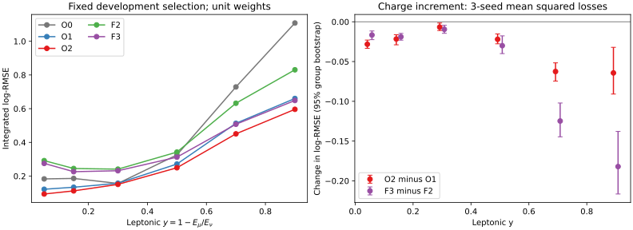
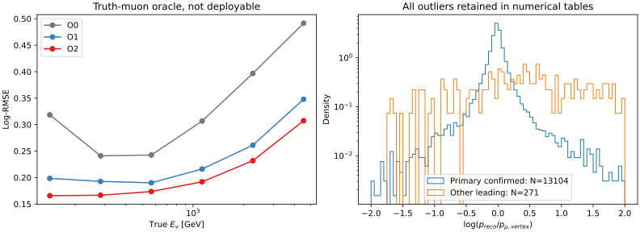

# 阶段15：primary μ 与非弹性度的物理分解

## 阶段目标与物理结论

检验阶段14的电子读出增益是否仅在修正 μ 动量重建错误，还是包含与
ν→μ 能量分配相关的信息。本阶段完成222文件真值核查、三个seed共9个隔离oracle
训练，并与阶段14相同容量、相同seed的部署模型F2/F3配对比较。

**在当前普通几何MC、原有选择及单位权重下，即使已知primary μ的真实产生动量、
方向、符号及交互顶点，计数和闪烁体电荷仍分别改善ν能量预测。新增电荷的macro
log-RMSE差为−0.028752，95%来源组配对区间[−0.035312, −0.022389]。
因此，修正μ动量重建错误不足以单独解释电荷增益；读出确有与leptonic能量分配
相关的条件信息。该结论在已确认primary的leading轨迹和μ响应良好子集中仍成立。**

电荷增益由FASERν box事件明确支持；铅块区域仍未测得明确改善。高非弹性度事件
中的误差改善较大，但绝对误差仍大。以上不将电荷解释为已校准的量热强子能量，
不分配强子shower、μ辐射等各自因果份额，不把真值oracle当作可部署模型。

另一个明确结论是程序语义限制：现有`truth_st1`动量**不能测量材料能损**，其模长
来自产生动量。已停止使用该分支进行能损分解，而非把接近零的差当作无材料损失。

## 输入、选择与物理量定义

沿用stage12的官方`d32b0ff3` merge / without-IFT、FASERNU-04、TI12MC04、
OFLCOND-FASER-06、s0014，六个nominal run
200082/200083/200089/200093/200094/200100。原有20项cut、最高pz leading定义、
truth fiducial及原index291缺失记录保持不变，没有移除错配或尾部事件。

- train：54,196 events / 91来源组；validation：13,375 / 22。
- 仅重新读取这两个分区对应的222个PHYS文件，共2,203,362 raw events；
  原选中键共67,571个。输入完整路径及文件级测量见
  [extraction_files.tsv](stage15_energy_ml/extraction_files.tsv)，冻结源清单为`ml/configs/files.tsv`。
- 真值诊断与已有缓存逐run/eventID连接；manifest_index逐值一致，ν标签、reco p及顶点
  交叉核对通过，压缩后所有字段读回一致。本次ν标签与stage14保存标签也逐值相等。
- calibration、locked test、SIBYLL challenge没有做模型评价或选择。
- 所有数值均为单位MC权重诊断。GenWeights=1不代表来源具有相同物理亮度；
  真实flux归一化、混合比例与物理加权结果仍未测量。

定义`y_lepton=1-E_mu(vertex)/E_nu`，不是中微子快度；
`transfer_energy=E_nu-E_mu(vertex)`单位GeV，是转移能量代理，不是探测器测得的
强子可见能量，也不包含目标静止质量的完整量热能量账本。

## primary识别、匹配与程序语义

[预注册](stage15_energy_ml/preregistered_protocol.md)和
[配置](../ml/configs/physics_decomposition.yaml)在新训练前写入。
从保存的前十个truth粒子中寻找符号正确、产生点与入射ν衰变点吻合的唯一μ，
逐坐标容差0.0001 mm；不假定固定索引或barcode。可获得重建匹配时，另要求
t_pdg/barcode等于候选、first-parent的PDG/barcode等于入射ν。
没有加truth-hit-ratio阈值。全部使用的truth及t_*向量逐文件验证长度；
不使用已知在筛选前填充的Track_hitSet/Track_nMeasurements进行索引配对。

| 核查 | train | validation |
|---|---:|---:|
| 选中事件/唯一primary候选 | 54,196 / 54,196 | 13,375 / 13,375 |
| 无候选/多候选 | 0 / 0 | 0 / 0 |
| leading身份及ν母粒子均确认 | 53,042（97.871%） | 13,104（97.974%） |
| 任意track可确认候选ν母粒子 | 53,176 | 13,131 |
| station1真值参考可用 | 53,758 | 13,264 |
| y超出[0,1] | 0 | 0 |
| 所用truth/t_*长度不一致 | 0 | 0 |

primary在保存列表的零基索引2/3/4/5，train分别452/3/53,658/83个，validation
112/2/13,249/12个。因此固定取index4会误读部分事件。未能通过任意track确认
母粒子的1,020/244个事件仍有唯一顶点/符号候选；这些不是“已经证明候选错误”。
oracle支持集恰为完整train/validation，没有因缺失真值缩小模型比较样本。

validation的271个非primary-confirmed leading中，匹配到π± 197、K± 36、p/反p 24、
Σ+ 1、其他μ 13个；13个μ不能按“是μ”就视为primary。详细见
[truth_order_and_species.tsv](stage15_energy_ml/truth_order_and_species.tsv)、
[other_leading_species.tsv](stage15_energy_ml/other_leading_species.tsv)。

**station动量语义审计：**固定官方源码`FiducialParticleTool::getMomentum`，
`p=hit.particleLink()->momentum().rho()`读取产生动量模长，方向由SiHit端点推算；
`getTruthMomenta`再平均station内向量。缺失参考为NaN。
validation的station1/vertex模长比中位数0.999999999980，最大偏离1仅
8.7678×10⁻⁶；这是源码构造及方向平均的结果，**不是材料能损接近零的物理证据**。
train最大偏离1为1.0328×10⁻⁴。出处、命令及训练前的方案修订见
[source_semantics.md](stage15_energy_ml/source_semantics.md)、
[station_reference_audit.tsv](stage15_energy_ml/station_reference_audit.tsv)。
实际材料能损与纯曲率拟合误差的独立分解：**未测量**，需输运时刻真实动量输出。

## 同输入分层的oracle实验

新增oracle输入只在`muon_oracle.py`明确隔离，不修改部署特征白名单：

| 模型 | 输入 | 维数 |
|---|---|---:|
| O0 | primary log(p/GeV)、px/pz、py/pz、PDG、真实交互x/y/z（mm） | 7 |
| O1 | O0 + 原7个station/事件计数 | 14 |
| O2 | O1 + 原13个闪烁体电荷（pC） | 27 |

均预测log(Eν/GeV)，squared error；seed20261029/30/31、depth5、最多1600轮、
早停100，lr0.04、subsample0.8、min_child_weight20、lambda10，其他设置与stage14相同。
九个模型实际训练439–1383轮，best_iteration为338–1282（零基），均已早停，
没有达到1600轮上限。O2既未输入reco μ动量，也未输入y或transfer-energy标签。

以下macro为六个预注册能量bin`[100,200,400,800,1600,3200,6400] GeV`等权
log-MSE平均后开根号；bin计数731/2455/4247/3933/1741/268。
表内指标无量纲，为三个单模型seed的均值[范围]，不是ensemble预测。

| 模型 | macro log-RMSE | 整体log-RMSE（三seed均方后开根号） |
|---|---:|---:|
| O0 | 0.344342 [0.344157, 0.344520] | 0.296463 |
| O1 | 0.241081 [0.240519, 0.241553] | 0.213311 |
| O2 | 0.212329 [0.212003, 0.212796] | 0.189490 |
| 已有deploy F2，depth5 | 0.422954 [0.421772, 0.423628] | 0.321647 |
| 已有deploy F3，depth5 | 0.379952 [0.379844, 0.380026] | 0.287483 |

统计方法：先对seed逐事件均方损失取平均，再做500次同来源组配对bootstrap。
所有模型用相同来源重采样，不平均预测以制造ensemble性能。

| macro对照 | Δ log-RMSE | 95%区间 |
|---|---:|---|
| O1−O0：计数 | −0.103261 | [−0.114097, −0.092779] |
| O2−O1：电荷 | −0.028752 | [−0.035312, −0.022389] |
| O2−O0 | −0.132013 | [−0.146737, −0.117851] |
| deploy F3−F2，stage14复用 | −0.043003 | [−0.051526, −0.033726] |

真实μ条件下电荷降低macro误差约11.93%。这提供了对“仅修正μ重建误差”的反证，
但有限容量模型的条件预测增益仍不等同严格的互信息或因果能量份额。
O2与F3使用不同的真实/重建输入，二者差不能直接解释成可实现的μ分辨率改进上限。

整体偏差、核心和尾部的三个单模型seed均值：

| 模型 | median相对偏差 | R68 | P(|r|>0.5) | P(|r|>1) |
|---|---:|---:|---:|---:|
| O0 | +7.173% | 0.206423 | 5.533% | 0.112% |
| O1 | +2.757% | 0.139057 | 3.178% | 0.192% |
| O2 | +2.380% | 0.121306 | 2.240% | 0.092% |
| deploy F2 | +5.527% | 0.253773 | 8.636% | 0.703% |
| deploy F3 | +3.840% | 0.228192 | 6.824% | 0.663% |

非线性偏差/分位数/尾率的专属bootstrap区间本阶段未测量，以上为描述值。
3200–6400 GeV的268个事件中，O2仍有−4.508%的median偏差、R68=0.163577、
P(|r|>0.5)=5.100%；不能只用整体指标宣称闭合。
原始数据见[macro_summary](stage15_energy_ml/macro_summary.tsv)、
[macro_gains](stage15_energy_ml/macro_gains.tsv)、[metrics](stage15_energy_ml/metrics.tsv)。

## 物理适用范围：匹配、区域与非弹性度

下表改用每个子集内的**整体**log-RMSE差，不能与macro差混用。
全部异常事件参与原训练和全样本指标；子集仅作诊断。
“响应良好”定义为primary已确认且`|p_reco/p_vertex−1|≤0.1`，是探索性分层，
不是新增选择，也不能仅凭此判定纯拟合误差小。

| 子集 | N | O2−O1 [95%区间] | deploy F3−F2 [95%区间] |
|---|---:|---|---|
| 全部 | 13,375 | −0.023821 [−0.026423, −0.020977] | −0.034164 [−0.037670, −0.030099] |
| primary已确认 | 13,104 | −0.025300 [−0.027723, −0.022802] | −0.033511 [−0.036427, −0.030138] |
| 其他leading | 271 | −0.001396 [−0.023625, +0.019781] | −0.057927 [−0.099728, −0.017696] |
| primary且响应良好 | 8,711 | −0.028085 [−0.031821, −0.024002] | −0.041624 [−0.046969, −0.036451] |
| FASERν box，z<−1950 mm | 12,747 | −0.024930 [−0.027510, −0.021909] | −0.035738 [−0.039411, −0.031523] |
| lead block，z≥−1950 mm | 628 | +0.008676 [−0.000682, +0.018176] | +0.003193 [−0.006754, +0.012502] |

增益显然不是仅由少数错选leading轨迹贡献。铅块子集的区间仍跨零，不因点估计
变差就终止该分支。box/lead的y中位数0.176687/0.106896，转移能量中位数
121.510/55.196 GeV；两区域谱、接受度及y支持不同，尚不能将差异归因为材料厚度。
六个run的O2−O1整体差均为负，区间均低于零（−0.018094至−0.038801）；
两个charm run各只有3个来源组，500次全来源重采样中477次有该run事件，
相应区间条件于这些非空抽样，统计外推能力有限。

| leptonic y | N | O2−O1 [95%区间] | deploy F3−F2 [95%区间] |
|---|---:|---|---|
| 0–0.1 | 4,349 | −0.028205 [−0.033315, −0.022995] | −0.016624 [−0.022434, −0.011495] |
| 0.1–0.2 | 3,050 | −0.021640 [−0.028902, −0.016276] | −0.018882 [−0.023066, −0.014587] |
| 0.2–0.4 | 3,486 | −0.006651 [−0.011006, −0.001531] | −0.009450 [−0.014461, −0.004427] |
| 0.4–0.6 | 1,579 | −0.021976 [−0.027640, −0.015295] | −0.029985 [−0.039982, −0.017696] |
| 0.6–0.8 | 643 | −0.062500 [−0.074574, −0.051592] | −0.124738 [−0.144630, −0.102120] |
| 0.8–1 | 268 | −0.064282 [−0.090884, −0.032103] | −0.182037 [−0.216535, −0.137841] |

高y的F3误差仍为0.648738（y≥0.8），O2为0.596277，不能把较大增益误读为已解决
高y重建。不同y区间也有不同能谱、错选比例与接受度；这些不是固定其他因素后的
y因果效应。真实μ条件下的改善支持leptonic能量分配关联，但尚不能区分强子活动、
μ辐射与其他选择相关机制的贡献。

尤其y≥0.8的268个选中事件中，只有99个leading确认是primary μ（36.94%），
远低于全样本97.97%的leading纯度；这是当前最高pz规则在高y区的具体限制，
不是整个选择的νμ探测效率。μ带走能量减少时强子轨迹可能胜过μ，结果与该机制
相容，但本阶段尚未比较替代leading策略。
探索性交叉分层中，primary已确认且y≥0.6的670例仍有O2−O1=−0.081579
[−0.099506,−0.065183]、deploy F3−F2=−0.163848[−0.185996,−0.141079]；
因此高y增益也不只来自错选轨迹。y≥0.8且已确认的99例O2−O1为−0.121573
[−0.168929,−0.069130]，但统计较少，绝对log-RMSE仍达0.750625。

用真实Eμ和各oracle输出构造`yhat=1-Eμ/Ehatν`（不截断），O0/O1/O2的
三seed平均y-MAE为0.129770/0.087316/0.075965，y-RMSE为
0.164324/0.120069/0.105042。O2有0.867%的负yhat描述率，说明点预测并未被强制
满足Ehat≥Eμ。这些是诊断而非已校准的可部署y测量。

完整分层：[stratified_gains](stage15_energy_ml/stratified_gains.tsv)、
[response_and_y](stage15_energy_ml/response_and_y.tsv)、
[y_reconstruction](stage15_energy_ml/y_reconstruction.tsv)。



## μ响应与能量分配宽度

validation的y中位数0.172053，16–84%区间[0.044057, 0.432892]；转移能量
中位数115.939 GeV。primary已确认子集的p_reco/p_vertex中位数0.983650，
16–84%区间[0.885354,1.089893]，2.5–97.5%区间[0.577115,1.749690]；
717/13,104个超出[0.5,1.5]，仍有宽尾。该响应同时包含物理传播、参考面差异和重建，
不能将其整体归为曲率拟合误差。

使用精确恒等式`log(Eν/p_reco)=A−B`，其中
`A=log(Eν/p_vertex)`，`B=log(p_reco/p_vertex)`，保留协方差：

| validation子集 | Var(A) | Var(B) | Cov(A,B) | Var(A−B) |
|---|---:|---:|---:|---:|
| 全部 | 0.184992 | 0.154587 | +0.050536 | 0.238508 |
| primary已确认 | 0.101530 | 0.107191 | −0.000580 | 0.209881 |
| 其他leading | 1.213715 | 1.941929 | +1.290548 | 0.574547 |

两项宽度在匹配子集中均不可忽略；全样本的正协方差又说明不能直接相加或分配
“百分之多少误差来源”。逐事件恒等式最大绝对残差8.88×10⁻¹⁶，方差闭合残差
最大4.44×10⁻¹⁶，排除了这项分解的数值/连接错误。
表见[log_variance_identity](stage15_energy_ml/log_variance_identity.tsv)。



## 执行、计时、存储与验证

新增纯Python诊断、隔离oracle、汇总与资源记录工具及两个Condor worker/sub文件；
没有修改C++或部署输入。LCG109、ROOT6.38、XGBoost2.1.3，BLAS/OMP固定1线程。

```bash
source AnalysisZipFramework/setup.sh
export OMP_NUM_THREADS=1 OPENBLAS_NUM_THREADS=1
python3 ml/extract_muon_truth.py --batch 0 --index 196 --output /tmp/nu_mu_primary_pilot.npz
tar -czf software/energy-ml-primary-stage15.tar.gz ml/extract_muon_truth.py \
  ml/configs/files.tsv ml/configs/physics_decomposition.yaml
condor_submit -name bigbird24.cern.ch AnalysisZipFramework/submission/ml_primary_extract.sub
python3 ml/prepare_muon_truth.py
python3 ml/muon_oracle.py --seed-index 0 --smoke --output-dir /tmp/nu_mu_stage15_smoke
tar -czf software/energy-ml-oracle-stage15.tar.gz ml/muon_oracle.py ml/train_bdt.py \
  ml/configs/baseline.yaml ml/configs/physics_decomposition.yaml ml/configs/files.tsv \
  ntuples/energy_ml_stage15/train_truth.npz ntuples/energy_ml_stage15/validation_truth.npz
condor_submit -name bigbird24.cern.ch AnalysisZipFramework/submission/ml_muon_oracle.sub
python3 ml/report_muon_physics.py
python3 ml/collect_physics_resources.py --extraction-cluster 1543317 --oracle-cluster 1543353
```

pilot完整10,000 raw事件文件，315选中事件：唯一primary315、leading母子确认311、
无向量对齐失败，wall1.150787 s、peak RSS126.098 MiB。
训练smoke为1200/400事件、20轮，覆盖O0/O1/O2，wall1.110797 s、CPU0.549804 s、
peak RSS652.105 MiB；不由smoke推断物理性能。小样本资源见
[extraction_pilot.json](stage15_energy_ml/extraction_pilot.json)、
[smoke_summary.json](stage15_energy_ml/smoke_summary.json)。

批量提取cluster1543317，19/19 exit0；训练cluster1543353，3/3 exit0。
均经bigbird24，1 CPU/job，提交RAM分别1200/1500 MB；站点实际各分配3000 MB。

| 实测资源 | 提取19作业 | oracle训练3作业 |
|---|---:|---:|
| 提交至最后完成 | 104 s | 218 s |
| Condor累计执行时间 | 432 s | 98 s |
| Condor累计remote CPU | 182 s | 84 s |
| /usr/bin/time累计wall | 396.96 s | 91.14 s |
| /usr/bin/time累计user+sys | 176.45 s | 84.15 s |
| /usr/bin/time最大RSS | 273,940 KiB | 284,632 KiB |

文件提取内部计时合计340.903 s，对应6,463.3 raw events/s、198.2 selected events/s
（总事件数除以各文件墙钟和，不是集群并发吞吐率）。诊断合并2.607 s、CPU1.899 s、
peak RSS233.457 MiB。oracle脚本合计wall80.524 s、CPU77.577 s、最大RSS277.961 MiB。
seed0的O2训练14.387 s/14.108 CPU s；13,375事件推理五次中位数0.330716 s，
40,442.5 events/s，模型3,340,038 bytes。GPU成本未测量，本阶段BDT未使用GPU。
详见[costs](stage15_energy_ml/costs.tsv)、
[Condor资源](stage15_energy_ml/condor_resources.tsv)、
[资源汇总](stage15_energy_ml/condor_summary.json)；报告汇总独立资源在summary.json。

EOS FUSE对已完成oracle0的stderr出现过目录列出但本地读取ENOENT；经
`xrdfs stat`和`xrdcp`读回71-byte原始日志后，使用collector的`--log-dir`指向本地
小日志副本完成测量。没有重训或估算该作业资源，日志仍保留在原EOS目录。

最终紧凑真值缓存`ntuples/energy_ml_stage15/{train,validation}_truth.npz`共
10,018,750 bytes；`ml/artifacts/stage15/`的三seed预测与seed0必要模型共
7,704,890 bytes，均不入Git。各字段读回验收后移除19份重复提取shard和含缓存的
传输tar包；不保存ROOT/xAOD中间产物。TSV、SVG、配置和汇总JSON随本报告入Git。
三个seed重复的完整配置合并为一份training_config.json，保留各seed独立计时与学习曲线。
科学图已转PNG目视检查；Python编译、shell语法、Git diff检查及真值白名单检查通过。

## 限制与下一步验收计划

训练/早停已接触validation，bootstrap仅描述给定模型的来源组统计波动，
不是独立test泛化区间。多重分层未校正；尤其少来源组/少统计的结论不作强外推。
本阶段仅一套GENIE/探测器模拟，不能证明data、interaction或shower系统稳健性。
真实flux权重、data响应校准、模型外推与最终能谱闭合收益均未测量。

1. **恢复物理权重。** 输入为六run的正式生产归一化、目标/相互作用与flux元数据；
   追溯实际生产使用值，不能拿GenWeights=1或GenieReader默认值替代。
   验收：来源级Σw/Σw²/Neff和能谱可复核，按run/组分重算F2/F3增益、偏差与尾部；
   缺失项明确列出，不以未知比例声称物理平均分辨率。
2. **固定输入比较强表格NN。** 输入为stage12冻结缓存，优先F3及F5两套共同输入，
   train/validation来源组不变；真值oracle一律隔离。实施MLP/表格ResNet/TabM，
   相同log损失、trial上限、早停规则、三个seed及实测CPU/GPU时间预算，
   大训练经GPU HTCondor。验收须同时报告能量/y/box-lead分层的精度、偏差、尾部和
   成本；物理问题是更强表格表示能否改善高y响应，不能只报告单一平均指标。
3. **空间信息按先易后难推进。** 使用同一选择的SpacePoint/track/segment，先按
   已核实几何构造station矩并与计数对照，再Deep Sets；需证明超出总计数的信息增益，
   才进入GNN/Transformer。同输入同划分，并报告对象数、I/O及GPU显存实测。
4. **保留系统与闭合主线。** 需要训练谱、GENIE/Geant4变体和匹配data控制区；
   先逐项测响应差，最终以独立响应MC比较能谱偏差和总不确定度。铅块分支继续保留，
   下一次先做共同y/能量支持诊断，不由628个事件的零结果推断材料因果效应。
