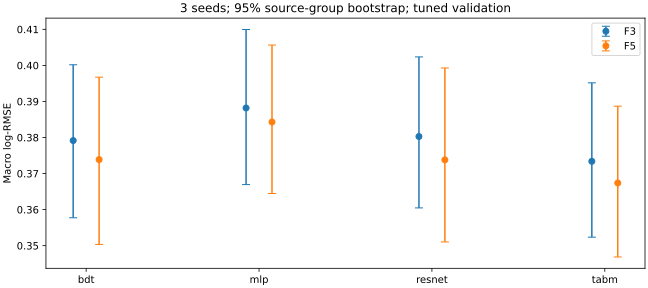
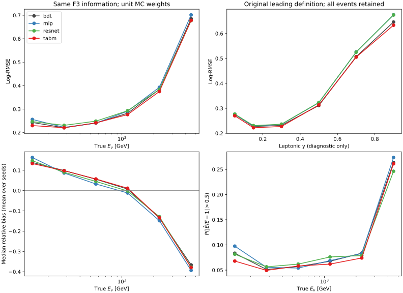

# 阶段16：同输入表格模型与高非弹性度响应

## 阶段目标

阶段15已经证明，闪烁体电荷的增益不能仅由修正μ动量重建错误解释。
本阶段检验：在相同电子读出信息和选择下，更强表格表示是否改善ν能量响应，
特别是高leptonic y事件的误差、偏差和尾部；同时继续追溯正式物理归一化。
模型复杂度本身不是物理收益，不能只报告平均排名。

## 有效物理结论与模型结果

**在冻结的单位权重MC样本中，TabM提取了BDT之外的小幅但稳定总体增益：F5的
macro log-RMSE由0.373879降至0.367379，配对差−0.006500，95%来源组区间
[−0.012371,−0.001845]；P(|r|>0.5)由6.672%降至6.268%。
改善主要由低/中y区域支持，在primary已确认的高y区尚未测得明确改善。
更强表格表示改善了总体响应，但高y及最高能量区仍是明确的物理重建难点。**

普通MLP的macro误差在本次两套输入/预算下均劣于BDT；ResNet未显示明确macro
改善。TabM保留为精度候选，BDT保留为成本与物理控制基线。没有据此宣布架构
全局最优或把高y余下误差归因于单一机制。

表内macro为三seed逐事件均方损失平均后开根号，括号是单seed范围；
整体log-RMSE保留原选中样本的能谱权重，单位均为无量纲。

| 架构 | F3 macro（单seed范围） | F5 macro（单seed范围） | F5整体log-RMSE |
|---|---:|---:|---:|
| bdt | 0.379149 [0.378977,0.379361] | 0.373879 [0.373241,0.374376] | 0.283253 |
| mlp | 0.388187 [0.383196,0.395313] | 0.384301 [0.382447,0.385728] | 0.289563 |
| resnet | 0.380272 [0.377414,0.385183] | 0.373799 [0.371308,0.378152] | 0.290650 |
| tabm | 0.373392 [0.371645,0.376571] | 0.367379 [0.364036,0.369211] | 0.280664 |

| 同输入对照 | Δ macro log-RMSE | 95%配对区间 |
|---|---:|---|
| mlp_F3 − bdt_F3 | +0.009038 | [+0.005283,+0.012973] |
| resnet_F3 − bdt_F3 | +0.001123 | [-0.003990,+0.005856] |
| tabm_F3 − bdt_F3 | -0.005757 | [-0.011064,-0.001682] |
| mlp_F5 − bdt_F5 | +0.010422 | [+0.004188,+0.016423] |
| resnet_F5 − bdt_F5 | -0.000080 | [-0.007486,+0.009024] |
| tabm_F5 − bdt_F5 | -0.006500 | [-0.012371,-0.001845] |

F5−F3的macro增量在BDT/MLP/ResNet/TabM依次为−0.005271/−0.003886/
−0.006473/−0.006014，配对区间均低于零；TabM为[−0.008167,−0.003752]。
这比较的是各输入在相同预算下各自选参的完整模型族，包含配置选择变化；
不是固定同一组超参的纯变量消融，也不能区分Calo与全局空间矩的独立贡献。
阶段14的去组消融仍是这两组独立信息的依据。

新BDT与阶段14原始输入/CPU depth5基线的macro差，F3为−0.000802
[−0.001879,+0.000336]，F5为−0.000576[−0.002439,+0.001070]，均跨零。
因此TabM相对新BDT的小幅改善有相近性能的既有基线作参照；这项对照不能单独
归因于asinh，因为CUDA算法、容量选择与预处理共同变化。

F5的描述性偏差、核心宽度与尾率（单模型指标的三seed均值）：

| 架构 | median(r) | R68 | P(|r|>0.5) | P(|r|>1) |
|---|---:|---:|---:|---:|
| bdt | +3.609% | 0.222592 | 6.672% | 0.618% |
| mlp | +3.476% | 0.233070 | 7.118% | 0.633% |
| resnet | +2.314% | 0.227996 | 6.943% | 0.713% |
| tabm | +3.490% | 0.220459 | 6.268% | 0.643% |

TabM F5相对BDT F5的整体log-RMSE差为−0.002589
[−0.003976,−0.001166]；0.5尾率差为**−0.4037个百分点**
[−0.6507,−0.2147]。更极端的1.0尾率差为+0.0249个百分点
[−0.0456,+0.1010]，尚无明确变化，不能把0.5尾率改善推广到所有尾部。
整体mean偏差差为−0.1692个百分点[−0.3196,−0.0368]。
完整表见[macro_summary](stage16_energy_ml/macro_summary.tsv)、
[macro_gains](stage16_energy_ml/macro_gains.tsv)、[metrics](stage16_energy_ml/metrics.tsv)。



各模型总区间高度相关，应根据配对差值表判断差异，不能仅看总区间是否重叠。

## 增益来自哪些物理区域

以下为**子集内整体**log-RMSE差TabM F5−BDT F5，不能与macro差混用。

| 子集 | N | BDT → TabM | Δ及95%来源组区间 |
|---|---:|---:|---|
| matching: primary_confirmed | 13104 | 0.276245 → 0.274037 | -0.002207 [-0.003642,-0.000700] |
| matching: other_leading | 271 | 0.519466 → 0.506468 | -0.012998 [-0.020525,-0.006675] |
| truth_region: FASERnu_box | 12747 | 0.284579 → 0.282170 | -0.002409 [-0.003948,-0.000921] |
| truth_region: lead_block | 628 | 0.254855 → 0.248124 | -0.006732 [-0.014351,+0.001257] |
| y_lepton: 0_0.1 | 4349 | 0.272946 → 0.268708 | -0.004238 [-0.007867,-0.000098] |
| y_lepton: 0.1_0.2 | 3050 | 0.224727 → 0.220519 | -0.004208 [-0.006919,-0.001854] |
| y_lepton: 0.2_0.4 | 3486 | 0.228564 → 0.224112 | -0.004452 [-0.006771,-0.002443] |
| y_lepton: 0.4_0.6 | 1579 | 0.306425 → 0.309344 | +0.002919 [-0.000268,+0.006795] |
| y_lepton: 0.6_0.8 | 643 | 0.496468 → 0.501117 | +0.004649 [-0.001937,+0.010030] |
| y_lepton: 0.8_1 | 268 | 0.629542 → 0.621702 | -0.007839 [-0.022062,+0.005592] |
| y_primary_confirmed: ge_0.6 | 670 | 0.562807 → 0.567790 | +0.004983 [-0.001937,+0.010351] |
| y_primary_confirmed: ge_0.8 | 99 | 0.820059 → 0.815195 | -0.004864 [-0.027657,+0.018972] |

primary已确认的13,104例仍有整体增益，因此不是仅由271个其他leading事件造成。
box增益明确；lead-block 628例的区间仍跨零。六个run的结果见完整分层表，
少来源组的bootstrap支持有限，不将混合样本的排序推广到所有物理组成。

低/中y的0–0.4各bin均测得整体误差改善；y≥0.4未测得明确改善。
primary已确认且y≥0.6的670例中，F5点估计略差，区间跨零；y≥0.8的99例
也没有明确改善，绝对log-RMSE仍0.815195。
阶段15测得全样本leading纯度97.97%，但y≥0.8时仅99/268=36.94%；
本次跨架构结果说明仅靠更强汇总表格表示尚未解决这个区域的响应困难。
不能据此断言不存在可学习信息：尚未测试完整轨迹候选、局部拓扑或更大调参空间。

探索性μ响应分层沿用primary且|p_reco/p_vertex−1|≤0.1的8,711例定义。
F3的TabM−BDT整体差为−0.001889[−0.003328,−0.000493]；
F5误差差−0.001398[−0.002880,+0.000091]，而0.5尾率差−0.4133个百分点
[−0.6041,−0.2109]。μ响应较好子集也有可见的尾部改善，但这不是纯拟合误差分解。

**最高能量bin仍有显著负响应。** 3200–6400 GeV的268例中，
BDT/TabM F5的median偏差为−36.598%/−37.064%，R68为0.195708/0.186955，
0.5尾率为26.617%/25.124%。整体log-RMSE差−0.012681
[−0.029563,+0.003058]，该bin尚无明确误差改善。
总体精度或正的全样本median偏差不能替代逐能量闭合。
阶段14已实测训练谱改变会产生偏差/尾部取舍；本阶段未单独分解高能欠响应中
训练先验、μ响应与未用空间信息的份额，后续以这些独立实验因素检验。

数据见[stratified_gains](stage16_energy_ml/stratified_gains.tsv)、
[learning_endpoints](stage16_energy_ml/learning_endpoints.tsv)。



## 实测预算与成本

正式GPU Condor cluster1543473，8/8 jobs exit0，40 fits；均实际使用
NVIDIA A100-PCIE-40GB，1 CPU+1 GPU、3000 MB RAM/job。
39次拟合早停，1次未选中的BDT F5 depth3候选达到2400轮；
全部24个最终seed拟合均早停，无180s墙钟触顶。
最终配置：BDT F3 depth5、F5 depth7；MLP F3选trial2、F5选trial0；
ResNet两输入均trial2；TabM两输入均trial1（width256、3blocks、dropout0.1、lr0.0005）。

提交至最后完成1176 s，Condor累计GPU分配1070 s（0.2972 GPU-hours）；
不是GPU活跃运算时长。累计remote CPU927 s；外部time wall1045.44 s、
user+sys919.14 s、peak RSS1,331,756 KiB。
脚本内部wall916.303 s、CPU846.824 s；拟合计时合计802.645 s，
最大worker RSS1272.793 MiB。报告聚合单独计时见summary.json。

小样本4架构均为F3、1200/400事件，NN2epochs、BDT20轮，通过全部路径；
wall及RSS详见[smoke_summary](stage16_energy_ml/smoke_summary.json)，不用于物理比较。
首次排队cluster1543471在执行前撤回，用于修正BDT预测缓存计时，未混入其预测或资源。
正式payload源码/依赖已直接读回核对，避免依赖变化。

下表F5训练成本含3个调参trial+2个额外seed；推理统一在本地T4，2,048事件，
GPU batch2048、CPU1线程，预热后6次中位数，排除预处理及host/device传输。

| 架构 | A100训练wall合计(s) | T4推理(events/s) | CPU推理(events/s) | checkpoint(MB) |
|---|---:|---:|---:|---:|
| bdt | 18.823 | 249,203 | 56,458 | 3.834 |
| mlp | 31.629 | 5,031,737 | 208,166 | 0.188 |
| resnet | 41.124 | 2,053,599 | 35,924 | 1.120 |
| tabm | 325.793 | 119,721 | 860 | 1.682 |

在此FP32、未compile实现下，TabM F5相对BDT的大batch T4推理约慢2.08倍，
CPU约慢65.6倍；调参+重复训练wall约17.3倍。MLP/ResNet在GPU上吞吐较高，
但本次准确度/尾部取舍与TabM不同。此成本不是优化后架构极限；AMP/编译等未测量。
预处理另测约2.2–4.5 ms/2048事件，对快速NN已经不可忽略；完整ROOT分析端到端吞吐未测量。

NN最大Torch allocator显存608.787 MiB；BDT此口径未测量。
Condor仅一个作业给出1228 MB GPU内存观测，其他作业未测得，不能用稀疏观测
替代完整GPU峰值。8个checkpoint均在T4读回通过，最大相对预测差5.49×10⁻⁷，
远小于本次物理指标变化。Python编译、shell语法及科学图渲染目视检查通过。

资源与验证：[all_costs](stage16_energy_ml/all_costs.tsv)、
[selected_fits](stage16_energy_ml/selected_fits.tsv)、
[condor_resources](stage16_energy_ml/condor_resources.tsv)、
[condor_summary](stage16_energy_ml/condor_summary.json)、
[共同设备推理](stage16_energy_ml/common_device_inference.tsv)、
[checkpoint核对](stage16_energy_ml/checkpoint_readback.tsv)。

最终模型/预处理/预测共15,777,023 bytes，位于ml/artifacts/stage16/并排除Git；
没有新增ROOT/xAOD或逐事件缓存。合并8份重复训练配置，只保留一份公共配置；
保留必要的独立学习曲线与资源测量。传输tar及重复解包依赖在验证后清理，
30,640 bytes的固定版本依赖wheel保留供复现；本次清理359,130 bytes。


## 输入、物理边界与归一化核查

沿用stage12官方`d32b0ff3` merge / without-IFT、FASERNU-04、TI12MC04、
OFLCOND-FASER-06、s0014，六个nominal run
200082/200083/200089/200093/200094/200100。原20项cut、最高pz leading、
truth fiducial及原index291缺失记录均保持不变。
train54,196 events/91来源组，validation13,375/22；所有异常事件保留。
calibration、locked test及SIBYLL challenge未做模型评价或选择。

本阶段不新增逐事件输入缓存，训练一次读取原紧凑NPZ并在同一进程复用各trial。
真值μ、顶点、母子匹配及`y_lepton=1-E_mu(vertex)/E_nu`只用于训练后分层，
不是部署输入。y不是中微子快度；高y子集不能直接代表相同能谱/接受度条件。

**完整EVNT元数据核查得到实际缺口，而非凭文件名猜权重。**
用匹配的现成Athena24.0.41/Calypso环境及`PyUtils.MetaReader(mode='full')`
读出六个实际输入EVNT的完整元数据，wall44.651 s；读取MetaData第0条、
文件entries及分支目录，没有评价EVNT事件payload/能量标签。

| run | EVNT events | FileMetaData run/lumiblock | TagInfo | stream weights |
|---|---:|---|---|---|
| 200082 | 559,607 | [0] / [0] | 空 | [1.0] |
| 200083 | 752,808 | [0] / [0] | 空 | [1.0] |
| 200089 | 180,947 | [0] / [0] | 空 | [1.0] |
| 200093 | 541,884 | [0] / [0] | 空 | [1.0] |
| 200094 | 738,614 | [0] / [0] | 空 | [1.0] |
| 200100 | 170,343 | [0] / [0] | 空 | [1.0] |

合计2,944,203 events，较冻结nominal raw样本2,934,203多10,000，
与保留原共同缺失文件的处理一致；这只是来源条目核对，不是亮度归一化。
六份FileMetaData的productionRelease均为空，未查得可验证的积分亮度、
flux归一化或生成接受度。相邻`22_23_crossing_angle_distribution_100_iab`
属于另一批文件，未据其名字向当前输入赋权。

元数据eventTypes的bit_mask为空，MetaReader据此显示IS_DATA；该默认元数据标签
不能覆盖已确认的MC生成来源，更不能用作权重。当前样本选择未依赖该EVNT标签。
GenieReader源码显式写入单位HepMC权重，转换未留下足以恢复归一化的记录。
这不代表生成端没有正式权重；需要原gFaser/GENIE生成清单、亮度及取样接受度记录。
因此本阶段仍只给**单位MC权重、固定所选样本**的模型/物理响应结论，
不能声称真实flux平均分辨率或最终截面测量收益。
用户确认在本仓库及来源路径未找到正式归一化时，继续采用当前默认单位权重。

原始输入与元数据见[normalization_audit.tsv](stage16_energy_ml/normalization_audit.tsv)、
[evnt_metadata_full.json](stage16_energy_ml/evnt_metadata_full.json)、
[normalization_summary.json](stage16_energy_ml/normalization_summary.json)。
原先uproot对自定义持久类反序列化失败；切换匹配的Athena读取器后已成功，
没有把读取失败误当作元数据不存在。

## 固定信息、目标和调参预算

[预注册](stage16_energy_ml/preregistered_protocol.md)、
[tabular.yaml](../ml/configs/tabular.yaml)在新全量训练结果出现前写入。

- F3：原μ动量/context、7个station/事件计数、13个闪烁体电荷，共37个原始变量。
- F5：F3加5个常规Calo变量和4个全局SpacePoint矩，共46个原始变量。
  F5不是空间点集合，不包含station拓扑。F5−F3不能单独归因于Calo。
- 所有架构使用相同信息与预处理：仅从train拟合每列median(|x|)尺度，
  asinh变换、train中位数填充、train均值/标准差归一化，并显式附加缺失标识。
  共74/92维；不截断有限离群值、不删事件、不从validation拟合变换。
- 目标统一为train标准化的log(Eν/GeV)，等价于原log-MSE相差一个固定尺度。
  无额外平坦谱、Huber目标、残差目标或真值下限约束。
- 每架构/输入3个seed0 trial，按validation整体log-MSE选择配置，再固定配置
  重复seed1/2。三个seed为20261029/30/31；8个模型族/输入组合，共40次拟合。
  没有用y/匹配分层结果调参。共同trial上限不等于共同FLOPs或实际资源用量。
- 每fit训练墙钟上限180 s；NN最多250epochs、早停25epochs、batch1024，AdamW；
  BDT早停100轮。真实计时与触顶情况必须一起解释结果。

| 模型 | 3个trial的主要设置 |
|---|---|
| BDT | depth3/2400轮、depth5/1600轮、depth7/1200轮；lr0.04、subsample0.8、min_child_weight20、lambda10、CUDA hist |
| MLP | width128/256/128，blocks3/3/4，dropout0.1/0.1/0.2，lr0.001/0.0005/0.001，wd0.0001/0.0001/0.001 |
| 表格ResNet | 相同width/blocks/dropout/lr/wd候选；PreNorm LayerNorm、两层线性、ReLU/dropout残差块 |
| TabM | 作者tabm0.0.3；相同width/blocks等候选，32个内部共享参数成员，LinearReLU数值embedding维8 |

TabM训练对每个内部成员分别计算目标损失，预测取log输出的内部平均；
这是TabM架构的组成部分。独立seed预测不做ensemble平均，主统计使用seed均方损失。
本阶段没有穷尽NN超参数或证明架构达到最佳性能。
学习曲线中NN的train loss是dropout-on在线epoch平均，不能与eval-mode validation
直接当成严格泛化gap；最佳checkpoint的完整train eval-mode误差未测量。

## 统计方法与验证

主统计为六预注册能量bin`[100,200,400,800,1600,3200,6400] GeV`等权
log-MSE平均后开根号，bin计数731/2455/4247/3933/1741/268。
对每事件的三个seed损失取平均，再做500次同来源组配对bootstrap；
子集内整体log-RMSE、尾率P(|Ehat/E−1|>0.5)及mean相对偏差也使用配对来源抽样。
R68和median偏差报告单模型seed描述均值，其专属bootstrap区间未测量。
全部模型已接触validation进行早停/选参，区间条件于这些拟合，不能作为独立test保证。
多重分层未作family-wise校正，少来源组/小样本结果谨慎解释。

逐模型run/eventID、真值标签与来源group对齐；特征白名单排除truth、run/eventID等输入。
最终checkpoint在本地T4用2,048个验证前缀事件读回，与远端保存seed0预测逐事件核对，
不做重训或校准。推理计时排除host/device传输，先warmup再重复测量；BDT使用
GPU-resident CuPy及inplace_predict，避免DMatrix预测缓存。CPU对照固定1线程。

最终一致性复核直接从保存的三seed预测重算8个模型的macro、整体log-RMSE及
两种尾率，与汇总表一致；核对40次拟合/24次选中拟合、逐事件标签与来源组、
配置与输入白名单、统计表唯一键及本地文档链接，全部通过，wall0.604 s。
记录见[validation_summary.json](stage16_energy_ml/validation_summary.json)。

## 执行与产物

批量训练通过GPU HTCondor；本地T4仅做小样本与checkpoint/推理复核。
LCG_109_cuda、x86_64-el9-gcc13-opt、PyTorch2.10.0、CUDA12.5、XGBoost2.1.3；
BLAS/OMP固定1，关闭TF32，不使用AMP或torch.compile。
依赖[requirements-tabular.txt](../ml/requirements-tabular.txt)固定tabm0.0.3及
rtdl_num_embeddings0.0.12，复用CVMFS的PyTorch/CuPy，没有安装重复GPU框架。

```bash
source /cvmfs/sft.cern.ch/lcg/views/LCG_109_cuda/x86_64-el9-gcc13-opt/setup.sh
export OMP_NUM_THREADS=1 OPENBLAS_NUM_THREADS=1 PYTHONNOUSERSITE=1
# 依赖wheel下载、解包到software/energy_ml_tabular_packages，worker无须联网安装
python3 -m pip download --no-deps --dest software/energy_ml_tabular_deps \
  tabm==0.0.3 rtdl_num_embeddings==0.0.12
python3 - <<'PY'
from pathlib import Path
from zipfile import ZipFile
destination = Path('software/energy_ml_tabular_packages')
destination.mkdir(parents=True, exist_ok=True)
for wheel in Path('software/energy_ml_tabular_deps').glob('*.whl'):
    with ZipFile(wheel) as archive:
        archive.extractall(destination)
PY
export PYTHONPATH="$PWD/software/energy_ml_tabular_packages${PYTHONPATH:+:$PYTHONPATH}"
for arch in bdt mlp resnet tabm; do
  python3 ml/train_tabular.py --architecture "$arch" --version F3 --smoke \
    --output-dir "/tmp/nu_mu_stage16_smoke_$arch"
done
tar --exclude=__pycache__ -czf software/energy-ml-tabular-stage16-v2.tar.gz \
  ml/train_tabular.py ml/train_bdt.py ml/configs/baseline.yaml ml/configs/tabular.yaml \
  ml/configs/files.tsv software/energy_ml_tabular_packages
condor_submit -name bigbird24.cern.ch AnalysisZipFramework/submission/ml_tabular.sub
python3 ml/report_tabular.py
python3 ml/benchmark_tabular.py
python3 ml/collect_tabular_resources.py --cluster 1543473 --log-dir /tmp/nu_mu_stage16_logs
```

资源统计实际先用xrdcp将`logs/ml_tabular_1543473.log`与八个`.err`读至
`/tmp/nu_mu_stage16_logs/`，避免EOS挂载缓存影响刚完成作业的日志读取；
默认省略`--log-dir`则直接读取仓库`logs/`。复跑时应使用新提交返回的cluster ID，
而非覆盖本次记录。缓存与软件传输包的清理量见
[storage_cleanup.json](stage16_energy_ml/storage_cleanup.json)。

完整元数据读取使用另一现成环境，不与CUDA环境混用：

```bash
source /cvmfs/sft.cern.ch/lcg/contrib/gcc/13.1.0/x86_64-el9/setup.sh
source /cvmfs/atlas.cern.ch/repo/sw/software/24.0/Athena/24.0.41/InstallArea/x86_64-el9-gcc13-opt/setup.sh
source ../calypso/build/x86_64-el9-gcc13-opt/setup.sh
python3 ml/audit_evnt_metadata.py
```

训练读取原stage12紧凑缓存；模型、预处理参数和预测位于`ml/artifacts/stage16/`，
不入Git、不保存ROOT/xAOD。仅保留seed0最终checkpoint及三seed验证预测；
学习曲线、实际计时、聚合TSV/SVG及配置随报告提交。重复配置合并为一份training_config.json。

## 引用及可行性

- [TabM论文](https://arxiv.org/abs/2410.24210)、[作者实现](https://github.com/yandex-research/tabm)：
  main实查28e47ae301c92ec37787dde1ce923a0793f405b4，2025-11-10；
  实际依赖为PyPI0.0.3，采用作者建议的数值embedding和独立成员训练损失。
  它对当前紧凑电子读出可直接运行，不需要虚构逐hit能量。
- [Revisiting Deep Learning Models for Tabular Data](https://arxiv.org/abs/2106.11959)：
  支持MLP/表格残差网络作为必要对照；这里使用明确列出的LayerNorm实现和预算，
  不声称复现论文全部benchmark或默认调参结果。
- [CERN GPU提交说明](https://batchdocs.web.cern.ch/gpu/index.html)：
  使用request_gpus=1及能力/显存下限，未为排队限定GPU型号；实际硬件单独记录。

## 下一步计划与验收

1. 对已确定的最佳表格候选冻结输入、预处理、目标与seed路由。正式权重需要
   原gFaser/GENIE生成清单、积分亮度、flux及取样接受度；恢复后必须重算Σw/Σw²/Neff、
   能量/y/来源分层收益，不能直接将本阶段单位权重排名当成物理平均排名。
2. 按已核实几何提取station内SpacePoint矩及相对leading的位置，固定BDT配置做
   计数vs空间分布消融；输入仍为同一批事件，先用小样本验收对齐和I/O，再Condor批量。
   验收标准：计数以外的配对增益、偏差/尾率及成本有证据，不能只用新增参数解释改善。
3. 同对象集合比较计数池化、Deep Sets及去空间关联对照。只有空间关系增益保留后
   才进入GNN/Transformer；保持calibration/test/challenge隔离。
4. 高y的最高pz leading限制继续单独研究：需要对齐的完整track/segment及真实μ匹配
   诊断，比较可部署候选选择策略与原定义的共同通过/完整选择集合。不得删掉少量
   高y或错配事件来制造回归改善，最终仍需独立MC响应与data控制区闭合。
