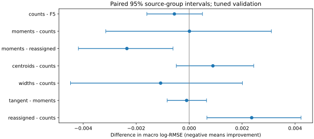
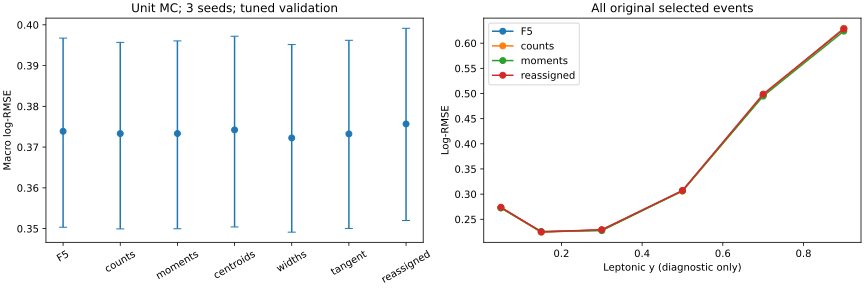

# 阶段18：计数之外的station空间信息

## 阶段目标与有效结论

检验横向SpacePoint分布与station位置的关联，在已知原F5和逐层占有率后，
是否仍改善ν能量重建。阶段16已经比较强表格网络，本阶段固定BDT配置，
先区分新增对象信息与表示能力，为Deep Sets确定必要对照。

**本次测量未发现预注册station空间矩超出已有F5及逐层计数的明确总体收益。**
counts与moments的macro log-RMSE分别为0.373321与0.373332，配对差
+0.000011，95%来源组区间[−0.003151,+0.003107]。
整体log-RMSE差−0.000368[−0.001191,+0.000479]，0.5/1.0尾率差也均跨零。
这是当前样本、输入表示和固定BDT预算下的结果，不是证明完整空间集合没有信息。

**随机关联对照揭示一个必须避免的误判。** moments优于reassigned的macro差
−0.002351[−0.004182,−0.000610]；但reassigned本身劣于counts，
差+0.002362[+0.000670,+0.004225]。因此“真实矩优于打乱矩”在本次不能
单独证明新增信息：引入随机矩会损害有限样本模型，而真实矩只回到计数基线附近。

| 模型 | macro log-RMSE（单seed范围） | 整体log-RMSE |
|---|---:|---:|
| F5 | 0.373879 [0.373241,0.374376] | 0.283253 |
| counts | 0.373321 [0.372810,0.373792] | 0.283077 |
| moments | 0.373332 [0.373005,0.373939] | 0.282708 |
| centroids | 0.374218 [0.373961,0.374652] | 0.282945 |
| widths | 0.372245 [0.371966,0.372769] | 0.282387 |
| tangent | 0.373237 [0.372781,0.373805] | 0.282411 |
| reassigned | 0.375682 [0.375497,0.375852] | 0.283968 |

| 配对比较 | Δ macro log-RMSE | 95%来源组区间 |
|---|---:|---|
| counts − F5 | -0.000558 | [-0.001598,+0.000503] |
| moments − counts | +0.000011 | [-0.003151,+0.003107] |
| moments − reassigned | -0.002351 | [-0.004182,-0.000610] |
| centroids − counts | +0.000897 | [-0.000484,+0.002440] |
| widths − counts | -0.001076 | [-0.004480,+0.002013] |
| tangent − moments | -0.000094 | [-0.000830,+0.000657] |
| reassigned − counts | +0.002362 | [+0.000670,+0.004225] |

逐层点数相对F5没有明确独立增益；质心、宽度/协方差及切线交互的宏观配对区间
也均跨零。widths点估计最好（0.372245），但这是预注册分解中的点估计排序，
没有据此改选主结论或宣称宽度已有效。主比较的不确定度约0.003，尚未完成
有预设容差的等效性检验，不能把跨零说成严格相等。



上图是配对差值，适于判断本阶段增益；下图各模型总误差区间高度相关，不能只凭
总区间重叠与否判断差异。完整表见[macro_summary](stage18_energy_ml/macro_summary.tsv)、
[macro_gains](stage18_energy_ml/macro_gains.tsv)。



### 偏差、尾部与物理区域

下表为每个模型指标的三seed描述均值；R68及median偏差本身未测bootstrap区间。

| 模型 | median(r) | R68 | P(绝对r>0.5) | P(绝对r>1) |
|---|---:|---:|---:|---:|
| F5 | +3.609% | 0.222592 | 6.672% | 0.618% |
| counts | +3.595% | 0.223325 | 6.584% | 0.653% |
| moments | +3.488% | 0.221812 | 6.614% | 0.636% |
| widths | +3.598% | 0.221569 | 6.619% | 0.675% |
| tangent | +3.546% | 0.221483 | 6.617% | 0.636% |
| reassigned | +3.658% | 0.223482 | 6.574% | 0.648% |

moments−counts的0.5尾率差+0.0299个百分点[−0.1204,+0.1606]，
1.0尾率差−0.0174个百分点[−0.0532,+0.0319]，均没有明确变化。

以下是子集内整体log-RMSE，不能与macro指标混用：

| 子集 | N | counts → moments | Δ及95%来源组区间 |
|---|---:|---:|---|
| matching: primary_confirmed | 13104 | 0.276119 → 0.275887 | -0.000232 [-0.001069,+0.000566] |
| matching: other_leading | 271 | 0.517946 → 0.513976 | -0.003971 [-0.011514,+0.003680] |
| truth_region: FASERnu_box | 12747 | 0.284446 → 0.284158 | -0.000289 [-0.001126,+0.000545] |
| truth_region: lead_block | 628 | 0.253687 → 0.251496 | -0.002192 [-0.005606,+0.001787] |
| y_lepton: 0_0.1 | 4349 | 0.272719 → 0.272559 | -0.000160 [-0.001789,+0.001539] |
| y_lepton: 0.1_0.2 | 3050 | 0.224389 → 0.225800 | +0.001411 [-0.000099,+0.002728] |
| y_lepton: 0.2_0.4 | 3486 | 0.228878 → 0.227329 | -0.001549 [-0.003460,+0.000220] |
| y_lepton: 0.4_0.6 | 1579 | 0.306006 → 0.306699 | +0.000693 [-0.000984,+0.002231] |
| y_lepton: 0.6_0.8 | 643 | 0.495951 → 0.494757 | -0.001194 [-0.005609,+0.002904] |
| y_lepton: 0.8_1 | 268 | 0.629244 → 0.623909 | -0.005336 [-0.011253,+0.000780] |
| y_primary_confirmed: ge_0.6 | 670 | 0.562541 → 0.560116 | -0.002424 [-0.006430,+0.000690] |
| y_primary_confirmed: ge_0.8 | 99 | 0.817455 → 0.807898 | -0.009557 [-0.022727,+0.002054] |

primary已确认的高y子集有较好的点估计，但仍未测得明确改善，不能据99个y≥0.8
事件停止空间集合分析，也不能把其残余误差归结为单一机制。
box与lead-block也均没有明确moments−counts增益。
六run中200100的539例出现整体误差差−0.002356[−0.003687,−0.000666]，
但只含3个来源组、500次抽样中477次有效，且未作多重分层校正，
不能用其替代主样本结论；完整各run结果均保留。

3200–6400 GeV的268例中，counts/moments的median偏差分别
−36.708%/−36.706%，0.5尾率26.119%/26.244%。整体log-RMSE差
+0.001733[−0.008883,+0.011969]；本阶段没有解决最高能区欠响应。
训练先验、μ重建/输运与局部shower形状仍需作为独立因素检验，不作因果份额划分。
完整[metrics](stage18_energy_ml/metrics.tsv)、
[stratified_gains](stage18_energy_ml/stratified_gains.tsv)记录全部模型、能量、y、来源及区域。

### 物理原因与程序原因的区分

程序核查给出明确证据：三seed的F5与阶段16预测逐事件精确相同（最大相对差均0）；
空间矩能重构原全局矩，空station与计数相容，随机对照保持同一批事件与全局信息。
seed0实际选中树使用了10,390个station矩分裂；新增变量确实进入模型。
其训练标准化目标RMSE三seed均值为0.266549，counts为0.275230，
表明模型能拟合这些特征，但validation没有测得明确额外收益。
这排除了输入未接入、事件错位或预算触顶作为本次平坦结果的解释，
但没有排除固定BDT表示/正则化和统计量选择的限制。
原始[学习端点](stage18_energy_ml/learning_endpoints.tsv)和
[模型变量使用](stage18_energy_ml/feature_use.tsv)随报告保存；树分裂/gain不能当作独立物理重要性。

物理上已测得两种占有率事实：点数总体90.6%位于IFT，但逐事件IFT点数占比的
中位数仅0.53846、四分位区间[0.27273,0.84746]，610例没有IFT点。
因此高占有率事件的IFT点主导总点数，不能推广为每个事件均由IFT主导。
原F5已有station cluster计数、总SpacePoints、全局xy矩及μ几何；
验证样本逐站点数与原cluster计数的Spearman相关依次为
0.98743/0.89097/0.80016/0.73452；在3,989个IFT占比≥0.8事件中，
IFT与全局mean x/y的Pearson相关为0.99747/0.99762，RMS x/y为0.95888/0.92542。
这直接证明输入描述之间有很强重叠，提供低阶空间汇总可能冗余的物理/重建依据；
相关性本身不能证明能量信息完全相同。固定BDT的独立增量测量仍以配对表为准。
这没有证明计数是空间信息的充分统计量；高阶形状、局部点对关系、对象关联及
更适合的集合表示均未测试。下一步以这些具体可检验因素推进，而非把未知原因作结论。
占有率与描述性剖面见[occupancy_diagnostics](stage18_energy_ml/occupancy_diagnostics.json)、
[station_profiles](stage18_energy_ml/station_profiles.tsv)。
相关性原始表见[redundancy_diagnostics](stage18_energy_ml/redundancy_diagnostics.tsv)，
它们是混合能谱下的描述性统计，不是已控制能谱/材料位置的因果检验。


## 冻结样本、几何与提取核查

沿用stage12官方`d32b0ff3` merge / without-IFT、FASERNU-04、TI12MC04、
OFLCOND-FASER-06、s0014，以及六个nominal run
200082/200083/200089/200093/200094/200100。
原20项cut、最高pz leading、truth fiducial及共同缺失文件处理均保持不变。
仅train/validation参与，分别54,196/13,375 events、91/22来源组。
没有因高y、μ错配或空间矩异常删事件；calibration/test/SIBYLL challenge未评价。
按用户确认采用默认单位MC权重，正式亮度/flux/取样接受度仍未恢复。

几何由对应Calypso数据库和实际坐标共同核对，不能套用旧图中的IFT位置：

| station | 中心z(mm) | 相对layer中心(mm) | 全部所选事件SpacePoints |
|---|---:|---|---:|
| 0 / IFT | −1860.15 | −31.5 / 0 / +31.5 | 14,830,816 |
| 1 | 47.4 | −31.5 / 0 / +31.5 | 685,456 |
| 2 | 1237.4 | −31.5 / 0 / +31.5 | 407,118 |
| 3 | 2427.4 | −31.5 / 0 / +31.5 | 364,238 |

读取222文件/2,203,362个原始事件，保留67,571个冻结所选事件、16,287,628个点。
train/validation点数13,204,073/3,083,555；validation中2,794,220个点在IFT，
占90.617%。这是点的比例，不是事件比例或能量份额。
原文件总大小9,311,534,548 bytes；实际仅读run/eventID、SpacePoints及xyz六个分支，
按32 MB chunk处理，仅输出标量。六分支实际压缩读取字节及物理网络传输字节未测量，
不能将整个文件大小等同于实际I/O。

逐点与最近station/layer中心匹配，预注册容差10 mm；最大实测偏离6.400048828 mm，
xyz/SpacePoints长度不一致、非有限坐标、未映射点、丢失/重复所选键均为0。
全局mean/RMS与原C++缓存最大绝对差1.151×10⁻¹¹ mm；
train/validation空station共2,788/730个，保留为NaN并由train-only填充及缺失mask处理。
不是删掉空station对应事件。所有输出字段合并后逐数组读回通过。

详见[几何与语义](stage18_energy_ml/source_semantics.md)、
[逐文件记录](stage18_energy_ml/extraction_files.tsv)、
[提取汇总](stage18_energy_ml/extraction_summary.json)、
[单文件小样本](stage18_energy_ml/extraction_pilot.json)。

## 输入组、固定模型与关联对照

[预注册](stage18_energy_ml/preregistered_protocol.md)在正式提取/训练结果前写入；
[spatial.yaml](../ml/configs/spatial.yaml)固定模型、几何、随机种子和统计协议。

| 模型 | 原始变量数 | 新增内容 |
|---|---:|---|
| F5 | 46 | 阶段16原F5，重跑核对程序与基线 |
| counts | 58 | F5+12个逐station/layer点数，station计数可由其求和得到 |
| moments | 78 | counts+每站mean x/y、RMS x/y、cov(x,y)，共20个量 |
| centroids | 66 | counts+8个质心坐标 |
| widths | 70 | counts+12个RMS/协方差 |
| tangent | 86 | moments+相对原leading上游切线的8个站中心偏移 |
| reassigned | 78 | counts+事件内xy点对重新分配到原z槽位后得到的20个矩 |

mean/RMS单位mm，cov单位mm²，计数无量纲。tangent是原μ输入与空间质心的
确定性特征交互，没有新轨迹信息；切线不代表穿磁场传播，偏移不是点到真实轨迹距离。

reassigned为每个事件/seed独立生成的无标签随机排列，配对xy保持在一起，
z槽位不变，所以逐层计数和完整全局xy点对集合均严格不变；全局mean/RMS
另以station加权重构验证。train与validation都重分配并重训，避免仅推理时扰动。
原F5保持不变。它破坏xy与station的关联，用于判断利用的是全局混合分布还是站间关系。
该对照可能破坏真实局部接受度，不是物理可实现的探测器系统误差；若随机维度
损害模型，不能仅凭moments优于reassigned就宣布有用信息，必须同时看moments−counts。
三seed也包含三种独立随机实现，其离散度随表记录；没有遍历大量随机排列择优。

七组均采用阶段16 F5 BDT配置：CUDA hist、depth7、最多1200轮、patience100、
lr0.04、subsample0.8、min_child_weight20、lambda10，1 CPU线程。
目标为train标准化log(Eν/GeV)，单位权重；种子20261029/30/31。
采用与阶段16相同的train-only asinh尺度、填充、标准化和显式缺失mask，
因此实际数值维度为表内的两倍。不截断有限离群值，没有本阶段选参或谱展平。

主指标为`[100,200,400,800,1600,3200,6400] GeV`六bin等权log-MSE均值开根号，
validation bin计数731/2455/4247/3933/1741/268。各事件先平均三seed损失；
不平均三seed预测，原始seed范围另列。500次同来源组配对bootstrap，
同时报告整体log-RMSE、相对偏差r=Ehat/E−1、R68=(q84−q16)/2与尾率。
主比较moments−counts、moments−reassigned，其他组解释信息构成。
truth μ/y/顶点/匹配仅用于训练后分层，不进入输入或本阶段配置选择。

区间条件于用于早停且在先前阶段参与选参的validation，不是独立test泛化保证。
多重探索分层未做family-wise校正，少来源组及小样本结果不能推广为确定规律。
所有结果仍限于所选MC；SpacePoint含重建/匹配与接受度效应，不是直接能量沉积
或粒子数测量，也没有把预测关联归为某一种shower或输运机制的因果份额。

## 执行、资源与复现

提取cluster1543565（19 jobs），训练cluster1543566（3 GPU jobs）。
本地T4仅运行单文件提取、1200/400事件×20轮小样本训练及2048事件checkpoint核对。
批量采用HTCondor，固定BLAS/OMP为1，LCG_109_cuda x86_64-el9-gcc13-opt，
复用CVMFS的XGBoost2.1.3、PyTorch2.10.0/CUDA12.5、uproot/awkward/CuPy。
没有构建Calypso、安装新框架或输出ROOT/xAOD。

```bash
source /cvmfs/sft.cern.ch/lcg/views/LCG_109_cuda/x86_64-el9-gcc13-opt/setup.sh
export OMP_NUM_THREADS=1 OPENBLAS_NUM_THREADS=1 PYTHONNOUSERSITE=1
mkdir -p ntuples/energy_ml_stage18/shards
python3 ml/extract_spatial.py --index 45 --output /tmp/nu_mu_stage18_pilot.npz
tar --exclude=__pycache__ -czf software/energy-ml-spatial-extract-stage18.tar.gz \
  ml/extract_spatial.py ml/configs/spatial.yaml ml/configs/files.tsv
condor_submit -name bigbird24.cern.ch AnalysisZipFramework/submission/ml_spatial_extract.sub
# 待19个提取作业成功并读回后：
python3 ml/prepare_spatial.py
python3 ml/train_spatial.py --seed-index 0 --smoke --output-dir /tmp/nu_mu_stage18_smoke
tar --exclude=__pycache__ -czf software/energy-ml-spatial-train-stage18.tar.gz \
  ml/train_spatial.py ml/train_tabular.py ml/train_bdt.py ml/extract_spatial.py \
  ml/configs/baseline.yaml ml/configs/spatial.yaml ml/configs/files.tsv
condor_submit -name bigbird24.cern.ch AnalysisZipFramework/submission/ml_spatial_train.sub
# 待3个训练作业成功并读回后：
python3 ml/report_spatial.py
python3 ml/benchmark_spatial.py
python3 ml/collect_spatial_resources.py --extraction-cluster 1543565 --training-cluster 1543566
```

复跑应使用新提交返回的cluster ID，并避免覆盖本次冻结结果。
小样本见[smoke_summary](stage18_energy_ml/smoke_summary.json)，不用于物理比较。
传输包源码读回见[payload_readback](stage18_energy_ml/payload_readback.json)。
一次YAML保留键序列化问题已修正引号，数值配置与既有JSON产物一致，
没有将程序核查失败解释为物理异常，详见source_semantics。

全部22作业exit0；21 fits均早停，实际540–882轮，无1200轮或180 s训练墙钟触顶。
三GPU作业均实际使用NVIDIA A100-PCIE-40GB，累计GPU分配155 s=0.04306 GPU-hours，
不是GPU活跃计算时长。训练从提交到最后完成336 s；拟合wall合计68.235 s，
内部worker wall94.868 s/CPU85.629 s、peak RSS1393.961 MiB；
外部time合计wall144.73 s/CPU112.82 s、peak RSS1,427,416 KiB。
内部计时不含Python模块导入，外部计时覆盖整个Python进程；资源口径均单独保留。

提取从提交到最后完成103 s；Condor execute累计720 s、remote CPU446 s，
外部time wall657.76 s/CPU443.17 s、peak RSS567,312 KiB。
逐文件内部wall578.425 s/CPU414.838 s，raw吞吐约3809 events/s、
selected约117 events/s（累计原始/所选事件除逐文件wall之和，非集群瞬时吞吐）。
单文件小样本wall1.603 s/RSS533.324 MiB；正式合并wall5.328 s/CPU2.643 s、
peak RSS533.324 MiB。提取submit申请1500 MB，但站点实际分配3000 MB；
训练申请与实际分配均3000 MB。不能将分配额当作实际峰值。

T4共同设备推理为2048事件、预热后6次中位数、GPU-resident输入、CPU单线程，
排除host/device传输、特征拼接和ROOT点集合到矩的计算，仅另测数值变换。

| 模型 | 3seed拟合wall(s) | T4推理(events/s) | CPU推理(events/s) | checkpoint(MB) |
|---|---:|---:|---:|---:|
| F5 | 11.124 | 178,100 | 54,810 | 3.834 |
| counts | 10.204 | 140,480 | 53,848 | 3.857 |
| moments | 9.914 | 146,916 | 53,717 | 3.723 |
| centroids | 8.583 | 144,024 | 51,136 | 3.736 |
| widths | 10.477 | 131,578 | 46,088 | 4.122 |
| tangent | 10.314 | 147,794 | 51,136 | 3.670 |
| reassigned | 7.620 | 174,955 | 63,341 | 3.058 |

本次更低的moments拟合耗时来自早停迭代数变化，不代表更多输入必然更快。
计时仅比较本次共同T4实验，不能把不同日期/运行条件的单次吞吐当架构收益。
数值预处理约3.3–5.4 ms/2048事件，完整ROOT分析端到端代价未测量。
7个seed0 checkpoint本地读回最大相对预测差2.22×10⁻¹⁶；
GPU峰值仅Condor前两作业分别观测626/1352 MB，第三个未测量，
BDT完整GPU allocator峰值未测量。未声称完整显存峰值已覆盖。
Python编译、shell语法、事件/标签/来源对齐、配置白名单及两张SVG渲染目视核查通过。
直接从三seed保存预测重算七模型主指标并核对525条指标/175条配对分层唯一键，
22作业完成状态和7个checkpoint均通过；最终一致性审计wall0.623 s，记录见
[validation_summary](stage18_energy_ml/validation_summary.json)。

[资源逐作业表](stage18_energy_ml/condor_resources.tsv)、
[资源汇总](stage18_energy_ml/condor_summary.json)、[拟合成本](stage18_energy_ml/costs.tsv)、
[checkpoint与共同推理](stage18_energy_ml/checkpoint_and_inference.tsv)、
[报告计时与基线复现](stage18_energy_ml/summary.json)记录实际数值。
资源收集实际通过xrdcp将两份完成日志与22份stderr读至`/tmp/nu_mu_stage18_logs/`，
再给collector传`--log-dir /tmp/nu_mu_stage18_logs`，避免EOS缓存影响完成判定；
上述命令省略此参数时直接读仓库logs。

最终紧凑输入为21,135,725 bytes（ntuples/energy_ml_stage18/train.npz及validation.npz），
模型/预处理/三seed预测28,531,386 bytes（ml/artifacts/stage18/）；均排除Git。
确认合并/读回后清理19份重复shard与两个传输tar，准确字节数见
[storage_cleanup](stage18_energy_ml/storage_cleanup.json)，共回收21,308,093 bytes。
只保留公共训练配置一份、
必要学习曲线及TSV/SVG，不保留原点云或中间ROOT/xAOD。


## 下一步与验收标准

1. 以冻结的F5和counts为控制，提取同样train/validation事件的紧凑SpacePoint集合，
   明确保留全部对象或可复现抽样的计数补偿；先小样本验证事件、点数、单位与资源，
   再Condor批量。所需输入为当前222份PHYS及原冻结缓存，禁止更换选择或剔除高y事件。
2. 比较同预算的计数/汇总池化、Deep Sets、去station关联的集合对照，保留强表格候选。
   分别检验全局形状和局部/站间关联，至少3seeds，报告macro、逐能量偏差、两种尾率及成本；
   验收必须同时有真实集合−计数/矩基线与真实集合−随机对照的配对证据，不能只胜过随机输入。
   若仍无增益，报告效应区间及统计能力，不因负结果跳过物理解释或直接扩大GNN。
3. 只有集合/空间关系增益有支持后才进入GNN/Transformer；保持calibration/test/challenge隔离。
   高y的leading候选问题、训练谱与μ响应另作独立实验因素，避免混合改变而无法解释收益。
4. 正式权重若恢复需重算Σw/Σw²/Neff及分层收益；最终还需模拟模型/探测器响应系统学、
   data控制区和能谱闭合，当前不能声称改善最终flux或截面精度。
