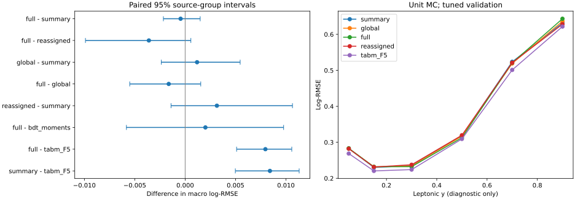
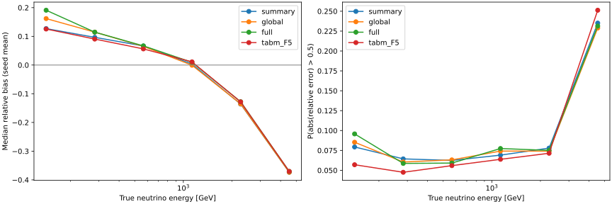

# 阶段19：完整SpacePoint集合的Deep Sets物理检验

## 阶段目标与测量边界

检验完整点云的非线性分布，是否提供超出F5、逐层点数及低阶station矩的ν能量信息；
区分全局横向形状与xy和station/layer的关联。上一阶段的负结果只约束低阶摘要，
本阶段保留全部点，使用Deep Sets式共享对象编码与置换不变池化。
协议在正式训练前写入[预注册记录](stage19_energy_ml/preregistered_protocol.md)。

## 实测物理结论

**完整点云在当前样本、共享标量和预注册Deep Sets预算下，没有测得超出真实摘要的
明确总体收益。** full的macro log-RMSE为0.375339，summary为0.375790，
配对差−0.000451，95%来源组区间[−0.002160,+0.001491]。
full−reassigned为−0.003600[−0.009893,+0.000565]，full−global也跨零。
因此全局高阶形状、站/层关联两项检验均未达到支持新增总体信息的要求；
这不是空间信息不存在或两种模型严格等效的证明。

当前三seed平均full比已有TabM F5更差：macro差+0.007961
[+0.005105,+0.010578]，整体log-RMSE差+0.011468
[+0.009295,+0.013905]。这一结果支持继续保留TabM为精度候选、BDT为控制基线，
不支持本阶段将完整点云模型用于替换它们。参考模型调参预算不同，不能泛化为
所有Deep Sets架构均劣于TabM。

| 模型 | macro log-RMSE | 单seed范围 | 整体log-RMSE |
|---|---:|---|---:|
| summary | 0.375790 | [0.373671,0.378818] | 0.292461 |
| global | 0.376971 | [0.372866,0.381299] | 0.292373 |
| full | 0.375339 | [0.368217,0.383388] | 0.292131 |
| reassigned | 0.378939 | [0.376969,0.382672] | 0.293045 |
| bdt_counts | 0.373321 | [0.372810,0.373792] | 0.283077 |
| bdt_moments | 0.373332 | [0.373005,0.373939] | 0.282708 |
| tabm_F5 | 0.367379 | [0.364036,0.369211] | 0.280664 |

| 配对比较 | Δ macro log-RMSE | 95%来源组区间 |
|---|---:|---|
| full − summary | -0.000451 | [-0.002160,+0.001491] |
| full − reassigned | -0.003600 | [-0.009893,+0.000565] |
| global − summary | +0.001181 | [-0.002368,+0.005457] |
| full − global | -0.001632 | [-0.005500,+0.001546] |
| reassigned − summary | +0.003149 | [-0.001402,+0.010648] |
| full − bdt_moments | +0.002008 | [-0.005829,+0.009769] |
| full − tabm_F5 | +0.007961 | [+0.005105,+0.010578] |
| summary − tabm_F5 | +0.008412 | [+0.004980,+0.011312] |

full单seed范围0.368217–0.383388，明显大于BDT参考的seed波动。
bootstrap对三seed平均事件损失条件化，不包含重新选参/重训的不确定性；
不能把区间当作架构的普适精度保证。本次也没有预注册等效性容差。
完整数值见[macro_summary](stage19_energy_ml/macro_summary.tsv)、
[macro_gains](stage19_energy_ml/macro_gains.tsv)。



### 偏差、尾部与物理子集

定义r=E估计/E真值−1；下表为指标的三seed描述均值，median偏差和R68未测bootstrap区间。

| 模型 | median(r) | R68 | P(绝对r>0.5) | P(绝对r>1) |
|---|---:|---:|---:|---:|
| summary | +3.380% | 0.237784 | 7.113% | 0.710% |
| global | +3.840% | 0.237480 | 7.183% | 0.812% |
| full | +4.466% | 0.237563 | 7.193% | 0.800% |
| reassigned | +3.438% | 0.233694 | 7.105% | 0.748% |
| tabm_F5 | +3.490% | 0.220459 | 6.268% | 0.643% |

full−summary的0.5尾率差+0.0798个百分点，95%区间[-0.0469,+0.2073]，没有明确改善。
full相对TabM的0.5尾率差+0.9246个百分点[+0.7212,+1.1439]，
总体尾部较差。极端1.0尾率及mean偏差的全部配对结果保留在分层表中。

以下为子集内整体log-RMSE，不能与macro混用；列出full相对summary：

| 子集 | N | summary → full | Δ及95%来源组区间 |
|---|---:|---:|---|
| matching: primary_confirmed | 13104 | 0.286465 → 0.286001 | -0.000464 [-0.001443,+0.000659] |
| matching: other_leading | 271 | 0.503366 → 0.506680 | +0.003314 [-0.005042,+0.010713] |
| truth_region: FASERnu_box | 12747 | 0.293755 → 0.293190 | -0.000564 [-0.001653,+0.000604] |
| truth_region: lead_block | 628 | 0.264835 → 0.269737 | +0.004903 [+0.000007,+0.009958] |
| y_lepton: 0.2_0.4 | 3486 | 0.235084 → 0.232295 | -0.002789 [-0.004968,-0.000621] |
| y_lepton: 0.4_0.6 | 1579 | 0.318028 → 0.312699 | -0.005329 [-0.008827,-0.002378] |
| y_lepton: 0.6_0.8 | 643 | 0.523721 → 0.521013 | -0.002708 [-0.008691,+0.002762] |
| y_lepton: 0.8_1 | 268 | 0.631491 → 0.643423 | +0.011932 [+0.005530,+0.018031] |
| y_primary_confirmed: ge_0.6 | 670 | 0.591083 → 0.591286 | +0.000203 [-0.006571,+0.005786] |
| y_primary_confirmed: ge_0.8 | 99 | 0.834624 → 0.853724 | +0.019100 [+0.005940,+0.032605] |
| energy_GeV: 100_200 | 731 | 0.242256 → 0.267256 | +0.025000 [+0.021025,+0.029810] |
| energy_GeV: 3200_6400 | 268 | 0.664980 → 0.657592 | -0.007389 [-0.013143,-0.002041] |

**观测到的是不均匀的响应变化，而非一致的空间增益。** y=0.2–0.6有改善，
y≥0.8和最低能量bin退化；lead-block的差值区间下限仅+0.0000066，
属于未经多重比较校正的边缘结果。primary确认且y≥0.6的670例没有改善；
y≥0.8的99例仍保留，full误差更高，不能解释为仅由leading错配造成。
不同y/区域的能谱和接受度尚未匹配，局部差异不是独立的因果能量信息测量，
也不据小子集结果删事件、改选输入或停止整条空间分支。

最高3200–6400 GeV的268例，summary/full/TabM的median偏差为
−37.344%/−37.071%/−37.064%，欠响应仍未解决。
full相对TabM的该bin log-RMSE差−0.007805[−0.018778,+0.000698]，
尚无明确改善；0.5尾率却从25.124%降至23.134%，差−1.9900个百分点
[−3.8345,−0.2339]。逐方向计数确认这两种模型该bin的0.5尾部全部为r<−0.5，
r>+0.5比例均为0。**减少阈值以下的欠估尾部，并不等于恢复能量尺度**，
不能仅凭这项局部尾率宣布高能响应已校正或能谱闭合完成。



全部7模型×3seed×25子集的525行指标（含欠估/高估尾率），以及8对×25子集的
200行配对增量，见[metrics](stage19_energy_ml/metrics.tsv)、
[stratified_gains](stage19_energy_ml/stratified_gains.tsv)。六run结果全部保留，
不以个别run的事后显著性替代主比较。

### 物理原因与程序原因

程序核查支持这是已接入完整点分布后的实测结果：全量key、逐层点数和空间矩均核对，
无抽样/裁剪；16次fit的编码器相对权重变化为0.1025–0.5811，均非零。
固定full seed0模型，在400个validation事件上仅重分配点的配对xy到z槽，
保持共同真实标量不变，输出标准化logE的最大/平均绝对变化为
0.0556910/0.00560587，证明最终模型实际使用了站/层关联。
这是输入敏感性核查，不是增益或系统误差测量。

400事件/56,240点的checkpoint读回最大相对预测差4.574×10⁻⁷；
station内对象重排的最大标准化log差2.384×10⁻⁷，global全事件重排为3.576×10⁻⁷。
事件内随机对照的配对xy多重集合、几何槽和计数均精确守恒。
H100 worker与A100 worker的预处理fill/mean/std最大绝对差为
1.110×10⁻¹⁶/2.220×10⁻¹⁶/4.441×10⁻¹⁶，scale、标签归一化及特征列表完全相同；
在核查的1200/400事件中float32变换输入最大差为0。最初逐字相等断言因这些末位差
失败，已改为1e−14数值容差并读回各自参数，未改训练或预测。
见[checkpoint_checks](stage19_energy_ml/checkpoint_checks.tsv)、
[numerical_checks](stage19_energy_ml/numerical_checks.json)。

全部fit在25–33 epochs由patience结束，最佳epoch索引9–17；无200epoch或600 s触顶。
这排除硬预算截断和输入未使用作为本次平坦结果的解释，但不证明达到全局最优，
也未排除编码维度、mean池化、正则化和有限调参的限制。
学习曲线train loss是dropout开启的逐批在线均值，不与eval验证loss直接解释为泛化差。
见[learning_endpoints](stage19_energy_ml/learning_endpoints.tsv)、各变体`learning_traces.json`。

物理上，阶段18已直接测得原F5/计数/低阶矩之间有很强重叠。
本阶段进一步把检验扩展到完整点分布，却仍未取得明确总体独立收益，
因此当前证据不支持用更复杂空间网络替换强表格基线。
全点mean编码尚未显式构建跨层track/segment关联或点对边，不能据此排除这些关系的价值。
最高能区的共同欠响应与高y残余说明仍需检验训练谱先验、选择/输运响应和目标函数；
哪一项是主因及其份额均未测量，不把这一待检验解释当作本阶段结论。

## 冻结样本与完整对象提取

沿用stage12官方`d32b0ff3` merge / without-IFT、FASERNU-04、TI12MC04、
OFLCOND-FASER-06、s0014及六个nominal run：
200082/200083/200089/200093/200094/200100。
输入逐文件清单为`ml/configs/files.tsv`；20项选择、最高pz leading、truth fiducial
和共同缺失文件处理均不变。train/validation为54,196/13,375 events、91/22来源组。
全部异常事件及高y事件保留；calibration/test/SIBYLL challenge未评价。
按用户确认继续默认单位MC权重，正式亮度、flux和取样接受度未恢复。

| 测量 | 实际数值 |
|---|---:|
| 输入文件 / 原始事件 | 222 / 2,203,362 |
| 选中事件 / 全部SpacePoint | 67,571 / 16,287,628 |
| train点数 / validation点数 | 13,204,073 / 3,083,555 |
| 单事件最大点数（train / validation） | 11,121 / 10,947 |
| 单事件点数中位数（train / validation） | 27 / 27 |
| 源文件大小合计 | 9,311,534,548 bytes |
| 最终点缓存及事件索引合计 | 195,699,654 bytes |
| 转float32最大坐标损失 | 0 mm |
| 提取累计文件wall / CPU | 700.978431 / 514.810580 s |
| 提取峰值RSS | 605.750 MiB |
| 合并核对wall / CPU | 61.106234 / 57.546129 s |
| 合并核对峰值RSS | 529.234 MiB |

源文件大小不是实际分支读取/网络流量；实际网络I/O字节数未测量。
按32 MB chunks仅读取run/eventID/SpacePoints/xyz，过滤冻结选中事件，
按事件/station/layer规范排序以便连续内存批处理。所有点均保留，无上限、抽样、
坐标裁剪或能量权重。19份shard通过1个Condor作业合并，事件key和12个逐层计数
全部一致；与阶段18 float32摘要的最大差分别为mean x/y
3.8147×10⁻⁶/7.6294×10⁻⁶ mm、RMS x/y 3.8147×10⁻⁶ mm、
covariance 0.000380202 mm²。差值是摘要数值精度差，非丢点。

station中心z为[−1860.15,47.4,1237.4,2427.4] mm，逐层偏移为[−31.5,0,+31.5] mm，
匹配容差10 mm；使用阶段18核实的实际几何。
缓存位于`ntuples/energy_ml_stage19/{train,validation}_points.npy`和
`{train,validation}_events.npz`，不进入Git。
详细提取证据见[extraction_summary](stage19_energy_ml/extraction_summary.json)、
[逐文件数据](stage19_energy_ml/extraction_files.tsv)及
[小样本计时](stage19_energy_ml/extraction_pilot.json)。

## 模型、对照与预算

四变体共享78个真实标量：原F5、12个逐层计数、20个station矩。
仅train拟合asinh尺度、缺失填补、标准化与缺失mask，展开为156维。
真值能量/y/primary身份/顶点只用于标签或诊断，不进入模型。
目标为train标准化log(Eν/GeV)，不展平训练谱、不改损失。

| 变体 | 额外编码输入与池化 | 检验对象 |
|---|---|---|
| summary | 每站10个固定摘要→共享MLP，每站32维 | 同一网络头的真实低阶信息基线 |
| global | 全点xy→共享MLP，全事件mean，复制为4槽 | 超出标量的全局高阶xy分布 |
| full | xy、station/layer one-hot、层内z偏移→共享MLP，每站mean | 完整点分布及站/层关联 |
| reassigned | 事件内配对xy重分配到固定z槽，编码/池化同full | 去站/层关联控制，真实标量保持不变 |

summary每站10项为5个空间矩、log1p点数/10、3个layer占比和空station标识。
点编码输入为asinh(x/100 mm)、asinh(y/100 mm)、4个station one-hot、3个layer
one-hot、(z−station中心−layer偏移)/10 mm。global其余8维置零。
共享编码器10→64→32、ReLU，128维池化结果与156维标量拼接，经3-block表格ResNet。
full/reassigned空station池化为0，显式计数与mean共同使用；summary为空站固定摘要编码。
global的复制槽使有效自由度受限；相同名义参数量不等于相同有效容量或FLOPs。
SpacePoint是空间读出对象，不当作真实粒子或能量沉积。

reassigned逐事件种子为[训练seed,run,eventID]，保持全部配对xy点集合、z槽和计数；
train与validation都变换后重训，三seed独立随机实现。规范排序后使用阶段18的种子方案，
不保证实现的逐点排列与阶段18相同。它可能破坏局部接受度，属于信息诊断，
不能当物理系统误差。单独胜过reassigned不足以证明新增信息。

每变体2个seed0候选：width128/256、lr0.001/0.0005，blocks3、dropout0.1、
weight decay10⁻⁴。以validation整体log-MSE选优，再固定配置重训seed1/2，
种子20261029/30/31，共16次fit、12次入选fit。
batch256、validation batch512、最多200epochs、patience15、单fit墙钟上限600 s。
相同上限不等于相同计算量。TF32关闭，不用AMP/compile，Torch/BLAS单线程。
逐批ragged gather与segment sum/mean处理全部对象，不padding截断。
完整配置见[sets.yaml](../ml/configs/sets.yaml)。

主要配对检验full−summary、full−reassigned，辅助global−summary、full−global。
主指标为100–6400 GeV六个倍增能量bin等权macro log-RMSE；
500次按22来源组配对bootstrap，seed误差先在事件层平均，不平均独立seed预测。
同时报告整体误差、相对偏差、R68、0.5/1.0尾率、y/primary/材料/run分层。
所有区间条件于已经用于早停与选参的validation，不是独立test置信区间；
子集未经多重比较校正。阶段18 BDT和阶段16 TabM仅作为实测精度参照，
不能宣称与本阶段具有相同调参预算的架构排名。

## 资源、吞吐与存储

24个正式作业（19提取+1合并+4训练）均exit 0；旧schedd的4个未启动作业不计为训练。
GPU作业submit为1 CPU/6,000 MB/1 GPU，站点实际分配2 CPU/6,000 MB/1 GPU，
计算线程仍固定1。summary/global/full实际使用同一A100-PCIE-40GB，reassigned用H100 NVL；
硬件不完全相同，且未强制bitwise确定性，不能把H100对照的wall优势归为模型优势。
所有fit都正常早停，无时间上限触顶，因此没有由硬件速度造成的600 s训练截断。

| 变体 | 4 fits累计wall(s) | worker wall(s) | 峰值RSS(MiB) | fit GPU allocator峰值(MiB) |
|---|---:|---:|---:|---:|
| summary | 105.359 | 138.964 | 1291.250 | 85.160 |
| global | 131.458 | 156.065 | 1869.047 | 798.713 |
| full | 127.071 | 149.083 | 1958.309 | 798.713 |
| reassigned | 64.053 | 79.596 | 2771.703 | 846.948 |

全部16 fits累计wall427.942 s，Python worker合计wall523.708 s/CPU462.443 s；
外层`/usr/bin/time`含解释器导入等，合计wall588.84 s/CPU498.33 s，
Condor GPU分配累计602 s。迁移后提交到最后完成742 s；原bigbird24排队时间另记，
不计入训练速度。GPU allocator峰值不等于设备全部显存或nvidia-smi峰值；
Condor仅对H100作业测得设备显存2,790 MB，其余三项未测量。
full相对summary的同A100累计fit wall为1.206倍、allocator峰值为9.379倍，
反映本次实际预算及数据布局，不能解释为通用FLOPs比。
每批全部点保留，最大训练batch点数113,094；两档参数数目238,177/866,785，
四变体均按整体validation选中width128/lr0.001。

共同T4上检查400事件、完整56,240点；最终GPU先持续预热至少0.5 s，再计20次，
CPU单线程预热1次后计6次。表中为模型forward（编码、池化、事件头）wall，
不含文件I/O、初始变换、数据传输或ragged gather。

| 模型 | T4 median(ms) | T4最小–最大(ms) | CPU median(ms) | CPU events/s |
|---|---:|---|---:|---:|
| summary | 1.651 | 1.547–1.827 | 12.547 | 31881 |
| global | 9.535 | 4.344–17.325 | 51.859 | 7713 |
| full | 22.357 | 11.201–29.019 | 51.887 | 7709 |
| reassigned | 18.438 | 4.435–26.979 | 51.954 | 7699 |

CPU full/summary约4.136倍；GPU短批计时存在明显波动，延长预热后仍未稳定，
不能据上述GPU点估计对full/reassigned/global作本征速度排名。
前一短预热测量中full为3.528 ms，最终20次为11.201–29.019 ms；
GPU占用/频率等同步状态未测量，波动原因尚未确定。
这不影响冻结预测的物理比较，但低负载、固定状态下的GPU延迟尚未测定。
单次非预热gather的full为14.295 ms，受首批初始化影响，不当作稳定吞吐。
CPU吞吐也是此400事件点数分布下的模型forward值，不能外推为ROOT全链吞吐。
原始[最终inference](stage19_energy_ml/inference.tsv)、
[短预热前测](stage19_energy_ml/inference_short_warmup.tsv)、
[costs](stage19_energy_ml/costs.tsv)、[selected_fits](stage19_energy_ml/selected_fits.tsv)、
[Condor逐作业资源](stage19_energy_ml/condor_resources.tsv)和
[汇总](stage19_energy_ml/condor_summary.json)均保留。

核对缓存及模型后删除19份重复点shard和3个已完成传输包，实际释放95,653,543 bytes。
保留最终点缓存195,699,654 bytes、4份seed0 checkpoint和三seed预测合计5,561,158 bytes；
不提交ROOT、点缓存、逐事件预测或模型二进制。
各变体重复配置JSON压缩为一份[training_config](stage19_energy_ml/training_config.json)。
详细删除清单及保留路径见[storage_cleanup](stage19_energy_ml/storage_cleanup.json)。

## 执行、程序验证与复现

软件环境为CVMFS `LCG_109_cuda/x86_64-el9-gcc13-opt`，Torch2.10.0/CUDA12.5。
先用1文件提取及1200/400事件×2epochs的T4小样本验证，再提交正式Condor。
提取/合并cluster分别为1543568（19 jobs）、1543599（1 job）。
训练初交bigbird24的1543614四个作业均未启动，按用户建议迁至空闲队列较少的
bigbird15 / 16976451；先挂起旧作业、新提交成功后移除，未产生重复fit。
普通schedd要求AFS执行脚本和日志，使用`/afs/cern.ch/user/x/xcheng/nu_mu_stage19`；
小传输包经root插件读取，数据和结果仍在EOS。部分H100 MIG缺Capability字段，
匹配补充识别A100/H100设备名，保留8 GiB显存下限；模型/输入/预算完全不变。
队列与匹配记录见[gpu_matching](stage19_energy_ml/gpu_matching.json)。
小样本训练与数值检查见[smoke_summary](stage19_energy_ml/smoke_summary.json)、
[smoke_numerical_checks](stage19_energy_ml/smoke_numerical_checks.json)，
这些短训练指标不作为物理结论。

```bash
source /cvmfs/sft.cern.ch/lcg/views/LCG_109_cuda/x86_64-el9-gcc13-opt/setup.sh
export OMP_NUM_THREADS=1 OPENBLAS_NUM_THREADS=1 MKL_NUM_THREADS=1 PYTHONNOUSERSITE=1
python3 ml/extract_sets.py --index 45 --output /tmp/nu_mu_stage19_pilot.npz
# 以下各阶段须在前一阶段完成并核查后执行；小样本训练需要合并好的点缓存。
mkdir -p software logs ntuples/energy_ml_stage19/shards
tar -czf software/energy-ml-set-extract-stage19.tar.gz ml/extract_sets.py \
  ml/configs/sets.yaml ml/configs/spatial.yaml ml/configs/files.tsv
tar -czf software/energy-ml-set-prepare-stage19.tar.gz ml/prepare_sets.py \
  ml/extract_spatial.py ml/train_bdt.py ml/configs/sets.yaml \
  ml/configs/spatial.yaml ml/configs/files.tsv
tar -czf software/energy-ml-set-train-stage19.tar.gz ml/train_sets.py ml/set_data.py \
  ml/train_tabular.py ml/train_bdt.py ml/extract_spatial.py ml/configs/baseline.yaml \
  ml/configs/sets.yaml ml/configs/spatial.yaml ml/configs/files.tsv
condor_submit -name bigbird24.cern.ch AnalysisZipFramework/submission/ml_set_extract.sub
condor_submit -name bigbird24.cern.ch AnalysisZipFramework/submission/ml_set_prepare.sub
for variant in summary global full reassigned; do
  python3 ml/train_sets.py --variant "$variant" --smoke \
    --output-dir "/tmp/nu_mu_stage19_smoke_$variant"
done
python3 ml/check_sets.py --smoke-artifacts
mkdir -p /afs/cern.ch/user/x/xcheng/nu_mu_stage19/logs
cp AnalysisZipFramework/submission/run_ml_set_train.sh /afs/cern.ch/user/x/xcheng/nu_mu_stage19/
condor_submit -name bigbird15.cern.ch AnalysisZipFramework/submission/ml_set_train_afs.sub
python3 ml/report_sets.py
python3 ml/check_sets.py
python3 ml/collect_set_resources.py --extraction-cluster 1543568 \
  --prepare-cluster 1543599 --training-cluster 16976451 --log-dir /tmp/nu_mu_stage19_logs
```

提交前按对应wrapper所需文件打包传输包；worker在本地scratch读写，最终经XRootD上传。
实际执行脚本为`AnalysisZipFramework/submission/run_ml_set_{extract,prepare,train}.sh`。
传输包与仓库源码逐字节一致性记录在
[payload_verification](stage19_energy_ml/payload_verification.json)，不做额外大文件SHA扫描。
模型及三seed预测位于`ml/artifacts/stage19/<variant>/`，仅seed0保留checkpoint。
最终8份Python源码语法、3个shell脚本语法、525行指标/200行配对表、
欠估与高估尾率分割、24个作业exit code及报告/路线图的本地链接均通过核查，
见[final_validation](stage19_energy_ml/final_validation.json)。两张SVG已渲染并人工检查。

## 下一步计划与验收

1. **优先检验训练能谱先验及目标对响应的影响。** 输入为现有冻结train/validation标量缓存、
   六能量bin、BDT F5与TabM F5固定候选及原单位权重结果。
   先预注册train-only能量bin再加权和未加权对照，保持事件、输入、预算及validation权重不变；
   权重只由train计数决定，不把诊断真值加为模型特征。
   验收必须报告macro及配对来源组区间、各能量bin偏差/R68/双方向尾部、primary确认的
   高y子集和成本，明确高能欠响应改善是否以低能/总体精度退化为代价。
   这属于先验压力测试，不替代缺失的生成归一化或正式物理权重。
2. **空间分支继续限定问题，不直接扩大GNN/Transformer扫参。** 当前Deep Sets未获得
   明确总体信息增益。下一轮空间工作先审计track/segment与SpacePoint跨层关联的现成输入，
   列清与本次全点单对象mean编码不同的实际关系信息；输入需同一生产及相同事件key。
   若推进关系模型，必须重新预注册真实摘要、全局形状及去关联对照，保留全部异常事件，
   验收同时要求优于真实摘要与关联对照，且不能仅靠改变容量或损失解释。
3. **稳健性与物理闭合仍在后续阶段。** 正式flux/亮度/取样接受度清单目前没有，按用户
   确认默认继续，不据此阻塞上述比较。训练先验、相互作用/探测器响应系统学、真实data
   控制区及最终能谱测量收益尚未完成；calibration/test/challenge继续隔离，待模型和评价
   方案冻结后再按计划使用。GPU端到端吞吐需在负载和状态可记录的条件下单独补测，
   不以当前不稳定短批延迟作部署收益依据。

## 引用与可行性

- Zaheer et al., Deep Sets, https://arxiv.org/abs/1703.06114 ：共享逐对象编码和对称池化
  适用于无序点集合，本阶段直接实现这种归纳偏置。
- Komiske et al., Energy Flow Networks / Particle Flow Networks,
  https://arxiv.org/abs/1810.05165 ：借鉴对象编码后的事件聚合；当前对象无能量权重，
  不适用其能量流红外/共线安全解释，也不声称SpacePoint为particle-flow粒子。
