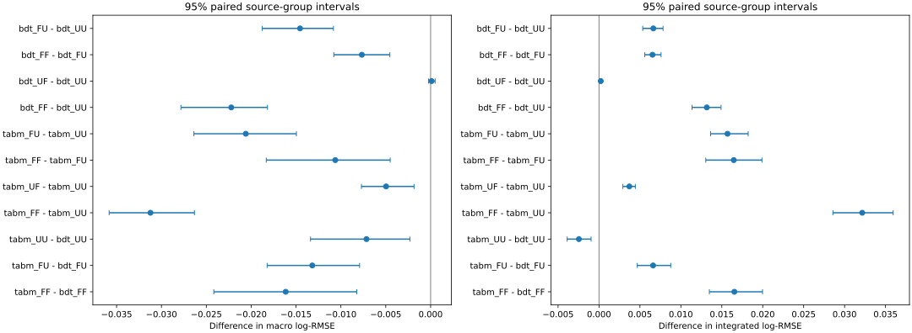
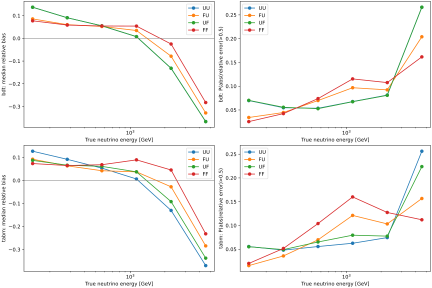

# 阶段21：分离训练能谱权重与早停目标的能量响应检验

**实测结论：在固定unit早停目标下，展平训练谱仍改善两端能量响应，因而此前的
端点改善不全来自早停目标变化。但中能区、整体误差和primary确认高y区均退化，
新增总体尾部主要来自过估。加权改变了响应取舍，没有提供新的探测器信息，
也未完成能谱测量闭合。以下结论限于冻结validation及当前训练预算。**

## 目标及相对已有工作的新增问题

阶段14已在seed0、depth3 BDT上测得展平谱改善端点偏差，同时总体尾部恶化；
当时训练权重和早停权重同时改变。阶段16和19显示强表格及完整点云模型仍有约37%的
最高能量bin欠响应。本阶段在固定的强BDT/TabM F5配置、三seed上分离这两个因素，
检验高能欠响应能否在固定unit早停下缓解，以及低/中能和高y响应如何变化。
不是把阶段14的现象重新作为首次发现。

正式训练前冻结[预注册协议](stage21_energy_ml/preregistered_protocol.md)与
[prior.yaml](../ml/configs/prior.yaml)，不据结果选择权重幅度、删事件或再扫超参。

## 样本、输入与四项控制

沿用stage12官方`d32b0ff3` merge / without-IFT、FASERNU-04、TI12MC04、
OFLCOND-FASER-06、s0014，六nominal run为200082/200083/200089/200093/200094/200100。
原20项cuts、最高pz leading、truth fiducial、共同缺失文件处理和全部异常事件保持不变。
train/validation为54,196/13,375 events，91/22来源组；逐文件清单为`ml/configs/files.tsv`。
只读已有train/validation紧凑缓存，不重扫ROOT或生成新的逐事件输入副本。
calibration/test/SIBYLL challenge未评价。

原F5的46个读出/μ运动学输入，train-only asinh、缺失填补、标准化及mask展开为92维。
标量预处理和log(Eν/GeV)目标均值/标准差都按原unweighted train计算，四设置一致。
真值能量只作标签、train权重或validation监视目标；y、primary身份和顶点只用于诊断，
不作模型输入。单位MC权重是用户确认的默认方案；本次flat权重不是物理flux归一化。

| 标识 | 训练损失事件权重 | 早停validation权重 | 最终评价 |
|---|---|---|---|
| UU | unit | unit | 同一unit validation |
| FU | train-bin flat | unit | 同一unit validation |
| UF | unit | 同一train映射的flat | 同一unit validation |
| FF | train-bin flat | 同一train映射的flat | 同一unit validation |

主比较FU−UU在固定unit早停目标下改变训练权重；FF−FU、UF−UU检验早停目标，
FF−UU与阶段14方向对照。flat monitor没有根据validation重新拟合映射，
不是精确的六bin等权macro目标；最终macro始终是六bin等权log-RMSE。

| 真实能量bin(GeV) | train事件数 | 每事件flat权重 |
|---|---:|---:|
| 100–200 | 2,944 | 3.068161232 |
| 200–400 | 9,776 | 0.923963448 |
| 400–800 | 17,237 | 0.524027770 |
| 800–1600 | 15,790 | 0.572049821 |
| 1600–3200 | 7,303 | 1.236843306 |
| 3200–6400 | 1,146 | 7.881908086 |

w_b=Ntrain/(6n_b)，不裁剪、不抽样；每bin总权重为9,032.666667，
Σw=54,196.000000、Σw²=128,326.676783、Neff=22,888.509931。
这些值由实际train复算，与阶段14一致；没有增加独立高能信息量。

BDT将w传入DMatrix。TabM每个成员的平方误差乘事件w后取原batch均值，
不按每batch权重和归一化；train全样本均值1保持整体梯度尺度约定。
unit分支使用原损失表达式。monitor用加权误差和/权重和，unit时保持原mean表达式。
加权会同时改变有效梯度、树节点权重和优化过程，不把它解释为纯探测器因果能损分解。

在总体分布、无限容量及平方log损失的理想条件下，最优输出满足
`f_w(x)=E[w(E) log(E)|x]/E[w(E)|x]`。因此，同样的探测器读出与条件不确定性下，
改变训练能谱可以改变回归响应；`exp(f_w)`也不自动成为每个真实能量bin内无偏的能量尺度。
这是风险函数的性质，不是本次有限网络达到该解或某项物理能损已被分解的证据。

## 固定模型、预算与统计

固定阶段16按unit validation选中的F5配置，不进行新选参：
BDT max_depth7/最多1200 rounds、learning rate0.04、subsample0.8、min_child_weight20、
reg_lambda10、patience100；TabM width256、blocks3、dropout0.1、lr0.0005、
weight decay10⁻⁴、k32、数值嵌入8维，batch1024/validation2048、
最多250epochs、patience25。每fit上限180 s，线程1，TF32关闭，无AMP/compile。
2架构×4设置×seeds20261029/30/31，共24次独立fit；每次重置相同seed，
同训练权重的不同monitor应具有相同的共同训练轨迹前缀，另行实测核对。
正式作业统一H100 NVL，避免硬件与实验因素混淆。最初优先A100以核对阶段16，
实际资源检查后在全部作业尚未开始、无正式结果时统一改用可用H100，
资源修订写入预注册协议；所有权重效应相对本轮同硬件UU计算。

先用本地T4、1200/400事件、20 trees/2epochs验证8分支，然后提交GPU Condor。
小样本使用完整train拟合的相同预处理与权重映射，保证运行路径与正式设置一致；
其精度不用于物理结论。8个小样本checkpoint均通过400事件读回，权重均值1和六bin
总权重相等通过核查，见[smoke_summary](stage21_energy_ml/smoke_summary.json)、
[smoke_numerical_checks](stage21_energy_ml/smoke_numerical_checks.json)、
[smoke_checkpoint_checks](stage21_energy_ml/smoke_checkpoint_checks.tsv)。
小样本BDT成本字段继承原fit函数对20-tree短跑的`patience`标签，实际运行的是固定20树上限，
不能用该字段宣称短跑已收敛。

500次22来源组配对bootstrap；三seed先平均事件损失，不平均预测。
宏观、整体误差、均值偏差、双方向0.5尾部和1.0尾部均保留配对区间。
能量及primary确认高y的median/R68补充来源组bootstrap，重采样使用加权经验CDF分位数
（每seed分别计算再平均），点估计CDF与NumPy插值描述值分开标明。
来源区间条件于已经用于早停和既有选参的validation，不包含重新选参不确定性，
不是独立test/物理加权结果；子集未经多重比较校正。

## 执行与产物

环境为CVMFS `LCG_109_cuda/x86_64-el9-gcc13-opt`，Torch2.10.0/CUDA12.5、
XGBoost2.1.3、TabM0.0.3、rtdl_num_embeddings0.0.12。
复用现成环境和两个纯Python wheel，不重建C++或Calypso。
正式训练为`bigbird103` cluster848785，包含8个GPU作业，每作业固定架构/设置、完成3seeds。
初交`bigbird15`的16976464全部尚未启动，先挂起后迁移，成功提交后移除旧作业。
外层作业时限由最初longlunch(2 h)改为espresso(20 min)，每fit的180 s上限不变；
同型号GPU匹配调整及修改时尚未开始的状态见[scheduling](stage21_energy_ml/scheduling.json)。
bigbird15普通schedd所需的启动脚本/日志原放AFS；bigbird103是EosSubmit，
要求全部执行/输入/日志路径在EOS，已使用`ml_prior_eos.sub`适配。
迁移时观测idle队列为bigbird15=41/bigbird103=35，较早快照的后者为1；
低队列数不保证立即获得GPU。最终数据、脚本、日志和结果均在EOS。
worker在scratch计算，最终经XRootD上传；无xAOD或ROOT中间输出。

```bash
source /cvmfs/sft.cern.ch/lcg/views/LCG_109_cuda/x86_64-el9-gcc13-opt/setup.sh
export OMP_NUM_THREADS=1 OPENBLAS_NUM_THREADS=1 MKL_NUM_THREADS=1 PYTHONNOUSERSITE=1
export PYTHONPATH="$PWD/software/energy_ml_tabular_deps/tabm-0.0.3-py3-none-any.whl:$PWD/software/energy_ml_tabular_deps/rtdl_num_embeddings-0.0.12-py3-none-any.whl${PYTHONPATH:+:$PYTHONPATH}"
for arch in bdt tabm; do
  for mode in UU FU UF FF; do
    python3 ml/train_prior.py --architecture "$arch" --mode "$mode" --smoke \
      --output-dir "/tmp/nu_mu_stage21_smoke_${arch}_${mode}"
  done
done
python3 ml/check_prior.py --smoke
tar -czf software/energy-ml-prior-stage21.tar.gz ml/train_prior.py ml/train_tabular.py \
  ml/train_bdt.py ml/robustness.py ml/configs/prior.yaml ml/configs/tabular.yaml \
  ml/configs/baseline.yaml ml/configs/robustness.yaml ml/configs/files.tsv \
  software/energy_ml_tabular_deps/*.whl
mkdir -p /afs/cern.ch/user/x/xcheng/nu_mu_stage21/logs
cp AnalysisZipFramework/submission/run_ml_prior.sh /afs/cern.ch/user/x/xcheng/nu_mu_stage21/
condor_submit -name bigbird15.cern.ch AnalysisZipFramework/submission/ml_prior.sub
# 原作业未开始，挂起后迁移到EosSubmit端点；成功后移除旧cluster，详见scheduling.json。
condor_submit -name bigbird103.cern.ch AnalysisZipFramework/submission/ml_prior_eos.sub
# 待8个作业全部完成后执行统计及checkpoint核查。
python3 ml/report_prior.py
python3 ml/check_prior.py
python3 ml/collect_tabular_resources.py --cluster 848785 --prefix ml_prior \
  --log-dir /tmp/nu_mu_stage21_logs --report-dir workbook/stage21_energy_ml
```

54,266 bytes传输包与源码逐字节核对，见
[payload_verification](stage21_energy_ml/payload_verification.json)。训练源码打包后冻结。
输入为`ntuples/energy_ml_stage12/dataset/{train,validation}.npz`及冻结manifest，
诊断标签复用`ntuples/energy_ml_stage15/validation_truth.npz`。
最终三seed预测、seed0模型及其预处理位于`ml/artifacts/stage21/<arch>_<mode>/`，不入Git。

## 实测结果：端点、整体与早停目标的取舍

误差指标无量纲，macro是六bin的平均log均方误差再开平方，integrated是
全样本的平均log均方误差再开平方；均先平均三seed损失，不平均预测后再评价。
相对误差r=Epred/Etrue−1；median、R68及尾率为各seed分别计算后的平均，
R68=(q84−q16)/2，0.5尾率为P(|r|>0.5)。bias和尾率列以百分数表示。

| 模型 | macro log-RMSE | integrated log-RMSE | 中位bias(%) | R68(%) | 0.5尾率(%) | 1.0尾率(%) |
|---|---:|---:|---:|---:|---:|---:|
| BDT UU | 0.373879 | 0.283253 | +3.609 | 22.259 | 6.672 | 0.618 |
| BDT FU | 0.359324 | 0.289889 | +3.623 | 22.583 | 7.681 | 0.860 |
| BDT UF | 0.373987 | 0.283470 | +3.553 | 22.289 | 6.647 | 0.626 |
| BDT FF | 0.351658 | 0.296420 | +4.639 | 22.911 | 8.381 | 1.092 |
| TabM UU | 0.366733 | 0.280799 | +3.357 | 22.008 | 6.275 | 0.673 |
| TabM FU | 0.346133 | 0.296495 | +4.022 | 22.656 | 8.177 | 1.154 |
| TabM UF | 0.361769 | 0.284505 | +3.958 | 22.560 | 7.070 | 0.793 |
| TabM FF | 0.335508 | 0.312955 | +6.580 | 24.893 | 10.946 | 2.325 |

来源：[macro_summary](stage21_energy_ml/macro_summary.tsv)、
[metrics](stage21_energy_ml/metrics.tsv)，后者保留全部600行逐seed分层数据。
差值及其95%配对来源组区间如下，负log-RMSE差表示改善。

| 架构 | 比较 | Δmacro [95%区间] | 问题 |
|---|---|---:|---|
| BDT | FU−UU | −0.014555 [−0.018780, −0.010831] | 固定unit monitor的训练权重效应 |
| BDT | FF−FU | −0.007666 [−0.010790, −0.004545] | flat训练下的monitor效应 |
| BDT | UF−UU | +0.000108 [−0.000233, +0.000503] | unit训练下未见明确macro变化 |
| BDT | FF−UU | −0.022221 [−0.027830, −0.018181] | 两因素合并 |
| TabM | FU−UU | −0.020600 [−0.026385, −0.014957] | 固定unit monitor的训练权重效应 |
| TabM | FF−FU | −0.010625 [−0.018317, −0.004506] | flat训练下的monitor效应 |
| TabM | UF−UU | −0.004964 [−0.007712, −0.001846] | unit训练下的monitor效应 |
| TabM | FF−UU | −0.031224 [−0.035829, −0.026322] | 两因素合并 |

[macro_gains](stage21_energy_ml/macro_gains.tsv)记录全部11项比较。
macro交互对比FF−FU−UF+UU：BDT为−0.007774 [−0.010870, −0.004817]；
TabM为−0.005661 [−0.014176, +0.002080]。前者说明本配置/预算下两因素组合
不能用独立macro变化简单相加描述，后者交互区间跨零；不作优化动力学的唯一因果解释。
详见[factor_interaction](stage21_energy_ml/factor_interaction.tsv)。

FU−UU的整体log-RMSE反而增加：BDT +0.006636 [0.005339, 0.007824]，
TabM +0.015696 [0.013626, 0.018224]。总体0.5尾率分别增加
**1.009个百分点 [0.760, 1.260]、1.902个百分点 [1.472, 2.338]**。
过估r>0.5尾率增加1.074个百分点 [0.752, 1.409]及1.884个百分点 [1.324, 2.444]；
欠估r<−0.5尾率变化−0.065个百分点 [−0.205, +0.077]及
+0.017个百分点 [−0.162, +0.180]。因此总体新增尾部主要来自过估，
不能只展示高能欠估尾部减少。

相同UU/FU/FF设定下，TabM−BDT的macro差分别为
−0.007146 [−0.013386, −0.002313]、−0.013191 [−0.018224, −0.007916]、
−0.016150 [−0.024165, −0.008228]。但integrated差分别为
−0.002454 [−0.003889, −0.000968]、+0.006606 [0.004674, 0.008766]、
+0.016535 [0.013479, 0.019977]：**flat训练后，架构的整体精度排序反转，
macro排序仍保留。**这支持按最终物理测量目标评价模型，而不是仅按一个汇总指标替换基线。
以上integrated及正负尾部均来自[stratified_gains](stage21_energy_ml/stratified_gains.tsv)。



### 最高能量欠响应确有缓解，但远未消失

3200–6400 GeV的validation仅268例。描述性中位bias采用NumPy插值，
0.5尾率为三seed均值：

| 架构 | 设置 | 中位bias(%) | 0.5尾率(%) |
|---|---|---:|---:|
| BDT | UU | −36.598 | 26.617 |
| BDT | FU | −32.816 | 20.398 |
| BDT | UF | −36.620 | 26.617 |
| BDT | FF | −28.230 | 16.169 |
| TabM | UU | −37.005 | 25.622 |
| TabM | FU | −28.446 | 15.672 |
| TabM | UF | −33.762 | 22.388 |
| TabM | FF | −23.198 | 11.194 |

固定unit monitor的FU−UU中位bias改善由独立的经验CDF估计及其bootstrap支持：
BDT +3.722个百分点 [2.298, 5.488]；TabM +8.494个百分点 [7.015, 9.507]。
这两项CDF差不等于上表插值中位数相减，不能将区间直接标在另一估计量上。
flat训练时，FF−FU再改善4.632个百分点 [3.566, 5.834]及
5.311个百分点 [4.610, 6.785]；unit训练时，UF−UU为
+0.046个百分点 [−0.317, +0.589]及+3.215个百分点 [2.255, 3.923]。
训练权重和早停均能影响高能响应，其相对作用依赖架构。
UU/FU这两种设置的本bin 0.5尾部全部为欠估，其他设置不一概推广。
全部176行非线性差和区间见[nonlinear_gains](stage21_energy_ml/nonlinear_gains.tsv)。

### 低能端也改善，损失集中于中能与高y

主比较FU−UU的100–200 GeV bin有731例：BDT的log-RMSE
0.233965→0.184453，中位bias +13.676%→+8.530%，0.5尾率6.977%→3.420%；
TabM对应0.221691→0.160179、+12.685%→+9.206%、5.563%→1.550%。
所以本次不能把代价归结为最低能量区退化。

800–1600 GeV有3,933例：BDT log-RMSE 0.279171→0.301865，
0.5尾率6.772%→9.679%，增加2.907个百分点 [2.437, 3.458]；
TabM log-RMSE 0.275966→0.325414，尾率6.255%→12.111%，
增加5.856个百分点 [5.289, 6.394]。这是整体代价的具体中能证据。

primary身份及入射ν母粒子确认、y≥0.6的**670例**中：

| 架构 | UU→FU log-RMSE | 差值 [95%区间] | 中位bias(%) UU→FU | 0.5尾率(%) UU→FU |
|---|---|---|---|---|
| BDT | 0.562807→0.581118 | +0.018312 [0.009605, 0.027410] | −32.541→−32.960 | 23.682→25.473 |
| TabM | 0.570416→0.607912 | +0.037496 [0.027921, 0.049646] | −32.156→−34.319 | 24.129→27.413 |

进一步y≥0.8仅99例，BDT log-RMSE变化+0.004259的区间跨零；
TabM +0.049723 [0.016431, 0.090914]。不据小子集删事件或终止高y研究。
高能bin改善与高y退化可同时成立：两者不是同一条件样本，且在同读出不确定性下，
训练风险对谱端点重新赋权不等于补足高y未见强子能量。
本结果不证明残差只由强子能损或某种泄漏引起；材料、接受度和训练谱条件差异仍未分解。



## 程序原因排查、收敛与可复现性

- [trajectory_checks](stage21_energy_ml/trajectory_checks.tsv)的12对相同训练权重、
  不同monitor拟合，在所有共同iteration的train metric最大差均为**0**。
  控制实验确实沿同一训练轨迹选择不同检查点，而不是无意改变初始化或batch顺序。
- [preprocessing_checks](stage21_energy_ml/preprocessing_checks.tsv)的8组fill/scale/mean/std
  参数完全相同；标签中心/尺度及事件键、来源组、输入列由统计脚本逐项核对。
  真实train权重均值1及各bin等权通过独立重算。
- [checkpoint_checks](stage21_energy_ml/checkpoint_checks.tsv)在每模型2,048例上读回seed0，
  BDT最大相对预测差0，TabM最大3.659×10⁻⁷；全8组通过。
  详见[numerical_checks](stage21_energy_ml/numerical_checks.json)。
- [baseline_reproduction](stage21_energy_ml/baseline_reproduction.tsv)：BDT UU对阶段16
  三seed最大相对差均2.22×10⁻¹⁶（指数转换末位）；TabM本轮H100与旧A100轨迹有差异，
  三seed最大相对预测差0.169862/0.161573/0.401537，平均绝对相对差
  0.013944/0.013948/0.015007。本轮macro 0.366733，旧值0.367379，
  integrated 0.280799，旧值0.280664。**不称其为精确复现，也不将跨硬件差归于权重。**
  尚未量化硬件数值差与优化放大的各自贡献；所有权重效应使用本轮同硬件UU控制。

24次正式fit无180 s触顶，NN无250epoch触顶；21次patience停止，
**BDT FU三seed均跑满1200 rounds，best iteration=1199/1193/1191（从0编号）**。
不能声称该分支充分收敛；主结论是固定预算下的权重敏感性。
BDT FF best=270/272/223，分别在371/373/324轮停止；
FU与FF共同前缀相同，monitor改变检查点确实是额外作用。
TabM UU/FU/UF/FF的best epochs依次为125/155/204、162/107/95、45/102/118、62/66/63，
均正常patience早停。无根据结果补跑并替换主24次fit；后续延长BDT预算另立诊断阶段。
逐seed最佳/终止指标见[learning_endpoints](stage21_energy_ml/learning_endpoints.tsv)，
原始紧凑学习曲线在各模型子目录。

## 实测资源与存储

| 模型 | 三seed累计fit wall(s) |
|---|---:|
| BDT UU / FU / UF / FF | 9.891 / 10.994 / 6.623 / 3.526 |
| TabM UU / FU / UF / FF | 110.247 / 87.625 / 67.699 / 53.402 |

24次累计fit wall **350.006 s**；Python worker累计wall394.514 s、CPU365.586 s，
峰值RSS1351.555 MiB；外层`/usr/bin/time`累计wall459.250 s、CPU403.430 s、
峰值RSS1,414,644 KiB。资源字段的层级不同，不相互替代。
8作业全部实际分配1 CPU/1 GPU/3000 MB，均H100 NVL且exit0；
累计GPU分配470 s，Condor累计remote CPU403 s，从103端点提交到最后结束546 s。
这些时间不包括前一个schedd的排队，旧排队/迁移时刻在scheduling.json独立保留。

TabM参数418,272，Torch实测峰值allocator UU656.795 MiB，其他设置656.920 MiB。
Condor仅TabM UU记录设备内存2560 MB，其余设备总内存为**未测量**；
BDT allocator内存**未测量**。各设置推理延迟**未测量**，不由训练时间或既有模型
时延外推本轮所有设置。单线程控制、scratch计算和末尾XRootD上传减少EOS随机写。
详见[costs](stage21_energy_ml/costs.tsv)、[condor_resources](stage21_energy_ml/condor_resources.tsv)、
[summary](stage21_energy_ml/summary.json)、[condor_summary](stage21_energy_ml/condor_summary.json)。

最终24个artifact文件共28,380,592 bytes（约27.066 MiB），仅保留seed0检查点、
三seed预测和预处理。无新逐事件输入缓存，无重复分片；报告配置/权重集中保存。
训练结束后再次逐字节核对传输包与冻结源码，删除54,266 bytes的stage21 tar包；
需重跑时按上面的tar命令重建。其他阶段数据未清理。
见[storage_cleanup](stage21_energy_ml/storage_cleanup.json)。
最终语法、表格一致性、配对方向、尾部分解、路径及队列核查见
[final_validation](stage21_energy_ml/final_validation.json)。
最后独立从8组预测重算macro/integrated，与汇总表一致；600/275/176行评价表、
12对轨迹、8组硬件/exit码及40个本地文档链接均通过，检查用时1.388 s。
Python语法用`compile(Path(f).read_bytes(), f, 'exec')`检查上述4个新增/修改脚本，
未导入或重新训练；其余验证命令如下，两cluster均返回0行活动作业。

```bash
bash -n AnalysisZipFramework/submission/run_ml_prior.sh
git diff --check
condor_q -name bigbird103.cern.ch 848785 -autoformat ClusterId ProcId JobStatus
condor_q -name bigbird15.cern.ch 16976464 -autoformat ClusterId ProcId JobStatus
```

## 阶段结论及下一步验收

1. 固定unit早停后，高能欠响应改善仍有来源组统计支持，训练赋权是独立于monitor选择
   的实测因素；继续改变monitor还可进一步改变响应。结论扩展到强BDT/TabM及三seed，
   但BDT FU有限轮数和调参validation限制必须保留。
2. macro改善伴随中能、整体及确认高y区退化，总体过估尾部上升；最高能量区仍欠响应
   23%–37%。本阶段没有测得可直接替换unit模型的最终物理测量收益。
3. 空间集合和更强表格之后仍存在的端点偏差，对训练风险敏感；不能仅依据欠响应就
   归因于空间网络容量不足，也不能据权重后改善宣称找回了未测强子能量。

下一阶段先完成**BDT预算诊断**：保留本阶段24次主结果，预注册UU/FU同配置三seed、
仅把最多轮数从1200延长到4800，保持unit monitor、patience100、180 s时限及同型号GPU。
输入仍是现有F5缓存，不增加选参或读取保留集；验收为记录每seed预算/早停状态，
比较新增轮数对FU−UU的macro、整体、中能和高y差及来源组区间的影响。
若仍触顶则明确标为未收敛，不把预算诊断包装成新物理输入增益。

随后冻结候选及评价协议，利用现有train/validation预测构建选中样本条件响应矩阵，
对预先规定的训练谱形状扰动作前向折叠/闭合诊断，比较偏差、迁移和统计信息，
检查端点改善是否转化为谱形状测量收益。需要冻结truth/reco bin、正则化和nuisance；
验收同时报告闭合偏差及不确定度，单位权重下仅作条件形状研究。
绝对产额/接受度/flux归一化、独立test收益、探测器/生成器系统误差及真实data控制区
仍**未测量**；在模型和协议冻结前继续不评价calibration/test/SIBYLL challenge。
track/segment关系模型需先核查可用关联输入及相对真实摘要的独立增益，再决定是否扩展。
