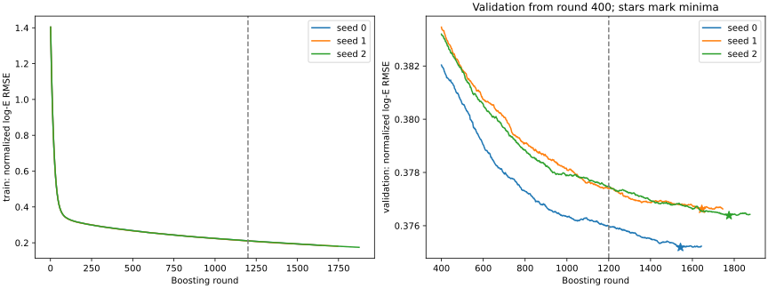
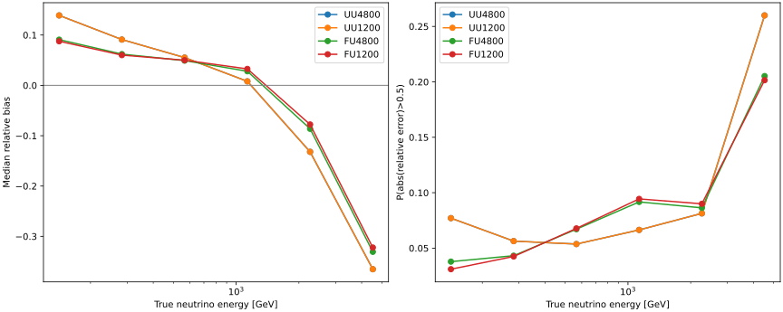

# 阶段22：延长BDT训练预算后的能谱权重响应检验

**实测结论：同CPU实现内，追加训练小幅改善整体和确认高y误差，同时使macro及最高能区响应退化。
全部6次长预算拟合均按patience早停后，flat相对unit仍改善端点，却加重整体、中能和高y误差。
因此1200轮上限并不足以解释原有响应取舍。结论限于本轮CPU/冻结validation；H100延长训练未测量。**

## 阶段目标与固定实验

阶段21在同输入、三seed下分离训练谱权重和早停目标，测得两端能量响应改善，
但整体、中能及primary确认高y误差退化。其FU BDT三seed均达到1200轮上限，
因此本阶段只检验**这一预算限制是否改变物理取舍**，不增加输入或寻找新的最佳超参。

正式训练前冻结[预注册协议](stage22_energy_ml/preregistered_protocol.md)和
[初始GPU配置](../ml/configs/prior_budget.yaml)。初始计划在H100上只改轮数；公用GPU持续占用，
103→20迁移后也未启动，正式结果产生前修订为[CPU配置](../ml/configs/prior_budget_cpu.yaml)，
并以CPU自身1200轮prefix为短预算对照，避免跨实现比较混淆。最多轮数1200→4800；固定原F5、depth7、
learning rate0.04、subsample0.8、min_child_weight20、lambda10，unit validation monitor、
patience100、180 s/fit、CPU hist与4线程，seeds20261029/30/31。
UU为unit训练，FU为train-bin flat训练，每轮两CPU作业、6次长预算fit；
每设置另做seed0独立1200轮控制，每轮8次，线程修正前后合计16次正式fit；无选参、无再调权重。
阶段21原24次结果不变，本轮UU1200/FU1200由CPU各seed的prefix定义，
旧H100预测/曲线仅作跨实现参考；原H100延长预算结果仍未测量。

## 样本、输入与统计约定

沿用stage12官方`d32b0ff3` merge/without-IFT，FASERNU-04、TI12MC04、
OFLCOND-FASER-06、s0014，nominal runs 200082/200083/200089/200093/200094/200100。
原20项选择、最高pz leading、truth fiducial、共同缺失文件规则及全部异常事件保留。
train/validation=54,196/13,375 events，91/22来源组；输入为
`ntuples/energy_ml_stage12/dataset/{train,validation}.npz`，
来源清单`ml/configs/files.tsv`，真值诊断复用`ntuples/energy_ml_stage15/validation_truth.npz`。
46个原始F5特征展开92维，asinh、缺失填补、标准化和logE中心/尺度仍按原unit train拟合。
不评价calibration/test/SIBYLL challenge，不用y/primary身份/顶点作输入。

用户确认的默认unit MC评价权重继续使用；本阶段flat不是物理flux归一化。
FU权重与阶段21完全相同：六个100–6400 GeV倍增bin的train数为
[2944, 9776, 17237, 15790, 7303, 1146]，`w_b=54196/(6n_b)`，不裁剪、不抽样。
Σw=54,196.000000、Σw²=128,326.676783、Kish Neff=22,888.509931；
train最高能bin每事件权重7.881908。没有增加独立高能事件。

主比较FU4800−FU1200为追加预算效应、FU4800−UU4800为延长后的训练权重效应；
UU4800−UU1200为早停控制、FU1200−UU1200为本轮CPU短预算参考。
宏观指标是六bin等权的平均log均方误差开平方，整体指标是unit validation平均log
均方误差开平方；三seed先平均事件损失，不平均预测。
`r=Epred/Etrue−1`，median bias和R68=(q84−q16)/2按各seed先算再平均，
0.5/1.0尾率为P(|r|>0.5/1.0)，正负0.5尾部分开。

500次同22来源组配对bootstrap，按阶段21相同seed及方法产生区间。
median/R68区间用经验CDF分位数，各seed分别算再平均；与NumPy插值的描述值区分。
分层包括全部能量bin、y、primary确认y≥0.6/0.8、matching、材料和run。
两个run子样本200089/200100各有23次重采样为空，区间各用477次有效抽样；
主结论的整体、能量及高y区间均使用500次，实际有效次数逐行记录，不补造空分层误差。
区间条件于已经调参/早停的validation，不含重新训练/选参不确定性，未做多重比较校正。

## 执行、程序控制与复现命令

复用CVMFS LCG_109_cuda/x86_64-el9-gcc13-opt，Torch2.10.0/CUDA12.5、
XGBoost2.1.3和现成两个纯Python wheel；无C++/Calypso重建。
`train_prior.py`新增可选配置及BDT轮数覆盖，默认仍为stage21；初始trial仍检查
属于原固定stage16配置，明确的budget覆盖改变最多轮数，CPU资源修订仅设置hist后端和线程数。
CPU UU/FU都调用同一个加权拟合函数，分别传全1和原flat权重；旧GPU默认路径保留。
每seed保存前1200轮内unit monitor最佳检查点预测；与同CPU独立短拟合核对，
再量化其与阶段21的跨实现差异，
不重新选择评价方式。包装脚本的配置/阶段参数及资源收集器的作业数均保留原默认值。

初始T4和后续CPU均用1200/400事件、20 trees、seed0跑通UU/FU两分支；
初始GPU小样本与阶段21逐事件一致，其记录单独保存为`smoke_*_gpu`。
正式采用CPU版本的下列读回记录。
二者400事件checkpoint读回均通过，权重与预处理核查通过，详见
[smoke_summary](stage22_energy_ml/smoke_summary.json)、
[smoke_numerical_checks](stage22_energy_ml/smoke_numerical_checks.json)、
[smoke_checkpoint_checks](stage22_energy_ml/smoke_checkpoint_checks.tsv)。
小样本继承原函数的`patience`标签，实际为20树短跑，不用于判定收敛或物理精度。

初交bigbird103 EosSubmit cluster848838，后迁移至当时idle=0的bigbird20 cluster1561047，
全部GPU fit均未启动。排队分析显示公用H100占用；空闲整卡有账户组限制，
MIG节点ShutdownTime已过且处于drain。切换schedd不能绕过资源/账户分配规则。
正式结果出现前挂起并移除GPU作业，在bigbird20提交首轮CPU cluster1561135。
首轮发现线程设置问题后，以cluster1561194完成性能修正复验；详见下节，全部结果保留。
资源修订及首次空闲队列快照见[scheduling](stage22_energy_ml/scheduling.json)，
不根据正式精度结果更改预算。CPU可行性短跑为5000事件/20树、1线程0.337183 s，
正式全样本耗时不能由该数值外推，见[cpu_feasibility](stage22_energy_ml/cpu_feasibility.json)。

worker在scratch解包/训练，末尾经XRootD上传紧凑结果，无新ROOT/xAOD或输入事件副本。
初始未使用GPU传输包54,618 bytes，首轮CPU传输包55,887 bytes，修正后CPU包55,918 bytes，
分别在打包时核对源码，见
[payload_verification](stage22_energy_ml/payload_verification.json)、
[payload_verification_cpu](stage22_energy_ml/payload_verification_cpu.json)、
[payload_verification_cpu_threaded](stage22_energy_ml/payload_verification_cpu_threaded.json)。
CVMFS、选择、输入、权重、seed及统计协议不变；CPU/GPU不同的抽样/直方图实现及线程
变化都可能影响轨迹，不把跨实现差异归因于单一硬件数值因素。

```bash
source /cvmfs/sft.cern.ch/lcg/views/LCG_109_cuda/x86_64-el9-gcc13-opt/setup.sh
export OMP_NUM_THREADS=1 OPENBLAS_NUM_THREADS=1 MKL_NUM_THREADS=1 PYTHONNOUSERSITE=1
export PYTHONPATH="$PWD/software/energy_ml_tabular_deps/tabm-0.0.3-py3-none-any.whl:$PWD/software/energy_ml_tabular_deps/rtdl_num_embeddings-0.0.12-py3-none-any.whl${PYTHONPATH:+:$PYTHONPATH}"
for mode in UU FU; do
  python3 ml/train_prior.py --architecture bdt --mode "$mode" \
    --config ml/configs/prior_budget_cpu.yaml --smoke \
    --output-dir "/tmp/nu_mu_stage22_smoke_bdt_${mode}"
done
python3 ml/check_prior.py --config ml/configs/prior_budget_cpu.yaml --smoke
tar -czf software/energy-ml-prior-cpu-threaded-stage22.tar.gz ml/train_prior.py ml/train_tabular.py \
  ml/train_bdt.py ml/robustness.py ml/configs/prior_budget.yaml ml/configs/prior_budget_cpu.yaml ml/configs/prior.yaml \
  ml/configs/tabular.yaml ml/configs/baseline.yaml ml/configs/robustness.yaml \
  ml/configs/files.tsv software/energy_ml_tabular_deps/*.whl
bash -n AnalysisZipFramework/submission/run_ml_prior.sh
mkdir -p /afs/cern.ch/user/x/xcheng/nu_mu_stage22/logs
cp AnalysisZipFramework/submission/run_ml_prior.sh /afs/cern.ch/user/x/xcheng/nu_mu_stage22/
condor_submit -name bigbird20.cern.ch -dry-run /tmp/nu_mu_stage22.cpu-submit.ad \
  AnalysisZipFramework/submission/ml_prior_budget_cpu.sub
condor_submit -name bigbird20.cern.ch AnalysisZipFramework/submission/ml_prior_budget_cpu.sub
# 等待2 jobs全部完成后，统计并读回最终checkpoint。
python3 ml/report_prior_budget.py
python3 ml/check_prior.py --config ml/configs/prior_budget_cpu.yaml
python3 ml/collect_tabular_resources.py --cluster 1561194 --prefix ml_prior_budget_cpu \
  --jobs 2 --gpus 0 --cpus 4 --log-dir /afs/cern.ch/user/x/xcheng/nu_mu_stage22/logs \
  --report-dir workbook/stage22_energy_ml
```

## 程序原因排查与线程修正

首轮两作业请求/配置4 CPU，但继承的`torch.set_num_threads(1)`把共享OpenMP运行时
限制在单线程；worker累计CPU/wall=446.121/452.765≈0.985。
独立5000×92合成输入、20树探针，固定XGBoost nthread4，仅改Torch全局线程1→4，
wall **0.752470→0.272494 s**，CPU/wall **0.994→3.843**，预测最大绝对差0。
这为程序性能原因提供直接控制证据，见[threading_probe](stage22_energy_ml/threading_probe.json)。

仅在CPU分支同步Torch线程到配置值，保留GPU默认单线程；源代码差异保存在
[thread_fix.patch](stage22_energy_ml/thread_fix.patch)。首轮结果未删除或用于新选参，
修正后原样重复6次长预算及2次独立短预算控制，阶段合计**16次fit**。
主物理表使用修正后的同CPU预算比较；首轮概要/曲线/成本保留在
[before_thread_fix](stage22_energy_ml/before_thread_fix/summary.json)。

[threading_reproduction](stage22_energy_ml/threading_reproduction.tsv)显示：
三seed最终及prefix预测的最大相对差UU为2.22×10⁻¹⁶、FU为0；
共同train/validation曲线最大差≤1.12×10⁻¹⁵，best及停止iteration全部一致。
因此这次线程修正的精度变化仅在浮点末位，未改变本阶段物理结论。
其统计不作为新的独立seed或额外模型选择。

CPU与阶段21H100的预测并非精确复现：本轮1200轮prefix对旧模型，UU三seed最大相对差
0.282/0.239/0.382，平均绝对相对差2.857%/2.822%/2.793%；
FU对应0.415/0.396/0.334和3.816%/3.848%/3.840%。共同曲线亦有差异，见
[stage21_hardware_reference](stage22_energy_ml/stage21_hardware_reference.tsv)。
CPU/GPU抽样、直方图实现、硬件及线程共同变化，不把这个对照当作纯预算效应，
也不把聚合精度接近称为逐事件复现。主预算对照始终在本轮同CPU拟合轨迹内完成。

[preprocessing_checks](stage22_energy_ml/preprocessing_checks.tsv)核对特征和标签中心/尺度；
标量参数差至多浮点末位。用同一本地transform对两partition、六份保存的预处理配置
全量复算，67,571例×92维float32输入全部一致，见
[input_precision_checks](stage22_energy_ml/input_precision_checks.json)，耗时1.798 s。
这是同一本地实现的复算，worker中间矩阵未保存，不冒充对worker数组的直接读回。
最终两个seed0 checkpoint各读回2,048例，UU/FU最大相对预测差分别2.22×10⁻¹⁶/0，
权重等bin总和及预处理检查通过，见[checkpoint_checks](stage22_energy_ml/checkpoint_checks.tsv)、
[numerical_checks](stage22_energy_ml/numerical_checks.json)。

## 早停与追加轮数的实测效果

iteration从0编号，实际训练轮数从1计。下表为修正后的主6次长预算拟合：

| 设置 | seed0/1/2最佳iteration | seed0/1/2实际轮数 | 停止原因 |
|---|---|---|---|
| UU4800 | 678 / 563 / 535 | 779 / 664 / 636 | 全部patience |
| FU4800 | 1542 / 1644 / 1774 | 1643 / 1745 / 1875 | 全部patience |

六次均未触及4800轮或180 s上限。UU1200与UU4800三seed预测完全相同。
FU1200的prefix最佳iteration为1199/1196/1195；追加训练确实选到后续检查点。
两个seed0独立短拟合与相应prefix的预测和共同曲线差均0，见
[prefix_controls](stage22_energy_ml/prefix_controls.tsv)及两模型目录的`short_budget_control.json`。
其他四个seed的独立短拟合**未测量**，其prefix来自本身长拟合，不额外计为六次短训练。
独立FU短控制按设计达到1200轮，不用它否认长预算拟合已patience停止。
patience停止只意味着本规则下100轮未改善，不等于全局最优或跨生成器收敛。



上图train显示全程，validation放大round≥400；星号是各seed最优检查点，虚线为1200轮。
这一区域仍在轻微改善，预算问题真实存在，不能只凭图上看似平坦宣布1200轮充分。

| CPU模型 | macro log-RMSE | integrated log-RMSE | 中位bias(%) | R68(%) | 0.5尾率(%) | 1.0尾率(%) |
|---|---:|---:|---:|---:|---:|---:|
| UU1200 = UU4800 | 0.373669 | 0.282939 | +3.632 | 22.381 | 6.694 | 0.636 |
| FU1200 | 0.357726 | 0.289242 | +3.495 | 22.495 | 7.454 | 0.892 |
| FU4800 | 0.360062 | 0.288565 | +3.376 | 22.519 | 7.362 | 0.857 |

完整中心值见[macro_summary](stage22_energy_ml/macro_summary.tsv)，
逐seed全部25分层共300行见[metrics](stage22_energy_ml/metrics.tsv)。
追加训练FU4800−FU1200的配对95%来源组区间为：

| 指标 | 差值 [95%区间] |
|---|---:|
| macro log-RMSE | **+0.002336 [+0.001507, +0.002988]** |
| 整体log-RMSE | **−0.000677 [−0.000947, −0.000388]** |
| primary确认y≥0.6 log-RMSE | −0.002912 [−0.004456, −0.001463] |
| 800–1600 GeV log-RMSE | −0.002814 [−0.003389, −0.002293] |
| 3200–6400 GeV log-RMSE | +0.007387 [+0.004383, +0.009753] |
| 3200–6400 GeV CDF中位bias(百分点) | −0.792 [−1.429, −0.336] |

整体0.5尾率变化−0.092个百分点 [−0.184, +0.018]，未测得明确改善。
因此延长训练在unit monitor选择下改善整体/中能/高y，同时损害两端贡献的macro和
最高能量响应；不是所有指标同方向改善。整体指标用于早停，其改善带有检查点选择性质，
区间仍条件于validation，不作独立泛化收益解释。
详见[macro_gains](stage22_energy_ml/macro_gains.tsv)、
[stratified_gains](stage22_energy_ml/stratified_gains.tsv)、
[nonlinear_gains](stage22_energy_ml/nonlinear_gains.tsv)。

## 追加训练后，训练谱取舍仍保留

主比较FU4800−UU4800：macro差为**−0.013607 [−0.018334, −0.008532]**，
但整体log-RMSE差仍为**+0.005626 [+0.004195, +0.006871]**。
这比同CPU短预算的整体代价+0.006303有所减轻，未将其消除；
不能拿CPU的这一减轻值直接减去旧H100结果并称为纯轮数收益。

整体0.5尾率增加**0.668个百分点 [0.448, 0.907]**；
过估r>0.5增加0.753个百分点 [0.500, 1.063]，
欠估r<−0.5变化−0.085个百分点 [−0.199, +0.056]。
新增总体尾部仍主要来自过估。

最高3200–6400 GeV仅268例，NumPy插值的描述性中位bias及尾率为：

| 设置 | 中位bias(%) | 0.5尾率(%) |
|---|---:|---:|
| UU4800 | −36.524 | 25.995 |
| FU1200 | −32.224 | 20.149 |
| FU4800 | −33.069 | 20.522 |

相对UU4800，FU4800的CDF中位bias改善**3.504个百分点 [2.118, 4.866]**，
0.5尾率减少5.473个百分点 [3.455, 7.143]；三种设置本bin尾部均为欠估。
表内插值描述值与CDF点估计/区间不是同一估计量，不把CDF区间直接标在插值差上。
最高能量区依然约33%欠响应，尚未恢复能量尺度。

最低100–200 GeV有731例，UU4800→FU4800的log-RMSE为0.233466→0.191070
（先平均各seed事件损失后开方），中位bias +13.902%→+9.084%，尾率7.706%→3.785%；
所以最低能量区也保留改善。800–1600 GeV有3,933例，log-RMSE
0.278957→0.297925，差+0.018968 [0.016285, 0.021546]；尾率6.645%→9.170%，
增加2.526个百分点 [2.106, 3.038]。

primary及入射ν母粒子确认、y≥0.6的670例中，log-RMSE
**0.561378→0.577510**，差**+0.016132 [0.009016, 0.023936]**。
中位bias −32.229%→−32.892%，0.5尾率23.234%→24.726%；
后者差+1.493个百分点 [−0.070, +3.308]跨零，不声称高y所有尾率指标均显著退化。
y≥0.8仅99例，log-RMSE差+0.012718 [−0.013831, +0.045929]跨零，
异常/高y事件继续保留。高能bin与高y不是同一条件样本；端点响应改善不能替代高y
未见强子能量的测量。本实验也未分解材料能损/泄漏的因果份额。



UU两预算的曲线重合。展平谱改变条件回归损失对不同能量事件的重视程度；
追加boosting与unit早停又改变检查点。统计证据支持这种风险函数/有限读出下的取舍，
不足以把最高能量欠响应归为“仅因1200轮未收敛”，也不支持据此扩大空间网络扫参。

## 实测资源、存储与最终验证

最终8次fit累计wall **173.238 s**、fit CPU685.342 s；首轮8次为438.234/433.192 s。
修正前后实际分配条件下wall比为**2.530**，CPU用时反而增加；资源优化减少等待计算的
wall代价，不能称为所有成本都降低。前后节点CPU型号不同，纯线程效应的控制证据
来自同节点合成探针，不将整批wall比全部归因于线程这一单一因素。
前后完整预算点、曲线和预测已复验，而不是用短跑推测正式加速。

最终worker累计wall180.301 s、CPU697.370 s、峰值RSS769.594 MiB；
前后16次总fit wall611.472 s，总worker wall633.066 s、CPU1143.492 s。
外层`/usr/bin/time`累计wall708.390 s、CPU1172.970 s、峰值788,064 KiB。
正式4个CPU作业全exit0，Condor remote CPU累计1174 s，分配core-time2880 core·s，
GPU分配0 s。最终轮提交到最后结束243 s，首轮376 s；GPU排队另记，不混作计算耗时。

每job描述文件请求4 CPU/3000 MB，Schedd实际分配4 CPU/**12000 MB**（见日志）；
最终UU/FU分别使用Xeon E5-2630 v4 @2.20 GHz / Silver4216 @2.10 GHz，
首轮两作业均Gold5218 @2.30 GHz，真实host保存在summary。
CPU正式训练未使用GPU；GPU内存指标不适用，部署推理延迟**未测量**。
资源收集器新增jobs/cpus/gpus参数，旧8作业默认路径复算阶段21资源摘要完全相同。
详见[costs](stage22_energy_ml/costs.tsv)、[summary](stage22_energy_ml/summary.json)、
[condor_resources](stage22_energy_ml/condor_resources.tsv)、
[condor_summary](stage22_energy_ml/condor_summary.json)、
[resource_comparison](stage22_energy_ml/resource_comparison.json)。

最终6个模型/预测/预处理文件15,017,373 bytes，另保留线程核查必需的4个紧凑
旧预测/预处理文件1,466,161 bytes，共**16,483,534 bytes**；仅保存最终seed0模型，
不保存独立短控制或首轮模型的重复checkpoint，无新事件输入缓存。
两份正式CPU包分别按当前源及逆补丁重建源核对后删除，未用GPU包一并删除，
总清理166,423 bytes，其他阶段数据未清理。
见[storage_cleanup](stage22_energy_ml/storage_cleanup.json)。
完整表格行数、事件键、指标独立复算、尾部分解、语法、队列及文档链接验证见
[final_validation](stage22_energy_ml/final_validation.json)。
最终独立核查用时1.721 s，4组预测的macro/integrated、300/100/64行评价表、
正负尾部分解及全部4个cluster无活动作业均通过；未重新训练或打开保留集。

## 阶段结论与下一步验收

1. 同CPU实现内，FU在约1,600–1,900轮按patience停止，追加训练的收益/代价均可测。
   仅把轮数上限从1200延长不能同时改善整体与能量端点；首轮预算不足确有影响，
   但不是训练谱引起响应取舍的全部解释。本结论不等于旧H100模型已完成延长训练。
2. 在当前样本/表示/早停规则下，flat仍降低macro和端点欠响应，却增加整体、中能及
   primary确认高y误差；不能因macro较好就替换unit能量观测量。独立test和物理测量
   收益尚未测量，材料/泄漏因果解释也未闭合。
3. 线程设置问题已通过受控探针定位、修正并全样本复验，精度差仅浮点末位；
   前后全部成本计入阶段记录，不以资源问题伪装物理变化。

下一步冻结**选中样本条件能谱闭合协议**：复用现有train/validation紧凑预测，比较
μ动量/0.8、固定BDT unit/flat及TabM unit/flat候选，不再据macro加扫架构。
正式计算响应矩阵前预注册六个truth能量bin、reco bin及上下溢出、来源组交叉划分、
拟合/正则化与MC统计处理。响应估计和闭合伪数据用不同来源组，谱形状扰动同时检查
bin内能谱变化；先验/标签仍只用于诊断，保持模型输入不含truth。
验收为同时报告名义及谱形扰动闭合偏差、统计区间/相关、迁移及可辨识性，
回答端点改善是否转化为能谱形状测量收益，不能仅比较回归RMSE。
单位权重下仅研究选中样本条件形状，绝对flux、接受度、生成器/探测器系统学和
真实data控制区仍**未测量**；calibration/test/SIBYLL challenge保持未评价。
