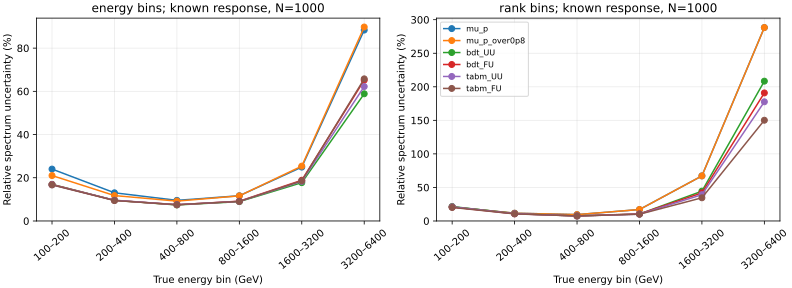
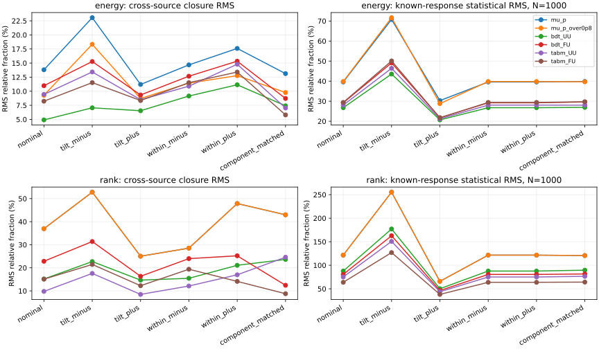

# 阶段23：选中样本条件能谱前向闭合

日期：2026-10-30。承接阶段22；本阶段完成正式计算、物理判断、数值复验与成本统计。

## 阶段目标与结论

检验既有回归增益能否转化为选中样本的能谱形状信息，并区分训练谱、箱内形状及有限MC的影响。
**在固定能量reco分箱、响应已知、N=1000个选中事件的基准下，BDT UU相对μ/0.8把六bin
相对统计误差RMS从39.797%降至26.752%，改善13.045个百分点，配对95%来源组区间
[5.983,32.490]个百分点。** TabM UU也保留统计信息收益，但本阶段不能建立它与BDT的
普适精度排序，尚不能证明任何候选具有更好的跨来源谱闭合。

**端点回归bias改善不等于能谱测量收益。** 固定能量分箱下，flat训练未测得明确的统计信息
或闭合收益；辅助rank分箱则出现flat的信息改善，但绝对误差很大、toy频繁碰边界。
**箱内谱形改变可在六bin真谱完全不变时增大闭合偏差**；后续应优先处理箱内形状依赖，
不能只通过回归尺度调整宣布响应恢复。本阶段未测量真实data、绝对flux或完整测量总误差。

## 冻结输入、样本与推断方法

计算前冻结[协议](stage23_energy_ml/preregistered_protocol.md)、
[配置](../ml/configs/closure.yaml)及[来源折](stage23_energy_ml/folds.tsv)。
本阶段没有新训练、超参/分箱扫描、正则化或异常事件删除。

- 输入：`ntuples/energy_ml_stage12/dataset/validation.npz`，13,375例、22个配对ν/反ν来源组。
  原stage12选择及100–6400 GeV truth范围；六bin分别有731、2455、4247、3933、1741、268例。
- μ基线读`ML_mu_p_GeV`；BDT UU/FU读`ml/artifacts/stage22/`CPU长预算的最终三seed预测，
  TabM UU/FU读`ml/artifacts/stage21/`最终三seed预测。不使用prefix或平均事件预测。
  学习器共12个独立读出、μ基线2个，共14个观测量实例；平均的是各seed/方向的**平方量**。
  历史训练硬件和预算不同，不能解释为本阶段同训练预算架构竞赛。
- 原unit MC混合，charm/k/pi分别8.0075%/54.0860%/37.9065%，不是flux权重。
  charm/k/pi分别3/11/8组，按组件内字典序交替分折，ν与反ν不拆开。
  A为11组6527例，B为11组6848例；双向A响应→B伪数据和反向。
  A/B的charm分别738/333例，k为3282/3952例，pi为2507/2563例。
- 真能量bin固定为[100,200,400,800,1600,3200,6400] GeV。
  主reco为9个内部边界[200,200√2,400,400√2,800,800√2,1600,1600√2,3200] GeV，共10类。
  首末类保留全部流出；μ/μ÷0.8分别有111/148例reco≥6400 GeV，未删除。
  所有候选reco<100 GeV计数均0，学习模型reco≥6400 GeV计数也均0。
  辅助rank为**响应折自身**观测量十分位，不使用truth或伪数据选择边界，bootstrap条件于固定边界。
- 以响应折估计`R[j,b]=P(reco j | truth b, selected)`；谱形`f≥0, sum(f)=1`。
  SLSQP最小化归一多项分布NLL，均匀初值、解析梯度、ftol=1e-13、最多500步。
  无伪计数/平滑/正则化；零支撑、空truth箱及优化失败均单独记录。
- Fisher矩阵只评价**已知响应**、无背景、固定选中数N=1000的局部形状统计信息。
  在五维simplex切空间求逆，映回六bin；相对特征值阈值1e-10，无伪逆。
  N=1000不是实际data产额，σ不是包含有限MC/物理系统学的完整误差。
- nominal；tilt±用伪数据权重`(E/800 GeV)^(±0.5)`；within±用
  `(E/真箱几何中心)^(±1)`，每个伪数据truth箱重新归一到原事件数。
  bootstrap每次也重新归一within权重，所以该压力测试严格保持六bin真谱不变。
  component_matched将两折分别匹配到全validation的unit组件比例，仅作中心值诊断，
  没有bootstrap/toys或显著性判断；匹配同时改变每折truth分布及箱内组件条件混合。

500次**来源组配对bootstrap**，每折有放回抽11组，跨模型/seed/case共享同一批组权重，
R、truth、reco同时重建，保持相关性。主闭合指标为六bin、seed、两个方向的相对偏差平方
平均后开方，绝不抵消相反方向的signed bias。每个seed/方向/分箱另做200个N=1000固定R
多项分布toy，是已知响应的统计检查，不是跨来源/生成器/data闭合。

这是已经用于选参/早停的validation再诊断，**不是独立test**。没有读取calibration、test或
SIBYLL challenge的预测/标签。组bootstrap条件于冻结模型和rank边界，不包含重训练不确定度；
三seed离散只作有限重复，3个charm来源组尤其限制总体MC不确定度的代表性。
所有95%区间为来源组bootstrap百分位区间，未做多重比较校正，不作最终独立确认显著性。

## 主结果：统计信息改善与闭合仍须分开

表内均为相对fraction的百分数；闭合和σ均先对平方量平均再开方。
最后一列是最高3200–6400 GeV bin的相对σ。

| 候选 | energy闭合RMS(%) | energy统计σ RMS(%) | 最高bin σ(%) | rank闭合RMS(%) | rank统计σ RMS(%) |
|---|---:|---:|---:|---:|---:|
| μ动量 | 13.809 | 39.588 | 88.357 | 36.953 | 121.515 |
| μ动量/0.8 | 9.284 | 39.797 | 89.767 | 36.953 | 121.515 |
| BDT UU | 4.911 | 26.752 | 58.868 | 15.146 | 87.702 |
| BDT FU | 10.979 | 29.211 | 65.175 | 22.834 | 80.523 |
| TabM UU | 9.436 | 28.049 | 62.222 | 9.770 | 75.066 |
| TabM FU | 8.232 | 29.381 | 65.778 | 15.087 | 63.798 |

[完整模型汇总](stage23_energy_ml/model_summary.tsv)、
[逐bin汇总](stage23_energy_ml/bin_summary.tsv)、
[336组逐seed/方向拟合](stage23_energy_ml/metrics.tsv)、
[2016行truth/fit/bias](stage23_energy_ml/closure_bins.tsv)。

主分箱下的配对差值为“候选−参考”，负值表示误差降低；单位均为百分点：

| 比较 | 统计σ RMS差 [95%来源组区间] | 闭合RMS差 [95%来源组区间] |
|---|---:|---:|
| μ/0.8 − μ | +0.209 [−3.342,+10.911] | −4.525 [−20.485,+17.936] |
| BDT UU − μ/0.8 | **−13.045 [−32.490,−5.983]** | −4.373 [−43.782,+11.290] |
| TabM UU − μ/0.8 | **−11.747 [−29.001,−3.488]** | +0.151 [−36.157,+14.532] |
| BDT FU − UU | +2.459 [−1.587,+9.720] | +6.068 [−10.130,+22.463] |
| TabM FU − UU | +1.332 [−3.125,+7.508] | −1.204 [−12.661,+12.404] |
| TabM UU − BDT UU | +1.298 [−1.200,+6.640] | +4.524 [−11.092,+19.555] |

全部配对使用500/500共同有效重复，详见[840行配对表](stage23_energy_ml/paired_comparisons.tsv)。
主分箱下，UU两学习器最高bin的σ相对μ/0.8也改善：BDT为−30.899个百分点
[−78.884,−13.333]，TabM为−27.546 [−70.046,−6.771]。
因此新增读出的现有标量表示保留了超出μ动量的**条件谱统计信息**，收益不仅是回归RMSE变化。
但未包含背景、接受度、flux及探测器系统学，不足以宣布最终物理测量改善同样大小。

μ缩放只改变与固定reco边界的相对位置，不创造信息：rank下两个μ候选的响应、Fisher及
全部bootstrap指标**逐项完全相同**。所以不能把energy分箱的中心值差当成新探测器信息。

辅助rank下也测得两UU学习器相对μ/0.8的σ RMS降低，BDT为−33.813个百分点
[−99.060,−11.288]、TabM为−46.449 [−121.753,−23.924]。
rank下FU−UU反而改善BDT/TabM的σ RMS 7.179 [1.126,20.405]及
11.268 [2.865,30.553]个百分点；TabM UU−BDT UU为−12.636 [−34.702,−2.628]。
这说明flat及架构的压缩后信息排序**依赖reco分箱**，不能只选一张有利的表推广结论。



跨来源闭合的模型差区间很宽，主五个case均未确立模型间明确的闭合赢家。
BDT UU的4.911%只是中心值，其来源bootstrap区间4.563%–26.783%；μ/0.8为
6.552%–51.162%，TabM UU为5.388%–31.775%。**RMS非负，直接对bootstrap RMS作
百分位区间不能检验“零bias”假设**；这里不因区间下界>0宣布显著不闭合，也不因模型差跨零
宣布已经通过闭合。有限来源MC下，本阶段支持的信息收益强于闭合收益证据。

两个方向的signed bias没有抵消：例如μ/0.8 seed0最高bin为+19.094%/−13.595%，
BDT FU seed0为+24.323%/−23.201%；主表使用所有seed/方向的平方而非signed平均。
最高bin仅268例，其中251例k、17例charm、0例pi，不能把这里的行为推广为均匀的组件收益。
[来源组成](stage23_energy_ml/source_composition.tsv)给出两折全部bin的计数。

## 谱形压力测试与物理原因

下表为主energy分箱的闭合RMS(%)；每列响应仍固定为相应响应折nominal R，
最后一列例外，使用同时匹配组件的响应与伪数据，仅作诊断。

| 候选 | nominal | tilt−0.5 | tilt+0.5 | within−1 | within+1 | 组件匹配 |
|---|---:|---:|---:|---:|---:|---:|
| μ | 13.809 | 23.061 | 11.205 | 14.677 | 17.599 | 13.128 |
| μ/0.8 | 9.284 | 18.331 | 8.708 | 11.434 | 12.773 | 9.768 |
| BDT UU | 4.911 | 7.056 | 6.536 | 9.149 | 11.146 | 7.412 |
| BDT FU | 10.979 | 15.275 | 9.338 | 12.667 | 15.335 | 8.715 |
| TabM UU | 9.436 | 13.423 | 8.491 | 10.898 | 14.789 | 7.022 |
| TabM FU | 8.232 | 11.528 | 8.350 | 11.520 | 13.406 | 5.795 |

作为冻结case的**补充、事后配对汇总**，within+1相对nominal的闭合RMS变化为：
BDT UU **+6.235个百分点 [1.282,7.303]**，BDT FU +4.356 [1.780,7.572]；
TabM UU **+5.353 [2.334,8.102]**，TabM FU +5.174 [1.205,7.394]。
这些区间未作多重比较校正，不能升级成新的独立确认检验；方向一致且固定bin真谱严格不变，
为当前平均响应的箱内谱形敏感性提供数据证据。
within±下R与六bin真谱不变，Fisher统计σ保持不变，而闭合偏移可扩大；统计信息收益不能替代谱形稳健性。
within−1的四个学习器变化区间均跨零，不声称正负扰动有对称效应。
完整补充对比见[stress_changes](stage23_energy_ml/stress_changes.tsv)。

物理/统计原因是`R[j,b]`还平均了该truth箱内连续能量、组件和事件运动学的分布。
即使六个箱积分完全相同，偏向箱内高能会改变reco迁移；无正则化拟合会将这种差异部分解释为
不同的bin fractions。flat改变回归训练风险及输出排序，没有自动消除这种有限分箱依赖。
本阶段未隔离材料能损、未见强子能量或泄漏各自的因果份额。

组件匹配能使部分中心值改善，也会使BDT UU等候选变差；rank下变化更大。
匹配没有单独的不确定度评估，而且不是箱内组件和运动学完全匹配，故不能将全部差异归因于
A/B的charm比例，也不能用匹配后的单个小bias宣布闭合。三个charm来源组的限制仍存在。



## 分箱代价与toy检查

所有336个中心响应都通过数值可辨识性阈值，Fisher条件数energy为54.269–121.955，
rank为71.863–309.028；**数值可辨识不等于N=1000时有足够统计精度或高斯区间可靠**。
rank的最后阈值仅约1.75–2.09 TeV（学习器随seed/方向变化），把更高reco合在一个类中。
例如BDT UU平均有52.582%的1600–3200 GeV事件和77.577%的3200–6400 GeV事件进入最后一类；
TabM UU为52.421%/80.574%。单位混合中最高truth bin仅约2%，等频压缩损失了稀少高能区的区分。
这不是删除异常事件或程序不可辨识造成的现象。

共11,200个固定R toy，全部拟合成功。下表最高truth bin的相对RMS误差、任一bin碰非负边界
的toy比例及最高bin的Fisher ±1σ覆盖率，均由相应模型全部seed/方向合并：

| 候选 | energy相对toy RMS(%) | energy碰边界(%) | energy覆盖(%) | rank相对toy RMS(%) | rank碰边界(%) | rank覆盖(%) |
|---|---:|---:|---:|---:|---:|---:|
| μ/0.8 | 82.529 | 10.250 | 69.000 | 192.057 | 42.250 | 84.250 |
| BDT UU | 58.627 | 3.833 | 66.583 | 162.788 | 30.417 | 82.083 |
| BDT FU | 60.451 | 4.833 | 70.667 | 147.475 | 28.667 | 83.167 |
| TabM UU | 59.722 | 4.250 | 68.667 | 141.579 | 27.250 | 82.750 |
| TabM FU | 61.189 | 5.750 | 69.250 | 122.863 | 24.250 | 82.833 |

每个学习器/分箱/真bin汇总1200 toys，μ为400，覆盖率有有限toy误差；不是实际data的coverage。
主energy分箱所有候选/bin覆盖率63.75%–73.00%，pull std为0.888–1.045；高能端仍有边界效应。
rank最高bin局部σ达150.171%–288.311%，toy平均偏差、pull压缩及过覆盖明显，
不能把rank的Fisher排序当作可靠的最终置信区间或部署选择。
μ两候选的rank toy数值略不同，是各自顺序RNG先生成不同energy toys后得到的独立实现；
toys未作跨模型配对比较，严格相等对照使用的是R、Fisher和共享组bootstrap。
详见[逐seed toy表](stage23_energy_ml/toys.tsv)、[合并toy表](stage23_energy_ml/toy_summary.tsv)。
[响应矩阵](stage23_energy_ml/response.tsv)、[相关矩阵](stage23_energy_ml/correlations.tsv)、
[reco边界](stage23_energy_ml/reco_edges.tsv)、[流出](stage23_energy_ml/flows.tsv)全部保留。

## 程序原因排查、执行命令与实际资源

新增`ml/closure.py`小数组推断及`run_closure.py` worker，预聚合group×truth×reco后只在小表
上重采样；原事件只读一次，无ROOT/xAOD扫描、无Torch/XGBoost推理或新事件副本。
`report_closure.py`合并紧凑输出，`check_closure.py`独立用逐事件二维直方图复算。

先本地smoke：每折每truth箱最多150例，共1768例；固定RNG抽样，seed0、8 bootstrap和8 toys。
μ/TabM UU核心wall为0.517/0.538 s、峰值RSS 80,032/557,748 KiB；无bootstrap失败、无self-check失败。
初次按文件顺序取前150例使组件不具代表性，改为固定随机抽样后再正式提交；未根据物理结果调选择。
[smoke记录](stage23_energy_ml/smoke_checks.json)不用于物理结论。

```bash
source /cvmfs/sft.cern.ch/lcg/views/LCG_109_cuda/x86_64-el9-gcc13-opt/setup.sh
export OMP_NUM_THREADS=1 OPENBLAS_NUM_THREADS=1 MKL_NUM_THREADS=1 PYTHONNOUSERSITE=1
python3 ml/run_closure.py --model mu_p --output-dir /tmp/nu_mu_stage23_smoke_mu_v2 --smoke
python3 ml/run_closure.py --model tabm_UU --output-dir /tmp/nu_mu_stage23_smoke_tabm_v2 --smoke
python3 ml/prepare_closure.py
mkdir -p /afs/cern.ch/user/x/xcheng/nu_mu_stage23/logs
cp AnalysisZipFramework/submission/run_ml_closure.sh /afs/cern.ch/user/x/xcheng/nu_mu_stage23/
condor_submit -name bigbird20.cern.ch AnalysisZipFramework/submission/ml_closure.sub
# 等待6 jobs完成后汇总与独立核验：
python3 ml/report_closure.py --compact
python3 ml/check_closure.py
python3 ml/collect_tabular_resources.py --cluster 1561506 --prefix ml_closure \
  --jobs 6 --gpus 0 --cpus 1 --log-dir /afs/cern.ch/user/x/xcheng/nu_mu_stage23/logs \
  --report-dir workbook/stage23_energy_ml
```

正式cluster **1561506@bigbird20**，6 jobs于15:16:16 CET提交、15:18:47启动，全部exit0；
最后15:20:26结束，提交至完成250 s。提交前该schedd仅2 idle job，未因排队切换或重复提交。
每job请求并实际分配**1 CPU/3000 MB**，单线程BLAS/OpenMP、无GPU。
全部140,000组bootstrap谱拟合、11,200 toy、336中心值及112真实响应self-check均完成。
所有500/500 bootstrap有效，无空truth箱、零支撑、优化失败或Fisher不可辨识。

| job候选 | worker wall(s) | worker CPU(s) | worker峰值RSS(KiB) |
|---|---:|---:|---:|
| μ | 25.610 | 25.029 | 75,416 |
| μ/0.8 | 24.263 | 23.844 | 73,412 |
| BDT UU | 74.006 | 73.093 | 78,504 |
| BDT FU | 70.772 | 69.932 | 74,656 |
| TabM UU | 90.684 | 89.165 | 68,640 |
| TabM FU | 85.438 | 84.794 | 79,456 |

累计worker wall **370.774 s**、CPU **365.858 s**，峰值**77.594 MiB**。
外层计时累计wall381.970 s、CPU371.830 s，Condor remote CPU375 s、分配409 core·s。
这是谱推断与重采样成本，不能当作六回归器的事件推理速度；GPU内存/延迟不适用。
host及版本NumPy2.2.6/SciPy1.16.3见[summary](stage23_energy_ml/summary.json)，
[Condor资源](stage23_energy_ml/condor_resources.tsv)、[批次摘要](stage23_energy_ml/condor_summary.json)。

合成矩阵fractions恢复误差2.74×10⁻⁸，梯度有限差分最大差1.90×10⁻¹⁰，零支撑与退化矩阵
探针均正确识别。实际响应做nominal及高两箱翻倍的112次exact forward self-closure，全部通过；
最大fraction/reco绝对误差分别**2.15×10⁻⁷/7.44×10⁻⁸**。
中心解最大simplex KKT残差**7.01×10⁻⁷**。这是程序自闭合，不冒充独立样本闭合。

[独立核验](stage23_energy_ml/independent_checks.json)对336个中心case重建事件权重/二维直方图，
R最大差2.89×10⁻¹⁵，truth fractions差3.33×10⁻¹⁵，相对σ差7.64×10⁻¹⁴；
确认within真箱计数守恒、键对齐、bootstrap每折11组、seed/双向平方聚合，耗时1.897 s。
这排除了分箱索引、权重归一、矩阵方向或signed抵消造成当前结果的程序解释。

仅新增6份bootstrap/中心小数组共**2,378,068 bytes**，保存在忽略的`ml/artifacts/stage23/`；
无新checkpoint/事件缓存。报告分片核对行内容后合并，删除976,458 bytes重复分片，
包含6份重复JSON；5,440,073-byte源码/输入包对9成员逐字节核对后删除。
[合并记录](stage23_energy_ml/compaction.json)、[存储清理](stage23_energy_ml/storage_cleanup.json)记录路径与大小。

[最终验证记录](stage23_energy_ml/final_validation.json)另外核对全部配对区间、表格行数、文档链接、
图文件、语法、无活动作业及源码包重建；C++/ROOT处理未修改，未重新构建。

方法参考：Cousins, May, Sun (2016), [arXiv:1607.07038](https://arxiv.org/abs/1607.07038)，
支持直接在重建空间作模型比较；Schmitt (2012), [arXiv:1205.6201](https://arxiv.org/abs/1205.6201)，
提示迁移问题的信息损失和正则化代价。本阶段采用无正则化前向形状拟合，先量化信息与有限MC限制。

## 下一步计划与验收

1. 优先冻结**箱内谱形响应诊断**，继续仅用现有validation与同一来源组交叉折、单位权重。
   固定六个报告bin，预注册12个半对数内部能量bin的积分/within±模板（不扫多个内部划分），以及固定观测量BDT UU、TabM UU、μ控制。
   不同时自由拟合超过reco信息维数的子箱fraction/shape参数；形状模板先作固定注入/扫描，
   不能用拟合自由度吸收一切偏差后宣布闭合。所需输入为现有事件truth、组、冻结预测。
   验收：量化箱内建模能否降低同一within注入下的闭合偏移，连同组MC变化、统计代价及toy边界报告；
   不能通过扫描后挑最好分箱、删高y/异常事件或打开test验收。
2. 在形状/有限MC稳定性获得证据后，再冻结拟合与nuisance协议，补充已授权查找的生成归一化、
   生成器/探测器响应变体和真实data控制区。缺少的flux、接受度、背景与系统学仍明确**未测量**，
   不请求用户重新提供已确认暂缺的清单，不将unit条件信息换算成实际测量灵敏度。
3. 保留BDT与TabM，不因macro或本阶段某个中心值直接部署新模型。空间分支如继续，需先审计
   track/segment跨层关联的实际新增输入；本阶段没有新增支持扩大GNN/Transformer扫参的证据。
