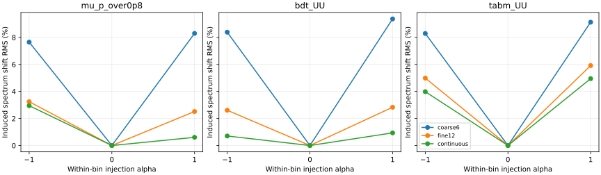
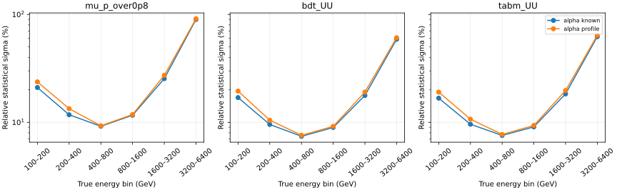

# 阶段24：箱内谱形响应积分的物理检验

日期：2026-10-30。承接阶段23；完成预注册计算、独立复验、资源统计及阶段提交。

## 阶段目标与有效结论

检验在六个报告truth箱积分不变时，用更细内部响应能否减小已知箱内谱形造成的谱偏移。
**固定12个内部半对数箱使BDT UU的±注入偏移RMS从8.889%降至2.722%，改善6.167个百分点，
配对95%来源组区间[2.425,7.004]个百分点。** μ/0.8与TabM UU也有配对区间支持的改善。
这直接支持阶段23偏移中存在可通过箱内响应积分建模的部分，无需新训练或修改回归尺度。

连续事件重加权参考中心值进一步减小偏移，但相对12内部箱的额外改善区间均跨零。
**减少注入偏移不等于解决总闭合**：TabM正向注入后的闭合RMS仍为14.180%（连续参考），
且跨来源toy最高bin覆盖率仍约61%。形状建模、来源变化与有限MC必须继续分开验证。

在N=1000选中事件、名义响应已知的局部Fisher诊断中，放开一个全箱共同的alpha参数，
BDT的统计σ RMS由26.752%升至27.985%，约增加4.61%。代价在该局部基准下较小，
但尚未完成未知alpha的实际拟合/覆盖率检验，更不代表六个独立箱内形状或全部系统学已受控。

## 冻结协议、输入和物理边界

[预注册协议](stage24_energy_ml/preregistered_protocol.md)及
[配置](../ml/configs/within_response.yaml)在本阶段响应/拟合结果产生前写入。
沿用stage23配置及[来源折](stage23_energy_ml/folds.tsv)，不改变选择、事件或来源组。

- 13,375例validation、22来源组，A/B为11组6527例/11组6848例，ν/反ν配对不拆开。
  保留原异常及全部reco流出；源缓存`ntuples/energy_ml_stage12/dataset/validation.npz`。
- 原unit MC混合及truth范围100–6400 GeV；六个报告bin为[100,200,400,800,1600,3200,6400] GeV。
  它们分别有731、2455、4247、3933、1741、268例，不使用正式flux/生成归一化。
- 观测量固定为μ动量/0.8、阶段22 CPU长预算BDT UU三seed、阶段21 TabM UU三seed；
  冻结预测分别位于`ml/artifacts/stage22/bdt_UU/predictions.npz`及
  `ml/artifacts/stage21/tabm_UU/predictions.npz`。不新训练或平均事件预测。
- reco固定stage23主energy十类：内部边界[200,200√2,400,400√2,800,800√2,
  1600,1600√2,3200] GeV，首末类保留所有上下溢出。不扫描rank或其他分箱。
- 双向A响应→B伪数据及反向，学习器各seed分别计算，再平均**平方量**。
  validation已用于历史选参/早停，本阶段是开发样本再诊断，不是独立test。
  未读取calibration/test/SIBYLL challenge预测或标签。

注入alpha为−1、0、+1，伪数据权重`(E/E_bin_geomean)^alpha`，每个报告truth箱恢复原bin总数。
每个bootstrap也重新归一，所以六bin真谱严格不变。响应仅用另一来源折，alpha作为**已知注入条件**
给响应构造；没有用伪数据的箱内truth分布推断alpha，不是已经得到真实data的形状约束。

三种响应均只拟合六个fractions，保留simplex约束、均匀初值、SLSQP解析梯度、ftol=1e-13、
maxiter=500，无正则化/平滑/伪计数：

1. **coarse6**：固定nominal六箱平均R0，所有注入使用同一R，复现阶段23。
2. **fine12**：每个报告箱仅在几何中心分成两个内部箱，固定nominal子箱条件响应R_sub；
   由响应折连续权重求各子箱占比g(alpha)，`R_b(alpha)=sum R_sub*g_sub(alpha)`。
   不自由拟合12个内部箱产额，内部划分只选这一种；半箱内响应仍固定。
3. **continuous**：在响应折直接以连续权重估计六箱条件R(alpha)，包含半箱内变化。
   它是已知alpha下的积分参考，不是新探测器信息，也不是实际未知形状已获约束。

alpha0三方法恒等，不能把fine12在名义点的表示变化解释为精度增益。
每个报告箱内连续条件分布变化，才使三方法在非零alpha下不同。

## 主指标：把注入偏移与原有闭合偏差分开

主指标为`s_b(alpha)=(fhat_b(alpha)-fhat_b(0))/ftrue_b`，对六bin、seed、双向、alpha±的s²
等权平均后开方。所有alpha的ftrue均相同，所以该量直接测量注入前后谱拟合变化；
不会将原有来源偏差与形状响应混作一个中心值，也不抵消相反方向的signed偏移。
另报告总闭合`fhat/ftrue-1`、已知R/alpha的N=1000统计σ及逐bin结果。

500次来源组配对bootstrap，沿用stage23相同seed和11/11组抽样，跨模型/方法/alpha共享组权重；
响应、子箱占比、伪数据truth/reco一起重估，保持相关性。所有主比较500/500共同有效，
无空内部truth箱、支撑失败、优化失败或profile Fisher不可辨识。
以下为95%百分位区间，条件于冻结模型、模板、来源组及validation，**未作多重比较校正**。
RMS非负，其正区间不用于检验零bias；模型之间仅描述，不新增架构选择。

| 候选 | coarse6偏移RMS(%) | fine12偏移RMS(%) | continuous偏移RMS(%) | fine12−coarse6(百分点，95%区间) |
|---|---:|---:|---:|---:|
| μ/0.8 | 7.977 | 2.901 | 2.127 | **−5.077 [−7.172,−0.530]** |
| BDT UU | 8.889 | 2.722 | 0.828 | **−6.167 [−7.004,−2.425]** |
| TabM UU | 8.717 | 5.470 | 4.490 | **−3.247 [−4.797,−0.630]** |

连续参考−coarse6的偏移RMS差：μ为−5.850个百分点 [−8.532,+0.511]，
BDT为−8.061 [−8.635,−2.028]，TabM为−4.227 [−6.914,+0.421]。
continuous−fine12三者差分别−0.773 [−2.698,+2.300]、−1.894 [−2.325,+1.473]、
−0.980 [−2.612,+1.294]个百分点，尚未建立更精细积分的额外统计优势。

每方向/seed保持signed值的数组保存在忽略的`ml/artifacts/stage24/<model>/bootstrap.npz`。
[90行模型汇总](stage24_energy_ml/model_summary.tsv)、
[90行配对比较](stage24_energy_ml/method_comparisons.tsv)、
[486行逐bin汇总](stage24_energy_ml/bin_summary.tsv)、
[756行逐seed/方向truth与拟合](stage24_energy_ml/closure_bins.tsv)给出完整数值。



这里测到的改善来自条件响应的箱内平均方式，而非新增观测量或更强网络。
半箱占比随谱形变化的部分已被fine12捕获；半箱内仍有连续迁移，continuous可以进一步建模，
但其来源MC变化也更重要，不能只看更小的中心值决定用法。

## 总闭合、统计精度与来源MC限制

表内为总闭合RMS(%)，不是上表的注入前后变化。名义点三方法相同，分别为
μ/0.8 9.284%、BDT UU 4.911%、TabM UU 9.436%。

| 候选 | alpha | coarse6 | fine12 | continuous |
|---|---:|---:|---:|---:|
| μ/0.8 | −1 | 11.434 | 7.472 | 6.654 |
| μ/0.8 | +1 | 12.773 | 10.573 | 9.721 |
| BDT UU | −1 | 9.149 | 5.036 | 4.491 |
| BDT UU | +1 | 11.146 | 6.074 | 5.292 |
| TabM UU | −1 | 10.898 | 6.267 | 5.784 |
| TabM UU | +1 | 14.789 | 14.587 | 14.180 |

BDT fine12−coarse6的总闭合差在alpha−1/+1分别为−4.113个百分点 [−4.953,+0.184]、
−5.073 [−6.142,+0.297]，均跨零；不能用其中心值接近nominal就宣布更好闭合。
TabM负注入fine12−coarse6为−4.631 [−6.445,−0.576]，有条件区间支持；
正注入仅−0.202 [−4.314,+3.849]，没有相同结论。结论须保留这种方向差异。

已知alpha的BDT统计σ RMS，coarse6固定26.752%；fine12在−1/+1为26.314%/26.964%，
continuous为26.143%/27.134%。μ及TabM的完整σ见模型汇总。这些是形状条件改变后的
已知响应统计信息；没有纳入响应MC或未知alpha总误差，不能当作部署精度改善。

12内部箱最后4525.483–6400 GeV在A/B仅**26/23例**；上一内部箱3200–4525.483 GeV为110/109例。
完整内部计数见[internal_counts](stage24_energy_ml/internal_counts.tsv)。
500次重采样未遇空箱只说明此批抽样的支撑稳定，不能补足高能MC或仅3个charm来源组的代表性。
A/B来源组件和运动学条件混合并不相同（阶段23已记录），unit混合不是实际flux。

continuous对响应折的指定重加权是精确事件积分，仍未消除跨来源总偏差。
下述response_control与cross_source两种toy均值明确区分了同一响应的积分近似与另一折的条件分布。
现有数据可确定剩余差异涉及这两个来源经验响应，而非矩阵索引/权重守恒错误；
**组件混合与有限来源MC各自的因果份额未测量**，不将剩余差异命名为确定的探测器系统误差。

## 未知形状的局部统计代价

在alpha0，响应折精确导数为
`R'_b=E[I_reco log(E/Ecenter)|b]−R_b E[log(E/Ecenter)|b]`。
将共同alpha方向`R'f`加入五个独立谱形方向，计算无先验、无边界的局部profile Fisher。
不是放开六个独立箱内参数，不实际拟合alpha，也没有给alpha人为先验或物理区间。
每个来源bootstrap同步重估导数；下表相对σ仍为N=1000的已知响应基准。

| 候选 | alpha已知σ RMS(%) | alpha局部profile σ RMS(%) | 相对增加(%) | 差值(百分点，95%组区间) | alpha σ RMS |
|---|---:|---:|---:|---:|---:|
| μ/0.8 | 39.797 | 40.860 | 2.67 | +1.063 [0.660,2.176] | 1.145 |
| BDT UU | 26.752 | 27.985 | 4.61 | +1.233 [0.725,2.232] | 0.943 |
| TabM UU | 28.049 | 29.212 | 4.14 | +1.162 [0.620,2.419] | 0.955 |

alpha无量纲，σ接近单位注入幅度，不能称已被强约束。中心Fisher条件数约4.44×10⁴–6.00×10⁴，
最大单bin fraction–alpha相关绝对值约0.454–0.536，均通过相对特征值1e-10的数值阈值。
最高truth bin已知→profile σ：μ89.767%→91.150%、BDT58.868%→60.861%、TabM62.222%→64.085%。
详见[profile_summary](stage24_energy_ml/profile_summary.tsv)、
[逐bin代价](stage24_energy_ml/profile_bins.tsv)、[逐seed/方向信息](stage24_energy_ml/profile.tsv)。

在本统计基准下，共同形状方向对谱fraction的局部相关有限，且约9%的固定响应注入偏移小于
约27%的统计σ RMS，因此局部profile代价较小。这不意味着可以忽略箱内形状：固定错误R的
偏移不会随实际样本增多自动消失；独立箱形状、组件/相互作用变体和响应MC仍未纳入。
实际未知alpha的非线性拟合、边界和覆盖率**未测量**，不能只依赖此渐近结果。



## 两种toy的检查与适用范围

每seed/方向/alpha生成200个N=1000多项分布toy，各方法共享同一批counts；alpha0三方法
只计算一次并复制，不能将重复表行计作独立统计。共**39,200次实际toy拟合**，全部成功。

- cross_source的均值来自另一折重加权后的reco分布，包含有限MC经验响应与跨来源偏移。
- response_control的均值为响应折continuous R(alpha)乘共同ftrue，是积分近似/统计程序控制，
  不是独立MC物理闭合。两种law分别抽toy，未作跨law配对显著性检验。

下表只列学习器最高truth bin；coverage是相对已知R/alpha Fisher ±1σ的覆盖率，
边界率指任一报告bin拟合到零。每格汇总1200 toys；μ对应400，完整结果另附。

| 候选 | alpha | 方法 | cross_source覆盖(%) | response_control覆盖(%) | cross_source碰边界(%) |
|---|---:|---|---:|---:|---:|
| BDT UU | −1 | coarse6 / fine12 / continuous | 66.250 / 67.000 / 65.333 | 68.333 / 68.083 / 66.917 | 5.583 / 3.833 / 3.417 |
| BDT UU | +1 | coarse6 / fine12 / continuous | 63.750 / 66.917 / 67.667 | 63.000 / 67.333 / 67.500 | 2.667 / 3.917 / 4.667 |
| TabM UU | −1 | coarse6 / fine12 / continuous | 64.583 / 65.417 / 65.417 | 67.833 / 67.500 / 67.333 | 8.500 / 5.917 / 5.167 |
| TabM UU | +1 | coarse6 / fine12 / continuous | 61.167 / 60.917 / 61.083 | 64.250 / 68.000 / 69.083 | 3.833 / 6.000 / 7.000 |

TabM正注入continuous在response_control下接近68%覆盖，在cross_source下仍约61%，
因此正确积分不足以保证跨来源区间可靠。BDT正注入的toy结果与减小形状偏移一致，
但负注入没有所有指标同向改善，不将“更细”推广为所有场景的coverage收益。
μ正注入response_control的fine12/continuous最高bin覆盖为76.750%/76.500%，
显示有限计数和非负边界也可能导致过覆盖；并非所有候选都满足高斯近似。

这些比例有有限toy误差，且R/经验均值固定，不包含响应MC的无条件coverage。
[1512行逐seed toy表](stage24_energy_ml/toys.tsv)、
[324行合并toy表](stage24_energy_ml/toy_summary.tsv)同时保留bias/RMS/pull/覆盖/边界。
覆盖率未加unknown-alpha profile，因为本阶段未进行该实际拟合。

## 程序原因排查、命令与实测资源

`within_response.py`实现12子箱及连续模板、精确导数和profile信息；`run_within_response.py`
一次读取冻结输入，预聚合group×12内部truth×reco×权重矩，随后只重采样小表。
复用stage23 simplex拟合，不引入新的优化/正则化选择；无ROOT扫描、GPU训练或新事件缓存。
`report_within_response.py`汇总，`check_within_response.py`独立用事件二维直方图及Schur补求逆核查。

先本地1768例、seed0、8 bootstrap/8 toys验证μ/TabM，核心wall0.958/0.856 s，
CPU0.918/0.824 s，峰值RSS79,188/557,748 KiB，无失败。合成反例中：
仅半箱占比变化时，fine12/continuous的fraction恢复误差均7.32×10⁻⁸；
同时有半箱内变化时，coarse/fine/continuous误差为0.026445/0.009060/1.51×10⁻⁷。
合成导数差分误差≤2.88×10⁻¹²。该探针验证近似的能力与局限，不作为真实样本物理结果。
见[smoke记录](stage24_energy_ml/smoke_checks.json)。

```bash
source /cvmfs/sft.cern.ch/lcg/views/LCG_109_cuda/x86_64-el9-gcc13-opt/setup.sh
export OMP_NUM_THREADS=1 OPENBLAS_NUM_THREADS=1 MKL_NUM_THREADS=1 PYTHONNOUSERSITE=1
python3 ml/run_within_response.py --model mu_p_over0p8 --output-dir /tmp/nu_mu_stage24_smoke_mu --smoke
python3 ml/run_within_response.py --model tabm_UU --output-dir /tmp/nu_mu_stage24_smoke_tabm --smoke
python3 ml/prepare_within_response.py
mkdir -p /afs/cern.ch/user/x/xcheng/nu_mu_stage24/logs
cp AnalysisZipFramework/submission/run_ml_within_response.sh /afs/cern.ch/user/x/xcheng/nu_mu_stage24/
condor_submit -name bigbird20.cern.ch AnalysisZipFramework/submission/ml_within_response.sub
# 等3 jobs完成，再汇总、独立复验与资源收集：
python3 ml/report_within_response.py --compact
python3 ml/check_within_response.py
python3 ml/collect_tabular_resources.py --cluster 1561616 --prefix ml_within \
  --jobs 3 --gpus 0 --cpus 1 --log-dir /afs/cern.ch/user/x/xcheng/nu_mu_stage24/logs \
  --report-dir workbook/stage24_energy_ml
```

正式cluster **1561616@bigbird20**，提交前该schedd仅2 idle job；3 jobs于15:43:12 CET提交、
15:45:24启动，最后15:46:57结束，提交至完成225 s，全部exit0。
每job请求并实际分配1 CPU/3000 MB、单线程BLAS/OpenMP，无GPU、重试或schedd切换。
实际完成98个中心值谱拟合（表中126行含名义恒等复制）、49,000个bootstrap谱拟合、
98个真实响应self-check及39,200次toy拟合；profile信息另作小矩阵求逆。

| 候选 | worker wall(s) | worker CPU(s) | worker峰值RSS(KiB) |
|---|---:|---:|---:|
| μ/0.8 | 27.739 | 26.963 | 71,740 |
| BDT UU | 86.145 | 84.124 | 78,112 |
| TabM UU | 80.685 | 79.596 | 80,448 |

累计worker wall**194.568 s**、CPU**190.682 s**，峰值**78.563 MiB**。
外层wall200.020 s、CPU193.430 s；Condor remote CPU194 s，分配214 core·s，GPU分配0 s。
这是条件谱推断成本，不是三个回归器的事件推理延迟。
host及NumPy2.2.6/SciPy1.16.3等见[summary](stage24_energy_ml/summary.json)，
[逐job资源](stage24_energy_ml/condor_resources.tsv)、[批次资源摘要](stage24_energy_ml/condor_summary.json)。

所有500/500组重复无失败，名义三方法逐项恒等。
阶段23的nominal及共享组draws**逐项完全复现**；within重算的bootstrap平方bias最大差1.15×10⁻⁶，
σ²最大差1.33×10⁻¹⁴。连续权重本轮用exp(alpha log x)，上一轮用x^alpha，
且内部聚合顺序不同；上述差异记录了本轮实现的数值复现精度，未逐项归因，
不宣称所有非零注入拟合bitwise相同。
[stage23_reproduction](stage24_energy_ml/stage23_reproduction.tsv)保留全部18项核对。

98次实际R的exact forward self-closure全部通过，最大fraction/reco绝对差分别
2.00×10⁻⁷/7.09×10⁻⁸，中心解最大simplex KKT残差6.36×10⁻⁷。
独立事件核验126个中心case，R最大差4.44×10⁻¹⁶、truth fractions差0、相对σ差8.88×10⁻¹⁶；
用Schur补替代直接6×6求逆，profile σ/alpha σ最大差5.55×10⁻¹⁶/1.55×10⁻¹⁵。
实际导数有限差分最大差3.64×10⁻¹¹，90项配对区间独立重算通过，总wall0.562 s。
[独立核验](stage24_energy_ml/independent_checks.json)、[self-check](stage24_energy_ml/selfchecks.tsv)、
[响应表](stage24_energy_ml/response.tsv)、[完整拟合指标](stage24_energy_ml/metrics.tsv)、
[3528行已知响应相关矩阵](stage24_energy_ml/correlations.tsv)支持程序原因排查。
名义fine12/continuous相关与coarse6相同，表中仅保留非重复矩阵。

仅保留3份signed bootstrap/中心小数组共**4,231,685 bytes**，不保存新checkpoint或逐事件副本。
三个worker报告逐行核对后合并，删除659,618 bytes重复分片及重复JSON；4,297,079-byte输入/源码包
对9成员逐字节核对后删除。
[合并记录](stage24_energy_ml/compaction.json)、[存储清理](stage24_energy_ml/storage_cleanup.json)记录详细路径。
[最终验证](stage24_energy_ml/final_validation.json)检查表格、文档链接、图、语法及空队列；
C++/ROOT处理未修改，未重新构建。

补充方法检索：Cowan et al., [arXiv:1007.1727](https://arxiv.org/abs/1007.1727)，
“Asymptotic formulae for likelihood-based tests of new physics”；
Cranmer, [arXiv:1503.07622](https://arxiv.org/abs/1503.07622)，“Practical Statistics for the LHC”。
引用用于nuisance/profile与渐近适用性判断；实际只采用一个共同alpha的局部信息诊断，
同时保留有限计数toy和边界检查，不直接把高能bin当作高斯测量。

## 下一步计划与验收

1. 冻结一个**未知共同alpha的连续前向拟合**，继续使用六报告bin、十reco类、μ/BDT/TabM控制、
   原source folds和unit权重，输入仅为现有truth/组/冻结预测。
   在结果出现前固定模板构造、数值alpha压力范围、初值、似然区间与toy预算，
   明确范围只是压力测试、没有物理系统学先验含义；不自由放开六个箱内alpha。
   验收为同时测量f与alpha的偏差、profile区间覆盖、越界/边界率和成本，并与本阶段alpha已知基准比较。
   不能仅因多一个参数使deviance下降就宣布物理闭合，不能扫描后挑最有利范围。
2. 将响应MC处理独立于未知形状：保留配对来源bootstrap，优先检查仅23/26例的最高内部箱，
   若新增MC可用再增加来源数；所需新增输入为同生产/选择的独立来源，当前**未测量**。
   若未知alpha推断不能达到预注册覆盖，应明确其局限并检查统计/数值原因，不因少数异常终止分支。
3. flux/接受度、背景、真实data控制区和生成器/探测器响应变体继续列为未完成项目。
   默认unit归一化遵循用户此前授权，不重复索要暂缺清单；独立test仍保持封存。
   当前证据支持先推进响应/系统建模，不支持以回归尺度或新增GNN/Transformer扫描替代物理闭合。
