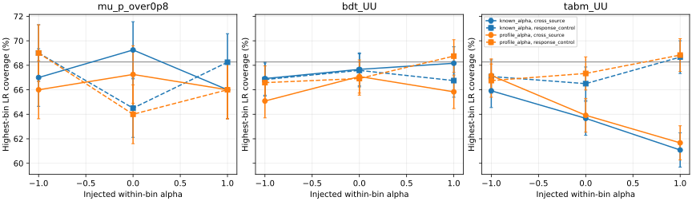
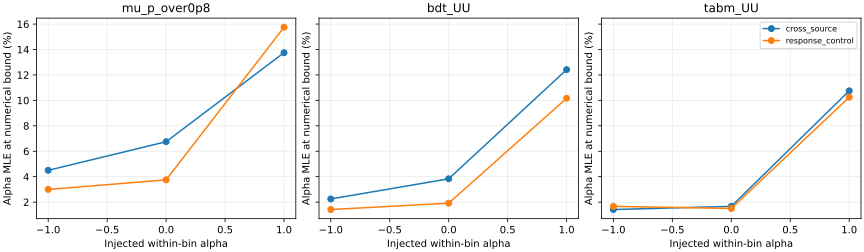

# 阶段25：未知共同箱内谱形的实际似然拟合与覆盖率

日期：2026-10-30。承接阶段24，完成冻结协议、正式Condor计算、独立核验及阶段提交。

## 阶段目标与有效物理结论

检验把一个共同箱内谱形参数alpha真正作为未知量拟合后，阶段24的局部统计代价判断是否成立，
以及能否解决跨来源谱闭合。**统计信息优势保留，但共同alpha不足以给出可靠的跨来源闭合。**
在固定经验响应的名义程序控制中，N=1000时六bin相对经验标准差RMS：
μ/0.8为38.510%，BDT UU为27.693%，TabM UU为28.681%；BDT相对已知alpha只增加4.328%。
这是条件统计量，不含响应MC、背景或物理系统误差，不能当作最终测量精度。

**更小deviance不保证真谱恢复。** BDT名义跨来源闭合RMS由已知alpha的4.911%变为
实际profile的9.853%；三seed双向共同alpha平均约+0.710/−0.760，符号随响应来源交换，
跨来源alpha置信集合覆盖仅55.00%±1.43个百分点，而同响应控制为67.92%±1.34个百分点。
全局signed均值接近零会掩盖这类双向偏移。总闭合差的95%来源组区间跨零，
因此这里只描述本折的偏移，不宣布总体性能已显著退化或改变模型排序。

TabM正注入下最高能量bin覆盖由已知alpha的61.08%变为61.67%±1.39个百分点，
配对变化+0.583个百分点、95% toy MC区间[−1.330,+2.497]个百分点；
仍低于目标68.27%，不能认为共同alpha解决了阶段24的覆盖问题。

## 冻结协议、样本和执行边界

[协议](stage25_energy_ml/preregistered_protocol.md)与
[配置](../ml/configs/profile_response.yaml)在正式拟合前冻结，mtime分别为
16:18:09及16:14:39 CET，早于16:22:39提交。来源折不变：
[stage23 folds](stage23_energy_ml/folds.tsv)。

- 输入为`ntuples/energy_ml_stage12/dataset/validation.npz`，13,375例、22来源组；
  A/B为11组6527例/11组6848例，ν/反ν来源对不拆分。保留异常和全部reco流出。
- unit MC、truth 100–6400 GeV，六报告箱边界[100,200,400,800,1600,3200,6400] GeV；
  各箱731/2455/4247/3933/1741/268例。没有正式flux、接受度或生成归一化。
- 固定μ/0.8、stage22 CPU长预算BDT UU、stage21 TabM UU。学习器各三seed单独拟合，
  双向及seed的平方量等权平均，不平均事件预测，不新训练。
- reco十类的内部边界为[200,200√2,400,400√2,800,800√2,1600,1600√2,3200] GeV，
  首末类含全部流出。不扫描新分箱、模型或alpha范围。
- validation已经用于历史开发，不是独立test；未读calibration/test/SIBYLL challenge标签或预测。
  仍只有3个charm来源组；最高4525–6400 GeV内部半箱A/B仅26/23例。

alpha注入−1/0/+1，以`(E/E_bin_geomean)^alpha`在每个truth箱重新归一，
保持六箱真积分完全相同。响应来自另一来源折的连续重加权，比较：

1. `known_alpha`：响应固定在注入真值，只拟合六fractions。
2. `profile_alpha`：六fractions与全箱共同alpha一起拟合；fractions非负且和为1。
   alpha在预定[−3,+3]数值压力域，无惩罚项。这个范围不是外部物理先验，
   一个共同参数也不等于六个独立形状系统学。

使用归一多项似然、SLSQP解析梯度、ftol=1e−13、maxiter=500；未知alpha全局三起点−3/0/+3。
固定f条件拟合用全局投影与相反端alpha两起点。中心反演`2N ΔNLL≤1`的LR集合，
每侧12个平方间距点扫描首个穿越后求根；保存域限制及扫描再入。
离散扫描不保证发现所有不连通分支。本阶段没有以局部Fisher误差替代实际LR覆盖。

两toy law均每seed/方向/注入200例：`response_control=R_source(alpha)*ftrue`，
检验固定经验模型内部程序；`cross_source`用另一来源折经验reco，检验跨来源压力。
N=1000只是共同选中事件数基准，不是data预期产额。两推断共享同一toy计数；
总16,800个独立toy，不能因比较两方法将独立样本数翻倍。覆盖由注入真值处LR≤1判定，
等价于LR集合覆盖，无需每toy反演端点。

500次配对来源组bootstrap沿用stage23/24的22组draws，每次重估响应、伪数据及真fractions，
共42,000个bootstrap方法点；不嵌套toy或区间。组区间为95%百分位、未多重比较校正。
RMS的非负区间不检验零bias。下文toy误差为固定seed/方向law下分层Bernoulli MC误差；
macro误差保留同toy六bin相关性。这些误差均不含来源模型和响应MC不确定度。

## 统计代价：局部判断获得条件toy支持

下表来自名义alpha0的同响应程序控制，经验标准差先在每seed/方向内扣除toy均值，
再对相对标准差的平方平均开根；使用200次toy的总体方差定义。
RMSE同时保留bias。数值单位均为%。

| 观测量 | 已知alpha SD RMS | 未知alpha SD RMS | 相对增加 | 未知alpha RMSE RMS |
|---|---:|---:|---:|---:|
| μ/0.8 | 37.373 | 38.510 | 3.043% | 38.782 |
| BDT UU | 26.544 | 27.693 | 4.328% | 27.771 |
| TabM UU | 27.740 | 28.681 | 3.392% | 28.762 |

因此阶段24所见约4%的BDT/TabM局部代价在名义点的非线性toy中仍为同一量级，
并未抹去相对μ的条件统计优势。这里不对有限模型间的经验SD差新增显著性声明，
也不能把已知响应下的信息优势转述为包含系统学后的测量收益。

## 实际LR覆盖：程序控制与跨来源差异

主结果为未知alpha；以下是六bin平均覆盖率，±为1σ toy MC误差（百分点）。
目标为68.2689%。完整逐bin/alpha结果及95% MC区间见
[coverage_summary.tsv](stage25_energy_ml/coverage_summary.tsv)，
全部方法汇总见[toy_summary.tsv](stage25_energy_ml/toy_summary.tsv)。

| 模型 | 注入alpha | 同响应macro覆盖(%) | 跨来源macro覆盖(%) | 跨来源最坏bin覆盖(%) | 跨来源最高bin覆盖(%) |
|---|---:|---:|---:|---:|---:|
| μ/0.8 | −1 | 70.125±1.108 | 66.208±1.096 | 62.250 | 66.000 |
| μ/0.8 | 0 | 66.750±1.122 | 66.375±1.091 | 63.500 | 67.250 |
| μ/0.8 | +1 | 67.417±1.093 | 64.000±1.120 | 58.250 | 66.000 |
| BDT UU | −1 | 68.028±0.618 | 64.194±0.627 | 62.250 | 65.083 |
| BDT UU | 0 | 67.472±0.626 | 64.319±0.625 | 60.917 | 67.083 |
| BDT UU | +1 | 67.597±0.609 | 64.514±0.606 | 61.250 | 65.833 |
| TabM UU | −1 | 67.958±0.621 | 66.569±0.603 | 64.917 | 67.167 |
| TabM UU | 0 | 67.972±0.610 | 63.722±0.641 | 59.500 | 63.917 |
| TabM UU | +1 | 68.236±0.623 | 63.083±0.628 | 56.500 | 61.667 |

同响应macro整体接近目标，但不能称所有单bin/参数的渐近阈值均已精确校准。
例如BDT alpha=−1时alpha自身控制覆盖65.17%±1.37个百分点，
相应95% MC区间[62.47,67.86]%，边界及有限N效应尚在；这不是拟合失败。
跨来源的不足更大：BDT alpha覆盖依注入−1/0/+1为52.33/55.00/56.25%，
各MC标准误约1.43个百分点，明显不能仅凭局部alpha σ≈1认为形状已获可靠约束。

TabM +1最坏为1600–3200 GeV箱，覆盖56.50%±1.41个百分点，
最高3200–6400 GeV箱61.67%±1.39，同响应最高箱68.83%±1.34。
最高箱profile−known覆盖变化的配对区间跨零；不是只看均值0.58个百分点就判定有效改善。



## 总闭合、双向偏移与物理解释

六bin相对真fractions的bias平方先对seed/方向/bin平均再开根，不让符号互相抵消。
表中均为%，已知alpha复现stage24 continuous。

| 模型 | alpha | 已知alpha闭合RMS | 未知alpha闭合RMS | 未知−已知(百分点，95%来源组区间) |
|---|---:|---:|---:|---:|
| μ/0.8 | −1 | 6.654 | 7.150 | +0.497 [−4.273,+9.272] |
| μ/0.8 | 0 | 9.284 | 9.591 | +0.307 [−4.712,+9.815] |
| μ/0.8 | +1 | 9.721 | 10.092 | +0.371 [−5.354,+11.159] |
| BDT UU | −1 | 4.491 | 8.333 | +3.842 [−2.761,+9.972] |
| BDT UU | 0 | 4.911 | 9.853 | +4.942 [−2.833,+12.960] |
| BDT UU | +1 | 5.292 | 11.853 | +6.561 [−3.717,+14.109] |
| TabM UU | −1 | 5.784 | 5.048 | −0.736 [−2.711,+5.201] |
| TabM UU | 0 | 9.436 | 8.469 | −0.967 [−3.346,+5.680] |
| TabM UU | +1 | 14.180 | 12.952 | −1.228 [−4.354,+6.206] |

相对stage24 coarse6的全部总闭合差区间也跨零；完整见
[closure_comparisons.tsv](stage25_energy_ml/closure_comparisons.tsv)。
不能因BDT中心变大就宣布普遍退化，也不能因TabM中心变小就宣布闭合改善。

在alpha0且六箱真谱不变时，BDT三seed平均：
A响应→B的alpha_hat=+0.709797，deviance(N1000)从2.047156降至1.532694；
B响应→A的alpha_hat=−0.760250，deviance从2.056961降至1.303540。
这是响应来源改变后共同形状方向承接经验差异、同时改变fractions的直接例子。
拟合在reco空间更接近伪数据，truth空间的总闭合却未获保障。
跨来源toy的alpha signed bias名义汇总仅+0.0305，更不能代表每方向无偏。

这些证据排除了“只要加一个共同形状参数就足够”的验收假设；
尚不能区分来源组混合、有限响应MC和真正条件响应差异各占多少。
程序控制、独立优化与直接事件积分均通过，支持优先研究经验响应不确定度及来源匹配，
不能把未分解的差异直接命名为生成器物理系统误差。

## alpha约束、边界与保留的异常

同响应alpha RMSE在−1/0/+1下：μ为1.002/1.200/1.317，BDT为0.953/1.032/1.100，
TabM为0.912/1.015/1.118（alpha无量纲）。约束有限且不完全高斯。
未知alpha toy MLE碰[−3,+3]域的频率如下（%）：

| 模型 | 同响应 −1/0/+1 | 跨来源 −1/0/+1 |
|---|---|---|
| μ/0.8 | 3.000 / 3.750 / 15.750 | 4.500 / 6.750 / 13.750 |
| BDT UU | 1.417 / 1.917 / 10.167 | 2.250 / 3.833 / 12.417 |
| TabM UU | 1.667 / 1.500 / 10.250 | 1.417 / 1.667 / 10.750 |



546个中心区间全部成功，0次扫描再入，6个区间至少一端受域限制：
5个alpha上端为+3（μ1、BDT3、TabM1），另有1个μ最高fraction下端为0。
不能据此宣称域外已排除，也不能为减少碰域而事后扩大范围。
边界事件均保留；名义同响应fraction触非负边界频率μ12.5%、BDT3.917%、TabM5.0%。
不删高y、高占有率或极端预测事件，不因少数离群事件停止分支。

## 数值实现、验证、资源与产物

连续响应压缩为`log(E/Ecenter)^k/k!`的0–16阶矩，组内一次聚合后反复求值，
并使用解析alpha导数。每model/seed/方向在[−3,+3]的13点与直接事件重权比较：
最大响应差6.66×10⁻¹⁶、导数差1.14×10⁻¹⁵。没有改变物理bin或事件权重定义。

- 合成检查：fraction恢复最大误差3.23×10⁻⁷、alpha误差1.91×10⁻⁶，
  数值导数/梯度差2.74×10⁻¹¹/1.86×10⁻¹⁰，域限区间正确标记。
- 本地smoke各1768例、4bootstrap/4toys每cell：μwall6.515 s/CPU6.349 s/RSS78.660 MiB，
  TabM wall6.406 s/CPU6.215 s/RSS544.676 MiB；1430/1435 solver calls，均0失败。
  smoke的本地包导入RSS较大，正式轻环境峰值见下；不把两者内存差解释为物理算法收益。
- 正式84个中心方法点、588行参数、546行区间、1092行toy参数汇总、168行toy全局汇总、
  14行压缩检查；500次配对draws跨全部模型与阶段23/24逐元素相同。
- 共479,935次优化调用、7,692,483次迭代；0优化失败、0失败cell、0负LR裁切、
  中心最大KKT残差5.96×10⁻⁷。`minimum_raw_lr`初值为0，仅作负值诊断，不能当作正LR最小值。
- 独立25点alpha扫描+凸fraction拟合核验42个中心及84个固定toy，最大NLL差
  4.53×10⁻¹⁴/4.26×10⁻¹⁴；重放全部16,800计数并重算33,600个toy方法点NLL及全部alpha LR，
  NLL最大差4.44×10⁻¹⁶。18个固定非域限端点独立检查，LR=1最大偏差5.15×10⁻⁶。
- 与stage24相同known-alpha bootstrap最大相对bias数值差：μ1.15×10⁻⁵、BDT8.43×10⁻⁷、
  TabM1.57×10⁻¹³。独立重建每模型最大差draw，在同响应上重算NLL差均≤4.93×10⁻¹⁴，
  最大fraction差≤1.21×10⁻⁷；属于浮点聚合/优化终止变化，不能称逐bit完全相同。

[独立核验](stage25_energy_ml/independent_checks.json)、
[总验证](stage25_energy_ml/summary.json)、[小样本](stage25_energy_ml/smoke_checks.json)保留实测值。
另已通过Python编译、shell语法、全部表行数与唯一键、7个数组的simplex/计数/LR约束、
JSON/SVG解析、本地Markdown链接和协议冻结时间核验，见[产物检查](stage25_energy_ml/validation.json)。
正式提交后，当前worker仅追加未触发的失败日志`law=not_applicable`补齐，
防止混合失败类型CSV键不一致；不改数值推断。正式全部failure_cells=0，
[精确补丁](stage25_energy_ml/failure_log_fix.patch)和
[两类失败记录roundtrip](stage25_energy_ml/failure_schema_check.json)保留。
正式源码包worker按修复前字节核对，其余成员按当前源核对，不声称两份worker完全相同。

7个单核CPU作业使用`2107209@bigbird21.cern.ch`，各请求3000 MB、无GPU，espresso；
全部正常exit0、队列已清空。单线程BLAS/OpenMP，避免线程过量；预聚合减少反复事件I/O。
worker累计wall2855.358 s、CPU2816.556 s、峰值76.082 MiB，单worker wall299.542–626.912 s。
wrapper累计wall2868.54 s、CPU2823.43 s；Condor remote CPU2828 s，提交到最后完成915 s，
GPU分配0 s。CPU/wall约98.64%，此比值仅衡量本批计时，不是跨节点加速结论。
资源见[condor_resources.tsv](stage25_energy_ml/condor_resources.tsv)及
[condor_summary.json](stage25_energy_ml/condor_summary.json)。

执行与复核命令（LCG109现成环境，未重新构建Calypso）：

```bash
source /cvmfs/sft.cern.ch/lcg/views/LCG_109_cuda/x86_64-el9-gcc13-opt/setup.sh
export OMP_NUM_THREADS=1 OPENBLAS_NUM_THREADS=1 MKL_NUM_THREADS=1 PYTHONNOUSERSITE=1
python3 ml/run_profile_response.py --model mu_p_over0p8 --output-dir /tmp/nu_mu_stage25_smoke_mu --smoke
python3 ml/run_profile_response.py --model tabm_UU --output-dir /tmp/nu_mu_stage25_smoke_tabm --smoke
python3 ml/prepare_profile_response.py
condor_submit -name bigbird21.cern.ch AnalysisZipFramework/submission/ml_profile_response.sub
python3 ml/report_profile_response.py
python3 ml/check_profile_response.py
python3 ml/collect_tabular_resources.py --cluster 2107209 --prefix ml_profile --jobs 7 --gpus 0 --cpus 1 \
  --log-dir /afs/cern.ch/user/x/xcheng/nu_mu_stage25/logs --report-dir workbook/stage25_energy_ml
python3 ml/report_profile_response.py --compact
```

汇总7分片后逐行/逐JSON验证并删除286,406 bytes重复表和JSON。
保留7个`ml/artifacts/stage25/<model>/seed_<seed>/inference.npz`，总6,287,725 bytes（6.288 MB），
含压缩矩、中心、bootstrap、toy计数/拟合/LR；不新存逐事件数据或checkpoint。
11成员正式源码包逐字节核对后删除4,300,598 bytes，记录于
[storage_cleanup.json](stage25_energy_ml/storage_cleanup.json)；分片去重见
[compaction.json](stage25_energy_ml/compaction.json)。原始Condor日志在AFS spool保留。

## 下一步计划与验收标准

本阶段已完成未知共同形状的实际推断检验；不能沿用“只看局部Fisher代价小即已闭合”的判断。
下一阶段优先区分有限MC与来源混合，不增加网络或依结果挑更易闭合的bin：

1. 冻结来源/物理组件匹配的closure诊断：使用现有validation及组标签、truth/reco矩，
   同一来源内独立拆分作控制，与原跨来源折并列；固定拆分seed、样本量与组件权重。
   验收为实测逐bin/alpha偏移、控制与跨来源coverage差及配对MC区间，不能只报deviance。
2. 将响应MC波动与伪数据计数分开传播：预注册有限MC重抽样或响应nuisance方案与toy预算，
   先小样本复验，再Condor执行。验收为控制law的无条件coverage及跨来源残余，
   同时报告区间宽度、边界、失败和资源，不能仅靠统一膨胀误差宣称系统学已解决。
3. 保持原报告bin、全部事件、unit归一化及保留集隔离。正式flux/接受度、背景、
   生成器与探测器响应变体、真实data控制区仍**未测量**；需要相应输入后才能作最终能谱收益结论。

统计参考沿用[Cowan et al., arXiv:1007.1727](https://arxiv.org/abs/1007.1727)与
[Cranmer, arXiv:1503.07622](https://arxiv.org/abs/1503.07622)：渐近LR阈值在此作为实测对象，
本阶段的边界和跨来源不足说明不能把其适用性视为前提。未新增文献检索或未测量的系统学结果。
