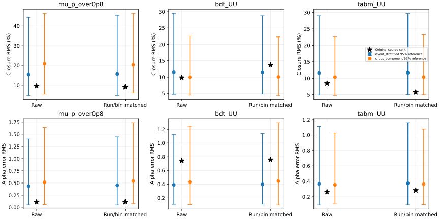
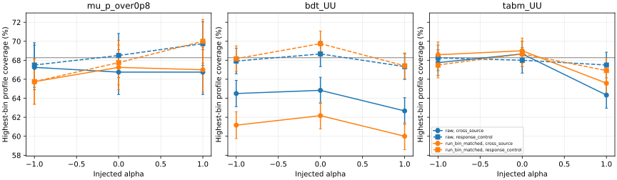

# 阶段26：来源比例匹配与有限MC拆分的能谱闭合检验

日期：2026-10-30。承接阶段25，完成协议冻结、两批Condor计算、独立重放、资源核验及阶段提交。

## 阶段目标与有效物理结论

检验阶段25的跨来源闭合/覆盖不足，是否可以仅由六个生成run的混合比例解释，
以及它相对于有限MC拆分波动是否异常。**来源比例匹配不能普遍恢复覆盖，有限MC误差必须进入后续推断。**

在固定每个run×truth箱的两侧计数、随机交换事件来源的零假设控制中，
N=1000、未知共同alpha拟合的六箱平均LR覆盖率：μ/0.8为62.167%，BDT UU为62.972%，
TabM UU为62.361%；相应同响应程序控制为67.500%、67.861%、67.639%。
BDT配对差为**−4.889个百分点，95% toy MC区间[−6.114,−3.664]个百分点**。
即使反事实地匹配每箱内全部run比例，BDT仍为62.667%对67.667%，差−5.000个百分点。
这些结果直接说明：在没有引入新的生成器或探测器变体时，有限的两侧经验MC本身就能造成明显低覆盖。

原来源折的名义闭合偏移并不异常于预定随机拆分参考：BDT原闭合RMS9.853%，
事件置换参考中位11.463%、95%参考范围[4.702,29.503]%，单侧p=0.625；
其alpha偏移RMS0.741的p=0.140。24项主检验经Holm校正均不拒绝。
**这不是证明所有偏移均由MC统计导致，也不是证明不存在模型差异。**
它不支持把当前折的偏移直接命名为额外物理系统误差，支持先分开传播MC统计。

本实验的两侧经验响应/伪数据均值同时来自有限MC，且互补拆分同一有限池。
因此这里测到的是**有限两侧MC与N1000计数共同作用的随机拆分覆盖**，
不能将约5个百分点缺口全部归于实际测量中单侧响应模板MC，更不能称真实data无条件覆盖已完成。

## 样本、冻结协议和统计预算修订

[预注册协议](stage26_energy_ml/preregistered_protocol.md)与
[配置](../ml/configs/source_response.yaml)在查看本阶段正式物理结果前写入。
原始200次置换预算的分辨率不足：24项Holm家族最小首项调整p为24/201=0.1194。
在仅查看smoke和作业进度、尚未查看正式closure/coverage/置换结果时，
[修订](stage26_energy_ml/permutation_resolution_amendment.md)将**point置换数增至1000**，
最小首项调整p可达24/1001=0.02398；昂贵coverage只用预定前200个分配。
原批次完成0–199，追加批次只补200–999的point，不重复原分配toy。
修订未改变模型、分箱、alpha、统计量、随机种子、原分配toy或推断方法；没有按p结果追加预算。

- 输入：`ntuples/energy_ml_stage12/dataset/validation.npz`，13,375例validation、22来源组；
  原A/B为11组6527例/11组6848例，ν/反ν来源对不拆。原MC为unit权重，未使用正式flux/生成归一化。
- 六truth箱100/200/400/800/1600/3200/6400 GeV，计数731/2455/4247/3933/1741/268。
  原十energy reco类及全部上下流出不变；保留所有异常、极端预测和高y事件。
- μ/0.8、stage22 CPU长预算BDT UU三seed、stage21 TabM UU三seed；冻结预测不重训、不平均事件预测。
  [来源折](stage23_energy_ml/folds.tsv)继续保留，原分配与随机控制并列。
- 六个nominal run为200082/200083/200089/200093/200094/200100。
  200082/200093最高truth箱两折都为空；其余34个共同有占有的run×箱均双侧>0，最少单侧2例。
  空目标stratum权重为0，不填伪计数，不删除原事件。
- validation已用于历史开发，不是独立test；未读calibration/test/SIBYLL challenge标签或预测。
  仍只有3个charm来源组、最高内部半箱A/B仅26/23例，独立生成归一化和真实data未增加。

## 两种响应和两级随机化的具体含义

`raw`为阶段25连续重权响应。`run_bin_matched`在每个报告truth箱内，
将六run的占比固定为全validation的nominal占比；各run×箱内先按
`exp(alpha*log(E/Ecenter))`归一，再按共同run占比混合。
响应和伪数据共同匹配，每个case/alpha均保留伪数据折原六箱truth fractions。
匹配case的run占比在alpha变化中也固定；所以非零alpha下，它与raw不是完全相同的干预。
名义alpha0是预定主检验；±1结果完整保留作压力诊断，不以它们挑选模型。

匹配使用truth/run标签，是反事实诊断，不能直接用在data上，也不构成新增探测器信息。
例如最高truth箱原A/B为136/132例，其中charm为12/5例（8.824%/3.788%），
共同目标为17/268=6.343%。匹配后该箱源MC有效数`1/sum(target_run²/n_run)`为
132.625/125.590 events，低于原计数；重权不会产生新的MC信息。
完整各run/bin计数、目标占比和有效数见[composition.tsv](stage26_energy_ml/composition.tsv)。

两级各1000次分配，跨模型/seed共用相同分配，双向一起统计：

1. `event_stratified`：在run×truth箱内置换A/B标签，精确保留原两侧各stratum计数。
   它检验stratum内事件可交换性，破坏组归属，不自动保留组内相关性。
2. `group_component`：在charm/k/pi内整组置换，保留原A组数2/5/4，ν/反ν组不拆。
   保留组相关性，但run/bin占比可以波动；它不等同于新生成器模型试验。

raw事件置换保留原两侧各自的run/bin混合差；matched才把这层差异也去掉。
因此关于“混合相同时有限MC仍会低覆盖”的判断以matched对照为直接依据，
不将raw参考中的全部波动都归于纯MC统计。

整组置换中，337/1000个分配缺少双侧共同run/bin支持，无法执行matched case；
663个可支持分配进入其条件参考。raw和事件置换均1000/1000有支持。
所有337个不支持分配记录，未删除其中事件或只保留易闭合的事件。
计入双向/七个model-seed后共4718个不支持case记录，与数值失败分开。
全部[不支持记录](stage26_energy_ml/failures.tsv)保留。

每分配/方向/alpha/case做known-alpha及profile-alpha点拟合。
closure RMS先对seed、双向和六bin的相对bias平方平均再开根；alpha用误差RMS，避免signed抵消。
置换p为`(k+1)/(Bvalid+1)`，预定名义profile的三模型×两case×两null×两统计量共24项统一Holm校正。
参考分布的2.5%–97.5%范围**不是原中心值的置信区间**，本阶段没有新来源组bootstrap或等效性检验。

未知alpha沿用[−3,+3]数值域、simplex、SLSQP解析梯度、ftol1e−13/maxiter500、三全局起点。
域不是物理先验；一个共同alpha不代表六个独立形状系统学。LR覆盖仍使用实际真值处
`2N ΔNLL≤1`，不以局部Fisher或事后统一膨胀误差替代，不新反演中心区间端点。

## 实测：有限两侧MC本身产生低覆盖

原分配每seed/方向/alpha/case/law各200 toy；事件置换前200个分配仅alpha0，每case/law各一个toy。
两law为另一折经验`cross_source`和本折`R(alpha)*ftrue`的`response_control`。
每个独立随机块内共享1000个uniform，通过不同CDF生成各case/law的多项计数，保证配对。
控制law没有两侧响应差异；它检验拟合/有限N行为，不是对真实MC误差的完整模拟。

全批保存44,800组计数实例（原分配33,600、事件置换11,200），各拟合两方法点；
**不是44,800个彼此独立的MC试验**。跨模型同seed也共享uniform，原分配有3600个不同RNG块，
事件置换有1200个不同RNG块且仅200个共享来源分配。误差按模型分别计算；
事件置换用整个分配聚类，包含seed/双向相关性，原分配按seed/方向分层。
macro保留同toy六bin相关性，所有case/law差使用配对误差。

下表为事件置换alpha0、未知alpha的六箱平均覆盖。±是1σ MC标准误，差的范围是95%配对MC区间。
N1000只是共同选中样本基准，不是data预期产额。目标覆盖68.2689%。

| 观测量 | case | 两侧经验MC覆盖(%) | 同响应控制(%) | 差(百分点，95%配对MC区间) |
|---|---|---:|---:|---:|
| μ/0.8 | raw | 62.167±1.210 | 67.500±1.080 | −5.333 [−7.503,−3.164] |
| μ/0.8 | matched | 62.083±1.187 | 67.500±1.084 | −5.417 [−7.723,−3.110] |
| BDT UU | raw | 62.972±0.685 | 67.861±0.627 | −4.889 [−6.114,−3.664] |
| BDT UU | matched | 62.667±0.700 | 67.667±0.612 | −5.000 [−6.177,−3.823] |
| TabM UU | raw | 62.361±0.698 | 67.639±0.620 | −5.278 [−6.558,−3.997] |
| TabM UU | matched | 62.458±0.693 | 67.653±0.613 | −5.194 [−6.501,−3.888] |

六个差的MC区间均不含零；这些coverage比较未作额外多重校正，条件于冻结经验池/模型。
这一直接数值对照支持：即使来源比例不变、未更换物理模拟，固定模板LR也不能覆盖全部有限MC拆分波动。
它同时包含响应折和另一折经验均值的MC误差；真实data没有额外“伪数据均值模板”这一抽样层，
因此不能把这些覆盖率直接当成最终测量覆盖率，也不能从这里给单侧MC方差的因果份额。

BDT raw的alpha覆盖在该控制中为62.33%±1.62个百分点，同响应69.58%±1.41；
原来源折本轮toy为53.33%±1.44对67.92%±1.35。alpha点偏移和低覆盖可以并存，
不能用方向平均接近零证明无偏。所有中心与toy边界均保留，未据碰域情况改alpha范围。
raw事件拆分中，alpha碰数值域的频率μ/BDT/TabM为7.500%/3.917%/3.750%，
同响应为4.250%/1.667%/1.333%；任一fraction触非负边界（f<1e−7）的频率为
16.500%/6.833%/7.417%，同响应11.000%/4.750%/6.667%。不能假设所有区间都处于高斯内部点。

raw事件拆分的谱fraction相对RMSE RMS为μ42.223%、BDT31.629%、TabM32.440%；
相应同响应为39.233%、28.048%、29.076%。可见本有限池中学习器的条件信息优势仍保留，
但这些数值包含此控制的特定MC层次，不是最终测量误差或模型间的独立显著性比较。

完整[coverage_summary.tsv](stage26_energy_ml/coverage_summary.tsv)、
[toy_summary.tsv](stage26_energy_ml/toy_summary.tsv)、
[coverage_comparisons.tsv](stage26_energy_ml/coverage_comparisons.tsv)给出全部逐bin/alpha/配对误差。

## 原来源折、混合比例匹配和随机化参考

名义未知alpha的原分配总闭合RMS：μ9.591%→9.023%，BDT9.853%→13.644%，
TabM8.469%→5.754%（raw→matched）。中心值变化方向不同，不支持普遍的“混合比例修正就闭合”。
对应原分配macro覆盖的配对变化分别为−0.708 [−1.469,+0.052]、
+0.056 [−0.505,+0.616]、+0.375 [−0.128,+0.878]个百分点，均不能确立覆盖改善。
这里没有来源组差的置信区间，不据中心值改变架构排序或宣布显著退化。

| 模型 | alpha | raw闭合RMS(%) | matched闭合RMS(%) |
|---|---:|---:|---:|
| μ/0.8 | −1 / 0 / +1 | 7.150 / 9.591 / 10.092 | 5.856 / 9.023 / 10.226 |
| BDT UU | −1 / 0 / +1 | 8.333 / 9.853 / 11.853 | 12.481 / 13.644 / 15.195 |
| TabM UU | −1 / 0 / +1 | 5.048 / 8.469 / 12.952 | 3.561 / 5.754 / 9.814 |

非零alpha的匹配case保持run混合不变，不能将该表解释为同一注入下纯算法改进。
全部known/profile结果在[model_summary.tsv](stage26_energy_ml/model_summary.tsv)，
逐bin平方量和signed量在[bin_summary.tsv](stage26_energy_ml/bin_summary.tsv)。

原raw名义闭合的参考分布及单侧p如下；三seed先一起形成每个分配的统计量，未把seed当独立来源样本。

| 模型 | 原闭合(%) | 事件置换中位及95%参考范围(%) | p_event | 整组置换中位及95%参考范围(%) | p_group |
|---|---:|---|---:|---|---:|
| μ/0.8 | 9.591 | 15.374 [4.788,44.404] | 0.769 | 20.808 [5.458,46.402] | 0.848 |
| BDT UU | 9.853 | 11.463 [4.702,29.503] | 0.625 | 9.977 [4.468,22.483] | 0.515 |
| TabM UU | 8.469 | 11.565 [4.874,29.013] | 0.737 | 10.375 [4.762,22.657] | 0.675 |

BDT原alpha误差RMS0.741，事件参考中位0.390、范围[0.107,1.125]，p=0.140；
整组参考中位0.431、范围[0.102,1.246]，p=0.191。匹配后误差RMS0.757，仍未消除偏移。
24项主检验最小未校正p=0.139860，Holm调整p均为1；0/24拒绝。
matched整组结果仅条件于663个可支持分配，不推断被排除分配的物理响应。
完整144行[随机化检验](stage26_energy_ml/randomization_tests.tsv)和
[配对匹配变化参考](stage26_energy_ml/matching_changes.tsv)保留，不只展示有利的case。



不能把“不拒绝”当成模型正确或等效的证据。当前样本也不能精确分解组相关性、箱内运动学及MC统计。
但原折结果没有超出这些冻结参考的证据，而同参考下低覆盖已被直接测出，
因此优先MC误差传播有实测依据，不需要先将问题归因于新的生成器/探测器系统学。



本轮raw toy RNG与阶段25不同，不能拿两阶段覆盖点变化当作物理改善。
例如TabM +1最高箱本轮raw64.333%、matched65.583%，配对变化+1.250个百分点，
95% MC区间[−0.159,+2.659]，仍未确立改善；同响应matched为66.917%。

## 程序原因核查、执行和性能

每run预聚合0–16阶矩，匹配响应按run/bin归一并使用解析导数；避免每次拟合重扫事件。
原分配在[−3,+3]的13点对直接事件重权，最大响应差3.33×10⁻¹⁶、
解析导数差1.14×10⁻¹⁵，额外有限差分导数差9.39×10⁻¹²。
raw与阶段25的全部中心参数最大差4.30×10⁻⁷（fractions/无量纲alpha），不是更换模型或事件。

- μ/TabM本地smoke各1505例，2置换/2toy每cell：wall7.478/7.043 s、CPU7.355/6.947 s，
  各1264 solver calls、0数值失败，峰值544.676 MiB；追加point smoke wall1.304 s/CPU0.999 s，
  168 calls、0数值失败、2个预期的不支持匹配case。smoke不作物理结论。
- 正式168个原分配方法中心；随机化请求336,000个方法点，307,692个有支持并成功，
  其余均为已记录的匹配支持不足。44,800组计数分别拟合known/profile点，LR覆盖只对profile计算。
- 共1,332,520次优化调用、25,146,610次迭代，0数值失败、0负LR裁切；
  最大KKT残差1.14×10⁻⁶。起点NLL最大差0.001824，表明不能假设每个起点都到同一解；
  实际取预定多起点的最佳成功解，并独立扫描核查。
- 独立重放2000个分配的stratum计数/整组约束及全部44,800组toy计数；
  重算全部89,600个toy方法点NLL及全部alpha LR，NLL最大差0。
  用25点alpha网格和凸fraction子问题检查84个原中心、294个固定null点、24个固定toy全局解，
  最大NLL差4.97×10⁻¹⁴；24个最高fraction真值处LR另用独立网格检查，最大差9.33×10⁻¹¹。
  扫描是独立数值审核，不是对任意多峰问题的数学最优性保证。
- 首次汇总因1000个point分配与200个coverage分配的truth数组长度不同而广播报错；
  改为显式使用对应前200个truth，正式拟合数组未改变。一个EOS JSON出现FUSE负缓存，
  直接远端内容与worker stdout核对相同后原字节同步，未改变数值结果。

验证见[独立核验](stage26_energy_ml/independent_checks.json)、
[小样本](stage26_energy_ml/smoke_checks.json)、[追加小样本](stage26_energy_ml/smoke_extension.json)、
[压缩检查](stage26_energy_ml/compression.tsv)、[阶段25复现](stage26_energy_ml/stage25_reproduction.tsv)。
Python编译、两个shell语法、全部表行数/唯一键、7个数组的simplex/计数/LR/缺支持NaN约束、
JSON/SVG、本地文档链接、协议修订时间与队列完成状态检查通过，见[产物验证](stage26_energy_ml/validation.json)。

原批7作业为`2107788@bigbird21.cern.ch`；追加最初在21等待，观察idle约2014对20的76后，
确认7个追加作业从未运行/RemoteWallClockTime=0，移除`2109838@bigbird21`，
改为`1562498@bigbird20`，随后全部启动。最初一次提交因拼写microcent被拒，
改为有效microcentury后提交；此拒绝未进入运行队列。均不改变统计协议。
14个正式作业全部正常exit0，单核/3000 MB/一小时flavour、单线程BLAS/OpenMP，无GPU。

worker累计wall11132.513 s、CPU11019.515 s、峰值82.969 MiB，CPU/wall98.985%；
原worker wall894.832–1163.286 s，追加397.009–823.062 s，节点不同，不据此宣称硬件加速。
wrapper累计wall11157.81 s/CPU11034.49 s，Condor remote CPU11039 s；
首次提交到最后完成1538 s。已移除待运行作业的计算时间0 s，GPU分配0 s。
[资源表](stage26_energy_ml/condor_resources.tsv)、[资源汇总](stage26_energy_ml/condor_summary.json)和
[调度记录](stage26_energy_ml/submission_notes.json)保留实际值，原始日志在AFS spool。

LCG109现成环境，不构建C++/Calypso；实际使用的命令包括：

```bash
source /cvmfs/sft.cern.ch/lcg/views/LCG_109_cuda/x86_64-el9-gcc13-opt/setup.sh
export OMP_NUM_THREADS=1 OPENBLAS_NUM_THREADS=1 MKL_NUM_THREADS=1 PYTHONNOUSERSITE=1
python3 ml/run_source_response.py --model mu_p_over0p8 --output-dir /tmp/nu_mu_stage26_smoke_mu --smoke
python3 ml/run_source_response.py --model tabm_UU --output-dir /tmp/nu_mu_stage26_smoke_tabm --smoke
python3 ml/extend_source_response.py --model tabm_UU --output-dir /tmp/nu_mu_stage26_smoke_extension --smoke
python3 ml/prepare_source_response.py
condor_submit -name bigbird21.cern.ch AnalysisZipFramework/submission/ml_source_response.sub
python3 ml/prepare_source_response.py --extension
condor_submit -name bigbird20.cern.ch AnalysisZipFramework/submission/ml_source_extension.sub
python3 ml/merge_source_response.py
python3 ml/report_source_response.py
python3 ml/check_source_response.py
python3 ml/collect_source_resources.py --base-cluster 2107788 --extension-cluster 1562498 \
  --log-dir /afs/cern.ch/user/x/xcheng/nu_mu_stage26/logs
python3 ml/report_source_response.py --compact
```

两批数组按0–199/200–999区间合并，逐数组读回核对后删除15,004,316 bytes追加分片/JSON；
再核对、合并报告分片并删除464,981 bytes重复表/JSON。
保留`ml/artifacts/stage26/<model>/seed_<seed>/source_inference.npz`共7个、26,728,524 bytes（26.729 MB），
含响应矩、原中心、随机化point、toy计数/拟合/LR；无新逐事件副本/模型checkpoint。
两源码包共8,607,435 bytes经13/14成员逐字节核对后删除。
原包的200配置及worker按[预算补丁](stage26_energy_ml/base_payload_amendment.patch)逆向核对，
追加包按当前源核对；不假称两批源码逐字节相同。
[批合并](stage26_energy_ml/batch_merge.json)、[报告去重](stage26_energy_ml/compaction.json)、
[存储清理](stage26_energy_ml/storage_cleanup.json)保留核对记录。

## 下一步计划与验收标准

本阶段没有实现MC辅助似然或校准LR阈值；不能将这次随机化参考直接用于data区间。
下一阶段优先分开“源MC响应误差”“伪数据均值MC误差”“N1000观测计数”，再评价推断方案：

1. 用冻结validation的pooled连续响应定义明确的toy总体，独立生成响应MC和N1000伪data，
   与本阶段互补两折控制并列；不要再额外用有限伪数据模板定义该总体的均值。
   输入为现有run/bin/reco及能量矩，先冻结抽样规模、truth谱、alpha和种子；
   验收为各抽样层单独启用/关闭时的逐bin与alpha覆盖、bias、边界及配对MC区间。
2. 在相同总体、响应MC预算和观测量下，检验包含MC统计的辅助似然或明确的bootstrap传播；
   先有小样本数值控制，再Condor执行。验收不只看覆盖恢复，还报告区间宽度、残余bias、
   代价和适用范围；对未知alpha及非零注入另作检验，不把名义已知形状结果推广为全部系统学完成。
3. 保留全部事件、原六报告bin、unit基准及保留集隔离。正式flux/接受度、背景、
   生成器/探测器变体和真实data控制区仍**未测量**；本阶段不选择新架构或启用独立test。

本轮联网核对文献题名/摘要及可行性：
[Phipson & Smyth (2010), PMID21044043](https://pubmed.ncbi.nlm.nih.gov/21044043/)支持有限随机置换用加一p，
因此修正原置换分辨率而不报告零p；
[Argüelles, Schneider & Yuan, arXiv:1901.04645](https://arxiv.org/abs/1901.04645)讨论有限随机MC模型的似然及覆盖。
后者是下一步方法候选；连续重权、列归一和未知alpha引入相关性，须实测，不能直接套用独立Poisson-bin假设。
