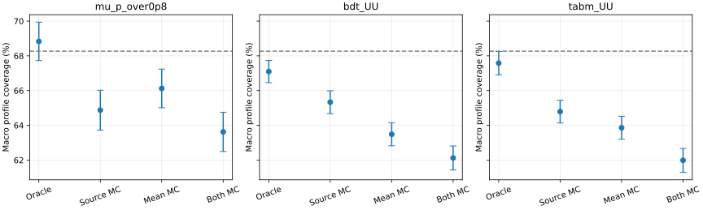
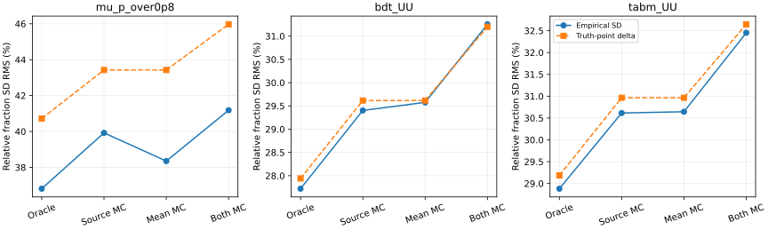

# 阶段27：独立抽样分离响应MC、经验均值MC与观测计数

日期：2026-10-30。承接阶段26；固定物理样本与模型，不训练、不打开保留集。

## 阶段目标与有效物理结论

**单侧有限响应MC本身已足以降低固定模板LR区间的覆盖；第二层有限伪数据均值MC会进一步增加缺口。**
在固定pooled经验总体、每侧6685例MC、N=1000观测、未知共同alpha的名义控制中，
BDT六箱平均覆盖为67.097%（准确总体响应）→65.333%（仅有限响应MC）→62.125%（两侧MC）。
第一步配对差−1.764个百分点，95% MC区间[−2.652,−0.875]个百分点，Holm p=0.000200；
第二步额外−3.208 [−4.185,−2.232]个百分点，Holm p=7.19×10⁻¹⁰。

这把阶段26的两侧缺口分开了：**不能把约5个百分点全部算到实际测量中的响应模板上，
也不能忽略单侧模板自身约2个百分点的条件覆盖损失。** 后一个数值只对应本实验的MC预算、
总体和N1000，不是实际data的普适修正值。三模型的单侧覆盖损失均通过预定六项Holm家族检验。

BDT谱fraction的相对经验SD RMS由27.721%增至29.403%，比例1.06070，
95%配对trial bootstrap区间[1.03399,1.08752]；两侧MC时为31.255%，比例1.12747
[1.09195,1.16423]。一阶独立MC传播预期的单侧增幅为5.992%，量级与实测6.070%相符。
但这不是可部署区间：未知alpha的非线性、边界和局部近似误差仍须用覆盖检验约束。

## 输入、冻结方案与总体的定义

[预注册协议](stage27_energy_ml/preregistered_protocol.md)和
[配置](../ml/configs/independent_response.yaml)先于正式提交写入。
本阶段先完成路线图中的独立层次分离及局部传播诊断；没有实现MC辅助似然或MC校准区间。

- 输入为`ntuples/energy_ml_stage12/dataset/validation.npz`，13,375例、22来源组。
  六truth箱为100/200/400/800/1600/3200/6400 GeV，计数731/2455/4247/3933/1741/268。
  truth fractions固定为这些计数/13375；保持原十reco类、全部异常和上下流出。
- 模型为μ/0.8（seed0）、stage22 BDT UU与stage21 TabM UU（各seed0/1/2），冻结已有预测。
  数据仍为用户授权的unit MC；未新增flux、亮度、生成接受度或背景归一化。
- 以全部validation的经验联合分布(箱内真能量、reco类)作为明确的toy总体。
  在每truth箱内用`exp(alpha*log(E/Ecenter))`归一，注入alpha=−1/0/+1而不改变六箱积分。
  共同未知alpha的[−3,+3]为冻结数值域，不是物理先验。
- 每个trial在每truth箱独立有放回抽样，响应与均值两侧均为
  365/1227/2123/1966/870/134例，合计6685例。两侧独立；不再互补拆分同一批事件。
  抽样包括run混合的有限样本波动，不固定run比例、不模拟来源组相关性。
- MC抽样索引在所有模型/seed/alpha间共享；400个trial块彼此独立，两侧共800个不同MC RNG样本。
  观测uniform按seed/alpha/trial独立，共3600个不同RNG块，跨模型同seed共享。
  四case共用uniform，经不同CDF生成各自的N1000计数。

| case | 拟合响应 | 伪数据均值 |
|---|---|---|
| oracle | 准确pooled总体 | 准确pooled总体 |
| source_mc | 有限抽样MC | 准确pooled总体 |
| mean_mc | 准确pooled总体 | 另一侧独立有限MC |
| both_mc | 有限抽样MC | 另一侧独立有限MC |

各case同时保存无观测计数的Asimov均值和N1000多项计数。正式共33,600个计数实例及
33,600个Asimov实例，每个均做known/profile-alpha点拟合；**不是67,200个独立试验**。
误差以400个trial整块聚类，保留seed/箱/case相关性。source_mc与oracle的均值和观测计数逐trial完全相同，
差别只有响应MC；both_mc与source_mc的差别是第二层均值MC。

这是固定有限经验总体下的独立事件抽样控制，不是新的生成器样本、来源组总体、真实data无条件覆盖。
validation已用于历史开发，calibration/test/SIBYLL challenge仍隔离。

## 物理结果：单侧和第二侧MC分别造成覆盖损失

主结果为实际profile LR真值检验`2N ΔNLL≤1`，六fraction的macro覆盖；目标68.2689%。
±为1σ trial MC标准误。N1000只是共同选中样本基准，不是预期data产额。

| 模型 | oracle (%) | source_mc (%) | mean_mc (%) | both_mc (%) |
|---|---:|---:|---:|---:|
| μ/0.8 | 68.833±1.105 | 64.875±1.144 | 66.125±1.112 | 63.625±1.128 |
| BDT UU | 67.097±0.640 | 65.333±0.657 | 63.486±0.662 | 62.125±0.689 |
| TabM UU | 67.583±0.670 | 64.792±0.657 | 63.861±0.663 | 61.986±0.688 |

预定名义三模型×两对比共六项主检验，用配对trial均值的正态MC近似双侧p，统一Holm校正：

| 模型 | 配对对比 | 差及95% MC区间（百分点） | Holm p |
|---|---|---:|---:|
| μ/0.8 | source−oracle | −3.958 [−5.532,−2.385] | 2.47×10⁻⁶ |
| BDT UU | source−oracle | −1.764 [−2.652,−0.875] | 0.000200 |
| TabM UU | source−oracle | −2.792 [−3.717,−1.867] | 1.66×10⁻⁸ |
| μ/0.8 | both−source | −1.250 [−2.941,+0.441] | 0.1474 |
| BDT UU | both−source | −3.208 [−4.185,−2.232] | 7.19×10⁻¹⁰ |
| TabM UU | both−source | −2.806 [−3.757,−1.854] | 2.97×10⁻⁸ |

5/6项拒绝。μ第二侧的中心值下降，但当前预算不能确立这一额外覆盖损失；不把未拒绝当等效性。
这些区间反映本控制的有限toy精度，不是来源组或实际物理系统学置信区间。
未对模型间差值作显著性检验，不据覆盖中心值重排模型。



非零alpha的macro覆盖完整保留，以下四列依次仍为oracle/source/mean/both：

| 模型 | alpha | macro覆盖 (%) |
|---|---:|---|
| μ/0.8 | −1 / +1 | 69.792/66.417/66.167/63.458；68.750/66.208/66.208/63.167 |
| BDT UU | −1 / +1 | 68.556/65.847/66.278/64.264；67.806/64.917/65.264/63.167 |
| TabM UU | −1 / +1 | 69.208/66.611/66.444/64.139；67.222/64.250/64.875/62.222 |

BDT的alpha自身覆盖在−1/0/+1时，oracle为65.833/66.333/64.500%，
source_mc为61.833/63.583/63.417%，both_mc为58.000/61.500/59.250%。
这说明六箱macro不能代替未知形状参数的可靠性检验；没有据此修改alpha域或LR阈值。
逐bin/alpha及配对误差见[覆盖表](stage27_energy_ml/coverage.tsv)、
[配对覆盖差](stage27_energy_ml/coverage_comparisons.tsv)、[主检验](stage27_energy_ml/primary_tests.tsv)。

## 局部MC传播与实际波动、偏差及边界

在总体真值点，取五维simplex切空间加共同alpha的设计矩阵
`D=[R*T, (dR/dalpha)*f]`，`P=(Dᵀ diag(1/p) D)⁻¹ Dᵀ diag(1/p)`。
固定每truth箱MC数n_b时，令`w=exp(alpha*log(E/Ecenter))/E[w]`，
`z=w*(onehot(reco)-R_b)`，则单侧经验归一响应造成的概率协方差为
`C_MC=sum_b f_b² E[z*zᵀ]/n_b`。计数项为`(diag(p)-p*pᵀ)/N`。
各层独立后相加，再经P和simplex映射传播；源与均值影响符号相反，同规模时一阶协方差相同。
它保留加权归一及reco间负相关，不把各weighted bin强行当成独立Poisson误差。

名义fraction相对SD RMS，单位%；括号为总体真值处一阶预测：

| 模型 | oracle | source_mc | mean_mc | both_mc |
|---|---:|---:|---:|---:|
| μ/0.8 | 36.810 (40.720) | 39.921 (43.425) | 38.350 (43.425) | 41.183 (45.971) |
| BDT UU | 27.721 (27.942) | 29.403 (29.616) | 29.576 (29.616) | 31.255 (31.201) |
| TabM UU | 28.881 (29.185) | 30.615 (30.964) | 30.644 (30.964) | 32.452 (32.646) |

BDT/TabM单侧SD倍率为1.06070 [1.03399,1.08752] / 1.06004 [1.03467,1.08573]；
两侧为1.12747 [1.09195,1.16423] / 1.12364 [1.08767,1.16185]。
这里是2000次整trial配对bootstrap的95%区间，三个seed仍一起重抽，未虚增MC样本数。
在关闭观测计数时，BDT源/均值/双侧的相对SD为10.535/9.806/14.623%，
TabM为10.890/10.391/15.525%；这些是MC本身的谱波动，Asimov LR≤1只称接受率，不称覆盖。

局部传播对学习器fraction RMS的量级有解释力，但并非所有参数都服从它。
例如BDT oracle的alpha经验SD1.0266，对比局部sigma0.9432；source_mc为1.0865对1.0113。
μ的fraction局部sigma高于实际SD，且名义任一fraction触边界的频率oracle/source/both为
14.000/18.750/20.250%；不能将局部高斯公式当成完整区间。
BDT对应边界频率4.583/5.583/7.167%，alpha碰数值域为1.917/2.333/2.667%。

BDT名义fraction相对偏差RMS为oracle2.086%、source1.571%、both1.450%；
alpha平均误差为+0.00992/−0.00921/−0.01939。这里只报告有限trial经验偏差，
不因均值较小宣称严格无偏，也不将MC引起的波动命名为新的模拟系统误差。
全部known/profile点解、逐参数bias/SD/RMSE及边界见
[逐参数表](stage27_energy_ml/metrics.tsv)、[总体指标](stage27_energy_ml/summary_metrics.tsv)、
[SD倍率区间](stage27_energy_ml/sd_comparisons.tsv)。



## 固定模板LR区间的宽度

按预定名义前32个trial，对四case的最高truth箱fraction与alpha共1792个区间反演实际LR=1端点。
宽度均值如下，fraction和alpha均无量纲；误差来自32个共享trial，不能当96个独立seed事件。

| 模型/参数 | oracle | source_mc | mean_mc | both_mc |
|---|---:|---:|---:|---:|
| μ，最高fraction | 0.029996 | 0.030610 | 0.028886 | 0.030174 |
| BDT，最高fraction | 0.022626 | 0.022164 | 0.022752 | 0.022316 |
| TabM，最高fraction | 0.023282 | 0.022680 | 0.023755 | 0.023250 |
| μ，alpha | 2.32694 | 2.35209 | 2.23170 | 2.25796 |
| BDT，alpha | 1.99816 | 1.98434 | 1.99270 | 1.95921 |
| TabM，alpha | 2.00737 | 2.00339 | 1.98322 | 1.96743 |

BDT source−oracle最高fraction宽度差为−0.000462，95%配对MC区间[−0.001506,+0.000582]；
alpha宽度差−0.01382 [−0.08895,+0.06131]。所有18项宽度差的描述性MC区间均跨零。
这批宽度测量没有确立区间随新增MC波动而拓宽，也不证明宽度严格相同；样本仅32个trial。
相比之下，400个trial上的SD增加和覆盖损失已有明确配对证据。

BDT四case各96个最高fraction区间有21/17/21/14个下端触0；alpha区间有
10/10/9/8个至少一端触数值域。全部保留；无扫描重入，没有更改范围来改善结果。
完整[区间端点](stage27_energy_ml/intervals.tsv)、[宽度汇总](stage27_energy_ml/width_summary.tsv)及
[配对宽度差](stage27_energy_ml/width_comparisons.tsv)保留。

## 程序核验、执行、资源与存储

复用连续16阶矩、解析导数、SLSQP多起点、simplex及冻结容差。
μ与TabM的2-trial smoke分别wall2.562/3.187 s、CPU2.527/3.140 s，
545/652次优化调用，均无最终拟合或优化调用失败；峰值80.027/544.676 MiB。
直接事件响应/导数误差均低于10⁻¹⁵；独立名义协方差误差7.12×10⁻²⁰，
事件权重扰动的得分导数误差2.49×10⁻¹³，见[小样本核验](stage27_energy_ml/smoke_checks.json)。

21个正式CPU作业`1562723@bigbird20.cern.ch`全部exit0，无最终拟合、支持或区间失败。
共1,159,908次优化调用、20,003,323次迭代，其中两个SLSQP起点未成功，最终多起点解均有效。
最大KKT残差1.18×10⁻⁶，起点NLL最大差0.004762；不能假设每个起点都到同一解。
25,600个接近零的负LR按冻结容差[−10⁻⁵,0)裁为0，全部保留最终LR；没有把它们当成新的计数波动。

独立核验重放5600个MC抽样实例（800个不同MC RNG样本）与33,600个计数实例，
重算全部134,400个方法点NLL及全部alpha LR；最大NLL差1.78×10⁻¹⁵。
36个预定全局解与36个最高fraction真值处条件LR用独立25点alpha网格+凸fraction子问题检查，
最大NLL差4.09×10⁻¹⁴、LR差1.08×10⁻¹⁰；44个非域限端点检查最大LR误差2.50×10⁻⁶。
协方差展开式误差7.28×10⁻²⁰。该抽查不是所有非凸问题全局最优的数学证明。
首次核验对跨CPU浮点矩使用逐位相等，发现3个元素差至多2.22×10⁻¹⁶，
改为显式浮点容差并记录最大差；整数计数仍逐位相等。正式数组未改变。
见[独立核验](stage27_energy_ml/independent_checks.json)。另有3个计数LR距离阈值1小于10⁻⁵，
逐一重新进行全局及真值条件扫描，最大LR差6.48×10⁻¹¹，三者覆盖分类均不变，
见[阈值附近核验](stage27_energy_ml/threshold_checks.json)。

一个EOS汇总JSON远端存在而本地负缓存不可见，远端原字节与worker stdout JSON核对后原子同步；
数值未改，见[可见性恢复](stage27_energy_ml/eos_visibility_recovery.json)。
两个未成功起点已用`1563155@bigbird20.cern.ch`的两个专项作业完整重放：
BDT seed0/alpha0的trial2最高fraction宽度扫描在f=0.697281处、
BDT seed2/alpha−1的trial284的fraction参数index4（1600–3200 GeV）真值处，均出现SLSQP状态8
“Positive directional derivative for linesearch”，解位于alpha及fraction约束边界。
候选KKT残差4.51×10⁻¹¹/2.43×10⁻¹⁰，NLL与独立网格/凸子问题差5.46×10⁻¹²/2.69×10⁻¹¹。
这是两次起点的线搜索停止标记，不是两个最终拟合失败；原多起点流程使用成功的候选。
完整重放的全部10个数组与正式结果逐元素差均为0，没有替换正式数组。
[专项计划](stage27_energy_ml/start_audit_plan.json)、
[seed0审计](stage27_energy_ml/start_audits/bdt_UU_seed_0_alpha_1.json)、
[seed2审计](stage27_energy_ml/start_audits/bdt_UU_seed_2_alpha_0.json)保留停止原因、固定参数及比较值。

正式worker累计wall7859.395 s、CPU7740.202 s，CPU/wall98.483%，峰值76.445 MiB；
单worker wall285.948–609.381 s。wrapper累计wall7903.99 s、CPU7762.26 s；
Condor remote CPU7764 s，提交至最后完成780 s；无GPU，未切换或丢弃运行作业。
两个专项重放作业另用wrapper wall685.48 s、CPU674.84 s、Condor remote CPU674 s，
峰值77.859 MiB，提交至末完成435 s，见[专项资源](stage27_energy_ml/start_audit_resources/condor_summary.json)。
全部23个Condor作业wrapper累计wall8589.47 s、CPU8437.10 s，remote CPU8438 s，无GPU。
独立本地核验另用wall37.644 s；正式与审计的计算量分开记账，不把重放当新增物理统计量。
每job单核、3000 MB、200 MB scratch、一小时flavour、单线程BLAS/OpenMP。
[资源表](stage27_energy_ml/condor_resources.tsv)、[资源汇总](stage27_energy_ml/condor_summary.json)、
[提交记录](stage27_energy_ml/submission_notes.json)保留实际值；原始日志位于
`/afs/cern.ch/user/x/xcheng/nu_mu_stage27/logs/`。

执行使用现成LCG109，无C++/Calypso源码变化，未重新构建：

```bash
source /cvmfs/sft.cern.ch/lcg/views/LCG_109_cuda/x86_64-el9-gcc13-opt/setup.sh
export OMP_NUM_THREADS=1 OPENBLAS_NUM_THREADS=1 MKL_NUM_THREADS=1 PYTHONNOUSERSITE=1
python3 ml/run_independent_response.py --model mu_p_over0p8 --alpha-index 1 --output-dir /tmp/nu_mu_stage27_smoke_mu --smoke
python3 ml/run_independent_response.py --model tabm_UU --alpha-index 1 --output-dir /tmp/nu_mu_stage27_smoke_tabm --smoke
python3 ml/prepare_independent_response.py
condor_submit -name bigbird20.cern.ch AnalysisZipFramework/submission/ml_independent_response.sub
python3 ml/report_independent_response.py
python3 ml/check_independent_response.py
python3 ml/collect_tabular_resources.py --cluster 1562723 --prefix ml_independent --jobs 21 --gpus 0 --cpus 1 \
  --log-dir /afs/cern.ch/user/x/xcheng/nu_mu_stage27/logs --report-dir workbook/stage27_energy_ml
python3 ml/prepare_independent_response.py --audit
condor_submit -name bigbird20.cern.ch AnalysisZipFramework/submission/ml_independent_audit.sub
python3 ml/collect_tabular_resources.py --cluster 1563155 --prefix ml_independent_audit --jobs 2 --gpus 0 --cpus 1 \
  --log-dir /afs/cern.ch/user/x/xcheng/nu_mu_stage27/logs --report-dir workbook/stage27_energy_ml/start_audit_resources
python3 ml/report_independent_response.py --compact
```

保留`ml/artifacts/stage27/<model>/seed_<seed>/alpha_<index>/independent_inference.npz`共21个，
总10,783,990 bytes（10.784 MB），含pooled矩、抽样种子对应拟合/计数/LR与局部协方差。
源/均值MC由种子重放，不保存逐trial事件或响应矩副本；无新checkpoint或ROOT文件。
汇总分片逐行/JSON核对后删除291,761 bytes重复输出；两源码包14/18成员逐字节核对后删除
9,635,416 bytes。清理后重新运行汇总，全部TSV字节不变；
见[报告去重](stage27_energy_ml/compaction.json)与[存储清理](stage27_energy_ml/storage_cleanup.json)。
Python编译、两shell语法、JSON/SVG、表格行数/唯一键、文档链接与队列状态检查见
[最终验证](stage27_energy_ml/validation.json)；Git提交后读回本阶段全部blob与工作文件比较。

## 下一步计划与验收标准

1. 在本阶段同一pooled总体、6685例响应MC、N1000观测下，实现并检验单侧MC传播的推断方案。
   输入是现有连续矩/原事件能量与reco、冻结truth谱与alpha；优先MC辅助似然或明确的联合bootstrap区间，
   处理加权归一与列间约束，不把每个weighted cell未经验证地当独立Poisson模板。
2. 先做小样本数值/自闭合，再Condor执行；在unknown-alpha、alpha−1/0/+1下，以逐bin/alpha覆盖、
   bias、区间宽度、边界、失败与CPU成本共同验收，配对比较固定模板基线。
   both_mc继续作第二层均值误差诊断，不能把它的方差全部加给真实data区间。
3. 局部传播只作量级/实现交叉核查，不事后统一放大LR阈值，也不据oracle总体真值选择最终模型。
   原六箱、全部事件、unit基准、保留集隔离不变。正式归一化、背景、生成器/探测器变体、
   接受度及真实data控制区仍**未测量**，不能称最终能谱测量闭合。

本轮联网核对[Barlow & Beeston, *Fitting using finite Monte Carlo samples*](https://doi.org/10.1016/0010-4655(93)90005-W)
的题名/DOI，以及[Argüelles, Schneider & Yuan, *A binned likelihood for stochastic models*](https://arxiv.org/abs/1901.04645)
的题名/摘要；检索与适用性见[文献记录](stage27_energy_ml/literature.json)。两者支持下一阶段的有限MC似然候选，
本阶段没有实现其方法。连续重权、归一化与未知alpha的相关性须显式建模并实测覆盖。
