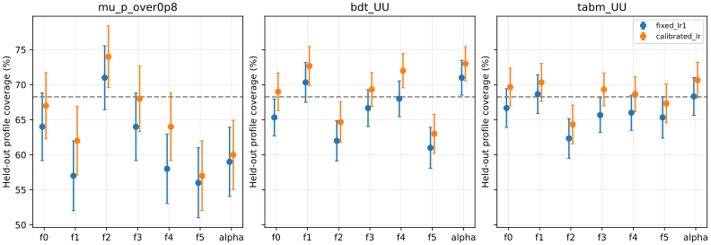

# 阶段28：单侧响应MC bootstrap 的留出 profile-LR 校准

日期：2026-11-01。承接阶段27，固定重建模型和样本，检验包含响应MC重抽样的LR临界值。

## 阶段目标与有效物理结论

**单侧响应MC bootstrap使名义留出样本上的平均覆盖接近目标，代价是约5%的最高能量箱区间拓宽；
池化校准尚不能保证逐箱和alpha的覆盖。** BDT的六箱平均覆盖65.556%→68.444%，
TabM65.778%→68.278%。计入有限校准阈值与测试trial两层误差后，BDT改善的95% MC区间为
+1.667至+3.667个百分点，TabM为+1.556至+3.167个百分点。
这些结果支持响应MC传播的可行性，不能称最终物理测量已闭合。

阶段27已测出：在固定经验总体、6685例响应MC及N1000观测条件下，BDT的单侧响应MC使
macro覆盖下降1.764个百分点，fraction相对SD RMS增加约6.07%。本阶段检验明确的混合
bootstrap校准，回答覆盖能否改善、逐参数是否一致、区间宽度和计算成本增加多少。

本阶段不重新选择架构、不训练、不读取真实保留集。本报告中的“校准/测试trial”是
validation经验总体生成的独立伪实验编号，不是实际`calibration.npz`/`test.npz`。
全部正式作业、独立核验与产物验证已完成。

## 输入、独立性及冻结方案

[预注册协议](stage28_energy_ml/preregistered_protocol.md)及
[配置](../ml/configs/mc_bootstrap.yaml)在正式提交前冻结。

- 固定13,375例validation，22来源组；真能量箱边界100/200/400/800/1600/3200/6400 GeV，
  六箱计数731/2455/4247/3933/1741/268，truth fractions固定为各计数/13375。
  原十reco类、全部异常和上下流出保留；unit MC，不新增flux/接受度/亮度归一化。
- μ/0.8仅seed0，stage22 BDT UU与stage21 TabM UU各seed0/1/2，冻结已有事件预测。
  每个model-seed做200个独立trial；响应MC逐truth箱有放回抽365/1227/2123/1966/870/134例，
  合计6685例，固定每箱MC数，不重抽真谱积分。
- 固定pooled validation的联合(真能量,reco)经验总体。仅名义alpha=0注入，实际拟合共同
  未知alpha，域[-3,+3]仍为数值范围而非物理先验。伪数据均值使用准确pooled响应，N=1000；
  本阶段不加入第二层有限伪数据均值MC，以免把该层误差加给实际data。
- 同seed/trial的事件与uniform RNG在不同模型间共享；模型内不同seed的事件/计数抽样独立。
  trial内参数、重抽样及模型相关性保留。不能把每个fraction或每次bootstrap当独立来源样本。

## bootstrap校准的具体定义

每个trial先从pooled总体独立抽响应MC，并用它拟合N1000观测，得到`(fhat, alphahat)`。
在该有限响应MC的每truth箱内有放回重抽16个响应样本。每次伪计数由**重抽前的有限响应**
及`(fhat, alphahat)`生成，再用**重抽后的响应**拟合，并在注入的MLE处计算七个实际profile LR。
这样响应重抽样与观测计数均进入LR分布；没有有限的第二侧均值模板。

实现审查发现最初smoke曾让生成和拟合共用重抽响应，仅能测计数波动；正式提交前已修正为
上述定义，重跑μ/TabM smoke并重建源码包。正式结果均来自修正后的实现。

每model-seed仅用trial0–99的bootstrap LR估计两个临界值：
六fraction池化的9600个LR取0.682689492137分位数，alpha的1600个LR另取相同分位数。
前100个外层trial是独立统计块；9600个LR并非9600个独立MC样本。
trial100–199只检验覆盖，固定阈值1和校准阈值使用相同MLE与真实值LR，不能用测试覆盖反调阈值。
后100个trial也生成了bootstrap，保留作审计，不参与阈值或测试覆盖计算。

这是有限源MC的非参数重抽样加参数化多项计数的混合bootstrap，最终使用的是名义伪实验
总体上的经验混合临界值；它不是完整Neyman构造，也不是可直接部署到未知真实data的阈值。
fraction共享阈值只针对池化macro，不能保证逐bin覆盖相同，alpha也有独立阈值。

主比较为三个模型各自的macro覆盖变化，seed先在trial内平均，三个配对正态MC近似p统一Holm。
同时报告固定校准结果条件下的测试MC标准误，以及1000次独立重抽校准/测试trial的总不确定性。
后者按整trial保留16次重抽样、六参数及seed相关性；不把有限临界值当精确常数。
在前16个测试trial上，对最高fraction与alpha反演固定/校准阈值的实际LR端点，记录宽度及域限。

## 实测覆盖、临界值及有限校准误差

全部1400个外层trial及22,400个bootstrap伪实验成功。最终覆盖只使用每身份后100个trial，
共700个计数实例；μ100例、BDT/TabM各300例，但模型间和seed间的共享trial相关性按100个块保留。
生成了23,800个计数/抽样实例；只有600个不同外层源MC索引/观测uniform序列和9600个不同
bootstrap索引/伪计数uniform序列，不能将23,800当成彼此独立MC试验。

下表±为固定已估计阈值条件下的1σ测试trial MC标准误；目标为68.2689%。最后一列由1000次
校准/测试trial独立重抽得到，同时包含阈值有限估计误差，不能与条件标准误混为一谈。

| 模型 | 固定LR=1的macro覆盖(%) | 校准后macro覆盖(%) | 校准覆盖95%联合MC区间(%) |
|---|---:|---:|---:|
| μ/0.8 | 61.667±2.112 | 65.333±2.167 | [61.000,69.333] |
| BDT UU | 65.556±1.249 | 68.444±1.307 | [65.278,70.944] |
| TabM UU | 65.778±1.217 | 68.278±1.188 | [65.721,70.724] |

BDT/TabM的名义macro中心接近68.2689%，区间均包含目标；**没有做等效性检验，不能证明覆盖
已精确恢复到目标**。μ有更明显边界/非线性，中心仍低于目标，不能简单套用学习器结论。
本阶段RNG与阶段27不同，不能拿两阶段固定阈值覆盖的中心变化当成模型改善。

| 模型 | 校准−固定(百分点) | 95%条件配对MC区间 | 95%联合MC区间 | Holm近似p |
|---|---:|---:|---:|---:|
| μ/0.8 | +3.667 | [2.307,5.027] | [1.500,5.167] | 1.26×10⁻⁷ |
| BDT UU | +2.889 | [2.139,3.639] | [1.667,3.667] | 8.69×10⁻¹⁴ |
| TabM UU | +2.500 | [1.874,3.126] | [1.556,3.167] | 1.54×10⁻¹⁴ |

三项主比较均通过统一Holm校正；p来自条件配对块均值的正态MC近似，不是物理发现显著性。
阈值升高本身就会单调扩大接受集合，方法验收的依据还包括留出绝对覆盖、逐参数表现及宽度成本，
不能仅以小p或接受率上升宣布方法正确。
完整[覆盖](stage28_energy_ml/coverage.tsv)、[各seed覆盖](stage28_energy_ml/seed_coverage.tsv)、
[配对覆盖差](stage28_energy_ml/coverage_comparisons.tsv)、[联合误差](stage28_energy_ml/joint_uncertainty.tsv)、
[主检验](stage28_energy_ml/primary_tests.tsv)保留。

实际阈值如下；全部由校准trial确定，未取各模型最有利seed：

| 模型/seed | fraction共同阈值 | alpha阈值 |
|---|---:|---:|
| μ/0.8 / 0 | 1.12043 | 1.14491 |
| BDT / 0 | 1.12103 | 1.22542 |
| BDT / 1 | 1.06237 | 1.12694 |
| BDT / 2 | 1.11036 | 1.08907 |
| TabM / 0 | 1.12418 | 1.26080 |
| TabM / 1 | 1.07538 | 1.08747 |
| TabM / 2 | 1.10117 | 1.11212 |

BDT seed0 fraction阈值95%校准MC区间[1.07366,1.16571]，alpha为[1.08473,1.33737]；
每个阈值的区间见[阈值表](stage28_energy_ml/thresholds.tsv)。阈值高于1的方向与阶段27
遗漏响应MC方差的诊断一致，但不能从该一致性直接推出所有参数或谱形下有效。

## 逐箱、alpha、边界与偏差

校准后的六箱及alpha覆盖依次如下，单位%；没有据它们重新校准参数专属阈值：

| 模型 | f0 | f1 | f2 | f3 | f4 | f5 | alpha |
|---|---:|---:|---:|---:|---:|---:|---:|
| μ/0.8 | 67.000 | 62.000 | 74.000 | 68.000 | 64.000 | 57.000 | 60.000 |
| BDT UU | 69.000 | 72.667 | 64.667 | 69.333 | 72.000 | 63.000 | 73.000 |
| TabM UU | 69.667 | 70.333 | 64.333 | 69.333 | 68.667 | 67.333 | 70.667 |

BDT最高truth箱3200–6400 GeV覆盖61.000%→63.000%，联合95% MC区间为[57.333,68.333]%；
alpha为71.000%→73.000%，区间[68.000,77.675]%。本预算不能确立每个bin的偏离，
也不能用这些宽区间证明逐箱等效；macro相近存在箱间补偿。TabM最小中心为f2的64.333%。
μ最高箱仍仅57%，不能因其少量边界事件而删样本或停止该模型的诊断。



后验描述性边界诊断（不改变已冻结阈值）显示LR并非统一chi-square分布。
例如BDT seed0校准期最高fraction的MLE有5/100个trial在边界；这些trial的80个bootstrap LR中
38.75%近零，68.27%分位为0.76680；95个内部trial的1520个LR没有近零值，分位为1.20162。
alpha的4个边界trial中45.3125% LR近零，分位0.43739，内部trial分位1.25617。
这提供了程序和统计原因：simplex及alpha数值域会改变LR分布，池化一个阈值不能自动消除条件差异。
边界分组只有4–5个trial，不能把这些描述分位当成稳定的条件校准。
全部[边界诊断](stage28_energy_ml/boundary_diagnostics.tsv)保留，未挑选有利分组。

固定和校准方法使用完全相同的MLE，校准没有修正点估计或bias。
测试期BDT最高fraction偏差+0.000592、经验SD0.013037，alpha偏差+0.04606、SD0.99176；
TabM相应为+0.000335/0.013343和+0.05828/1.04900，均为无量纲。
BDT最高fraction碰边界频率5.333%、alpha碰数值域1.000%；μ对应为24.000%与6.000%。
完整[点估计bias/SD/RMSE](stage28_energy_ml/metrics.tsv)不以平均接近零证明严格无偏。

## 区间宽度与代价

前16个测试trial、7个身份、最高fraction及alpha共有224对固定/校准区间，即448个区间。
下表为实际profile LR端点间宽度均值，均无量纲；只测这两个参数，其他fraction的端点宽度未测量。

| 模型/参数 | 固定宽度 | 校准宽度 | 相对增加 |
|---|---:|---:|---:|
| μ，f5 | 0.026544 | 0.028019 | 5.555% |
| BDT，f5 | 0.022595 | 0.023674 | 4.777% |
| TabM，f5 | 0.023571 | 0.024701 | 4.794% |
| μ，alpha | 2.366439 | 2.514546 | 6.259% |
| BDT，alpha | 1.972961 | 2.104704 | 6.677% |
| TabM，alpha | 1.984763 | 2.124087 | 7.020% |

BDT f5宽度配对增加0.001079，95%条件MC区间[0.000979,0.001179]；alpha增加0.131744
[0.122689,0.140798]。这是固定已估计阈值下16个trial的宽度误差，没有额外传播校准阈值误差，
不等同于100个测试trial上的覆盖精度。约5%的宽度代价与阶段27单侧MC增加约6%的谱波动量级相符，
但宽度仅测最高fraction，不能视为全谱误差已经优化。

所有区间状态均ok，无扫描重入。BDT f5的48对区间固定/校准分别有6/7个下端触0；
alpha各有7个至少一端触[-3,+3]。域限全部保留，不通过扩大数值域改善结果。
见[全部端点](stage28_energy_ml/widths.tsv)及[宽度汇总](stage28_energy_ml/width_summary.tsv)。

## 执行与复现

使用现成LCG109；无C++/Calypso源码变化，不重新构建：

```bash
source /cvmfs/sft.cern.ch/lcg/views/LCG_109_cuda/x86_64-el9-gcc13-opt/setup.sh
export OMP_NUM_THREADS=1 OPENBLAS_NUM_THREADS=1 MKL_NUM_THREADS=1 PYTHONNOUSERSITE=1
python3 ml/run_mc_bootstrap.py --model mu_p_over0p8 --seed-index 0 --output-dir /tmp/nu_mu_stage28_smoke_mu --smoke
python3 ml/run_mc_bootstrap.py --model tabm_UU --seed-index 0 --output-dir /tmp/nu_mu_stage28_smoke_tabm --smoke
python3 ml/prepare_mc_bootstrap.py
condor_submit -name bigbird22.cern.ch AnalysisZipFramework/submission/ml_mc_bootstrap.sub
python3 ml/report_mc_bootstrap.py
python3 ml/check_mc_bootstrap.py
python3 ml/collect_tabular_resources.py --cluster 17503485 --prefix ml_mc_bootstrap --jobs 7 --gpus 0 --cpus 1 \
  --log-dir /afs/cern.ch/user/x/xcheng/nu_mu_stage28/logs --report-dir workbook/stage28_energy_ml
python3 ml/report_mc_bootstrap.py --compact
python3 ml/validate_mc_bootstrap.py
```

正式集群为`17503485@bigbird22.cern.ch`，7个单核/3000 MB/200 MB disk/一小时flavour作业，
BLAS/OpenMP单线程，无GPU。选schedd时bigbird22有9个idle/3988个running；
20/21虽排队少但活跃资源也少，因此选择已有资源的22。没有删除或迁移运行作业。
原始日志在`/afs/cern.ch/user/x/xcheng/nu_mu_stage28/logs/`。

正式7作业全部exit0，worker累计wall3569.738 s、CPU3534.770 s，CPU/wall99.020%，
单job wall457.574–540.429 s，峰值77.133 MiB。wrapper累计wall3586.00 s、CPU3543.43 s，
Condor remote CPU3547 s，提交至最后完成619 s，无GPU。
共402,034次优化调用、7,195,468次迭代，最终拟合/条件LR/优化调用失败均0；
MLE最大KKT残差5.14×10⁻⁷。334个接近零的负LR按冻结[-10⁻⁵,0)容差裁至0，未改变阈值。
[实际资源](stage28_energy_ml/condor_resources.tsv)、[资源汇总](stage28_energy_ml/condor_summary.json)及
[提交记录](stage28_energy_ml/submission_notes.json)保留。没有单独计时固定模板基线，
因此不声称端到端加速或成本倍率；16次辅助bootstrap带来额外拟合计算的实际总量如上。

修正后的μ/TabM smoke各4个外层trial、3次重抽样，wall3.287/3.159 s、CPU3.193/3.114 s，
峰值77.156/76.871 MiB，634/620次优化调用，失败均0；smoke阈值不用于物理结果。
见[小样本核验](stage28_energy_ml/smoke_checks.json)。

独立核验重放全部23,800个抽样和计数实例、全部23,800个最优点NLL，最大差0。
12个预定全局解用独立25点alpha网格+凸fraction子问题核查，最大NLL差3.60×10⁻¹⁴；
1508个条件LR检查最大差7.46×10⁻¹¹，20个非域限区间端点最大LR误差1.39×10⁻⁶。
重新用前100个trial计算全部14个阈值，逐元素相等；正式源/重抽样均保持各truth箱规模，
bootstrap事件均来自对应有限源MC。测试LR距任一判定阈值小于10⁻⁵的数量为0。
这同时检查了重抽前响应生成、重抽后响应拟合的实现，防止退化为仅计数控制。
独立核验wall66.401 s，见[核验记录](stage28_energy_ml/independent_checks.json)。
这些固定位置的数值检查不是全部非凸拟合全局最优的数学保证。

紧凑产物为`ml/artifacts/stage28/<model>/seed_<seed>/mc_bootstrap.npz`，7个共2,974,259 bytes
（2.974 MB）；保存矩、计数、MLE/NLL、真实值LR和阈值，不保存逐trial事件或模型副本。
重复汇总逐行/JSON核对后删除46,821 bytes分片，清理后重跑汇总全部TSV字节不变。
源码包15个成员逐字节核对后删除4,301,973 bytes；随后只清理worker的一行空白行尾空格，
[格式补丁](stage28_energy_ml/production_source_format.json)保留这一非数值差异，未改变统计或重跑正式结果。
见[报告去重](stage28_energy_ml/compaction.json)、[存储清理](stage28_energy_ml/storage_cleanup.json)。
最终Python/shell、表格唯一键、JSON/SVG、链接、队列及冻结时间验证见
[产物验证](stage28_energy_ml/validation.json)；覆盖图已渲染目检。Git提交后读回全部本阶段blob与工作文件比较。

## 下一步验收范围

1. 固定相同pooled总体、6685例源MC预算和原模型，在不读取本轮测试trial来定阈值的条件下，
   对六fraction分别校准，并在alpha−1/0/+1上设计独立校准/验收序列。输入为原事件能量/reco与
   冻结预测；预注册独立外层trial数、辅助次数、参数分组和主检验，再小样本/Condor执行。
   验收为逐bin/alpha的覆盖及联合MC误差、宽度、偏差、边界、MC成本，不能只要求macro改善。
2. 对边界与内部点的LR差异继续做有统计功效的控制，保留全部事件。优先确认参数专属校准是否
   解释BDT f5与alpha的相反中心偏移；本轮仅4–5个边界校准trial，不能直接拟合复杂条件阈值。
   如比较MC辅助似然，保持同一总体与预算，并显式处理连续加权/列归一相关性。
3. 本阶段没有测量alpha±1的MC-aware覆盖、背景、flux/接受度、来源组误差、生成器/探测器变体
   或真实data控制区，也未启用正式calibration/test/SIBYLL challenge。unit基准、原六报告箱、
   全部异常及保留集隔离不变；不把经验混合临界值直接移植到真实data。

本轮联网核对Efron (1979), *Bootstrap Methods: Another Look at the Jackknife*，
[DOI](https://doi.org/10.1214/aos/1176344552)的题名、作者及出版日期；该文支持经验重抽样原则，
不会自动保证本有边界、多参数profile问题的覆盖。[Argüelles等](https://arxiv.org/abs/1901.04645)
仍为后续有限MC似然候选，本阶段没有实现其解析似然。见[文献记录](stage28_energy_ml/literature.json)。
