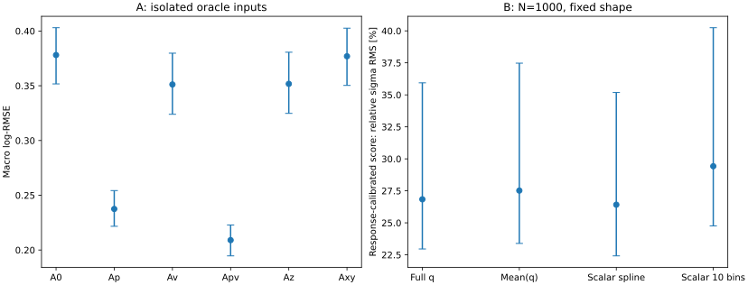

# 阶段30：产生动量/顶点缺口与概率压缩的同事件检验

日期：2026-11-01。按修订路线图执行A主实验和B有上限表示实验，含达到门槛后的z/xy控制。
全部新结果是**开发证据**。本阶段没有启用正式calibration、locked test或SIBYLL challenge。

## 阶段目标与物理结论

**最大条件缺口在primary μ产生动量大小。** 相同F5与相同事件下，macro log-RMSE
A0/Ap/Av/Apv为0.378062/0.237497/0.351194/0.209044。动量与顶点增益分别为
0.140565 [0.121453,0.162832]、0.026868 [0.020882,0.032015]；Ap优于Av的差为
−0.113697 [−0.141287,−0.090809]。但这是增加**产生动量信息**的实验，不能全部
解释为μ拟合误差，也不是可实现的tracker改善上限。

**顶点增益主要由真实纵向位置支持，整体没有确立动量/顶点协同。** z-only为0.351746，
接近xyz的0.351194；xy-only为0.376943，增益区间跨零。协同量
I=0.001585 [−0.002887,0.005936]，不能解释成因果份额。高y例外很重要：
primary-confirmed、y≥0.8的99例中，单加真实动量使log-RMSE增加0.032880
[0.016917,0.050653]，加动量和顶点后相对A0降低0.092635 [0.056255,0.133482]。
不能以总体动量主导宣布解决高y的能量分配问题。

**粗分箱确有可避免的谱信息损失；完整概率向量尚未显示超出灵活标量的明确谱收益。**
N=1000、固定箱内形状、已知经验响应的score信息基准，scalar十类→scalar样条映射
相对σ RMS为29.424%→26.417%，相对改善10.220% [5.254%,15.451%]。
不依赖十类posterior映射的解析Fisher复核仍支持粗分箱损失：29.100%→26.417%，
改善9.222% [2.332%,15.253%]。
完整q为26.839%，相对同分类器均值的改善2.475% [−0.617%,7.095%]，不足以启动扩展；
相对scalar样条的改善−1.599% [−8.794%,4.438%]。
完整q仍有更好的proper类别log score，因此不宣布概率输出没有信息；这里测的是
冻结映射和局部score推断的谱收益，不是所有可能算法的信息上限。

**下一阶段唯一优先主线：同参考面真实动量、有符号曲率响应与拟合协方差。**
深度/联合模型和更高维概率网络暂不扩展；灵活标量映射作为便宜的谱表示对照保留。

## 输入、支持集、配置与冻结协议

沿用stage12普通几何、六个nominal run 200082/200083/200089/200093/200094/200100、
官方merge/without-IFT、原20 cuts、最高pz leading、原truth fiducial、unit MC。
没有删除错配、异常、尾部或高y事件，也没有重读ROOT、重生产xAOD。

- F5缓存：`ntuples/energy_ml_stage12/dataset/train.npz`、`validation.npz`。
- 真值缓存：`ntuples/energy_ml_stage15/train_truth.npz`、`validation_truth.npz`。
- train 54,196例/91来源组，validation 13,375例/22来源组；全部都有唯一有效primary、
  正的真实产生动量及有限xyz，四格共同支持为完整样本，排除0例。
- 同源ν/反ν组不拆分，run/eventID、真ν能量及组键逐值对齐、事件键唯一、train/validation组不重叠。
- validation六能量箱计数731/2455/4247/3933/1741/268；
  y六层4349/3050/3486/1579/643/268；primary-confirmed 13,104，未确认271。
- 正式calibration/test/challenge及真实data、物理flux归一化、背景和接受度收益：**未测量**。
  validation已长期开发复用，本阶段区间不构成独立确认，未做多重比较校正。

预注册[协议](stage30_energy_ml/preregistered_protocol.md)与
[配置](../ml/configs/information_gap.yaml)在新训练前写入。固定三个seed
20261029/20261030/20261031；按组件内来源组随机置换，split seed=20261101。

| train内部角色 | 事件数 | 来源组数 | 六能量箱事件数 |
|---|---:|---:|---|
| fit | 36,668 | 60 | 2014/6587/11681/10691/4920/775 |
| early stop | 6,340 | 11 | 359/1127/1979/1854/889/132 |
| 独立预测map | 11,188 | 20 | 571/2062/3577/3245/1494/239 |

[逐组清单](stage30_energy_ml/train_source_split.tsv)。A0/Ap/Av/Apv、z/xy控制与分类器
统一fit/stop划分。新模型均不用validation标签早停或校准，也不refit到全train。
BDT使用原始F5，depth5、lr0.04、subsample0.8、min_child_weight20、lambda10、
hist、最多1600轮、patience80、4线程CPU；回归目标log(E/GeV)。
回归每fit上限120s，分类器240s；21个不同模型全部因patience停止，没有触及时间/轮数上限。

46个重建输入完全保留。Ap仅加`log(primary_p_GeV)`，Av仅加真实xyz（mm），
Apv加这四列；共46/47/49/50维。没有增加truth方向、PDG、匹配标记、y或transfer。
部署F5 allowlist不变。z/xy-only分别47/48维。

B用原六箱unit分类，π为fit实际频率，map按π_fit/π_map类权重校准，保持参考先验一致。
温度+五个class intercept在独立map预测上拟合；map内再按组二折cross-calibration，
使训练qmean映射的温度模型也未见自身标签。validation使用全map温度模型。
qmean严格是**同一分类器完整校准q**乘原六箱几何中心的log值后的单标量；
再用8结点三次样条+multinomial logistic(C=1)学概率映射。
scalar是本次A0的log预测，使用同一廉价映射；ten是该scalar沿用原9个内部边界的十类。
没有用同一事件的scalar和q做独立似然相乘。

## A：同事件四格与小控制

主风险L是六箱log-MSE平均后开根号；三seed先平均逐事件平方损失，**不是模型ensemble**。
Gp=L0−Lp，Gv=L0−Lv，Gpv=L0−Lpv，I=Lp+Lv−Lpv−L0。
500次来源组配对bootstrap共享模型/seed重抽样，区间条件于冻结模型、不含重训练误差。

| 输入 | macro log-RMSE | 95%来源组区间 | 相对A0改善 |
|---|---|---|---|
| A0 | 0.378062 | [0.351707, 0.403018] | — |
| Ap | 0.237497 | [0.221694, 0.254302] | 37.180% |
| Av | 0.351194 | [0.323981, 0.379778] | 7.107% |
| Apv | 0.209044 | [0.194648, 0.222865] | 44.706% |
| Az | 0.351746 | [0.324782, 0.380634] | 6.961% |
| Axy | 0.376943 | [0.350320, 0.402608] | 0.296% |

Gpv=0.169018 [0.149253,0.191091]。
Apv在Ap上仍改善0.028453 [0.023439,0.033207]，因此顶点不是可忽略的第二信息。
Av相对A0的改善7.107% [5.341%,8.769%]达到预注册5%且增益CI下限>0，
才执行三seed z/xy-only。Av−Az=−0.000552 [−0.001139,+0.000016]；
Axy相对改善仅0.296% [−0.032%,0.592%]。这支持纵向位置知识的重要性，
**不把全部z收益称为shower深度**：位置还可关联材料传播、采样条件和选择响应。

整体响应如下；r=Ehat/Etrue−1，bias与尾率为百分数，R68=(q84−q16)/2无量纲。
median/R68及尾率是各seed指标平均；log-RMSE先平均平方损失。

| 输入 | 整体 log-RMSE | mean bias (%) | median bias (%) | R68 | 尾率 abs(r)>0.5 (%) | 尾率 abs(r)>1 (%) |
|---|---|---|---|---|---|---|
| A0 | 0.284965 | +3.832 | +3.716 | 0.227438 | 6.707 | 0.653 |
| Ap | 0.211646 | +2.210 | +3.133 | 0.144014 | 2.801 | 0.160 |
| Av | 0.261315 | +3.094 | +2.724 | 0.200792 | 5.191 | 0.521 |
| Apv | 0.185664 | +1.635 | +2.326 | 0.120136 | 1.986 | 0.070 |

逐能量层的单元格为“log-RMSE / median bias”；能量单位GeV：

| 分层 | N | A0 | Ap | Av | Apv |
|---|---|---|---|---|---|
| 100_200 | 731 | 0.2441 / +13.81% | 0.2089 / +12.10% | 0.2037 / +10.07% | 0.1730 / +9.00% |
| 200_400 | 2455 | 0.2183 / +9.75% | 0.1856 / +7.08% | 0.1947 / +7.49% | 0.1594 / +5.39% |
| 400_800 | 4247 | 0.2375 / +5.38% | 0.1917 / +3.57% | 0.2147 / +4.28% | 0.1693 / +2.76% |
| 800_1600 | 3933 | 0.2814 / +0.33% | 0.2151 / +1.54% | 0.2600 / +0.55% | 0.1897 / +1.08% |
| 1600_3200 | 1741 | 0.3775 / -13.52% | 0.2567 / -0.80% | 0.3512 / -11.67% | 0.2262 / -0.73% |
| 3200_6400 | 268 | 0.6872 / -37.98% | 0.3338 / -5.58% | 0.6508 / -35.63% | 0.3017 / -4.91% |

最高箱Ap−A0的log-RMSE差为−0.353371（同支持268例）；median bias从−37.985%
变为−5.576%，但不能将oracle表现当作已经实现的部署改善。
逐能量的mean bias、R68、两种尾率及其95%区间全部见
[全指标](stage30_energy_ml/oracle_metrics.tsv)、[配对差](stage30_energy_ml/oracle_paired.tsv)。

逐leptonic y层，同样为“log-RMSE / median bias”：

| 分层 | N | A0 | Ap | Av | Apv |
|---|---|---|---|---|---|
| 0_0.1 | 4349 | 0.2746 / +8.93% | 0.1098 / +5.53% | 0.2643 / +6.42% | 0.0969 / +4.21% |
| 0.1_0.2 | 3050 | 0.2283 / +7.23% | 0.1381 / +5.39% | 0.2067 / +5.29% | 0.1140 / +4.23% |
| 0.2_0.4 | 3486 | 0.2297 / +1.44% | 0.1688 / -0.03% | 0.2102 / +1.64% | 0.1487 / +0.07% |
| 0.4_0.6 | 1579 | 0.3074 / -13.66% | 0.2755 / -14.40% | 0.2779 / -9.03% | 0.2479 / -10.30% |
| 0.6_0.8 | 643 | 0.4991 / -28.01% | 0.4945 / -30.10% | 0.4418 / -20.56% | 0.4379 / -22.29% |
| 0.8_1 | 268 | 0.6286 / -19.45% | 0.6469 / -29.11% | 0.5385 / -14.41% | 0.5568 / -21.62% |

高y总体Ap−A0为+0.018277 [−0.006603,+0.042172]，没有明确改善；
其99例confirmed子集的增加区间严格大于零，说明不是只由错误leading身份驱动。
这不与总体条件信息改善矛盾：按真实y分层本身依赖真实Eν，不能要求加信息后
每一个标签相关子总体在相同整体训练损失下都改善。

primary分层，同样为“log-RMSE / median bias”：

| 分层 | N | A0 | Ap | Av | Apv |
|---|---|---|---|---|---|
| confirmed | 13104 | 0.2782 / +3.77% | 0.2042 / +3.17% | 0.2551 / +2.80% | 0.1788 / +2.37% |
| unconfirmed | 271 | 0.5145 / -3.07% | 0.4400 / -6.44% | 0.4715 / -4.55% | 0.3933 / -8.29% |

confirmed上Ap−A0的整体log-RMSE差为−0.073982 [−0.082369,−0.064262]，
因此总体动量增益不只是oracle告诉未确认leading谁才是primary。
未确认271例仍全部保留；其truth候选/匹配语义沿用stage15，不称为“primary没有重建”。

真实顶点z分层（mm），同样为“log-RMSE / median bias”：

| 分层 | N | A0 | Ap | Av | Apv |
|---|---|---|---|---|---|
| -3000_-2650 | 3443 | 0.2934 / +0.65% | 0.2230 / +2.06% | 0.2828 / +3.45% | 0.2120 / +3.33% |
| -2650_-2300 | 4928 | 0.2830 / -0.55% | 0.2218 / +0.78% | 0.2620 / +3.23% | 0.1970 / +2.67% |
| -2300_-1950 | 4376 | 0.2843 / +11.05% | 0.1998 / +7.16% | 0.2442 / +2.39% | 0.1558 / +1.98% |
| -1950_-1600 | 628 | 0.2572 / +3.25% | 0.1323 / +1.67% | 0.2484 / +1.17% | 0.1186 / +0.17% |

横向r<50/≥50mm、confirmed高y及所有层的R68/mean bias/tail/协同量均已测，
见[oracle_metrics](stage30_energy_ml/oracle_metrics.tsv)、
[oracle_interaction](stage30_energy_ml/oracle_interaction.tsv)、
[逐seed表](stage30_energy_ml/oracle_seed_metrics.tsv)。配对非线性median/R68区间用
整数来源组权重的精确线性插值分位数，已与显式复制事件的np.quantile核对。

### 物理原因与程序原因的区分

[响应诊断](stage30_energy_ml/y_response_diagnostic.tsv)是看过结果后的解释性诊断，不用于选参：
低y<0.2的7399例中，primary能量份额中位数0.91765；高y≥0.8为0.12673。
高y有169/268例未确认；其reco p/primary产生p中位数3.2089、超出二倍范围66.864%。
而高y-confirmed的99例比值中位数0.98991、超出二倍范围0例，primary能量份额中位数
0.15048，Ap/A0的预测log比中位数为−0.03444。
这直接说明高y并非都由大的动量响应离群造成，μ产生能量只占很小份额；
单独知道它不足以解除ν能量分配的不确定性。有限容量、整体损失与训练先验的条件
收缩仍可能参与，本阶段没有把这几种机制做因果分离，也没有为改善高y再调参。

程序检查涵盖缓存对齐、21个模型feature_names、checkpoint最优轮回读、归一概率、
来源隔离、same-model均值压缩、分位数bootstrap、合成混合闭合与解析梯度。
没有发现方向/PDG/matching混入、事件支持变化或错读truth导致四格排序。
`truth_st1`在本阶段不使用；reco p/产生p只作**复合响应**诊断，绝不解释为材料能损。
产生点到跟踪参考面的传播、同参考面拟合误差、曲率协方差贡献：**未测量**。

## B：概率表示与粗分箱

固定α=0、nominal箱内形状与unit来源混合、N=1000。N不是观测data数。
按L(f)∝∏Σ f_b q_b/π_b拟合六箱fractions；不把sum(q)当真谱。
f0为共同validation单位混合，六箱最高fraction=268/13375=2.003738%。

必须区分两种误差：似然曲率依赖q是否正确；全局概率校准并不保证它就是正确响应。
另在实测truth条件响应下，用冻结的五维likelihood score g、均值导数G、协方差V，
构造N GᵀV⁻¹G并在正交simplex基上求逆。这给出该score估计方程可保留的局部信息，
**不是所有完整q信息的上界/精确最大Fisher信息**。没有伪逆或谱正则化。

| 表示 | 已知响应score相对σ RMS (%) | 误校准敏感的曲率σ RMS (%) | Asimov相对bias RMS (%) | 最高箱score相对σ (%) |
|---|---|---|---|---|
| q_full | 26.839 | 21.725 | 1.987 | 59.836 |
| q_mean | 27.520 | 21.826 | 2.976 | 61.448 |
| q_scalar | 26.417 | 21.459 | 4.579 | 58.579 |
| q_ten | 29.424 | 24.120 | 7.570 | 65.628 |

这四种新表示使用同一fit/stop/map与同支持；full vs mean最接近维数压缩对照，
但包含各表示映射的估计误差、cross-calibration和容量近似。
scalar来自不同目标（连续回归而非六分类），不能把full vs scalar全部归因于输出维数。
原stage23的既有BDT UU+十reco类在同13,375个validation上为26.752%，
但用了全train、validation早停、A/B响应估计及不同容量，本轮仅保留为
[历史基准](stage30_energy_ml/historical_scalar_reference.json)，不将跨阶段差算成压缩收益。
本轮A0+十类为更严格的同训练对照。

200次来源组配对bootstrap的资源决策指标：

| 参考→候选 | 相对score谱σ改善 (%) | 95%配对区间 (%) |
|---|---|---|
| q_mean → q_full | +2.475 | [-0.617, +7.095] |
| q_ten → q_full | +8.785 | [+3.190, +15.467] |
| q_scalar → q_full | -1.599 | [-8.794, +4.438] |
| q_ten → q_scalar | +10.220 | [+5.254, +15.451] |

full相对mean的区间仍允许≥5%收益，故是**证据不足**，不是排除了实用收益。
full相对灵活scalar的该局部score基准区间上限4.438%，不支持在当前预算/映射下扩大
概率架构。scalar-only相对十类的增益下限5.254%，支持粗分箱本身是重要压缩来源。
另外做了一个事后**解析方法核查**：以validation的truth条件计数仅测量固定十类的已知响应
Fisher，完全不用训练map posterior；这是评价响应，不是重拟合validation概率映射。
十类的精确信息σ RMS为29.100%，与q_ten score的29.424%接近但不相等。
灵活scalar的score下界相对这个精确十类基准改善9.222% [2.332%,15.253%]，
full改善7.770% [1.044%,15.069%]，见[解析核查](stage30_energy_ml/categorical_information_check.tsv)。
因此改善不只是十类map估计失准，仍有粗分箱压缩损失；但解析基准尚未以95%区间
支持≥5%的下限，不将预注册score的10.220%全部解释成精确Fisher损失。
该核查不改变full-vs-mean的扩展门槛，没有新训练、toys或重分箱。

预注册的full-vs-mean中心≥5%且区间下限>0门槛未满足，within±1：**未测量**，
没有转向扩大α/模型扫描。

### 概率质量、罕见箱与有限MC

| 表示 | proper log score (nat/event) | Brier | classwise ECE | 平均q最高箱 (%) | 零真类概率数，三seed合计 |
|---|---|---|---|---|---|
| classifier | 0.648034 | 0.374330 | 0.005319 | 1.8278 | 0 |
| q_full | 0.647984 | 0.374512 | 0.005289 | 2.0342 | 0 |
| q_mean | 0.681872 | 0.383141 | 0.010134 | 2.0482 | 0 |
| q_scalar | 0.681024 | 0.384759 | 0.005126 | 2.0759 | 0 |
| q_ten | ∞ | 0.413047 | 0.004012 | 2.0872 | 22 |

proper log score单位nat/event，越小越好。full−mean为−0.033888
[−0.039875,−0.027690]，full−scalar为−0.033041 [−0.041579,−0.025321]。
因此完整向量保留了均值之外可用于类别预测的信息；其谱收益尚未同样确立。
温度校准full−raw为−0.000050 [−0.000485,+0.000355]，未显示全局log score明确改善。
最高箱实际fraction为2.00374%，full平均posterior为2.03421%，只说明该边际量接近，
不证明局部概率或新谱下响应正确。完整reliability和逐truth箱log score见
[校准表](stage30_energy_ml/probability_reliability.tsv)、
[逐truth箱](stage30_energy_ml/probability_truth_bins.tsv)、
[log score配对区间](stage30_energy_ml/probability_paired.tsv)。

十类map没有空的**reco**箱，但部分reco×truth单元为零，导致validation每seed有8/7/7例
真实类别被赋零posterior（最高箱各4例）。这22个seed-event对不是22个独立来源事件。
proper log score应为∞；原实现的1e−15截断只保留为显式`clipped_log_score=0.741359`，
不能冒称有限proper score。已修正报告并列出[事件](stage30_energy_ml/zero_posterior_events.tsv)，
未加事后伪计数、未删事件、未重新训练。平滑的三种概率表示全部真类概率为正。
这说明有限map MC对十类稀少单元有实际影响；不等于证明新表示的响应MC误差已解决。

固定q不重新校准，原来源A/B两折分别6527/6848例，full score相对σ为27.170%/26.549%，
Asimov相对bias RMS为3.612%/3.723%；scalar为25.690%/27.230%、3.499%/5.830%；
ten为27.992%/31.242%、6.492%/10.086%。这些是来源MC敏感性诊断，
没有在validation折上拟合映射，也不是跨生成器验证。
这些区间条件于冻结模型和映射，没有重抽/重拟合train与map；概率估计的训练MC不确定度未完整传播。
全样本source bootstrap的full相对σ区间[22.958%,35.941%]、
mean [23.393%,37.478%]、scalar [22.417%,35.181%]、ten [24.762%,40.246%]。
稀少最高箱仅268例（K251/charm17/π0），组bootstrap不创造新尾部支持。

最弱谱方向使用六维fraction的Euclidean正交simplex基，full三seed方向在符号统一后
约(−0.010,+0.092,−0.451,+0.714,−0.503,+0.157)，主要是相邻中高箱之间的交替形变。
各seed最弱特征值约979.8–989.5（精确值见逐seed表），条件数约13.59–13.66；
最高箱相对σ仍59.836%，不能以总体σ约27%掩盖稀少尾箱的弱约束。
方向的完整逐seed/来源折系数见[分箱表](stage30_energy_ml/representation_bins.tsv)。

100个共同经验pseudo-data样本/seed，每个N=1000，不按模型另取有利样本：

| 表示 | toy bias RMS (%) | toy相对SD RMS (%) | toy相对RMSE (%) | 任一fraction触边 (%) |
|---|---|---|---|---|
| q_full | 1.964 | 23.344 | 23.309 | 2.333 |
| q_mean | 2.390 | 24.202 | 24.199 | 2.000 |
| q_scalar | 3.294 | 24.071 | 24.176 | 1.000 |
| q_ten | 8.389 | 27.628 | 28.741 | 3.333 |

这是同100批事件的三seed模型重复，不是300个独立实验。全部1200次拟合成功，
最大KKT残差3.227×10⁻⁶；每seed/bin的均值MC标准误已列在
[toy逐箱表](stage30_energy_ml/representation_toys.tsv)。有限N/边界会改变bias与SD；
q似然的曲率σ、toy SD以及响应校准score的σ针对不同近似/估计器，不可混称已验证覆盖。
这里没有测LR覆盖，没有推广到未知α、箱内形状变化、data或探测器系统误差。



## 执行命令、资源和程序修复

环境为CVMFS LCG_109_cuda/x86_64-el9-gcc13-opt，XGBoost2.1.3、NumPy2.2.6、
sklearn1.8.0；训练用CPU4线程，不需要重新编译或申请GPU。
小样本先以每个train角色900例、validation600例、20轮验证；成功smoke wall4.42s，
含环境启动，最大RSS387368KiB；脚本内部wall1.369s。首次smoke发现十类空reco箱，
在正式运行前明确了返回π的无信息fallback及计数，正式运行该计数为0。

```bash
source /cvmfs/sft.cern.ch/lcg/views/LCG_109_cuda/x86_64-el9-gcc13-opt/setup.sh
export OMP_NUM_THREADS=4 OPENBLAS_NUM_THREADS=1 MKL_NUM_THREADS=1 PYTHONNOUSERSITE=1
python ml/train_information_gap.py --seed-index 0 --smoke --output-dir ml/artifacts/stage30/smoke
tar -czf software/energy-ml-information-gap-stage30.tar.gz \
  ml/train_information_gap.py ml/information_gap.py ml/train_bdt.py \
  ml/configs/information_gap.yaml ml/configs/baseline.yaml \
  ml/configs/physics_decomposition.yaml ml/configs/files.tsv \
  ntuples/energy_ml_stage12/dataset/train.npz ntuples/energy_ml_stage12/dataset/validation.npz \
  ntuples/energy_ml_stage15/train_truth.npz ntuples/energy_ml_stage15/validation_truth.npz
condor_submit -name bigbird21.cern.ch AnalysisZipFramework/submission/ml_information_gap.sub
# 控制必须用-append；不能用文件中会被mode=main覆盖的普通命令行宏赋值
condor_submit -name bigbird21.cern.ch -append 'mode = controls' AnalysisZipFramework/submission/ml_information_gap.sub
# 等主模型完成、核查概率smoke后打表示实验包
# python ml/run_probability_representation.py --seed-index 0 --smoke --output-dir /tmp/stage30_probability_smoke
tar -czf software/energy-ml-probability-stage30.tar.gz \
  ml/run_probability_representation.py ml/probability_information.py ml/information_gap.py \
  ml/train_bdt.py ml/configs/information_gap.yaml workbook/stage23_energy_ml/folds.tsv \
  ml/artifacts/stage30/main/seed_0/predictions.npz \
  ml/artifacts/stage30/main/seed_1/predictions.npz ml/artifacts/stage30/main/seed_2/predictions.npz
condor_submit -name bigbird21.cern.ch AnalysisZipFramework/submission/ml_probability_representation.sub
export OMP_NUM_THREADS=1
python ml/report_information_gap.py --controls
python ml/report_probability_representation.py
python ml/check_information_gap.py
```

提交包分别含train/validation紧凑缓存和源文件，或三个seed的紧凑预测和概率分析脚本；
提交描述符指定EOS xrootd传输，AFS spool为`/afs/cern.ch/user/x/xcheng/nu_mu_stage30`。
不从worker重复读取全ROOT。打包和传输路径、CPU/内存请求保存在提交描述符。
选择bigbird21时idle0、running12，默认bigbird28约2354个idle；所有12作业exit0。

| 任务 | cluster | 作业数 | wrapper wall合计 (s) | CPU合计 (s) | 最大RSS (KiB) |
|---|---|---|---|---|---|
| main | 2187183 | 3 | 271.28 | 946.66 | 340004 |
| technical_repeat | 2187184 | 3 | 265.60 | 951.46 | 341712 |
| controls | 2187186 | 3 | 78.19 | 258.93 | 314516 |
| representation | 2187185 | 3 | 54.41 | 51.47 | 191012 |

总wrapper wall669.48s，CPU2208.52s，最大RSS341712KiB；GPU申请/使用0。
一个可避免的提交错误必须计入成本：首次尝试用普通命令行`mode=controls`时被sub中的
`mode=main`覆盖，cluster2187184重复了15个主模型fit；发现时已结束。
实际为**21个不同BDT、36次正式fit**，超过预注册的21次fit计数，但未做新参数搜索，
仍在预注册总wall上限2880s内。额外CPU951.46s、wall265.60s计入上表，不算独立证据。
已用-append及dry-run核对控制参数。回归和raw分类预测完全一致；校准/映射概率
最大绝对差5.33×10⁻¹⁵，见[重复核对](stage30_energy_ml/technical_repeat_check.json)。
保留的main每模型成本表为最后技术重复的实测时钟，初次作业成本另由Condor日志统计。

正式回归/控制fit wall范围7.97–14.13s、分类30.25–33.60s（保留运行）；
A0推断吞吐123380–157457 events/s，分类22925–30889 events/s，CPU批量输入已在内存。
一次完整A分层报告约10.27s CPU10.04s、RSS189.47MiB；
B每seed完整200来源bootstrap+100toys11.96–15.15s（精确值见summary）。
不把wrapper启动/传输时间当作纯训练时间。

序列化报告首次遇到np.int64 JSON类型错误，仅修复类型，不改数值/模型；
proper log score复验发现零posterior后补充真实support诊断，未以截断掩盖无限损失。
21个checkpoint全部回读、每个582例抽查预测；合成混合fractions最大差5.12×10⁻⁸，
解析梯度误差4.16×10⁻¹¹，score/精确曲率协方差相对差9.98×10⁻¹⁶，无信息摘要被正确判退。
见[最终验证](stage30_energy_ml/final_validation.json)、
[回读表](stage30_energy_ml/model_readback_checks.tsv)、
[输入smoke](stage30_energy_ml/input_smoke_checks.json)、
[资源](stage30_energy_ml/condor_resources.tsv)。

## 产物、限制与下一步验收

代码：`ml/train_information_gap.py`、`information_gap.py`、`probability_information.py`、
`run_probability_representation.py`及两个报告脚本和验证脚本。
紧凑预测/checkpoint：`ml/artifacts/stage30/main/seed_*/`、`controls/seed_*/`；
概率toys/bootstrap数组：`ml/artifacts/stage30/representation/seed_*/sampling.npz`，均不提交Git。
表/图/配置快照与协议在`workbook/stage30_energy_ml/`；公共JSON配置/特征/来源分配合并保存。
技术重复未另保留模型副本，EOS临时版本当前无残留；smoke模型和已验证源包已清理。最终预测/模型68.090MiB，表/图/元数据约1.257MiB，见[compaction记录](stage30_energy_ml/compaction.json)。

本阶段未测量：同参考面真实μ动量、独立材料能损、曲率pull、协方差可靠性、
reco深度可恢复性、within±1（未触发）、CaloNu同事件增益、真实data响应、
interaction/shower/电子学系统学、独立保留集和最终含背景/接受度/归一化测量收益。

下一步只推进以下一条物理主线，不扩大GNN/Transformer/TabM竞赛，不扫α或树预算：

1. **参考面与语义审计**：输入官方ntuple/Calypso源码、原selected事件键、primary barcode、
   同参考面q/p和完整相关协方差字段。查明真实动量是否来自输运时刻，必须排除stage15
   `truth_st1`使用产生模长的语义。若缺字段，只做代表性小样本导出，先smoke再Condor，
   不保存大xAOD。验收为单位、参考面、barcode/母粒子关联和读出语义逐项可复验。
2. **同参考面响应**：在相同confirmed事件上测q/p残差、bias、核心宽度/尾部及pull，
   按真能量、y、z、charge分层，并与产生点到参考面的真实传播变化区分。
   不倒数接近零曲率后用截断删尾；未确认事件作为单独混合问题保留。
   验收为一个来源组区间支持的物理结论，判断缺口主要来自传播/拟合/非高斯尾的哪一项，
   无法区分的项明确写未测量，不由oracle全部差距推断。
3. **对应data控制与决定是否可恢复**：先用穿透μ和已有data/MC校准检查tracker参考面、
   charge/协方差与响应范围；MIP不能校准强子能量。只有新证据支持可恢复时再训练一个
   固定的小模型并比较同事件收益。否则按路线转向有效新读出；不因为oracle好就承诺能实现。

继续执行Prompt已更新至[下一轮](../docs/nu_mu_energy_ml_next_step_prompt.md)。
