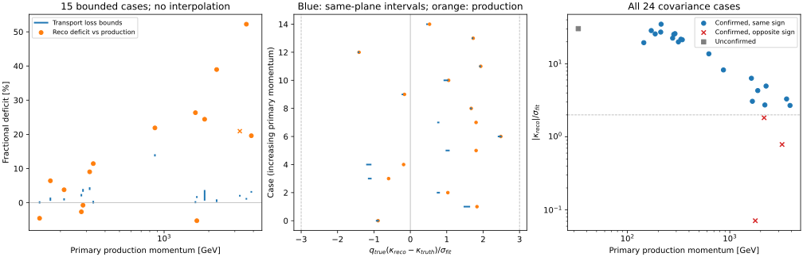

# stage32：同参考面动量界限与真实拟合协方差

## 阶段目标与路线位置

严格沿修订路线的动量主线，区分产生点→tracker传播与reco→同参考面响应。
本阶段是stage31的必要原生控制，**不是路线表中“冻结与独立检验”已经完成**。
没有新ML fit，F5全部46维与F6新增19维均保留为有限候选；未读正式calibration/test/challenge。
unit MC、不引入flux归一化、原六run/官方merge withoutIFT/原20cuts/最高pz leading/truth fiducial不变。

**新结论：稀疏TruthEvent确实含真实输运信息，约一半诊断事件能给保守同面动量界限。
可约束高p子样本的材料传播不足以解释多例大幅动量低估；同时真实σκ表明这些偏差并未在本小样本中形成>3σ尾。
下一步应扩大来源与同面响应/协方差控制，不能把全部oracle缺口解释成拟合误差或直接调大模型。**

## 工作内容与固定输入

- [预注册协议](stage32_energy_ml/preregistered_protocol.md)、配置`ml/configs/reference_audit.yaml`，seed=20261102。
- [12文件manifest](stage32_energy_ml/manifest.tsv)、[288事件抽样表](stage32_energy_ml/sample.tsv)。原train与validation，
  charm/k/pi各取每分区字典序第一个source group、保留两生产时期；独立组只有6个，不能按12文件重抽样。
  每文件24例，轮流覆盖Eν六箱、从非空(y,z)格随机抽取，不看reco误差、电荷或matching。
- 每文件2例协方差导出，优先所抽事件中p_primary<400GeV和≥1600GeV各1例；缺区域固定随机补足。
  总计24次单事件重建，没有因tail好坏替换事件。这是覆盖稀少区的诊断设计，**不是全unit样本的无偏总体估计**。
- 官方现成d32b0ff3/Athena24.0.41/gcc13.1，不使用版本不符的邻目录build。
  native PyAthena+POOL解码TruthEvent，原RDO重建后导出真实front五参数、5×5协方差和associatedSurface。
  详细源码/单位/匹配核查见[来源审计](stage32_energy_ml/source_audit.md)。

## 详细数据：保存覆盖与程序核验

288例primary barcode/PDG/产生pxpy pz/xyz逐事件核对全部通过；274例leading-primary确认、14例未确认，全部保留。
延续链长1–18，共1,276对相邻状态，同PDG、再生barcode差1,000,000、顶点连续与动量非增检查全部通过，无分叉。
全部288例HepMC动量enum声明GEV，但官方源码与数值采用内部MeV/mm；generated μ mass统一为105.65837097167969MeV。
第一次truth smoke错误地按enum再次乘1000，被与PHYS逐值核验拦截后修正；不能把元数据问题说成G4能量放大1000倍。
第一次cov smoke发现请求中的`LeadTrack_pz0`本已是GeV，准备器补乘1000后才与native MeV一致。
这两个修正在正式批处理前完成，原seed/选择/事件键不变，失败成本保留。

没有任何保存顶点距原front z小于0.001mm；最近距离最小/中位/最大为1616.560/1975.627/2807.417mm。
所以不能把最近顶点、`truth_st1`或插值当精确参考面真值。
原生post-incident链允许给界限：被动材料、静态纯磁场、同μ延续且动量非增时，
唯一跨面有限段的起点post-p为上界，终点下一μ的post-p为下界；上下扩大2e-6相对数值容差。
24协方差例按真实curvilinear associatedSurface的center/normal判断跨面，不直接冒充sensor平面。

| 同原front z平面的保存覆盖 | 有界/总数 | 比例 | 95%来源组bootstrap |
|---|---:|---:|---:|
| 全部 | 145/288 | 50.347% | [46.345%,55.208%] |
| primary-confirmed | 144/274 | 52.555% | [48.621%,57.246%] |
| 未确认 | 1/14 | 7.143% | [0%,29.321%] |

143例不可给双侧界限，均为最后保存μ无end vertex、最后production仍在参考面上游。
这是保存缺口，不能解释为没有穿过tracker或零能损；也没有把开口链外推成同面真值。
逐Eν/y/z覆盖见[transport_coverage.tsv](stage32_energy_ml/transport_coverage.tsv)：
Eν六箱有界/总数为17/44、24/59、22/55、30/55、33/51、19/24；覆盖与能量并不独立。
y≥0.8为5/17，不能将可约束支持的损失外推整个高y区。

24次重建的原front p/xyz/charge全部在预定数值精度内复现，SDO确认标记全部与原PHYS一致。
24个协方差全部有限、对称、正对角且correlation矩阵正定，最小特征值0.000373720。
σκ中位数1.75661×10^-4 GeV^-1。q/p原单位MeV^-1、方差MeV^-2，σ转换乘1000。
track_fitter枚举0有20例、3有4例，仅作来源记录，不比较算法。

## 详细数据：传播与同面响应

κ=q/p（有符号逆总动量，GeV^-1）。由真实p区间得到κ_truth区间及
`r=(κ_reco−κ_truth)/σκ`区间；**这是标准化残差区间，不是精确pull**。
24例中15例有界，均primary-confirmed；占全部62.5% [45.833%,83.333%]，
占confirmed 15/23=65.217% [50%,83.333%]。9例无界原样列入表。

15例κ区间宽度/σκ中位数0.038928 [0.006350,0.073540]，最大0.135021。
在这个支持上，输运状态未保存造成的不确定范围明显小于fit σ；已有稀疏链足以排除“全部由传播解释”的说法，
不必先全量重模拟。但不足以给所有事件精确pull。

| 15例同支持指标 | 由输运界限允许的范围 | 端点来源组95%区间的外包络 |
|---|---:|---:|
| 平均产生→参考面动量损失比例 | [2.2843%,2.6517%] | [1.3828%,3.8824%] |
| mean(q_true·r) | [0.545293,0.587247] | [0.174261,0.851282] |
| RMS(q_true·r) | [1.312577,1.353054] | [1.047027,1.551306] |
| R68(q_true·r)=(Q84−Q16)/2 | [1.367908,1.395190] | [0.891970,1.747613] |

第一列范围是**部分识别的端点界限**，不是统计置信区间；最后列是对应端点bootstrap区间的外包络，
不声称构造了严格联合95%覆盖集。相同6来源组500次同时重抽样，缺组的有效次数另记。
这些均值/RMS/R68端点汇总是冻结提取后的解析诊断，未改样本或加模型。
q_true乘残差避免正负电荷偏差抵消；正值表示曲率沿真电荷方向偏大。
同15例对产生点计算的复合标准化RMS为1.442553；换成同面界限后仍为1.312577–1.353054，
不能把所有响应展宽当材料传播。小样本、选择与保存覆盖都可能影响均值和宽度，未标定全局σκ比例。

**高p具体检验：**7例p_primary≥1600GeV可给界限，传播损失允许范围总跨度0.08613%–3.48890%。
其中6例reco p低于同面下界，reco相对产生点动量低19.5997%–52.2282%；另1例高于同面上界。
例如run200083/event5282：p_vertex=3586.893GeV，p_ref∈[3545.433,3546.005]GeV，
p_reco=1713.524GeV；仅1.13994%–1.15590%的传播损失，明显解释不了52.2282%的低估。
其同面r∈[−1.708685,−1.708427]，这同时说明大百分比动量偏差不等于大量σ异常。

15例r区间全部位于±3内，最大可能|r|=2.486114；必然/可能>3均为0/15。
**0/15不能证明总体无尾或Gaussian pull闭合**；纯bootstrap在零尾事件上退化，表中总体区间为nan并标注原因，
不报告[0,0]作为总体上限。R68的来源区间仍允许1，本轮不能确认协方差缩放失准。

## 电荷、matching与分层限制

24例4例电荷不同，其中confirmed 3/23=13.043% [0%,28.884%]。
p_primary≥1600GeV的10例均confirmed，其中3例异号，30.0% [0%,63.636%]；
这是小样本设计下的诊断比例，不替代stage31较大样本结果。
三个异号的|κ_reco|/σκ分别为0.787166、1.829555、0.071265，均<2：
**已报告的拟合误差本身就不支持这些事件的曲率符号被精确测定**。
材料传播不翻转μ电荷；只有其中1例可给双侧输运界限，另外2例传播量未测量，不编造分解。

唯一未确认例run200093/event23343，p_primary=33.141GeV、reco p=127.229GeV且异号，
对primary产生动量的复合标准化残差146.717。它不是已确认primary轨迹的fit pull，
保留并单列，不能混入精确tracker响应结论，也不能事后删除这个tail再说性能改善。
本次cov样本的y≥0.8只有此1例、没有confirmed高y支持，不能回答stage31的99例高y能量分配缺口。

所有逐Eν、p、y、z、电荷、confirmed层的N/组数/端点/区间见
[reference_summary.tsv](stage32_energy_ml/reference_summary.tsv)和
[bounded_aligned_summary.tsv](stage32_energy_ml/bounded_aligned_summary.tsv)。
很多层仅1–2组；退化bootstrap写nan，不伪装高精度。6组区间只表示该诊断设计的来源敏感性，不代表探测器系统误差。



图左蓝线是传播损失范围、橙点是reco相对产生点的动量亏损，叉号表示异号；
中图蓝线是同面端点范围、橙点为产生点对照；右图保留全部24例及未确认事件。

## 命令、成本与验证

小样本先成功读取1例native TruthEvent及重建/导出1例协方差，再提交：

```bash
source setup_env.sh --official
python ml/audit_transport_truth.py --request ntuples/energy_ml_stage32/requests/101.json --output /tmp/stage32_truth_smoke.json --smoke
# covariance smoke：faser_reco.py --isMC --geom TI12MC04 --skip 5282 --nevents 1 <input-RDO.root>
# 然后 ml/audit_reference_covariance.py --request <101.json> --event 5282 --xaod <xAOD> --output <json>
condor_submit -name bigbird21.cern.ch AnalysisZipFramework/submission/ml_reference_audit.sub
condor_submit -name bigbird21.cern.ch AnalysisZipFramework/submission/ml_reference_covariance.sub
source /cvmfs/sft.cern.ch/lcg/views/LCG_109_cuda/x86_64-el9-gcc13-opt/setup.sh
export PYTHONNOUSERSITE=1 OPENBLAS_NUM_THREADS=1 OMP_NUM_THREADS=1
mkdir -p workbook/stage32_energy_ml/resources_truth workbook/stage32_energy_ml/resources_cov
python3 ml/collect_tabular_resources.py --cluster 2187190 --log-dir /afs/cern.ch/user/x/xcheng/nu_mu_stage32/logs --prefix native --report-dir workbook/stage32_energy_ml/resources_truth --jobs 12 --gpus 0 --cpus 1 --memory-mb 3000
python3 ml/collect_tabular_resources.py --cluster 2187191 --log-dir /afs/cern.ch/user/x/xcheng/nu_mu_stage32/logs --prefix native --report-dir workbook/stage32_energy_ml/resources_cov --jobs 12 --gpus 0 --cpus 1 --memory-mb 3000
python3 ml/report_reference_audit.py --compact
python3 ml/plot_reference_audit.py --png-preview /tmp/stage32_reference_diagnostics.png
```

prepare命令为`python3 ml/prepare_reference_audit.py`，用既有stage12/15紧凑缓存与PHYS事件键；
其4.364s只涵盖准备，不当作原生解码成本。payload包含准备好的request、诊断代码/headers与setup脚本，
官方archive由worker从EOS加载；提交前两份descriptor均做dry-run核验12个正确index。
不在登录节点跑批量。两个cluster为2187190、2187191，每个12 jobs，全部exit0；
每job请求1CPU/3000MB/2000MB磁盘，无GPU，microcentury。原始RDO12文件总大小12,516,548,391bytes。

| 实测成本 | truth 12 jobs | cov 12 jobs（24次重建+24次导出） | 合计 |
|---|---:|---:|---:|
| wrapper wall总和/s | 2007.78 | 3758.75 | 5766.53 |
| wrapper user+system CPU/s | 1151.09 | 2764.69 | 3915.78 |
| 最大RSS/KiB | 1,625,172 | 2,138,152 | 2,138,152 |
| 提交到各cluster最后完成/s | 246 | 426 | 不相加 |

cov分项：12次本地copy wall74.05s；24次重建wall486.66s/CPU345.91s；
24次导出wall3059.01s/CPU2323.71s。每文件先本地copy一次供两次随机entry重建，worker单线程，
只输出紧凑JSON；每个子进程600s上限，trap删除RDO/xAOD/ROOT临时文件。
返还选中truth的吞吐为288/2007.78=0.14344例/s（按wrapper wall总和）；
它不是全部扫描事件吞吐，原生reader还遍历未选事件的EventInfo，总扫描事件吞吐未测量。
cov返还为24/3758.75=0.006385例/s，主要成本为官方POOL与解释编译初始化。

含失败smoke的已测wall总和334.57s，CPU已测190.26s；首个失败truth及早期字典探索未完整计时，明确未测量。
成功truth smoke wall71.27s/RSS1,519,156KiB，成功cov smoke80.81s/1,983,120KiB；
其前重建23.29s/1,021,056KiB。失败cov smoke76.98s/2,020,952KiB，已计入。
native首例pilot82.22s/1,611,864KiB，CPU未测量，不能称smoke总CPU完整。
详细表见[resource_summary.json](stage32_energy_ml/resource_summary.json)、
[smoke_resources.tsv](stage32_energy_ml/smoke_resources.tsv)、两个resources子目录及
[cov_subprocess_resources.tsv](stage32_energy_ml/cov_subprocess_resources.tsv)。

边界算法用100→90GeV toy检验两种电荷的逆动量包含关系，以及动量反增、错误parent barcode、缺end的拒绝；
结果见[analytic_checks.json](stage32_energy_ml/analytic_checks.json)。真实288/24事件键完整，
矩阵/单位/匹配/front复现全部通过；图已检查，无填补缺失真值。紧凑化后再次读回复算关键物理表一致。

最终native请求/输运/cov合并为
`ntuples/energy_ml_stage32/native_results.json.gz`，**166,109bytes**，字典完整读回相等后删除36个源JSON。
只保留这个ignored紧凑缓存与可追溯TSV/JSON/SVG；不提交ROOT或二进制数据，清理本轮smoke xAOD及源payload。
首次紧凑汇总6.26s CPU6.04s/RSS170.36MiB；archive-only复算6.44s CPU6.29s/RSS170.12MiB，
8张物理/资源表逐字节一致，见[复算记录](stage32_energy_ml/postprocess_validation.json)，不需要重复批处理。

## 阶段性结论与下一步验收

1. 原生保存链提供了真实、可核验的输运上下界，推翻“现有RDO没有可用输运动量信息”的假设；
   精确同面状态仍为0/288。143例缺口有保存机制原因，未将未知当零能损。
2. 在可约束高p支持上，多例大幅动量低估不能由已发生的材料传播单独解释；真实σκ同时显示符号分辨和逆动量统计精度有限。
   这支持继续做同面有符号响应与协方差控制，而不是把oracle差距全部解释为拟合误差。
3. 15例条件偏差、R68与0个>3σ不足以完成MC/data或pull闭合，不用它们直接标定F6或σκ。
   高y、未确认、无界支持和真实data仍欠覆盖；新增轨迹族的总体ν增益仍沿用stage31，不宣称本轮训练改善。

**下一条唯一主线：有预算扩大独立来源的同参考面响应审计，随后冻结有限F5/F6的校准/独立检验协议。**

- 输入：原train/validation的更多source groups、对应官方RDO与原PHYS、当前native reader/cov导出器；
  data控制另须核对同参考面、时期/几何/对齐/conditions及真实可执行选择。
- 先冻结新协议：至少新增12个独立来源组，重建上限96例，保留低/高p、正负电荷、高y和未确认支持，
  不按残差筛选；报告抽样设计和覆盖，不能把重复时期当独立来源。
- 验收：复现原front；逐p/Eν/y/z/charge/matching测覆盖、κ偏差/R68/尾和σκ响应；
  对有界支持给端点与组区间，对无界支持保留并评估是否能用有物理依据的单侧界限。
  若现有保存始终不能约束关键支持，再只对有预算少量事件导出精确G4参考面状态，必须与同次新reco配对。
- 在以上控制后预先冻结允许校准、评价、nuisance及一次性locked test协议；不无限复用validation调模型。
  不启动深度/联合概率/大型拓扑扩容，也不全量重模拟。真正data协方差闭合、精确pull、系统变体、
  CaloNu同事件增益及最终能谱测量收益本轮均**未测量**。
