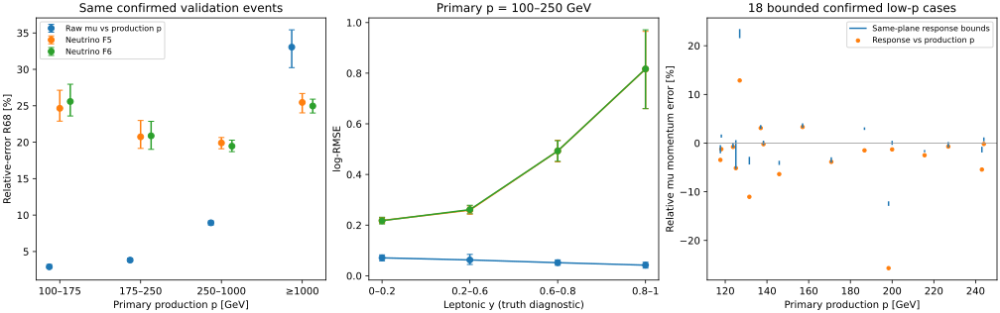

# stage33：低动量响应与非μ信息的条件收益

## 阶段目标

按用户最新物理判断，将≥1TeV μ作为tracking分辨能力参考，不再以修复TeV动量为主研究终点。
本轮重点检验较低动量区的μ是否已经足够准确、ν能量缺口是否还在，以及已有非μ输入哪些确实有用。
完整F5/F6保留，无新训练、调参或正式calibration/test/challenge读取。

原ν选择要求reco pz>100GeV，不能由此声称覆盖完整25–100GeV：
train+validation中primary p=25–100GeV有437例，仅19例leading-primary确认；
本轮可稳定评价的重点为产生p=100–250GeV。完整25–100GeV无偏控制**未测量**，需另建放宽p门槛的控制选择。
未将未确认事件当“低p tracking很差”的证据，也未改变当前ν模型选择。

## 输入、协议与工作内容

- [预注册协议](stage33_energy_ml/preregistered_protocol.md)，`ml/configs/low_momentum_audit.yaml`，seed20261103。
- 新native样本排除stage32全部6来源组；每component×train/validation取接下来2新组，
  共12独立新组、24文件、576个truth事件、96次单事件重建。两个生产时期不是独立来源。
  每文件truth的100–250/250–1000/≥1000GeV配额12/8/4，cov配额2/1/1；
  非空(y,z,真电荷)格固定随机，不看残差或matching；不足低p truth配额按冻结规则补剩余p≥100事件。
  属于覆盖诊断设计，不是全unit样本总体估计。[manifest](stage33_energy_ml/manifest.tsv)、
  [sample](stage33_energy_ml/sample.tsv)和[selected population](stage33_energy_ml/selected_population.tsv)保留全部键。
- 先提交首文件178的truth/cov两个小样本Condor作业；成功后再运行其余23文件，首文件4次重建计入96上限。
  复用官方d32b0ff3、native POOL与stage32真实输运链/协方差算法；仅wrapper增加stage参数。
- 复用stage30/31已有三seed的13,375例validation预测，22来源组同步bootstrap500次。
  本轮不是新的独立检验。原始μ对产生动量误差与真正同面响应分开，不把同面界限中点当精确pull。
- 为避免将非线性/先验收益全部归给新读出，补充stage13同预算单seed的μ-only BDT/F5、
  stage14固定d5/1600三seed变量组对照。这是主缓存比较后的探索性补充，零新增fit，不重新挑容量。
  不与stage30/31不同训练划分/容量混成单一受控实验。

## 大样本实测：低p μ准确，但ν能量仍有缺口

以下均为primary-confirmed的同事件validation，误差定义为pred/target−1；
μ target为**产生动量**，ν target为Eν，R68=(Q84−Q16)/2。
每个模型三seed指标先按既有规则合并，再对相同来源组同时重抽样；不能将三个seed当独立事件。

| 产生p区域 | N | 原始μ R68 | 原始μ中位偏差 | 原始μ log-RMSE | ν F5 log-RMSE | ν F6 log-RMSE |
|---|---:|---:|---:|---:|---:|---:|
| 100–250GeV（重点） | 2315 | 3.3984% [3.2419%,3.5805%] | −1.5520% [−1.6387%,−1.4395%] | 0.065516 | 0.296955 | 0.297415 |
| ≥1000GeV（参考） | 2783 | 33.0543% [30.2371%,35.4287%] | −3.2871% [−4.7648%,−1.9867%] | 0.620208 | 0.342649 | 0.318602 |

100–175/175–250GeV确认事件分别1055/1260例，原始μ R68为2.8957%/3.8172%；
不能把临近p_reco>100门槛后的条件分布当所有低p轨迹的无偏响应。
100–250GeV原始μ相对误差>20%为1.2959% [0.8885%,1.7591%]，>50%为0.1728% [0.0422%,0.2983%]；
尾事件保留。ν F5 R68=22.5651% [21.0474%,24.4035%]，F6=22.6516% [21.1321%,24.4560%]。

低p F6−F5 ν log-RMSE差+0.000460 [−0.001715,+0.002722]；
相对风险改善−0.1550% [−0.9064%,+0.5914%]，该开发支持上不支持再靠轨迹族取得5%ν风险收益。
≥1TeV参考区F6改善7.0181% [4.7913%,9.3554%]，解释了整体收益偏向较难的tracking区域；
保留候选，不把这个结果变成继续修复所有TeV事件的要求。

低p μ产生动量辅助F6回归log-RMSE=0.091256，比原始0.065516更差，差
+0.025740 [0.016269,0.034823]；R68=4.0500%，相对原始增加0.6516个百分点
[0.5154,0.8030]。**不将该辅助回归部署为低p μ校正**，其总体收益不代表逐能区收益。

固定同一低p区再按y分层：

| leptonic y | N | 原始μ log-RMSE | ν F5 | ν F6 |
|---|---:|---:|---:|---:|
| 0–0.2 | 1167 | 0.070741 | 0.218348 | 0.217636 |
| 0.2–0.6 | 879 | 0.062479 | 0.259234 | 0.261172 |
| 0.6–0.8 | 212 | 0.051638 | 0.492638 | 0.492863 |
| 0.8–1 | 57 | 0.041918 | 0.816307 | 0.816974 |

高y的μ仍准确而ν误差显著增大，F6−F5差+0.000667 [−0.009350,+0.008049]。
这支持将低p ν问题转向能量分配与非μ活动信息，而非继续归因高p曲率。
不把Eν−Eμ,vertex称已测可见强子能量，也不由此保证新读出能恢复所有缺失信息。

详细误差、偏差、尾、组数及区间见[cached_validation_metrics.tsv](stage33_energy_ml/cached_validation_metrics.tsv)、
[paired](stage33_energy_ml/cached_validation_paired.tsv)和[relative gains](stage33_energy_ml/cached_validation_log_gains.tsv)。
未确认、reco 100–250及25–100选择支持均另报，未删离群事件。

## 哪些已有变量确实有用

低p确认支持上，当前F5相对固定pμ/0.8的log-RMSE改善38.0458% [33.9804%,42.0629%]。
这个比较包含非线性标定/训练先验，不能全算作非μ读出信息。匹配历史模型控制给出：

| 固定模型族与比较 | 低p ν log-RMSE相对改善 | 95%来源配对区间 |
|---|---:|---:|
| stage13单seed：μ-only F0→F5 | 35.5371% | [33.6335%,37.6202%] |
| stage14三seed：F1→F2，加计数 | 21.7618% | [19.7495%,24.4578%] |
| stage14三seed：F2→F3，加闪烁体 | 16.6287% | [13.5135%,19.5010%] |
| stage14三seed：F5去闪烁体→完整F5 | 16.2859% | [13.3957%,18.8133%] |
| stage14三seed：F5去常规Calo→完整F5 | 0.5278% | [0.0969%,0.9410%] |
| stage14三seed：F5去全局空间shape→完整F5 | 1.7115% | [1.0147%,2.5149%] |

计数/闪烁体提供可利用的条件信息；常规Calo和全局shape的边际收益较小，不能据此说完全没信息，
也不能把常规Calo结果搬到CaloNu。stage13完整F5去计数的收益只有0.2483% [−0.2949%,1.0211%]，
说明与其他活动变量有冗余；顺序加入与去组不是独立贡献分解，收益不能相加。
这些活动相关性还未成为经过data校准的强子能量测量。保持F5全部变量，不按本轮val结果删变量或扫结构。
历史模型只有开发验证，stage13/14早停使用validation，训练来源/预算不同于stage30/31；
旧入射flux动量库复用风险仍在，来源bootstrap不等于消除了完整生成谱系依赖。
[完整对照](stage33_energy_ml/historical_ablation_paired.tsv)与[模型指标](stage33_energy_ml/historical_ablation_metrics.tsv)保留具体配置族。

## 新原生低动量控制

576例原生primary产生动量/xyz全部与原PHYS核验通过，0条分叉；同原front-z平面有界273/576。
100–250/250–1000/≥1000GeV的truth设计支持为281/196/99例，有界106/101/66例，
即37.72%/51.53%/66.67%。覆盖随动量改变，不能把有界支持外推所有事件。
没有0.001mm内的保存状态，最近z距离最小0.806978mm，仍然没有精确同面真值。
576例HepMC单位enum与内部MeV数值约定不一，质量统一105.65837097167969MeV；
逐事件核验成功，不把元数据问题解释成模拟能量放大1000倍。源码依据沿用[stage32审计](stage32_energy_ml/source_audit.md)。

96次重建全部复现原front p/xyz/charge，96个协方差有限、对称、正对角且correlation正定，
最小特征值0.000359336；SDO确认标记与原PHYS一致，无程序复现失败或技术重复。
按真实associatedSurface有界44/96，全部confirmed；其余52例保留为无双侧界限，没有伪装精确pull。

| 产生p区域 | cov总数 | confirmed | 同面有界confirmed / 来源组 | confirmed电荷不同 |
|---|---:|---:|---:|---:|
| 100–250GeV | 48 | 44 | 18 / 9 | 0/44 |
| 250–1000GeV | 24 | 24 | 11 / 8 | 0/24 |
| ≥1000GeV | 24 | 23 | 15 / 11 | 3/23 |

5例未确认事件全部保留，不混成已确认primary的内禀fit响应；新来源只是相对stage32的审计扩展，
仍来自旧train/validation，不能将576例加到13,375例当独立检验样本。
低p cov有界18/44=40.91% [25.87%,56.99%]；先以12个来源组统一重抽样，再报告有界支持实际9组。

以下给出18例低p同支持的**部分识别端点范围**，不是区间中点估计或统计置信区间：

| 指标 | 端点允许范围 | 端点95%来源区间的外包络 |
|---|---:|---:|
| 平均产生→参考面损失比例 | [2.5497%,3.4866%] | [1.0757%,5.6441%] |
| 同面相对动量误差均值 | [−0.2779%,+0.6909%] | [−2.9820%,+3.9119%] |
| 同面相对动量误差R68 | [2.9631%,3.7416%] | [0.7607%,7.5874%] |
| 同面相对动量误差RMS | [6.1695%,6.8093%] | [1.8769%,10.2962%] |
| q_true·标准化κ残差均值 | [−0.167843,+0.253717] | [−0.610040,+0.943116] |
| q_true·标准化κ残差R68 | [0.968115,1.330764] | [0.263592,1.992328] |

外包络不声称严格联合95%覆盖。低p全部44例的σκ中位数1.34795×10^-4 GeV^-1、
|κ_reco|/σκ中位37.679。18例有界支持的κ区间宽/σκ中位0.220272，最大3.162015；
少数稀疏区间较宽，尤其不能用中点作Gaussian pull闭合。均值包含0，当前样本不支持精细校准σκ。
也不能把此设计样本的平均传播损失直接从全validation的中位偏差扣除。

低p 18例中有1例必然且可能相对误差>20%，1/18=5.56% [0%,17.05%]；>50%为0/18。
这个设计小样本尾率与全validation的1.30%不是同支持总体估计，来源区间也允许后者，不能据此说低p总体变差。
该例run200093/event31170：p_vertex=126.933GeV，p_ref∈[116.215,117.708]GeV，
p_reco=143.257GeV，同面误差[+21.706%,+23.269%]；σκ=6.60481×10^-4 GeV^-1，
标准化残差[2.294057,2.459286]，误差较大同时伴随较大的fit σ。
不因这一例停止低p分支，也不删掉它再报告核心精度。
全部44例有界支持的标准化残差区间均在±3内，最大可能|r|=2.904053；
零尾bootstrap退化写nan，不称总体无尾或精确pull闭合。

TeV参考的3例异号|κ_reco|/σκ为0.206628、1.373473、0.309555，均<2，
与高p符号分辨有限相符，不要求达到低p百分比精度，也不据此诊断硬件/软件故障。
远离零曲率时σp/p≈pσκ，说明高p百分比误差自然随p放大；在零曲率附近不能靠倒数/截断恢复信息。
52例无双侧界限仍保留。开口链可讨论条件性的上界，但本轮没有新增逐簇穿面证据，
未将条件性外推升级成同面测量，也未为此启动额外重模拟。

全部事件见[reference_events.tsv](stage33_energy_ml/reference_events.tsv)，
[同面相对误差分层](stage33_energy_ml/bounded_relative_momentum_summary.tsv)、
[κ端点分层](stage33_energy_ml/bounded_aligned_summary.tsv)与
[覆盖](stage33_energy_ml/transport_coverage.tsv)保留p/Eν/y/z/charge/matching与实际组数。



图左、中为同一validation确认支持，右为新native的18例有界低p确认支持。
右图保留所有区间和tail；μ对产生动量与同面动量的误差不同，不把图中不同目标的R68当同一种分辨率。

## 执行、成本与验证

准备耗时13.695s；先在较空闲bigbird21提交首文件pilot，再在其事件键、front、协方差全部验收后交其余文件。
没有额外pilot重建：pilot的4次已经计入96次。两个submit文件均先dry-run；
cluster2187192为2 jobs，2187193为46 jobs，**48作业全部exit0、96次重建、零技术重复、零新fit**。
每job请求1CPU/3000MB/2000MB、无GPU、microcentury；每RDO仅copy一次供4次重建，
每子进程600s上限、单线程设置，worker退出清理RDO/xAOD/ROOT，仅上传紧凑JSON。

```bash
source /cvmfs/sft.cern.ch/lcg/views/LCG_109_cuda/x86_64-el9-gcc13-opt/setup.sh
export PYTHONNOUSERSITE=1 OPENBLAS_NUM_THREADS=1 OMP_NUM_THREADS=1
python3 ml/prepare_low_momentum_audit.py
# 打包setup_env.sh、两个native脚本、两个诊断header及24个request；官方53MB archive另由worker加载。
condor_submit -name bigbird21.cern.ch -dry-run /tmp/stage33_pilot.ads AnalysisZipFramework/submission/ml_low_momentum_pilot.sub
condor_submit -name bigbird21.cern.ch AnalysisZipFramework/submission/ml_low_momentum_pilot.sub
# 核验首文件24/4事件及正定cov，见pilot_validation.json；然后：
condor_submit -name bigbird21.cern.ch -dry-run /tmp/stage33_batch.ads AnalysisZipFramework/submission/ml_low_momentum_batch.sub
condor_submit -name bigbird21.cern.ch AnalysisZipFramework/submission/ml_low_momentum_batch.sub
python3 ml/report_low_momentum_control.py
python3 ml/report_low_momentum_ablations.py
python3 ml/report_reference_audit.py --config ml/configs/low_momentum_audit.yaml --compact
python3 ml/plot_low_momentum_control.py --png-preview /tmp/stage33_low_momentum_diagnostics.png
```

实际worker用`source setup_env.sh`的`nu_mu_official_setup`解包匹配d32b0ff3，
等价交互入口为`source setup_env.sh --official`；没有重编Calypso，也没有读正式保留分区。
资源回收复用`ml/collect_tabular_resources.py --cluster <2187192或2187193> --jobs <2或46>
--log-dir /afs/cern.ch/user/x/xcheng/nu_mu_stage33/logs --prefix native --gpus 0 --cpus 1 --memory-mb 3000
--report-dir workbook/stage33_energy_ml/resources_<pilot或batch>`。

| 实测资源 | pilot | 后续batch | 合计 |
|---|---:|---:|---:|
| wrapper wall总和/s | 758.32 | 15351.93 | 16110.25 |
| wrapper CPU user+system/s | 515.79 | 11007.49 | 11523.28 |
| 最大RSS/KiB | 2,006,428 | 2,155,740 | 2,155,740 |
| 各cluster提交到最后结束/s | 651 | 646 | 分两波，不作为并发时长相加 |

24个输入RDO总大小25,078,220,135bytes。分项：24次copy wall138.95s/CPU40.61s，
96次reco wall1635.74s/CPU1223.29s，96次cov导出wall10127.42s/CPU8001.72s；
24次truth reader内部wall3636.55s/CPU1946.00s。
truth wrapper总和3915.65s，返还选中事件吞吐0.14710例/s；cov wrapper12194.60s，吞吐0.0078723例/s。
不是原始扫描吞吐：reader还遍历未选事件，全部扫描事件吞吐与实际物理I/O字节数**未测量**。
主要成本是POOL/运行时初始化与每次解释编译，没有在登录节点批量读取RDO。
详细见[resource_summary.json](stage33_energy_ml/resource_summary.json)、
[子进程表](stage33_energy_ml/cov_subprocess_resources.tsv)及resources_pilot/resources_batch。

缓存主比较运行两次：先生成指标/差值，再补相对风险区间；第一次wall7.289s/CPU7.135s，
两次资源见[cached_postprocess_runs.json](stage33_energy_ml/cached_postprocess_runs.json)，不是额外训练证据。
历史匹配对照wall0.355s/CPU0.111s。首文件报告smoke6.319s，单来源区间正确抑制，
见[report_smoke.json](stage33_energy_ml/report_smoke.json)。
完整原生汇总20.087s/CPU19.524s，compact复算20.331s/CPU19.878s、RSS173.16MiB。
9张物理/资源表逐字节一致；archive读回独立复算全部96事件的区间与表完全一致，
见[postprocess_validation.json](stage33_energy_ml/postprocess_validation.json)。图已检查，脚本语法及shell检查通过。

最终紧凑缓存`ntuples/energy_ml_stage33/native_results.json.gz`为**324,778bytes**，
完整字典读回一致后删除72个重复request/truth/cov JSON；清理本轮源payload和本地smoke临时报告目录，
不保存新ROOT/xAOD，不将二进制数据提交Git。无失败作业，不隐去成本。

## 阶段性结论与下一步

1. 用户关于低p μ更准确、TeV受tracking能力限制的判断与实测一致：100–250GeV的μ核心误差为几％，
   同面18例约束与2315例复合响应相符。传播效应需要区分，但不要求把TeV精度调到同样水平。
   完整25–100GeV因原p_reco>100选择尚未评价；本轮没有制造这一区间的性能结论。
2. 低p ν能量仍有明显y依赖；新增轨迹族在该区的ν收益区间上限仅约0.59%，
   辅助μ产生动量回归反而变差，不继续扩tracking模型或部署该低p校正。
   保留F5/F6两个ν候选，高p F6已有有限收益不必抹去。
3. 匹配模型控制表明计数/闪烁体活动有条件信息，常规Calo与全局shape边际较小；
   用更多信息应优先保留已验证的非μ输入，并验证能量分配/响应，而不是继续堆TeV曲率变量。
   未证明每变量独立有用，也未完成真实data、强子能量或精确pull闭合。

**下一条唯一优先任务：冻结有限F5/F6的校准与一次性独立检验协议，以低p ν剩余缺口为重点诊断，停止扩展tracking审计。**

- 输入：既有三个seed的F5/F6固定模型、stage12的calibration/test事件键和对应PHYS，
  为保留分区补充相同19维reco特征；不能加入truth p/方向/PDG/matching或用truth p切换部署模型。
- 先写协议再读保留分区：冻结两候选、物理基线、允许的校准形式/预算、评价与挑战顺序；
  calibration只做明确允许的校准，locked test一次性评价，不能根据test回头调参。
  逐Eν、reco p及仅作MC诊断的truth p/y/matching报误差、bias/R68/tail和来源区间，保留全部异常支持。
- 验收：独立检验上是否保留整体及分能区ν收益、低p bias和高y尾；明确校准与系统效应局限，
  不以全局平均掩盖低p损失，不再要求TeV恢复不可测精度。
  nominal unit-MC及flux模型挑战不能替代真实detector/interaction系统变体。
- data条件、isForward/选择兼容、闪烁体电荷与强子响应、CaloNu同事件有/无和完整25–100GeV控制
  均列为后续物理验证；缺现成匹配输入时明确未测量，不转回无限调模型。
