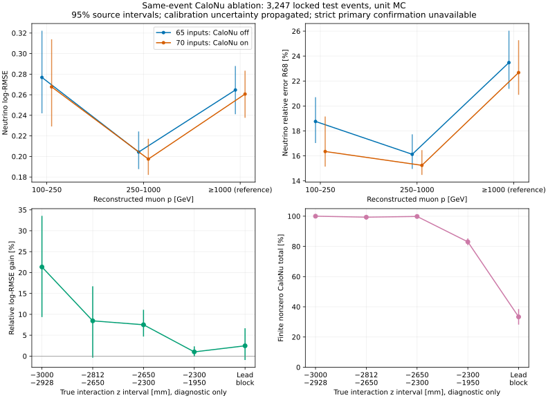

# stage35：同事件CaloNu读出信息量与深度依赖

日期：2026-11-01；起点：bfec61d。沿修订路线第16节推进，用户重点为100–1000 GeV，
保留100–250、250–1000子层，≥1TeV只作参考。

## 阶段目标与结论

在相同CaloNu几何、相同事件和全部65维F6输入上，隔离额外CaloNu读出对ν能量的条件增益。
**重点区间log-RMSE改善3.3359% [2.2676%,4.7581%]，总体改善2.9276% [1.8244%,4.2141%]。**
读出增加了当前BDT能利用的信息，R68和50%尾也改善；收益有明显交互z分层。
未达到预注册中心≥5%的进一步建模门槛，不扩大架构/变量扫描。
高y支持稀疏且缺严格primary确认，不能说解决此前高y缺口，也不能把EM-scale总量当已标定强子能量。
下一步先做匹配条件的through-going μ/波形拟合响应控制。

## 输入、选择与冻结顺序

清单：[calonu_files.tsv](../ml/configs/calonu_files.tsv)，配置：[calonu_ablation.yaml](../ml/configs/calonu_ablation.yaml)，
协议：[preregistered_protocol.md](stage35_energy_ml/preregistered_protocol.md)。
输入`/eos/experiment/fasernu-data0/faser/sim/mc24/genie/{200139,200140,200146}/bck/s0015/*.root`，
π/K/charm分别46/63/15文件；124 PHYS、1234895原事件、21979 selected。
生产reference为CaloNuMC/1ec47efe、Calypso22.0.49、FASERNU-CALONU、OFLCOND-FASER-05。
**K/charm确切bck maker命令未核实**，不能用forward reference证明bck配置；
[来源审计](stage35_energy_ml/source_audit.md)保留证据与边界。

原20cuts、最高pz leading、truth fiducial和reco pz>100GeV保持；已有PMT
truth z∈[−2928,−2812]mm veto在CaloNu几何生效，没有另按CaloNu信号切样本。
零、非有限、未确认/代理以外和离群事件均保留。unit MC，无已验证flux/亮度归一化。

UTC12:43:05先冻结协议/按文件名划分，此前仅看固定fit pilot首文件10000例中的218 selected。
统一紧凑提取可写全部分区标签，但训练payload仅fit/stop；人工与统计检验在六fit和两个offset冻结后才读test。
这是预注册允许的统一提取，不能误记成stage34那样逐分区提取。

| 分区 | 来源组 | selected | π/K/charm来源组 | 紧凑NPZ bytes |
|---|---:|---:|---|---:|
| fit |81|14309|30/41/10|6056526|
| stop |11|2007|4/6/1|900454|
| calibration |14|2416|5/7/2|1075125|
| test |18|3247|7/9/2|1425023|

来源组按component+生成range定义且互斥，但不能证明flux-library谱系完全独立。
本几何同事件C0/C1才是受控读出对照，不计算ordinary与CaloNu几何的性能差作读出收益。

## 模型、校准与统计

C0：全部F6 65维；C1：相同65维+四模块E_EM和total E_EM，共70维，MeV/1000→GeV EM scale。
模块fit和total的raw/overflow定义不同，因此保留各自定义，不强制相加相等。
不额外加入status、charge、truth、PDG、matching或isForward；truth仅标签/诊断，不按truth切换模型。
旧stage30/31模型零重训，旧ordinary固定模型仅域外参考。

两候选×seed20261102/03/04，共六个正式fit；depth5/max1600/patience80/4CPU，每fit120s上限。
其余base参数learning_rate=.04、subsample=.8、colsample=1、min_child_weight=20、lambda=10、hist。
log(Eν/GeV)平方损失；只用stop早停；三seed取best_iteration+1后log平均。
另两个20轮smoke各900fit/400stop，无额外正式fit/扫描。

UTC12:50:49.613355冻结calibration两个全局log offset：
C0=.00584809032523、C1=.00502693016034，乘数1.00586522379/1.00503958637；
calibration共2416例/14组，六模型推断.879215s。
UTC12:50:59.424602固定test报告，无条件校准、test返调或seed选择。

500来源组配对bootstrap，候选共用test重抽；另共同但独立重抽calibration组传播offset不确定性。
95% percentile区间，属于条件于本样本的来源统计区间，不含detector/interaction/flux系统误差。
各分层/指标未作多重检验校正。macro按中心N≥100的原真能箱等权，固定active为100–3200的五箱；
3200–6400仅53例，仍逐箱报告而不进入macro；不要称六箱均有足够统计。
严格barcode确认因缺truth_barcode **未测量**。test有3247唯一primary候选，3086个kinematic-parent代理、161个非代理；
代理定义见source audit，不冒充严格primary-confirmed。

## 单事件性能与配对结论

log-RMSE无量纲；bias、R68和tail表列百分数；R68为相对误差16–84分位半宽。
相对改善定义1−L(C1)/L(C0)，区间已含校准统计。
完整逐能量/y/代理/组件/深度七指标及区间见
[test_metrics.tsv](stage35_energy_ml/test_metrics.tsv)、[test_paired.tsv](stage35_energy_ml/test_paired.tsv)、
[test_macro.tsv](stage35_energy_ml/test_macro.tsv)。

| 支持 | N | C0 log-RMSE | C1 log-RMSE | 改善% [95%] |
|---|---:|---:|---:|---|
|全部|3247|0.233796|0.226951|2.9276 [1.8244, 4.2141]|
|reco p 100–1000 GeV|2689|0.226873|0.219305|3.3359 [2.2676, 4.7581]|
|reco p 100–250 GeV|750|0.276852|0.267663|3.3188 [1.3166, 6.0505]|
|reco p 250–1000 GeV|1939|0.204288|0.197448|3.3480 [1.7629, 5.0267]|
|reco p≥1TeV参考|558|0.264631|0.260675|1.4952 [-0.5703, 3.5827]|
|primary真p 100–1000 GeV|2582|0.214687|0.207368|3.4088 [2.1445, 4.7554]|
|primary真p 100–250 GeV|686|0.231998|0.220267|5.0566 [2.7359, 7.5793]|
|primary真p 250–1000 GeV|1896|0.208069|0.202499|2.6767 [1.2795, 4.1293]|
|真p重点且y≥.8|40|0.469214|0.453456|3.3584 [0.1746, 6.9108]|
|上述且kinematic-parent代理|8|0.583143|0.543255|6.8402 [0.2022, 32.3080]|
|非代理|161|0.447719|0.437203|2.3487 [-0.6509, 7.4635]|

macro C0/C1=.228559771/.220763494，改善3.4110% [1.8080%,4.8910%]。
未校准总体C0/C1=.233475663/.226705767，改善2.8996% [1.7959%,4.1783%]，
说明读出收益并非由两个不同offset制造；global offset也并非所有支持最优。

| 支持/模型 | mean bias% | median bias% | R68% | 尾 >50% | 尾 >100% |
|---|---:|---:|---:|---:|---:|
|all/C0_cal|4.29889|2.77815|18.05914|4.25008|0.70835|
|all/C1_cal|3.92700|2.66769|16.90875|3.63412|0.70835|
|reco_p_100_1000/C0_cal|4.49989|3.10302|16.61543|3.90480|0.66939|
|reco_p_100_1000/C1_cal|4.14710|2.88200|15.59735|3.38416|0.63221|

重点R68配对变化−1.0181pp [−1.6696,−.4960]，50%尾变化−.5206pp [−.9514,−.0987]；
100%尾变化−.0372pp [−.2573,+.1184]，未确立极尾改善。
总体相应为−1.1504pp [−1.4932,−.5730]、−.6160pp [−1.0498,−.1685]、0pp [−.2070,+.1243]。
既不只报中心精度，也不把少数极尾作为停止物理研究的理由。

原始pμ和pμ/.8总体log-RMSE=.565909/.481597，macro=.555584/.482306；
ordinary固定F5/F6域外macro=.311487/.303650。它们只作本样本参考，不能由这些差距
分解CaloNu收益或跨几何重建收益，受控量始终为C1−C0。

### 真能量分层

| 真Eν GeV | N | C0/C1 log-RMSE | C0/C1 mean bias% | C0/C1 R68% | 改善% [95%] |
|---|---:|---|---|---|---|
|100–200|195|0.184979/0.166877|12.224/10.180|14.579/13.225|9.7861 [4.7478, 15.7547]|
|200–400|712|0.188541/0.179335|8.670/8.023|13.891/12.833|4.8831 [0.8814, 9.4070]|
|400–800|1068|0.206945/0.201077|7.614/7.342|15.428/14.889|2.8356 [0.5383, 4.9965]|
|800–1600|891|0.250145/0.243386|2.770/2.633|20.041/19.395|2.7023 [0.7958, 5.3268]|
|1600–3200|328|0.293315/0.289837|-10.448/-10.286|20.418/21.061|1.1859 [-3.0715, 5.7339]|
|3200–6400|53|0.545840/0.539031|-33.399/-33.210|11.787/11.673|1.2474 [-1.9713, 3.2521]|

仍有低真能上偏、高真能下偏，读出没有解除均值回归/先验/响应的全部问题。
高y且真p重点40例/15组，C0/C1 mean bias=−21.191%/−21.364%，R68=23.969%/23.247%，
50%尾=15%/10%；只有8例/7组满足kinematic-parent代理，区间极宽。
因此不能与stage34严格confirmed高y的104例直接对比并声称问题已解决。
缺primary条码确认是schema限制；不把未确认样本的统计改善解释为正确primary能量分配的确定证据。

## 深度与信号：物理解释的依据和边界

[test_readout_response.tsv](stage35_energy_ml/test_readout_response.tsv)和下图来自预注册分层。
全test总量零550、有限非零2695、非有限2；有限total中位7.95490GeV EM、q84=12.9819GeV、最大774.8745GeV。
总量与transfer proxy Eν−Eμ,vertex的Spearman=.237877（仅点估计，非独立条件信息的度量）。

| 真交互z mm | N/来源组 | 有限非零/缺失 | total中位GeV EM | transfer秩相关 | C1风险改善% [95%] |
|---|---|---|---:|---:|---|
|-3000 至 -2928|57/17|57/0|15.11530|0.73555|21.3335 [9.3461, 33.5666]|
|-2812 至 -2650|152/18|151/1|44.17606|0.88745|8.4423 [-0.3747, 16.7055]|
|-2650 至 -2300|573/18|572/1|16.94389|0.55688|7.5063 [4.6881, 11.0852]|
|-2300 至 -1950|2201/18|1827/0|7.59110|0.21771|1.0140 [-0.0924, 2.3342]|
|-1769.65 至 -1619.65|264/18|88/0|0.00000|0.19461|2.4715 [-0.9289, 6.6627]|

最靠前57例改善21.33% [9.35%,33.57%]；占大多数的−2300至−1950mm共2201例，改善仅1.01%且区间跨0。
该层total q84=8.8760GeV、最大12.5969GeV；lead block中位0，只有88/264有限非零。
这些实测深度差异与几何覆盖/传播/shower响应有关的解释相容，但没有独立隔离各机制，
也没有安装几何全局z或匹配μ控制，不能将约8GeV窄信号直接称MIP峰或已标定强子能量。
40例高y的transfer相关为−.09137，不支持在此支持简单按total线性恢复transfer。

零读出层550例仍改善5.0344% [1.7890%,9.9405%]，有限非零层2695例改善2.5232% [1.3320%,3.7419%]。
这是两个全局训练模型在子层的条件风险差；零也可有类别信息及模块抵消/区别，不能解释为“零量测到了额外能量”。
缺失total仅2例/2组，bootstrap有79/500次无支持；charm只2组，70/500次无支持。
稀疏层区间按有效重抽报告，不能当稳定总体外推；空primary-invalid层N=0明确未测量。



## 单位、状态、程序原因与data边界

详见[source_audit.md](stage35_energy_ml/source_audit.md)、[readout_audit.tsv](stage35_energy_ml/readout_audit.tsv)。
MC fit14309及run016000前2048条未选择data的模块330MeV/MIP和58.5MeV/MIP公式、total raw/fit定义
在全部有限可验支持上0失败。total有限可验14299/2047例，最大舍入差.102775/.087228MeV，
满足rtol3e−6/atol.003MeV；10/1个非有限不算通过。

MC fit四模块非有限3/4/1/2，raw charge全部有限；负fit EM值15/26/12/13。
模块1最小−117895.168GeV，status32=CrystalBall fit failed；模块2最小−1670.179GeV，status48=双fit failed。
这是具体拟合输出异常的证据，不能当负物理能量。精确波形失效机制及其收益影响**未测量**。
有限异常保留；只将非有限特征转XGB missing，没有根据test删/截断/refit。
事后[fit_quality_descriptive.tsv](stage35_energy_ml/fit_quality_descriptive.tsv)仅检查支持，不作模型选择。
status1是threshold failed而非一概missing；overflow bit4在MC fit为0例，data为2例。
data零/有限非零/非有限=0/2047/1，不能与CC MC fit直接解释为物理差异。

该data没有GRL/trigger/through-going μ选择，只验证读出结构/代数，**不是data/MC物理闭合**。
MIP增益、强子响应、几何/材料/conditions匹配、探测器和相互作用系统变体、真实data控制区及最终谱收益均未测量。
不把unit MC排名当物理flux平均性能，不把稀疏缺失或少数尾当全部结论。

## 验证、成本、命令与存储

pilot 10000例/218 selected：numpy与原C++/YAML的20步cutflow及事件键完全相同，
46维F5最大差1.42e−14；19维沿用已验证track_response.derive；六模型序列化后特征顺序一致。
原始ROOT只裁剪读取必需分支、每文件一次正式提取。分区来源组/事件键互斥，全部预测有限且事件长度一致；
四NPZ全部字段压缩读回相等。技术检查见[pilot_cpp_validation.json](stage35_energy_ml/pilot_cpp_validation.json)、
[archive_validation.json](stage35_energy_ml/archive_validation.json)。

Condor schedd bigbird21：

| 批次 | cluster/jobs | wrapper总wall s | 总CPU s | 峰值RSS KiB | 提交至最后完成s |
|---|---|---:|---:|---:|---:|
| 提取 |2187197/13|694.83|581.26|894000|130|
| 训练 |2187198/3|60.85|143.50|265476|45|

16 jobs全exit0，无重复正式fit/失败作业，无GPU分配。请求提取1CPU/训练4CPU、2000MB，
站点实际分配3000/12000MB；实际RSS见表，不把分配内存当使用量。remote CPU分别583/145s（Condor舍入）。
提取内部函数总wall581.066750s、CPU524.712564s、峰873.046875MiB，吞吐2125.22原事件/s（总函数wall口径），
不把并行提交至完成时间混为单核吞吐。完整逐job资源表见resources_extract/resources_train。

| 模型/seed序号 | best_iteration(从0) | stored树 | fit wall s | fit CPU s | bytes |
|---|---:|---:|---:|---:|---:|
|C0/0|452|533|4.951236|19.556213|1120951|
|C1/0|481|562|5.715282|22.610147|1192976|
|C0/1|576|657|5.433325|21.462148|1372384|
|C1/1|650|731|6.466059|25.654670|1537789|
|C0/2|606|687|5.656365|22.295942|1457328|
|C1/2|386|467|4.463237|17.644793|985946|

六fit均patience结束，未触120s。两个smoke fit wall分别.122700/.122761s；
六模型test推断含加载.653161s，4971.21 selected/s；report内部wall5.785552s/CPU5.518124s/RSS334.734375MiB。
本地外部计时（含Python/LCG导入，不含环境source；CPU=user+system）：

| 操作 | wall s | CPU s | RSS KiB | 结果 |
|---|---:|---:|---:|---|
| 初次pilot |6.23|3.15|196152|失败：缺truth_barcode |
| 修正schema后pilot |4.34|2.87|230156|通过 |
| 初次C++ QA |18.54|4.15|691148|失败：可选ML_truth_barcode定义 |
| 跳过缺失诊断的C++ QA |17.19|12.34|809768|通过 |
| 两个20轮smoke |4.85|3.45|324356|通过 |
| 初次读出报告 |5.05|3.15|223860|失败：非有限差值不应写JSON数值 |
| 有限支持读出报告 |5.17|3.06|224004|通过 |
| 一次性test报告 |9.80|7.99|342768|通过 |

最终紧凑归档QA wall=.924380s，六模型重载/来源互斥/预测有限及清理记录检查通过；
该QA的CPU/RSS及collect/package/plot/Git独立计时未测量，不混入上述正式作业成本。
失败均技术校验，不是重复正式fit，成本照计。pilot文件在正式提取中按协议重读，不算新独立数据。
提取文件日志原“非零”计数把NaN也计入，归档QA从紧凑cache更正为有限非零并另列缺失，
同时修正后续extract代码；没有改变事件、模型、offset或任何test指标。
重复训练cfg/来源清单合并为shared_training.json，三seed只留唯一成本/trace/时间记录。

执行命令（按顺序；已完成的test脚本有禁止静默覆盖保护，不重复运行）：

```bash
source /cvmfs/sft.cern.ch/lcg/views/LCG_109_cuda/x86_64-el9-gcc13-opt/setup.sh
export PYTHONNOUSERSITE=1 OPENBLAS_NUM_THREADS=1 OMP_NUM_THREADS=1 MKL_NUM_THREADS=1
# 小样本：index0为10000事件首文件
python3 ml/calonu_ablation.py extract --index 0 --output /tmp/stage35_pilot.npz
python3 ml/audit_calonu_pilot.py --index 0 --input /tmp/stage35_pilot.npz --output workbook/stage35_energy_ml/pilot_cpp_validation.json
python3 ml/calonu_ablation.py train --smoke --seed-index 0 --output /tmp/stage35_smoke_models
python3 ml/package_calonu.py --action extract
condor_submit -name bigbird21.cern.ch AnalysisZipFramework/submission/ml_calonu.sub action=extract cpus=1 -queue 13
python3 ml/calonu_ablation.py collect
python3 ml/package_calonu.py --action train
condor_submit -name bigbird21.cern.ch AnalysisZipFramework/submission/ml_calonu.sub action=train cpus=4 -queue 3
python3 ml/calonu_ablation.py calibrate
python3 ml/report_calonu.py
python3 ml/audit_calonu_readout.py
python3 ml/plot_calonu.py
python3 ml/verify_calonu.py
```

模型`ml/artifacts/stage35/seed_{0,1,2}/{C0,C1}.ubj`共7667374bytes，保留但不入Git。
最终`ntuples/energy_ml_stage35/`四分区+两个预测cache共9607764bytes，忽略提交；
其中C0/C1的raw/cal key均保存offset前log预测，cal需读取calibration_state.json加offset；ordinary参考已含旧offset。
归档校验后清13分片和2payload共16908518bytes，不留新ROOT/xAOD。Git只留代码、配置、表、图、报告。

## 下一步：唯一主线和验收标准

1. 优先寻找**已有且能匹配**的CaloNu through-going μ MC/data及生产/conditions证据；
   核实K/charm bck maker、全局模块位置、通道映射、HV/增益、时期和外推面。
   若不能匹配，明确未测量及所缺字段，不用不相容CC MC/data分布做闭合。
2. 冻结小预算控制协议，再按预先的through-going μ/轨迹外推选择检查四模块raw/fit电荷、
   nMIP/EM scale、status/overflow/阈值、轨迹交点与路径长度依赖，给来源/运行块区间、失败率和资源。
   先使用现成生产/构建，小样本后才Condor批量；不自动全量重模拟，不训练新网络。
3. 验收必须给出一个响应/覆盖或拟合原因的实测结论，检验约8GeV窄响应是否与穿越μ/通道标定相符，
   以及异常fit是否可由raw积分和状态识别；支持不足就量化覆盖/统计缺口，不猜测MIP或shower。
   本阶段只是为响应控制立项，没有预报其物理结果。
4. 不达到本阶段≥5%扩展门槛，不追加CaloNu模型扫描。stage34和stage35保留test均已评价，
   以后任何根据这些结果改动的模型只能当开发；新独立检验须另有未使用来源支持。
   100–1000重点、两个子层和≥TeV参考继续；高y缺口、data/探测器/相互作用系统和最终谱收益保持未闭合。
