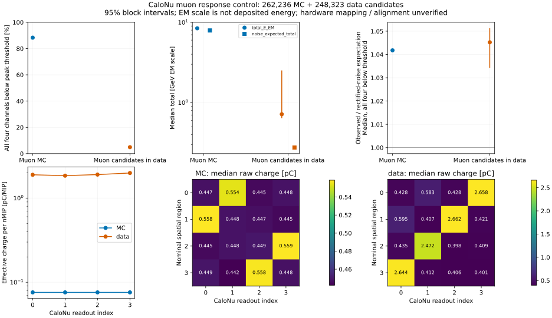

# stage36：CaloNu μ控制揭示整流噪声pedestal与响应可比性缺口

日期2026-11-01；起点`7e7f89e`。按修订路线第17节推进，不改stage35模型或重读其test。
**本阶段得到的物理结论：μ MC约8GeV EM的窄总响应有主要的正半波噪声积分pedestal贡献，
不能认作穿越μ物理沉积能量峰。** 专门μ MC中88.2865%事件四通道均低于5σ峰阈值；
这一层总量中位8.26571GeV EM，对应源码预先给出的噪声尺度7.93610GeV EM，
事件逐个比值中位1.04178 [1.04106,1.04246]。不是精确纯噪声闭合，约4%残差仍待分解。
data也看到同类阈下pedestal，但几何/通道、有效增益和时期尚未匹配，物理data/MC闭合未测量。

## 目标、冻结和输入

[预注册协议](stage36_energy_ml/preregistered_protocol.md)冻结于2026-11-01T13:56:34.015898Z。
冻结前只看μ−首文件与data16000首文件各2048条，用于schema/选择pilot，并已发现正半波积分源码。
pilot允许重现在正式控制cohort中，因此本阶段不是新ML独立test。零新fit、零GPU、零重模拟。
焦点reco p为100–1000GeV，保留100–250/250–1000两个子层，不追逐TeV精度。

输入/条件由[配置](../ml/configs/calonu_muon_control.json)、
[18文件manifest](../ml/configs/calonu_muon_files.tsv)、
[官方v10 GRL三run冻结子集](../ml/configs/calonu_muon_grl.json)定义：

| 样本 | 输入 | 冻结取样 | 原事件 | selected | 文件来源组 |
|---|---|---|---:|---:|---:|
| μ−/μ+ MC | `/eos/experiment/faser/sim/mc24/particle_gun/{100049,100050}/bck/s0015/` | 可用99/100文件中各取六个沿文件名等距文件，每文件50000条 | 600000 | 262236 | 12 |
| data μ候选 | `/eos/experiment/faser/data0/phys/2024_back/r0022/{015838,016000,016923}/` | 每run首文件/第8文件，各前100000条 | 600000 | 248323 | 6，3run |

MC参考为Calypso22.0.49、CaloNuMC/1ec47efe、FASERNU-CALONU、OFLCOND-FASER-05。
data参考为Calypso22.0.49、reco/r0022/d0b1b2dd、TI12Data04/noIFT。
37个生产日志reference均找到；**μ+对应0020/0040/0059的ntp日志没有backward选项**，
不能把它们当实际bck maker配置的认证。μ−六份及μ+其余三份reference显式backward。
全部冻结输入照常保留；不因审计缺口事后换文件。完整证据/源码定位见
[来源与响应审计](stage36_energy_ml/source_audit.md)、[日志片段](stage36_energy_ml/production_audit.json)。

## 外部选择与效率

最高pz轨迹；longTracks=1，nLayers≥7、nDoF≥9、χ²/ndof<15；100≤reco p<1000GeV；
保存VetoNu面外推|x|,|y|<500mm且二维角度模<25mrad，排除999999失败哨兵；
VetoNu0/1、Veto20/21的raw charge各>40pC。data另施加v10 stable/nonexcluded与distanceToCollidingBCID=0，MC不施加。
**没有根据CaloNu电荷、MIP、status或有限性作选择。** 混合线上trigger接受度未校正，
这些是外部符合μ候选，不保证无shower或无偏μ谱；没有truth选择/部署输入，也没有使用truth_st*模长测能损。

| 累计cutflow | MC | data |
|---|---:|---:|
| input | 600000 | 600000 |
| stable+colliding（仅data） | 600000 | 596106 |
| one long track | 553538 | 594865 |
| track quality | 532676 | 543252 |
| reco p 100–1000GeV | 262261 | 249558 |
| valid extrapolation | 262236 | 248944 |
| independent scintillator coincidence | 262236 | 248323 |

总体通过率43.7060%/41.3872%；两个p子层MC为71994/190242例，data为92658/155665例。
逐文件cutflow、输入名、计时和float32误差见[extraction_files.json](stage36_energy_ml/extraction_files.json)。

## 统计方法与量纲

500次来源block bootstrap、固定seed20261103：MC在固定μ符号内各抽6个文件；
data先抽3个run，再对每次抽中的run独立抽其2个文件。95% percentile区间不含完整系统误差。
三run不足以描述完整时期/conditions，区间不是系统误差包络。观测量仅在各自finite支持计算，
同时保留全部事件的非有限计数和status率；没有裁剪/删异常。
逐run data区间只用包含该run的draw，15838/16000/16923分别有141/149/141次无支持，
这些次数在表中明确保留。主总体和阈下比值无空支持draw。
精确整数block复制的quantile算法与显式numpy重复事件的小例逐值核验通过，包括全零支持。

E_EM为nMIP×0.330GeV；E_dep=58.5MeV/MIP是生产常数，不是本阶段独立测量。
模块E_EM为fit量，total在overflow时用fit，否则用raw/fit比换算；详见source audit。
**GeV EM scale不等于物理沉积或已标定强子能量。** 表中的区间均统计条件区间。

## 主结果：约8GeV来自哪里

固定源码`findRawHitValues`跳过所有≤0的baseline-subtracted采样，再以2ns步长积分。
默认75窗口含端点共76采样，因此冻结前提出的近似高斯噪声预期为
`q_noise = 2×76×baseline_rms_mV/(50√(2π)) pC`，未用正式数据调参数。
以每模块有效charge/nMIP中位标度转为总EM-scale预期。baseline/相关噪声、窗口边界和残余信号尚未分离。

| 量 | μ MC | data μ候选 |
|---|---:|---:|
| N / 四通道全threshold failed N | 262236 / 231519 | 248323 / 12170 |
| 全threshold failed比例 | 88.2865% [88.1802,88.3999]% | 4.9009% [3.9981,5.5233]% |
| 全样本finite total中位 [GeV EM] | 8.42637 [8.41982,8.43287] | .714922 [.638982,2.513867] |
| 全样本noise预期中位 [GeV EM] | 7.91481 [7.91278,7.91699] | .274638 [.274026,.275586] |
| 全threshold failed total中位 [GeV EM] | 8.26571 [8.25933,8.27208] | .287250 [.284867,.289535] |
| 同层noise预期中位 [GeV EM] | 7.93610 [7.93373,7.93899] | .276203 [.275452,.277429] |
| 同层事件逐个total/noise的中位 | 1.04178 [1.04106,1.04246] | 1.04523 [1.03424,1.05126] |

主结论有源码机制、专门μ统计和阈下层共同支持，不依赖未证的模块几何排列。
**比值区间排除1**，不把约4%差额当零或把所有响应归纯高斯噪声；未作逐例扣除。
此控制也不能说明stage35 C1新增信息全由噪声产生，或把其收益逐项分解为噪声/μ/强子。
stage35同事件重点3.3359%仍是该MC生产条件下的信息增益，未升级为可部署的绝对能量测量。

两个p子层MC total中位8.25134 [8.24213,8.26029] /8.50275 [8.49263,8.51280]GeV EM；
data为.654735 [.606144,1.944860] /.766042 [.667762,2.825392]GeV EM。
μ−/μ+分别8.44561/8.40551GeV EM，十二个文件均约8.39–8.46GeV；
日志配置缺口没有表现为只有少数文件才有该窄尺度，但不能因此认证其生产一致。
完整[total_response.tsv](stage36_energy_ml/total_response.tsv)、
[noise_aggregate.tsv](stage36_energy_ml/noise_aggregate.tsv)。

## 电荷、位置与数据时期限制

| 模块0/1/2/3的中位量 | MC | data |
|---|---|---|
| raw charge [pC] | .47319 / .47824 / .46299 / .46628 | .51598 / .49414 / .48446 / .48645 |
| baseline rms [mV] | .37054 / .37036 / .37058 / .37044 | .32969 / .32106 / .32088 / .32267 |
| 有效charge/nMIP [pC/MIP] | .0757 / .0757 / .0757 / .0757 | 1.892 / 1.847 / 1.902 / 1.986 |

同量级raw/noise经明显不同有效尺度换算，不能直接将EM峰差解释为物理沉积差。
data该比值含HV gainRatio，不等于原始MIP_ref；不据此宣称25倍标定错误或直接统一缩放。

名义DB+固定GDML给出box中心[10,−21,−2605.68]mm、core半尺寸[60.6,60.6,216]mm，
以VetoNu保存轨迹作直线、±.05rad倾斜控制。MC/data nominal interior为121557/97577例，
两符号tilt均interior为104679/83447；all-off为68/20291，robust all-off仅17/9953。
改变tilt影响41565/34370个模块interior判断，说明不能把该代理当精确传播/测量安装坐标。
名义路径约433mm只反映包络，未测量有效闪烁体厚度或同面μ沉积。

冻结时未验证分支序号=几何region序号。对应paired interior−off负值保留在
[paired_channel_response.tsv](stage36_energy_ml/paired_channel_response.tsv)，**不能作物理信号反向解释**。
事后4×4 raw-charge关联峰给出MC[1,0,3,2]、data[3,2,1,0]候选对应，
没有据此重排/返调；须由native identifier/ChannelMapping独立认证。
名义几何覆盖见[geometry_coverage.tsv](stage36_energy_ml/geometry_coverage.tsv)，
全部模块/p/status/run层分位数及区间见[response_metrics.tsv](stage36_energy_ml/response_metrics.tsv)。

data run15838/16000/16923的total中位分别2.34128 [.610798,4.769520]、
.654917 [.653982,.656024]、.652617 [.651828,.653650]GeV EM。
**事后描述性逐文件核查**：15838首/中文件4.76952/.610798GeV EM，
有效charge/nMIP不变、baseline rms约.32–.33mV，但raw中位.571–.687→.469–.493pC。
简单归因于MIP系数变动不受支持；trigger/事件活动/响应时序等贡献未分离。
没有删除该run或改用逐事件bootstrap隐藏差异。
见[file_total_response_posthoc.tsv](stage36_energy_ml/file_total_response_posthoc.tsv)、
[file_module_response_posthoc.tsv](stage36_energy_ml/file_module_response_posthoc.tsv)。



## 非有限fit与程序原因

| 模块质量计数 | MC（1048944个模块观测） | data（993292个模块观测） |
|---|---:|---:|
| 非有限E_EM / 无fit failure位 / raw有限 | 21 / 21 / 21 | 117 / 114 / 117 |
| 有限且\|E_EM\|>1000GeV / 有fit failure位 | 35 / 3 | 102 / 2 |
| 有限负E_EM / 有fit failure位 | 972 / 752 | 1386 / 1093 |

status16/32不能作为充分质量保证；有限极端值也不全是fit错误，未自动判错或删值。
固定源fitCBall在time NaN分支改变fit_status而未清valid，是具体可审查的不一致路径；
但没有逐例native重放，不能将全部非有限归因到此处。raw有限而total非有限也可能涉及派生量代数传播。
质量表[response_quality.tsv](stage36_energy_ml/response_quality.tsv)、
[unflagged_quality.tsv](stage36_energy_ml/unflagged_quality.tsv)保留原始分母。

## 执行、验证、成本与存储

没有修改C++源，不需要重新构建。现成LCG109_cuda环境、18个1CPU/2000MB Condor jobs，
bigbird21 cluster2187200，18个全部exit0；无重提/正式fit/GPU。代表smoke先通过再批量提交。

```bash
source /cvmfs/sft.cern.ch/lcg/views/LCG_109_cuda/x86_64-el9-gcc13-opt/setup.sh
export PYTHONNOUSERSITE=1 OPENBLAS_NUM_THREADS=1 OMP_NUM_THREADS=1 MKL_NUM_THREADS=1
python3 ml/calonu_muon_control.py extract --index 0 --limit 2048 --output /tmp/stage36_mc_smoke.npz
python3 ml/calonu_muon_control.py extract --index 14 --limit 2048 --output /tmp/stage36_data_smoke.npz
python3 ml/package_calonu_muon.py
condor_submit -name bigbird21.cern.ch AnalysisZipFramework/submission/ml_calonu_muon.sub -queue 18
python3 ml/calonu_muon_control.py collect
python3 ml/audit_calonu_geometry.py
python3 ml/report_calonu_muon.py
python3 ml/audit_calonu_muon_noise.py
python3 ml/audit_calonu_muon_production.py
python3 ml/describe_calonu_muon_files.py
python3 ml/plot_calonu_muon.py
python3 ml/collect_calonu_muon_resources.py
```

| 操作 | wall [s] | CPU [s] | 最大RSS [KiB] |
|---|---:|---:|---:|
| schema / selection pilot | 3.61 / 4.11 | 1.68 / 1.66 | 93060 / 94816 |
| MC / data 2048条smoke，selected908/867 | 3.10 / 1.79 | 1.30 / 1.12 | 91420 / 92496 |
| 18批量wrapper求和 | 181.99 | 61.66 | 158044 |
| collect成功 | 11.12 | 10.17 | 326868 |
| 名义geometry成功 | 1.32 | .78 | 89952 |
| 主响应统计 | 62.82 | 61.37 | 314852 |
| noise / production审计首次 | 6.83 / 5.31 | 5.21 / 2.03 | 306936 / 90008 |
| 逐文件描述 / 绘图 | 3.54 / 3.29 | 1.90 / 2.84 | 190636 / 94716 |

提交至最后完成81s，remote CPU65s；内部实际ROOT读取/选择wall求和97.7373s、CPU26.0378s，
峰RSS154.340MiB，1.2M输入/内部wall约12277.8 events/s。
读取字段限制为本分析所需列、每job单线程，避免网络I/O及线程过量；未声称相对另一实现加速。
分job资源见[resources](stage36_energy_ml/resources/condor_resources.tsv)。

技术失败也记录：两次本地collect因PG eventID重复假设失败，wall3.68/2.61s、CPU1.89/1.93s、
RSS242000/258816KiB；先前一个依赖cache的报告因collect未成功而失败，1.23s/.74s/85088KiB。
初始geometry遍历命中无关悬空tag，耗时未测量，改为有界CaloNu节点后通过；
小型精确quantile零容差比较相差2.2e−16，独立耗时未测量，使用atol1e−12核验通过。
selection pilot出现零除warning，已用errstate抑制并保留无效量不通过cut。
失败均为本地程序验证，不重新读批量ROOT、重提Condor或产生额外fit。
最终provenance补注重跑只读37条reference，单独计时未测量。
最终核查首次把float32中位计算与表的float64秩平均作零相对误差比较，差4.76837e−7GeV EM；
核查端对齐describe的float64计算后通过，表/cache均未改，该次失败单独耗时未测量。

**事件身份更正**：PG每个合并文件含五个生成子文件，eventID在内部重启。
MC262236行仅20000个distinct(run,eventID)，不能据此去重；data248323个均唯一。
cache用(file group, source_selected_row)唯一保留全部行；selected row是**选后序号，不是原ROOT entry**，
下一阶段native联接须重新取得真实input entry及合并顺序。精确(file,eventID,p,x,y,raw0)重复0，
但不当作完整生成谱系独立性的证明。

最终两个53字段cache共66953477bytes，`ntuples/energy_ml_stage36/{MC,data}.npz`
分别33628487/33324990bytes，逐字段读回相等；无需保留原ROOT/xAOD。
float32的p最大舍入.03125MeV、xy<7.63e−6mm；原Calo float32量未降精度。
选中p没有恰为100/250/1000GeV的事件；最终计数/唯一身份/全部字段行数再次核验通过。
中间18NPZ分片及1payload读回后共清66619657bytes，明细见[归档记录](stage36_energy_ml/archive.json)。
Python编译与bash语法检查、汇总表行数/主数字及本地Markdown链接核验结果见
[最终核查](stage36_energy_ml/final_validation.json)。stage35模型/预测未改。

## 阶段结论和下一阶段验收

1. 约8GeV窄响应的主要尺度可由正半波噪声pedestal加MC有效MIP尺度解释；
   仍有非零约4%残差，未定为纯噪声、MIP峰或强子沉积。stage35信息收益保留为条件MC结论。
2. raw尺度相近而有效charge/nMIP相差约25倍、模块空间排列不一致、data文件响应变化明显，
   所以**目前样本不满足直接物理data/MC闭合的条件**。缺口量化，不因少量离群停止CaloNu主线。
3. status fit failure位漏标非有限输出，存在具体源码有效性不一致路径；需原生case replay确定原因。

**下一条唯一主线：有界原生CaloNu HITS→RDO waveform→xAOD/PHYS响应链和通道映射审计。**
先冻结≤4个MC来源组（两符号各2）、≤128个预定义μ候选及异常对照的预算，
优先已有匹配release/build/dictionaries与存储文件，先小样本再Condor；零新ML fit，不自动全量G4/重模拟。
所需输入是同源HITS/RDO/xAOD、合并事件次序、identifier/ChannelMapping、digitization/MIP/HV/时窗payload，
及data15838两时期已有conditions/trigger记录。
验收：独立认证几何region↔identifier↔hardware↔分支关系；
逐例给出真实active能量沉积MeV、signed/positive积分pC、noise pedestal和gain/kernel/窗口，
明确可闭合或不闭合的环节及误差/失败覆盖；至少重放代表非有限/未标flag案例或量化不可重放缺口。
不得仅按本阶段关联峰重排模块或直接乘25；没匹配就记录未测量，不用跨几何造闭合。
所有case按真实input entry/合并来源联接，不能用重复eventID或selected ordinal伪配对。
完成响应因果核验后才决定修生产、重新标定或继续CaloNu建模；不追加架构竞赛或重复旧test调参。
data物理响应、探测器/相互作用系统、物理归一化及最终能谱收益仍未测量。
