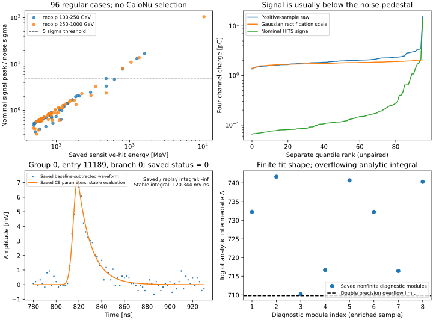

# stage37：原生 CaloNu 链定位弱信号、整流噪声与积分溢出

日期2026-11-01；起点`b93abf4`。严格执行修订路线第18节，焦点仍为 reco p 100–1000 GeV，
保留100–250/250–1000两个子层；零新ML fit、零G4、零重模拟，不重评stage34/35 test。

**本阶段的物理结论：这批μ MC的约8 GeV EM窄响应主要受弱信号上的整流噪声影响，
名义时窗漏失不是主因；部分未标失败的非有限能量已定位为ROOT解析积分的中间项溢出。**
96个不切CaloNu质量的常规对照，保存敏感层能量中位85.7583 MeV，名义信号仅0.115149 pC，
而四通道整流噪声尺度中位1.78828 pC；名义窗口捕获率中位99.9956%。
这不是“没有物理沉积”，也没有据此把stage35的全部信息收益归为噪声。

## 目标、输入、选择及预算

[冻结协议](stage37_energy_ml/preregistered_protocol.md) UTC2026-11-01T14:51:06.325607；
[配置](../ml/configs/calonu_native_control.json)。冻结前只看μ−首个原生事件和schema，pilot与失败保留。
stage36外部轨迹/闪烁体符合选择不变；从已有cache固定两符号各首/末来源组：

| group | run、合并来源 | 常规100–250 / 250–1000 GeV | 富集诊断 |
|---:|---|---:|---:|
| 0 | μ−100049，00000–00004 | 12 / 12 | 8 |
| 5 | μ−100049，00495–00499 | 12 / 12 | 8 |
| 6 | μ+100050，00000–00004 | 12 / 12 | 8 |
| 11 | μ+100050，00495–00499 | 12 / 12 | 8 |

常规为每p层按选后行等距取样，无CaloNu信号/status/有限性cut；
诊断按非有限、极端有限、fit失败、负值优先级选32例，不能用该富集样本估总体故障概率。
这是机制开发控制，不是新ML独立test，也不是完整μ总体的无偏统计抽样。
1000次来源组bootstrap、seed20261104，各符号内抽两个组，区间为95% percentile。
只有四来源组，区间不能作为系统误差包络；单组/诊断只报描述性统计，不给伪精确区间。

已有原生输入为
`/eos/experiment/faser/sim/mc24/particle_gun/{100049,100050}/`
下 `sim/s0015/*-HITS.root`、`rdo/s0015/*-RDO.root`、`rec/s0015/*-xAOD.root`，
对应 `bck/s0015/*-PHYS.root`。四份[request](stage37_energy_ml/request_0.json)记录精确路径和冻结fingerprint，
其余为同目录request_5/6/11.json；最终cache另存完整逐例lineage。
每个PHYS/RDO/rec为50000条，HITS子文件各10000条。

原CaloNu源1ec47efe/build不可读，复用已有d32b0ff3只读字典；相关五个持久化声明/转换文件文本相同，
实际branch布局checksum相等，未调用普通几何的ID helper，未重建/拷贝整份ROOT。
详见[源码审计](stage37_energy_ml/source_audit.md)、[schema核验](stage37_energy_ml/native_schema_checks.json)。

## 联接、映射与量纲核验

通过多观测量fingerprint找**真实PHYS entry**，再核对HITS/RDO/rec身份、三动量和四模块读出。
128/128联接成功，512模块rec/PHYS status相等；不是按重复eventID或selected row伪配对。
原两例μ+触发严格质量检查，差值均为一个float32 ULP、最大7.62939e−6 MeV；
PDG/status/三动量完全相等。采用<0.001 MeV质量容差后只重提原两组，不换事件。
没有将误差容差扩大到动量；本核验不认证完整生成谱系独立性。

GDML遍历、factory、hit bit布局、历史cable payload和native id32共同认证：

| PHYS分支0/1/2/3 | MC hardware | hit id | 模拟GDML region |
|---|---|---|---|
| CaloNu0/1/2/3 | 20 / 21 / 22 / 23 | 9 / 1 / 11 / 3 | **1 / 0 / 3 / 2** |

当前global tag解析的CableMapping-00将20–23标none，不能复现旧生产；
历史`CABP200_250908.db/OFLP200`四条payload/IOV已保存在[conditions_audit](stage37_energy_ml/conditions_audit.json)。
data15838用20–23，16000/16923用6/7/14/15，row/module次序可查；
data实际survey/安装朝向未认证，stage36 data空间关联候选不能代替硬件真值或模拟全球坐标。

保存ADC按默认2 V量程换算后，与保存波形512×76点**逐点完全相等**；
raw正半波积分复算最大差1.9531250e−5 pC，rec/PHYS电荷最大差2.6855469e−5 pC，均通过冻结容差。
全部窗口780–930 ns、76采样，与820 ns nominal、−20 sample起点/75宽度一致。
HITS能量独立编码展开通过，包括overflow编码；保存能量含Birk/nonuniform修正，
不称未修正G4沉积或全detector能损，没有使用truth_st*动量模长。

## 主结果：信号弱，名义窗口基本包含信号

用匹配源卷积：0.1 ns hit时间hist、Crystal Ball PDF、20采样平均至2 ns，
kernel由条件库固定，norm=.5500000119 ADC·ns/MeV、mean820 ns、sigma3.670000076 ns、
alpha−.3199999928、n1000，baseline15650/3 ADC。
kernel与ROOT PDF独立8点核对；TOF用已审计名义GDML中心，未加载完整原生GeoModel或重现随机种子。
因此下表是**名义无噪声预测**，不是严格生产digitization重放或data标定。

| 常规样本量的中位数 | 全部96例（95%来源区间） | 100–250 GeV，48例 | 250–1000 GeV，48例 |
|---|---:|---:|---:|
| 保存敏感层总能量 [MeV] | 85.7583 [81.6291,102.590] | 83.9259 | 87.2540 |
| 最大信号峰/生产噪声σ | .797585 [.713693,.878032] | .703812 | .858624 |
| 窗内信号/全波形信号 [%] | 99.995595 [99.995592,99.995598] | 99.995595 | 99.995594 |
| 窗内预测四通道信号 [pC] | .115149 [.109605,.137749] | .112688 | .117157 |
| 四通道高斯整流尺度 [pC] | 1.78828 [1.75344,1.81794] | 1.81244 | 1.76653 |
| 保存四通道raw积分 [pC] | 1.94002 [1.90716,1.98117] | 1.95174 | 1.93998 |

逐事件信号/噪声尺度之比的中位为.0671225 [.0597307,.0778991]。
89/96名义最大信号峰<5σ；84/96实际四通道全阈下，仅为冻结对照样本的描述，不取代stage36总体率。
最小窗口捕获率99.9382%，因此这批常规μ事件不支持以大规模窗口漏失解释窄噪声峰。
少数大响应照常保留：敏感层总能量范围48.8669–10340.1 MeV、信号.0656143–13.8837 pC，
不把大响应全当技术错误，也不因此停止该分支。

| 来源组，各24例 | 敏感层能量中位/范围 [MeV] | 窗内信号中位/范围 [pC] |
|---:|---|---|
| 0 | 83.6987 / 51.1925–1047.64 | .112383 / .0687368–1.40668 |
| 5 | 84.9440 / 49.9202–10340.1 | .114056 / .0670286–13.8837 |
| 6 | 128.324 / 54.0274–1600.94 | .172303 / .0725433–2.14960 |
| 11 | 75.0953 / 48.8669–802.465 | .100831 / .0656143–1.07748 |

全部层、范围、均值及区间见[native_metrics.tsv](stage37_energy_ml/native_metrics.tsv)，
逐例/逐模块见[native_case_response.tsv](stage37_energy_ml/native_case_response.tsv)、
[native_module_response.tsv](stage37_energy_ml/native_module_response.tsv)。

**不宣称精确信号闭合**：已知生产baseline的signed积分均值.420024 pC，名义预测均值.387157 pC；
逐例差均值.0328667 [.0174613,.0482721] pC，区间排除0。
逐例差标准差.238516 pC，同窗口独立3 ADC噪声的名义标准差.255404 pC。
两个p层差均值.0206494 [−.0130982,.0543970]和.0450841 [.0421472,.0480209] pC。
四组区间可能偏窄；噪声实现、量化、名义TOF/卷积近似的残差贡献未分离。
不能把整流pedestal和线性信号简单相加，也没有对CC逐例扣噪声或改stage35输入。

## 非有限输出：原源码重现解析积分溢出

32例富集诊断中8个模块的integral为−inf且status=0；raw、CB参数和时间有限。
原源码函数+原ROOT6.28/12重放4个代表，4/4重现−inf、CB valid=1和fit_status=0，
与“物理无限沉积”不相容；它们的时间均有限，不是之前怀疑的time NaN分支。

| group/entry/branch | 保存/重放积分 [mV·ns] | 同一保存参数的稳定积分 [mV·ns] |
|---|---|---:|
| 0 / 11189 / 0 | −inf / −inf | 120.343624 |
| 0 / 37704 / 0 | −inf / −inf | 43.974919 |
| 5 / 34521 / 3 | −inf / −inf | 233.602665 |
| 6 / 24444 / 3 | −inf / −inf | 268.102113 |

ROOT解析原函数中间项`A=(n/|alpha|)^n exp(−alpha²/2)`溢出；
8个异常保存参数的log(A)=710.214–741.665，全部超过double上限709.782713。
用log1p稳定点函数作分段数值积分，8/8为有限正值.858457–65.9948 pC，
与30001点细梯形积分在1e−6相对精度内核验。没有重拟合这8组参数或改保存值。
见[数值定位](stage37_energy_ml/nonfinite_integral_diagnosis.tsv)、
[ROOT固定版本源码](https://github.com/root-project/root/blob/v6-28-12/math/mathcore/src/ProbFuncMathCore.cxx)。

重放共8个模块，status8/8相等；正常fit55.320175→55.320174 mV·ns，
阈下raw17.16455078125逐值相等；两个故障fit数值不精确重现，仍可能依赖拟合初值/顺序和未初始化字段。
这只是函数重放，不是整个tool/原作业重建；富集样本不给总体发生率。
`clear()`未初始化全部字段、time NaN/valid状态不一致和未检查最终积分有限性仍需修复验证；
不把所有有限负值、极端值或stage36全部异常都归成这一种机制。
详细[wavefit_replay.tsv](stage37_energy_ml/wavefit_replay.tsv)。

## 校准及data时期：更正旧解释，保留未测量

**更正stage35/36对通式的解释**：检查实际调用发现MC源1ec47efe和data源d0b1b2dd的
CaloNu均显式`correct_gain=false`；本分支没有普通Calo的HV外推。
旧报告所测q/nMIP实际就是MIP_ref。
MC为.0757 pC/MIP，data四模块1.892/1.847/1.902/1.986 pC/MIP。
已有两cache的2040682个有限非零对全部通过前向标度关系，正常浮点最大相对差5.95251e−8；
10个subnormal对保留并用float32绝对精度核验，未用近零比值造增益异常。
见[calibration_constant_checks.tsv](stage37_energy_ml/calibration_constant_checks.tsv)。
这说明生产代数一致，不证明绝对MIP正确，也不能据25倍常数差直接统一缩放。

data15838两时期同run的cable/MIP/range/timing IOV相同；
本地HV folder四个时间端点无对应payload，硬件HV是否改变**未测量**。
已有TBP/TAP15/15比例96.3034%/96.1681%，同模式total中位仍4.86558/.618096 GeV EM；
14/14同模式仍1.64596/.384149 GeV EM，不能仅用这两类模式混合比例解释差异。
没有校正实际触发接受度、位置/活动或native时序；不宣称故障原因已确定。
[data15838_trigger_patterns.tsv](stage37_energy_ml/data15838_trigger_patterns.tsv)。
真实data/MC物理响应闭合、实际安装朝向、强子标定、detector/interaction系统与最终谱收益均**未测量**。



## 执行、成本、验证及产物

先单例locate/native smoke，再4组Condor，2个质量严格相等检查失败后仅技术重提；
共6 jobs，低于冻结上限8，bigbird21，无GPU；4组最终成功，固定128例无增删。
读取只启用需要的branches、按实际entry随机读取；每job1 CPU/3000 MB、单线程。
无C++生产源码改动或全项目重编译，原源码函数用已有ROOT解释器加载。

```bash
source /cvmfs/sft.cern.ch/lcg/views/LCG_109_cuda/x86_64-el9-gcc13-opt/setup.sh
export PYTHONNOUSERSITE=1 OPENBLAS_NUM_THREADS=1 OMP_NUM_THREADS=1 MKL_NUM_THREADS=1
python3 ml/prepare_calonu_native.py  # 仅首次冻结，已有配置时拒绝覆写
python3 ml/locate_calonu_native.py --request workbook/stage37_energy_ml/request_0.json --output /tmp/stage37_smoke_request.json --smoke
# native reader及原ROOT函数重放在另一个干净shell中：
export NU_MU_SKIP_LCG=1
source setup_env.sh
nu_mu_official_setup /tmp/xcheng/nu_mu_calypso_master_d32b0ff3_180107
python ml/read_calonu_native.py --request /tmp/stage37_smoke_request.json --output /tmp/stage37_native_smoke.npz --include "$FASER_CALYPSO_RUN/include"
python ml/audit_calonu_native_conditions.py
python3 ml/package_calonu_native.py
condor_submit -name bigbird21.cern.ch AnalysisZipFramework/submission/ml_calonu_native.sub
# 同一描述符仅把queue改成(6 11)后，技术重提为2187366。
# LCG109_cuda shell：
python3 ml/report_calonu_native.py
python3 ml/diagnose_calonu_native.py
python3 ml/plot_calonu_native.py
# 原ROOT干净shell：
python ml/replay_calonu_wavefit.py
python3 ml/collect_calonu_native_resources.py
```

| 操作 | wall [s] | CPU user+system [s] | 最大RSS [KiB] |
|---|---:|---:|---:|
| 1例locate / native smoke | 2.33 / 51.02 | 1.10 / 44.01 | 88256 / 1263968 |
| 加BeamTruth核验单例smoke | 49.38 | 43.00 | 1264532 |
| 6 jobs合计（含失败） | 629.28 | 531.61 | 2899424 |
| 4成功 / 2失败wrapper合计 | 477.87 / 151.41 | 411.36 / 120.25 | 2899424 / 1317424 |
| 最终conditions审计 | 20.42 | 7.85 | 585904 |
| 最终native汇总及读回 | 13.80 | 12.75 | 1283768 |
| 最终稳定积分/标度诊断 | 2.65 | 2.00 | 142988 |
| 原ROOT有效重放（首次修正后） | 11.01 | 4.49 | 567328 |
| 同8例重放、补参数适用性标记 | 14.42 | 5.28 | 569848 |
| 最终SVG+临时PNG绘图 | 4.46 | 3.62 | 122004 |
| 分片读回及归档 | .90 | .39 | 38008 |

正式提交至最后完成667s；成功native内部wall345.028s/CPU301.792s，128/内部wall=.3710 events/s。
包含百万hit诊断事件，不与stage36纯列式cache吞吐比较成“减速/加速”；
峰内存约2.77 GiB，未超过申请；不声称性能优化收益。
分job资源见[condor_resources.tsv](stage37_energy_ml/condor_resources.tsv)。

其他实际成本和技术失败均保留于[local_timing_records.json](stage37_energy_ml/local_timing_records.json)：
pilot经历TClass私有成员访问、converter动态库/空EventContext、COOL tag/通道和GDML外部实体/遍历问题，
修正后原生单例通过才提交；converter初始signal失败39.36s，三次定位27.38/11.84/12.07s，
conditions首次18.84s失败，后续18.06s遍历失败，再20.27s通过；详见记录而非隐去成本。
最终汇总初次仅允许NaN对NaN，遇两边相同−inf而失败7.87s/CPU4.83s/RSS767528KiB；
修为保留NaN与有符号inf的一致性，未删值；汇总中间成功26.89/20.51s也记录。
重放初次PyROOT6.28把NumPy double buffer误读成float，12.74s结果作废；
改用Python list并逐值检查输入后8例通过；最后仅标注未拟合CB参数不适用后再核查同8例，成本另记。
新增标度逐比值核验遇subnormal而失败，改查前向浮点关系，全部原行保留；成本另记。
最终验证首次未兼容前两组较严格的旧`beam_equal`字段名，.39s/CPU.22s/RSS33176KiB失败；
补充两版字段语义兼容后重新核查，不改cache或物理判断。
Git格式核查另发现绘图默认行尾空格及TSV空区间末列，已清绘图空格并显式标注not_applicable，
SVG XML有效、表格列和实测数字不变；单独格式修改耗时未测量。
零新ML模型/伪实验，也没有把作废计算当物理结果。

最终`ntuples/energy_ml_stage37/native_response.npz` **649006 bytes**：保存128例的ADC、
原波形/时间、名义信号、fit/status/参数、敏感层总量和完整lineage；逐字段读回相等。
128例全部raw/fit/status联接、512×76波形、独立能量解码、稳定积分交叉核验、语法和文档链接检查均完成。
四个大HITS临时分片与payload读回核验后删除，清理细目见[archive.json](stage37_energy_ml/archive.json)。
共清理373840101 bytes；原实验ROOT文件未改。
不保存新ROOT/xAOD。最终检查见[final_validation.json](stage37_energy_ml/final_validation.json)。

## 阶段结论和下一步验收

1. 在本MC生产和冻结对照支持内，存在约86 MeV的敏感层保存能量，却通常只产生不到1σ峰；
   常规窗口基本含住名义信号。整流噪声主导窄响应的机制得到原生链支持，不能把它称为MIP峰或简单扣常数校准。
2. 非有限能量已有具体可复现的数值原因；必须先控制稳定积分/valid状态，不能仅靠fit状态位筛选。
   同时确认CaloNu没有HV外推，修正旧物理解释；没有认定25倍标度错误。
3. 历史MC映射已认证，当前tag无法直接复现旧生产；data安装/时期响应仍不匹配，不能宣布物理闭合。

**下一条唯一主线：在冻结原始波形上验证有界的稳定积分、完整初始化与有限性fallback修复，
并检验可在data执行的弱信号读出。**
先以本阶段8异常/正常控制作开发，保存参数固定比较稳定解析/分段数值积分和原ROOT路径，
不得为了修积分而强行限制n或删大信号；对未初始化/NaN/最终非有限输出定义明确status和raw fallback。
然后在未参与修复开发的新来源组上预注册有限波形控制，保留两个p层、阈下/高信号/饱和/窄峰，
优先原生小样本，批量走Condor；不自动全量重模拟或重跑PHYS。
验收：异常有限化有明确数学依据、正常有效信号积分在输入精度内一致、失败不再无标记传播，
并量化signed或固定模板振幅的噪声/偏差及baseline敏感性；truth HITS只作控制标签，不进部署输入。
需要已有匹配来源、固定历史cable payload/IOV和源码版本；有必要的build只编译修改模块。
若新读出控制通过，再冻结同事件CC小预算比较；旧stage35 test不能重新当独立确认。
data时期原因、真实data闭合及强子/系统最终收益继续明确未测量，不恢复架构竞赛。
