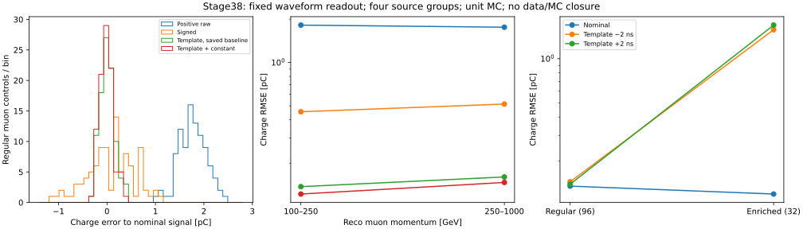

# stage38：CaloNu 稳定积分修复与固定弱信号读出确认

日期：2026-11-01；起点 `ef5dc89`。遵循修订路线第19节及[冻结协议](stage38_energy_ml/preregistered_protocol.md)。

## 阶段目标与结论

**在四个新来源组的96例常规μ控制上，固定模板加常数基线项相对保存baseline的signed积分，
四模块总电荷RMSE由0.485709降至0.135039 pC，改善72.1974%，来源组配对95%区间
[69.3173%,74.3946%]，通过冻结的弱信号读出门槛。**
它说明原波形仍有可恢复的电荷信息，不能把整流噪声pedestal当物理能量或宣称现有保存电荷已达信息极限。
这不是ν能量分辨率改善72%，也不是绝对电荷、data/MC或强子标定闭合。

新确认中的4个非有限模块在修复函数重放后全部有限，40个正常可辨认正脉冲的固定保存参数积分全部保真。
**数值修复与弱信号估计必须分开**：修复旧fit后，常规样本电荷RMSE仍为1.760829 pC，
阈下raw回退仍含整流噪声；仅修溢出不会恢复弱信号。
富集高信号对模板±2 ns偏移明显敏感，下一阶段必须保留时间/形状控制。

## 输入、选择、冻结与统计

配置：[calonu_repair_control.json](../ml/configs/calonu_repair_control.json)，
冻结UTC `2026-11-01T16:17:56.234576+00:00`。
沿用stage36外部轨迹/闪烁体μ选择，reco p为100–1000 GeV，保留100–250/250–1000 GeV两层。
μ−为run100049，μ+为100050；每文件50000输入事件。

| group | run | 原PHYS/RDO/rec合并范围 | 常规100–250 / 250–1000 GeV | 诊断 |
|---|---:|---|---:|---:|
| 1 | 100049 | 00100–00104 | 12 / 12 | 8 |
| 4 | 100049 | 00395–00399 | 12 / 12 | 8 |
| 7 | 100050 | 00100–00104 | 12 / 12 | 8 |
| 10 | 100050 | 00395–00399 | 12 / 12 | 8 |

原路径与fingerprint在[四份请求](stage38_energy_ml/request_1.json)及同目录request_4/7/10.json；
例如 `/eos/experiment/faser/sim/mc24/particle_gun/100049/{bck,rdo,rec}/s0015/` 下对应原文件，
完整实际路径以请求为准，不按PG重复eventID强配。
每组常规按已选行等距取样，不切CaloNu质量；诊断共4非有限、8高raw、8fit失败、8负值、4填充。
无饱和模块，**饱和修复精度未测量**；没有为了覆盖而增加样本。
四组与stage37的0/5/6/11不重叠；但stage36汇总已用于诊断选择，不能称完全未知样本，
也没有认证所有生成来源谱系独立性。

全部128事件/512模块通过实际entry、fingerprint、RDO/HITS primary三动量、rec/PHYS读出及持久化布局核验。
branch→region继续固定`[1,0,3,2]`，使用stage37历史cable payload/IOV；不采用当前tag的none映射。
保存ADC重构波形逐点相等；raw复算通过3e−5 pC绝对容差；与stage36 charge最大差3.356934e−6 pC。
阈下、高信号、负值和非有限事件全保留，不重排通道、不裁负值、不调物理增益。

统计单位为四通道总电荷。误差=读出−名义HITS窗内线性信号，单位pC；R68=(q84−q16)/2。
HITS仅为评估标签，含Birk/nonuniform修正；TOF用名义GDML，不是完整digitization随机种子重放。
常规名义敏感层能量中位83.6825 MeV，窗内信号中位0.112362 pC，85/96四模块全低于原5σ阈值。
1000次来源block bootstrap，各符号内抽两个来源组，seed20261105，所有读出共用抽样。
区间只描述这四组的来源重抽样，来源数很少、取样按行固定，不覆盖系统误差或完整总体统计不确定性。
富集诊断不估总体故障率、不计算确认区间。

## 数值修复与物理保真

固定源`1ec47efe`，由[生成器](../ml/build_waveform_repair.py)产出
[可审查patch](../ml/patches/calonu-waveform-stability-1ec47efe.patch)。
未改Calypso checkout或原PHYS。稳定积分在log域计算Crystal Ball有限窗尾项，使用log1p/expm1，
不构造易溢出的`(n/|alpha|)^n`；允许有限窗下n≤1，不强限尾参数或删除大响应。
完整初始化fit字段，检查ROOT fit有效性、time/最终积分有限性；Gaussian失败保留raw，CB失败保留前级，
相应failure位不再因time NaN误标valid。

| 检查 | 实测结果 |
|---|---|
| 旧stage37开发函数重放 | 14模块；原8非有限→修复0非有限 |
| 合成参数独立积分 | 84组合全部通过，含n≈1、n=1000、两种alpha符号、不同窗口 |
| 旧保存参数独立积分 | 75组全部通过；8个非有限参数积分恢复 |
| 新确认函数重放 | 512模块；原4非有限→修复0非有限 |
| 新保存参数独立quadrature | 56组全部通过，最大绝对差9.094947e−13 mV·ns |
| 正常可辨认保存参数保真 | 40/40；rtol3e−6、atol1e−5 mV·ns，按保存质量选取，不按修复结果筛选 |
| CB time NaN显式注入 | 开发及四确认组均拒绝CB、置status32并得到有限fallback |

积分对照见[开发结果](stage38_energy_ml/development/integral_summary.json)、
[确认积分逐例表](stage38_energy_ml/confirmation_integrals.tsv)和
[函数重放表](stage38_energy_ml/confirmation_replay.tsv)。
56组中9组保存width<0.2 ns；其中2模块原status0且无阈下位。
这些窄峰/负输出仍保留，有限不等于正确物理信号。
4个原−inf模块的修复函数重放电荷为0.966762、58.383917、0.708104、0.422709 pC；
不同重放初值/顺序可能改变fit参数，不把重拟合数值冒充同保存参数积分。

原/修复函数来自明确固定源码，在原ROOT6.28/12解释器中编译；独立参数积分核验使用ROOT6.38和SciPy。
这是保存窗口/baseline上的源函数scaffold，**不是完整Athena tool重建或全生产链验证**；
没有证明所有未初始化路径、并发状态或全部异常都由同一机制解释。
原源码static fit结果对象的线程安全本阶段未测量；wrapper与Condor均单线程。

## 固定读出的测量结果

模板取固定生产kernel：mean820 ns、sigma3.6700001 ns、alpha−0.31999999、n1000，
使用0.1 ns离散卷积/2 ns采样后归一为窗内pC。所有事件使用同一时间，不选峰、不逐例选最好偏移。
主读出为`template_plus_constant`：波形同时拟合模板振幅和常数项；权重和为零，因此消去常数baseline偏移。
部署接口[calonu_weak_readout.py](../ml/calonu_weak_readout.py)只接波形、ADC、保存baseline/rms、时间和conditions，
不接HITS、truth、PDG或matching。

96例常规，尾率为|误差|超过给定pC阈值的比例：

| 读出 | RMSE [pC] | bias [pC] | R68 [pC] | >0.25 pC | >1 pC | 离峰RMS [pC] |
|---|---:|---:|---:|---:|---:|---:|
| 原正半波raw | 1.788984 | +1.767664 | 0.280746 | 100% | 100% | 1.825302 |
| 保存baseline的signed | 0.485709 | +0.080657 | 0.492612 | 57.2917% | 5.2083% | 0.490822 |
| 固定baseline模板 | 0.149319 | +0.005357 | 0.145550 | 10.4167% | 0% | 0.130923 |
| 模板+常数项（冻结主候选） | 0.135039 | −0.012532 | 0.125590 | 6.2500% | 0% | 0.115990 |
| 数值修复后的原fit/raw回退 | 1.760829 | +1.728994 | 0.291500 | 100% | 96.8750% | 未测量 |

主候选bias95%来源区间[−0.023001,−0.002063] pC，仍有非零残差；100–250 GeV层bias为
−0.032646 [−0.049488,−0.015803] pC，不宣称精确无偏，也未用此残差事后扣常数。

| reco p [GeV] | N | signed RMSE [pC] | 主候选RMSE [pC] | 主候选bias [pC] | 主候选R68 [pC] | 配对RMSE改善95% |
|---|---:|---:|---:|---:|---:|---|
| 100–250 | 48 | 0.455053 | 0.122034 | −0.032646 | 0.115601 | 73.1825% [71.4394%,74.6078%] |
| 250–1000 | 48 | 0.514541 | 0.146898 | +0.007582 | 0.161429 | 71.4506% [67.5836%,74.2410%] |

完整指标、bias/RMSE区间、时间变体与诊断表：
[readout_metrics.tsv](stage38_energy_ml/readout_metrics.tsv)、
[paired_readout_gain.tsv](stage38_energy_ml/paired_readout_gain.tsv)、
[baseline_sensitivity.tsv](stage38_energy_ml/baseline_sensitivity.tsv)。

## 物理原因与时间/基线边界

**改善同时来自保留脉冲形状和消除baseline公共偏移。**
按生产3 ADC count白噪声，理想四模块总噪声RMS预计signed0.255404、固定baseline模板0.111902、
模板+常数0.124486 pC；拟合常数会相对理想已知baseline模板付出噪声代价。
实测signed离峰0.490822却远大于理想0.255404 pC，主候选0.115990则接近其理想尺度。
解释性MC已知digitizer baseline15650 count控制（不作为新部署候选、不改gate）给出signed RMSE0.235104 pC；
保存baseline相对该常数引起的积分偏移RMS0.409148 pC，与signed误差相关系数0.875539。
这支持baseline估计误差放大长窗积分的解释，不据此假设真实data具有相同已知baseline或白噪声。

冻结±1保存rms的常数扰动下，常规主候选最大变化6.661338e−16 pC；
signed最大5.950899 pC、固定baseline模板1.142356 pC。
离峰窗口ADC[100:176]，与读出同样76点；没有用离峰标签调权重。
这是常数偏移控制，斜坡/非平稳或相关噪声鲁棒性未测量。

| 固定模板时间 | 常规RMSE [pC] | 常规bias [pC] | 富集32例RMSE [pC] |
|---|---:|---:|---:|
| 820 ns（名义） | 0.135039 | −0.012532 | 0.119275 |
| 818 ns | 0.144640 | −0.023822 | 1.575770 |
| 822 ns | 0.139250 | −0.028486 | 1.694162 |

高信号富集样本对微小时序失配敏感；无噪声名义信号上的模板误差同样随偏移增大，
说明不能仅以程序故障或噪声解释。没有逐例选择三个输出之一，不能宣布模板对所有CC shower稳定。



## 执行、成本、归档与验证

先旧样本compact单例及打包scaffold smoke，再4个Condor jobs，schedd使用bigbird14；
cluster17555947，全部exit0、零重提，排队82 s，提交至最后完成245 s，小于8 jobs冻结预算。
描述符1 CPU/4000 MB，经站点规则实际请求/分配2 CPU/6000 MB，代码单线程、无GPU。
wrapper合计wall564.62 s、CPU324.11 s，峰1405544 KiB；
原生读取内部wall320.8754 s，128例吞吐0.398909 events/s。
只启用所需branches，按实际entry读；临时HITS转换后就地生成名义信号并释放，不落盘逐hit数组。
compact单例与旧archive的17个公共字段逐值相等（含名义信号、ADC和HITS汇总）。
不将不同富集样本/ROOT装载耗时比较成性能优化收益。

```bash
# LCG109_cuda，单线程Python：
source /cvmfs/sft.cern.ch/lcg/views/LCG_109_cuda/x86_64-el9-gcc13-opt/setup.sh
export PYTHONNOUSERSITE=1 OPENBLAS_NUM_THREADS=1 OMP_NUM_THREADS=1 MKL_NUM_THREADS=1
python3 ml/build_waveform_repair.py
python3 ml/check_waveform_integral.py
# 原ROOT6.28/12干净shell执行开发和compact smoke：
export NU_MU_SKIP_LCG=1
source setup_env.sh
nu_mu_official_setup /tmp/xcheng/nu_mu_calypso_master_d32b0ff3_180107
python ml/repair_calonu_wavefit.py
python ml/read_calonu_native.py --request /tmp/stage37_smoke_request.json \
  --output /tmp/stage38_compact_smoke.npz --include "$FASER_CALYPSO_RUN/include" --compact-signal
# 回到LCG shell，冻结只执行一次，已有配置时拒绝覆写：
python3 ml/prepare_calonu_repair.py
python3 ml/package_calonu_repair.py
condor_submit -name bigbird14.cern.ch AnalysisZipFramework/submission/ml_calonu_repair.sub
python3 ml/report_calonu_repair.py
python3 ml/validate_calonu_repair.py
python3 ml/collect_calonu_repair_resources.py
```

开发重放wall18.78 s、CPU5.64 s、峰567308 KiB；compact smoke51.57 s/42.91 s/1260892 KiB；
包内重放smoke12.58 s/5.31 s/567132 KiB；成功开发quadrature5.08 s/2.17 s/596624 KiB；
汇总2.48 s/1.68 s/153272 KiB；最终独立核验/作图及全部实测成本见
[local_timing_records.json](stage38_energy_ml/local_timing_records.json)。
开发独立积分首次未适应极窄峰quad、7.52 s失败，改为标准化坐标并显式分段后通过，未调松验收。
开发JSON首次NumPy整数未序列化、3.86 s失败；确认核验同类序列化遗漏5.08 s失败，转Python int后通过。
最后补充解释性baseline诊断重算一次，未增加读出或fit；失败/重复成本均记录，不计为物理结果。
修复生成、打包、资源汇总与文档编辑若无独立计时则标记未测量，不从其他计时推算。
一次Condor history只读资源查询长时间无响应后中止；资源结论来自已完成作业的event log和实际time输出，
未重复提交作业，此查询CPU成本未测量。格式核查提示patch原源码上下文的行尾空白，
以patch目录的whitespace属性保留原文；源码/文档常规格式检查通过，没有改冻结的修复内容。

最终 `ntuples/energy_ml_stage38/confirmation.npz` 为620787 bytes，128例/512模块，
保留ADC、名义信号、保存/修复读出、参数和完整lineage，逐字段读回；schema与资源单独去重归档。
清理分片/payload前再次逐字段联接读回，清理清单与bytes见[archive.json](stage38_energy_ml/archive.json)。
共清理770401 bytes，最终原生cache没有重复分片。
无新ROOT/xAOD、ML模型或G4事例；未覆盖原实验输入。格式/语法/文档链接及最终提交blob读回检查记录随阶段保存。

## 下一阶段：受限CC同事件读出比较

1. 冻结小预算CC波形支持，先验证PHYS→rec/RDO真实entry/fingerprint和历史conditions，
   使用可取得的相同CC事件比较原F6、有原CaloNu与固定signed/模板读出。需要匹配原生波形及来源组划分；
   无法联接时先报告覆盖缺口，不以错误eventID或不同几何替代。
2. 保留reco100–250/250–1000 GeV、阈下/高信号/饱和/负值及固定±2 ns控制。
   先量化CC中的时间/形状敏感性，不用逐事件truth调时间、不把诊断控制当训练调参。
   若小样本暴露明显不适用，先明确可恢复物理量及读出约束，再决定有限的时间模型；不扫描网络。
3. 同输入预算/同事件划分下才评价ν能量误差、bias、R68与尾部，及必要的来源配对区间；
   stage35 test已评价，不能成为改模型后的新独立确认。正式模型之前另冻验收与train内部映射/校准规则。
4. 接受标准是CC读出覆盖与基线/时间控制可审查、比较无truth泄漏，增益与失效区域均实测；
   不把μ电荷的72%改善直接折算为ν能量或谱收益。data安装/时期、绝对MIP、强子响应、
   探测器/相互作用系统及最终能谱收益均仍为**未测量**。
