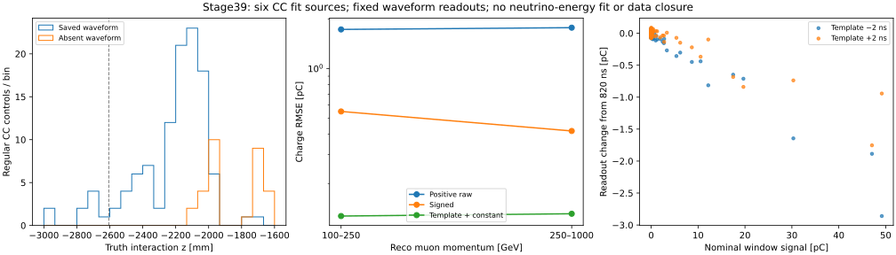

# stage39：CC同事件波形收益、空读出机制与时间敏感性

日期：2026-11-01；起点`d25c353`。沿修订路线第20节推进；
[冻结协议](stage39_energy_ml/preregistered_protocol.md)、[配置](../ml/configs/calonu_cc_waveform.json)。

## 阶段目标与物理结论

**固定模板加常数基线项的弱信号收益可以迁移到CC，但尚不足以支持直接重训ν能量模型。**
190例全部完成原生联接。142例常规控制中112例有完整波形；在这112例相同事件上，
四通道电荷RMSE由signed的0.484287降至0.128924 pC，改善73.3787%，来源组配对95%区间
[70.1344%,76.7130%]。离峰RMS从0.479922降至0.133249 pC，常数baseline扰动不变。

另有两个实测限制：

1. 常规30/142例（21.1268%）没有保存任何CaloNu波形，敏感层HITS也为空。
   全部控制共43例同样如此；已有PHYS把这些记录为全零电荷、status1。
   源码确认空HITS时直接返回，不生成噪声。**这是模拟/保存机制，不能直接当data测得的无噪声零电荷。**
2. 常规17例名义信号≥1 pC。固定模板提前2 ns后，14/17的名义模型响应误差超过5%，
   12/17相对名义模板的变化超过5%；三个组件均存在。不是少数离群事件导致停止分支，
   而是预定义高信号控制中的广泛时间敏感性。

因此本阶段通过共同有效支持上的弱信号gate，同时触发时间/形状限制。
下一步先验证**含空HITS的完整读出响应与有限时间自由度**，再做有新冻结划分的有限能量模型比较。
没有将电荷的73%改善折算为ν能量或谱收益，没有重新启用stage35 test。

## 输入、冻结与事件支持

清单沿用stage35的124份PHYS，π/K/charm为run200139/200140/200146。
实查124/124对应RDO、124/124 rec和1240/1240名义HITS子文件存在；
这只是文件覆盖，不是124份全部事件的联接认证。
见[lineage_inventory.tsv](stage39_energy_ml/lineage_inventory.tsv)。
K末合并文件108只有8184例、charm末文件123为6711例；本阶段按完整文件规则不选它们。

从**已有fit分区**各组件第二个及最后一个完整文件取六组，不使用三个pilot首文件。
配置UTC冻结`2026-11-01T16:47:50.467515+00:00`，打开本次原生波形/HITS值之前。
只用已有fit汇总选择事件：每组两p层各最多12常规，按eventID排序等距，无CaloNu cut；
另各8例诊断，每类最多2，按非有限/饱和/高raw/负值/fit失败/零读出/high-y顺序补足。
两个charm低p层各只有11例，全保留且不换来源，实际190例，低于192例上限。
这不是新的独立ν能量test，也未证明所有生成谱系独立性。

| index | 来源组 | 常规100–250 / 250–1000 GeV | 诊断 |
|---|---|---:|---:|
| 1 | pi:00010–00019 | 12 / 12 | 8 |
| 44 | pi:00440–00449 | 12 / 12 | 8 |
| 47 | k:00010–00019 | 12 / 12 | 8 |
| 106 | k:00600–00609 | 12 / 12 | 8 |
| 110 | charm:00010–00019 | 11 / 12 | 8 |
| 120 | charm:00110–00119 | 11 / 12 | 8 |

请求中的完整路径为
`/eos/experiment/fasernu-data0/faser/sim/mc24/genie/<run>/{bck,rdo,rec,sim}/s0015/`；
具体文件、fingerprint、标签与cache行在request_1/44/47/106/110/120.json。
原选择、最高pz leading、truth fiducial/PMT veto、unit权重和两个p层不变；无新增质量cut。
诊断是富集样本，不用它估总体异常率或确认区间。零、负值、非有限保存输出均保留。
无饱和模块，**饱和精度未测量**；保存fit有1个非有限模块，未在本阶段重拟合或覆盖。

## 原生身份、数值与来源核验

CC每HITS文件1000例、十文件合并10000例，与PG控制的10000/50000不同。
PHYS用eventID、leading p/x/y和raw0唯一fingerprint定位真实entry；不是把cache行当ROOT entry。
再以商余数定位HITS，逐例核验HITS/RDO/rec的run/event、HITS/RDO所有BeamTruth粒子的
PDG/status/三动量，以及PHYS入射ν三动量；190例全部通过。
所有出现通道的RDO/rec id32、rec/PHYS raw/fit/status相符，持久化class布局兼容。
PHYS/cache charge最大差1.831055e−6 pC；ADC换算与保存波形逐点相等，raw复算最大差0 pC。
映射保留历史payload的branch→region `[1,0,3,2]`，没有按关联峰重排。

六个初始jobs被沿用PG的绝对质量容差1 keV拦住。具体probe中，ν的
HITS/RDO三动量、barcode、生成质量完全相等，p=338060.0028 MeV，
仅持久化动量学质量−0.00390625/+0.0055242716 MeV；signed m²差4.577637e−5 MeV²。
E²−p²相消使近无质量粒子的绝对m检查不稳定。
技术修正改查signed m²差不超过
`64 ε_double |p|² + 4 ε_float max(m_HITS²,m_RDO²) + 1e−12 MeV²`，
并新增严格barcode/生成质量相等、能量符号一致；PDG/status/三动量仍逐值相等。
代表差值只占舍入界0.0281860；全190例最大界比0.0286299，最大绝对m差0.0441942 MeV。
这只修身份检查，不改变物理读出或冻结门槛。PG原检查保留。
证据：[probe](stage39_energy_ml/beam_mass_probe.json)、[数值验证](stage39_energy_ml/beam_mass_validation.json)。

六份rec日志均记录Calypso22.0.49、CaloNuMC/1ec47efe、TI12MCCaloNu；
历史Digitization payload IOV覆盖三个CC run。见[生产reference](stage39_energy_ml/production_reference.tsv)、
[源码证据](stage39_energy_ml/source_audit.json)。
这不认证K/charm确切bck maker配置，也不是完整原始GeoModel、嵌入conditions或随机种子重放。
现成d32b0ff3 runtime只读字典；没有调用普通几何CaloHit helper或重建CaloNu生产。

## 空波形与零电荷：明确分母及程序原因

| 支持 | 选中 | 完整波形 | 四通道均缺失 | HITS为空 |
|---|---:|---:|---:|---:|
| 常规 | 142 | 112 | 30 | 30 |
| 100–250 GeV | 70 | 53 | 17 | 17 |
| 250–1000 GeV | 72 | 59 | 13 | 13 |
| π / K / charm常规 | 48 / 48 / 46 | 36 / 35 / 41 | 12 / 13 / 5 | 12 / 13 / 5 |
| 诊断 | 48 | 35 | 13 | 13 |

全部190例的present pattern只有四通道全有147例、全无43例；不存在半缺通道。
43个空HITS事件全部没有RDO波形，PHYS模块raw/fit charge为0、status=1。
源码`CaloWaveformDigiAlg::execute`先记录空容器，发现`caloHitHandle->size()==0`立即返回，
发生在波形/噪声生成之前；`NtupleDumper::clearTree`将电荷置0、status默认置1。
因此status1既可表示真实保存波形的阈下，也可表示没有该波形，不能单靠它判有效性。
本阶段保留channel_present及common_waveform mask，缺失电荷估计写NaN，**未补造零测量或baseline**。

在已有整个fit分区（仅描述，不重新做test）：总零读出2403/14309=16.7936%；
reco100–1000 GeV为2074/11658=17.7904%。按名义CaloNu中心−2605.68 mm分层，
上游1124例零读出0、下游13185例零2403（18.2253%）。
新的常规30例缺失也全在该中心下游；这支持与交互位置/可达活动有关，不是随机少数坏文件。
中心分层不是active体积/轨迹传播选择，不能由此把全部信号归为某一种粒子或shower机制。
全fit中的每个零值都来自空HITS尚**未逐例认证**，不把190例结论无条件推广。
stage35的约3.34%增益可能包含这种生产中的缺失标记信息，**贡献份额未测量**，不能说全部增益已被解释。

## 固定读出：收益成立于共同有效波形支持

stage38 kernel、mean820 ns、同一76采样窗；比较正半波、signed、固定baseline模板及模板+常数项。
固定±2 ns/±1保存rms敏感性，不逐例选最好输出、不裁负、不用HITS调时间。
算法接口不接truth/PDG/matching；HITS只作评估端名义窗内线性信号标签，含Birk/nonuniform与名义TOF局限。
误差=读出−名义信号，单位pC；R68=(q84−q16)/2，尾率为|误差|超过指定阈值。
112常规有效波形中94例四模块全低于原5σ，名义信号中位仅0.00734274 pC，
远低于主候选离峰RMS0.133249 pC；改善电荷噪声并不创造多数事例本来没有的强可见信号。

| 读出，N=112 | RMSE [pC] | bias [pC] | R68 [pC] | >0.25 pC | >1 pC | 离峰RMS [pC] |
|---|---:|---:|---:|---:|---:|---:|
| 正半波raw | 1.756581 | +1.727699 | 0.290469 | 100% | 97.3214% | 1.810863 |
| signed | 0.484287 | +0.012910 | 0.514397 | 60.7143% | 4.4643% | 0.479922 |
| 固定baseline模板 | 0.135134 | −0.002599 | 0.134759 | 6.2500% | 0% | 0.138563 |
| 模板+常数项（冻结主候选） | 0.128924 | −0.006283 | 0.117733 | 6.2500% | 0% | 0.133249 |

主候选bias95%来源区间[−0.029521,+0.017799] pC，不能据包含0宣布校准闭合。
无噪声名义信号上的主候选平均误差−0.0277134 pC，表明observed平均偏差小也可能包含噪声相消。

| reco p [GeV] | 有效N | signed RMSE [pC] | 主候选RMSE [pC] | 主候选bias [pC] | 主候选R68 [pC] | RMSE改善95% |
|---|---:|---:|---:|---:|---:|---|
| 100–250 | 53 | 0.549072 | 0.126717 | +0.018106 | 0.116422 | 76.9216% [73.1364%,80.1507%] |
| 250–1000 | 59 | 0.417608 | 0.130874 | −0.028192 | 0.140307 | 68.6610% [65.7265%,71.4295%] |

250–1000 GeV层bias区间[−0.048949,−0.006720] pC仍非零，未扣常数。
固定baseline扰动下主候选常规最大变化1.421085e−14 pC，通过不变性验收；斜坡/非平稳噪声未测量。
1000次来源block bootstrap，组件内各抽两组，seed20261106，所有方法共用抽样。
六来源很少，区间不含模型/探测器系统、所有事件抽样不确定性或不同物理组分归一化。

完整逐能量、y、名义z、组件及primary代理的bias/R68/尾率与配对区间见
[指标](stage39_energy_ml/readout_metrics.tsv)、[配对收益](stage39_energy_ml/paired_readout_gain.tsv)、
[覆盖](stage39_energy_ml/coverage.tsv)和[逐例表](stage39_energy_ml/events.tsv)。
最高能量箱仅1例且无波形，电荷误差未测量；y≥0.8仅8有效例、没有≥1 pC参考，
不能把其小电荷残差当ν能量或高y问题已解决。
barcode严格primary确认仍未测量，128/142为独立命名的kinematic-parent代理，不冒充严格confirmed。

## 高信号：冻结的时间控制未通过

常规名义信号≥1 pC共17例（π/K/charm=5/7/5），诊断另22例。
下表相对误差只在**无噪声名义HITS信号**上计算，故与随机噪声或旧fit溢出可以区分。

| 模板时间 | 常规整体读出RMSE [pC] | 高信号17例模型相对bias | 模型相对RMSE | 模型误差超过5% |
|---|---:|---:|---:|---:|
| 820 ns名义 | 0.128924 | −1.86796% | 2.40621% | 0/17 |
| 818 ns | 0.443130 | −7.22139% | 7.52236% | 14/17 |
| 822 ns | 0.290194 | −4.05742% | 4.30368% | 4/17 |

相对名义模板的变化超过5%：−2 ns为12/17，+2 ns为0/17；
诊断组分别7/22、1/22。诊断名义模板本身1/22超过5%，不删掉它。
−2 ns的模型偏差在π/K/charm分别−7.4953%、−7.2930%、−6.8472%，
广泛存在于不同组件，不是一个特殊事件制造的结论。
没有为了通过门槛改时间、改5%阈值或选三个输出中较好的一个。
结论是**固定单模板振幅的时序鲁棒性不足，需要受限时间/形状控制**，并非CaloNu分支没有信息。



## 执行、成本与产物

先原生单例smoke，通过后提交；bigbird24拒绝AFS executable/log路径（EosSubmit规则），无作业入队，转bigbird14。
初始6 jobs为17555948，均因近无质量ν的绝对质量检查技术失败；
确认数值原因后，17555949两个jobs各重读三个原来源，均exit0，190例无增删，总数8，未突破预算。
描述符1CPU/4000MB，经站点实际2CPU/6000MB，程序单线程、无GPU。
全部wrapper wall1007.52 s、CPU770.33 s，峰1462368 KiB；失败wall505.93 s、成功501.59 s。
首次提交至最后完成887 s；最终原生内部wall468.3783 s，吞吐0.405655 events/s，包含六次ROOT装载。
不与不同支持的PG计时宣称加速。逐job及步骤见[资源表](stage39_energy_ml/condor_resources.tsv)。

```bash
source /cvmfs/sft.cern.ch/lcg/views/LCG_109_cuda/x86_64-el9-gcc13-opt/setup.sh
export PYTHONNOUSERSITE=1 OPENBLAS_NUM_THREADS=1 OMP_NUM_THREADS=1 MKL_NUM_THREADS=1
python3 ml/prepare_calonu_cc_waveform.py  # 已冻结，拒绝覆写
python3 ml/locate_calonu_native.py --request workbook/stage39_energy_ml/request_1.json \
  --output /tmp/stage39_smoke_request.json --smoke
# 原ROOT干净shell：
export NU_MU_SKIP_LCG=1
source setup_env.sh
nu_mu_official_setup /tmp/xcheng/nu_mu_calypso_master_d32b0ff3_180107
python ml/read_calonu_native.py --request /tmp/stage39_smoke_request.json \
  --output /tmp/stage39_native_smoke.npz --include "$FASER_CALYPSO_RUN/include" --compact-signal
python ml/probe_calonu_beam_mass.py
# 回到LCG；最终sub为合并重试的left/right两job，初始六job见资源记录：
python3 ml/package_calonu_cc_waveform.py
condor_submit -name bigbird14.cern.ch AnalysisZipFramework/submission/ml_calonu_cc_waveform.sub
python3 ml/audit_calonu_cc_source.py
python3 ml/report_calonu_cc_waveform.py
python3 ml/plot_calonu_cc_waveform.py
python3 ml/archive_calonu_cc_waveform.py  # 全字段联接核验后清重复分片，仅执行一次
python3 ml/validate_calonu_cc_waveform.py
python3 ml/collect_calonu_cc_resources.py
```

本地成功原生smoke47.40 s/CPU42.51 s/峰1254120 KiB；质量probe7.80 s/3.30 s/574020 KiB；
新质量规则/空HITS smoke51.21 s/44.57 s/1254892 KiB；最终汇总2.26 s/1.75 s/90508 KiB；
作图2.49 s/1.97 s/77488 KiB。其他失败和重复成本见[计时记录](stage39_energy_ml/local_timing_records.json)。
冻结前准备三次失败分别为status浮点、partial文件、低p不足12；未看原生结果后改选。
首次原生smoke在保存lineage时重复hits_file关键字失败51.18 s，修dict构造后原事件通过。
汇总首次错把缺波形status预期为0，0.81 s失败；源码明确默认1，改成检查真实默认值，事件/读出不变。
随后的作图因表未生成失败1.44 s；资源汇总依赖summary而失败，独立CPU/RSS未测量，最终重做通过。
源码审计补充Ntuple默认值后重做一次，1.04 s/CPU0.24 s/峰42152 KiB；
打包/资源查询/手工诊断/文档编辑未独立计时者标未测量。

最终 `ntuples/energy_ml_stage39/cc_waveform.npz` 为1244048 bytes，保留190例的ADC/保存波形、
名义信号、存在性、固定读出与完整lineage；逐字段读回。
六分片各22个原生数组字段、冻结请求、metadata及class布局再次逐值联接核验通过，
并独立复算常规signed/主候选指标，随后删除六分片和payload共1316675 bytes，
归档wall0.50 s/CPU0.35 s/峰53 MiB（脚本内部计时），见[归档](stage39_energy_ml/archive.json)。
汇总命令依赖归档前分片；已归档cache可直接用于后续控制，不重提作业重建重复产物。
不保存新ROOT/xAOD、逐hit大数组或新ML模型；零新G4。文件格式、支持/数值及文档验证见final_validation.json。
最终验证再次检查190例冻结支持、空HITS/缺失mask、ADC→波形/raw及缺失估计NaN，
11份Python语法、shell语法、17份JSON、11份TSV列宽、53个本地链接及SVG XML均通过。
验证内部wall0.67 s/CPU0.22 s/峰52.97 MiB；ν能量收益和物理data/MC闭合仍未测量。

## 下一阶段任务与验收

1. **唯一主线为完整的CaloNu读出响应控制**：针对已认证的空HITS→空波形路径，
   准备只影响该路径的最小修复/受限源函数验证，明确探测器/通道映射与历史conditions，
   验证无信号也生成同条件噪声读出；非空HITS路径保持原物理响应。
   输入为本阶段冻结的空/非空原生控制及明确生产源码。只需相关模块/函数，不自动全量G4/PHYS。
2. 同一有界响应实验中冻结一个简单时间自由度对照（例如模板与时间导数的联合线性估计，
   或固定有界时间拟合），先用旧控制开发并按来源隔离新确认。
   禁止truth选时间、逐例挑更好方法或扩大网络扫描。保留强信号、阈下、负值/失败与饱和覆盖缺口。
3. 验收必须分别证明空HITS不再成为无噪声理想零标记、正常非空响应保真，
   并定量检查噪声、偏差及预定义时间扰动；未通过则定位物理/程序原因，不删尾或只报总体平均。
   所有新门槛与预算在新确认前冻结，不用stage39结果调参后又声称它是新独立确认。
4. 完成该响应控制后才另冻同事件F6/原CaloNu/改进波形的有限能量模型比较，
   train内部映射/校准与旧stage35 test的独立性问题必须明确。
   真实data安装/时期、绝对MIP/强子响应、探测器/相互作用系统及最终谱收益继续**未测量**。
