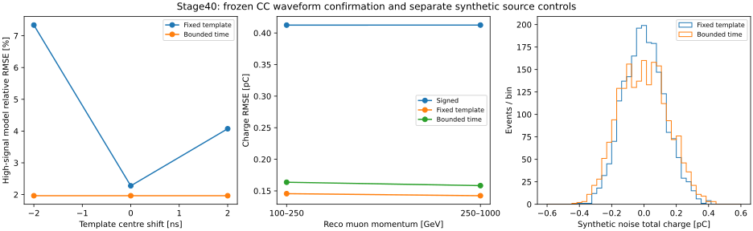

# stage40：显式空信号噪声路径与有限时间读出的收益、代价

日期：2026-11-01；起点`7485e05`。按修订路线第21节推进。
[冻结配置](../ml/configs/calonu_response.json)、[协议](stage40_energy_ml/preregistered_protocol.md)、
[测量汇总](stage40_energy_ml/summary.json)。本阶段零ML训练、零新G4。

## 阶段目标与结论

**有界时间拟合修正了固定模板的强信号时间敏感性，但会提高弱信号噪声；
空HITS的噪声缺失已有安全的显式源函数修复对照，完整Athena生产修复仍未测量。**

1. 新六来源181例全部原生匹配。15常规及19诊断高信号的无噪声模型误差在三个模板中心下
   均小于5%；常规最大4.64515%、诊断最大3.82736%，中心改变下电荷变化为0。
   固定模板提前2ns时常规14/15超过5%；简单时间自由度确实解决这一有界控制中的损失。
2. 同一109常规有效波形上，名义电荷RMSE固定模板0.143794→有界时间0.160735 pC，
   **恶化11.7815% [8.6347%,14.8819%]**，不能称为总体精度提升。
   有界时间相对长窗signed仍改善61.0335% [58.8093%,62.8819%]。
3. 2048例独立合成源函数控制中，四通道均产生600采样，ADC RMS3.01505对量化理论3.01386。
   256对无hist/全零hist全部ADC逐点一致，理想恒定零信号波形为0/2048。
   **这证明受限源函数路径消除了无噪声零标记，不是已修复的原生观测或完整生产认证。**

冻结响应门槛通过，下一阶段唯一主线为匹配历史条件的最小Athena数字化/重建闭合；
通过后才冻结有限能量模型实验。不直接向39个缺失原生事件填随机噪声，不重用旧test宣称新独立能量确认。

## 开发、冻结与输入

开发只用已评价的stage39 cache。先比较固定模板与一次“模板+时间导数+常数”诊断，
导数步长0.1ns；常规RMSE0.128924→0.128965 pC，−2ns高信号仍14/17超过5%。
归一化脉冲平移导数近乎与振幅正交，一阶项不能修正已测的二阶振幅损失。
于是只开发一个有界时间模型，无后续架构、范围或步长扫描。
详见[开发表](stage40_energy_ml/development/timing_methods.tsv)。
开发时有界时间离峰RMS0.155825对固定0.133249 pC，噪声代价已知；
新确认前明确接受不超过1.25倍的离峰RMS，同时要求低于signed、配对RMSE收益下限>0、
常数基线不变及所有高信号模型误差/中心变化≤5%。没有看新确认后放宽门槛。

配置UTC冻结`2026-11-01T17:40:25.192084+00:00`，打开本次新原生波形/HITS之前。
只用stage35已有fit汇总选择各组件第三及倒数第二个完整10000事件来源，
与stage39和各组件pilot来源不重叠。是**来源隔离的波形确认**，不是新的ν能量test或生成谱系独立性证明。

| index | 来源组 | 常规100–250 / 250–1000 GeV | 富集诊断 |
|---|---|---:|---:|
| 2 | π:00020–00029 | 12 / 12 | 8 |
| 43 | π:00430–00439 | 12 / 12 | 8 |
| 49 | K:00030–00039 | 12 / 12 | 8 |
| 105 | K:00590–00599 | 12 / 12 | 8 |
| 111 | charm:00020–00029 | 4 / 12 | 8 |
| 119 | charm:00100–00109 | 9 / 12 | 8 |

每p层至多12例，按eventID稳定排序等距取，无CaloNu cut；不足全取，不换来源。
诊断每类最多2，沿stage39顺序挑非有限/饱和/高raw/负值/fit失败/零读出/高y，再按行填满。
实际181=133常规+48诊断，低于192上限，整个阶段3 jobs低于冻结10上限。
保持原选择、最高pz leading、truth fiducial、PMT veto及unit MC权重，无新增质量cut。
具体路径、fingerprint、cache行、真能量/y标签及来源见六份request JSON。
输入根目录为`/eos/experiment/fasernu-data0/faser/sim/mc24/genie/<run>/{bck,rdo,rec,sim}/s0015/`。

PHYS真实entry由多变量fingerprint定位，按1000事件/HITS子文件商余数联接；
181例run/event、所有BeamTruth PDG/status/三动量、barcode/生成质量、signed m²数值界及PHYS入射ν检查均通过。
保存ADC→波形逐点相同，raw复算与保存值一致；rec/缓存四模块raw、status核验通过，
保存fit电荷的独立缓存核验结果见final_validation.json。
实际最大差1.831055e−6pC，在预定float持久化容差内；未改写任何保存拟合输出。
六份rec日志均为Calypso22.0.49/CaloNuMC-1ec47efe/TI12MCCaloNu，历史Digitization IOV覆盖三个run。
[来源审计](stage40_energy_ml/production_reference.tsv)。K/charm确切bck maker、嵌入全部conditions及原随机种子仍未重建。

## 空HITS修复：为什么不能只删提前返回

原`CaloWaveformDigiAlg`在空HITS时记录空容器然后返回。
下游`generate_calo_waveforms`和`generate_calo_timing_waveforms`均解引用`begin()`来区分Ecal/CaloNu；
直接删早退会访问空集合，不是安全修复。

[候选patch](../ml/patches/calonu-empty-noise-1ec47efe.patch)固定原源1ec47efe，
新增显式`generate_calonu_noise_waveforms`：从CaloNu ID helper建立四通道，再调用原`convolve_waveforms(empty)`。
算法仅在`CaloNuHits`为空且显式开启`DigitizeEmptyCaloNu`时走新分支；属性默认false。
普通Ecal空路径、全部非空信号生成及卷积函数不改。接口增加方法并升为2.0，
完整使用需要重建工具、算法及相关接口消费者，不能只替换一个不兼容二进制。
示例启用点为`acc.getEventAlgo("CaloNuWaveformDigiAlg").DigitizeEmptyCaloNu = True`，本阶段未部署到生产。

patch在临时原源文件树通过`git apply --check`；外部Calypso checkout和实验输入未改。
使用原始`create_waveform_map`、`generate_baseline`、`create_kernel`、`convolve_waveforms`
及新helper的ROOT解释编译fixture，显式替代ID迭代、EventContext、Gaudi handle和历史conditions。
历史branch→region仍为`[1,0,3,2]`，四个id32不重排；不调用普通几何helper生成CaloNu映射。
源码及替身边界见[source_control.cxx](stage40_energy_ml/source_control.cxx)、[scope](stage40_energy_ml/source_scope.json)。
归档源码仅移除原文件行尾空白，逐token相等检查通过，不改变已执行的源函数控制。
未做完整Athena/GeoModel装载、历史随机种子重放、RDO→rec→PHYS闭合或多线程认证。

### 独立合成噪声控制

Condor执行2048例×4通道×600采样=4915200个ADC；TRandom3 seed20261107，ROOT6.38.00。
固定base_mean15650 ADC、base_rms3 ADC；对每个采样沿原源码取float Gaussian、round和下限钳位。
量化理论RMS近似`sqrt(3²+1/12)=3.01385689 ADC`。

| 项目 | 实测 | 冻结验收 |
|---|---:|---|
| ADC均值 | 15650.0010614 ADC | 距15650小于0.02 ADC，通过 |
| ADC RMS | 3.01505221 ADC | 距量化理论小于2%，通过 |
| 无hist/全零hist配对 | 256事件、1024通道、614400 ADC | 全部逐点相等 |
| 理想恒定零信号波形 | 0/2048 | 原生缺失ADC未作任何填充 |

同一780–930ns窗，以下基线已知为合成条件常数；**不是data可获得的精确基线或原生保存baseline估计**。

| 合成噪声读出 | mean [pC] | RMS [pC] | R68 [pC] |
|---|---:|---:|---:|
| 正半波 | +1.769750 | 1.776081 | 0.151367 |
| signed | +0.000281 | 0.258269 | 0.259961 |
| 固定模板+常数 | +0.000144 | 0.127631 | 0.128869 |
| 有界时间 | −0.002267 | 0.149117 | 0.153628 |

有界时间噪声RMS增加16.8338%，显示从噪声中搜索时间的实际代价。
正半波仍有约1.77pC整流pedestal；“补上噪声”不会自动得到无偏强子能量。
控制只支持所测独立Gaussian噪声路径，不认证相关/非平稳噪声、实测基线或真实data响应。

## 新原生样本覆盖：缺失仍保留，不补零

| 支持 | 选中 | 完整波形 | 四通道均缺失 | ≥1pC有效参考 |
|---|---:|---:|---:|---:|
| 常规 | 133 | 109 | 24 | 15 |
| 100–250 GeV | 61 | 49 | 12 | 7 |
| 250–1000 GeV | 72 | 60 | 12 | 8 |
| π / K / charm常规 | 48 / 48 / 37 | 40 / 37 / 32 | 8 / 11 / 5 | 9 / 2 / 4 |
| y≥0.8常规 | 8 | 6 | 2 | 0 |
| 富集诊断 | 48 | 33 | 15 | 19 |

总计142例完整、39例全缺，无部分缺失；39例全部敏感HITS为空。
常规24/133=18.0451%缺失，全在名义中心−2605.68mm下游。
这在新的来源支持上重复了stage39的机制；缺失估计仍为NaN，不把源函数合成噪声写入这些事件。
不能由两个有界控制样本的缺失比例差声称生产发生率变化。
109常规有效波形名义信号中位仅0.00526845pC；≥1pC仅15例，弱信号仍占多数。
严格barcode primary确认不可用；代理118常规中96有效、15高信号，非代理15中13有效、无高信号。
最高真能箱3200–6400GeV无常规支持；饱和模块0、保存非有限积分0，相关精度/故障率均未测量。

## 冻结读出：时间鲁棒性与噪声代价同时报告

一个event共享一个时间，四通道各有有符号幅度和常数基线；固定33点网格覆盖中心±4ns。
用四通道合计残差选时间，精确并列取较早者，不用HITS、truth、PDG或matching调时间。
不裁负、不挑读出、不按时间边界删事件。中心±2ns仅为网格中心扰动控制，
不是已验证真实硬件时钟漂移、任意shower延迟或不同通道独立错时。

误差为四通道总电荷读出−名义HITS窗内线性信号[pC]，R68=(q84−q16)/2。
HITS含Birk/nonuniform、TOF用名义几何；标签不是绝对MIP/强子校准。
同一109常规完整事件，1000次组件内各抽两来源组的配对bootstrap，seed20261107。
六来源很少，区间不包含探测器/模型系统或完整总体抽样不确定性。

| 方法 | RMSE [pC] | bias [pC] | R68 [pC] | 绝对误差>0.25pC | >1pC | 离峰RMS [pC] |
|---|---:|---:|---:|---:|---:|---:|
| signed | 0.412496 | −0.008826 | 0.406005 | 49.5413% | 0% | 0.459171 |
| 固定模板+常数 | 0.143794 | −0.017275 | 0.142753 | 9.1743% | 0% | 0.128484 |
| 有界时间 | 0.160735 | −0.010697 | 0.165095 | 13.7615% | 0% | 0.147207 |

有界时间相对固定名义RMSE恶化11.7815% [8.6347%,14.8819%]，离峰RMS增加14.5725%，
低于冻结25%上限且远低于signed。有界时间总体bias区间[−0.032704,+0.010911]pC，
100–250层bias−0.038637 [−0.068237,−0.005177]pC仍非零，不据总体含0宣布校准闭合。

| reco p [GeV] | 有效N | fixed RMSE [pC] | 有界RMSE [pC] | 有界bias [pC] | 有界R68 [pC] | 相对signed改善95% |
|---|---:|---:|---:|---:|---:|---|
| 100–250 | 49 | 0.145566 | 0.163652 | −0.038637 | 0.151144 | 60.3228% [56.8537%,63.8998%] |
| 250–1000 | 60 | 0.142331 | 0.158313 | +0.012122 | 0.163594 | 61.6234% [58.1401%,64.6850%] |

相对固定两层分别恶化12.4248% [6.0057%,19.5678%]、11.2291% [5.9902%,16.4635%]。
baseline±1保存rms最大变化3.552714e−14pC，常数不变性通过；斜坡/非平稳扰动未测量。
逐能量、y、名义z、primary代理、组件的指标/尾率及配对区间见
[metrics](stage40_energy_ml/metrics.tsv)、[paired](stage40_energy_ml/paired_gain.tsv)、[events](stage40_energy_ml/events.tsv)。

### 强信号模型门槛通过，但含噪声精度未达到逐例5%

| 常规≥1pC，N=15 | 无噪声相对RMSE | 最大绝对相对误差 | 模型误差>5% | 含噪声相对RMSE | 含噪声误差>5% |
|---|---:|---:|---:|---:|---:|
| 固定，−2ns | 7.33672% | 12.0571% | 14/15 | 7.59278% | 8/15 |
| 固定，名义 | 2.27622% | 5.38690% | 2/15 | 4.45680% | 4/15 |
| 固定，+2ns | 4.07286% | 5.69522% | 3/15 | 6.71591% | 7/15 |
| 有界，三个中心均相同 | 1.96472% | 4.64515% | 0/15 | 4.38544% | 5/15 |

19例诊断高信号有界模型相对RMSE1.36095%、最大3.82736%，三个中心全部0/19超过5%，
相对中心变化0；含噪声RMSE2.23565%，1/19超过5%。诊断富集，不用于总体概率区间。
34例高信号三个中心的最优时间均落在重叠搜索区；实际波形拟合最大偏移1ns，全部未触边。
这支持所测中心扰动的局部鲁棒性，**不等于34例噪声精度都小于5%，也不等于真实时间/形状系统已闭合**。

94常规弱信号中43例触时间边界（45.7447%），41例总读出为负；高信号0/15触边。
弱信号的时间值多由噪声决定，不将它当交互时间或新的物理部署特征。
这些事件全保留，未把负值裁0，未根据新确认结果开发逐例切换方法。
新结论是**时序稳定性可以用简单模型获得，但当前多数弱信号下固定模板名义误差更小**。



## 执行、成本与归档

bigbird14 cluster17556151，两个原生合并job加一个source job，3/3 exit0，无重提/技术失败。
描述符1CPU/4000MB，站点实际2CPU/6000MB；各程序单线程、无GPU。
wrapper总wall479.46s/CPU349.47s、峰1447980KiB；提交至末完成303s。
最终原生内部wall433.3539s，吞吐0.417672events/s；不与不同支持/失败次数的旧阶段宣称加速。
source内部wall4.71294s/CPU4.59594s、峰757.883MiB，含解释编译/合成/统计；wrapper14.88s。
[资源明细](stage40_energy_ml/condor_resources.tsv)、[操作计时](stage40_energy_ml/operation_resources.tsv)。

单线程缓存推断微基准：142事件批×10次，不新增物理支持；固定预计算权重0.306μs/event，
有界时间含每批33模板构造101.680μs/event；只计函数计算，不含I/O、训练或完整重建。
这是当前实现成本，不声称已充分优化；[基准](stage40_energy_ml/inference_cost.tsv)。

```bash
python3 ml/build_calonu_empty_noise.py
python3 ml/build_calonu_noise_fixture.py
source /cvmfs/sft.cern.ch/lcg/views/LCG_109_cuda/x86_64-el9-gcc13-opt/setup.sh
export PYTHONNOUSERSITE=1 OPENBLAS_NUM_THREADS=1 OMP_NUM_THREADS=1 MKL_NUM_THREADS=1
python3 ml/develop_calonu_response.py
python3 ml/prepare_calonu_response.py  # 已冻结，拒绝覆写
python3 ml/locate_calonu_native.py --request workbook/stage40_energy_ml/request_2.json \
  --output /tmp/stage40_smoke_request.json --smoke
python3 ml/run_calonu_noise_control.py --smoke --output /tmp/stage40_noise_smoke.npz
# 原生smoke在干净shell中：
export NU_MU_SKIP_LCG=1
source setup_env.sh
nu_mu_official_setup /tmp/xcheng/nu_mu_calypso_master_d32b0ff3_180107
python ml/read_calonu_native.py --request /tmp/stage40_smoke_request.json \
  --output /tmp/stage40_native_smoke.npz --include "$FASER_CALYPSO_RUN/include" --compact-signal
# 回到LCG环境：
python3 ml/package_calonu_response.py
condor_submit -name bigbird14.cern.ch AnalysisZipFramework/submission/ml_calonu_response.sub
python3 ml/report_calonu_response.py
python3 ml/diagnose_calonu_response.py
python3 ml/plot_calonu_response.py
python3 ml/audit_calonu_response_source.py
python3 ml/archive_calonu_response.py  # 全字段核验后清分片，仅一次
python3 ml/collect_calonu_response_resources.py
python3 ml/validate_calonu_response.py
```

本地开发wall0.90s/CPU0.52s；准备3.11s/1.01s；locate smoke1.80s/1.05s；
native smoke50.43s/42.42s、峰1241688KiB；source smoke8.10s/2.65s、峰582200KiB。
正式汇总4.65s/2.55s、峰76612KiB；诊断0.69s/0.45s；作图2.06s/1.55s；
来源审计0.96s/0.20s；归档0.78s/0.51s。
首次schedd查询误将-name和-submitter并用被拒，改用-name与用户名后正常，无提交失败或重复作业。
准备/正式作业/汇总无运行失败；初始临时实现草稿、源码查看、打包/资源查询/文档编辑未独立计时，标未测量。
完整本地timing记录随阶段保存，最终验证成本见final_validation.json。
最终验证wall1.10s/CPU0.45s、峰53468KiB，181例冻结支持/身份、ADC/raw、fit缓存、
指标复算、独立noise摘要和归档均通过；14份Python、shell语法、JSON/TSV格式、57个本地链接及SVG XML通过。

最终原生`ntuples/energy_ml_stage40/response.npz`为1204523bytes，
独立合成`source_noise.npz`39622bytes，共1244145bytes，两者不混用。
六分片各22原生字段及cases/metadata/class schema重联相等，最终cache全字段读回，
删除六分片和payload1254024bytes；[归档](stage40_energy_ml/archive.json)。
汇总依赖归档前分片，后续直接读最终cache，不重提旧作业造重复结果。
没有新ROOT/xAOD、逐hit大数组或新模型；原实验输入未改。

## 下一阶段唯一主线与验收

1. **匹配历史CaloNu条件的最小Athena数字化/重建闭合**：先审查现成匹配build，
   隔离构建必要接口/工具/算法及消费者；记录接口2.0兼容性。
   显式装载原CaloNu几何、历史cable payload/IOV和Digitization条件，不能用当前none通道映射代替。
   输入沿已有认证的空/非空HITS少量代表，不默认全量G4、PHYS再生产。
2. 默认关闭patch；仅在受限验证中开启。固定seed/顺序验证空HITS有四通道正确噪声，
   非空信号在相同随机控制下保真，空事件插入对后续随机流的影响要明确；
   继续核验RDO→rec的baseline/status/有符号电荷与存在性。若完整匹配不成立，明确缺口，不能叫生产修复。
3. 读出保留固定与有界时间两参考，冻结推断接口；不据本次确认再调时间范围或用truth做混合切换。
   通过完整响应验证后，才另冻F6/原CaloNu/改进波形的有限同事件能量模型预算及来源划分。
   缺失标记贡献及有/无噪声读出的能量收益需专门配对测量，不能由电荷RMSE直接推算。
4. stage34/35能量test、stage39/40波形支持均已用；寻找新确认前明确独立性，
   train内部映射/校准不能使用test预测。真实data安装/时期、绝对MIP/强子响应、探测器与相互作用系统、
   正式归一化和最终能谱收益继续未测量；unit默认保持，不重复询问清单，不恢复架构竞赛。
