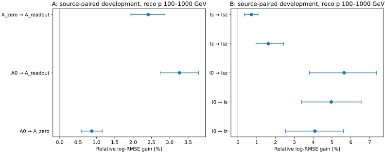
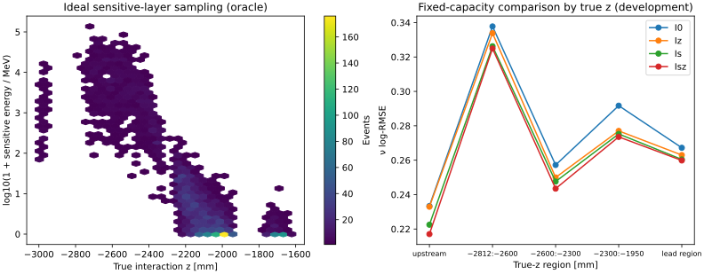
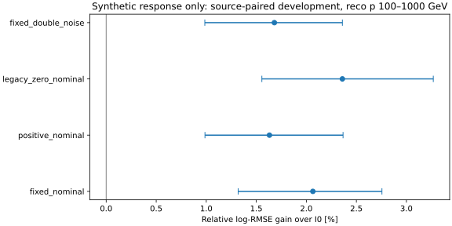

# stage42：CaloNu 零标记、理想信号与深度信息诊断

日期：2026-11-01。承接88fa423的最新信息预算计划及修订路线§23。
阶段状态：A/B/C全部完成：33个正式BDT及对应独立scalar映射，2个小smoke BDT。

**物理决策：CaloNu有超出深度的条件信号，统一含噪后仍保留有限收益；
进入有预算的真实噪声/data响应验证，暂不扩大成完整历史生产工程。**
重点原读出改善3.264%、零标记单独.873%；理想S改善4.962%，已知z后的S增量1.617%；
统一白噪声固定模板仍改善2.065% [1.319,2.755]。这是开发MC/合成证据，不是data部署或最终能谱收益。

## 1. 目标与协议

先判断ν能量中可用的信息，再决定生产修复投入。主目标为100≤reco pμ<1000 GeV，
另报100–250、250–1000与≥1000 GeV；没有把Eν截在1TeV。
F6全部65项、原选择、最高pz leading、truth fiducial（包括lead区域）、PMT veto与unit MC均保持。
原读出的10个非有限值事件和66个负值事件全部保留；20个非有限标量进入missing路由，
没有有限值转换float32后溢出。有限EM读出绝对值最大117895.168 GeV，保留并不把它当作可靠强子量热标定。

唯一学习输入：`ntuples/energy_ml_stage35/fit.npz`，14309例/81来源（π5725、K7621、charm963）。
这是已用过的开发总体；本轮没有读取stage34/35旧test，更不是新的独立确认。
B按来源文件次序、组件分层等距选择完整来源：8π/10K/3charm，共3703例/21来源；
未按HITS、y或模型结果挑选，未重加权成全fit总体。B的风险指该预定子样本，不能与A的绝对风险直接比较。
B重点3024例；100–250/250–1000/≥1000分别849/2175/679例；保留90个y≥.8事件（19来源）。
每个入选来源的全部原选择事件都进入四格对照，没有删除HITS空、弱信号或尾部事件。

按组件分层的来源三折：评估f，训练(f+1)%3，独立校准及scalar映射(f+2)%3。
B三折总数1473/1259/971，A为4969/4762/4578。每事件仅有一个独立来源模型预测，非ensemble。
固定BDT：400轮、depth3、eta .04、subsample .8、min_child_weight20、lambda10、hist、1线程；无早停或架构扫描。
校准折独立预测只拟合mean log-offset及8结点三次样条+multinomial logistic scalar映射。
映射保留原六个Eν箱[100,200,400,800,1600,3200,6400] GeV，没有围绕结果改箱。
500次按组件分层的来源配对bootstrap；区间条件于固定模型，不含重训、生成器、材料或响应系统误差。

协议、完整输入名单、实际折分与数值审计：
[preregistered_protocol](stage42_energy_ml/preregistered_protocol.md)、
[config](../ml/configs/calonu_information.json)、[source_folds](stage42_energy_ml/source_folds.tsv)、
[input_numeric_audit](stage42_energy_ml/input_numeric_audit.json)。

## 2. A：零标记有用，但不足以替代原读出

A0=F6；A_zero加五个原PHYS EM读出均有限且精确为零的标记；A_readout加原四模块及总EM读出。
全fit零事件2403例，重点2074例；五量全零与total-only零无分歧。

| 模型 | N | log-RMSE | mean bias % | median bias % | R68 % | 尾部 >0.5 % | 尾部 >1 % |
| --- | --- | --- | --- | --- | --- | --- | --- |
| A0 | 11658 | 0.262736 | 3.053 | 2.908 | 18.855 | 4.932 | 0.463 |
| A_zero | 11658 | 0.260442 | 3.006 | 2.773 | 18.477 | 4.821 | 0.463 |
| A_readout | 11658 | 0.254159 | 2.804 | 2.543 | 17.726 | 4.486 | 0.455 |

| 层 | N | 配对 | 相对改善 % | 来源95%区间 % |
| --- | --- | --- | --- | --- |
| focus | 11658 | A0 → A_zero | 0.873 | [0.584, 1.157] |
| focus | 11658 | A0 → A_readout | 3.264 | [2.738, 3.785] |
| focus | 11658 | A_zero → A_readout | 2.412 | [1.938, 2.870] |

零标记单独的0.873%增益与原读出3.264%增益都获来源区间支持；
原读出相对零标记仍有2.412%增量。**不能把全部CaloNu收益解释为精确零标记。**
也不能把剩余部分自动称为强子量热信息：位置、生产响应与其他数值机制仍可能参与；增益不能机械分账。

在既有stage39/40逐例原生支持上，371例中82例全零，与空HITS及全通道缺失完全一致；
常规支持275例/54例全零。新B的3703例中644例全零，重点3024例中547例；均与空HITS、S=0一一一致。
这些是实测联接支持的结论；未逐例读取HITS的其他A事件不能直接称已认证空HITS。
详见[existing_native_zero_summary](stage42_energy_ml/existing_native_zero_summary.json)及[signal_support](stage42_energy_ml/signal_support.tsv)。

A的100–250/250–1000 GeV原读出增益2.989% [2.232,3.762] / 3.460% [2.827,4.070]；
y≥.8的369例增益1.814% [−.087,3.692]，证据不足以单独确认该层。
完整逐p、Eν、y、z、组件、primary proxy的风险/bias/R68/尾部及配对区间见
[A_metrics](stage42_energy_ml/A_metrics.tsv)、[A_paired](stage42_energy_ml/A_paired.tsv)。

## 3. B：理想信号与真深度有重叠，也有条件增量

I0=F6，Iz加真z[mm]，Is加四模块S[MeV]，Isz加两者；全部在同3703例及相同来源角色重训。
S通过原生CaloHitCollection converter读取**敏感层保存能量**，含生产中的Birk/非均匀性修正；
它不是完整强子能量，也不是严格信息上界。真z与HITS只进入隔离oracle，未加入truth方向、PDG或matching输入。
本schema没有严格barcode确认，分层明确使用primary kinematic-parent proxy，不冒充confirmed。

| 模型 | N | log-RMSE | mean bias % | median bias % | R68 % | 尾部 >0.5 % | 尾部 >1 % |
| --- | --- | --- | --- | --- | --- | --- | --- |
| I0 | 3024 | 0.287097 | 3.635 | 3.288 | 20.582 | 6.052 | 0.529 |
| Iz | 3024 | 0.275347 | 3.161 | 2.623 | 19.165 | 5.390 | 0.430 |
| Is | 3024 | 0.272850 | 3.171 | 2.567 | 19.223 | 5.291 | 0.265 |
| Isz | 3024 | 0.270893 | 3.124 | 2.566 | 18.749 | 5.258 | 0.364 |

| 层 | N | 配对 | 相对改善 % | 来源95%区间 % |
| --- | --- | --- | --- | --- |
| focus | 3024 | I0 → Iz | 4.093 | [2.538, 5.614] |
| focus | 3024 | I0 → Is | 4.962 | [3.387, 6.550] |
| focus | 3024 | I0 → Isz | 5.644 | [3.799, 7.371] |
| focus | 3024 | Iz → Isz | 1.617 | [0.963, 2.432] |
| focus | 3024 | Is → Isz | 0.717 | [0.352, 1.072] |

重点区间真z单独改善4.093%，S单独改善4.962%，联合改善5.644%。
已知z后S仍改善1.617% [0.963,2.432]；已知S后z仍改善0.717% [0.352,1.072]。
四格交互 MSE(I0)−MSE(Is)−MSE(Iz)+MSE(Isz)=
**+0.005544586 [0.003612413,0.007610346]**（log²，无量纲）；按预定义符号表示冗余，
不是把唯一因果贡献分成百分比。不能将S增益全归于位置，也不能忽略两者重叠。

| 层 | N | 配对 | 相对改善 % | 来源95%区间 % |
| --- | --- | --- | --- | --- |
| all | 3703 | I0 → Is | 4.361 | [3.088, 5.595] |
| p100_250 | 849 | I0 → Is | 5.443 | [2.936, 8.095] |
| p250_1000 | 2175 | I0 → Is | 4.558 | [3.120, 5.892] |
| p1000_up | 679 | I0 → Is | 2.191 | [0.825, 3.967] |
| focus_y0.8_1.01 | 90 | I0 → Is | 7.595 | [2.248, 12.600] |
| focus_z-3000_-2928 | 55 | I0 → Is | 4.655 | [-2.778, 16.880] |
| focus_z-2812_-2600 | 197 | I0 → Is | 3.412 | [0.656, 6.113] |
| focus_z-2600_-2300 | 452 | I0 → Is | 3.742 | [0.627, 6.739] |
| focus_z-2300_-1950 | 2062 | I0 → Is | 5.637 | [3.223, 8.193] |
| focus_z-1769.65_-1619.65 | 258 | I0 → Is | 2.537 | [0.492, 5.203] |

最上游55例区间很宽，不能因未显著就认定没有信号；高y90例已有理想S收益，但仍是开发诊断。
全部分层见[B_metrics](stage42_energy_ml/B_metrics.tsv)、[B_paired](stage42_energy_ml/B_paired.tsv)、
[B_interaction](stage42_energy_ml/B_interaction.tsv)。

### 敏感层采样的实际尺度

| 区域（真z单位mm） | N | 空HITS | S总量中位 MeV | S总量p90 MeV |
| --- | --- | --- | --- | --- |
| focus | 3024 | 547 | 2.98084 | 3073.49 |
| focus_z-3000_-2928 | 55 | 0 | 854.192 | 7922.4 |
| focus_z-2812_-2600 | 197 | 0 | 6292.58 | 34821.8 |
| focus_z-2600_-2300 | 452 | 0 | 1640.04 | 14912.5 |
| focus_z-2300_-1950 | 2062 | 366 | 1.5217 | 19.5691 |
| focus_z-1769.65_-1619.65 | 258 | 181 | 0 | 1.00653 |

重点总体S中位2.980845 MeV，而p90为3073.495 MeV；y≥.8的90例S中位4.600027 MeV，
其transfer=Eν−Eμ,vertex中位586.961890 GeV。后者不是可见强子能量。
深度导致很不均匀的采样尺度；这些数值不构成材料能损测量或能量守恒闭合。
特别是不能用truth_st*动量模长解释材料能损。




## 4. C：按预设门槛触发的一次合成响应

B中Is相对I0的重点改善≥2%、来源95%下限>0，且Isz相对Iz点改善非负，触发C；
这不追认stage35原5%扩展门槛。只运行预设名义噪声与×2压力，没有扫描。
详见[C_gate](stage42_energy_ml/C_gate.json)。

四模块S转换成同步820ns CB单脉冲，760–910ns的76个2ns样本；
名义独立Gaussian白噪声3 ADC、压力×2；已知pedestal、连续浮点，无量化/饱和/真实HITS时间形状。
四模块电荷与总电荷共5个输入[pC]，负值保留。每物理事件一个噪声副本，仍留在原来源折内。
固定模板、正半波积分、S=0显式精确零的legacy机制对照、固定模板×2噪声共12个BDT；
legacy是有意的合成机制对照，不是可部署truth特征或原生生产复现。
原ADC/mask没有修改，没有将随机数冒充缺失观测。

无噪声电荷代数最大误差5.684342e−14 pC；644个S=0事件的2576个通道均经过加噪，
固定模板零信号通道RMS=.0566708 pC。该简单模型已知同步时间和pedestal，不能认为已代表真实噪声/时序。
S oracle用4输入，C用4电荷+确定性总量5输入；有限BDT的C对Is差不应全解释成噪声因果损失。

| 模型 | N | log-RMSE | mean bias % | median bias % | R68 % | 尾部 >0.5 % | 尾部 >1 % |
| --- | --- | --- | --- | --- | --- | --- | --- |
| fixed_nominal | 3024 | 0.281168 | 3.506 | 3.318 | 19.875 | 5.820 | 0.364 |
| positive_nominal | 3024 | 0.282413 | 3.587 | 3.186 | 19.996 | 6.184 | 0.430 |
| legacy_zero_nominal | 3024 | 0.280321 | 3.359 | 3.044 | 19.874 | 6.019 | 0.496 |
| fixed_double_noise | 3024 | 0.282272 | 3.524 | 3.280 | 20.016 | 5.787 | 0.397 |
| I0 | 3024 | 0.287097 | 3.635 | 3.288 | 20.582 | 6.052 | 0.529 |
| Is | 3024 | 0.272850 | 3.171 | 2.567 | 19.223 | 5.291 | 0.265 |

| 层 | N | 配对 | 相对改善 % | 来源95%区间 % |
| --- | --- | --- | --- | --- |
| focus | 3024 | I0 → fixed_nominal | 2.065 | [1.319, 2.755] |
| focus | 3024 | I0 → positive_nominal | 1.632 | [0.987, 2.367] |
| focus | 3024 | I0 → legacy_zero_nominal | 2.360 | [1.556, 3.269] |
| focus | 3024 | I0 → fixed_double_noise | 1.681 | [0.986, 2.360] |
| focus | 3024 | Is → fixed_nominal | -3.048 | [-4.598, -1.662] |
| focus | 3024 | fixed_nominal → fixed_double_noise | -0.393 | [-0.765, -0.087] |
| focus | 3024 | positive_nominal → legacy_zero_nominal | 0.741 | [0.310, 1.249] |

固定模板名义风险.281168，比I0的.287097改善2.065% [1.319,2.755]；
噪声×2仍改善1.681% [.986,2.360]，但比名义恶化.393% [.087,.765]。
同一正半波响应仅恢复S=0的精确零机制，又改善.741% [.310,1.249]。
这是模拟标记有预测力的机制对照，不能替代原生产的因果分账，也不能据此删除无沉积事件。

| 层 | N | 配对 | 相对改善 % | 来源95%区间 % |
| --- | --- | --- | --- | --- |
| all | 3703 | I0 → fixed_nominal | 1.790 | [1.124, 2.381] |
| p100_250 | 849 | I0 → fixed_nominal | 2.586 | [1.554, 3.767] |
| p250_1000 | 2175 | I0 → fixed_nominal | 1.627 | [0.714, 2.440] |
| p1000_up | 679 | I0 → fixed_nominal | 0.787 | [-0.525, 1.972] |
| focus_y0.8_1.01 | 90 | I0 → fixed_nominal | 1.329 | [-2.357, 4.877] |
| focus_z-3000_-2928 | 55 | I0 → fixed_nominal | 14.541 | [4.481, 25.604] |
| focus_z-2812_-2600 | 197 | I0 → fixed_nominal | 7.795 | [5.023, 11.551] |
| focus_z-2600_-2300 | 452 | I0 → fixed_nominal | 2.819 | [0.301, 5.590] |
| focus_z-2300_-1950 | 2062 | I0 → fixed_nominal | 1.124 | [0.150, 2.051] |
| focus_z-1769.65_-1619.65 | 258 | I0 → fixed_nominal | 1.177 | [-1.542, 3.567] |

含噪固定模板在高y90例改善1.328% [−2.357,4.877]，该层尚未确认；
最上游55例改善14.541% [4.482,25.604]，有局部价值但支持少。
部分局部含噪模型优于四输入S模型，不表示噪声创造信息：
C的确定性总量表示、有限样本及BDT容量等因素未逐一隔离。
本轮采用C对同事件I0的任务收益和预设噪声压力作决策，
不把Is→C差值全部解释成电子学因果损失，更不把四积分S当严格信息上界。

完整结果：[C_metrics](stage42_energy_ml/C_metrics.tsv)、
[C_paired](stage42_energy_ml/C_paired.tsv)、[synthetic_response](stage42_energy_ml/synthetic_response.json)。



## 5. 灵活scalar谱表示：proper score改善，六箱谱增益仍证据不足

只用独立校准来源的预测拟合scalar样条，未使用评估标签选择/校准。
| 实验 | scalar来源 | log-score nats | Brier | 经验score相对σ RMS | 来源95%区间 |
| --- | --- | --- | --- | --- | --- |
| A | A0 | 0.625494 | 0.347436 | 6.495 | [1.244,108.444] |
| A | A_zero | 0.617454 | 0.342915 | 6.388 | [1.338,94.167] |
| A | A_readout | 0.597864 | 0.330836 | 2.368 | [0.893,54.715] |
| B | I0 | 0.669055 | 0.366633 | 4.478 | [2.022,41.412] |
| B | Iz | 0.635890 | 0.348529 | 3.565 | [1.897,35.896] |
| B | Is | 0.628712 | 0.344175 | 3.399 | [1.847,30.855] |
| B | Isz | 0.622195 | 0.340900 | 3.482 | [1.967,35.090] |
| C | fixed_nominal | 0.653904 | 0.357913 | 5.200 | [2.407,84.442] |
| C | positive_nominal | 0.657252 | 0.359237 | 7.557 | [3.019,122.118] |
| C | legacy_zero_nominal | 0.654120 | 0.356311 | 7.882 | [3.152,144.310] |
| C | fixed_double_noise | 0.651831 | 0.355807 | 5.420 | [2.491,155.061] |

σ是N=1000个选中事件、固定箱内形状、已知开发响应的局部经验score诊断，无量纲，不是data误差。
A重点六真能量箱计数[841,2926,4567,2909,368,47]，B/C为[222,770,1142,788,91,11]。
最高Eν箱支持少，谱约束很不稳定；σ配对改善区间跨零，不能据点值宣称谱测量提升。
500个矩阵可逆也不代表约束可靠。
A原读出相对F6的log-score变化−.0276303 nats [−.0319991,−.0237134]，有概率质量改善；
它与六箱联合比例精度、最终含系统的能谱收益是不同指标。
全样本与重点结果：[A_spectrum](stage42_energy_ml/A_spectrum.json)、
[B_spectrum](stage42_energy_ml/B_spectrum.json)、[C_spectrum](stage42_energy_ml/C_spectrum.json)，
配对表为同目录`A/B/C_spectrum_paired.tsv`。不追加概率网络、分箱搜索或覆盖率调校。

## 6. 执行、实际资源与验证

HITS只读CaloNuHits、EventInfo和BeamTruth，按[9,1,11,3] hit-id顺序C++聚合；
不调用普通几何helper、不存逐hit/波形、不重跑G4/xAOD。
逐例核对PHYS唯一指纹→真实entry→HITS run/event及独立ν PDG/三动量。
持久化/加载字典layout checksum全部匹配（不是全文件SHA）。
使用现成d32b0ff3 Calypso字典作布局兼容读取，不宣称重建了匹配历史生产。

先smoke：stage39已知事件四模块能量/计数逐项一致，能量[.17407,0,19.577235,75.523162] MeV；
再验证新来源2例identity。训练smoke为2个20轮BDT、200/200/100例，缺类未拟合scalar映射。
正式各折均覆盖六类，33个scalar映射全部收敛，正式HITS3703例零失败。
smoke的2个新来源事件属于这3703例，不能另计独立事件。
最终核对来源角色互斥、事件回读、所有预测有限且正、概率归一、F6及oracle维数。

HITS内部累计wall 1885.483 s、CPU 1582.203 s，
含字典启动的吞吐1.963953 event/s，峰值RSS 1325.75 MiB。
33个BDT及scalar映射累计wall 45.319 s、CPU 44.543 s。
LCG_109、XGBoost2.1.3、NumPy2.2.6；单线程hist，GPU分配0。

Condor提交65条：26个执行成功、39个未启动撤回转移、执行失败0、执行重试0。
一次提交因移除日志未刷新、job-list尚不存在而被拒，无cluster/无fit，确认移除后恢复。
bigbird14完成A和7个HITS来源，bigbird18完成余下HITS及B，bigbird12完成C；bigbird21未启动的作业撤回。
C根据B约180 MiB RSS将请求4GB降为1GB，站点实际分配1CPU/3GB；其他为2CPU/6GB。
累计wrapper wall 2037.85 s、CPU 1689.70 s，
实际分配占用4724 CPU·s，最大RSS 1357568 KiB，
首提交至末完成2346 s（含排队）。

C遇本地EOS负缓存：XRootD确认输出已存在，取回/tmp核验C折及4模型元数据，
以相同字节原子回写并回读，无重训，见[output_visibility](stage42_energy_ml/output_visibility.json)。
详细[condor_resources](stage42_energy_ml/condor_resources.tsv)、
[operation_resources](stage42_energy_ml/operation_resources.tsv)、
[HITS_resources](stage42_energy_ml/HITS_resources.tsv)、
[final_validation](stage42_energy_ml/final_validation.json)。
原日志：`/afs/cern.ch/user/x/xcheng/nu_mu_stage42/logs/`。

复现主要命令（根目录；各payload创建后立即提交，勿覆盖尚待传输的不同配置）：

```bash
source setup_env.sh
export OMP_NUM_THREADS=1 OPENBLAS_NUM_THREADS=1 MKL_NUM_THREADS=1
python3 ml/prepare_calonu_information.py
# 先locate_calonu_native.py与read_calonu_sensitive_summary.py做小smoke
python3 ml/package_calonu_information.py --part hits
# 用AnalysisZipFramework/submission/ml_calonu_information.sub和生成的hits.jobs提交
python3 ml/collect_calonu_information.py
python3 ml/describe_calonu_information.py
python3 ml/package_calonu_information.py --part A
# 提交生成的A.jobs，完成后：
python3 ml/report_calonu_information.py --part A
python3 ml/package_calonu_information.py --part B
# 提交B.jobs（all三折顺序执行），完成后：
python3 ml/report_calonu_information.py --part B
python3 ml/build_calonu_information_synthetic.py
python3 ml/package_calonu_information.py --part C
# C实际提交见下方；完成后：
python3 ml/report_calonu_information.py --part C
python3 ml/plot_calonu_information.py
python3 ml/validate_calonu_information.py
python3 ml/collect_calonu_information_resources.py
python3 ml/archive_calonu_information.py
```

C实际命令：
`condor_submit -name bigbird12.cern.ch -batch-name nu_mu_stage42_C -append 'request_memory = 1000MB' -append '+JobFlavour = "espresso"' AnalysisZipFramework/submission/ml_calonu_information.sub jobs=/afs/cern.ch/user/x/xcheng/nu_mu_stage42/C.jobs`。
全部cluster/schedd见[submissions](stage42_energy_ml/submissions.json)。

最终事件缓存位于`ntuples/energy_ml_stage42/`：`development.npz`、`sensitive.npz`、`synthetic.npz`、
`A_predictions.npz`、`B_predictions.npz`、`C_predictions.npz`；模型/原折预测位于`ml/artifacts/stage42/`，均不入Git。
请求压缩为`requests.tar.gz`；逐项exact rejoin后清理46个重复文件、1682071 bytes，
最终事件缓存共8923948 bytes（约8.92 MB），见[storage](stage42_energy_ml/storage.json)。

## 7. 物理解释、局限与下一步

本轮支持位置/采样混合、弱信号噪声可见度与精确零机制共同限制CaloNu价值，
不支持任一项独占为唯一原因。联接检查排除了本轮HITS错位，异常与困难事件未删；
四格比较支持信号有超出z的信息，统一合成噪声后仍保留有限任务收益。
高y、lead区及最高Eν箱有限支持仍是实际缺口。
材料/淋浴与相互作用变体、真实gain/time扰动、data响应、flux归一化、接受度/背景、
最终能谱闭合均为**未测量**。理想S、已知时序与白噪声不能替代真实响应；
局部模型排序也不是数学信息上界。

文献动机沿用stage41方案[L1]模拟捷径、[L2–L3]噪声/模板、[L4]敏感层/起点诊断；
本轮未新增文献检索，没有借用其探测器性能数值。

**下一阶段只选CaloNu真实噪声/响应验证，问题是“这约2%的ν收益在data响应约束下能否保留”。**

- 输入：本轮3703例、F6和来源折，以及既有独立μ/data控制原文件。先审计ADC、pedestal、噪声相关、时序和相对增益；
  不直接乘25，不用HITS时间/ν标签选时窗，不把独立噪声样本叫独立ν能量test。
- 预算：优先≤512个data控制事件、≥8文件的联合四通道离峰噪声块；可用性不足如实报告，
  不伪装已测data噪声。全部S=0/非零事件统一响应、一事件一个噪声副本。
  同B样本/F6/BDT及scalar校准，≤9个正式BDT+1小smoke，一个名义和一个预先定义物理压力；
  如需隔离表示影响，最多3个fit用于S+确定性总量控制，计入9次预算。
- 必要的最小Athena生产控制限≤24例、空/非空均保留，明确源revision/conditions和剩余环境缺口；
  不把完整历史复现重新升级为所有ν研究的门槛，不拿电荷RMSE代替ν目标。
- 验收：下轮读结果前冻结重点log-RMSE改善≥2%、来源95%下限>0的实用标准；
  同报bias/R68/尾、p/Eν/y/z/组件/proxy及scalar谱信息。
  未达到则保留局部支持与区间，解释响应/统计缺口，不删困难事件或追加容量寻找通过。
  后续新确认须明确新来源/生成谱系并冻结候选，不能再次解封旧stage34/35 test充当新确认。

实际主要提交命令（其余未启动迁移的cluster/proc逐条在submissions及资源表中）：

```bash
condor_submit -name bigbird14.cern.ch -batch-name nu_mu_stage42_A AnalysisZipFramework/submission/ml_calonu_information.sub jobs=/afs/cern.ch/user/x/xcheng/nu_mu_stage42/A.jobs
condor_submit -name bigbird21.cern.ch -batch-name nu_mu_stage42_hits AnalysisZipFramework/submission/ml_calonu_information.sub jobs=/afs/cern.ch/user/x/xcheng/nu_mu_stage42/hits.jobs
condor_submit -name bigbird18.cern.ch -batch-name nu_mu_stage42_B AnalysisZipFramework/submission/ml_calonu_information.sub jobs=/afs/cern.ch/user/x/xcheng/nu_mu_stage42/B.jobs
```
