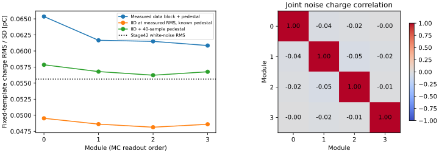
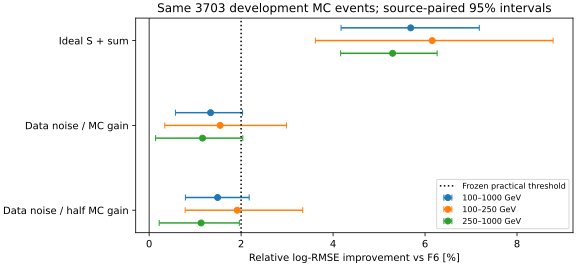

# stage43：真实离峰噪声下的CaloNu信息保留与空间局限

## 阶段目标与结论

执行修订路线§24、信息预算计划§9和stage43 Prompt：在相同事件/F6/来源折下，
检验stage42约2%的ν能量收益能否在真实data离峰噪声与有限pedestal下保留。

**重点reco pμ=100–1000 GeV的3024例，相对F6的log-RMSE改善1.3365%
[0.5717%,2.0317%]。正收益仍在，但点估计未达到预先冻结的≥2%实用门槛。**
区间上沿仍包含2%，不能宣称已经排除2%收益。理想S+确定性总量改善5.6882%
[4.1739%,7.1794%]；已测响应损失值得保留，不能把所有差距解释为纯噪声或μ拟合误差。

主要下游区域z∈[−2300,−1950) mm占重点2062/3024例：理想增益6.1410%，
data噪声后0.0189% [−1.0073%,1.0631%]。在**MC名义增益**下，该区域99.5635%
事件的所有模块信号都低于各自噪声RMS。相反，上游三个区域仍有正收益。
这支持“采样与可见度高度依赖位置，当前CaloNu对多数下游弱信号能力有限”，
不支持把它视为普适强子量热器，也不否认少数区域价值。

本轮完成9个正式BDT及1个小smoke，504个data事件/9个原RAW文件；没有新G4、
没有新Athena重建、没有读取旧test、没有删困难事件。另有一次切schedd时的启动竞争，
旧任务运行5秒后终止，无模型输出；是否进入过训练调用**未测量**，详见执行记录。
本报告的“9次”指已完成且逐折回读认证的正式拟合，不虚称完全没有额外部分执行。

## 冻结、样本与独立性

冻结时间2026-11-01 19:56:51.778684 UTC，起始提交`33039052dbba67024b05269088233a6e2460c76a`。
冻结前只审计stage42已有结果及16000/RAW0前2例schema/ADC；没有stage43 ν拟合。
配置嵌入每折预测metadata，并与最终配置逐字段相等校验。

- [冻结协议](stage43_energy_ml/preregistered_protocol.md)、[配置](../ml/configs/calonu_data_noise.json)、
  [精确RAW清单](stage43_energy_ml/raw_manifest.json)。
- ν样本复用stage42 B的3703例/21来源（pi/k/charm各7来源），重点3024例；
  100–250 GeV 849例，250–1000 GeV 2175例；≥1 TeV 679例仅作参考。
  F6保留全部65个重建变量，原highest-pz leading、truth fiducial/lead区、PMT veto与unit MC不变。
  **没有将Eν截在1 TeV**，最高箱3200–6400 GeV仍有11例进入重点评估。
- 三来源折事件1473/1259/971；eval=f，train=(f+1)%3，cal=(f+2)%3。
  固定400轮、depth3、eta=.04、min_child_weight20、lambda10、单线程BDT，沿用stage42种子。
  log-offset及灵活scalar映射只用该模型训练来源以外的cal预测，不读取eval标签校准。
- 噪声控制为run15838、16000、16923各RAW文件0、1、400的前56个PhysicsTag事件，
  共504例；不按CaloNu幅度、track、GRL或ν标签筛选，因此是inclusive data离峰控制，
  **不将其冒充504个通过μ选择的控制事件**。九文件每个仅顺序读取约0.44–0.47 MB。
- 每个RAW文件序号0/1/400分别进入噪声折0/1/2，各折168例、三个run齐全。
  每ν事件仅一个完整四通道76采样块，同一data事件不跨ν折共享；固定种子折内打乱循环，
  每data块复用5–9次。复用不增加独立物理事件，也不是噪声不确定度边缘化。
- 644个S=0事件（重点547个）与非零事件经过相同响应；所有空信号事件均获得非零噪声读出。
  原生PHYS读出、原ADC和mask未改，缺失/非有限F6仍按原规则输入NaN，不删负电荷或尾部。
- HITS仅作隔离响应参考，未将S、真z、truth方向/PDG/matching标记加入可部署F6。
  不使用truth_st1模长推断材料能损，不把primary运动学代理称为严格barcode confirmed。

来源配对区间沿用按pi/k/charm分层的500次来源组bootstrap，所有候选共享抽样。
这是条件于当前训练与固定噪声库的开发MC区间；不覆盖有限噪声库、增益、生成模型或data迁移系统误差。
stage34/35 test已经解封，本轮没有重开；独立data噪声不等于新的独立ν能量确认。

## 原生ADC与物理响应审计

数据xAOD `CaloNuWaveformHitsAux.`只存脉冲附近窗口，没有完整RawWaveformContainer。
因此直接读取原RAW，用现成官方EventFormats的`EventFull`与`DigitizerDataFragment`，
不重写DAQ字节打包规则、不复制大型RAW/xAOD，也不要求完整历史Athena生产。
薄C++适配器见[reader](../ml/read_calonu_raw_noise.cxx)。

2例独立RAW/xAOD验证中，run/event身份和四通道逐项对应，持久化字典layout检查通过；
按照`float32(baseline_mean − ADC×2/16.384)`逐点重建原saved_wave，最大差**0 mV**，
正半波积分重建raw charge最大差**0 pC**。见[pilot](stage43_energy_ml/pilot.json)及
[可复现的原生验证](stage43_energy_ml/native_pilot_validation.json)。
这验证解码/单位/代数，不证明历史全生产、真实强子标定或有信号pulse形状全部闭合。

- 每通道280个2 ns样本，量程2 V，即0.1220703125 mV/ADC。
  run15838硬件通道20/21/22/23，其余6/7/14/15，均按审计CableMapping对应MC模块ID9/1/11/3。
  原xAOD pilot脉冲窗口112–262 ns；data nominal trigger为200 ns，不能直接照搬MC 820 ns。
- 固定前40点0–78 ns的均值估计pedestal，固定360–510 ns即ADC[180:256]作76点联合离峰块。
  保留四通道间/采样间相关、离峰与pretrigger均值漂移，不按每个离峰块再次中心化。
  64–110 ns仅作平稳性诊断，不按ν结果选择窗口。
- 所用digitizer board均valid。原始event status=2有495例、status=0有9例；status2是BCIDMismatch位，
  未据此裁掉样本。board1−board0 time tag差−1/0/1/2分别179/189/65/71例；
  不把board间时标差直接当CaloNu脉冲jitter，也未从HITS时间选窗口。
- 数据原重建r0022/Calypso22.0.49、revision d0b1b2dd；只读字典来自现成d32b0ff3 runtime。
  EventFormats薄reader为系统GCC11.5编译，LCG_109用于NumPy2.2.6/XGBoost2.1.3。
  不将packager所在的GCC15误记为reader编译器，二进制`.comment`记录见payload provenance。
  没有触发额外Athena生产控制，因为本轮所需RAW身份和代数已闭合。

### 实测噪声

| 模块 | 离峰去块均值RMS (mV) | 实测40点pedestal固定模板RMS (pC) | 相同逐点RMS的iid已知pedestal预测SD (pC) | iid+40点pedestal预测SD (pC) |
|---|---:|---:|---:|---:|
| 0 | 0.324202 | 0.0653624 | 0.0495226 | 0.0578500 |
| 1 | 0.318280 | 0.0616658 | 0.0486180 | 0.0567933 |
| 2 | 0.315132 | 0.0614970 | 0.0481371 | 0.0562315 |
| 3 | 0.318135 | 0.0608467 | 0.0485958 | 0.0567673 |

stage42已知pedestal、3 ADC独立白噪声固定模板RMS为0.0556253 pC。
真实控制逐点噪声更小，但本轮电荷RMS更大，说明**不能只用逐点RMS描述实际读出误差**。
iid比较是相同逐点RMS下的解析预测，不是第二套ν候选或data的真实pedestal误差测量。
该近似中有限40点pedestal贡献总方差的26.7175%；实测电荷RMS还高于该iid预测，
不能把额外部分全部确定归给某一种相关噪声。

九文件×四模块的去块均值RMS范围0.306658–0.328489 mV；前窗0.303054–0.331025 mV。
离峰lag1相关范围−0.049757至0.030829，全库四模块lag2为−0.02838/−0.05993/−0.02431/−0.00377。
全库电荷通道间相关绝对值≤0.04962，分折最大可达0.26529，保留了这些相关而没有强制独立化。
离峰相对前40点pedestal的逐文件均值漂移−0.019168至0.015827 mV；
本有限控制中去块均值后>5RMS的样本，模块0/1为0，模块2/3各1点，未裁除。
这些描述不证明全run平稳/高斯或所有触发下没有晚脉冲。

详见[逐文件模块](stage43_energy_ml/noise_by_file_module.tsv)、
[噪声统计](stage43_energy_ml/noise_statistics.tsv)、[前后时窗](stage43_energy_ml/noise_time_windows.tsv)、
[协方差](stage43_energy_ml/noise_covariance.json)。



## 冻结响应与表示控制

三个正式候选均为F6+5输入，不再扫描容量、增益、时窗或噪声副本：

1. `ideal_sum`：四模块敏感层S与确定性总量。它与stage42 Is的差只测试有限BDT的表示影响。
2. `data_noise_nominal`：stage42同步MC单脉冲、名义增益，叠加实测四通道离峰残差；
   采用固定模板得到四signed charge及总量，单位pC。
3. `data_noise_half_gain`：同一data块、同一模板，仅将信号增益减半。是因子2 SNR物理压力，
   **不是data强子增益测量或其置信区间**。没有乘25的MC/data MIP_ref比例。

模板760–910 ns在MC 820 ns同步中心，实测离峰序列平移嵌入该坐标；
这依赖离峰噪声向脉冲时段的可迁移性及已知同步单脉冲假设，不宣称外部时序已经恢复。
无噪声固定模板与窗口signed积分最大差5.68434×10⁻¹⁴ pC。
名义窗口增益0.00134244 pC/敏感MeV；S是已有Birk/位置修正的保存能量，
不是完整G4沉积或强子能量。对真实信号的增益、shower时间结构、非线性/饱和仍**未测量**。

## ν能量结果

log-RMSE使用ln(Ehat/E)；bias为r=Ehat/E−1；R68为r的16–84百分位半宽。
下表除log-RMSE外以%表示；尾部为P(|r|>.5)及P(|r|>1)，没有删离群事件。

| 重点3024例 | log-RMSE | mean bias (%) | median bias (%) | R68 (%) | >50%尾 (%) | >100%尾 (%) |
|---|---:|---:|---:|---:|---:|---:|
| F6 / I0，缓存 | 0.287097 | 3.6351 | 3.2881 | 20.5821 | 6.0516 | 0.5291 |
| Is四S，缓存 | 0.272850 | 3.1713 | 2.5674 | 19.2234 | 5.2910 | 0.2646 |
| ideal_sum | 0.270766 | 3.0847 | 2.3494 | 19.0359 | 5.1918 | 0.3638 |
| stage42白噪声固定模板，缓存 | 0.281168 | 3.5062 | 3.3183 | 19.8745 | 5.8201 | 0.3638 |
| data_noise_nominal | 0.283260 | 3.3533 | 3.0771 | 20.0869 | 5.9854 | 0.3307 |
| data_noise_half_gain | 0.282822 | 3.3886 | 3.2149 | 19.9004 | 5.9854 | 0.3638 |

| 重点配对比较 | 相对log-RMSE改善 (%) | 来源配对95%区间 (%) |
|---|---:|---:|
| I0→ideal_sum | 5.6882 | [4.1739,7.1794] |
| I0→data_noise_nominal | 1.3365 | [0.5717,2.0317] |
| I0→data_noise_half_gain | 1.4891 | [0.7884,2.1757] |
| Is四S→ideal_sum | 0.7638 | [0.4919,1.0247] |
| ideal_sum→data_noise_nominal | −4.6142 | [−5.8936,−3.4659] |
| stage42固定模板→data_noise_nominal | −0.7441 | [−1.1314,−0.3883] |
| data_noise_nominal→half_gain | 0.1546 | [−0.1432,0.4256] |

确定性总量本身没有新增探测器信息，却改善有限BDT：这是stage42 S4/C5表示混杂的实测控制。
本轮仍然是理想化参考，不把ideal_sum当信息论上界；某些小层含噪排序可反转。
相对理想对照的退化包含可见噪声/有限pedestal与有限训练利用，不作唯一因果分账。
相对旧toy还同时改变了噪声实现、相关和pedestal，不能把0.7441%单独称为某种电子学因果份额。
半增益的RMSE排序区间跨零，不能据其点值反常宣称“降增益更好”或“增益不重要”。

全3703例I0/ideal_sum/nominal/half_gain log-RMSE为0.292744/0.278144/0.288913/0.288890；
后三者相对改善4.9873% [3.8463,6.0977]、1.3089% [0.5272,1.9951]、1.3167% [0.6736,1.9041]。
重点nominal的mean bias相对I0减少0.2818个百分点 [0.0373,0.5018]；不能称偏差已消失。
100–250 GeV I0→nominal log-RMSE .366767→.361106，改善1.5436% [.3398,2.9856]；
250–1000 GeV .249179→.246284，改善1.1617% [.1402,2.0371]；
≥1 TeV .316675→.312850，改善1.2079% [−.0711,2.5411]，仅参考。
两重点子层的bias/R68/尾及全部能量/y/z/component/proxy数值见
[metrics](stage43_energy_ml/metrics.tsv)、[来源配对](stage43_energy_ml/paired.tsv)。



## 分层物理结论

以下均在重点reco pμ区间，同一批事件，没有按truth分层结果部署选择。

| 分层 | N / 来源数 | ideal_sum改善 (%) | nominal改善及95%区间 (%) | half_gain改善 (%) |
|---|---:|---:|---:|---:|
| Eν 100–200 GeV | 222 / 21 | 8.671 | 4.276 [2.022,6.893] | 3.995 |
| Eν 200–400 GeV | 770 / 21 | 11.437 | 3.986 [2.425,5.870] | 3.528 |
| Eν 400–800 GeV | 1142 / 21 | 7.110 | 3.558 [1.988,5.088] | 3.096 |
| Eν 800–1600 GeV | 788 / 21 | 6.064 | 1.092 [-0.199,2.437] | 1.255 |
| Eν 1600–3200 GeV | 91 / 17 | 3.014 | -1.757 [-4.462,0.461] | -1.174 |
| Eν 3200–6400 GeV | 11 / 8 | -2.068 | -1.816 [-3.902,0.240] | -0.253 |
| y 0–.2 | 1645 / 21 | 2.193 | 0.811 [-0.574,2.144] | 1.586 |
| y .2–.5 | 973 / 21 | 7.851 | 1.708 [0.626,2.925] | 0.908 |
| y .5–.8 | 316 / 21 | 9.743 | 3.072 [1.626,4.655] | 2.779 |
| y≥.8 | 90 / 19 | 9.573 | -0.581 [-4.689,3.754] | -0.273 |
| z −3000–−2928 mm（含lead区） | 55 / 19 | 13.927 | 15.472 [9.912,25.503] | 15.535 |
| z −2812–−2600 mm | 197 / 21 | 6.076 | 6.665 [3.785,11.764] | 7.919 |
| z −2600–−2300 mm | 452 / 21 | 4.034 | 3.437 [1.306,5.735] | 2.347 |
| z −2300–−1950 mm | 2062 / 21 | 6.141 | 0.019 [-1.007,1.063] | 0.216 |
| z −1769.65–−1619.65 mm | 258 / 21 | 2.401 | 2.139 [0.274,3.858] | 2.598 |
| pi来源 | 1406 / 8 | 8.908 | 3.717 [2.603,5.215] | 3.672 |
| k来源 | 1398 / 10 | 3.959 | 0.178 [-0.757,1.148] | 0.624 |
| charm来源 | 220 / 3 | 7.570 | 1.758 [1.459,2.430] | 0.414 |
| primary运动学代理成立 | 2879 / 21 | 5.666 | 1.629 [0.781,2.439] | 1.677 |
| 代理不成立 | 145 / 21 | 5.813 | -0.310 [-3.178,3.095] | 0.428 |

各ideal_sum/half_gain的完整配对区间也保存在paired.tsv；表中未展开不等于未测量。

不能从高y90例的nominal −.581% [−4.689%,3.754%]推断该分支无用；统计不足。
最高Eν11例、代理不成立145例也不能承担部署裁剪决定。低Eν三箱的收益较明确，
而1600 GeV以上两箱区间跨零，困难高y/高Eν事件完整保留。

### 为什么下一步测新的局部活动信息

[信号可见度](stage43_energy_ml/signal_visibility.tsv)只用于truth隔离解释，不作部署输入：
重点总信号中位0.00400160 pC，四模块总噪声RMS0.119844 pC；
76.9841%的重点事件各模块信号均低于本库对应噪声RMS，20.4696%至少一个模块超过3RMS。
强信号长尾使p90总信号仍有4.12598 pC，不能用中位数否定全部读出。

| 重点z层 (mm) | N | 总信号中位 (pC) | 所有模块SNR<1 (%) | nominal风险改善 (%) |
|---|---:|---:|---:|---:|
| −3000–−2928 | 55 | 1.14670 | 3.6364 | 15.4724 |
| −2812–−2600 | 197 | 8.44741 | 0 | 6.6652 |
| −2600–−2300 | 452 | 2.20165 | 3.3186 | 3.4371 |
| −2300–−1950 | 2062 | 0.00204278 | 99.5635 | 0.0189 |
| −1769.65–−1619.65 | 258 | 0 | 100 | 2.1393 |

最后一层理想/含噪排序的微小差异，以及若干层含噪优于理想，是有限模型/训练的经验风险，
不是噪声增加物理信息的证据。表中的SNR使用MC名义增益和全库模块噪声RMS，
不是实测data事例的强子SNR；改变真实增益后数字可能变化。
主要区域2062例占68.1878%，其模块最大SNR中位仅0.02250。
有限pedestal在iid近似中造成约17%的标准差增加，量级与该区域的弱信号/噪声差距不相当；
这支持先询问其他可见活动，而不是假定小幅电子学改动能恢复所有下游事件。
没有建立“实际硬件不可能改善”的绝对上界，也没有把未知的gain/time系统称为已排除。

## 灵活scalar概率与六能量箱谱

全部正式候选均在独立cal预测上训练相同灵活scalar映射，六箱为
100/200/400/800/1600/3200/6400 GeV；没有重新优化分箱或扩大概率模型。

| 重点3024例 | log score (nats，越低越好) | Brier | 经验score相对谱误差RMS | 来源95%区间 |
|---|---:|---:|---:|---:|
| I0 | .669055 | .366633 | 4.47766 | [2.02218,41.4121] |
| Is四S | .628712 | .344175 | 3.39889 | [1.84720,30.8546] |
| ideal_sum | .622275 | .341517 | 3.94616 | [2.00451,90.0507] |
| stage42白噪声固定模板 | .653904 | .357913 | 5.20014 | [2.40736,84.4424] |
| data_noise_nominal | .652277 | .355737 | 6.18108 | [2.82800,151.593] |
| data_noise_half_gain | .655681 | .357078 | 5.69854 | [2.52155,106.319] |

nominal相对I0 log score差−.0167785 nats [−.0248826,−.00986967]，支持概率质量仍有增量；
相对白噪声−.00162761 [−.00432042,.00113328]，没有显著排序。
half_gain相对nominal log score恶化+.00340480 nats [.00000914,.00675165]，
与RMSE点估计排序不同；预定主指标不因这一差异改换。

表中谱σ使用N=1000个选中事件、固定箱内形状与已知开发响应的局部经验score诊断，
数值无量纲（不是3024个控制样本对应的data误差），不含响应或物理系统。
真实箱计数[222,770,1142,788,91,11]；nominal六箱score矩阵条件数41.204，
500次bootstrap数值上有效，但谱区间很宽。相对I0的谱误差改善区间为[−442.20%,12.09%]。
**没有建立谱精度改善，尤其不是含接受度/背景/系统的最终flux或截面收益**。
proper score变好、风险变好与最终谱误差不是同一指标。
全样本及全部配对见[spectrum](stage43_energy_ml/spectrum.json)、
[spectrum_paired](stage43_energy_ml/spectrum_paired.tsv)。

## 成本、执行和验证

先用2例RAW提取smoke及一个20轮、200/200/100例BDT smoke；
后者0.04501 s拟合/映射流程，脚本0.11861 s、峰RSS181.15 MiB。
smoke校准支持缺最高能量类，scalar映射未测量；9个正式fit的cal均包含六类，全部映射有效。
没有通过再拟合第二个smoke修饰这一事实。

| 操作 | 实际耗时/资源 |
|---|---|
| 504例RAW / 9文件逐文件提取 | 累计1.17478 s；合计读取4,104,120 bytes，完整脚本6.20 s，81.29 events/s |
| RAW提取wrapper | user3.13/system.65 s，峰168696 KiB（约164.74 MiB） |
| 原生2例身份/波形验证 | wall42.2063 / CPU38.7122 s，峰1191.45 MiB（加载ROOT字典占主导） |
| 统一合成响应及建库 | wall.433454 / CPU.284827 s，峰183.35 MiB |
| 9个正式fit含scalar映射 | 拟合段wall合计7.21036 s，每fit .71827–.91885 s |
| 三fold训练脚本 | wall合计7.41211 s，CPU7.35266 s，峰183.55 MiB |
| 三fold外层进程 | wall9.64/5.38/5.06 s，峰174476/187248/187956 KiB |
| 全指标/500次来源谱评估 | wall5.82527 / CPU5.59264 s，峰175.66 MiB |

本机小规模数字算术/可视化单线程；批量RAW及正式训练均走HTCondor，没有用交互节点跑批量输入。
请求1 CPU/1000 MB，站点重写为1 CPU/3000 MB；不把站点粗采样RSS当实际峰值，峰值用time/resource。
训练CPU小、GPU未使用；GPU不会补足这里的可见信息。

- 提取：bigbird18 cluster13645334，exit0、排队18 s、slot wall12 s、提交至完成30 s。
- 初始训练：bigbird18 cluster13645335。迁移决策时查询idle/NumJobStarts0；
  实际condor_rm前调度发生竞争，日志证明21:01:15–21:01:20（CET）已执行5 s，
  claim wall7 s、user CPU1 s；无stdout/模型/预测返回。是否进入`xgb.train`未测量，
  不能将它写成“未启动所以零成本”。没有把未知部分执行计作一个额外成功模型。
- 迁移训练：bigbird12 cluster16114840，exit0、排队20 s、slot wall25 s、总45 s；
  九个完整400轮模型及独立cal映射全部成功，未按结果重训。
  后续迁移应先hold并核对实际启动/已完成折，避免查询与删除之间的调度竞争。

见[提交记录](stage43_energy_ml/submissions.json)、[Condor资源](stage43_energy_ml/condor_resources.json)、
[提取资源](stage43_energy_ml/extraction_resources.tsv)、[训练资源](stage43_energy_ml/training_resources.tsv)。
提取记录的decoder累计user时间最终.203537 s；逐文件差分已单独列出，不将累计数求和冒充CPU。
正式job日志在`/afs/cern.ch/user/x/xcheng/nu_mu_stage43/logs/`。

验证完成原事件cache_row/run/event、21来源/三角色隔离、噪声不跨折复用、
S=0和非零同构、ideal_sum与S逐字段相等、有限/归一概率、9×400轮及配置精确回读。
[最终验证](stage43_energy_ml/final_validation.json)通过。
正式cal都覆盖六箱，映射迭代51–65次；未修改旧test或旧原生ADC。

最终`ntuples/energy_ml_stage43/`仅保留data_noise.npz、response.npz、predictions.npz、smoke.npz，
共2,067,114 bytes。对九原分片与合并库**全部字段exact rejoin**后删除439,230 bytes重复分片，
不做全文件SHA，没有保存大型ROOT/xAOD副本。模型与逐折审计预测在`ml/artifacts/stage43/`，均不入Git。
模型及逐折/小smoke产物另占4,417,221 bytes；已删除可重建的3,694,654 bytes训练payload。
精确路径/体积见[storage](stage43_energy_ml/storage.json)。

### 执行命令

```bash
# 薄reader复用现成官方header；不重建Calypso
/usr/bin/g++ -std=c++17 -O2 \
  -I /tmp/xcheng/nu_mu_calypso_master_d32b0ff3_180107/include \
  -I /eos/home-x/xcheng/FASER/calypso/faser-common/Logging/include \
  ml/read_calonu_raw_noise.cxx -lzstd -lz -llz4 -o /tmp/xcheng/read_calonu_raw_noise
source /cvmfs/sft.cern.ch/lcg/views/LCG_109/x86_64-el9-gcc15-opt/setup.sh
export PYTHONNOUSERSITE=1 OPENBLAS_NUM_THREADS=1 OMP_NUM_THREADS=1 MKL_NUM_THREADS=1
python3 ml/calonu_data_noise.py extract --reader /tmp/xcheng/read_calonu_raw_noise --smoke
python3 ml/package_calonu_data_noise.py --part extract
condor_submit -name bigbird18.cern.ch -batch-name nu_mu_stage43_extract \
  AnalysisZipFramework/submission/ml_calonu_data_noise.sub \
  jobs=/afs/cern.ch/user/x/xcheng/nu_mu_stage43/extract.jobs
python3 ml/calonu_data_noise.py build
python3 ml/audit_calonu_data_noise.py
python3 ml/run_calonu_data_noise.py --fold 0 --smoke
python3 ml/package_calonu_data_noise.py --part train
condor_submit -name bigbird12.cern.ch -batch-name nu_mu_stage43_train \
  AnalysisZipFramework/submission/ml_calonu_data_noise.sub \
  jobs=/afs/cern.ch/user/x/xcheng/nu_mu_stage43/train.jobs
python3 ml/report_calonu_data_noise.py
python3 ml/report_calonu_signal_visibility.py
python3 ml/plot_calonu_data_noise.py
python3 ml/validate_calonu_data_noise.py
```

原生2例另在`NU_MU_SKIP_LCG=1`下source setup_env.sh并
`nu_mu_official_setup /tmp/xcheng/nu_mu_calypso_master_d32b0ff3_180107`，运行
`python ml/validate_calonu_raw_pilot.py`。以上build在清理九分片后需重新提取或直接复用最终库；
不为检查报告而盲目重训。初始训练提交/删除命令及cluster见submissions和日志。

## 系统限制与投资决定

已测量的是**同事件unit开发MC、MC名义同步信号与真实离峰噪声约束下的风险**。
真实data强子增益、全run/触发的噪声迁移、晚shower时间、饱和/非线性、材料与相互作用变体、
带归一化的flux/接受度/背景、新生产谱系独立ν确认及最终data谱闭合均**未测量**。
旧MIP或HV条件审计不能替代这些测量；真实增益不能因半增益压力结果相近就宣告闭合。

物理与程序原因分开：解码、单位、脉冲积分、事件身份和原角色已经数据验证；
表示控制测出确定性和的有限模型收益；真实噪声与有限基线联合处理测出风险退化。
本轮没有单独隔离pedestal和采样相关的因果份额，也没测定时序损失；这些未知项不当结论。
主要下游多数事件的低SNR是本名义响应下的明确证据，不能把整个oracle缺口归为tracker误差。

**下一条主线选择信息预算计划§5.1：同事件相对leading μ的局部活动变量BDT消融。**
保留CaloNu的局部正结果，但本轮没有通过全重点≥2%实用门槛，不触发扩大生产/模型预算。
新实验优先询问现有SpacePoint/track/segment是否包含此前全局矩未测的关系信息；
stage18/19并未测尽这一方向。这里没有检索新的论文，沿用信息计划L4的shower起点/几何动机；
不将相关文献的量热分辨率搬到本探测器。候选收益仍**未测量**。

具体下一阶段任务、输入和验收：

1. 用本轮3703例/21来源的原PHYS、SpacePoint xyz、最高pz leading轨迹/已存传播面或segment，
   先audit run/event/向量对齐、CaloNu实际station几何、坐标单位和局部参考面。
   不用未对齐Track_hitSet，不跨磁场用单条直线代替真实传播；可靠局部轴不足时显式missing，事件保留。
2. 在ν拟合前固定一组≤24个变量，例如station内距μ轴10/50 mm管道外计数、偏心和相邻station增长；
   半径需有分辨率/几何依据，不能按ν标签扫描。管道外活动不直接称真强子。
   只计算必要紧凑摘要，≤4000事件、无新G4、先小样本再Condor。
3. 同F6/事件/三折/校准与小BDT，≤9正式fit+1 smoke；相对活动、一个保留计数但破坏μ关联的
   预定义null可各3 fits，余量不能自动扩大模型。null不得跨来源/角色共享事件。
   基线允许复用精确相同I0缓存；输入/容量若变则必须重训公平基线。
4. 验收先冻结重点相对I0改善≥2%、来源95%下限>0，并报告相对null的配对区间、bias/R68/尾、
   p/Eν/y/z/component/proxy与灵活scalar谱诊断；特别覆盖多数下游弱CaloNu及高y支持。
   不删困难事件、不用真z作部署gate、不重开旧test。
   若无实用增益或区间不足，按独立物理支持/新读出信息缺口决策，不自动升级GNN/Transformer。
