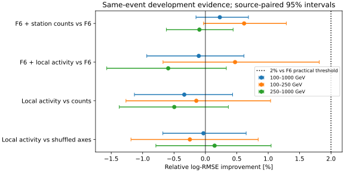
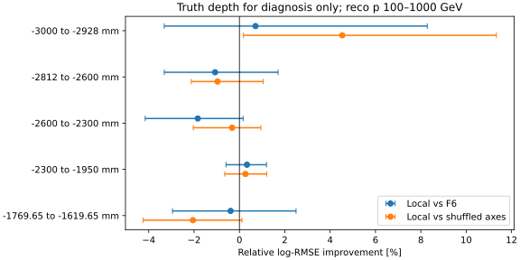

# stage44：相对 leading μ 的局部活动没有建立额外 ν 能量收益

## 阶段目标与结论

按信息预算计划§10/§5.1、修订路线§25与本轮冻结协议推进：
在同一F6和同一批开发事件上，检验SpacePoint相对μ的局部关系是否超出既有计数/全局矩。
**本轮冻结22项摘要未通过2%实用门槛，也未胜过打乱μ轴的控制。**
这否定的是当前小BDT、输入摘要和开发总体上的实用增量，不能外推为一切空间关系无信息。
下一阶段选计划§5.2的粗深度可预测性及ν收益，不自动扩展GNN/Transformer或波形工程。

## 输入、选择与冻结

- 起点commit `ca50740`；配置[local_activity.json](../ml/configs/local_activity.json)，
  [拟合前协议](stage44_energy_ml/protocol.md)记录UTC冻结时刻、预算和物理尺度；冻结前无本轮ν预测。
- 同stage42 B的3703例/21来源、三折1473/1259/971例；pi/k/charm分别8/10/3来源（按实际manifest回读）。
  来源索引[0,6,14,19,28,33,39,44,46,51,59,63,72,81,86,95,101,106,109,113,120]。
  逐来源run/group/重点人数见[input_sources.tsv](stage44_energy_ml/input_sources.tsv)，原路径见ml/configs/calonu_files.tsv。
- 实际读取`ntuples/energy_ml_stage42/development.npz`的selected行（原始开发谱系stage35 fit），
  F6全65项、highest-pz leading、truth fiducial含lead区、PMT veto、unit MC均保持。
  原PHYS为200139/200140/200146的CaloNu bck；没有重开stage34/35 test。
- 重点100≤reco pμ<1000 GeV共3024例；100–250为849例、250–1000为2175例；≥1 TeV的679例仅参考。
  不截Eν，最高Eν箱11例、高y90例、primary proxy失败145例及缺失/离群均保留。
  这是重复开发总体上的受控证据，未作新的独立ν确认或flux归一化。

## 几何与程序审计

[源码审计](stage44_energy_ml/source_audit.md)与[8例无标签pilot](stage44_energy_ml/input_pilot.json)：
生产参考1ec47efe保存front/back拟合状态和传播面，角为rad、坐标mm。
IFT局部轴用Veto1(z=-1769.65 mm)，首站用Trig(z=0)，末站用back state。
**中间station2未存leading局部状态**，不以独立segment集合或跨磁铁直线冒充传播，只增加其计数。
不使用未对齐Track_hitSet，不将truth方向/z/PDG/matching作为部署输入。
K/charm参考log与确切bck生产对应仍未认证；本轮实际文件schema/几何逐例直接核对。

全量扫描21文件/210000个原始事件，选定事件含1501084个SpacePoint：

- 三站有效参考面各3703/3703；这是有限/参考面检查，不是primary匹配认证。
- 实际station中心[-1860.15,47.4,1237.4,2427.4] mm，层偏移[-31.5,0,31.5] mm；
  最大实际层偏差6.400049 mm（冻结容差10 mm），局部点到参考面最大dz为128.400049/85.300003/75.800049 mm（限150 mm）。
- 三站最近点距离中位0.514915/0.236588/0.250168 mm，p95为2.384594/0.873090/0.875122 mm；
  最大185.6168/163.2816/117.6267 mm，未因这些离群值停分支或删事件。
  此分布仅在该站有点时计算，不能当作探测器分辨率或已证明的hit归属。
- 所用Track向量、SP xyz与计数全部对齐；run/event、p0、F6首态坐标与缓存精确/浮点容差回读通过。
  132例leading不是首条轨迹；没有用first track代替最高pz。
- 非有限SP=0；所有事件保留，station计数之和逐例等于F6总SP。
  无可靠轴预设NaN+axisvalid，本轮未触发；无outside点的形状量保持NaN，不补成物理零。

10/50 mm是粗核心外/宽活动尺度，不是hit匹配分辨率或真强子标签。
它们远大于80 μm strip pitch和pilot核心距离；stereo分辨率另有方向依赖。
保守量级假设B≤2 T、p≥100 GeV、L≤150 mm给局部tangent偏离≤0.0675 mm；
未作精确场图积分，该估算不认证跨station传播。

## 三候选、预算与来源区间

- I0：F6，精确复用stage42相同事件/折/模型容量/校准的缓存。
- counts：F6+四station SP计数，69输入。占用余下3fit有明确理由：F6有station cluster计数，只有全局SP总数。
- local：F6+22项，87输入。四计数+每s0/s1/s3的nout10/nout50、outside10的mean dx/dy、sqrt(mean(r²))、axisvalid。
- null：同87输入，保留原点云/四计数，三轴整套替换为donor轴后重算相对量。
  donor在同来源/折、预定reco p层[100,250)/[250,1000)/[1000,∞)、同三轴有效模式内固定种子循环移位。
  21来源×3p层的63池，本轮singleton/self=0，计数与axisvalid逐例保持。
  它是有限模型的关联破坏控制，不保证所有物理联合分布完全不变，也不是唯一因果证明。

共9正式BDT（每候选3折）+1个20轮小smoke，未增加重训/半径/种子扫描。
正式400轮depth3、eta .04、min_child_weight20、lambda10、单CPU；相同F6、fold、seed与独立cal offset。
灵活scalar映射只用未参与该BDT训练的校准角色预测，评估事件不参与映射。
500次pi/k/charm分层来源配对bootstrap；区间条件于这次固定交叉拟合，未包含重训/生产系统；charm仅3来源尤其限制独立支持。
预定local相对I0改善≥2%、来源95%下限>0；μ关联主张另需对null和counts下限均>0。

## 主要物理结果

log-RMSE=√mean[ln(Epred/Eν)²]，无量纲；相对改善不等于百分比能量分辨率。

| 重点3024例 | log-RMSE | 相对I0改善及来源95%区间 | mean bias | median bias | R68 | 尾>50% | 尾>100% |
|---|---:|---:|---:|---:|---:|---:|---:|
| I0 | 0.28709694 | — | 3.635% | 3.288% | 20.582% | 6.052% | 0.529% |
| counts | 0.28643710 | 0.230% [-0.150%, 0.685%] | 3.577% | 3.387% | 20.480% | 6.151% | 0.364% |
| local | 0.28740092 | -0.106% [-0.934%, 0.614%] | 3.552% | 3.478% | 20.768% | 5.985% | 0.397% |
| null | 0.28731079 | -0.074% [-0.691%, 0.576%] | 3.310% | 3.116% | 20.800% | 6.448% | 0.364% |

local相对counts改善 **−0.336% [−1.130%,0.433%]**，相对null为 **−0.031% [−0.678%,0.649%]**。
重点local的来源区间上沿0.614%低于预定2%；在本次固定模型/开发总体/来源重抽样范围内，
数据不支持2%改善，而不只是“点估计未达门槛”。这不是排除其他容量、其他摘要或新生产总体的2%。
没有建立风险/偏差/R68/尾的统一改善；尾>100%从16例变12例的描述性变化不足以推翻整体结论。

逐层local对I0结果如下；完整四模型bias/R68/尾见[metrics.tsv](stage44_energy_ml/metrics.tsv)，
全部比较及mean-bias配对区间见[paired.tsv](stage44_energy_ml/paired.tsv)。

| 层（focus前缀为reco pμ100–1000 GeV） | N | I0 log-RMSE | local log-RMSE | 改善及来源95%区间 |
|---|---:|---:|---:|---:|
| all | 3703 | 0.292744 | 0.292768 | -0.008% [-0.673%, 0.582%] |
| focus | 3024 | 0.287097 | 0.287401 | -0.106% [-0.934%, 0.614%] |
| p100_250 | 849 | 0.366767 | 0.365035 | 0.472% [-0.675%, 1.813%] |
| p250_1000 | 2175 | 0.249179 | 0.250655 | -0.592% [-1.571%, 0.333%] |
| p1000_up | 679 | 0.316675 | 0.315566 | 0.350% [-0.571%, 1.178%] |
| focus_E100_200 | 222 | 0.256689 | 0.255783 | 0.353% [-2.675%, 2.691%] |
| focus_E200_400 | 770 | 0.221038 | 0.217583 | 1.563% [0.127%, 3.066%] |
| focus_E400_800 | 1142 | 0.220262 | 0.220378 | -0.052% [-1.622%, 1.314%] |
| focus_E800_1600 | 788 | 0.283973 | 0.285886 | -0.674% [-1.752%, 0.362%] |
| focus_E1600_3200 | 91 | 0.751534 | 0.750015 | 0.202% [-1.539%, 1.910%] |
| focus_E3200_6400 | 11 | 1.556725 | 1.588191 | -2.021% [-4.217%, 0.286%] |
| focus_y0_0.2 | 1645 | 0.266658 | 0.267570 | -0.342% [-1.278%, 0.723%] |
| focus_y0.2_0.5 | 973 | 0.242193 | 0.240948 | 0.514% [-0.758%, 1.476%] |
| focus_y0.5_0.8 | 316 | 0.401300 | 0.403414 | -0.527% [-2.519%, 1.082%] |
| focus_y0.8_1.01 | 90 | 0.519820 | 0.517403 | 0.465% [-1.292%, 1.986%] |
| focus_z-3000_-2928 | 55 | 0.233358 | 0.231704 | 0.709% [-3.315%, 8.285%] |
| focus_z-2812_-2600 | 197 | 0.337771 | 0.341395 | -1.073% [-3.314%, 1.704%] |
| focus_z-2600_-2300 | 452 | 0.257223 | 0.261951 | -1.838% [-4.155%, 0.165%] |
| focus_z-2300_-1950 | 2062 | 0.291699 | 0.290727 | 0.333% [-0.590%, 1.195%] |
| focus_z-1769.65_-1619.65 | 258 | 0.267226 | 0.268261 | -0.387% [-2.951%, 2.497%] |
| focus_pi | 1406 | 0.227920 | 0.226173 | 0.767% [-1.064%, 2.303%] |
| focus_k | 1398 | 0.333017 | 0.334570 | -0.466% [-1.476%, 0.365%] |
| focus_charm | 220 | 0.310240 | 0.311667 | -0.460% [-3.136%, 1.163%] |
| focus_proxy | 2879 | 0.271349 | 0.272066 | -0.264% [-1.075%, 0.508%] |
| focus_not_proxy | 145 | 0.506992 | 0.502939 | 0.800% [-0.682%, 2.105%] |

- 多数下游z[−2300,−1950) mm的2062例（68.19%重点）local相对I0改善0.333% [−0.590%,1.195%]，
  对null为0.266% [−0.649%,1.202%]；没有恢复stage43弱CaloNu区域所缺的实用精度。
- 高y≥.8的90例local改善0.465% [−1.292%,1.986%]，对null为−0.942% [−2.882%,0.988%]。
  R68从45.626%到49.030%，不能以mean bias接近零（+.015%）声称已解决高y；较大正负误差可抵消。
  少数支持的区间不稳定，1.986%四舍五入附近不能当稳健排除2%的物理结论。
- Eν200–400 GeV的770例local相对I0为1.563% [.127%,3.066%]，但null为2.617% [1.425%,3.939%]；
  local对null为−1.082% [−3.465%,1.000%]。该层不支持μ关系机制；多分层区间未作多重比较校正。
- primary独立运动学/parent代理通过2879例、失败145例均未建立关系增量。
  原PHYS没有barcode，不能称primary-confirmed。最高Eν箱11例全部保留，不以离群值作为停止理由。




## 物理原因与程序原因

[活动支持](stage44_energy_ml/activity_support.json)：重点station0/1/2/3每事件SP中位29/5/3/3，
零SP人数223/7/8/12。所有重点SP合并后的92.600%位于IFT（是点数权重，不是事件比例）；
log1p(IFT计数)与log1p(总SP)的Pearson相关.926521。
首站和末站nout10=0分别1325/3024（43.82%）和2088/3024（69.05%）。
晚站可用于新局部活动的支持通常稀疏，而大占有率由IFT主导；未截去12540点的大占有率事件。
F6已含总计数、全局矩、station cluster和轨迹状态，因此新增摘要可能高度冗余；
本轮直接测得的是没有可利用的实用风险增量，而非测出了条件互信息为零或唯一冗余机制。

程序方面已排查事件错连、首条track误选、向量错位、几何套错、长程直线、真值输入、缺失删例、
计数/轴valid差异与角色泄漏；这些检查通过，不能把负结果归因于缺轴或样本被删。
仍未测量station2的真实局部拟合关系、已审计cluster/segment对应、晚shower及其他关系摘要；
没有证据把全部oracle缺口解释成μ拟合误差，也没有用truth_st1模长估材料能损。

## 概率质量与原六箱谱

独立cal灵活scalar概率映射：重点I0/local log score为.66905523/.66821574 nats，
配对差local−I0=−.00083949 [−.00488929,.00350774] nats；Brier为.36663299/.36713104（略恶化）。
local对null log score差−.00272404 [−.00842112,.00364032] nats，未建立概率质量增量。

原六箱[100,200,400,800,1600,3200,6400] GeV，重点人数[222,770,1142,788,91,11]。
固定响应、N=1000的经验局部score相对σ的RMS：I0=4.477661 [2.022183,41.412119]，
local=4.621466 [1.976552,48.946158]；配对改善区间[−123.081%,41.908%]，500/500有效。
全体I0/local为.515704/.468336，但改善区间[−3.316%,29.857%]仍跨零。
这些是无量纲的unit-MC局部谱诊断，最高箱支持有限，不能换成真实data谱误差或正式flux收益。
完整proper/Brier/六箱结果见[spectrum.json](stage44_energy_ml/spectrum.json)和
[spectrum_paired.tsv](stage44_energy_ml/spectrum_paired.tsv)。

## 执行、性能与验证

LCG_109/x86_64-el9-gcc15-opt，NumPy2.2.6、XGBoost2.1.3；OPENBLAS/OMP/MKL单线程。
本轮未编译Athena/C++、不新跑G4，不保存大型ROOT/xAOD或点云副本。

- 8例pilot后1次20轮BDT smoke：4训练/2校准/2检查，仅验证运行和输入拼接，未用于物理结论。
  smoke进程.10645 s、RSS655.46 MiB；小校准不覆盖六箱，未运行scalar映射。
  [reco smoke](stage44_energy_ml/reco_smoke.json)另检验打乱后计数/有效模式保持。
- 正式提取内部74.2716 s、CPU61.9107 s、RSS634.711 MiB；含setup/import为77.29 s。
  两次按分支顺序扫描（先轨迹再SP），按210000个唯一原始事件计约2827例/s，
  选定事件摘要约49.86例/s、选定点约20211点/s；仅存约668 KiB压缩摘要。
- 三折训练内部总10.7011 s；九个fit含offset/映射/存模之和约10.446 s。
  三个训练进程含setup/import分别7.68/7.35/6.52 s；峰值RSS192.19/192.72/192.98 MiB。
  实际小表格无需GPU；1 CPU、提交请求1 GB由站点改为3 GB。
- Condor `bigbird10:13110723`同一作业内extract→三折训练：NumJobStarts=1、ExitCode=0、slot wall104 s，
  user CPU76 s、system CPU8 s。该cluster排队至匹配493 s（含37 s为改顺序步骤所hold）。
  Condor最后采样RSS约98 MiB不代表提取峰值，峰值采用/usr/bin/time。
- 前两次`bigbird12:16114847`和`bigbird21:2187557`均先hold，回读status5/NumJobStarts0/无JobStartDate后删除迁移，
  没有部分模型返回。空队列不保证更快；后来发现Hostgroup限制在各schedd均存在，不能归因于bigbird21。
  总体从第一次提交至最终匹配约941 s，没有为排队额外执行fit。
- [验证回读](stage44_energy_ml/validation.json)：精确rejoin、I0缓存完全一致、donor来源/折/p层/有效模式隔离、
  概率有限归一化、9×400轮和1 smoke预算全部通过。
  [训练成本](stage44_energy_ml/training_resources.tsv)、[进程计时](stage44_energy_ml/execution_resources.txt)、
  [Condor资源](stage44_energy_ml/condor_resources.json)、[迁移记录](stage44_energy_ml/submissions.json)。

执行命令（AFS先建logs并复制wrapper；all模式避免提取后再排一次队）：

```bash
source /cvmfs/sft.cern.ch/lcg/views/LCG_109/x86_64-el9-gcc15-opt/setup.sh
export PYTHONNOUSERSITE=1 OPENBLAS_NUM_THREADS=1 OMP_NUM_THREADS=1 MKL_NUM_THREADS=1
python3 ml/local_activity.py --pilot-json /tmp/xcheng/stage44_pilot.json
python3 ml/run_local_activity.py --fold 0 --smoke
python3 ml/package_local_activity.py --part extract
condor_submit -name bigbird10.cern.ch AnalysisZipFramework/submission/ml_local_activity.sub   jobs=/afs/cern.ch/user/x/xcheng/nu_mu_stage44/all.jobs
python3 ml/report_local_activity.py
python3 ml/describe_local_activity.py
python3 ml/validate_local_activity.py
python3 ml/plot_local_activity.py
python3 ml/collect_local_activity_resources.py bigbird10.cern.ch:13110723
```

本次实际先用extract提交，再在0次启动的hold状态将Args改all、Cmd改AFS wrapper、TransferExecutable=false后release，
具体cluster与日志见submissions；不是以上新提交命令的第二次运行。
小pilot原始JSON是8个事件上述reco分支的临时导出，身份见input_pilot，未提交原始点云。
当前紧凑features/predictions在`ntuples/energy_ml_stage44/`，9模型及逐折预测在`ml/artifacts/stage44/formal/`，均忽略Git。
表格和SVG在本报告同名stage目录；正式代码、冻结配置、报告、结果表一同提交，不推送。
精确rejoin后已清理重复extraction JSON、临时pilot摘要与传输tar，最终忽略Git的缓存/模型共6015661 bytes（约5.74 MiB）。

运行问题：初始临时pilot写Parquet时LCG pyarrow缺zstd，改用临时JSON后完成，无事件变化；
一次辅助命令覆盖PYTHONPATH导致awkward不可见，修正为sys.path插入，未产生fit。
Condor元数据空输出/无limit历史查询的问题仅影响资源收集器，改为空列表回读和limit1/20s后完成；
没有因此重训。本轮真实nu输入审计、拟合、统计与最终验证均成功。

## 系统边界与下一条单主线

当前结论只覆盖这套冻结摘要、有限BDT、unit开发MC及该生产谱系；
探测器噪声/效率/pile-up、材料与交互模型、真实data、归一化/接受度/背景及新独立ν确认均**未测量**。
站2可靠μ状态与已关联clusters/segments的信息价值也**未测量**。
未检索新的方法论文，沿用信息预算计划L4（SND@LHC shower起点/采样）与L1受控关联检验的动机，
不借用其他探测器的分辨率。本轮不需要新架构；下一轮来自现有计划§5.2，而非追加同半径/容量扫描。

**stage45：检验粗深度能否由reco恢复，并检验该软概率是否带来ν风险/谱收益。**
stage42真z约4.09%的条件参考与强几何依赖仍提供动机；stage44仅说明直接局部摘要未改善。
不要先验假定粗深度可恢复或能改善ν。

1. 输入只用本轮F6+22摘要/相同3703例/21来源/三折和已缓存真z标签；不需重扫ROOT、重开旧test或波形生产。
   先按实际target/material几何冻结粗区域定义、缺失规则、训练先验与唯一小模型。
2. 每外折在训练来源内部做两折来源隔离OOF粗深度预测，再在全部外训练角色拟合该classifier用于独立cal/eval。
   禁止用in-sample深度预测训练能量模型，禁止truth z作为部署gate；校准映射也只用独立预测。
3. 单候选X=F6+22+软区域完整概率，固定原BDT；对照复用相同X不加区域概率的local，以及I0。
   必要同X+真z隔离oracle缺口（仅oracle）。预算≤15正式fit+1 smoke：9个区域classifier、3个reco能量BDT、3个oracle BDT；不自动扩容。
4. 同报区域log/Brier相对训练先验、混淆/来源迁移和ν log-RMSE/bias/R68/尾/六箱谱，
   重点、下游多数、高y/primary proxy保持完整。分类可预测不等于ν成功。
   拟合前冻结ν相对I0≥2%、来源下限>0，并报告相对local的配对增量；未过门槛不转空间网络。
5. 若oracle仍有益而reco深度不可恢复，记录可观测量缺口并转新有效读出/独立物理支持；
   若恢复区域却无ν收益，说明当前表示在本预算的收益不足；若ν收益通过，再冻结新来源/谱系独立确认。
   所有这些后续结果目前均**未测量**。
