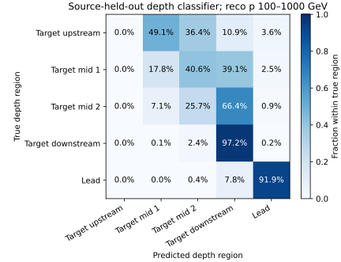
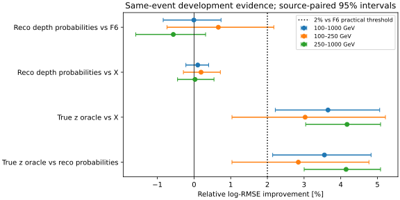
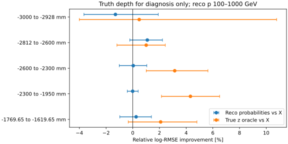

# stage45：粗深度可预测，但未转化为实用 ν 能量增量

## 阶段目标与物理结论

按修订路线§26、信息预算计划§11/§5.2推进，在同一F6+局部活动X上，
检验来源OOF粗深度概率是否能把已知真z参考收益变成reco部署收益。
**reco读出包含明显粗区域信息，但本轮软区域表示未带来预定≥2%的ν log-RMSE改善。**
真z在同X上仍有3.653% [2.216%,5.062%]的重点增益，故不能把“深度分类有用”直接当“ν改善”。
同时，连续真z与估计的五类概率改变了粒度和预测质量，不能把两者差距全部解释为reco顶点不可恢复。

## 输入、选择与冻结

- 起点commit `bc5d978`；[冻结配置](../ml/configs/coarse_depth.json)的UTC时刻为2026-11-01T21:36:17.221002。
  [拟合前协议](stage45_energy_ml/protocol.md)冻结区域、来源OOF、先验、单容量、种子和15+1 fit预算。
- 输入只读stage42 development.npz的原selected行和stage44 features.npz；不重扫ROOT，不新跑G4/Athena。
  同3703例/21来源/三折1473、1259、971例；pi/k/charm为8/10/3来源。
  原F6全部65项+stage44冻结22摘要组成X=87项，没有加入truth/PDG/方向/matching部署输入。
- highest-pz leading、truth fiducial含lead区、PMT veto、unit MC均保持；未重开stage34/35已解封test。
  本轮是重复开发MC支持上的受控研究，不是新独立确认或归一化flux平均收益。
- 重点reco pμ100–1000 GeV为3024例：100–250为849例、250–1000为2175例；≥1TeV的679例仅参考。
  不截Eν，最高能箱11例、高y90例、primary运动学/parent代理失败145例及所有缺失/尾部事件保留。

五个半开z区间（mm）及原样本人数：

| 区域 | z范围 / mm | 全部N | 重点N |
|---|---:|---:|---:|
| target_upstream | [−3000,−2928) | 62 | 55 |
| target_mid1 | [−2812,−2600) | 246 | 197 |
| target_mid2 | [−2600,−2300) | 568 | 452 |
| target_downstream | [−2300,−1950) | 2510 | 2062 |
| lead | [−1769.65,−1619.65) | 317 | 258 |

沿用原fiducial/material gap和既有深度诊断层；−2600/−2300是分析分界，不是探测器模块边界。
原选择已排除[−2928,−2812]材料窗口，本轮未新增z cut。unknown/outside=0，覆盖全部3703例。
[输入审计](stage45_energy_ml/input_audit.json)、[逐角色/内部折支持](stage45_energy_ml/region_support.tsv)。

## 来源OOF与模型

每外折eval=f、train=(f+1)%3、cal=(f+2)%3，三个角色无来源交叉。
仅在外train内将source group字典排序、rank%2分内部折；来源数分别4/3、3/3、4/4。
初始只读审计曾考虑按component分别重置rank，但会造成5/2等不平衡；
在冻结前改为全训练来源统一排序交替，不依ν预测或分类性能选划分。
两个内部classifier各在另一半来源训练，给未见来源生成能量训练用5概率；
第三个classifier在完整外train训练，只给独立cal/eval生成概率。
每个外train只有1个charm来源，因此内部一半没有charm，未跨来源/角色借样本补齐。
实际内部最小类别5例，没有类别缺失；保留该支持限制。

深度classifier固定200轮depth3/eta.04/min_child_weight20/lambda10/subsample.8/hist/单CPU。
先验(count+.5)/(N+2.5)作为5类log base_margin，训练和推理一致；参考为对应fit的常数训练先验。
保留5类完整概率，不作hard gate/阈值或后校准；评分只作固定1e-12数值保护。
能量BDT保持400轮depth3和stage44相同参数/种子，独立cal offset及灵活scalar映射。

| 模型 | 能量输入 | 列数 | 本轮正式fit |
|---|---|---:|---:|
| I0 | F6 | 65 | 0，精确缓存 |
| X / local | F6+22局部摘要 | 87 | 0，精确缓存 |
| R / reco_depth | X+来源独立粗深度5概率 | 92 | 3 |
| Z / oracle_z | X+连续真z，仅oracle | 88 | 3 |

另有9个深度classifier，正式共15 fit；1 smoke仅20轮classifier，未额外做能量smoke/调参。
分类准确率不是验收。重点R对I0≥2%、来源配对95%下限>0，且相对X有正的来源下限才视为实用增量。
500次pi/k/charm分层来源bootstrap，条件于本次固定交叉拟合；未包含重训/生产系统，charm仅3来源。

## 粗区域确实可预测

重点3024例的常数训练先验与深度classifier：

| 方法 | log score / nats | Brier | accuracy | macro recall |
|---|---:|---:|---:|---:|
| 训练先验 | 1.006999 | .501095 | 68.188% | 20.000% |
| 来源隔离深度预测 | .582034 | .294028 | 79.134% | 46.505% |

log score差=−.424965 [−.446229,−.402454] nats，Brier差=−.207067 [−.219560,−.193646]。
pi/k/charm各自log score差为−.430840/−.426426/−.378131 nats，来源区间均小于零；
charm的bootstrap只覆盖3来源，不能当新生成模型迁移认证。
全体3703例先验/classifier log score为1.011161/.576706，accuracy67.783%/78.936%。

粗区域识别很不均匀：重点五区域召回为0%、17.766%、25.664%、97.236%、91.860%。
上游55例没有任何一例被argmax判入第0类，事件及其软概率仍完整保留，没有以此删样本。
79.1%整体准确率主要受多数下游与lead的区分支撑，不能称已准确恢复所有顶点，更不是mm分辨率测量。



训练OOF的三折log score为.638871/.643161/.602365，独立eval为.545811/.610761/.579420；
OOF classifier的样本量453–803例，全外train为971–1473例，各角色来源/谱混合不同。
存在表示质量和分布变化的可能；这些不是同事件对照，不能将差值全部归为样本量效应。
未以in-sample概率替代OOF、未为缩小差值追加classifier或校准。
完整[depth_metrics.tsv](stage45_energy_ml/depth_metrics.tsv)、[配对区间](stage45_energy_ml/depth_paired.tsv)、
[角色诊断](stage45_energy_ml/depth_role_metrics.tsv)、[混淆计数](stage45_energy_ml/depth_confusion.json)。

## ν能量没有建立实用增量

log-RMSE=√mean[ln(Epred/Eν)²]，无量纲；相对改善不等于能量分辨率百分比。
误差r=Epred/Eν−1；R68=(q84−q16)/2，尾部为|r|>.5或>1。

| 重点3024例 | log-RMSE | 相对X改善及来源95%区间 | mean bias | median bias | R68 | 尾>50% | 尾>100% |
|---|---:|---:|---:|---:|---:|---:|---:|
| I0 | 0.28709694 | — | 3.635% | 3.288% | 20.582% | 6.052% | 0.529% |
| local | 0.28740092 | — | 3.552% | 3.478% | 20.768% | 5.985% | 0.397% |
| reco_depth | 0.28710998 | 0.101% [-0.222%, 0.398%] | 3.503% | 3.471% | 20.238% | 5.985% | 0.298% |
| oracle_z | 0.27690373 | 3.652% [2.216%, 5.062%] | 3.252% | 2.951% | 19.208% | 5.357% | 0.430% |

R相对I0改善 **−.0045% [−.8410%,.7364%]**，相对X **.1012% [−.2224%,.3984%]**；两项验收均未通过。
本固定交叉拟合/来源重抽样下上沿低于2%，不支持当前表示有2%的实用收益；不外推所有深度方法或新样本。
Z相对X为 **3.6525% [2.2156%,5.0617%]**，相对R为3.5548% [2.1439%,4.8270%]。
R的R68、极端正尾有小的点估计变化，但整体log风险未改善，不能据此称解决能量重建。

完整分层：下表对照固定为X；全部四模型的mean/median bias/R68/尾见[metrics.tsv](stage45_energy_ml/metrics.tsv)，
所有比较及mean-bias配对区间见[paired.tsv](stage45_energy_ml/paired.tsv)。

| 层（focus为reco p100–1000 GeV） | N | 来源数 | R相对X改善及95%区间 | Z相对X改善及95%区间 |
|---|---:|---:|---:|---:|
| all | 3703 | 21 | 0.057% [-0.193%, 0.312%] | 3.258% [2.201%, 4.255%] |
| focus | 3024 | 21 | 0.101% [-0.222%, 0.398%] | 3.652% [2.216%, 5.062%] |
| p100_250 | 849 | 21 | 0.191% [-0.290%, 0.718%] | 3.029% [1.035%, 5.218%] |
| p250_1000 | 2175 | 21 | 0.027% [-0.450%, 0.544%] | 4.171% [3.044%, 5.086%] |
| p1000_up | 679 | 21 | -0.105% [-0.613%, 0.443%] | 1.813% [0.376%, 3.346%] |
| focus_E100_200 | 222 | 21 | 1.114% [0.046%, 2.584%] | 2.861% [0.402%, 6.591%] |
| focus_E200_400 | 770 | 21 | -0.808% [-1.301%, -0.277%] | 6.660% [3.584%, 9.675%] |
| focus_E400_800 | 1142 | 21 | 0.194% [-0.562%, 1.007%] | 5.498% [3.936%, 7.317%] |
| focus_E800_1600 | 788 | 21 | 0.057% [-0.609%, 0.702%] | 4.033% [2.149%, 5.872%] |
| focus_E1600_3200 | 91 | 17 | 0.354% [-0.268%, 0.978%] | 2.333% [-0.486%, 5.833%] |
| focus_E3200_6400 | 11 | 8 | 0.225% [-1.153%, 1.523%] | -1.754% [-6.720%, 3.547%] |
| focus_y0_0.2 | 1645 | 21 | 0.172% [-0.271%, 0.744%] | 0.627% [-1.173%, 2.787%] |
| focus_y0.2_0.5 | 973 | 21 | 0.198% [-0.525%, 0.947%] | 5.605% [3.326%, 7.918%] |
| focus_y0.5_0.8 | 316 | 21 | -0.023% [-0.848%, 0.651%] | 6.592% [4.704%, 8.542%] |
| focus_y0.8_1.01 | 90 | 19 | -0.204% [-1.515%, 1.449%] | 8.064% [3.502%, 12.886%] |
| focus_z-3000_-2928 | 55 | 19 | -1.300% [-3.659%, 1.909%] | 0.483% [-4.003%, 10.781%] |
| focus_z-2812_-2600 | 197 | 21 | 1.089% [-0.220%, 2.224%] | 1.007% [-1.186%, 2.437%] |
| focus_z-2600_-2300 | 452 | 21 | 0.035% [-1.010%, 1.053%] | 3.143% [1.012%, 5.633%] |
| focus_z-2300_-1950 | 2062 | 21 | -0.008% [-0.409%, 0.404%] | 4.321% [2.150%, 6.508%] |
| focus_z-1769.65_-1619.65 | 258 | 21 | 0.250% [-0.969%, 1.397%] | 2.089% [-0.340%, 4.807%] |
| focus_pi | 1406 | 8 | 0.019% [-0.583%, 0.572%] | 4.620% [3.205%, 6.289%] |
| focus_k | 1398 | 10 | 0.192% [-0.235%, 0.619%] | 3.187% [1.088%, 5.337%] |
| focus_charm | 220 | 3 | -0.284% [-0.732%, 0.057%] | 3.826% [1.636%, 6.182%] |
| focus_proxy | 2879 | 21 | 0.112% [-0.202%, 0.409%] | 3.276% [1.818%, 4.868%] |
| focus_not_proxy | 145 | 21 | 0.037% [-0.945%, 0.994%] | 5.869% [2.727%, 8.890%] |

- 下游2062例（68.19%重点）：R对X −.0084% [−.4094%,.4037%]，Z对X4.3215% [2.1498%,6.5081%]。
  该层分类召回97.24%不意味着能量所需的位置信息已恢复。
- 高y≥.8的90例（19来源）：R对X −.2045% [−1.5155%,1.4488%]，Z对X8.0636% [3.5023%,12.8863%]。
  R的R68为51.009%，Z为38.723%；高ymean bias接近零不是高精度证据。
- primary运动学/parent代理通过2879例和失败145例均未建立R增益，Z分别改善3.276%/5.869%。
  原PHYS无barcode，不能冒充primary-confirmed，也不把差距全归μ拟合。
- Eν100–200 GeV层R对X小幅正收益，但200–400 GeV层为−.8075% [−1.3011%,−.2770%]；
  不选择有利能量层宣布总体通过。最高箱11例保留，多分层区间未作多重比较校正。




## 概率输出与六箱谱

独立cal scalar→原六箱概率的重点log score：I0 .669055、X .668216、R .666059、Z .634908 nats。
R对X差−.0021563 [−.0046795,−.0001413] nats，有小幅条件概率质量收益；
R对I0差−.0029958 [−.0067640,.0009635] nats未确认净增益，不把它升级为新部署结果。
重点Brier I0/X/R/Z为.366633/.367131/.366259/.348608。
Z对X log score差−.0333077 [−.0475102,−.0190089] nats，是真值隔离结果。

六箱[100,200,400,800,1600,3200,6400] GeV，重点计数[222,770,1142,788,91,11]。
固定响应、N=1000局部经验score的相对σ RMS：I0=4.477661 [2.022183,41.412119]，
X=4.621466 [1.976552,48.946158]，R=4.498244 [2.050476,87.753946]，Z=3.668708 [1.719398,88.600663]。
R对I0谱σ改善区间[−155.338%,25.013%]，R对X[−118.175%,23.297%]，均不能建立谱改善。
这些是unit-MC、固定模型/响应的无量纲诊断，不是实际flux/截面或data误差。
详见[spectrum.json](stage45_energy_ml/spectrum.json)、[spectrum_paired.tsv](stage45_energy_ml/spectrum_paired.tsv)。

## 物理解释与尚未识别的份额

已证实X中存在粗区域相关信息；不是所有深度知识都不可由当前读出获得。
但R相对同X没有实用风险增量，说明这一次辅助表示在本预算内未增加BDT能利用的ν信息。
多数下游和lead可识别，与target上游/中部较低召回并存；置信不确定性、区内深度、能量分配、
已有X的冗余和有限模型/OOF分布变化都可能参与，**本轮没有逐一测出因果份额**。

尤其Z使用连续真z，R使用估计的五区域概率，**尚缺X+真实五区域one-hot的控制**。
因此不能由Z−R断言“缺口全是精细z/全是顶点分类误差/现有电子读出根本无法恢复”。
下游单一区间内Z仍有收益，并不能替代这个控制，因为完美区域知识本身也可能改变条件预测。
Z是有限模型参考，不是严格数学信息上界。

程序原因已检查：输入/事件/折对齐、来源OOF、全部角色隔离、base_margin先验、完整5概率、
同参数能量训练、独立cal offset/scalar、精确基线复用和15+1预算。
保存的9个分类器已逐个回读并复算OOF/cal/eval概率，值精确一致；
能量6模型回读的exp舍入最大相对差2.22e−16（容差1e−14），逐折与合并缓存仍逐项完全相等。
没有为通过验证重训、补折、删例或改变特征。

## 执行、性能与产物

LCG_109/x86_64-el9-gcc15-opt；NumPy2.2.6、XGBoost2.1.3；OPENBLAS/OMP/MKL单线程。
1 smoke classifier：200训练/100检查、20轮，进程.16381 s、fit及预测/存模.09324 s、RSS655.46 MiB；
仅验证多类base_margin/输出形状和角色，未用于选择模型或声称物理收益。

Condor `bigbird12:16114848`等待约8分41秒后先hold，核对status5/NumJobStarts0/无JobStartDate，删除后迁移；
`bigbird10:13110727`等51秒匹配，NumJobStarts1、ExitCode0，slot wall42 s、CPU user30 s/system3 s。
同一个作业内完成三折，未二次排队、未有部分重训。请求1CPU/1GB，站点实际分3GB。

三折进程含setup/import耗时15.02/9.91/10.59 s，/usr/bin/time峰值RSS190.32/189.83/188.99 MiB。
内部三进程wall9.11345/6.38597/7.14785 s，15模型wall合计22.35378 s（9分类12.91963、6能量9.43416）。
按唯一3703个评估事件及含import三进程35.52 s计约104.25例/s，包含全部OOF与oracle计算，非单模型推理吞吐。
实际小表格无需GPU，输入仅读两份紧凑缓存，没有ROOT/xAOD副本。

[资源/来源记录](stage45_energy_ml/condor_resources.json)、[迁移](stage45_energy_ml/submissions.json)、
[进程资源](stage45_energy_ml/process_resources.json)、[实际time输出](stage45_energy_ml/execution_resources.txt)、
[能量fit](stage45_energy_ml/training_resources.tsv)、[深度fit及来源清单](stage45_energy_ml/depth_training_resources.json)、
[验证结果](stage45_energy_ml/validation.json)。

执行命令：

```bash
source /cvmfs/sft.cern.ch/lcg/views/LCG_109/x86_64-el9-gcc15-opt/setup.sh
export PYTHONNOUSERSITE=1 OPENBLAS_NUM_THREADS=1 OMP_NUM_THREADS=1 MKL_NUM_THREADS=1
python3 ml/coarse_depth.py
# 写入冻结配置/协议后，只执行一次smoke
python3 ml/run_coarse_depth.py --fold 0 --smoke
python3 ml/package_coarse_depth.py
condor_submit -name bigbird12.cern.ch -batch-name nu_mu_stage45_coarse_depth   AnalysisZipFramework/submission/ml_coarse_depth.sub
# hold/核对0启动/remove后，迁移到bigbird10，实际cluster见上文
python3 ml/report_coarse_depth.py
python3 ml/report_depth_predictability.py
python3 ml/validate_coarse_depth.py
python3 ml/plot_coarse_depth.py
python3 ml/collect_local_activity_resources.py --output workbook/stage45_energy_ml/condor_resources.json   bigbird10.cern.ch:13110727
```

紧凑ν/深度合并预测在`ntuples/energy_ml_stage45/`，15模型、逐折预测与1 smoke在`ml/artifacts/stage45/`，均忽略Git。
最终模型/缓存22文件共11742954 bytes（约11.20 MiB）；回读后删除传输tar，未保留中间大点云/ROOT。
表格/SVG、中文报告、冻结配置和代码一同提交；不推送。

执行问题仅有一次能量exp逐bit回读出现2.19e−16级相对差，改为浮点容差并保留缓存精确rejoin，
不掩盖模型差异，也未重训。科学计算、角色检查和预算最终全部通过。

## 系统限制、文献与下一步

未测量：新来源/生产谱系独立ν确认、真实data区域标签与响应闭合、材料/交互模型/探测器效率和pile-up变体、
正式归一化/接受度/背景，以及最终能谱总误差。模拟深度可预测性不能直接搬到data。
未知机制不作物理结论，未用truth_st1模长测材料能损。

已在线检索ν/hadronic shower论文并阅读SND@LHC 2504.01716v2的相关全文段落：
将shower起点和target/HCAL敏感层能损分开诊断可参考，不能移植其分辨率。
CrossRef核对Wolpert 1992 stacking书目信息，来源OOF避免in-sample输入泄漏但不保证ν收益。
其他IceCube/JUNO/Prometheus结果仅评估摘要，不引入其模拟基建；详见[文献记录](stage45_energy_ml/literature.md)。

**下一条单主线stage46：固定真实粗区域oracle控制，拆开粒度与估计质量的混淆。**
这是对本轮已测差距的必要有限解释，不扩大深度classifier或空间网络；当前15-fit预算已用完，不追加本轮拟合。

1. 输入复用同X/3703例/21来源/折/选择和冻结五区域；只加真实五类one-hot（X+5=92列）。
   truth只在oracle，禁止部署；不改变分箱/半径/参数/样本，不再训练深度classifier。
2. 仅3个正式400轮depth3能量BDT+最多1小smoke；单Condor作业。复用I0/X/R/Z全部精确缓存。
   与R同列数/预算，独立cal offset/scalar；不需要新ROOT或数据输入。
3. 冻结报告C对X、C对R、Z对C的来源配对区间，重点≥2%及下限>0只作信息诊断门槛，
   不因truth oracle通过而触发部署。保留各p/Eν/y/z/component/proxy、bias/R68/尾和六箱谱。
4. 若C与Z接近，主要证据指向当前区域估计/其使用方式未保留有用粗知识；若C接近X而Z仍有益，
   支持当前粗粒度不足。有限BDT的one-hot/连续表示也不同，不能机械给出唯一不可恢复信息比例。
   不管哪种结果，停止追加区域/容量扫描；后续据此选择有效新读出信息或新的独立物理支持。

真实粗区域C的ν收益目前**未测量**；不以本轮分类79.1%或连续z收益替代该结果。
