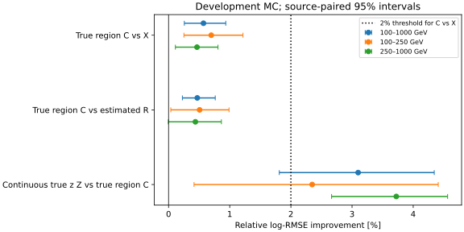
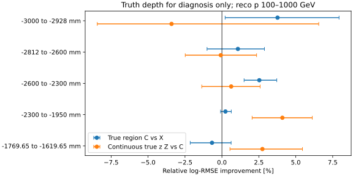

# stage46：真实粗区域仅小幅有效，不能替代连续深度信息

## 阶段目标与结论

依修订路线§27、信息预算计划§12和stage45预定控制，在完全相同事件/输入/来源折上，
补足X+真实五区域one-hot的oracle C，比较C对X、C对预测区域R、连续真z的Z对C。
**完美五区知识对X有0.570% [0.258%,0.935%]的小幅log-RMSE增益，但不足预定2%；
连续真z对C仍改善3.100% [1.811%,4.344%]。**
当前粗分区不能保留连续z的全部有限模型收益；不能将stage45的Z−R全归为区域分类错误。
这也不是精细z不可由读出恢复的证明，未分离连续/one-hot表示、有限模型与物理信息的因果份额。

## 输入、选择、预算与冻结

- 起点commit `8761c81`；[配置](../ml/configs/true_coarse_depth.json)冻结UTC为`2026-11-01T22:03:42.079558+00:00`，
  [拟合前协议](stage46_energy_ml/protocol.md)先于smoke/正式训练写入。
- 仅读stage42 `development.npz`、stage44 `features.npz`和stage45 `predictions.npz`。
  同3703例、21来源（pi8/k10/charm3），三外折1473/1259/971例；没有新扫ROOT/HITS/G4/Athena。
- X=F6全部65变量+22项局部活动，共87项；不再只关注μ动量。保留station/电荷/常规Calo/空间与相对μ局部信息。
  C仅新增真实五区域one-hot，共92项，与R同列数；Z为X+连续真z，共88项。
  新增truth严格限oracle，未加入真实方向/PDG/matching或身份字段为部署特征。
- 原highest-pz leading、truth fiducial含lead、PMT veto和unit MC不变；未重开stage34/35已解封test。
  当前是已重复研究的开发MC，不是新独立确认，更不是flux加权或data收益。
- 重点100≤reco pμ<1000 GeV为3024例：100–250有849例、250–1000有2175例；≥1TeV679例仅参考。
  不截Eν；高y90例/19来源、代理失败145例、最高能箱11例/8来源、缺失及尾部全部保留。

固定半开z区间（mm）：

| 区域 | z / mm | 全部N | 重点N |
|---|---:|---:|---:|
| upstream | [−3000,−2928) | 62 | 55 |
| mid1 | [−2812,−2600) | 246 | 197 |
| mid2 | [−2600,−2300) | 568 | 452 |
| downstream | [−2300,−1950) | 2510 | 2062 |
| lead | [−1769.65,−1619.65) | 317 | 258 |

unknown/outside=0；−2600/−2300是分析分界，非模块边界。原选择已排除材料窗口[−2928,−2812)，
本轮没有新增z cut。[逐折角色与支持](stage46_energy_ml/role_support.json)完整保存。

每外eval=f、train=(f+1)%3、cal=(f+2)%3，来源无交叉。
C固定400轮depth3/eta.04/minchild20/lambda10/subsample.8/hist/单CPU，种子20261101+fold；
与stage45能量BDT相同。独立cal的offset及灵活scalar六箱映射，不用eval标签校准。
本轮只3正式C fit+1小smoke，无新classifier、基线重训、容量/区域/种子扫描。
I0/X/R/Z与stage45精确缓存复用，不把旧fit计入本轮预算。

## 总体能量指标与配对区间

log-RMSE=√mean[ln(Epred/Eν)²]，无量纲；相对log-RMSE改善不等于能量分辨率百分比。
r=Epred/Eν−1；R68=(q84−q16)/2；尾部为|r|>.5或>1。

| 重点3024例 | log-RMSE | mean bias | median bias | R68 | 尾>50% | 尾>100% |
|---|---:|---:|---:|---:|---:|---:|
| I0 / F6 | 0.28709694 | 3.635% | 3.288% | 20.582% | 6.052% | 0.529% |
| X / local | 0.28740092 | 3.552% | 3.478% | 20.768% | 5.985% | 0.397% |
| R / reco_depth | 0.28710998 | 3.503% | 3.471% | 20.238% | 5.985% | 0.298% |
| C / oracle_region | 0.28576139 | 3.435% | 3.181% | 20.352% | 5.919% | 0.331% |
| Z / oracle_z | 0.27690373 | 3.252% | 2.951% | 19.208% | 5.357% | 0.430% |

500次pi/k/charm分层来源组配对bootstrap，条件于固定模型与校准，95% percentile区间。
未包含重训、生产谱系、材料/相互作用/探测器系统；charm仅3来源。

| 重点比较（左为参考，右为候选） | 相对改善及95%区间 | log-RMSE差及95%区间 |
|---|---:|---:|
| local → oracle_region | 0.570% [0.258%, 0.935%] | -0.00163954 [-0.00269116, -0.00073166] |
| reco_depth → oracle_region | 0.470% [0.226%, 0.763%] | -0.00134860 [-0.00220781, -0.00066869] |
| oracle_region → oracle_z | 3.100% [1.811%, 4.344%] | -0.00885766 [-0.01215545, -0.00532374] |
| I0 → oracle_region | 0.465% [-0.346%, 1.197%] | -0.00133555 [-0.00346901, 0.00098887] |

C对X小幅正收益有来源统计支持，不能说“真实区域完全无用”；但上沿0.935%低于本次2%信息门槛，
当前固定支持/拟合下不支持2%实用增量。C对I0为0.465% [−0.346%,1.197%]，未确认净改善。
C对R为0.470% [0.226%,0.763%]，显示完美粗知识相对估计粗概率仍有小差距；
Z对C显著为正，故不是仅提高现有五区classifier准确率就能解释全部oracle收益。
不能由区间跨零宣称模型等效，也不能机械计算唯一“精细深度贡献比例”。



## 完整分层与物理原因检查

所有模型的误差、mean/median bias、R68、两种尾部及scalar proper/Brier见[metrics.tsv](stage46_energy_ml/metrics.tsv)，
所有预定比较的log风险及mean-bias来源区间见[paired.tsv](stage46_energy_ml/paired.tsv)。
以下给出三个主比较；多层探索区间未作多重比较校正。

| 层 | N | 来源 | C对X改善 | C对R改善 | Z对C改善 |
|---|---:|---:|---:|---:|---:|
| all | 3703 | 21 | 0.552% [0.335%, 0.802%] | 0.495% [0.255%, 0.772%] | 2.721% [1.776%, 3.570%] |
| focus | 3024 | 21 | 0.570% [0.258%, 0.935%] | 0.470% [0.226%, 0.763%] | 3.100% [1.811%, 4.344%] |
| p100_250 | 849 | 21 | 0.698% [0.251%, 1.217%] | 0.508% [0.037%, 0.989%] | 2.348% [0.417%, 4.409%] |
| p250_1000 | 2175 | 21 | 0.465% [0.112%, 0.808%] | 0.438% [-0.004%, 0.864%] | 3.724% [2.666%, 4.563%] |
| p1000_up | 679 | 21 | 0.482% [-0.015%, 0.991%] | 0.587% [0.159%, 0.966%] | 1.338% [0.006%, 2.650%] |
| focus_E100_200 | 222 | 21 | 0.409% [-0.874%, 2.217%] | -0.713% [-1.755%, 0.479%] | 2.462% [0.455%, 5.084%] |
| focus_E200_400 | 770 | 21 | 0.296% [-0.555%, 1.112%] | 1.095% [0.228%, 2.049%] | 6.382% [3.735%, 9.143%] |
| focus_E400_800 | 1142 | 21 | 1.151% [0.661%, 1.693%] | 0.958% [0.120%, 1.791%] | 4.398% [2.802%, 6.333%] |
| focus_E800_1600 | 788 | 21 | 0.675% [0.072%, 1.235%] | 0.618% [0.120%, 1.239%] | 3.381% [1.798%, 4.954%] |
| focus_E1600_3200 | 91 | 17 | -0.057% [-1.060%, 0.855%] | -0.412% [-1.297%, 0.440%] | 2.389% [-0.168%, 5.912%] |
| focus_E3200_6400 | 11 | 8 | 0.779% [-0.512%, 2.140%] | 0.555% [-0.115%, 1.131%] | -2.553% [-7.411%, 3.614%] |
| focus_y0_0.2 | 1645 | 21 | 0.404% [-0.068%, 1.017%] | 0.233% [-0.223%, 0.713%] | 0.224% [-1.320%, 1.970%] |
| focus_y0.2_0.5 | 973 | 21 | 0.422% [-0.233%, 1.171%] | 0.225% [-0.527%, 1.078%] | 5.204% [3.149%, 7.631%] |
| focus_y0.5_0.8 | 316 | 21 | 1.137% [0.491%, 1.836%] | 1.160% [0.368%, 1.938%] | 5.517% [3.716%, 7.510%] |
| focus_y0.8_1.01 | 90 | 19 | 0.524% [-0.646%, 1.967%] | 0.727% [-0.836%, 2.366%] | 7.579% [2.907%, 12.199%] |
| focus_z-3000_-2928 | 55 | 19 | 3.765% [0.219%, 7.931%] | 5.000% [1.124%, 8.109%] | -3.410% [-8.439%, 6.554%] |
| focus_z-2812_-2600 | 197 | 21 | 1.082% [-1.007%, 2.878%] | -0.007% [-2.002%, 1.049%] | -0.076% [-2.482%, 2.347%] |
| focus_z-2600_-2300 | 452 | 21 | 2.532% [1.501%, 3.713%] | 2.497% [1.448%, 3.653%] | 0.627% [-1.365%, 2.588%] |
| focus_z-2300_-1950 | 2062 | 21 | 0.238% [-0.090%, 0.635%] | 0.246% [-0.145%, 0.674%] | 4.093% [2.045%, 6.119%] |
| focus_z-1769.65_-1619.65 | 258 | 21 | -0.671% [-2.145%, 0.623%] | -0.923% [-2.346%, 0.125%] | 2.741% [0.544%, 5.453%] |
| focus_pi | 1406 | 8 | 0.718% [0.337%, 1.148%] | 0.699% [0.104%, 1.355%] | 3.930% [2.638%, 5.594%] |
| focus_k | 1398 | 10 | 0.479% [0.013%, 1.022%] | 0.288% [-0.005%, 0.641%] | 2.721% [0.986%, 4.559%] |
| focus_charm | 220 | 3 | 0.742% [0.020%, 1.840%] | 1.023% [0.075%, 1.784%] | 3.108% [1.366%, 6.163%] |
| focus_proxy | 2879 | 21 | 0.564% [0.217%, 0.923%] | 0.453% [0.144%, 0.803%] | 2.727% [1.466%, 4.055%] |
| focus_not_proxy | 145 | 21 | 0.606% [-0.278%, 1.795%] | 0.569% [-0.110%, 1.679%] | 5.296% [2.363%, 8.070%] |

- 重点下游2062例占68.19%，C对X0.238% [−0.090%,0.635%]，而Z对C4.093% [2.045%,6.119%]。
  完美知道同一个大区域仍不等于拥有连续z的条件预测力。
- 高y≥.8为90例/19来源，C对X0.524% [−0.646%,1.967%]，Z对C7.579% [2.907%,12.199%]。
  C/Z的R68为49.637%/38.723%，尾>50%为31.111%/25.556%；mean bias接近零不代表高精度。
  不能把低pμ下的这个ν缺口全部解释为高动量谱仪缺陷。
- 上游55例C对X3.765% [0.219%,7.931%]，mid2的452例2.532% [1.501%,3.713%]；
  完美区域在部分支持有局部价值，不因为总体<2%抹去。上游Z对C−3.410% [−8.439%,6.554%]，
  小支持无法区分二者，不因此删该层或称one-hot全局优于连续z。
- 代理通过2879例/失败145例均保留；Z对C分别2.727%/5.296%，下限为正。
  PHYS无barcode，独立运动学/parent代理不冒充primary-confirmed。
- ≥1TeV仅参考，Z对C1.338% [0.006%,2.650%]，没有把恢复TeV谱仪精度变成本阶段目标。



与位置相关的响应、能量采样/损失、选择或生成谱相关性都可能让连续z有用，本轮未逐一隔离。
连续z对浅树提供有序阈值，one-hot提供类别分割；即使列数与R相同，也不是完全相同的可学习表示。
所以本轮约束的是**当前五区粒度与模型组合不足**，不是fine-z不可恢复或某一探测器故障的唯一因果证明。
未用truth_st1模长估材料能损。

## 概率输出与六箱谱

灵活scalar映射来自BDT未训练的独立cal来源；没有用eval拟合。
重点I0/X/R/C/Z的log score依次为.669055/.668216/.666059/.662608/.634908 nats；
Brier为.366633/.367131/.366259/.363847/.348608。

- C−X log score=−.00560785 [−.00949899,−.00191186] nats；C−I0=−.00644734 [−.01059800,−.00202027]。
  有小幅概率质量收益；与log-RMSE对I0区间跨零并不矛盾，两者评价不同。
- C−R=−.00345156 [−.00700980,.00015294] nats，重点下未确认额外proper收益。
- Z−C=−.02769987 [−.04153598,−.01393484] nats，连续z在概率质量上仍有明显条件增益。

原六箱边界[100,200,400,800,1600,3200,6400] GeV，重点计数[222,770,1142,788,91,11]。
N=1000固定响应局部经验score的相对σ RMS，I0/X/R/C/Z为
4.477661/4.621466/4.498244/4.961069/3.668708，无量纲。
C的来源区间[2.275691,78.944463]；C对X的谱σ改善区间[−39.593%,4.588%]，
C对I0[−162.693%,32.659%]，Z对C[−5.969%,55.162%]，均未建立稳定谱改善。
不能以单一谱点估计或proper收益代替真实data的能谱总误差收益。
详见[spectrum.json](stage46_energy_ml/spectrum.json)、[spectrum_paired.tsv](stage46_energy_ml/spectrum_paired.tsv)。

## 程序核验、执行命令与成本

[validation.json](stage46_energy_ml/validation.json)全部通过：事件/身份/来源角色/同X/原参数与区域一致；
3模型重新加载、cal offset及scalar映射重新计算，能量最大相对差0，概率最大绝对差0；
逐折↔合并缓存及I0/X/R/Z所有旧字段均逐项完全相等。3正式+1smoke，无额外fit或重试。
Python编译与bash语法通过；图已查看并缩短标题以免边缘裁剪，没有据图改变模型。

LCG_109/x86_64-el9-gcc15-opt；NumPy2.2.6/XGBoost2.1.3；OPENBLAS/OMP/MKL=1。
smoke200训练/200cal/100检查、20轮：内部wall.121108 s、CPU.082653 s、RSS658.691 MiB，
fit/predict/save .043611 s。小cal未覆盖六能量箱，未在smoke拟合scalar映射；
正式cal各覆盖六箱，全部scalar映射已逐个复算精确一致，smoke不作物理结论。

Condor `bigbird10.cern.ch:13110729`，NumJobStarts=1、ExitCode=0；无迁移/hold/失败重试。
QDate→JobStartDate57 s，事件日志提交→执行为58 s（秒边界/字段语义差异）；slot wall23 s，CPU user13 s/system2 s。
请求1CPU/1000MB，站点实际分配1CPU/3000MB。
三折外部进程wall6.90/5.09/5.49 s，峰值RSS178.844/184.949/183.520 MiB；
内部wall1.987688/1.697676/1.953217 s，RSS176.820/182.828/180.863 MiB。
三模型含预测/映射/存模wall合计5.402373 s、CPU5.354449 s；内部进程合计5.638581 s。
以唯一3703 eval和含import三进程17.48 s计211.84例/s，含oracle训练/校准，不是纯推理吞吐。
小型表格CPU足够，本轮不需GPU。

[Condor资源](stage46_energy_ml/condor_resources.json)、[进程资源](stage46_energy_ml/process_resources.json)、
[实际time输出](stage46_energy_ml/execution_resources.txt)、[每fit成本](stage46_energy_ml/training_resources.tsv)。

```bash
source /cvmfs/sft.cern.ch/lcg/views/LCG_109/x86_64-el9-gcc15-opt/setup.sh
export PYTHONNOUSERSITE=1 OPENBLAS_NUM_THREADS=1 OMP_NUM_THREADS=1 MKL_NUM_THREADS=1
python3 ml/run_true_coarse_depth.py --fold 0 --smoke
python3 ml/package_true_coarse_depth.py
mkdir -p /afs/cern.ch/user/x/xcheng/nu_mu_stage46/logs
cp AnalysisZipFramework/submission/run_ml_true_coarse_depth.sh /afs/cern.ch/user/x/xcheng/nu_mu_stage46/
condor_submit -name bigbird10.cern.ch -batch-name nu_mu_stage46_true_coarse_depth AnalysisZipFramework/submission/ml_true_coarse_depth.sub
python3 ml/report_true_coarse_depth.py
python3 ml/validate_true_coarse_depth.py
python3 ml/plot_true_coarse_depth.py
python3 ml/collect_local_activity_resources.py --output workbook/stage46_energy_ml/condor_resources.json bigbird10.cern.ch:13110729
python3 -m py_compile ml/run_true_coarse_depth.py ml/report_true_coarse_depth.py ml/validate_true_coarse_depth.py ml/package_true_coarse_depth.py ml/plot_true_coarse_depth.py
bash -n AnalysisZipFramework/submission/run_ml_true_coarse_depth.sh
```

模型与逐折预测在`ml/artifacts/stage46/`，合并预测在`ntuples/energy_ml_stage46/`，均忽略Git。
最终9文件共2614446 bytes（2.493 MiB）；传输tar4498407 bytes，成功回读后删除。
[存储清单](stage46_energy_ml/storage.json)记录保留路径；只有紧凑表/JSON/SVG、配置/代码与本报告提交。
没有ROOT/xAOD副本，没有新增大点云。无失败拟合，未为通过验证重训或删例。

## 限制、文献与下一阶段

未测量：新的来源/生产谱系独立ν确认、data顶点/能量响应闭合、材料/交互/探测器响应变体、
正式flux/接受度/背景归一化及最终物理谱总误差。旧开发支持反复分析的统计区间不包含研究选择效应。
新增oracle不是部署候选；不能把truth收益当现有reco性能。
在线检索FASER calorimeter和SND shower，仅读本轮API摘要，未声称新阅读全文；
普通Calo是EM读出，敏感层能损不等于全部强子能量。适用性与引用见[文献记录](stage46_energy_ml/literature.md)。

**stage47唯一主线：已有HITS中普通下游Calo敏感层能量采样的信息诊断。**
停止区域classifier、细分z和容量扫描。F6已经含普通Calo重建量，下一步必须明确新增的是
敏感层保存能损oracle，不能把原电荷换名字称新读出收益，也不声称理想沉积可直接部署。

1. 输入：stage42同21来源请求/已验证PHYS↔HITS身份、同3703例/X87/三折/选择。
   先最多2来源、总≤40事件的schema/单位/模块ID/persistency/动态范围pilot；
   分支可得性和完整事件支持目前**未测量**。不复用CaloNu的ID或EM标定到普通Calo。
2. 若pilot可用，冻结普通Calo物理四模块的敏感能损向量S_Calo（MeV，统一转GeV），
   累加所有粒子沉积，不用truth μ扣除/理想方向/可见强子真值，不拼其他新读出族。
   全21来源≤4000事件，提取仅需的branch/entries；单次批量Condor，紧凑摘要，无新G4/RDO/PHYS生产。
   空hit集合与缺失branch/无法定位分别记录；缺失不能假填0，不能删难例换完整子集。
3. 完整相同支持上仅比较X+S_Calo、X+S_Calo+真z；复用X/Z缓存。
   最多6正式400轮depth3能量fit+1小smoke；原来源角色/种子/独立cal不变，
   先冻结≥2%与来源下限>0的重点信息门槛及已知z后的条件增量。
   同报完整p/Eν/y/z/component/proxy、bias/R68/尾/proper/六箱谱与资源。
4. 若S_Calo有条件收益，再判断现有重建量相对理想沉积的响应损失和可实现读出；
   若无实用收益，明确该物理采样支持的限制，转新独立物理支持，不加网络/电子学扫描。
   若完整匹配/敏感分支不可用，本阶段不为补齐开新生产链，记录不可测量并转来源/生产谱系审计。
   不把不同几何/同一已用test重新划分当新独立检验。

本轮已用完3正式fit预算，S_Calo的可得性和ν收益均未测量，下一阶段不能以预期代替结果。
