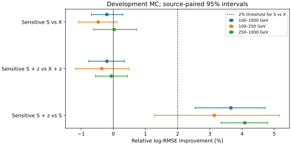
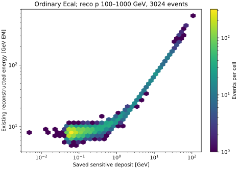

# stage47：普通Calo保存敏感沉积的信息诊断

**阶段结论：在当前同事件、固定浅树和独立校准下，普通Calo保存敏感沉积未提供实用条件增量。**
重点100–1000 GeV，S对X相对log-RMSE改善−0.201% [−0.686%,0.298%]；
已知连续真z后SZ对Z为−0.198% [−0.764%,0.348%]，均未通过冻结门槛。
加入S后真z仍改善3.655% [2.542%,4.718%]。结束普通Calo理想采样的模型/响应扩展，
下一阶段检验连续z缺口能否在当前模型未见过的来源上复现；不把有限模型结果称信息论上界。
中间区域的局部收益和全样本相对I0的谱诊断收益保留如下，不替代重点验收。

## 目标与冻结

依修订路线§28、信息预算计划§13，检验普通下游Calo敏感层采样能否提供现有X和位置知识之外的ν信息。
本阶段不继续区域/容量扫描。X保留F6全部65项+stage44冻结22项，已有station、scintillator电荷、
普通Calo四模块/总EM能量、空间和相对leading μ局部活动，共87项。
新增S_Calo是普通Ecal四物理模块的保存敏感沉积oracle，不是把原EM读出改名，也不是完整强子能量。

起点commit `44b5898`，配置冻结UTC为`2026-11-01T22:19:31.390430+00:00`。
[pilot范围/归档审计](stage47_energy_ml/prepilot_protocol.md)、[正式协议](stage47_energy_ml/protocol.md)、
[配置](../ml/configs/ordinary_calo_information.json)在正式提取/能量拟合前记录唯一变量族、6+1预算和门槛。

## 样本、输入与物理定义

同3703例/21来源（pi8/k10/charm3）和原三折1473/1259/971例；unit MC。
原highest-pz leading、truth fiducial含lead、PMT veto不变，没有新Eν/z/y/异常读出筛选。
重点100≤reco pμ<1000 GeV为3024例，100–250为849、250–1000为2175；≥1TeV679例仅参考。
保留高y90例/19来源、代理失败145例、最高Eν箱11例/8来源及全部缺失/尾部；没有重开stage34/35旧test。
该开发支持反复使用，本轮不是新独立ν确认或flux加权/data收益。

物理模块顺序(row,module)=(0,0),(0,1),(1,0),(1,1)，hitID=[0,8,2,10]；
production 1ec47efe源码的EcalCaloNu位为0，Row/Module各2bit，与CaloNu分支明确分开。
`CaloHitCollection_p1a_EcalHits`用原生converter还原后逐hit求和，所有粒子/所有保存时间都进入；
hit_count只作QA，不进入模型。不扣truth μ，不加入truth方向/PDG/matching。
保存energyLoss已经含生产Birks及局部非均匀性修正，不是未修正全材料能损；MeV/1000→GeV仅单位变换。
S_Calo和z只用于oracle，不是部署输入，不用truth_st1模长测材料能损。

[source_audit.md](stage47_energy_ml/source_audit.md)记录源码、原生解码、模块和布局证据。
工具配置把Ecal敏感体命名为DownstreamRegion；精确全局模块z/alignment未测量，
不能从旧GDML/proposal猜测containment或唯一路程机制。现成d32b0ff3字典只作兼容读取，非完整历史生产认证。

## 40例pilot和完整提取

按manifest首个已选π=0和K=46，各取原请求前20例，无能量/位置/沉积挑选。
两组均通过branch/未知ID=0/原生布局/run-event/独立ν PDG及三动量检查；四模块有动态范围。
π20例每模块沉积中位[4.418926,1.503490,5.096061,28.584190] MeV，最大值
[256.694171,571.981788,576.013956,11105.177474] MeV；K中位
[10.390127,43.737320,12.068266,47.309383] MeV，最大
[21612.906192,511.115185,1187.887852,9757.202113] MeV。
均无全空事件，允许个别模块零。[pilot.json](stage47_energy_ml/pilot.json)含逐文件schema和实际资源。

pilot内部wall47.016092/47.690763 s、CPU41.122320/42.735801 s、峰值RSS1172.879/1184.422 MiB；
外部wall49.25/49.24 s、RSS1201028/1212848 KiB。字典加载/JIT占主要启动成本，不以pilot回归ν精度。
两次PHYS定位wall.946813/.909420 s；pilot PHYS读取字节未测量，HITS计数22498143/86723838 bytes。

stage42的requests.tar.gz只保留原PHYS指纹，located entry/ν签名随逐源shard归并删除，
stage44也无原PHYS entry。因此本轮必要地对同21个PHYS文件最小列重定位，未猜entry或改变事件。
本轮新增located_requests.tar.gz保留完整已核对定位，以后不再为同样本重复扫PHYS。

正式21个Condor提取共210个HITS文件、3703例，身份失败0，三分支每文件loaded/saved布局均一致；
40例pilot与批量输出逐项完全相等。[extraction.json](stage47_energy_ml/extraction.json)、
[schema_checks.json](stage47_energy_ml/schema_checks.json)、[逐源资源](stage47_energy_ml/HITS_resources.tsv)。
空hit可以为0，缺失branch/未知ID/无法匹配从不补0或删例。本轮实际无全空/全零事件，覆盖完整原支持。

## 信号及现有读出检查

全体总S_Calo的min/10%/50%/90%/99%/max为
[.004761,.056240,.110417,1.727509,28.575097,177.031060] GeV；
重点为[.004761,.055725,.100060,1.465195,26.496922,107.730833] GeV。
重点四模块零值数[1016,982,784,686]，总量始终>0，不存在靠全零/非零标记识别此样本的捷径。
现有普通Calo总EM读出全3703例有限且>0，未裁掉不利读出。

重点S总量与现有总EM能量的Spearman=.606918（全体.647410）。与transfer proxy=Eν·y_lepton的
Spearman，S为.367769、现有EM为.307153；全体为.376435/.310357。
这些只是描述相关，未作独立条件信息或唯一物理因果证明；transfer proxy不是已测全部可见强子能量。
重点EM/S的5%/50%/95%比值[6.649016,82.104006,160.283894]（GeV EM/GeV敏感），
不能直接把它当增益或标定错误，更不能凭相关性提升宣布ν改善。
完整分层见[signal_summary.tsv](stage47_energy_ml/signal_summary.tsv)与JSON。

## 固定四格模型与验收

| 模型 | 输入 | 列数 | 本轮正式fit |
|---|---|---:|---:|
| I0 | F6 | 65 | 0，stage45缓存 |
| X / local | F6+22局部活动 | 87 | 0，stage45缓存 |
| Z / oracle_z | X+连续真z | 88 | 0，stage45缓存 |
| S / ordinary_calo | X+四模块S_Calo | 91 | 3 |
| SZ / ordinary_calo_z | X+四模块S_Calo+连续真z | 92 | 3 |

外eval=f、train=(f+1)%3、cal=(f+2)%3，来源无交叉；400轮depth3/eta.04/minchild20/lambda10/
subsample.8/hist/nthread1，种子20261101+fold，原独立cal offset及灵活scalar六箱映射。
只6正式能量fit+1个S小smoke，不重训基线/分类器，不扫种子/模块/时间/阈值/噪声。
smoke200训练/200cal/100检查、20轮，wall.128620 s、CPU.087813 s、RSS178.723 MiB，
fit/predict/save .041694 s。小cal未覆盖六类，未做scalar映射；正式须每折覆盖六类并回读校准。

重点S对X相对log-RMSE改善≥2%且来源配对95%下限>0为信息门槛；
SZ对Z点增量非负为既定扩展必要条件，来源下限>0另作为强条件信息证据。
500次pi/k/charm分层来源bootstrap，条件于固定拟合/校准，未包含重训/系统/研究选择，charm仅3来源。
全部主比较及bias/R68/尾/proper/谱必须报告，不由有利分层替代总体验收。

### 总体和重点风险

令r=Êν/Eν−1，bias为r均值/中位数，R68=(r的84%分位−16%分位)/2；尾部为|r|>.5和>1的比例。
log-RMSE使用自然对数，无量纲；下表除log-RMSE外均为%。改善=100×(1−R新/R参考)，正值为好。

| 支持 | 模型 | log-RMSE | mean bias % | median bias % | R68 % | 尾>50% % | 尾>100% % |
|---|---|---:|---:|---:|---:|---:|---:|
| 全体3703 | I0 | 0.29274437 | 4.2736 | 3.0776 | 22.2769 | 6.8863 | 0.9182 |
| 全体3703 | X | 0.29276834 | 4.1502 | 3.3360 | 21.9945 | 6.8323 | 0.8102 |
| 全体3703 | Z | 0.28323067 | 3.8392 | 2.7109 | 20.6490 | 6.2382 | 0.8912 |
| 全体3703 | S | 0.29265882 | 4.1165 | 3.0653 | 22.0957 | 6.8053 | 0.8102 |
| 全体3703 | SZ | 0.28422116 | 3.9039 | 2.6131 | 20.7511 | 6.4272 | 0.9722 |
| 重点3024 | I0 | 0.28709694 | 3.6351 | 3.2881 | 20.5821 | 6.0516 | 0.5291 |
| 重点3024 | X | 0.28740092 | 3.5521 | 3.4782 | 20.7681 | 5.9854 | 0.3968 |
| 重点3024 | Z | 0.27690373 | 3.2524 | 2.9506 | 19.2081 | 5.3571 | 0.4299 |
| 重点3024 | S | 0.28797801 | 3.5515 | 3.2564 | 20.7041 | 6.1508 | 0.3638 |
| 重点3024 | SZ | 0.27745258 | 3.3358 | 2.8387 | 19.1809 | 5.6878 | 0.4960 |

| 重点配对比较 | 相对改善 % [来源配对95%区间] |
|---|---:|
| S 对 X | -0.2008 [-0.6860, 0.2982] |
| SZ 对 Z | -0.1982 [-0.7642, 0.3483] |
| SZ 对 S | 3.6549 [2.5421, 4.7179] |
| S 对 I0 | -0.3069 [-1.2482, 0.5735] |
| Z 对 X | 3.6525 [2.2156, 5.0617] |

四格风险交互R_SZ−R_Z−R_S+R_X=−0.0000282381 [−0.0020806152,0.0021031951]，
未建立S与z协同；这是当前模型的风险交互，不是因果信息分解或互信息。
总体信息门槛、条件增量强证据和完整扩展门槛全部false；oracle始终不是部署候选。
[evaluation.json](stage47_energy_ml/evaluation.json)、[interaction.tsv](stage47_energy_ml/interaction.tsv)。



### 完整预设分层

以下除all/动量行外均在重点区间内；p、Eν单位GeV，z单位mm。逐层全部五模型的误差、
mean/median bias、R68、两种尾部、proper/Brier在[metrics.tsv](stage47_energy_ml/metrics.tsv)，
全部五组配对风险及bias差区间在[paired.tsv](stage47_energy_ml/paired.tsv)，
[真深度比较图](stage47_energy_ml/depth_gain.svg)显示两个条件对照。
表中primary只用独立运动学/parent代理；barcode不可得，真实primary-confirmed仍未测量。

| 分层 | N / 来源 | S对X改善 % [95%] | SZ对Z改善 % [95%] |
|---|---:|---:|---:|
| all | 3703 / 21 | 0.037 [-0.311,0.432] | -0.350 [-0.931,0.225] |
| focus | 3024 / 21 | -0.201 [-0.686,0.298] | -0.198 [-0.764,0.348] |
| p100_250 | 849 / 21 | -0.472 [-1.083,0.115] | -0.357 [-1.172,0.482] |
| p250_1000 | 2175 / 21 | 0.024 [-0.613,0.721] | -0.064 [-0.554,0.439] |
| p1000_up | 679 / 21 | 0.922 [0.305,1.584] | -0.887 [-1.769,0.039] |
| focus_E100_200 | 222 / 21 | -1.369 [-2.708,-0.219] | -1.630 [-2.660,-0.102] |
| focus_E200_400 | 770 / 21 | -0.845 [-2.117,0.279] | -0.894 [-1.875,0.059] |
| focus_E400_800 | 1142 / 21 | -0.126 [-1.008,0.805] | -0.124 [-0.981,0.663] |
| focus_E800_1600 | 788 / 21 | -0.262 [-0.989,0.641] | -0.248 [-1.402,0.841] |
| focus_E1600_3200 | 91 / 17 | -0.503 [-1.362,0.454] | 0.127 [-1.342,1.956] |
| focus_E3200_6400 | 11 / 8 | 1.835 [0.191,3.337] | 0.690 [-0.959,2.437] |
| focus_y0_0.2 | 1645 / 21 | 0.125 [-0.566,0.882] | 0.568 [-0.096,1.410] |
| focus_y0.2_0.5 | 973 / 21 | -1.272 [-2.112,-0.365] | -1.081 [-1.931,0.015] |
| focus_y0.5_0.8 | 316 / 21 | 0.437 [-0.676,1.559] | -0.478 [-1.691,0.509] |
| focus_y0.8_1.01 | 90 / 19 | -0.622 [-1.736,0.638] | -1.737 [-3.539,-0.249] |
| focus_z-3000_-2928 | 55 / 19 | -1.960 [-5.259,3.344] | -3.539 [-6.041,-0.680] |
| focus_z-2812_-2600 | 197 / 21 | 2.349 [0.850,3.309] | 0.944 [-0.082,2.087] |
| focus_z-2600_-2300 | 452 / 21 | -0.021 [-1.090,1.119] | 0.141 [-1.031,1.181] |
| focus_z-2300_-1950 | 2062 / 21 | -0.484 [-0.935,-0.061] | -0.334 [-0.997,0.291] |
| focus_z-1769.65_-1619.65 | 258 / 21 | -0.670 [-2.706,1.184] | -0.411 [-1.576,0.564] |
| focus_pi | 1406 / 8 | -0.777 [-1.389,-0.210] | -0.563 [-1.247,0.111] |
| focus_k | 1398 / 10 | 0.062 [-0.635,0.771] | -0.105 [-0.833,0.648] |
| focus_charm | 220 / 3 | -0.178 [-1.419,1.612] | 0.323 [-1.935,1.835] |
| focus_proxy | 2879 / 21 | -0.088 [-0.624,0.443] | 0.042 [-0.576,0.685] |
| focus_not_proxy | 145 / 21 | -0.852 [-1.768,0.197] | -1.657 [-2.674,-0.371] |

中间区z∈[−2812,−2600)的197例S有2.349% [0.850%,3.309%]局部收益；
但SZ对Z为0.944% [−0.083%,2.087%]。多数下游2062例S对X反而−0.484% [−0.935%,−0.061%]。
高y90例/19来源SZ对Z为−1.737% [−3.539%,−0.249%]；proxy失败145例为−1.657% [−2.674%,−0.371%]。
最高Eν箱11例/8来源和≥1TeV679例的有利S分层保留，但小支持/参考区不能代替重点总体。
不能把上述层的好坏单独外推到全部ν，也没有因此删掉某层或停止原物理主问题。

### 概率和六箱谱

所有新增模型的灵活scalar概率映射仅用原独立cal来源，六箱均有覆盖，eval没有参与映射。
重点I0/X/Z/S/SZ的log score为.669055/.668216/.634908/.672099/.637409 nats；
Brier为.366633/.367131/.348608/.368761/.348917。
S−X log score=+.00388358 [−.00056151,.00821440] nats；
SZ−Z=+.00250097 [−.00146307,.00633072]，未建立S的proper条件增量。
SZ−S=−.03469033 [−.05042583,−.02173936]，位置知识仍有概率质量收益。

原六箱边界[100,200,400,800,1600,3200,6400] GeV，重点真实计数[222,770,1142,788,91,11]。
N=1000固定响应局部经验score的相对σ RMS（无量纲），I0/X/Z/S/SZ重点依次为
4.477661/4.621466/3.668708/4.662354/3.497422。重点S对X的σ改善区间
[−59.954%,17.638%]、SZ对Z [−9.639%,26.453%]、S对I0 [−137.148%,30.920%]，均跨零。
最高箱仅11例，谱诊断不稳定，未为改善条件数合箱或删例。

**不能概括成所有支持上均无谱收益：**全3703例对应σ RMS为
.515704/.468336/.469130/.439187/.445531；全体S对I0的来源区间[3.982%,35.016%]为正，
但S对X [−2.736%,15.015%]跨零。它支持合并输入相对旧I0在此固定响应诊断有价值，
未隔离出新增敏感沉积相对已有X的可靠净增量；也不建立重点区或真实能谱测量收益。
全部proper/谱点值和来源区间见[spectrum.json](stage47_energy_ml/spectrum.json)、
[spectrum_paired.tsv](stage47_energy_ml/spectrum_paired.tsv)。没有传播响应系统、背景、归一化及data误差。

### 物理解释与程序原因检查

S与现有EM读出具有相关但非恒定的关系，S与transfer proxy的相关略高，
却未转化为X条件下的ν改善。已有输入包含普通Calo读出，所以更强的边际相关不等于新增信息。
加入S后连续z仍改善约3.65%，不支持“普通Calo保存敏感采样即可补齐连续深度缺口”。
总S无全零事件、四模块动态范围有效、身份/原生布局/单位和pilot重合全部通过，
排除了本轮可检验的错branch、复制CaloNu ID、事件错配、单位混淆和全零填充问题。
有限样本、浅树表示、生产采样/几何和已有读出的冗余仍可能影响增量，未测其各自因果份额。
这既不是普通Calo对任何任务无价值，也不是“所有读出都不可能恢复深度”的证明。



## 执行和资源

CVMFS LCG_109/x86_64-el9-gcc15-opt用于定位/学习；原生读HITS使用现成d32b0ff3 Calypso+Athenav24 gcc13字典。
无完整源码重建；OPENBLAS/OMP/MKL=1，训练XGBoost2.1.3/NumPy2.2.6。
正式HITS读取9862379402 bytes（9.862 GB），PHYS最小列36405799 bytes（36.406 MB）；
这是ROOT/uproot计数的压缩basket/元数据，不是总EOS线速流量；无ROOT/xAOD副本或全文件SHA。
HITS内部累计wall1025.966948 s、CPU760.234932 s、峰值RSS1339.359 MiB，
含启动吞吐3.609278例/s。PHYS重定位累计wall27.316876 s。

提取bigbird10:13110733，共21进程，NumJobStarts各1、ExitCode全0，无执行失败/重试。
请求1CPU/2GB，站点实际1CPU/3GB；slot wall累计1403 s、CPU user760 s/system106 s；
首次提交到最后完成206 s（含排队），QDate→JobStartDate43–118 s。
训练旧bigbird10:13110734在约3分钟未启动后hold，回读status5/NumJobStarts0/无JobStartDate/无模型，
再remove并迁到bigbird23:12063684；输入/参数/候选未变，使用espresso，不重复fit。
[迁移记录](stage47_energy_ml/submissions.json)、[所有作业资源](stage47_energy_ml/condor_resources.json)。

资源收集曾用history上限100，实际只有21进程，扫描无关历史超时30 s；
改为已知进程数并先查q，仅取剩余完成数，.25 s内取齐21条。没有作业重跑或物理输入改变。

训练新schedd等待194 s，NumJobStarts=1、ExitCode=0，slot wall23 s、CPU user9 s/system1 s。
三折外部wall11.77/3.51/3.49 s、峰值RSS194288/194232/194952 KiB；
内部wall1.922432/1.732921/1.752179 s、峰值RSS188.875/189.023/189.273 MiB。
6个fit含预测/映射/存模wall合计5.252073 s、CPU5.222457 s，其中概率映射wall.177394 s。
唯一3703 eval对应外部三进程18.77 s，197.28例/s，包含训练/校准/import，非纯推理吞吐。
报告wall4.836856 s、CPU4.623384 s、RSS175.641 MiB；此小表格无需GPU。
[进程资源](stage47_energy_ml/process_resources.json)、[逐fit资源](stage47_energy_ml/training_resources.tsv)、
[实际time输出](stage47_energy_ml/execution_resources.txt)。

[validation.json](stage47_energy_ml/validation.json)全部通过：3703身份/21来源/原角色/原X87不变；
6正式模型重新加载，cal offset与scalar映射逐项复算，能量最大相对差0、概率最大绝对差0；
I0/X/Z缓存完全相等，没有丢事件或打开旧test。6正式+1smoke预算已用完，没有失败fit或物理重训。
Python编译、bash语法、Git空白检查通过，SVG已人工查看，不根据图改变模型。

保留`ntuples/energy_ml_stage47/{sensitive,predictions}.npz`、一次定位归档`located_requests.tar.gz`、
`ml/artifacts/stage47/{formal,smoke}/`模型及逐折预测，均不进Git。
精确rejoin后删除27个重复shard/pilot文件691404 bytes、2个payload 4953427 bytes。
最终14文件4516993 bytes（4.308 MiB），见[storage.json](stage47_energy_ml/storage.json)。
没有ROOT/xAOD副本或逐hit大缓存。代码、配置、紧凑表/JSON/SVG和报告一起提交。
归并脚本依赖已删除shard，不能在归档后盲目重跑；模型/汇总回读仍可用。

## 命令、限制、文献与下一阶段

核心执行命令如下；正式训练由Condor包装脚本逐折调用，禁止再次执行成功fit。
提交用的payload已在校验后删除，以下记录用于复现，不是继续加预算。

```bash
source /cvmfs/sft.cern.ch/lcg/views/LCG_109/x86_64-el9-gcc15-opt/setup.sh
export PYTHONNOUSERSITE=1 OPENBLAS_NUM_THREADS=1 OMP_NUM_THREADS=1 MKL_NUM_THREADS=1
python3 ml/package_ordinary_calo_information.py --mode hits
# 21来源提交：描述符中jobs=.../hits.jobs，memory=2000MB，schedd=bigbird10
# 包装器先locate_calonu_native.py，再在现成Calypso中read_ordinary_calo_sensitive.py
python3 ml/collect_ordinary_calo_information.py
python3 ml/describe_ordinary_calo_information.py
python3 ml/run_ordinary_calo_information.py --fold 0 --smoke
python3 ml/package_ordinary_calo_information.py --mode train
# 正式三折由run_ml_ordinary_calo_information.sh执行：
# python3 ml/run_ordinary_calo_information.py --fold {0,1,2}
# 旧训练cluster安全hold/readback/remove后，以相同payload迁到bigbird23/espresso
python3 ml/report_ordinary_calo_information.py
python3 ml/validate_ordinary_calo_information.py
python3 ml/plot_ordinary_calo_information.py
python3 ml/collect_ordinary_calo_resources.py bigbird10.cern.ch:13110733:21 bigbird10.cern.ch:13110734:1 bigbird23.cern.ch:12063684:1
python3 ml/archive_ordinary_calo_information.py
bash -n AnalysisZipFramework/submission/run_ml_ordinary_calo_information.sh
```

提交描述符、完整输入路径、逐源文件/entries和配置分别在
[Condor描述符](../AnalysisZipFramework/submission/ml_ordinary_calo_information.sub)、
[配置](../ml/configs/ordinary_calo_information.json)、`located_requests.tar.gz`和HITS资源表；
[包装脚本](../AnalysisZipFramework/submission/run_ml_ordinary_calo_information.sh)固定最小列读取、
CVMFS/Calypso加载、超时和xrdcp输出。唯一通用定位改动是记录uproot实际请求字节数，原选择不变。

未测量：真正新的来源/生产谱系独立ν确认、真实data响应/控制区闭合、材料/交互模型和探测器响应系统、
正式flux/接受度/背景归一化、最终能谱总误差；精确普通Ecal全局z/alignment及完整强子containment未测量。
来源配对区间条件于固定模型和cal，未覆盖重训和反复开发选择，charm仅3来源。
在线检索并阅读SND@LHC相关HTML段落，FASER proposal仅读API摘要；
适用性和原文范围见[文献记录](stage47_energy_ml/literature.md)，不套用SND分辨率/标定系数。

**下一阶段stage48：当前X/Z模型未见来源上的连续z缺口复现，0个新fit。**
普通Calo采样模型/模块/阈值/噪声/响应链与细分区域/网络扫描均关闭。
先用现有manifest/报告/缓存做一次有界谱系与暴露审计，优先找同几何真正未使用的来源。
当前已测库存：当前21来源以外，stage35-fit/stage42-A另有10606例/60来源（pi22/k31/charm7），
其中重点8634例，见[next_support_counts.json](stage47_energy_ml/next_support_counts.json)。
它们曾用于stage35 fit和stage42 A，**不是新blind test或独立生产确认**；仅未进入当前X/Z拟合及校准。

若没有可认证的真正未使用来源，明确采用“来源外开发复现”，不重命名旧test。
身份/component/预算规则在看新残差前冻结，≤4000例、≥12来源、目标≥2000例；
只补现有22项reco局部特征（小pilot后Condor），复用F6缓存和已存X/Z模型、原assigned-fold及offset/scalar映射，
不得用新标签重训、校准、选模型或做噪声/区域扫描，不再读取新HITS。
验收为完整事件/角色/输入与模型回读，以及重点Z对X相对log-RMSE改善≥2%且500次component分层来源配对95%下限>0；
同时报告偏差/R68/尾及原分层/proper/谱，不因有利少数层放宽验收。
若通过，仅认定缺口在新于当前模型的来源上可迁移；未通过则记录统计限度/来源变化，不把它称缺口不存在。
两种结果都用于决定是否值得为独立生产/读出支持投入下一预算，不能再回到同3703例无边界扫描。
完整细则以[下一轮Prompt](../docs/nu_mu_energy_ml_next_step_prompt.md)为准。本轮不执行stage48。
