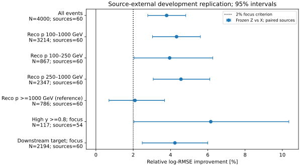
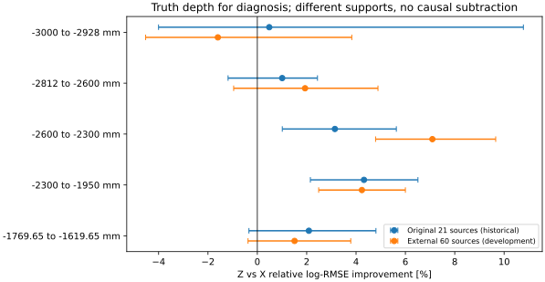

# stage48：冻结X/Z的来源外开发复现

**阶段结论：连续深度知识的条件收益在当前模型未见来源上复现。**
冻结X=F6全65+stage44原22项，Z=X+连续真z；同4000例/60来源，重点100–1000 GeV有3214例。
Z对X相对log-RMSE改善4.3264% [3.0368%,5.6059%]，通过预设≥2%且来源95%下限>0的迁移验收。
重点R68从21.0454%降至19.4121%，|r|>50%尾部从5.9739%降至5.1338%。
这不是新blind test或独立生产确认；同生产早期开发暴露和真z oracle边界不变。
极端尾部和不稳定六箱谱不能由上述正结果替代。

## 阶段目标、来源审计与冻结

依据修订路线§29、信息计划§14、stage48执行Prompt，唯一问题是连续z缺口能否迁移到当前X/Z训练/校准之外。
起点commit `1c76dc7`，配置冻结UTC `2026-11-01T22:55:15.046414+00:00`，报告完成日期2026-11-02（Europe/Zurich）。
[冻结协议](stage48_energy_ml/protocol.md)、[配置](../ml/configs/source_transfer.json)、
[逐来源暴露表](stage48_energy_ml/source_exposure.tsv)在新预测/残差之前写入。

一次有界审计仅用已有manifest、缓存和stage35/42记录，没有全EOS递归扫描。
同几何manifest共124来源：fit81、stop11、calibration14、test18，均已用于stage35；fit又用于stage42 A。
没有在此审计范围内认证出真正未用的blind支持；不同普通nominal几何不能自动替代CaloNu几何。
未重新读取stage34/35旧test事件。**采用预定后备“来源外开发复现”，不把旧fit换名为新独立检验。**

当前X/Z使用的21来源以外，已有fit10606例/60来源（pi22/k31/charm7）；
按group字典序、源内(run,eventID,cache_row)升序，逐源轮转直到4000例，未依Eν/y/z/p/残差选例。
每源59–67例，原assigned folds保留，三折1328/1336/1336例；所有60来源与三个旧模型的train/cal集合均不交叉。
这是有预算的身份顺序样本，不是10606例总体的随机无偏估计，也未作flux权重。
[支持审计](stage48_energy_ml/support_audit.json)记录范围，`ntuples/energy_ml_stage48/selection.npz`保存完整行号与身份。

生产reference沿用CaloNuMC/1ec47efe、Calypso22.0.49、FASERNU-CALONU、OFLCOND-FASER-05，
run200139/200140/200146的bck/s0015 PHYS，完整路径在暴露表与提取资源表。
保留stage35审计边界：K/charm确切bck maker配置未核实，reference不是全部历史生产认证。
原最高pz leading、truth fiducial含lead、PMT veto/unit MC不变，不新增Eν上限或丢高y/代理失败/缺失/尾部。

| 支持 | 全部N / 来源 | 重点N | 全部pi/K/charm | 重点高y / proxy失败 | 重点六Eν箱计数 |
|---|---:|---:|---|---:|---|
| 历史21来源 | 3703 / 21 | 3024 | 1485/1893/325 | 90 / 145 | 222,770,1142,788,91,11 |
| 本轮60来源 | 4000 / 60 | 3214 | 1462/2077/461 | 117 / 186 | 228,815,1224,811,118,18 |

本轮重点pi/K/charm=1345/1538/331，未知y=0；≥1TeV786例仅参考。
重点p的10/50/90%为156.251/382.617/806.599 GeV，Eν为229.224/565.810/1204.110 GeV，
y为.028222/.178632/.575849。历史对应分布与完整计数见[support_description.json](stage48_energy_ml/support_description.json)。
来源组成和选择密度不同，不能把新旧点估计直接相减称物理因果变化或恢复比例。

## 特征pilot、完整提取与缺失含义

只复用stage44冻结函数`axes/summary`及原22项定义：4个station计数和s0/s1/s3相对leading μ的活动、
10/50 mm半径、150 mm最大局部外推；没有新半径/新族/null/深度classifier或网络扫描。
首先按冻结来源顺序pi index1、K index47各20例，不按标签挑选。
run/event、最高pz p、起点xyz、SpacePoint总数和原F6四个形状摘要全部通过。
两pilot共10768点，非有限点0；K中1例最高pz不是向量首项，未改leading定义。
π/K实际读取1.386/3.310 MB，内部wall1.064485/.766309 s、CPU.465553/.531459 s、RSS98.629/114.715 MiB；
外部wall2.74/2.05 s、RSS100996/117468 KiB。[pilot.json](stage48_energy_ml/pilot.json)。

6个CPU1 Condor进程，每进程串行10来源，单文件一次打开：先读轻量run/event确定entries，再取覆盖请求的最小范围、
只读25个reco列。未重新读取HITS或生成/重建生产，未复制ROOT/xAOD。
60文件共594895原entries，实际解码范围232967 entries，保留原4000例；读取764072707 bytes（764.073 MB）。
字节为uproot压缩basket/元数据请求计数，不是总网络线速流量。
累计提取wall83.512920 s、CPU60.256681 s、峰值RSS557.637 MiB，47.89678 selected例/s（含每源摘要/读取）。
原F6指纹全部匹配，40例pilot与正式输出逐项相等，身份失败0。

4000例共1580655点、非有限点0；149例（3.725%）leading index非0均保留。
最大station层距离6.400049 mm、最大局部外推128.400049 mm；三轴均无缺失。
out10均值/均方半径在s0/s1/s3分别631/1640/2715例为NaN，原因是对应局部外侧集合为空，
按原定义交XGBoost missing，未伪填零或删例，不等于axis丢失。
[extraction.json](stage48_energy_ml/extraction.json)、[逐源资源](stage48_energy_ml/extraction_resources.tsv)。

## 冻结模型、原校准与程序核验

本轮**0个能量fit、0个新支持校准**；模型为
`ml/artifacts/stage44/formal/{f}/local.ubj`与`ml/artifacts/stage45/formal/{f}/oracle_z.ubj`。
每例只调用原assigned fold；400轮depth3/eta.04的旧模型、87/88输入列、原offset均不变。
连续真z是唯一新增truth输入，仅oracle；truth方向/PDG/matching均未输入，不用truth_st1模长测材料能损。
原primary运动学parent代理只用于报告，barcode不可得，不称primary-confirmed。

6份灵活scalar六箱映射仅用各自**原cal来源/原标签/原先验**确定性重建，保存`original_maps.joblib`；
这包括6次旧cal逻辑回归映射重建，不能混称“没有任何计算拟合”，但没有新能量模型或新target校准。
新支持的标签、先验比例和残差从未参与offset/概率映射、模型或来源选择。
原3703例全部float32原始log预测精确一致，offset逐项完全相等；
能量最大相对舍入差2.22045e−16，概率最大绝对差3.33067e−16。
第一次严格逐位比较exp输出在77/1473值出现≤4.55e−13 GeV、≤2.22e−16相对舍入差；
定位为double指数末位差，而非BDT/输入/offset变化。改为验证原始float32输出精确、exp相对1e−14、概率1e−12/绝对1e−14，
没有重训/改精度/改物理输入，见[historical_readback.json](stage48_energy_ml/historical_readback.json)。

正式推理后再次加载全部6旧模型和原映射；新支持float32输出精确，能量/概率最大差均2.22045e−16。
身份/原fold/与全部旧train-cal来源互斥/无删例/旧test未打开均通过。
[validation.json](stage48_energy_ml/validation.json)记录实际误差，而非把机器舍入差硬记为0。

## 风险、偏差、R68与尾部

r=Êν/Eν−1，mean/median bias为r均值/中位；R68=(r84%−r16%)/2，尾部为|r|>.5及>1的比例。
log-RMSE用自然对数，无量纲；下表其余风险列单位为%。
改善=100×(1−R_Z/R_X)，正值为好；500次pi/K/charm分层来源配对bootstrap，固定模型/校准。
区间不含重训、生成/探测器/flux系统或早期开发选择，charm只有7来源。

| 支持 | 模型 | log-RMSE | mean bias % | median bias % | R68 % | 尾>50% % | 尾>100% % |
|---|---|---:|---:|---:|---:|---:|---:|
| all | X | 0.30039955 | 3.7869 | 2.4811 | 22.4569 | 6.8000 | 0.9000 |
| all | Z | 0.28900347 | 3.4238 | 2.2368 | 21.0274 | 6.0000 | 1.0000 |
| focus | X | 0.29281421 | 2.7737 | 2.7347 | 21.0454 | 5.9739 | 0.4667 |
| focus | Z | 0.28014578 | 2.4458 | 2.4837 | 19.4121 | 5.1338 | 0.5600 |
| p100_250 | X | 0.35136635 | 4.6508 | 5.6705 | 26.1585 | 9.5732 | 0.6920 |
| p100_250 | Z | 0.33747022 | 3.7765 | 4.6379 | 23.7193 | 8.5352 | 0.9227 |
| p250_1000 | X | 0.26796789 | 2.0803 | 1.8331 | 19.8129 | 4.6442 | 0.3835 |
| p250_1000 | Z | 0.25574003 | 1.9542 | 1.8222 | 17.9746 | 3.8773 | 0.4261 |
| p1000_up | X | 0.32960510 | 7.9300 | 1.0413 | 29.4295 | 10.1781 | 2.6718 |
| p1000_up | Z | 0.32270322 | 7.4229 | 0.9910 | 27.7400 | 9.5420 | 2.7990 |

重点log-RMSE从.29281421降至.28014578，改善4.3264% [3.0368%,5.6059%]，通过冻结验收。
mean bias下降.3279个百分点 [.0129,.6043]，尾>50%下降.8401个百分点 [.3116,1.4095]；
尾>100%反而由.4667%增至.5600%，差+.0933个百分点 [−.0312,.2159]，未确认极端尾部改善。



以下全部预设分层，除all/动量行外均在重点内；Eν、p单位GeV，z单位mm。
原六箱、全部y/z/component/proxy层的完整两模型误差、mean/median bias、R68、尾部及proper/Brier
见[metrics.tsv](stage48_energy_ml/metrics.tsv)，配对bias/尾部差和区间见[paired.tsv](stage48_energy_ml/paired.tsv)。

| 分层 | N / 来源 | Z对X相对log-RMSE改善 % [来源95%区间] |
|---|---:|---:|
| all | 4000 / 60 | 3.794 [2.781,4.818] |
| focus | 3214 / 60 | 4.326 [3.037,5.606] |
| p100_250 | 867 / 60 | 3.955 [2.049,6.270] |
| p250_1000 | 2347 / 60 | 4.563 [3.074,6.107] |
| p1000_up | 786 / 60 | 2.094 [0.700,3.684] |
| focus_E100_200 | 228 / 51 | 5.214 [1.383,10.038] |
| focus_E200_400 | 815 / 60 | 7.264 [4.811,9.547] |
| focus_E400_800 | 1224 / 60 | 4.777 [2.996,6.762] |
| focus_E800_1600 | 811 / 60 | 4.688 [2.123,7.143] |
| focus_E1600_3200 | 118 / 41 | 4.120 [1.570,6.854] |
| focus_E3200_6400 | 18 / 14 | -0.432 [-3.402,2.945] |
| focus_y0_0.2 | 1731 / 60 | 1.393 [-0.021,2.930] |
| focus_y0.2_0.5 | 1043 / 60 | 6.630 [4.241,9.194] |
| focus_y0.5_0.8 | 323 / 60 | 7.920 [4.863,11.167] |
| focus_y0.8_1.01 | 117 / 54 | 6.160 [2.038,10.348] |
| focus_z-3000_-2928 | 52 / 35 | -1.600 [-4.526,3.828] |
| focus_z-2812_-2600 | 186 / 57 | 1.934 [-0.959,4.889] |
| focus_z-2600_-2300 | 479 / 60 | 7.093 [4.792,9.659] |
| focus_z-2300_-1950 | 2194 / 60 | 4.238 [2.486,6.000] |
| focus_z-1769.65_-1619.65 | 303 / 58 | 1.509 [-0.377,3.786] |
| focus_pi | 1345 / 22 | 5.424 [3.600,7.389] |
| focus_k | 1538 / 31 | 3.584 [1.856,5.343] |
| focus_charm | 331 / 7 | 5.627 [1.558,9.740] |
| focus_proxy | 3028 / 60 | 5.045 [3.666,6.436] |
| focus_not_proxy | 186 / 59 | 1.261 [-1.940,4.583] |

两个动量子区间867/2347例分别改善3.955% [2.049%,6.270%]和4.563% [3.074%,6.107%]；
主要下游2194例改善4.238% [2.486%,6.000%]，中部z∈[−2600,−2300)479例7.093% [4.792%,9.659%]。
收益并非只来自≥1TeV或少数上游事件。π/K/charm三个分量均有正来源区间，但不等于独立生成模型确认。
高y117例/54来源改善6.160% [2.038%,10.348%]，但尾>50%点值反而增加1.709个百分点，
[−2.930,6.761]跨零；不能把风险改善说成该层所有指标改善。

最低y层、上游52例、中间区186例、lead303例、proxy失败186例及最高Eν箱18例的风险区间跨零。
proxy失败Z对X仅1.261% [−1.940%,4.583%]，最高箱−.432% [−3.402%,2.945%]；全部保留，不选有利层重算总体。
历史21来源重点改善3.6525% [2.2156%,5.0617%]，本轮4.3264%支持缺口在更多来源复现，
但两支持成分/事件密度不同，未检验两改善之差的显著性，不声称收益变大。



## 概率输出与六箱谱诊断

旧cal scalar映射和先验完全冻结；未按新样本能谱重新校准。
全体X/Z log score=.715201/.688413 nats，Brier=.400996/.384306；
重点=.690198/.655732 nats，Brier=.382792/.363554。
重点Z−X log score=−.03446549 [−.04353443,−.02416155] nats，全体−.02678771 [−.03486228,−.01797462]。
这支持概率质量也能跨来源迁移，不代表最高能箱被准确恢复：重点真实最高箱比例.00560050，
X/Z平均预测仅.00382882/.00382560，未用此差返调。

原六箱[100,200,400,800,1600,3200,6400] GeV，N=1000固定响应局部经验score：
全体相对σ RMS从.375259到.355358，但来源配对σ改善区间[−15.631%,22.673%]跨零。
重点从5.109632到10.359421，点值反而变差，区间[−2052.777%,97.277%]极宽；
矩阵condition从200.199到804.302。500次bootstrap均可逆不等于估计稳定；
最高箱仅18例/14来源，不能裁箱、补例、合箱或调阈值来制造谱收益。
[谱结果](stage48_energy_ml/spectrum.json)、[谱配对](stage48_energy_ml/spectrum_paired.tsv)。
**本轮未建立稳定谱收益，更未测量真实data/背景/接受度/响应系统下的物理谱总误差。**

## 阶段物理结论与原因边界

1. 已有87项reco信息之上，连续z知识的有限模型条件收益可迁移到当前X/Z未见的60来源；
   两个低/中动量区间与占重点68.264%的下游均支持这一点，不必以高动量tracker拟合为唯一解释。
2. 增量可能包含位置相关采样/响应、选择与生成能谱先验；本轮没有分离这些因果份额。
   同生产跨source不改变几何/interaction/flux模型，不能从迁移成功证明探测器中可恢复同样信息，
   也不能用连续truth z输入替代部署。stage47普通Calo敏感沉积无实用增量的结论不因本轮而撤销。
3. 排除了本轮可检验的事件错join、取错leading、F6指纹差、改变22项、train/cal泄漏、目标返调和旧模型变更。
   原始float32精确与极小double舍入差区分记录，未以程序容差掩盖物理差异。
4. 事件风险和proper改善未建立实际谱测量收益；极端尾部与稀疏高Eν仍是保留的限制，不能用好看的总体覆盖。

## 执行命令、成本与存储

CVMFS LCG_109/x86_64-el9-gcc15-opt，NumPy2.2.6、XGBoost2.1.3，OPENBLAS/OMP/MKL=1。
终端hostname=lxplus908；小pilot/回读/报告本地，完整提取与推理均Condor，未分配GPU或新编Calypso。
选bigbird12时快照1406 running/88 idle；6提取作业`16114884`均等待59 s、各启动1次/exit0，
slot wall累计146 s，提交到最后完成94 s。推理`16114885`等待38 s、wall8 s、启动1次/exit0。
总remote CPU user62 s/system12 s；请求1CPU/1000MB，站点分配1CPU/3000MB，无迁移/hold/失败重试。
各外部wall/RSS见[execution_resources.txt](stage48_energy_ml/execution_resources.txt)，完整7进程表见
[condor_resources.json](stage48_energy_ml/condor_resources.json)、[提交摘要](stage48_energy_ml/submission_summary.json)。

冻结推理内部wall.454950 s、CPU.173584 s、RSS173.688 MiB；外部wall3.84 s、RSS180140 KiB。
6次旧模型加载/预测及概率变换wall合计0.086937 s；4000例分别经X/Z，按唯一4000例计46010.49例/s，
这是两模型的加载/预测/映射循环吞吐，非单模型纯推理。按完整外部进程计1041.67例/s。
旧映射重建/3703回读内部wall.598273 s、CPU.430969 s、RSS658.957 MiB；
报告wall1.993328 s、CPU1.842298 s、RSS660.820 MiB。
不同进程/环境导入的RSS不可与原生HITS字典任务直接当算法内存比较。
[推理资源](stage48_energy_ml/inference_resources.json)、[模型回读](stage48_energy_ml/historical_readback.json)。

```bash
source /cvmfs/sft.cern.ch/lcg/views/LCG_109/x86_64-el9-gcc15-opt/setup.sh
export PYTHONNOUSERSITE=1 OPENBLAS_NUM_THREADS=1 OMP_NUM_THREADS=1 MKL_NUM_THREADS=1
python3 ml/prepare_source_transfer.py
python3 ml/rebuild_source_transfer_maps.py
python3 ml/read_source_transfer_features.py --index 1 --pilot
python3 ml/read_source_transfer_features.py --index 47 --pilot
python3 ml/package_source_transfer.py --mode extract
condor_submit -name bigbird12.cern.ch -batch-name nu_mu_stage48_extract -append 'jobs = /afs/cern.ch/user/x/xcheng/nu_mu_stage48/extract.jobs' AnalysisZipFramework/submission/ml_source_transfer.sub
python3 ml/collect_source_transfer.py
python3 ml/package_source_transfer.py --mode infer
condor_submit -name bigbird12.cern.ch -batch-name nu_mu_stage48_infer -append 'jobs = /afs/cern.ch/user/x/xcheng/nu_mu_stage48/infer.jobs' AnalysisZipFramework/submission/ml_source_transfer.sub
python3 ml/report_source_transfer.py
python3 ml/validate_source_transfer.py
python3 ml/describe_source_transfer.py
python3 ml/plot_source_transfer.py
python3 ml/collect_condor_resources.py --output workbook/stage48_energy_ml/condor_resources.json bigbird12.cern.ch:16114884:6 bigbird12.cern.ch:16114885:1
python3 ml/archive_source_transfer.py
python3 -m py_compile ml/*source_transfer*.py ml/collect_condor_resources.py
bash -n AnalysisZipFramework/submission/run_ml_source_transfer.sh
```

全量成功推理有禁止静默覆盖保护。归档后shards/pilot/payload已删除，提取归并器不能盲目重跑。
精确rejoin后删除62个重复NPZ共275330 bytes、2个payload共4307038 bytes；
最终4文件852846 bytes（.813 MiB）：selection/features/predictions及original_maps，均Git忽略，旧模型直接复用。
[storage.json](stage48_energy_ml/storage.json)含每文件路径/大小，只有紧凑表/JSON/SVG和代码/配置/本报告入Git。
Python编译、bash语法和Git空白检查通过；两图已实际查看，未据结果改模型或分层。
本轮沿用既有来源隔离/配对方法，没有新增架构或声称新文献性能；
生产定义证据见[stage35来源审计](stage35_energy_ml/source_audit.md)，采样与位置解释边界见[stage47文献记录](stage47_energy_ml/literature.md)。

## 下一阶段：一次冻结谱形压力对照，再决定新生产投入

本轮已通过迁移验收，但同生产仍共享生成能谱与选择相关性。真z增益是否依赖该先验**未测量**。
真实data、严格barcode-primary、精确历史生产闭合、interaction/材料/读出系统、flux/接受度/背景归一化和真正独立生产仍未测量。
不因同生产跨来源成功直接恢复模型/响应扫描，也不因不稳定谱矩阵继续覆盖率/阈值/合箱调参。

stage49唯一实测任务：在本轮同4000例/60来源、固定X/Z预测和原概率映射上，
预先冻结wα=(Eν/400 GeV)^α，α=−.5/0/+.5，归一到同N；全部事件权重正，不新增Eν/p/y/z筛选。
不使用新标签训练/校准，不重提ROOT/HITS；0新fit、0目标校准、0生产，仅缓存风险分析。
重点及原分层同报配对log-RMSE、bias/R68/尾/proper、原始N/来源/Neff，500次共同component来源抽样。
名义结果必须精确回读stage48。验收：两端点重点均≥2%且来源下限>0才称在该预设压力范围内稳健；
未通过则限定谱依赖，不把变化解释成因果分解或信息消失，不加α/模型/校准扫描。
这是人工谱形压力，**不是有物理标定的flux系统误差或真实能谱测量**。

同时明确真正独立确认的输入需求：同几何/选择、可核对生成seed/谱系与生产reference、
未开发的≥12来源、目标≥2000且≤4000例、pi/K/charm支持及F6+原22项可得；
旧模型/映射冻结后一次推理，不与旧test混合。没有该支持就报告未测量，不以重新分区替代。
只可对三个已知生产目录作一次非递归文件清单核对；不为补齐支持自动开启完整历史生产链。
该配套输入清单不能代替stage49的缓存物理比较。
本阶段不执行stage49；后续以[下一轮Prompt](../docs/nu_mu_energy_ml_next_step_prompt.md)为准。
