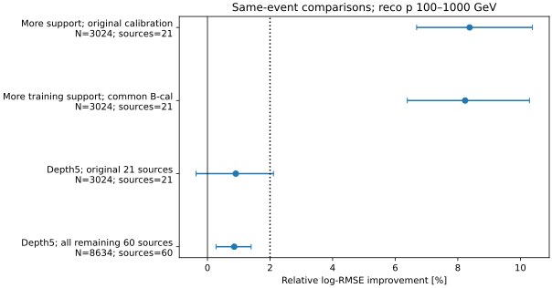
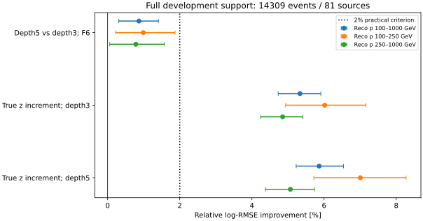

# stage50：扩大完整训练支持后，固定容量仍未补齐连续深度增量

**阶段结论：此前约千例训练明显限制F6，但一次depth5扩展没有补齐连续z增量。**
在完全相同的B重点3024例上，大支持A0相对小支持I0改善8.378% [6.685%,10.386%]；
两者共用同一B-cal来源后仍改善8.234% [6.387%,10.291%]。
因此不能把stage44–47的小训练结果视作现有电子读出的信息极限。
但在**全部14309例/81来源、重点11658例**上，depth5对depth3的F6改善仅.868% [.310%,1.409%]，
未过2%实用门槛；同学习器的真z增量分别5.333% [4.729%,5.912%]与5.864% [5.227%,6.540%]。
G_L3−G_L5区间跨零，未建立容量增加缩小z增量的证据。
本轮结束容量问题，下一轮进入全开发支持上的短段方向/会聚新信息实验，不继续depth/seed网格。

## 目标、审查依据与结果前冻结

根据用户最新[stage49审查](2026-11-02_stage49_research-reassessment.md)、修订路线§31、信息计划§16，
本轮回答训练支持/有限交互表达是否影响F6及其连续z oracle差距。
原谱倾斜不是本轮前置条件，未执行；没有重开普通Calo四积分、五区classifier、完整波形或通用网络扫描。
起点commit `ea4f8e8`，配置冻结UTC `2026-11-02T09:24:15.611709+00:00`，正式新残差计算前已写
[协议](stage50_energy_ml/protocol.md)、[配置](../ml/configs/learning_capacity.json)、[来源角色表](stage50_energy_ml/source_roles.tsv)。

针对用户扩大重要结论样本的要求，使用stage42 **全部A缓存14309例/81来源**，
不是4000例轮转或只用21来源；每例恰有一次来源外折评价。
另外完整报告原B3703例/21来源及**其余全部10606例/60来源**，不截源内前若干例。
这是旧开发支持，81来源都已用于stage35 fit/stage42 A，不能叫新blind test、独立生产或data验证。
没有访问stage34/35旧test事件；“扩大评价”不等于新增独立生成谱系。

## 输入、选择与支持规模

输入`ntuples/energy_ml_stage42/development.npz`（3482505 bytes，见[input_bytes.json](stage50_energy_ml/input_bytes.json)），F6全部65项，
不含stage44局部22项；这是新的F6同事件公平对照，不与stage48 X87/Z88直接相减。
来源折沿用`workbook/stage42_energy_ml/source_folds.tsv`，eval=f、train=(f+1)%3、cal=(f+2)%3。
原最高pz leading、含lead truth fiducial、PMT veto/unit MC保持；Eν不设新上限，
高y/proxy失败/非有限特征/空摘要/最高能箱/尾部均保留；非有限F6只走原XGBoost missing。
模型不输入run/event/source/fold/selected标记或truth p、方向、PDG、matching。
连续真z只在oracle第66列；不用truth_st1模长测材料能损。

| 支持 | 全部事件 / 来源 | 重点100–1000 GeV | 100–250 / 250–1000 GeV | ≥1TeV参考 | 重点高y / proxy失败 |
|---|---:|---:|---:|---:|---:|
| A完整 | 14309 / 81 | 11658 | 3217 / 8441 | 2651 | 369 / 597 |
| B原21来源 | 3703 / 21 | 3024 | 849 / 2175 | 679 | 90 / 145 |
| 其余60来源全部 | 10606 / 60 | 8634 | 2368 / 6266 | 1972 | 279 / 452 |

A的pi/K/charm=5725/7621/963例、30/41/10来源；重点5348/5645/665例。
重点六Eν箱[100,200,400,800,1600,3200,6400] GeV计数[841,2926,4567,2909,368,47]；
五z区重点[208,745,1781,7908,1016]，未知y=0。最高箱仍47例/29来源，不能仅凭总N扩大就说高端谱充分。
完整计数/原F6每列missing数见[support_description.json](stage50_energy_ml/support_description.json)。

| eval fold | A train N / 来源 | B train N / 来源 | A cal N | B cal N | A eval N | B eval N |
|---|---:|---:|---:|---:|---:|---:|
| 0 | 4762 / 27 | 1259 / 7 | 4578 | 971 | 4969 | 1473 |
| 1 | 4578 / 26 | 971 / 6 | 4969 | 1473 | 4762 | 1259 |
| 2 | 4969 / 28 | 1473 / 8 | 4762 | 1259 | 4578 | 971 |

训练扩大3.37–4.71倍，同时加入不同来源/component/运动学混合，不是保持分布不变的纯样本数干预。
每个角色的来源列表、component人数和Eν六箱组成均保存于[source_roles.tsv](stage50_energy_ml/source_roles.tsv)。
train/cal/eval来源均无交叉；三折轮换是开发交叉拟合，不是三个独立生产。

## 对照A：同B事件，大/小训练支持与共同cal

A0与I0均原depth3/400轮/F6，直接加载既有stage42 A/B模型和缓存，不新增能量fit。
先比较原A-cal和B-cal offset；再对每个当前eval-fold的A0，使用它**真正未训练的B-cal子集**特征预测，
重新计算mean-log offset。I0沿用原B-cal offset；没有用B-eval标签校准，没有误用cal事件另一个fold的OOF输出。
本轮仅3个A0共同B-cal offset计算，不重建概率映射/六箱谱。
原A0/I0原始float32预测与offset回读精确，exp最大相对舍入差约2.22e−16，
详[control_readback.json](stage50_energy_ml/control_readback.json)。

| 同B重点3024例 | log-MSE | log-RMSE | mean bias % | median bias % | R68 % | 尾>50% % | 尾>100% % |
|---|---:|---:|---:|---:|---:|---:|---:|
| I0 | 0.08242465 | 0.28709694 | 3.6351 | 3.2881 | 20.5821 | 6.0516 | 0.5291 |
| A0 | 0.06919207 | 0.26304385 | 3.1962 | 3.0588 | 18.6838 | 5.1587 | 0.4299 |
| A0_common_B | 0.06940965 | 0.26345712 | 3.4190 | 3.1647 | 18.8544 | 5.3241 | 0.4299 |

| 同B重点配对 | 相对log-RMSE改善 % [来源95%区间] |
|---|---:|
| A0 对 I0 | 8.378 [6.685,10.386] |
| A0_common_B 对 I0 | 8.234 [6.387,10.291] |

共同B-cal后仍保留约8.23%增益，不能把大支持效果全解释成原cal扩大；
也不能把8.23%完全归纯N，因为训练来源与混合同时变化。
原cal vs共同cal点估计略不同，未据此反选较好校准用于后续A实验。
所有原Eν/y/z/component/proxy及动量层的两组支持对照都在[paired.tsv](stage50_energy_ml/paired.tsv)和metrics表，未只看总体。



## 对照B：完整A支持2×2

| 名称 | 输入 | depth / 轮数 | 本轮正式fit |
|---|---|---:|---:|
| L3_F6 | F6 65项 | 3 / 400 | 0，原A0缓存精确复用 |
| L3_F6z | F6+连续真z oracle | 3 / 400 | 3 |
| L5_F6 | F6 65项 | 5 / 400 | 3 |
| L5_F6z | F6+连续真z oracle | 5 / 400 | 3 |

depth之外参数完全相同：eta=.04、subsample=.8、colsample=1、min_child_weight=20、lambda=10、hist、CPU1，
目标log(Eν/GeV)，seed=20261101+fold。无早停、种子/轮数/深度扫描或ensemble。
所有A候选在同一完整A-cal上计算mean-log offset；L3_F6在本项保持原A-cal版本，不混用共同B-cal。
先1个L5_F6 20轮/200train/200cal/100eval小smoke，再1个Condor作业内顺序9正式fit；没有重复原L3基线。

r=Ehat/Eν−1；mean/median bias为r均值/中位数，R68=(r84%−r16%)/2；尾部为|r|>.5和>1比例。
log-MSE/RMSE为自然对数无量纲。以下除它们外均为%。
500次pi/K/charm分层来源配对bootstrap；同支持全部模型共用draw，
区间条件于固定模型/offset，不含cal来源不确定性、重训、研究选择或生成/探测器/flux系统。

| A支持 | 模型 | log-MSE | log-RMSE | mean bias % | median bias % | R68 % | 尾>50% % | 尾>100% % |
|---|---|---:|---:|---:|---:|---:|---:|---:|
| all | L3_F6 | 0.07355508 | 0.27121040 | 3.4095 | 2.6765 | 20.4235 | 5.6188 | 0.6989 |
| all | L3_F6z | 0.06696207 | 0.25877031 | 3.1254 | 2.2675 | 18.8747 | 5.0528 | 0.6430 |
| all | L5_F6 | 0.07207654 | 0.26847074 | 3.3296 | 2.5850 | 20.3015 | 5.5839 | 0.6849 |
| all | L5_F6z | 0.06500249 | 0.25495585 | 3.0324 | 2.3178 | 18.6333 | 4.9479 | 0.6709 |
| focus | L3_F6 | 0.06903041 | 0.26273639 | 3.0528 | 2.9083 | 18.8553 | 4.9322 | 0.4632 |
| focus | L3_F6z | 0.06186351 | 0.24872376 | 2.7187 | 2.4497 | 17.3208 | 4.3318 | 0.4117 |
| focus | L5_F6 | 0.06783746 | 0.26045626 | 2.9426 | 2.8000 | 18.7458 | 4.8207 | 0.5232 |
| focus | L5_F6z | 0.06011434 | 0.24518226 | 2.5802 | 2.3317 | 16.8810 | 4.2031 | 0.4718 |
| p100_250 | L3_F6 | 0.10369551 | 0.32201787 | 4.1880 | 4.0964 | 22.5046 | 8.8281 | 0.6528 |
| p100_250 | L3_F6z | 0.09159164 | 0.30264111 | 3.7336 | 3.6071 | 20.0803 | 7.6158 | 0.6528 |
| p100_250 | L5_F6 | 0.10165381 | 0.31883195 | 4.1143 | 4.2407 | 22.2434 | 8.3929 | 0.8082 |
| p100_250 | L5_F6z | 0.08790743 | 0.29649188 | 3.4812 | 3.0183 | 19.6328 | 7.2739 | 0.7460 |
| p250_1000 | L3_F6 | 0.05581899 | 0.23626042 | 2.6202 | 2.4801 | 17.7620 | 3.4475 | 0.3909 |
| p250_1000 | L3_F6z | 0.05053364 | 0.22479689 | 2.3319 | 2.0051 | 16.4792 | 3.0802 | 0.3199 |
| p250_1000 | L5_F6 | 0.05494951 | 0.23441312 | 2.4960 | 2.3000 | 17.5768 | 3.4593 | 0.4146 |
| p250_1000 | L5_F6z | 0.04952195 | 0.22253527 | 2.2369 | 2.0769 | 16.1478 | 3.0328 | 0.3673 |

| A重点比较 | 改善 % [来源95%区间] |
|---|---:|
| L5_F6 对 L3_F6 | 0.868 [0.310,1.409] |
| L3_F6z 对 L3_F6 | 5.333 [4.729,5.912] |
| L5_F6z 对 L5_F6 | 5.864 [5.227,6.540] |
| L5_F6z 对 L3_F6z | 1.424 [0.828,2.010] |

depth5 F6有小幅统计支持，但重点95%上沿1.409%低于2%投入门槛，不能称没有利用能力增益，也不能宣布实用候选通过。
重点尾>100%从.4632%增至.5232%，差+.0600个百分点 [−.0347,.1457]；尾>50%差−.1115个百分点区间跨零。
更强容量对核心/风险的小收益未建立极端尾部改善。



### 同事件log-MSE交互

G_L=MSE(F6,L)−MSE(F6+z,L)，单位为平方自然对数，无量纲：

- G_L3=.0071669039 [.0063455426,.0080155499]。
- G_L5=.0077231243 [.0068118860,.0086964893]。
- G_L3−G_L5=−.0005562204 [−.0012304660,.0001385010]。

区间跨零，未识别容量增加让z增量缩小；点值方向反而是L5的z增量稍大。
不能把不同支持的8.23%与这组差分相减，不能把交互当互信息、Bayes风险份额或唯一探测器机制。
完整分层交互在[interaction.tsv](stage50_energy_ml/interaction.tsv)。

### 全部预设分层与样本覆盖检查

下表为A完整同事件；除all/动量行外均在重点内，p/Eν单位GeV、z单位mm。
每层四模型的全部MSE/RMSE、bias/R68/尾部见[metrics.tsv](stage50_energy_ml/metrics.tsv)；
四组配对的风险、mean bias/两尾差区间见[paired.tsv](stage50_energy_ml/paired.tsv)。
primary仅独立运动学parent代理，barcode-confirmed因原输入缺barcode仍未测量。

| 分层 | N / 来源 | L5_F6对L3_F6 % [95%] | L3 z增量 % [95%] | L5 z增量 % [95%] |
|---|---:|---:|---:|---:|
| all | 14309 / 81 | 1.010 [0.492,1.543] | 4.587 [4.108,5.043] | 5.034 [4.455,5.569] |
| focus | 11658 / 81 | 0.868 [0.310,1.409] | 5.333 [4.729,5.912] | 5.864 [5.227,6.540] |
| p100_250 | 3217 / 81 | 0.989 [0.222,1.869] | 6.017 [4.934,7.162] | 7.007 [5.717,8.275] |
| p250_1000 | 8441 / 81 | 0.782 [0.057,1.572] | 4.852 [4.244,5.415] | 5.067 [4.370,5.734] |
| p1000_up | 2651 / 81 | 1.474 [0.168,2.670] | 2.201 [1.469,2.917] | 2.353 [1.427,3.184] |
| focus_E100_200 | 841 / 77 | 0.729 [-1.086,2.713] | 9.744 [5.988,13.545] | 11.591 [7.337,16.360] |
| focus_E200_400 | 2926 / 81 | 1.433 [0.105,2.749] | 7.246 [5.975,8.487] | 6.913 [5.573,8.465] |
| focus_E400_800 | 4567 / 81 | 0.638 [-0.404,1.665] | 7.046 [6.076,8.079] | 7.605 [6.517,8.830] |
| focus_E800_1600 | 2909 / 81 | 0.705 [-0.224,1.715] | 5.124 [4.102,6.247] | 6.715 [5.601,8.035] |
| focus_E1600_3200 | 368 / 66 | 0.692 [-0.735,1.991] | 3.332 [1.756,4.868] | 2.833 [0.932,4.795] |
| focus_E3200_6400 | 47 / 29 | 1.338 [-0.468,3.438] | 0.267 [-2.069,2.344] | 0.682 [-2.521,3.222] |
| focus_y0_0.2 | 6325 / 81 | 0.994 [0.043,1.862] | 2.698 [1.819,3.722] | 2.827 [1.996,3.609] |
| focus_y0.2_0.5 | 3800 / 81 | 2.088 [1.294,3.016] | 6.805 [5.600,7.919] | 6.485 [4.855,7.942] |
| focus_y0.5_0.8 | 1164 / 81 | -0.994 [-1.964,0.084] | 7.946 [6.416,9.754] | 10.064 [8.410,12.000] |
| focus_y0.8_1.01 | 369 / 77 | 1.221 [-0.758,3.157] | 6.997 [4.955,9.352] | 7.804 [5.537,10.355] |
| focus_z-3000_-2928 | 208 / 74 | 0.581 [-3.080,3.474] | 1.591 [-1.311,4.485] | 1.094 [-2.822,4.299] |
| focus_z-2812_-2600 | 745 / 81 | -0.426 [-2.595,1.360] | 1.715 [0.008,3.334] | 2.401 [-0.130,4.693] |
| focus_z-2600_-2300 | 1781 / 81 | 1.615 [0.262,2.850] | 5.616 [4.244,6.966] | 5.353 [3.702,7.040] |
| focus_z-2300_-1950 | 7908 / 81 | 0.784 [0.119,1.424] | 6.183 [5.393,7.039] | 6.912 [5.908,7.903] |
| focus_z-1769.65_-1619.65 | 1016 / 81 | 1.138 [-0.655,3.087] | 1.659 [-0.054,3.517] | 2.384 [0.618,4.343] |
| focus_pi | 5348 / 30 | 0.755 [-0.013,1.602] | 7.015 [6.123,7.889] | 7.278 [6.369,8.229] |
| focus_k | 5645 / 41 | 0.868 [0.157,1.694] | 4.627 [3.776,5.481] | 5.145 [4.140,6.152] |
| focus_charm | 665 / 10 | 1.314 [-1.016,2.993] | 4.195 [2.262,5.809] | 5.845 [3.053,8.050] |
| focus_proxy | 11061 / 81 | 1.139 [0.552,1.664] | 5.622 [4.974,6.381] | 6.009 [5.266,6.707] |
| focus_not_proxy | 597 / 81 | -0.373 [-1.622,1.039] | 4.011 [2.213,5.814] | 5.219 [3.170,7.368] |

主要下游7908例，L3/L5的z增量分别6.183% [5.393%,7.039%]、6.912% [5.908%,7.903%]；
高y369例/77来源分别6.997% [4.955%,9.352%]、7.804% [5.537%,10.355%]。
不是只依赖≥1TeV tracker或稀少上游事件。高y L5_F6的尾>50%反而由22.493%增至24.390%，
而L5_F6z为20.325%；不能把容量略好的总体风险扩大成高y各项均改善。
y∈[.5,.8)1164例L5对L3点值−.994% [−1.964%,.084%]，proxy失败597例−.373% [−1.622%,1.039%]，不利层全部保留。
最高Eν47例/29来源的L3 z增量区间跨零；全体扩大仍不保证每个稀少层精度充分。

| 使用A完整训练/校准，重点评价子支持 | N / 来源 | L5_F6对L3_F6 % [95%] | L3 z增量 % [95%] | L5 z增量 % [95%] |
|---|---:|---:|---:|---:|
| A_B_sources | 3024 / 21 | 0.905 [-0.363,2.109] | 5.141 [3.788,6.532] | 5.266 [3.744,6.631] |
| A_remaining_sources | 8634 / 60 | 0.855 [0.273,1.397] | 5.401 [4.757,6.058] | 6.075 [5.355,6.895] |

其余60来源的完整8634重点事件也支持相同方向，避免只根据stage48源内前59–67例作重要判断。
这些数值是当前F6 2×2的同事件比较，不是把stage48 X87的4000例换成10606例重算，也不称独立外部确认。

## 物理与程序判断、下一研究基线

1. **训练支持不足有直接证据。** 共用B-cal后仍8.23%风险改善，阶段性负结果必须保留训练量边界；
   对已有观测不足的论断不能建立在约千例浅树上。扩大来源/混合同时改变，未识别纯N效应。
2. **本次有限容量没有补齐z增量。** 同完整支持、同cal的L3/L5都保留>5% oracle风险收益，
   主要下游和高y也保持；不能据此宣布硬件/Bayes极限，更不能把z全部归μ拟合或材料能损。
   本阶段属于stage49决策的“有限容量对照没有补齐z增量”，同时承认更充分训练已带来显著收益。
3. **结束容量扫描，转有方向的新观测。** 下一信息实验固定L5作为较强的reco基线：
   它在完整重点有.868%稳定小收益、单fit约2.1 s，适合作为防止弱基线夸大变量增益的控制。
   这不是把未过2%门槛的L5升级为已获独立确认的部署模型；保留L3历史基线和全部阴性/尾部证据。
4. **本轮只给事件风险结论。** 不新造概率映射、六箱反演、toys或coverage，
   stage48谱最弱方向不稳定的边界仍成立；实际谱收益、data及interaction/响应系统未测量。

本轮用事件/列顺序/来源角色/原模型/offset回读检查程序原因，全部通过；
没有选择有利cal版本或删掉错leading/高y/尾部来获得增益。名义输入和基线不变、低成本小smoke之后才正式训练。

## 实际执行、资源与存储

CVMFS LCG_109/x86_64-el9-gcc15-opt；NumPy2.2.6、XGBoost2.1.3；OPENBLAS/OMP/MKL=1。
无新ROOT/HITS读取、G4/Athena生产或GPU需求。小smoke L5_F6：20轮200train/200cal/100eval，
内部wall.122026 s、CPU.091094 s、RSS187.395 MiB；fit/预测/存模.039967 s。
外部wall3.21 s、user1.60 s/system.40 s、RSS191892 KiB；smoke仅软件验证，不用于选模型或物理结论。

首次bigbird24为EosSubmit专用schedd，因AFS executable/log路径拒绝提交，无cluster/无fit；
改bigbird13，相同payload/样本/超参，cluster15314138，NumJobStarts=1、ExitCode=0。
QDate→JobStartDate58 s、slot wall34 s、提交→完成92 s，remote user21 s/system3 s。
事件日志execute记09:27:25 UTC，ClassAd StartDate09:27:22 UTC，语义/预执行开销不同，不能混当纯训练。
请求1CPU/1000MB，站点分配1CPU/3000MB；无运行hold、迁移或失败fit/重试。
[提交记录](stage50_energy_ml/submissions.json)、[Condor资源](stage50_energy_ml/condor_resources.json)。

正式三进程内部wall5.420769/5.098809/5.785339 s、RSS195.457/197.973/202.020 MiB；
外部wall10.98/8.04/8.47 s、RSS200148/202724/206868 KiB。
9 fit含cal/eval/存模wall合计16.070701 s、CPU15.892521 s；
L3_F6z/L5_F6/L5_F6z各三折合计wall3.094843/6.279884/6.695974 s。
同节点同轮数oracle中depth5约2.16倍depth3成本；旧A0含概率映射且硬件/阶段不同，不直接当同机训练速度比较。
14309唯一eval对应外部三进程27.49 s，520.5166例/s（含3候选训练/校准/import，不是纯推理吞吐）。
共同cal/旧模型回读内部wall.610093 s、CPU.370381 s、RSS183.730 MiB；
报告wall1.519278 s、CPU1.284325 s、RSS190.766 MiB。
[每fit成本](stage50_energy_ml/training_resources.tsv)、[进程成本](stage50_energy_ml/process_resources.json)、
[原始time输出](stage50_energy_ml/execution_resources.txt)。

[validation.json](stage50_energy_ml/validation.json)：9正式+1smoke、14309例完整、81来源原角色、
原A0缓存完全一致、全部新模型重新加载、原始float32预测精确、cal offset复算精确，
exp能量最大相对差2.22045e−16；共同B-cal使用当前模型独立预测；无概率映射fit或打开旧test。
归并前逐折预测与汇总精确相等；只保留一份合并预测和逐折metadata/模型。
归档后验证仍可从保存的source metadata和汇总预测重新加载模型独立核验，不依赖已删除重复NPZ。
Python编译、bash语法、Git空白检查通过，两图已实际查看，未据图加模型/改阈值。

```bash
source /cvmfs/sft.cern.ch/lcg/views/LCG_109/x86_64-el9-gcc15-opt/setup.sh
export PYTHONNOUSERSITE=1 OPENBLAS_NUM_THREADS=1 OMP_NUM_THREADS=1 MKL_NUM_THREADS=1
python3 ml/prepare_learning_capacity.py
python3 ml/prepare_learning_controls.py
python3 ml/run_learning_capacity.py --fold 0 --smoke
python3 ml/package_learning_capacity.py
# bigbird24拒绝，无cluster；正式同payload提交到兼容AFS的schedd：
condor_submit -name bigbird13.cern.ch -batch-name nu_mu_stage50_learning_capacity AnalysisZipFramework/submission/ml_learning_capacity.sub
python3 ml/describe_learning_capacity.py
python3 ml/report_learning_capacity.py
python3 ml/validate_learning_capacity.py
python3 ml/plot_learning_capacity.py
python3 ml/collect_condor_resources.py --output workbook/stage50_energy_ml/condor_resources.json bigbird13.cern.ch:15314138:1
python3 ml/archive_learning_capacity.py
# 归档后独立回读，未重训：
python3 ml/validate_learning_capacity.py
python3 -m py_compile ml/*learning_capacity*.py ml/prepare_learning_controls.py
bash -n AnalysisZipFramework/submission/run_ml_learning_capacity.sh
```

成功fit有禁止静默覆盖保护。payload3482255 bytes校验后删除，
逐折重复预测401176 bytes精确rejoin后归并删除，保留9正式模型/3metadata、1smoke模型/NPZ、
`ntuples/energy_ml_stage50/predictions.npz`和`support_controls.npz`，16文件6324390 bytes（6.031 MiB），均Git忽略。
旧事件cache/旧模型没有复制长期归档，没有ROOT/xAOD或点云副本。
[storage.json](stage50_energy_ml/storage.json)记录每个产物；紧凑表/JSON/SVG与配置、代码、本报告提交。
本轮没有新检索或声称文献性能，方法与物理动机沿用[stage49文献/理论边界](2026-11-02_stage49_research-reassessment.md#9-本轮文献检索与适用性)。

## 下一阶段：全开发支持上的短段方向与会聚

**stage51只做有局部方向的新信息实验，不再延长容量对照。**
输入为原81来源PHYS、stage42全14309事件/F6与原fold、固定L5_F6模型/参数。
先≤40个按身份规则固定的无能量调参pilot，核实实际segment向量对齐、坐标/方向含义、station/IFT覆盖、
ghost/重复、可靠μ传播参考和局部场/材料范围。
小pilot的缺覆盖不能当全部样本结论；若拟关闭某collection/方向分支，先在81来源全部选中事件做最小列覆盖统计。

可用后，拟合前冻结角度族Rθ、角度+位置—斜率会聚族RθC及同事件/station配对打乱控制；
不把重复μ方向变换叫新信息，不把segment不可靠动量当强子pT，不跨磁铁直线反推全靶。
角度/会聚不是天然ν顶点，二次shower/MCS/重复段可能破坏共顶点；无可靠量保留missing/宽曲线，不删难例。
一次Condor提取全14309例紧凑摘要，I/O/内存/作业预算依据pilot实测冻结，不继承HITS4000例上限。
评价全部81来源及原B/剩余60来源，不再重要结论依赖源内前若干例。

公平同L5/原train-cal/seed/offset比较F6、F6+Rθ、F6+RθC、F6+打乱控制，
原L5_F6完全可复用时只9新正式fit，否则≤12，至多1小smoke，无depth/seed/半径扫描。
重点相对F6≥2%且来源95%下限>0为实用门槛，会聚相对打乱控制下限>0为额外关系证据；
同报所有原分层、bias/R68/尾与成本。若仅角度有增益，保留简单摘要，不用网络强求会聚通过。
若角度/会聚无增益则报告区间和覆盖，结束此实现；只有输运后方向oracle显示潜力才考虑恢复短段。
可靠局部方向不可得时，不从40例冒充全样本否定；完整覆盖审计后明确未测量，并给出有限SiHit输运后方向oracle需求，
不自动开全量tracklet/GNN或完整历史生产。

实际短段可用性与新变量收益均未测量。已有F6的data关键计数/电荷响应、ν相互作用/材料/探测器系统、
一个预固定且可辨识的正向谱硬度目标、真正未开发生产确认仍是必须交付，不由此oracle对照替代。
本阶段不执行stage51；具体输入与验收见[下一轮Prompt](../docs/nu_mu_energy_ml_next_step_prompt.md)。
