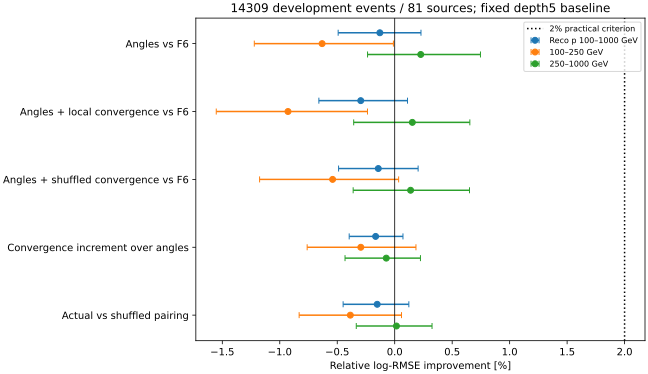

# stage51：完整支持下短段角度与局部会聚未建立实用能量增益

**阶段结论：实际保存的短段方向可用，但本轮角度/局部关系摘要没有通过能量收益门槛。**
在全部14309例/81来源、重点100–1000 GeV的11658例上，固定L5_F6基线log-RMSE为.26045626；
加入46项角摘要为.26079294，改善−.129% [−.492%,.229%]；再加24项局部会聚为.26122583，
改善−.295% [−.660%,.111%]。真实配对相对打乱控制−.152% [−.449%,.123%]，未建立关系收益。
这排除了当前固定表示在该开发支持上的2%主门槛，并不证明所有真实角信息或靶内深度无用。
下一轮停止本输入族扩容，转已有F6关键计数/闪烁体电荷的data可靠性控制。

## 阶段目标与结果前协议

承接[stage49审查](2026-11-02_stage49_research-reassessment.md)§5、[stage50完整支持结果](2026-11-02_stage50_full-support-learning-capacity.md)、
修订路线§32/信息计划§17，本轮只测局部方向及位置—方向配对是否有超出F6的条件能量信息。
按用户要求，训练与评价保持全开发支持，不再作4000例或源内前若干事件抽样。
起点commit `f2abbcb`，协议冻结UTC `2026-11-02T09:50:18.612598+00:00`。
[配置](../ml/configs/segment_information.json)、[协议](stage51_energy_ml/protocol.md)、[来源表](stage51_energy_ml/support_sources.tsv)在新能量残差前形成。

40例QA发现微小负χ²后，**结果前**修订有效性规则，见[QA修订](stage51_energy_ml/QA_amendment.json)：
原“χ²≥0”会误删20/196个pilot短段，均ndof=0，最小−1.42717e−8；
取消符号筛选，只要求χ²有限，不按大小筛段。修订时正式作业均未启动，0能量fit/0新残差；
不改变事件支持、特征族、9+1训练预算或门槛。原13号schedd与18号QA hold均先核NumJobStarts=0。
全样本证实GhostBusted有6515段微小负χ²（最小−2.09022e−7），全部保留；
不能把这类数值消去当成物理坏方向。本轮没有通过χ²阈值扫描选样。

## 输入、独立性与不变条件

输入`ntuples/energy_ml_stage42/development.npz`，3482505 bytes；
全部14309例/81来源，pi/K/charm=5725/7621/963例、30/41/10来源。
重点11658例，100–250/250–1000 GeV分别3217/8441，≥1TeV参考2651例。
原B为3703例/21来源（重点3024）；其余**全部**10606例/60来源（重点8634）。
来源与文件路径在原`ml/configs/calonu_files.tsv`，全81来源的实际读取记录在[extraction.json](stage51_energy_ml/extraction.json)。

原最高pz leading、含lead truth fiducial、PMT veto、unit MC不变；Eν不新截断。
高y、proxy失败、空短段、missing、最高箱和尾部均保留；空摘要走原XGBoost missing。
重点六Eν箱计数[841,2926,4567,2909,368,47]，最高仍47例/29来源。
81来源均已用于旧开发，原fold及eval=f/train=(f+1)%3/cal=(f+2)%3不变；
训练4762/4578/4969例，cal4578/4969/4762，评价4969/4762/4578，每例恰有一次来源外折评价。
没有打开stage34/35旧test；不是新blind、独立生产或data确认。

F6全部65项原样保留。部署新输入不含truth p/z/方向/PDG/matching、run/event/source/fold。
真值只作原诊断层，primary代理不是barcode-confirmed；不用truth_st1模长估材料能损。
本轮没有增加oracle模型，不声称直接测量角输入关闭了多少z增量。

## 实际短段语义与完整覆盖

先按身份冻结40例：pi/K各2来源×7例，charm2来源×6例；每component取首尾manifest来源，源内按run/eventID取前若干例。
它只用于schema/物理/计时QA，不代表分布或重要阴性结论。pilot原始向量仅留忽略Git的小QA缓存，
[身份协议](stage51_energy_ml/pilot_protocol.json)、[紧凑pilot](stage51_energy_ml/pilot.json)、[特征QA](stage51_energy_ml/feature_smoke.json)记录40例检查。
全部向量长度与计数对齐，普通/GhostBusted各196段，station0/1/2/3为31/60/56/49，均有限且正pz；精确重复0。

生产源码`calypso@1ec47efe`核查见[source_audit.json](stage51_energy_ml/source_audit.json)：
NtupleDumper读`SegmentFit`和`Segments`的front参数；SegmentFit为各station局部直线拟合，参考面是该station探测器元件中心均值。
**q/p固定1/100000 MeV⁻¹，模长100 GeV不是测得粒子动量。**
全样本模长对100000 MeV最大差.005492 MeV为保存精度量级；不能据此做强子pT/动量守恒或材料能损。
源码有MinClusters=4/MaxClusters=36的占据筛选，但本轮没有读完整原始cluster候选或证明缺段原因；
也未测逐段协方差/角真值分辨率。不能把缺覆盖直接归给吸收、MCS或算法中的某一种。

完整81来源读取普通70613段、GhostBusted70402段；14168/14309事件两collection多重集完全相同，
差异141例，普通比GhostBusted多211段。GhostBusted有效且去重后仍70402段，精确重复0；
非有限/非正pz/负ndof均0，ndof0共12374且全部保留，最大参考面偏差.000097657 mm。
没有用GhostBusted命名宣称所有ghost已经正确剔除。

| 支持层 | N | 有效station0/1/2/3段数 | 有≥1段事件数，逐station | 有≥2段事件数，逐station | 任意station可会聚N |
|---|---|---|---|---|---|
| all | 14309 | [10145, 20306, 20936, 19015] | [4401, 11512, 13481, 13954] | [2330, 4324, 3902, 2830] | 8442 |
| focus | 11658 | [8851, 16437, 16780, 15349] | [3898, 9548, 11016, 11374] | [2014, 3403, 3001, 2197] | 6732 |
| p100_250 | 3217 | [2692, 4545, 4536, 4258] | [1288, 2743, 3044, 3138] | [568, 891, 761, 604] | 1763 |
| p250_1000 | 8441 | [6159, 11892, 12244, 11091] | [2610, 6805, 7972, 8236] | [1446, 2512, 2240, 1593] | 4969 |
| focus_y0.8_1.01 | 369 | [79, 593, 853, 801] | [21, 202, 318, 349] | [15, 162, 236, 227] | 322 |


重点IFT覆盖3898/11658=33.436%，高y仅21/369=5.691%；
重点有局部多段的6732例=57.746%。
下游station3重点覆盖11374/11658=97.564%，不能说“整个电子样本没有短段”。
所有来源/原层覆盖与μ局部切线可用数分别见[source_coverage.tsv](stage51_energy_ml/source_coverage.tsv)、[coverage.tsv](stage51_energy_ml/coverage.tsv)。
这给出真实覆盖边界：高y靶后IFT局部方向稀少，而下游方向多；当前负结果不排除恢复丢失的早期方向可能有价值。

## 冻结表示及可解释范围

1. **angles = F6+Rθ，共111项。** 4个station各10项：相对全局+z的真实极角q25/q50/q75/q90、tx/ty均值与标准差、方位cos/sin均值；station0/1/3再各加2项相对同面μ切线的角分位数，共46项。
   tx=px/pz、ty=py/pz；代码的`tx/ty_*mrad`字段实际是1000×无量纲斜率，只在小角近似等价mrad，不能拿它当大角精确角度。
   `theta`和μ相对角用atan/atan2计算，是真角mrad。名义方向用全局z，不用每例truth入射方向。
2. **convergence = F6+Rθ+C，共135项。** 每station在自己的层间范围z中心±31.5 mm内，计算直线集合的均方横向离散；保留最小点dz、最小/中心/两端RMS和相对最小离散+10%的几何宽度，共24项。
   只把参考面差≤1 mm的段平移到共同中心，然后在已有拟合63 mm范围内评价；**不回推靶区，不跨磁铁**。不需要为低能段假定虚假的100 GeV输运。
   这是局部出射活动关系；宽度不是协方差/置信区间，二次曲线不表示多峰。本轮没有测靶内ν顶点会聚；二次shower/MCS也不保证共顶点。
3. **shuffle = F6+Rθ+C_shuffle。** 固定身份种子20261151，在同事件/station内随机重配中心面位置与斜率，再算同一C。
   角输入、位置/角集合、计数、missing与中心RMS精确保留；允许并报告固定点，不作跨事件/能量标签配对。
   实际27014个段配对改变，7038/14309个事件的C摘要改变；单段与空station不强造控制。

角族没有另加station计数或χ²特征，但空摘要/missing仍携带占据信息，不能把合并输入增益全部归纯角度。
真实C也含位置边际，因此必须另报真实相对shuffle；仅C对F6的改善不够证明关系有用。
参数/变量完整清单见冻结JSON；没有按新能量残差选择角度截断、station、半径或更长传播区间。

## 公平训练与验收

固定stage50 L5：depth5/400轮、eta=.04、subsample=.8、colsample=1、min_child_weight=20、lambda=10、hist、CPU1，
seed=20261101+fold，目标log(Eν/GeV)。三族各3折，9正式fit；原L5_F6模型/offset与预测精确复用，0重复基线fit。
先仅1个convergence 20轮/200train/200cal/100eval小smoke，不用它作模型选择；无早停、seed/轮数/架构扫描。
所有候选用相同完整A-cal mean-log offset，不使用eval标签校准。
L5只是较强开发控制，未因stage50小收益被宣布为独立确认部署模型。

r=Ehat/Eν−1；R68=(r84%−r16%)/2，尾为|r|>.5和>1。log-MSE/RMSE为自然对数无量纲，不能称百分比能量分辨率。
500次pi/K/charm分层来源组配对bootstrap，同支持所有模型共draw；
区间条件于固定模型/offset，未含cal来源不确定性、重训、研究选择、生产/interaction/探测器/flux系统。
重点改善≥2%且来源95%下限>0为实用门槛；C相对shuffle下限>0另作关系门槛。

| 支持层 | 模型 | log-MSE | log-RMSE | mean bias % | median bias % | R68 % | 尾>50% % | 尾>100% % |
|---|---|---|---|---|---|---|---|---|
| all | F6 | 0.07207654 | 0.26847074 | 3.3296 | 2.5850 | 20.3015 | 5.5839 | 0.6849 |
| all | angles | 0.07228357 | 0.26885603 | 3.4109 | 2.8291 | 20.2189 | 5.7027 | 0.6360 |
| all | convergence | 0.07247033 | 0.26920314 | 3.4600 | 2.6837 | 20.3554 | 5.6608 | 0.6639 |
| all | shuffle | 0.07232330 | 0.26892992 | 3.3861 | 2.7300 | 20.2284 | 5.6468 | 0.6989 |
| focus | F6 | 0.06783746 | 0.26045626 | 2.9426 | 2.8000 | 18.7458 | 4.8207 | 0.5232 |
| focus | angles | 0.06801296 | 0.26079294 | 3.0427 | 2.9766 | 18.5811 | 4.9151 | 0.4804 |
| focus | convergence | 0.06823894 | 0.26122583 | 3.1130 | 2.9241 | 18.6966 | 4.8722 | 0.4889 |
| focus | shuffle | 0.06803151 | 0.26082851 | 3.0066 | 2.9866 | 18.5908 | 4.8636 | 0.5061 |
| p100_250 | F6 | 0.10165381 | 0.31883195 | 4.1143 | 4.2407 | 22.2434 | 8.3929 | 0.8082 |
| p100_250 | angles | 0.10294218 | 0.32084604 | 4.1523 | 4.2935 | 22.5751 | 8.7348 | 0.7771 |
| p100_250 | convergence | 0.10355032 | 0.32179236 | 4.3019 | 4.3738 | 22.7356 | 8.6727 | 0.8393 |
| p100_250 | shuffle | 0.10275533 | 0.32055472 | 4.0509 | 4.3349 | 22.4483 | 8.6416 | 0.8082 |
| p250_1000 | F6 | 0.05494951 | 0.23441312 | 2.4960 | 2.3000 | 17.5768 | 3.4593 | 0.4146 |
| p250_1000 | angles | 0.05470087 | 0.23388217 | 2.6198 | 2.5933 | 17.5150 | 3.4593 | 0.3673 |
| p250_1000 | convergence | 0.05478120 | 0.23405385 | 2.6599 | 2.5019 | 17.5219 | 3.4238 | 0.3554 |
| p250_1000 | shuffle | 0.05479771 | 0.23408911 | 2.6086 | 2.5167 | 17.5630 | 3.4238 | 0.3909 |


| 重点11658例比较 | 改善 % [来源95%] |
|---|---|
| F6 → angles | -0.129 [-0.492,0.229] |
| F6 → convergence | -0.295 [-0.660,0.111] |
| F6 → shuffle | -0.143 [-0.488,0.204] |
| angles → convergence | -0.166 [-0.396,0.072] |
| shuffle → convergence | -0.152 [-0.449,0.123] |


angles与C对基线的上沿分别.229%/.111%，均低于2%；shuffle也未通过。
R68从18.7458%至18.5811%/18.6966%、极端尾点值稍低，不据此事后换主指标。
mean bias分别增加.1001个百分点 [.0284,.1698]和.1705个百分点 [.0934,.2471]；
|r|>.5分别增加.0944/.0515个百分点，区间均跨零；两尾配对区间完整保留。



## 全部分层及源外剩余支持

下表除all/p行外均在重点内；动量/Eν单位GeV，z单位mm。全部四模型MSE/RMSE、bias/R68/两尾在[metrics.tsv](stage51_energy_ml/metrics.tsv)，
五项比较的风险/bias/两尾配对区间在[paired.tsv](stage51_energy_ml/paired.tsv)。IFT有/无、任意局部多段三层在新残差前冻结，不重新训练子层模型。

| 分层 | N / 来源 | angles对F6 % [95%] | C对F6 % [95%] | 真实C对shuffle % [95%] |
|---|---|---|---|---|
| all | 14309 / 81 | -0.144 [-0.509,0.221] | -0.273 [-0.636,0.129] | -0.102 [-0.375,0.144] |
| focus | 11658 / 81 | -0.129 [-0.492,0.229] | -0.295 [-0.660,0.111] | -0.152 [-0.449,0.123] |
| p100_250 | 3217 / 81 | -0.632 [-1.222,-0.011] | -0.929 [-1.553,-0.237] | -0.386 [-0.831,0.059] |
| p250_1000 | 8441 / 81 | 0.227 [-0.236,0.746] | 0.153 [-0.357,0.654] | 0.015 [-0.334,0.325] |
| p1000_up | 2651 / 81 | -0.190 [-0.973,0.565] | -0.198 [-1.025,0.534] | 0.065 [-0.331,0.515] |
| focus_E100_200 | 841 / 77 | 0.271 [-1.768,2.283] | -0.302 [-2.452,1.809] | -1.694 [-3.106,-0.371] |
| focus_E200_400 | 2926 / 81 | -0.113 [-1.059,0.876] | -0.814 [-1.764,0.120] | -1.238 [-1.928,-0.567] |
| focus_E400_800 | 4567 / 81 | -0.254 [-1.012,0.559] | -0.529 [-1.373,0.375] | -0.180 [-0.683,0.310] |
| focus_E800_1600 | 2909 / 81 | 0.109 [-0.609,0.934] | 0.440 [-0.335,1.267] | 0.077 [-0.322,0.554] |
| focus_E1600_3200 | 368 / 66 | -0.101 [-0.960,0.830] | -0.112 [-1.113,0.897] | 0.670 [-0.050,1.405] |
| focus_E3200_6400 | 47 / 29 | -0.672 [-2.574,1.313] | -1.080 [-2.722,0.481] | 0.239 [-0.793,1.373] |
| focus_y0_0.2 | 6325 / 81 | -0.407 [-1.074,0.355] | -0.528 [-1.272,0.231] | 0.047 [-0.428,0.510] |
| focus_y0.2_0.5 | 3800 / 81 | -0.123 [-0.882,0.546] | -0.414 [-1.066,0.323] | -0.592 [-1.029,-0.085] |
| focus_y0.5_0.8 | 1164 / 81 | -0.202 [-0.933,0.573] | -0.201 [-0.983,0.636] | -0.262 [-0.794,0.324] |
| focus_y0.8_1.01 | 369 / 77 | 1.073 [-0.032,2.258] | 0.679 [-0.374,1.807] | 0.325 [-0.486,1.236] |
| focus_z-3000_-2928 | 208 / 74 | 0.873 [-2.739,3.043] | 1.071 [-2.077,3.217] | -0.170 [-1.261,1.222] |
| focus_z-2812_-2600 | 745 / 81 | 0.225 [-1.137,1.957] | 0.409 [-1.125,2.116] | 0.526 [-0.168,1.369] |
| focus_z-2600_-2300 | 1781 / 81 | 0.261 [-0.441,0.935] | 0.372 [-0.407,1.081] | 0.488 [-0.148,1.104] |
| focus_z-2300_-1950 | 7908 / 81 | -0.229 [-0.722,0.254] | -0.560 [-1.057,-0.040] | -0.347 [-0.694,-0.028] |
| focus_z-1769.65_-1619.65 | 1016 / 81 | -0.657 [-2.176,0.897] | -0.359 [-2.201,1.565] | -0.277 [-1.428,0.977] |
| focus_pi | 5348 / 30 | 0.174 [-0.430,0.787] | -0.121 [-0.743,0.642] | -0.533 [-0.879,-0.198] |
| focus_k | 5645 / 41 | -0.380 [-0.891,0.126] | -0.417 [-0.957,0.092] | 0.037 [-0.399,0.447] |
| focus_charm | 665 / 10 | 0.601 [-0.436,1.622] | -0.051 [-1.297,1.131] | -0.116 [-0.967,0.528] |
| focus_proxy | 11061 / 81 | -0.390 [-0.793,0.046] | -0.436 [-0.846,0.023] | -0.045 [-0.317,0.220] |
| focus_not_proxy | 597 / 81 | 1.047 [0.092,2.109] | 0.335 [-0.685,1.408] | -0.643 [-1.395,0.119] |
| focus_IFT | 3898 / 81 | -0.386 [-1.192,0.340] | -0.524 [-1.279,0.197] | -0.269 [-0.820,0.276] |
| focus_no_IFT | 7760 / 81 | -0.040 [-0.453,0.425] | -0.216 [-0.642,0.272] | -0.112 [-0.447,0.188] |
| focus_local_multipair | 6732 / 81 | -0.113 [-0.564,0.314] | -0.284 [-0.828,0.257] | -0.225 [-0.623,0.115] |


| 使用完整A训练/cal，重点评价子支持 | N / 来源 | angles对F6 % [95%] | C对F6 % [95%] | 真实C对shuffle % [95%] |
|---|---|---|---|---|
| A_B_sources | 3024 / 21 | 0.016 [-0.524,0.609] | -0.014 [-0.744,0.831] | -0.108 [-0.554,0.460] |
| A_remaining_sources | 8634 / 60 | -0.180 [-0.662,0.240] | -0.394 [-0.841,-0.005] | -0.168 [-0.513,0.133] |


100–250 GeV角度/C分别−.632% [−1.222%,−.011%]/−.929% [−1.553%,−.237%]；
250–1000 GeV点值+.227%/+.153%，区间跨零，未达2%。主要下游7908例C为−.560% [−1.057%,−.040%]；
真实配对比shuffle更差−.347% [−.694%,−.028%]，不是因只看小上游样本才得到阴性。
剩余60来源完整8634重点例角度−.180% [−.662%,.240%]、C−.394% [−.841%,−.005%]，与总体实用阴性相符；不是新独立确认。

**局部有利结果不隐藏：** 高y369例/77来源angles为+1.073% [−.032%,2.258%]，仍未建立正来源下限，不能说这一层已排除2%。
primary代理失败597例angles为+1.047% [.092%,2.109%]，有小幅层内支持，但未过2%点值门槛；
它是多层开发诊断，不能事后改为主要成功判据。高y四模型尾>50%分别为
F6 24.390%, angles 23.035%, convergence 23.035%, shuffle 22.764%。
最高Eν层仍只有47例，不以大总N宣称每层充分。

## 物理与程序结论

- **实测结论：当前保存的局部角分布/63mm内关系摘要没有实用条件增益。** 全来源、全部剩余事件、两动量层与明确控制支持这个有限模型/表示结论；不能用少数有利层或R68中心值另选赢家。
- **关系门槛也未通过。** 实际打乱改变7038事件且保留边际与missing，阴性不来自完全失效控制；固定点/单段会稀释可检验支持，不能据此给所有几何关系信息上界。
- **物理覆盖边界明确。** 高y IFT覆盖5.7%，下游段看到的是输运后活动；可靠的靶区长程会聚、真实角误差、早期丢失段与原因均未测量。没有把短段固定动量当真动量，没有把局部C冒充ν顶点或将z缺口全归tracker。
- **结束当前实现。** 不加角阈值/半径/更深树/关系GNN来追同一输入，不延长容量扫描。理想输运后方向oracle潜力仍未测量；只有具体重建投入需要量化潜力时才另立有界协议，不自动启动全量tracklet/HITS/历史生产。

程序方面，原F6总段数与最高pz leading的p/xyz指纹、来源角色/身份、全部向量对齐、共享角输入/中心RMS/missing都核对。
40例从原pilot独立重算与全量摘要逐项精确；9新模型全部重新加载，raw float32预测和cal offset精确，
能量最大相对舍入差2.220446049250313e-16。[validation.json](stage51_energy_ml/validation.json)归档前后均通过；
图已渲染查看，没有据图加模型或改门槛。
没有新概率映射、六箱谱反演/toys/coverage或data/系统实验，更好R68也不代表实际谱收益。

## 实际资源、执行命令与存储

CVMFS LCG_109/x86_64-el9-gcc15-opt，NumPy2.2.6/XGBoost2.1.3；OMP/OPENBLAS/MKL=1，CPU1，无GPU/G4/Athena。
pilot内部wall3.750604 s、CPU1.943979 s、RSS113.207 MiB，请求字节2260518；
外部wall5.53 s、user2.57/system.25 s、RSS115924 KiB。
小训练smoke内部wall.198973 s、CPU.134787 s、RSS202.926 MiB，fit含cal/eval/存模.076321 s；
外部wall3.32 s、user1.57/system.40 s、RSS207796 KiB。

初投bigbird13 cluster15314146排队未启动，先hold核9个NumJobStarts=0，再remove确认消失；
迁bigbird18 cluster13646667。18号在能量训练前QA修订期间也短暂hold，核全部0启动后释放。
没有重复提取/fit，模型和控制定义没有依据能量残差改变。
9提取进程各启动1次、exit0，ClassAd QDate到Start均166 s（含QA hold），slot wall17–25 s；
外部提取进程wall合计157.10 s，最大RSS174816 KiB。
按源提取wall累计119.832279 s、CPU87.074814 s、最大RSS170.719 MiB；
uproot请求计数字节181206392（181.206 MB），低于2 GB冻结上限。
吞吐14309/119.832=119.409选中例/s，含读取/摘要，非纯推理；没有新HITS或保存点云。

正式训练bigbird18 cluster13646672，仅1作业/启动1次/exit0，排队193 s、slot wall46 s、提交至完成239 s。
请求1CPU/1000MB，站点实际1CPU/3000MB；9fit含cal/eval/存模wall34.918975 s、CPU34.621074 s。
三族三折wall合计angles/convergence/shuffle=9.981768/12.337049/12.600157 s。
三进程内部wall12.119933,11.533898,11.521166 s，RSS229.926,229.613,228.957 MiB；
外部wall14.43/13.75/13.88 s，RSS235444/235124/234452 KiB。
报告wall2.413699 s、CPU1.437507 s、RSS192.246 MiB。
旧L5成本与本轮机器/输入不同，不把跨节点时间比当精确算法加速比较。
[源资源/覆盖](stage51_energy_ml/source_coverage.tsv)、[逐fit](stage51_energy_ml/training_resources.tsv)、[进程资源](stage51_energy_ml/execution_resources.json)、
[提取Condor](stage51_energy_ml/extraction_condor_resources.json)、[训练Condor](stage51_energy_ml/training_condor_resources.json)、[未执行迁移记录](stage51_energy_ml/migrated_resources.json)。

```bash
source /cvmfs/sft.cern.ch/lcg/views/LCG_109/x86_64-el9-gcc15-opt/setup.sh
export PYTHONNOUSERSITE=1 OPENBLAS_NUM_THREADS=1 OMP_NUM_THREADS=1 MKL_NUM_THREADS=1
python3 ml/audit_segment_pilot.py
python3 ml/prepare_segment_information.py
# pilot摘要函数QA、旧L5回读；χ²规则结果前修订见QA_amendment.json，未重定义能量门槛
python3 ml/package_segment_information.py --mode extract
condor_submit -name bigbird13.cern.ch -batch-name nu_mu_stage51_segments -append 'jobs = /afs/cern.ch/user/x/xcheng/nu_mu_stage51/extract.jobs' AnalysisZipFramework/submission/ml_segment_information.sub
condor_hold -name bigbird13.cern.ch 15314146
condor_q -name bigbird13.cern.ch 15314146 -af ProcId JobStatus NumJobStarts
condor_rm -name bigbird13.cern.ch 15314146
condor_submit -name bigbird18.cern.ch -batch-name nu_mu_stage51_segments -append 'jobs = /afs/cern.ch/user/x/xcheng/nu_mu_stage51/extract.jobs' AnalysisZipFramework/submission/ml_segment_information.sub
# 结果前QA hold/release、更新同一提取payload；18号全部NumJobStarts=0时完成
python3 ml/collect_segment_information.py
python3 ml/run_segment_information.py --fold 0 --smoke
python3 ml/package_segment_information.py --mode train
condor_submit -name bigbird18.cern.ch -batch-name nu_mu_stage51_segment_models -append 'jobs = /afs/cern.ch/user/x/xcheng/nu_mu_stage51/train.jobs' AnalysisZipFramework/submission/ml_segment_information.sub
python3 ml/report_segment_information.py
python3 ml/validate_segment_information.py
python3 ml/plot_segment_information.py --png /tmp/stage51_segment_information.png
python3 ml/collect_condor_resources.py --output workbook/stage51_energy_ml/extraction_condor_resources.json bigbird18.cern.ch:13646667:9
python3 ml/collect_condor_resources.py --output workbook/stage51_energy_ml/training_condor_resources.json bigbird18.cern.ch:13646672:1
python3 ml/collect_segment_resources.py
python3 ml/archive_segment_information.py
python3 ml/validate_segment_information.py
python3 -m py_compile ml/*segment*.py
bash -n AnalysisZipFramework/submission/run_ml_segment_information.sh
```

作图PNG渲染最初尝试CairoSVG，LCG无此包；随即用已有Matplotlib渲染并实际查看，不安装依赖、不重复fit。
81份逐源摘要和3份逐折预测精确rejoin后删除2618126 bytes；
两份payload分别删除3498782/5205661 bytes。仅留9正式模型/3metadata、1smoke模型/NPZ、
全量紧凑features/predictions及40例微型QA回读JSON，共17文件/9181237 bytes（8.756 MiB），均Git忽略。
[storage.json](stage51_energy_ml/storage.json)列出全部归档；不提交原始向量、ROOT、xAOD或模型。
本阶段无新文献性能主张，物理动机沿[stage49文献](2026-11-02_stage49_research-reassessment.md#9-本轮文献检索与适用性)；新增直接证据是生产源码和本轮实测。

## 下一步：已有F6的计数/闪烁体data可靠性

**stage52不追加能量模型，先推进必须完成的data交付。**
必要输入为`ml/configs/calonu_muon_files.tsv`已有12个MC100049/100050和6个data15838/16000/16923 PHYS来源，
既有GRL与真实触发/波形定义，以及F6 allowlist/变量组。现有stage36缓存只含CaloNu响应，不能冒充已验证F6关键计数/电荷。

先小schema/物理pilot，核这些源对SpacePoint/segment计数、Veto/Timing/Preshower charge与status等的支持和生产/几何差别。
在看探针响应差前冻结一个**不按被测电荷阈值截断**的独立tag选择和共支持的p/x/y分层。
原stage36要求四个Veto raw charge>40 pC，不能原样拿来验证同四路低电荷效率/完整响应；
测试各探针时用其他已核实触发/探测器作tag，并报告剩余选择偏差。单longTrack选择也不能验证多轨迹效率。
μ标尺只能约束相应MIP/电子读出响应，不能校准强子shower或证明ν事件能量闭合。

默认用已知18来源文件的完整事件范围，先metadata/计时再冻结I/O与Condor预算，
不机械继承旧entry_stop的50000/100000前缀；重要判断覆盖全部合适来源、逐run报告。
预算确有上限时先明确覆盖/均匀身份取样规则与不能作的结论，不静默缩样。
固定100–1000 GeV及两动量子层、几何共支持和源/run条件；报计数分布、探针电荷分位数/低信号/状态、样本N与来源区间。
发现差异先区分生产/触发/几何/选择与响应；不按data残差反调BDT、不任意±比例当系统，也不将重加权匹配当独立确认。
无可靠独立tag/公共几何时明确未测量和最小所需输入，不强行宣布闭合。

验收是一次有明确支持范围的物理判断：哪些已有效F6变量在μ控制中相容，哪些响应差异需要有依据的nuisance或新输入。
0新能量fit/概率映射/谱反演；完整中文报告、实际资源与紧凑产物提交。
独立ν相互作用/输运变体、预固定可辨识正向谱硬度与真正未开发生产确认仍必须交付；本阶段未测量。
本轮不执行stage52，见[下一轮Prompt](../docs/nu_mu_energy_ml_next_step_prompt.md)。
