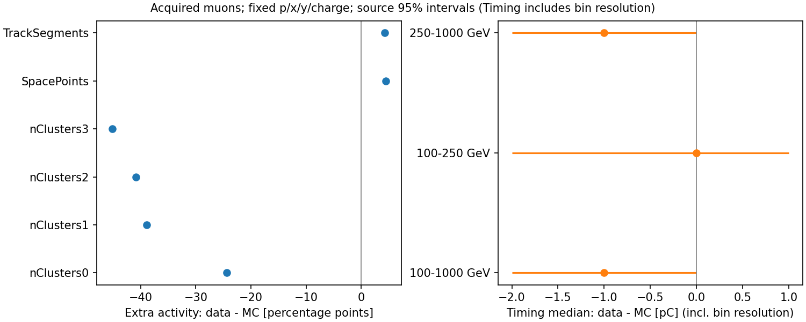

# stage52：全来源μ控制揭示tracker活动失配，Timing中央电荷尺度较接近

## 1. 目标与阶段判断

本阶段执行修订路线§33、信息预算§18与stage49审查§7的F6可靠性交付。**在已采集、单longTrack、共同p/x/y/电荷支持的μ样本中，MC下游station额外cluster明显偏多；SpacePoint和普通segment额外活动反而略偏少。不能将所有计数统一乘一个系数，也不能宣称F6全部读出已在data闭合。** Timing总电荷中央尺度较接近，但宽度、拟合非有限值、状态和在线接受度边界尚未关闭。

完成18个已知文件的全部6,021,535条，重要结论不再依赖旧data前100,000条。0新能量fit、0概率映射、0谱反演/toys；未打开旧test，未重建/扫描历史生产，未调整BDT。结论是条件μ读出比较，不是ν强子shower、总tracking效率或ν能量bias。

## 2. 冻结协议、定义与独立性

- [配置](../ml/configs/f6_muon_response.json)于2026-11-02 10:37:15 UTC冻结，起点`73aa101`；先前只看18文件metadata与40例schema/单位/状态/向量对齐，没有比较probe响应残差。相同40例随后复用作提取smoke，未扩大交互式事件范围。
- 在正式读取前、首批任务仍0启动时澄清一处逻辑：MC μ−/μ+的支持检查各自对应reco电荷格，不要求每个生成符号同时充分填充正负电荷。只改支持规则文字，未改提取；时间和原因已进配置。正式有效批次的时间线见ClassAds，不据结果改格/选择。
- 输入沿用[18文件manifest](../ml/configs/calonu_muon_files.tsv)与[GRL](../ml/configs/calonu_muon_grl.json)，**忽略旧entry_stop，读完整范围**。PG合并文件eventID重启，不按run/eventID去重；以source index及原entry顺序覆盖全部原始entry。
- leading固定最高pz。data用GRL稳定期、排除期及distanceToCollidingBCID=0；恰一longTrack，nLayers≥7、nDoF≥9、χ²/nDoF<15；100≤reco p<1000 GeV。VetoNu传播位置|x|,|y|<500 mm，hypot(θx,θy)<0.025 rad；四VetoNu0/1,Veto20/21 raw charge>40 pC作为μ tag；Timing z=0面|x|,|y|<80 mm，reco charge=±1。
- tag没有按计数或Timing电荷截断；**不测上述Veto自身响应**。TBP/TAP/inputBits菜单和生产DoScintFilter开关未认证，所以Timing也只能测已采集样本的条件响应，不测无偏低信号效率。不能由raw低信号率0宣布100%效率。
- 六个计数probe为F6既有nClusters0–3、SpacePoints和**普通**TrackSegments。data六文件均缺GhostBusted，未换collection冒充同义；longTracks已固定为1，未把它当闭合证据。
- 电荷probe为四Timing通道的fit charge总和及raw_charge总和；按已知MC `1ec47efe` 与data `d0b1b2dd` 源码均为integral/50，单位pC，没有新增归一化。保存nonfinite与overflow，不按probe有限性、状态或高响应删事件。

[定义与有界源码核对](stage52_energy_ml/source_semantics.md)记录了station累加、z=0传播面、999999失败哨兵及状态位。这里只认证所读片段代数一致；MC CaloNu与data TI12Data04/noIFT生产reference不相同，noIFT字样不能被解释成data物理上没有IFT或其cluster branch为空。材料、对准、digitization、collection及实际触发条件未完整匹配。

## 3. 完整样本、选择与来源覆盖

| index | 样本/run | 完整输入N | 选中N | 角色 |
| --- | --- | --- | --- | --- |
| 0 | MC/100049 | 50000 | 17232 | 参考 |
| 1 | MC/100049 | 50000 | 17334 | 评价 |
| 2 | MC/100049 | 50000 | 17249 | 参考 |
| 3 | MC/100049 | 50000 | 17190 | 评价 |
| 4 | MC/100049 | 50000 | 17367 | 参考 |
| 5 | MC/100049 | 50000 | 17076 | 评价 |
| 6 | MC/100050 | 50000 | 15828 | 参考 |
| 7 | MC/100050 | 50000 | 15838 | 评价 |
| 8 | MC/100050 | 50000 | 16082 | 参考 |
| 9 | MC/100050 | 50000 | 15874 | 评价 |
| 10 | MC/100050 | 50000 | 16060 | 参考 |
| 11 | MC/100050 | 50000 | 16109 | 评价 |
| 12 | data/15838 | 780874 | 133478 | 参考 |
| 13 | data/15838 | 933264 | 162391 | 评价 |
| 14 | data/16000 | 868756 | 148926 | 参考 |
| 15 | data/16000 | 993990 | 173102 | 评价 |
| 16 | data/16923 | 846889 | 146820 | 参考 |
| 17 | data/16923 | 997762 | 176007 | 评价 |

完整输入MC600,000、data5,421,535；选中MC199,239、data940,724。全部18来源纳入；原stage36 data600,000前缀扩大到完整5,421,535，为9.036倍。各来源实际路径、触发pattern与资源见[extraction_files.json](stage52_energy_ml/extraction_files.json)，schema缺列审计见[input_audit.json](stage52_energy_ml/input_audit.json)。

| 累计选择 | MC N | data N |
| --- | --- | --- |
| input | 600000 | 5421535 |
| stable_colliding_if_data | 600000 | 5391489 |
| one_long_track | 553538 | 5379757 |
| track_quality | 532676 | 4913627 |
| reco_p_100_1000_GeV | 262261 | 2251329 |
| valid_vetonu_extrapolation | 262236 | 2245725 |
| four_veto_tag | 262236 | 2240152 |
| central_timing_plane | 199239 | 940724 |
| unit_reco_charge | 199239 | 940724 |

## 4. 共同支持与参考权重

事前固定5个p格[100,160,250,400,650,1000] GeV、x/y各[-80,0,80] mm、两电荷，共40格。仅参考来源MC0/2/4/6/8/10、data12/14/16的p/x/y/电荷决定支持：每个参考data run及对应符号MC格≥20例，目标质量正比于两侧归一格质量的min。**没有使用计数/Timing响应拟合或选权重。** 另一组来源MC1/3/5/7/9/11与data13/15/17直接格内标准化到同一固定质量。

40格全部通过；参考MC99,818、data429,224，重叠质量0.754893；未因probe差异删格。主评价MC99,421/6来源、data511,500/3来源；Neff分别85,395.67/465,020.19，最小评价格N为1,420/3,002。参考/评价source严格不交叠，但这些旧开发生产并非新blind。

| 主评价 | MC N | data N | MC Neff | data Neff |
| --- | --- | --- | --- | --- |
| 100–1000 GeV | 99421 | 511500 | 85395.67 | 465020.19 |
| 100–250 GeV | 26781 | 186434 | 26638.78 | 173623.04 |
| 250–1000 GeV | 72640 | 325066 | 59156.50 | 293165.83 |

未标准化时评价p均值data380.874、MC469.554 GeV；标准化后406.300/409.558 GeV，x均值0.563/0.398 mm，y均值2.450/1.766 mm。格质量精确一致，但格内连续运动学仍不完全相同，也未匹配θ、材料或活动；不能把“匹配成功”当成响应已闭合。TSV中的NA表示该项未测区间或比值未定义。完整[格与N](stage52_energy_ml/common_cells.tsv)、[匹配前](stage52_energy_ml/unweighted_response.tsv)、[匹配后分层](stage52_energy_ml/response_comparison.tsv)保留。

所有主区间为500次来源bootstrap，seed20261105：data按三个run来源抽样，MC在μ±内各抽三个评价文件；固定参考质量，重算格内分母。三个主层均500/500有效。区间条件于参考质量、此选择和已知生产，不含参考权重学习误差、事件抽样误差、研究选择及系统；3个data运行条件远不等于51万独立运行条件。未使用逐事件高统计来缩窄来源变化。

## 5. 核心计数结果

额外活动阈值事先固定为nClusters_s>6、SpacePoints>12、TrackSegments>4：分别对应名义每station3层×2面、4station×3层和每station一个segment的描述参照，不是经过效率标定的“多粒子”判据。单μ会有辐射、secondary、噪声、重叠/组合及重建差异；不称这些计数为纯强子活动。

| probe | data均值/事例 | MC均值/事例 | 均值差 [来源95%] | data额外率 % | MC额外率 % | 额外率差 pp [来源95%] |
| --- | --- | --- | --- | --- | --- | --- |
| nClusters0 | 19.331 | 19.258 | 0.073 [-0.662, 0.800] | 52.719 | 77.101 | -24.383 [-24.665, -24.151] |
| nClusters1 | 7.776 | 8.676 | -0.900 [-0.948, -0.841] | 34.022 | 72.902 | -38.880 [-39.317, -38.506] |
| nClusters2 | 7.074 | 8.060 | -0.985 [-1.006, -0.969] | 30.323 | 71.158 | -40.835 [-41.053, -40.593] |
| nClusters3 | 6.910 | 8.090 | -1.180 [-1.210, -1.148] | 26.069 | 71.210 | -45.141 [-45.441, -44.866] |
| SpacePoints | 35.812 | 33.923 | 1.889 [-0.914, 4.612] | 56.401 | 51.983 | 4.417 [4.042, 4.777] |
| TrackSegments | 4.595 | 4.456 | 0.139 [0.133, 0.146] | 27.540 | 23.307 | 4.233 [4.021, 4.462] |

| probe | data中位数/q84 | MC中位数/q84 |
| --- | --- | --- |
| nClusters0 | 7/17 | 8/16 |
| nClusters1 | 6/9 | 7/10 |
| nClusters2 | 6/8 | 7/9 |
| nClusters3 | 6/7 | 7/9 |
| SpacePoints | 13/22 | 13/20 |
| TrackSegments | 4/6 | 4/5 |

**不能因nClusters0/SpacePoints均值区间跨零就宣称分布相容。** nClusters0均值接近，但>6比例差−24.38 pp；两者中央/尾部组成不同。station1–3的MC不仅额外率偏高，均值也多0.90–1.18 cluster/event。SpacePoints和segment额外率则是data更高4.42/4.23 pp，说明不是全tracker计数一致偏移。

全部大尾保留。计数直方图以≥513终端格收尾，但真实count_sum单独累计，均值不截断；六probe全选中样本终端格N为3685/42/14/69/6770/0。此处中位/q84均低于终端格，额外率与精确count_sum不受该压缩损失影响；>513尾内形状未保存，不声称测了其完整分布。

| probe | 100–250 GeV：data/MC额外率 % | 差 pp [95%] | 250–1000 GeV：data/MC额外率 % | 差 pp [95%] |
| --- | --- | --- | --- | --- |
| nClusters0 | 46.620/74.452 | -27.833 [-28.218, -27.381] | 55.891/78.479 | -22.588 [-22.936, -22.243] |
| nClusters1 | 31.388/72.016 | -40.628 [-41.289, -39.967] | 35.392/73.363 | -37.970 [-38.410, -37.593] |
| nClusters2 | 28.791/70.769 | -41.979 [-42.363, -41.603] | 31.120/71.360 | -40.241 [-40.546, -39.891] |
| nClusters3 | 24.746/71.321 | -46.576 [-46.963, -46.187] | 26.758/71.153 | -44.395 [-44.698, -44.175] |
| SpacePoints | 50.069/46.571 | 3.498 [3.234, 3.782] | 59.694/54.799 | 4.895 [4.293, 5.415] |
| TrackSegments | 24.010/20.227 | 3.783 [3.450, 4.089] | 29.376/24.909 | 4.467 [4.163, 4.791] |

这不是>1 TeV tracker精度主导的结果：两个用户重点动量区间都保留显著cluster差异。四象限station3额外率data25.041–26.849%、MC70.664–71.689%，不能由某个选后位置角落解释；角度/材料/生产混合的剩余贡献仍未识别。

## 6. run、符号与源间支持

下表逐run使用该run两文件、MC使用固定6个评价文件；给出固定参考条件下的两文件内bootstrap区间。它复用参考data来源，属于描述性辅助，不升级成独立确认；每run只有两来源，区间不足以覆盖未知运行条件。μ±行使用对应生成符号三评价来源与相同reco电荷的三份评价data；两侧target限制到对应电荷格。每行500次来源抽样，非逐事件区间。

| 辅助对照 | data N/源N | MC N/源N | station3 data/MC % | station3差 pp [95%] | SP差 pp [95%] | segment差 pp [95%] |
| --- | --- | --- | --- | --- | --- | --- |
| data_run_15838 | 295869/2 | 99421/6 | 26.027/71.210 | -45.183 [-45.461, -44.944] | 4.303 [3.958, 4.639] | 4.171 [3.955, 4.416] |
| data_run_16000 | 322028/2 | 99421/6 | 26.244/71.210 | -44.966 [-45.256, -44.728] | 4.493 [4.128, 4.822] | 4.255 [4.040, 4.525] |
| data_run_16923 | 322827/2 | 99421/6 | 26.150/71.210 | -45.061 [-45.378, -44.685] | 4.221 [3.899, 4.507] | 4.093 [3.858, 4.340] |
| MC_minus | 270824/3 | 50670/3 | 25.471/70.920 | -45.449 [-45.701, -45.196] | 3.573 [2.989, 4.093] | 3.775 [3.310, 4.335] |
| MC_plus | 240676/3 | 47149/3 | 26.495/71.264 | -44.769 [-45.144, -44.385] | 5.483 [5.123, 5.835] | 4.849 [4.575, 5.137] |

各run两文件标准化Timing fit/raw中位均57.5/59.5 pC。三个run的SpacePoints均值34.124/36.562/36.783，而>12率56.286/56.476/56.204%，说明均值更受源尾组成影响。不能以大N替代对尾/运行条件的判断。[每来源/动量/位置的完整数值](stage52_energy_ml/source_response.tsv)覆盖所有18来源；单一来源自身的来源区间**未测量**，不能伪造。两动量层的主区间见§5，各source/run的两动量和位置中央值见该表；[run/符号差异区间](stage52_energy_ml/run_sign_comparison.tsv)与主评价分开。

## 7. Timing电荷：中央尺度、宽度与状态分开

1 pC直方图中央格[-128,8192]，远尾几何格到1e6 pC、另存under/overflow/nonfinite。中位与R68=(q84−q16)/2只对有限电荷CDF计算，同时报告非有限率；没有对事件选择加有限性筛选。中央分位点单项数值分辨上限±0.5 pC，因此data−MC中位或R68的区间另扩±1 pC。**这只是分箱数值包络，不是探测器nuisance。** “源区间[-1,-1]”不得被误读成有无限精度的1 pC差异。

| 指标/pC | data | MC | 差 [源95%] | 差 [含分箱包络] |
| --- | --- | --- | --- | --- |
| Timing_charge_median_pC | 57.5 | 58.5 | -1.0 [-1.0, -1.0] | -2.0 至 0.0 |
| Timing_charge_R68_pC | 19.0 | 18.0 | 1.0 [1.0, 1.5] | 0.0 至 2.5 |
| Timing_raw_charge_median_pC | 59.5 | 59.5 | 0.0 [0.0, 1.0] | -1.0 至 2.0 |
| Timing_raw_charge_R68_pC | 20.0 | 18.0 | 2.0 [1.5, 2.5] | 0.5 至 3.5 |

| 动量 | fit中位data/MC pC | fit R68 data/MC pC | raw中位data/MC pC | raw R68 data/MC pC |
| --- | --- | --- | --- | --- |
| 100–250 GeV | 57.5/57.5 | 16.5/15.5 | 58.5/58.5 | 17.5/15.5 |
| 250–1000 GeV | 57.5/58.5 | 20.0/19.5 | 59.5/59.5 | 20.5/19.0 |

总体fit中位差−1 pC，含分箱包络[−2,0] pC；raw中位差0、包络[−1,2] pC：支持中央尺度在本选择和数值分辨下较接近，不支持给出已认证gain校准。data宽度更大，raw R68差2 pC、源区间[1.5,2.5]，加分箱包络[.5,3.5] pC。位置象限fit中位data−MC为−1/+1/−2/+1 pC，亦不支持据一个总体常数修正全部位置。

| 指标/% | data | MC | 差 pp [源95%] |
| --- | --- | --- | --- |
| Timing_charge_low_pct | 0.011097 | 0.000000 | 0.011097 [0.010920, 0.011179] |
| Timing_raw_charge_low_pct | 0.000000 | 0.000000 | 0.000000 [0.000000, 0.000000] |
| Timing_charge_nonfinite_pct | 0.051978 | 0.000000 | 该项区间未测量 |
| Timing_charge_hist_under_over_pct | 0.001324 | 0.000000 | 该项区间未测量 |
| Timing_active_threshold_failed_pct | 21.295131 | 22.150570 | -0.855439 [-0.996456, -0.690660] |
| Timing_active_overflow_pct | 0.083581 | 0.066701 | 0.016881 [0.002191, 0.031402] |
| Timing_active_missing_invalid_pct | 0.000000 | 0.000000 | 0.000000 [0.000000, 0.000000] |

low阈值≤20 pC来自既有hitsTiming，未据分布调整。status OR的“活动通道”沿用y>20 mm取top2/3、y<−20 mm取bottom0/1、其余取四通道的约定；中央重叠区的threshold-failed OR可含未真正穿越的另一paddle，21%绝不能当作μ漏检率。overflow是真实保留的条件状态率，不自动等同错误。

完整选中样本Timing拟合总电荷非有限MC2/data487；评价MC0/data258。raw总电荷全有限。所有非有限均计入相应分母，不被删掉；状态位是否覆盖每个非有限原因、逐事件原生拟合因果路径**未测量**。低信号与宽度的在线触发相关性尚未去除，Veto、Preshower和各Timing单通道完整响应闭合**未测量**。



## 8. 程序、生产与物理解释

1. **程序原因已检验的部分：** all18完整entry、最高pz/向量对齐、GRL/colliding、单位、哨兵、普通collection和计数直方图分母通过；MC/data已知源计数累加与charge/50代数一致。不是把GhostBusted混成普通segment，也不是用被测Timing阈值选出相容峰。
2. **生产与条件仍不匹配：** MC为粒子枪、CaloNu几何；data为2024 r0022，源reference另有noIFT差别；实际digitization、dead/noisy-strip masking、timebin/compression、tracking、触发和背景活动未完全等同。p/x/y格内与角度分布残差也存在。不同tag通过率不等于探测器低信号效率。
3. **有动机但未测的机制：** 已知SCT FrontEnd源码确有随机噪声strip注入与expanded模式的噪声占据变化；配置可从DB读calibration，header fallback不等于实际文件参数。MC“cluster偏多而SP/segment并未同向偏多”值得检验unpaired/noise、timebin与重建关联；不能仅凭模式就宣布噪声已定因。强子/辐射活动、几何和选择的份额均未分离。

**决策：先定位tracker活动差异，取得有依据的读出变体，再评估其对固定F6的影响。** 本轮没有把nClusters3差−45 pp当作所有ν事件的加/减常数，没有任意±gain、删除计数、重新训练或据data残差反调模型。Timing中央尺度的接近也不能替代其宽度/状态或强子能量响应的验证。

## 9. 执行、性能与存储

```
source /cvmfs/sft.cern.ch/lcg/views/LCG_109/x86_64-el9-gcc15-opt/setup.sh
export PYTHONNOUSERSITE=1 OPENBLAS_NUM_THREADS=1 OMP_NUM_THREADS=1 MKL_NUM_THREADS=1
python3 ml/audit_f6_control_inputs.py
# 仅复用同40例的read_f6_muon_response.extract(..., smoke=True)，见smoke_validation.json
python3 ml/package_f6_muon_response.py
condor_submit -name bigbird18.cern.ch AnalysisZipFramework/submission/ml_f6_muon_response.sub
python3 ml/analyze_f6_muon_response.py
python3 ml/audit_f6_response_io.py                 # 只读metadata，不读事例
python3 ml/validate_f6_muon_response.py --archive   # 仅首次归档；不会覆盖已完成archive
python3 ml/collect_condor_resources.py --output workbook/stage52_energy_ml/condor_resources.json bigbird18.cern.ch:13646690:6
```

首批13646689的6任务虽exit0，却在2–4 s内空转、无Python输出或产物；AFS runner当时未有执行位，修复为755并显式`/bin/bash`启动。未把exit0当完成；无事件重复读取。保留[首批ClassAds](stage52_energy_ml/condor_empty_attempt.json)。正式13646690六任务各处理两MC+一data，共18文件，均1启动/exit0；排队109–110 s。1CPU、描述符1500MB经站点实际变3000MB，无GPU。

| 测量 | 实际值 |
| --- | --- |
| metadata+40例pilot | wall8.681 s、CPU5.457 s、peak135.703 MiB、请求9.073 MB |
| 完整提取累计内部wall/CPU | 167.398 / 73.934 s |
| 完整提取吞吐/peak | 35971.4 events/s / 348.047 MiB |
| 正式Condor累计remote wall/CPU | 234.0 / 98.0 s |
| 最终分析内部wall/CPU/peak | 111.651 / 108.518 s / 420.719 MiB |
| 最终分析外部time | wall115.25 s、user104.77 s、sys5.20 s、RSS430816 KiB |
| 完整提取请求I/O | 2452265764 bytes =2.452265764 GB |
| 原18直方图/最终archive | 1046349 / 809763 bytes |

**I/O超预算如实保留：** 原冻结2.0 GB上限，实际超22.613%。metadata诊断显示所读42列的独占压缩basket为891,764,982 bytes，但固定50k-entry `arrays`请求跨块重复触碰basket共2,448,887,887 bytes，加metadata3,377,877 bytes，**精确等于**实测2,452,265,764 bytes。不是额外事件或悄悄扩大范围。下一次提取应先试basket复用的`iterate`并按实际touch字节预算；本轮未为优化计时重复扫6M条，优化后的吞吐**未测量**。

首次分析因不同CPU libm的远尾几何边界差5.820766e−11 pC而触发过严逐bit检查，wall2.79 s失败；中央1pC边界全精确。改为要求远尾差<5e−15相对且两边界之间不存在可表示float32电荷，证明不会改任何分箱，无需重读ROOT。初版主分析wall42.06 s，随后补逐run/符号区间及分箱数值包络得到最终分析；非数值/模型扫描。各次代价均计为实际工作，不只报最后成功。

最终只保留一个忽略Git的 `ntuples/energy_ml_stage52/source_histograms.tar.gz`（809,763 bytes，0.772 MiB），18个逐source NPZ原字节回读全部一致后删去重复shards；分析reader可直接读取archive。只含格内充分统计和metadata，无逐事例vector、ROOT/xAOD、模型或点云。软件payload8,605 bytes，紧凑表与图随代码提交。

## 10. 验证、未测量与下一步

[验证记录](stage52_energy_ml/validation.json)：18来源完整6,021,535 entries；计数/电荷分母、额外活动率与未截断均值验证；参考/评价不交叠，固定格质量和主计数表从充分统计独立重算；archive逐文件字节与18来源回读一致。图已目视检查，Timing数值分辨包络单独标注。未改C++，不重复构建Calypso；这不是μ效率或ν能量回归测试。

未测量：SCT真实噪声因果份额、匹配读出变体及其ν能量/谱影响；无偏Timing/Veto效率、各单通道标定；ν interaction/FSI、G4材料/输运的独立系统；正向谱硬度实际收益；真正未开发生产确认。没有从μ对照宣布达到电子信息极限。

下一阶段按更新后的[stage53 Prompt](../docs/nu_mu_energy_ml_next_step_prompt.md)执行：一次有限tracker噪声/读出机制实验。必要输入为**已知配对同事件**HITS/RDO/reco、实际SCT配置和固定tag/计数定义，优先复用已验证联结，按小pilot计时后扩大到跨源μ控制；不恢复历史生产。比较名义与仅关闭独立随机noise-strip注入的机制臂，保留analog噪声和全部选前/选后变化；先实测该噪声项对cluster/SP/segment的因果份额，不能把on/off全差当正式1σ。重要总体判断需扩大来源和样本；若数据依据不足，明确机制范围，不能用少数异常否定分支。验收为来源配对差值、选择迁移、定义/identity核验和资源闭合；得到可信变体后再固定模型评估ν压力，而非立即反调BDT或开谱toy。

本阶段先写本中文报告、再与代码/配置/紧凑表图一起本地Conventional Commit，不推送，不自动启动stage53。
