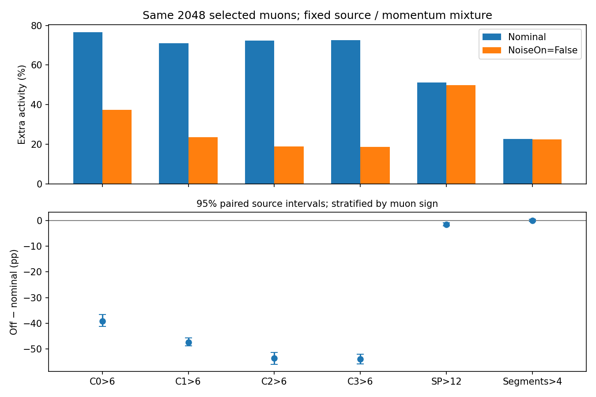

# stage53：同事件SCT随机strip噪声机制控制

## 1. 阶段目标和研究范围

依照修订路线§34、信息预算计划§19和stage53执行Prompt，检验stage52“MC额外cluster偏多，而SpacePoint/segment不同比例偏多”的一个具体机制：SCT前端独立随机noise-strip注入。只比较actual nominal和`FrontEnd.NoiseOn=False`，保留`AnalogueNoiseOn=True`及其他条件；0新能量fit、0概率映射、0谱反演/toy、0新G4事件。

这里测的是模拟代码干预对同事件读出和条件选择的影响，不将开/关全差当正式1σ，不按data残差反调BDT，也不把单μ控制当ν强子响应闭合。stage52采用40格标准化的来源隔离评价；本轮采用平衡来源/动量的固定事件混合，二者不能直接相减计算data失配的精确归因比例。

## 2. 冻结样本、选择和配对

- 输入为`ml/configs/calonu_muon_files.tsv`中的全部12个已知MC μ来源：100049的6个μ−来源，100050的6个μ+来源；每来源完整50000条PHYS，共600000条，199239条通过原stage52选择。没有按被测cluster数或噪声残差挑选。
- 2048例名单在两臂结果前冻结，100–250和250–1000 GeV各1024例，两符号各1024例。每来源×动量格85例，8格额外1例；来源总数170或171。固定`SeedSequence([2026110253,source,pbin])`对全部通过者置换后取前N，再按原entry排序。全部12来源的原entry跨度和通过率见[sample_summary.json](stage53_energy_ml/sample_summary.json)。这是有界机制样本，不是全ν独立性能确认。
- 保持最高pz leading、恰一longTrack、≥7层、nDoF≥9、χ²/nDoF<15、100≤p<1000 GeV、原几何/斜率、四Veto raw>40 pC、Timing面|x/y|<80 mm及单位重建电荷选择。无被测计数截断。条件于名义单μ/质量/触发支持，不能测全部tracking效率或无偏低信号效率。
- 原名单由nominal参考固定；报告全部2048例的选前计数和各臂选择迁移，不删掉关噪声后失败者。每次使用原RDO的真实entry；PG的eventID在10000条生成子文件间重启，不能只靠run/eventID联结。
- 使用原HITS中的同一SCT hit collection，子文件编号=合并RDO起始编号+entry//10000，HITS entry=entry%10000。沿用stage37/38已验证的原生联结，严格原RDO strip-ID/timebin检查进一步约束身份；不保存HITS/RDO/xAOD副本或点云。

原冻结协议见[sampling_protocol.json](stage53_energy_ml/sampling_protocol.json)、[experiment_protocol.json](stage53_energy_ml/experiment_protocol.json)，配置修正记录见[nominal_correction_protocol.json](stage53_energy_ml/nominal_correction_protocol.json)。名单、干预和门槛未因结果而改变。

## 3. actual条件、重放与程序原因

原生产为Calypso22.0.49/CaloNuMC `1ec47efe`、`FASERNU-CALONU`、`OFLCOND-FASER-05`；原mc24安装已不可用。复用现成`calypso-master-d32b0ff3-el9-gcc13.tar.gz`/Athena24.0.41，不重编Calypso包，仅同gcc13编译紧凑分析helper。数字化、cluster/SP/segment和p4 converter的已核源码无差异；CKF的旧layer mask0..2对应新side mask0..5，均排除IFT。ACTS加载SCT、Scint、Dipole几何及原生产指定的`material-maps-alma9.json`。

实际DB两run均读192行ChipNoise和ChipGain：occupancy为3.5e−5，无量纲；NoiseByChip1600电子，gain52、gainRMS1.25、offset45、offsetRMS1.75（以上gain/offset为DB原值，单位本轮未核实，不用于电荷标定）。前端threshold1 fC（日志6242.20电子）、TimeOfThreshold30 ns、compression/readout=1/1、UseCalibData=True。不是fallback NOBarrel3=2.1e−5，也不是compression3时的三倍模式。noise-strip时间箱010可通过cluster的01X要求。静态bad-strip/module为0，随机disabled-cell默认1%保持不变。详[conditions_audit.json](stage53_energy_ml/conditions_audit.json)和[source_audit.md](stage53_energy_ml/source_audit.md)。

`NoiseOn`仅门控`randomNoise`调用；不能用同时改变analog噪声/OnlyHitElements的`DoInnerDetectorNoise=False`替代。两臂保持原工具名和默认event-context RNG配置；去掉randomNoise调用会改变后续共用随机流位置，因此同seed不代表所有信号涨落逐例完全相同。结果包括该单代码干预诱发的随机实现变化，不把所有逐例差都标成可逐strip识别的noise。

名义验证中定位并修正了三类程序问题：

1. **持久化表示。** 刚数字化的transient word含重复strip位；POOL p4将row/strip另存，读回word不含这些重复位。使用原生生产converter在内存做transToPers/persToTrans，再严格比较完整strip-ID/word多重集；原参考再次转换必须幂等。没有手工mask不明bit或放宽timebin容差。
2. **RDO内HITS副本不逐bit等价。** 初版2048例有28例RDO不符、18例计数不符；结果选择的4例程序诊断显示HITS再次写出造成端点位置最大差1.9073486328125e−6 mm，ID/顺序、能损和时间相同。最终读原HITS，不用小数值误差作为放松门槛理由。诊断不是总体物理率，见[embedded_hits_diagnostic.json](stage53_energy_ml/embedded_hits_diagnostic.json)。
3. **原材料图遗漏。** 初版原RDO参考重建有19/2048例退出原选择，不能称噪声效应。原生产日志明确指定alma9材料图，补齐后6个失败/对照例通过；继而对同一2048例重新验证。修正前完整结果及不符区间保留在[pre_correction/nominal_validation.json](stage53_energy_ml/pre_correction/nominal_validation.json)，旧产物归档于`ntuples/energy_ml_stage53/pre_correction_nominal.tar.gz`。这既不否定整个读出方向，也不构成噪声因果证据。

严格门槛同时要求entry/run/event、p4 RDO、原PHYS/reference/replay六项计数、两臂名义参考选择，以及nominal reference/replay轨迹摘要精确一致；历史PHYS浮点轨迹差另报。只有完整门槛通过后才执行关噪声臂。

## 4. 最终实测结果

### 4.1 完整名义门槛：2048/2048通过

[最终名义验证](stage53_energy_ml/nominal_validation.json)在全部12来源通过；p4 RDO不符、reference持久化非幂等、原PHYS/reference计数不符、reference/replay计数不符、原选择不复现、nominal两次轨迹摘要不相同，均为**0/2048**。两个动量层、两个符号和逐来源失败数均为0；没有删去原28例RDO失败或19例选择失败后再验证。

历史PHYS与当前reference的动量差只剩float32存储尺度：相对p差min/16%/median/84%/max为−5.794479e−8/−2.783874e−8/1.302302e−9/2.696369e−8/5.784149e−8，最大绝对p差0.031164 MeV。nLayers、nDoF、χ²和电荷差全为0；VetoNu传播x/y最大绝对差0.000425/0.000481 mm，Timing面x/y差3.804e−6/3.805e−6 mm。历史传播差单独保留，未放宽配对两次reco精确一致的门槛。原材料图修正消除了此前最高120倍相对p差及19例选择迁移的程序伪效应。

[门槛放行记录](stage53_energy_ml/off_arm_gate_release.json)在关噪声结果前保存；只在完整验证通过后提交唯一的NoiseOn=False臂。

### 4.2 单机制配对结果

全部2048例选前读出，固定等事件权；所有差值为**关噪声−nominal**。以下区间均为500次、按μ符号分层的来源配对bootstrap 95%区间，条件于这一冻结机制样本/配置；12来源的外推与多次开发选择不确定性未包含。数量为每事件计数，无量纲；率差为百分点（pp）。

| 变量 | nominal均值 | 关噪声均值 | 配对均值差 [95%区间] | nominal额外率 % | 关噪声额外率 % | 配对率差 pp [95%区间] |
| --- | ---: | ---: | --- | ---: | ---: | --- |
| nClusters0 >6 | 15.59766 | 14.32617 | -1.27148 [-1.330, -1.210] | 76.514 | 37.451 | -39.062 [-41.239, -36.607] |
| nClusters1 >6 | 8.53223 | 7.27002 | -1.26221 [-1.319, -1.190] | 70.996 | 23.584 | -47.412 [-48.743, -45.675] |
| nClusters2 >6 | 7.98535 | 6.69336 | -1.29199 [-1.339, -1.248] | 72.412 | 18.799 | -53.613 [-55.846, -51.220] |
| nClusters3 >6 | 7.98242 | 6.65869 | -1.32373 [-1.365, -1.286] | 72.607 | 18.750 | -53.857 [-55.773, -52.036] |
| SpacePoints >12 | 23.93408 | 23.90869 | -0.02539 [-0.085, 0.040] | 51.270 | 49.756 | -1.514 [-2.052, -0.878] |
| TrackSegments >4 | 4.48291 | 4.49023 | 0.00732 [-0.008, 0.022] | 22.607 | 22.559 | -0.049 [-0.439, 0.391] |

四station合计每事件平均减少5.149414个cluster。station3中1485例计数下降、554例相同、9例反而增加；后者保留，不能将逐例差强制截成非正。SpacePoints为281降/1602同/165增，普通segment为42降/1959同/47增。模拟信号噪声保留、共用随机流后续位置改变、邻道合并和重建非线性都可能参与逐例变化；本轮未逐strip分解这些份额。



### 4.3 动量、符号和来源支持

| 层 | N | station3均值差 [95%区间] | station3>6率差 pp [95%区间] | SP>12率差 pp [95%区间] | segment>4率差 pp [95%区间] |
| --- | ---: | --- | --- | --- | --- |
| 100–250 GeV | 1024 | -1.39844 [-1.468, -1.342] | -55.371 [-57.744, -53.027] | -1.855 [-2.346, -1.174] | -0.195 [-0.781, 0.442] |
| 250–1000 GeV | 1024 | -1.24902 [-1.283, -1.216] | -52.344 [-54.652, -50.000] | -1.172 [-2.055, -0.195] | 0.098 [-0.390, 0.587] |
| μ− | 1024 | -1.28809 [-1.318, -1.252] | -52.734 [-55.327, -50.169] | -1.953 [-2.737, -1.172] | 0.098 [-0.489, 0.880] |
| μ+ | 1024 | -1.35938 [-1.426, -1.304] | -54.980 [-57.730, -51.852] | -1.074 [-1.856, -0.195] | -0.195 [-0.684, 0.293] |

12个来源的station3>6率差全部为负，范围−58.824至−47.953 pp，不由少数特殊来源或>1 TeV名义事件驱动。本轮名义p全部100–1000 GeV。逐来源及来源×动量的246行均值、16/50/84/95/99分位数、阈值率和方向计数见[paired_response.tsv](stage53_energy_ml/paired_response.tsv)；单来源无来源重抽样区间，未伪造其误差。

| 变量 | nominal 16/50/84/95/99分位数 | 关噪声 16/50/84/95/99分位数 |
| --- | --- | --- |
| nClusters0 | 6.00 / 8.00 / 15.00 / 37.00 / 134.18 | 6.00 / 6.00 / 13.48 / 36.00 / 133.12 |
| nClusters1 | 6.00 / 7.00 / 10.00 / 15.00 / 26.00 | 6.00 / 6.00 / 8.00 / 13.00 / 25.00 |
| nClusters2 | 6.00 / 7.00 / 9.00 / 12.00 / 21.53 | 6.00 / 6.00 / 7.00 / 11.00 / 21.00 |
| nClusters3 | 6.00 / 7.00 / 9.00 / 12.00 / 20.00 | 6.00 / 6.00 / 7.00 / 10.00 / 18.00 |
| SpacePoints | 11.00 / 13.00 / 19.00 / 36.65 / 138.01 | 11.00 / 12.00 / 19.00 / 37.65 / 138.01 |
| TrackSegments | 4.00 / 4.00 / 5.00 / 7.00 / 10.00 | 4.00 / 4.00 / 5.00 / 7.00 / 10.00 |

### 4.4 选择迁移：不删除53例失败者

| 层 | 原nominal通过 | 关后仍通过 | 通过→失败 | 损失 % [95%来源区间] |
| --- | ---: | ---: | ---: | --- |
| all | 2048 | 1995 | 53 | 2.588 [2.101, 3.029] |
| p100_250 | 1024 | 1013 | 11 | 1.074 [0.588, 1.462] |
| p250_1000 | 1024 | 982 | 42 | 4.102 [3.173, 4.976] |
| mu_minus | 1024 | 993 | 31 | 3.027 [2.149, 3.904] |
| mu_plus | 1024 | 1002 | 22 | 2.148 [1.854, 2.537] |

53例失败中，4例没有longTrack；47例不再满足100≤p<1000 GeV，其中6例落到100 GeV以下、41例超过1 TeV；2例nDoF失败，1例Timing几何边界失败。一例同时不满足nDoF和动量，故原因次数总数54而非53。47例动量退出者的名义p范围100.061–995.762 GeV，中位776.418 GeV；关后p范围80.381–10410.063 GeV。它们不是新增真值动量误差测量，未以高p倒数尾部宣称真实分辨率恶化；并未继续对高p做拟合/阈值扫描。

完整41组迁移见[selection_migration.tsv](stage53_energy_ml/selection_migration.tsv)，逐例原因及关后轨迹见[selection_failure_cases.json](stage53_energy_ml/selection_failure_cases.json)。原名单只含nominal通过者，失败→通过和双失败为0是样本定义的结果，不能测原未选样本的恢复率或全tracking效率。所有53例均进入前述选前计数，未只留下1995例双通过者。

## 5. 有效物理结论、未解释部分与决策

**独立随机noise-strip注入是已验证的“大幅增加额外cluster、对组合读出影响较小”的模拟机制。** 同原HITS/生成与输运末态、原材料图、全部2048例名义严格复现后，仅关闭该调用即可使四station各减少约1.3个cluster，station3>6减少53.857 pp，来源区间远离零，两动量/两符号/全部来源一致。这是代码干预的配对因果证据，不再只是从data/MC分布形状猜机制。

SpacePoint均值差−0.02539 [−0.08460, 0.03983]与零相容，但SP>12仍有−1.514 [−2.052, −0.878] pp的小变化；不能说SP严格不受影响。普通segment>4差−0.049 [−0.439, 0.391] pp，没有明确非零证据。模拟噪声大多产生缺少可组合伙伴的strip/cluster是与结果相容的机制解释，但“逐strip归属和占据组成”尚未直接测量。

| 额外率 | stage52 data−MC pp | 本轮关噪声−nominal pp |
| --- | ---: | ---: |
| nClusters0 | -24.383 | -39.062 |
| nClusters1 | -38.880 | -47.412 |
| nClusters2 | -40.835 | -53.613 |
| nClusters3 | -45.141 | -53.857 |
| SpacePoints | 4.417 | -1.514 |
| TrackSegments | 4.233 | -0.049 |

**该项噪声的数量级足以解释相当大的cluster过量模式，但还不能确认真实data应使用零噪声。** 本轮cluster下降幅度比stage52相应差异还大；两个实验的p/x/y/符号/来源混合不同，不能机械相减、计算解释百分比或据此反求occupancy。data的真实噪声、masking、触发、对准/几何、背景和次级活动仍需分别约束。

**它不能同时解释data的SpacePoint/segment较多。** stage52 data−MC分别为+4.417/+4.233 pp，而关噪声使前者下降、后者与零相容；这不是整体统一计数偏移。当前结果也不能认证ν shower响应。

**噪声变化不只是给输入计数减一个常数。** 名义选择后有2.588%退出，主要是动量范围迁移；后续固定F6压力必须保留对应重建及选择变化，不能用统一计数/gain缩放替代真实变体。两臂共用随机流的影响未逐项拆开，关噪声不是正式1σ。

**决策：结束本轮单开关机制实验，不续开seed/occupancy/timebin网格。下一轮先量化data可约束的孤立strip/cluster占据及有效读出条件；取得有依据的非零范围后，才做固定F6同事件ν压力。** 不因机制阳性恢复CaloNu全历史生产或架构扫描，也不因剩余失配宣布F6不可部署或达到硬件极限。

## 6. 执行命令、成本与存储

```bash
source /cvmfs/sft.cern.ch/lcg/views/LCG_109/x86_64-el9-gcc15-opt/setup.sh
export PYTHONNOUSERSITE=1 OPENBLAS_NUM_THREADS=1 OMP_NUM_THREADS=1 MKL_NUM_THREADS=1
python3 ml/package_tracker_noise.py --part prepare
condor_submit -name bigbird16.cern.ch AnalysisZipFramework/submission/ml_tracker_noise_prepare.sub
python3 ml/package_tracker_noise.py --part replay
condor_submit -name bigbird16.cern.ch -maxjobs 6 -append 'mode = nominal' AnalysisZipFramework/submission/ml_tracker_noise.sub
python3 ml/analyze_tracker_noise.py --nominal-only
# 完整严格门槛通过且放行记录写入后，才执行：
condor_submit -name bigbird16.cern.ch -maxjobs 6 -append 'mode = nonoise' AnalysisZipFramework/submission/ml_tracker_noise.sub
python3 ml/analyze_tracker_noise.py
python3 ml/collect_condor_resources.py --output workbook/stage53_energy_ml/final_arm_resources.json bigbird16.cern.ch:16530258:6 bigbird16.cern.ch:16530262:6
python3 ml/validate_tracker_noise.py --archive
python3 ml/analyze_tracker_noise.py  # 从归档回读并验证结果不变
```

实际payload早期由等价有界打包命令生成，新增packager固化其最小依赖与runner复制步骤；最终payload291774 bytes。prepare的16530252完成1次/exit0；旧bigbird18任务先hold并核0启动后remove，移到16号，见[prepare_old_schedd.json](stage53_energy_ml/prepare_old_schedd.json)。未发生重复准备读取。

首批重放16530255六任务因shell通用变量mode被runtime setup覆盖成relonly而argparse失败，exit2，无事件结果；改为专用tracker_noise_arm。16530256是修正前全2048例名义诊断，六任务完成，未执行当时关噪声臂。修正后16530258/16530262共12任务各1启动/exit0，始终最多6并发；前者排队41 s，后者136–137 s。实际1CPU/4GB请求经CERN站点变为2CPU/6000MB，在路线≤2CPU/6GB内，Python/BLAS/重建仍单线程。见[初期ClassAds](stage53_energy_ml/condor_resources.json)、[最终两臂ClassAds](stage53_energy_ml/final_arm_resources.json)与[站点资源说明](stage53_energy_ml/site_resource_clarification.json)。

| 实测项目 | 数值 |
| --- | --- |
| 全600000条PHYS名单准备 | wall26.349 s / CPU9.717 s / peak256.574 MiB / 请求92941675 bytes |
| 最终nominal 12来源 | wall2182.018 s / CPU1088.155 s / peak1991.910 MiB |
| 最终关噪声12来源 | wall1612.623 s / CPU771.186 s / peak2032.891 MiB |
| 正式两臂Condor累计remote | wall4320 s / CPU2214 s =0.615 h |
| 两臂重放摘要内部吞吐 | 4096臂事件 / 3794.641 s =1.0794 arm-events/s（含初始化与稀疏EOS读取） |
| 正式两臂ROOT实际读字节 | 各1767797200，总3535594400 bytes =3.5355944 GB |
| 归档前正式分析 | 内部wall2.931 s / CPU2.430 s / peak109.238 MiB；外部wall3.51 s / user2.55 s / sys0.18 s / RSS111860 KiB |
| 早期修正前2048例名义 | wall1774.948 s / CPU930.158 s / ROOT读577295551 bytes |
| 最终结果archive | 1425732 bytes =1.360 MiB；25个JSON逐字节回读后删除重复shards |
| 早期诊断archive | 339991 bytes =0.324 MiB |

正式两臂CPU、输入及紧凑产物均在冻结8 h/10 GB/20 MB上限内。上述ROOT计数包含实际ROOT文件（含conditions）的读字节，不冒称EOS物理磁盘唯一读取量。archive没有ROOT/RDO/HITS/xAOD或逐hit数组，仅冻结样本和紧凑重放摘要。最终两archive合1765723 bytes =1.684 MiB，存于忽略Git的`ntuples/energy_ml_stage53/`；表格/协议/图随代码提交。

探索成本没有省略成“首跑成功”：早期pilot累计17个独立source/entry，≤40门槛内，部分因helper key、cluster symlink、ACTS几何/JIT和selector接口失败而重试；[pilot_attempts.json](stage53_energy_ml/pilot_attempts.json)逐项记载。该清单中已计时CPU合670.340 s，另两次早期初始化失败CPU未测量；后续4/6例原HITS/材料图诊断有各自JSON计时。不会用最后成功一次的耗时冒充全部探索耗时，也不对未记录的初始化成本补造数值。

## 7. 验证和局限

[validation.json](stage53_energy_ml/validation.json)：2048例/12来源、两p层各1024、246条配对响应、41组迁移均独立从事件摘要重算；entry/run/event、原六计数、全部名义门槛及两臂reference轨迹核验通过。25个JSON归档前后逐字节一致，再用archive reader回读；正式分析从archive重跑，7个数值输出逐字节一致，见[archive_readback_validation.json](stage53_energy_ml/archive_readback_validation.json)；首次回读wall4.600 s/CPU3.999 s/peak108.281 MiB；随后仅将TSV行尾统一为LF、缺失区间显式写NA，重算后数值仍一致，末次计时也保存在该验证记录。归档前计时另存[analysis_before_archive_resources.json](stage53_energy_ml/analysis_before_archive_resources.json)。Python语法、shell语法、git diff空白和Markdown本地链接检查；图表另作目视检查。本阶段没有C++分析框架源码变化，不重新构建Calypso。

未测量：data真实独立电子噪声率及误差、逐strip noise/真实次级归属、两臂共同信号随机流的路径级份额、ν计数/重建/固定F6/谱响应、全tracking效率、truth曲率分辨率、独立ν interaction/FSI及G4材料系统、背景/归一化、全局谱硬度与真正未开发生产确认。bootstrap来源区间不是这些系统的替代。

## 8. 下一步输入、具体任务和验收

stage54按[新执行Prompt](../docs/nu_mu_energy_ml_next_step_prompt.md)做一次有界data读出约束，不在本轮自动启动：

1. 输入既有6 data PHYS/12 MC来源、其已知r0022日志与配套REC/RDO、原mask/calibration/读出条件，以及本轮2048例manifest和原生decoder。只从这些已知路径做有界metadata确认，不递归扫全EOS；确认data实际有何collection、station、timebin和可用active-channel分母。
2. ≤40例无物理阈值扫描QA后，目标在6个data来源完整支持独立冻结2048个100–1000 GeV μ，与原2048 MC共同几何/读出定义比较。测μ邻域外的strip/cluster占据、timebin/孤立性及来源/动量层；用实际mask和有效channel数作分母。不得将所有未关联hit都叫电子噪声，需区分或上界化真实次级/背景。缺无偏tag/quiet样本时只给条件占据或上限，不硬造纯噪声率。
3. 验收为跨来源的实际占据/定义/单位/选择支持、区间与相同observable上的MC预测比较，并明确data能否约束一个非零noise范围；不能仅凭本轮on/off线性插值给1σ。metadata确认原始collection不可用时，交付最小缺失输入与可从PHYS测的局限，不恢复全历史生产。
4. 有可信范围后下一阶段才做同事件ν真实读出变体、固定F6的重建/选择/能量压力；不能只减常数计数或重新训练把偏差吸收掉。独立interaction/FSI/输运、可辨识正向谱硬度和真正未开发生产确认仍为最终必须交付。

本阶段先完成本中文报告，再将代码、提交配置及紧凑结果一起本地Conventional Commit，不推送。
