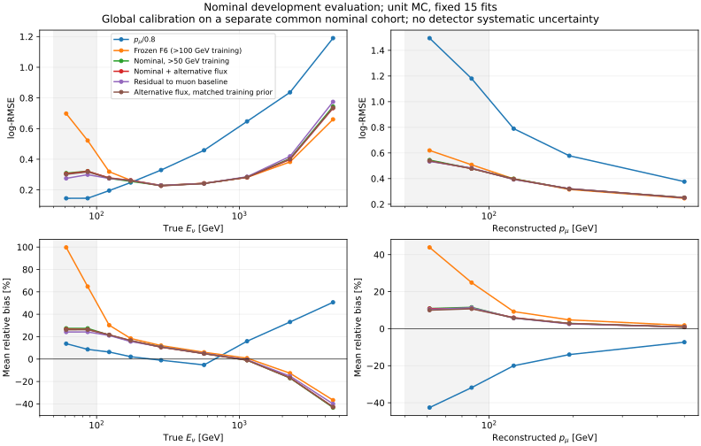

# 阶段55：50–100 GeV选择、低能上偏与替代flux训练

## 阶段目标

按用户本轮优先级，检查低能区ML逊于传统方法的原因；同时放宽重建与MC真值的pz门槛至50 GeV，并检验200080–200090、200091–200101的替代flux训练支持。
原stage54占据/读出工作尚未完成，本阶段保留其未提交文件；不以低能MC训练替代data可靠性交付。

## 冻结设计与输入

本轮开始commit：`3c9e6f9`。普通几何、官方master d32b0ff3的merge/without-IFT、TI12MC04、FASERNU-04、OFLCOND-FASER-06。
已有替代模型`bck`并非相同重建，故不直接混入。复用既有官方Calypso软件归档，无源码修改/重编译；新来源只在worker scratch执行RDO→reco→PHYS→标量训练缓存，xAOD和新PHYS不上传EOS。

[配置](../ml/configs/low_energy.json)、[302文件清单](../ml/configs/low_energy_files.tsv)、
[独立低能cut配置](../AnalysisZipFramework/config/ml_low_energy_cuts.yaml)。
相对原cuts，只有truth pz与leading reco pz从100改50 GeV；原顺序/其余条件不变，去掉直方图以减少输出。
F6原46+19项全保留；truth只作标签/诊断，不进部署输入；最高pz leading、原truth fiducial/lead与电荷条件不变。

- nominal六run复用原train/validation/calibration，合254文件；不读取旧locked test事件。
- 其余16个run每run两个训练来源、一个评价来源，共48文件，3个已有200080官方merge直接复用，45个需新重建。
- π/charm训练range为00000–00009、00010–00019，评价00020–00029；K评价00080–00089，匹配原nominal group角色。
- 读取各文件完整事件范围，保留已有末尾文件的实际不足10000事件长度；45个新来源均为10000事件，不按前缀/残差抽样。替代评价虽有16run，仅3个保守generation-range组，不能据此声称精确跨模型区间。
- 校准与评价的入射ν `(pdg,px,py,pz)` 精确重用从校准剔除；任何校准/评价重用从新训练剔除。
  不声称完整生成谱系独立。旧validation/calibration/challenge已暴露，全部是开发比较，非新blind确认。
- unit MC，新增来源同时改变N、母粒子/flux混合与先验；不可唯一归因纯训练数量，不作物理flux归一化预测。

同一新nominal校准支持上每模型一个全局log offset，另报raw；原F6保留旧offset，同时给共同校准版本。
固定depth5/400轮，3seed，nominal100、nominal50、mixture50、residual50、matched_flux50共15正式fit上限，无早停/参数扫描。
residual50预测`log(Eν/(pμ/0.8))`，推理加回mu基线。pμ已包含在X中，因此无限表达力/同分布的平方log损失最优解仍为E[log Eν|X]；残差参数化不增加观测信息，只能检验有限模型的学习偏置。matched_flux50按(component,true E分箱)训练计数重权，使总权重及各格权重和等于nominal50；与unit混训对照，有限隔离谱/组件先验变化。它不是物理flux归一化，格内连续谱/响应仍未完全匹配。正式fit前将原拟μ-only学习控制替换为此必要控制，总数仍15；传统pμ/0.8基线保留。
真实Eν与reco p分开分层，保留高y、未确认leading、极端尾与最高能量；500次component分层来源配对区间条件于固定模型/offset，不含重训、校准不确定性与系统误差。

## 已复现的低能问题（冻结模型，重训前）

完整nominal validation的扩展选择，原F6使用stage34原offset；本表不用于更改15-fit设计。
完整数值见[frozen_diagnosis.tsv](stage55_energy_ml/frozen_diagnosis.tsv)。

| 支持 | N | F6 / pμ/0.8 log-RMSE | F6 / pμ/0.8 mean bias % |
|---|---:|---:|---:|
| true Eν 50–100 GeV | 208 | .583560 / .145526 | +75.833 / +10.286 |
| true Eν 100–200 GeV | 906 | .288682 / .226855 | +23.588 / +3.955 |
| reco p 50–100 GeV | 682 | .562891 / 1.336788 | +33.808 / −36.889 |
| reco p 100–250 GeV | 2669 | .343550 / .652121 | +6.170 / −15.890 |

原模型真实低能区明显退化，且50–100 GeV不在原训练选择内。reco低p混有较高Eν/high-y与迁移事件，不能把其总体风险收益解释成真实低能无偏。
这里还没有从统计/先验/模型输入能力中唯一识别原因；后续共同事件支持对照回答放宽训练支持和flux混合的作用。

补充完整nominal来源诊断见[nominal_low_energy_composition.tsv](stage55_energy_ml/nominal_low_energy_composition.tsv)及[nominal_muon_response.tsv](stage55_energy_ml/nominal_muon_response.tsv)。true E50–100的208例中206例leading确认primary；median y=.064261（50–75为.040037，75–100为.075263），选择下多数能量已在μ中。确认的206例重建p对产生p的log-RMSE=.048647、median bias=−2.488%、R68=2.172%；confirmed true p50–100全402例为.044650、−2.400%、2.332%。这是不同参考面的复合响应，包含传播与拟合，不是同面pull或data标定。

因此当前MC真实低能样本的巨大ν上偏不支持简单归为μ核心重建失效；原训练门槛、全局回归/先验及条件选择需要继续分开。两例未确认与全部尾仍保留在模型评价，不能靠清除少数事件解释或改善总体。真E100–200确认882/906例，μ R68=3.035%；更高动量完整尾明显扩大，也不外推低p精度到TeV。此补充读取紧凑缓存wall1.079066 s、CPU.144578 s、RSS521.320 MiB；无需ROOT重读/新fit。

## 程序验证与技术记录

首个现有来源200082/00000–00009完整10000事件，低能选择323例，比原多35例；reco50–100为35例，true E50–100为8例。
原>100支持288例的身份与46个F5 float32列逐项精确复现。随后全nominal原选择train54196、validation13375、calibration9727的身份与46列均精确复现；validation全部19个附加输入也精确复现，见[existing_feature_validation.json](stage55_energy_ml/existing_feature_validation.json)。提取wall19.045876 s，父CPU1.133983 s，父RSS221.906 MiB，analysis RSS663.125 MiB；父CPU不包含子analysis。

200081/00010–00019修正后100事件新重建测试：100事件/528branches、18tracks，5例选中；向量/有限关键轨迹字段通过，measurement长度不符29例为官方已知记录顺序问题，未用于ML输入。
复制RDO6.45 s；reco30.12 s、user20.67/system3.27 s、RSS1024804 KiB；ntuple11.54 s、user7.30/system2.24 s、RSS894364 KiB；提取外部11.45 s、user6.72/system1.56 s、RSS654780 KiB。
原日志含已知geometry overlap ERROR与FPE：reco overflow9/invalid161/divbyzero6，ntuple三类FPE均0；关键轨迹字段有限不等于日志无FPE，也不代表shower系统闭合。

初次index257拟100事件pilot，但外部setup改写通用shell变量`mode`，导致实际跑全文件。已将worker变量全部改为stage55前缀；另用index258补做100事件验证。随后我在原进程尚运行时覆盖其AFS worker文件，Bash在原if块结束后读到改变的文件偏移，于line38语法错误exit2；重建和ntuple虽成功，scratch清理后无法恢复特征。这是操作造成的技术失败，不能当物理异常或成功产物。正式fit仍0时冻结排除仅训练index257，不改任何cal/eval；200081仍由258训练及259评价覆盖，全部22run保留。301个成功来源中44个需新重建。失败完整CPU/wall计入成本，不以更换源或删评价者掩盖失败。
正式45新RDO文件总字节45,673,906,493（45.674 GB十进制），这是源文件大小，非所有框架请求字节之和。45个RDO的CollectionTree头也逐个核验均10000 entries；只读metadata请求合计5583620 bytes，wall7.871516 s，未读事件payload。提取Uproot请求单独记录，analysis读取字节未instrument，不能与总I/O等同。

训练smoke只200 train/100 cal/100 eval、20轮：fit .0272021 s；内部wall .0895885 s、CPU .0332592 s、RSS171.180 MiB；外部3.25 s、user1.39/system.37 s、RSS175992 KiB；存模回读预测精确。
它只验证实现，不作为物理结果，也不从此选择超参数。

## 正式数据与结果

实际301成功来源完整2,991,976条，选中95,748例。清单原302，技术失败257仅训练排除，不能把计划值当成功值。
[完整支持](stage55_energy_ml/support.tsv)、[去重后训练支持](stage55_energy_ml/eligible_training_support.tsv)、[合并核验](stage55_energy_ml/dataset_summary.json)。

| 样本/分区 | 文件 | 选中N | 训练去重后N | true E50–100 N | reco p50–100 N |
|---|---:|---:|---:|---:|---:|
| nominal train | 178 | 56993 | 41447 | 778 | 2793 |
| nominal validation | 44 | 14057 | — | 208 | 682 |
| nominal calibration | 32 | 10263 | — | 150 | 536 |
| alternative train | 31 | 9559 | 9382 | 139 | 511 |
| alternative validation | 16 | 4876 | — | 78 | 259 |

训练保护指纹排除15,723例（nominal15,546、alternative177），校准排除1,823例，最终共同校准8,440例。这里排除是保守的精确入射四动量复用，不声称不同四动量即完整生成谱系独立。评价18,933例全部保留。
nominal100有效训练38,947例，nominal50为41,447，mixture/residual/matched为50,829；后者比nominal50增加22.636%。
nominal100与nominal50均应用同一去重，因此这两个新模型是训练门槛的受控比较。历史F6训练仍是原54,196例，不能撤销旧训练中的保护集四动量重用；它只作历史失效参照，不能把与它的全部差异归为门槛。
真实E50–100训练0→767→906，E100–200为2836→3564→4215。替代来源增加真实低能训练139例（18.123%），远少于原始RDO规模；仍不能据此独断“只有缺数据”。

五候选×三seed，15正式fit全部完成；各候选取三个log预测均值，再用共同8,440例nominal校准一个全局log offset。没有按能量箱校准、truth gate、早停或追加fit。
指标定义：log-RMSE = sqrt(mean(log(Ehat/Etrue)^2))，无量纲；mean/median bias为100×(Ehat/Etrue−1)，R68为相对残差84%与16%分位差的一半，tail50为|Ehat/Etrue−1|>0.5的比例。分辨率宽度必须连同偏差和尾读。

### 真实低能：改善明显，但仍逊于传统方法

下表均为nominal开发评价，同一事件支持，E50–100为208例/19组，E100–200为906例/22组。

| true Eν GeV | 方法 | log-RMSE | mean bias % | median bias % | R68 % | tail50 % |
|---|---|---:|---:|---:|---:|---:|
| 50–100 | 传统 pμ/0.8 | 0.145526 | 10.286 | 12.951 | 11.432 | 0.000 |
| 50–100 | 历史F6/原校准 | 0.583560 | 75.833 | 64.595 | 39.518 | 68.269 |
| 50–100 | nominal100 | 0.558448 | 71.845 | 65.322 | 34.989 | 68.269 |
| 50–100 | nominal50 | 0.318419 | 27.411 | 17.531 | 22.092 | 14.904 |
| 50–100 | mixture50 | 0.316318 | 26.533 | 15.617 | 23.079 | 15.865 |
| 50–100 | residual50 | 0.291938 | 24.196 | 14.791 | 19.745 | 11.538 |
| 50–100 | matched_flux50 | 0.312526 | 26.220 | 15.918 | 23.357 | 16.827 |
| 100–200 | 传统 pμ/0.8 | 0.226855 | 3.955 | 9.951 | 17.312 | 2.318 |
| 100–200 | 历史F6/原校准 | 0.288682 | 23.588 | 15.473 | 20.411 | 12.804 |
| 100–200 | nominal100 | 0.260310 | 20.459 | 13.972 | 16.592 | 9.382 |
| 100–200 | nominal50 | 0.264299 | 18.425 | 13.019 | 16.504 | 9.161 |
| 100–200 | mixture50 | 0.269575 | 18.666 | 12.842 | 17.113 | 9.382 |
| 100–200 | residual50 | 0.267378 | 18.010 | 12.089 | 17.190 | 8.940 |
| 100–200 | matched_flux50 | 0.268091 | 18.819 | 13.258 | 16.517 | 9.161 |

完整[校准后指标](stage55_energy_ml/metrics.tsv)、[原始指标](stage55_energy_ml/raw_metrics.tsv)、[配对区间](stage55_energy_ml/paired.tsv)、[run分层](stage55_energy_ml/run_metrics.tsv)。

来源配对相对log-RMSE降低率，正值为改进，95%区间条件于固定模型和offset，500次component分层来源bootstrap；不含重训/校准/探测器/flux系统，不作多重检验修正：

| 比较 | true E50–100降低率 % [95%] | true E100–200降低率 % [95%] |
|---|---:|---:|
| nominal50 对 nominal100 | +42.982 [+38.064, +49.566] | -1.532 [-3.983, +0.987] |
| mixture50 对 nominal50 | +0.660 [-1.335, +3.034] | -1.996 [-3.639, -0.276] |
| matched_flux50 对 nominal50 | +1.851 [+0.433, +3.642] | -1.435 [-2.733, -0.089] |
| residual50 对 mixture50 | +7.707 [+3.927, +11.793] | +0.815 [-1.257, +2.585] |
| residual50 对 mu_p_over0p8 | -100.609 [-136.531, -67.486] | -17.863 [-26.063, -9.855] |

1. 门槛受控对照在50–100显著改善42.982%，但100–200为−1.532% [−3.983,+.987]，未见一致改善。原训练支持缺失是50–100失效的实际贡献，不能解释全部剩余误差。
2. 本轮替代flux新增139低能训练事件后，unit混训只改善.660% [−1.335,+3.034]，尚无明确50–100增益；100–200反而变差1.996%。按组件/真能量格匹配nominal训练先验后，50–100小幅改善1.851% [.433,3.642]，100–200仍略退化。故不能说扩样已修复，也不能据有限增量断言更大独立样本无用；格内谱/响应和模型正则仍不完全等同，不能唯一分离纯N。
3. residual50相对mixture在50–100改善7.707% [3.927,11.793]，而nominal全样本退化2.046% [1.236,2.995]。它不是全能赢家；不能按truth能量在评价时切换到不同模型。最好的本轮50–100中心值.291938仍为传统.145526的2.006倍，mean bias+24.196%而传统+10.286%，tail50为11.538%而传统0%。
4. raw residual在50–100为.291109/+24.036%，100–200为.266720/+17.858%；共同校准后为.291938/+24.196%、.267378/+18.010%。raw与校准后都失效，不能再归咎于一个全局offset。仅更换为残差目标没有消除条件先验/有限函数拟合的影响。

### 替代flux评价与reco低动量必须分别解释

替代评价16来源/3generation-range组；50–100仅78例/2组，100–200315例/3组，只作描述性跨模型检查，不给虚假的精确来源CI。

| 替代评价 | pμ/0.8 | nominal50 | mixture50 | residual50 | matched_flux50 |
|---|---:|---:|---:|---:|---:|
| E50_100 log-RMSE | 0.156733 | 0.306021 | 0.299090 | 0.263562 | 0.296742 |
| E100_200 log-RMSE | 0.238729 | 0.258557 | 0.258345 | 0.258943 | 0.257371 |
| reco_p50_100 log-RMSE | 1.282382 | 0.502657 | 0.498422 | 0.488960 | 0.497515 |

替代样本真实低能同样保留ML劣势，不能归为nominal单一谱特例。未施物理flux权重，不将此表解释为各flux真实发生率。

nominal reco p50–100有682例：传统/mixture/residual log-RMSE为1.336788/.507014/.506949，mixture相对传统降低62.072% [59.946,64.143]；mean bias为−36.889/+10.864/+10.882%，R68为50.734/41.952/40.702%。
reco p100–250有2669例：传统/mixture/residual为.652121/.346202/.345825，mixture降低46.911% [45.109,48.891]，mean bias−15.890/+3.773/+3.556%。
这种改善有价值，却不能替代真实能量指标。682例中true E50–100为208，100–200为175，200–400为100，≥400为199；只有30.499%是真实50–100。
四组median y依次.0643/.3473/.7332/.8273，confirmed为206/152/47/38，高y或未确认者解释了为什么低reco p不是同一低E人群。
四组median总cluster31/36/127.5/416，Timing57.79/65.55/209.10/549.07 pC，calo EM .676/1.038/3.039/17.855 GeV。
这些分布只说明存在可利用的活动差异，不保证逐事件完全可分；不能用truth类标签选择保底路径，不能任意降低低p全部预测。

全nominal14,057例，传统/nominal50/mixture/residual log-RMSE=.568037/.296059/.294636/.300666；混训相对nominal50仅.481% [.214,.748]。
高y≥.8的440例与未确认510例全部保留：mixture对传统log-RMSE为.653096/1.676647和.580418/1.699317，但tail50仍36.818%/30.588%；ML也仍有4.091%/4.314%的>100%尾。
3200–6400 GeV271例，mixture log-RMSE=.733638，mean bias−42.737%、tail50=30.996%；residual为.774581/−39.989%/35.055%，高能尚未解决。≥6400本轮选中评价0例，未测量；不据空bin宣称稳健。




## 执行命令与产物

```bash
source /cvmfs/sft.cern.ch/lcg/views/LCG_109/x86_64-el9-gcc15-opt/setup.sh
export PYTHONNOUSERSITE=1 OMP_NUM_THREADS=1 OPENBLAS_NUM_THREADS=1 MKL_NUM_THREADS=1
# 准备清单/协议已冻结；prepare_low_energy.py拒绝覆盖，不能重复生成协议。
python ml/package_low_energy.py
# 生产清单见submissions.json；原257失败、258 pilot和258–301正式任务独立计账。
condor_submit -name bigbird18.cern.ch AnalysisZipFramework/submission/ml_low_energy.sub \
  mode=extract indices=/afs/cern.ch/user/x/xcheng/nu_mu_stage55/extract.txt \
  payloads=root://eoshome-x.cern.ch//eos/user/x/xcheng/FASER/nu_muAnalysis/software/energy-ml-low-energy-stage55.tar.gz
condor_submit -name bigbird18.cern.ch AnalysisZipFramework/submission/ml_low_energy.sub \
  mode=reco indices=/afs/cern.ch/user/x/xcheng/nu_mu_stage55/reco.txt \
  payloads=root://eoshome-x.cern.ch//eos/user/x/xcheng/FASER/nu_muAnalysis/software/energy-ml-low-energy-stage55.tar.gz,root://eoshome-x.cern.ch//eos/user/x/xcheng/FASER/nu_muAnalysis/software/calypso-master-d32b0ff3-el9-gcc13.tar.gz
python ml/collect_low_energy.py
python ml/package_low_energy_training.py
condor_submit -name bigbird18.cern.ch AnalysisZipFramework/submission/ml_low_energy_train.sub
# 训练cluster13648313，成功后：
tar -xzf ntuples/energy_ml_stage55/models.tar.gz -C .
python ml/report_low_energy.py
python ml/validate_low_energy.py
python ml/plot_low_energy.py
python ml/collect_low_energy_resources.py
python ml/collect_condor_resources.py --output workbook/stage55_energy_ml/condor_resources.json \
  bigbird18.cern.ch:13647425:257 bigbird18.cern.ch:13647424:1 \
  bigbird18.cern.ch:13647426:1 bigbird18.cern.ch:13647430:44 bigbird18.cern.ch:13648313:1
python ml/archive_low_energy.py
python ml/validate_low_energy.py
```

原始job参数/模式以[submissions.json](stage55_energy_ml/submissions.json)和Condor Ads为准。上述生产打包/提交通常只执行一次，不是重跑指令；打包的AFS worker版本不可在运行中更改。
紧凑事件缓存及模型分别位于`ntuples/energy_ml_stage55/`与`ml/artifacts/stage55/`，不提交Git。
合并后归档会逐301来源校验数组一致，再移除重复shards；传输包及15份共享索引也去重，保留单份数据、全部seed预测、模型和压缩提取metadata。

## 资源、存储与验证结果

[Condor资源](stage55_energy_ml/condor_resources.json)覆盖304进程/304次启动，303 exit0，index257对应唯一exit2；全部开销计入。remote CPU137,092 s = 38.081 h，累计remote wall142,285 s = 39.524 h（并发进程之和，非整轮耗时）。训练单进程remote wall183 s、user143/system12 s。批量全经HTCondor，每任务1 CPU；站点将内存请求上调为实际3,000 MB，不能把sub中的1,500/1,800 MB当实际分配。

[流水线计时](stage55_energy_ml/pipeline_summary.tsv)：

| 角色/环节 | 次数 | 累计wall s | 累计CPU s | 最大RSS KiB |
|---|---:|---:|---:|---:|
| 正式新reco | 44 | 109726.09 | 108191.18 | 1382692 |
| 正式新ntuple | 44 | 21107.18 | 20696.57 | 1056460 |
| 正式标量提取 | 301 | 5196.13 | 3669.41 | 703804 |
| 修正100-event pilot reco | 1 | 30.12 | 23.94 | 1024804 |
| 修正pilot ntuple | 1 | 11.54 | 9.54 | 894364 |
| 修正pilot提取 | 1 | 11.45 | 8.28 | 654780 |
| 失败完整reco | 1 | 3009.18 | 2982.15 | 1272004 |
| 失败完整ntuple | 1 | 642.03 | 632.59 | 1024944 |

正式44reco平均4.010 events/s、ntuple20.846 events/s（440000原始事件/各环节累计wall）；301外部提取575.809 events/s。无代码变更，复用现成构建，不需要新增C++编译。
15个fit内核wall101.020687 s，含载入/预测/存模的内部wall121.586730 s、CPU118.089435 s、峰值341.113 MiB；外部Python启动与环境计时另见Condor。
合并核验写缓存前wall21.692820 s、CPU2.499217 s；完整指标与bootstrap wall55.582132 s、CPU53.822347 s；归档后模型验证wall3.980681 s、CPU3.883274 s、RSS527.664 MiB。

Uproot标量/真值辅助提取请求1,015,334,461 bytes = 1.015 GB；RDataFrame另外读ROOT，未instrument，**总实际I/O未测量**。新源RDO大小45.674 GB及头读5.584 MB是独立计量，不混同全链路读写。正式44源均核10000 events/528branches及关键轨迹字段；没有保存新RDO/xAOD/PHYS副本。
原官方reco日志仍有geometry overlap与FPE，不能写“无ERROR”：44正式源reco OVERFLOW47,364/INVALID677,968/DIVBYZERO13,413，ntuple为0/12/4,620；逐源见[production_diagnostics.tsv](stage55_energy_ml/production_diagnostics.tsv)。验证通过只说明选用身份/分支和输入处理通过，不代表全部框架数值或探测器系统正确。

程序验证：

- 全nominal原>100身份/F5和validation F6附加输入精确复现；历史三个seed在13,375例旧validation的能量预测精确复现。
- 15个新模型逐个重新载入，逐seed、集成、offset及全局校准预测验证通过；四个直接log能量候选完全精确。residual的worker/lxplus log函数存在float64舍入差：逐seed最大8.8818e−16、集成最大1.7764e−15；offset精确。最初精确断言因此失败，随后仅对含log锚的residual设置8e−15绝对log容差；其他模型保持精确，未改模型或重训，不影响物理数值。
- 训练对保护集指纹重叠0，校准对评价0，来源组角色重叠0；不把此当完整谱系独立证明。
- 12组固定整数bootstrap权重与显式重复事件的七项指标独立核对，最大绝对差7.1054e−15。
- 301个source shard逐数组核对统一缓存后归档；15份seed预测共享身份索引、保留全部fit元数据；去重两个早期Condor JSON前逐项核对最终Ads一致。清理传输包/重复shards共63,735,430 bytes，最终缓存+模型24文件43,618,031 bytes = 41.597 MiB，见[storage.json](stage55_energy_ml/storage.json)。归档后独立模型/seed预测验证仍通过；未写SHA。
- Python语法编译、两worker的`bash -n`及`git diff --check`通过。曲线已查看，真实能量与重建动量横轴分别标注。

## 阶段性结论

**本轮已量化并显著减轻50–100 GeV的外推失效，但没有达到低真实能量超过传统方法的目标。** 训练门槛是已确认贡献；当前替代flux增量收益小，不能把剩余问题唯一归于统计量不足。共同全局校准与残差参数化也没有解除低能上偏。

仅以低reco p切换传统方法会牺牲其中高能/high-y事件的既有收益；后续必须在data可定义的读出条件下识别何时μ信息足够、何时需要shower信息，报告完整取舍。当前MC未证明信息不可恢复，也未识别全部物理原因，不能凭少数离群者关闭低能分支。

所有结果为已开发生产的selected-event MC研究，尚无新的盲确认、背景/接受度/物理flux归一化结论。真实data占据与响应、ν interaction/FSI/材料系统、最终谱收益本轮未测量；stage54任务保留，不能以这轮训练取代。

## 下一步计划

1. **先做0新fit的低能条件诊断**：输入本轮完整cache、五候选/传统预测、65部署读出；用train内固定p/活动格（不按validation残差定边界），测50–100、100–200真能区与较高E/high-y迁移在同一读出格内的风险、偏差、R68、尾、来源覆盖。验收为找出剩余上偏主要在低活动μ主导区还是读出重叠区；不可识别时明确量化，不能以truth作部署gate。
2. **依据该诊断冻结一次有界保底方案再训练**：仅用训练来源内隔离cross-fitting确定μ基线与残差估计的读出条件收缩规则；不在已暴露validation调阈值，不立即扩大网络/架构/seed扫描。新协议需明确低E相对传统的风险验收及高E/high-y代价，全真实支持和未确认/大尾均保留；未达标拒绝替换。新增独立生成谱系输入用于之后确认，现有分区不能重新叫blind。不是本阶段追加fit。
3. **继续待完成stage54 data占据/有效读出控制**：输入原6 data/12 MC已知来源、REC/RDO身份与实际mask/timebin定义；验收为共有分母下可解释的条件占据或上限，真实有据的响应范围。已有未提交stage54文件保留原状。本轮低能结果不能外推为data shower闭合。
