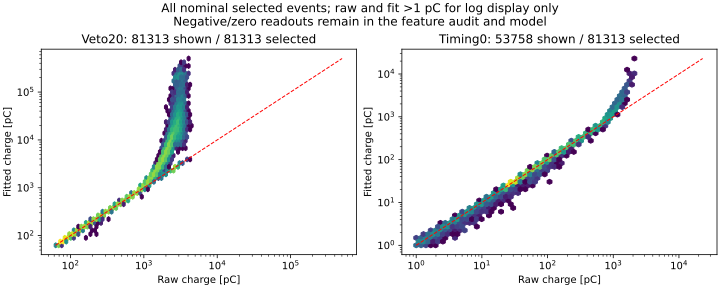
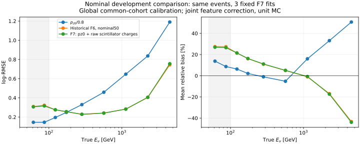

# 阶段56：pz0动量约定、raw闪烁体读出与非物理占位值审计

## 阶段目标与冻结范围

按用户最终澄清：**动量模长/纵向动量的线性输入只保留pz0；px/py、q/p和弯折量允许保留。** 删除p0/p1/pz1与log(p1/p0)，闪烁体拟合charge改raw_charge；检查-999、非负变量中的-1、状态默认和派生污染。
本轮起点`8c35b5c`。新用户输入审计优先于上一轮预定0新fit的条件诊断；只冻结3个seed的输入修订验证，不作架构/参数/能量门槛扫描。

[当前输入契约](../docs/nu_mu_energy_ml_features.md)、[F7配置/62列allowlist](../ml/configs/audited_features.json)、[65列逐项审计](stage56_energy_ml/feature_inventory.tsv)、[有界源码核对](stage56_energy_ml/source_semantics.md)。
主实现为`ml/audited_features.py`；新基础snapshot为`AnalysisZipFramework/config/ml_audited_output_columns.yaml`，与既有ml_definitions及显式50GeV cuts搭配。C++无修改，复用现成build。
历史F6/阶段55冻结配置与模型保持历史身份，不能给65列旧模型直接换62列或改名冒充F7。stage54未提交文件未修改、未混入本阶段。

## 输入与样本

- 对阶段55实际95,748个选中者/301来源的65列缓存做完整数值和变量谱系审计，无ROOT重读、无新fit。
- 仅从254个现有nominal官方d32b0ff3 merge PHYS补读raw/status/baseline_rms等标量，全2,521,976条，选中81,313例。六nominal run、普通几何、without-IFT、FASERNU-04、OFLCOND-FASER-06。输入精确路径仍为`ml/configs/low_energy_files.tsv`的nominal条目。
- 与stage55 nominal50严格相同的保护指纹/来源组角色：训练41,447、共同cal8,440、评价14,057/22组，true E50–100208例/19组、100–200906例/22组。所有42例新标缺失者、高y和未确认者仍保留，未按电荷/残差删事件。
- 45个替代RDO尝试的新增PHYS已按stage55约定清理，本轮不重复重建。F7只验证nominal；历史替代flux混训模型没有被冒充已修订，也不用fit charge填充缺失raw。
- 原pz>50选择及部分fit-charge cut沿用，以隔离输入修订的共同事件比较；本轮没有修改选择接受度或背景。unit MC，旧开发生产，不是新blind确认。

## 动量：同一拟合的近重复量，不作独立能损观测

95,748例测量（相对差无量纲）：

| 比较 | q16 | median | q84 | 最小/最大 | abs>1% N |
|---|---:|---:|---:|---:|---:|
| p0_over_pz0_minus1 | 5.6594522e-06 | 3.4174076e-05 | 0.00012711741 | 6.565859e-13 / 0.00031256892 | 0 |
| p1_over_p0_minus1 | -4.6519197e-05 | -1.0806734e-05 | -3.5623347e-06 | -0.0634866 / 0.054978767 | 8 |
| pz1_over_pz0_minus1 | -5.3184538e-05 | -1.157845e-05 | -1.8510324e-06 | -0.063485905 / 0.054978187 | 8 |
| log_p1_over_p0 | -4.6516781e-05 | -1.0809851e-05 | -3.5642957e-06 | -0.065591484 / 0.053520646 | 8 |

所有p0/pz0相对差小于.000312569（.031257%），median .003417%。p1/p0仅8例超过1%，全部保留，不以此删尾或宣布独立物理能损。
源码确认p0/p1为同一拟合轨迹最前/最后measurement处模长。log比值不等同完整靶区能损，也不直接测入射ν能量；本轮按用户意见删除。
F7保留前/后px/py、两q/p、弯折与位置/几何/质量；q/p仍是原前/后模长的逆参数化，允许使用不等于获得独立能量测量。传统基线统一pz0/.8。

## 闪烁体：拟合电荷外推是实际输入问题

每通道N=81,313，电荷pC；ratio为同事件fit/raw，统计ratio仅要求raw>1pC，**不是模型选样条件**。fail指GFIT/CBFIT标志，overflow单列，不混同所有大ratio都是无效fit。

| 通道 | raw最大pC | fit最大pC | 同事件fit/raw最大 | fit失败N（raw仍可用） | overflow N |
|---|---:|---:|---:|---:|---:|
| VetoNu0 | 364.837 | 365.999 | 1.462 | 21 (21) | 0 |
| VetoNu1 | 425.603 | 423.788 | 1.559 | 15 (15) | 0 |
| Veto10 | 5239.966 | 503189.906 | 121.578 | 2600 (2600) | 38363 |
| Veto20 | 4478.996 | 502838.375 | 123.344 | 2517 (2517) | 37102 |
| Veto21 | 4392.274 | 499688.844 | 132.380 | 1914 (1914) | 35762 |
| Timing0 | 2096.746 | 22977.250 | 11.073 | 15 (15) | 1965 |
| Timing1 | 2098.385 | 17812.672 | 8.563 | 13 (13) | 1964 |
| Timing2 | 2082.086 | 18953.518 | 9.119 | 14 (14) | 2189 |
| Timing3 | 2084.905 | 20711.811 | 9.972 | 5 (5) | 2194 |
| Preshower0 | 1680.506 | 3707.522 | 2.206 | 0 (0) | 84 |
| Preshower1 | 1679.897 | 3838.194 | 2.285 | 0 (0) | 289 |

Veto10/20/21中raw>1pC且fit/raw偏离1超过50%的分别24,967/23,542/22,347通道事件，不是只有少数离群点。饱和积分与拟合外推不是同一种观测；不能由最大fit值证明真实电荷为50万pC，也不把raw积分当未饱和真实电荷。
11个闪烁体拟合charge均已从F7 allowlist替换为raw_charge。GFIT/CBFIT失败不使可用raw丢失；overflow的实际截断raw保留，状态留诊断，不增加状态特征。



`VetoNu*_reduced_charge`来自原始wave样本的时间窗积分，不是拟合积分，故作为不同物理读出保留；缺参考时刻会回退raw总积分。其参考时刻与窗口系统仍待data核查。
actual d32b0ff3的raw积分是整窗基线扣除后有符号求和。VetoNu0/1 raw负值4,329/3,979例，Timing0–3为13,360/13,401/11,283/11,055例；不能把这些正常低信号涨落都当占位值。
已知data d0b1b2dd和旧MC参考1ec47efe的同名算法却只积分正wave样本。两者单位均pC，但算法不同；本轮是有界源码证据，未重新认证data完整生产或测全量响应。后续不能仅凭同名raw分支宣称data/MC闭合。

## 缺失/占位值规则与实际影响

旧F6主要只将非有限值变NaN，track helper对999999有局部处理，没有逐变量物理域约束；有限异常值和状态失败仍可能作为有效数进入。
对95,748个实际选中F6输入，本轮未发现-999、-9999或相应MeV→GeV缩放标记残留，也没有非有限单元。**这不证明原始未选中事件无占位值**，也不把“当前没发现”当未来预处理保障。

| 类型 | 当前处理 |
|---|---|
| pz0、正的几何跨度 | <=0或非有限→NaN；-.999GeV（原-999MeV）也能识别 |
| 半径、角度模、chi2/ndf、RMS | <0或非有限→NaN，合法0保留 |
| 计数 | 负数、非整数、uint32 wrap的4294967295及float32后的4294967296→NaN |
| 粒子电荷符号 | 只允许±1，-1合法；无效符号同时使依赖的两q/p缺失 |
| 模块ID | 实际IdDict允许eta=-1/+1、phi=0/1/2/3，越界→NaN |
| 外推/位置 | 已知999999mm→NaN，先清理坐标再算跨度/弦斜率，传播父项缺失 |
| 有符号读出/坐标/px/py/q/p | 保留合法负值；未知signed的-999先审计来源，不能全局替换 |
| raw/reduced波形 | baseline/missing/invalid mask392→NaN；fit失败bits16/32不删除raw |
| calo拟合EM能量 | baseline、fit失败、overflow、缺波形mask444→NaN；模块缺失使严格求和总量缺失，不用nansum伪装部分总和 |

原生清理先于float32转换；通道质量清理先于总量/比值依赖。不补0、不用评价集估计填充值，XGBoost原生处理NaN。`matrix`负责逐列规则，`build`还处理波形状态和派生依赖，后续评分不能绕过这些步骤。
本轮raw波形baseline/missing/invalid flags为0，baseline_rms=-1为0；但Calo0–3分别11/7/7/17个fit失败且旧能量为有限值，共42事件、84新NaN单元（模块及其依赖总量）。所有事件保留；评价其中7例/5组，不从小子集声称收益，完整风险表列出。
坐标/电荷负号合法性、正变量-1、-.999/-.001缩放占位、uint32 wrap前后、模块ID、无效坐标→派生斜率、无效符号→两q/p、fit失败raw仍可用及缺波形raw缺失均有固定QA验证。
status=1也可能是ntuple未填通道默认，不能凭1或0 charge统一删除；本轮只使用已定义的明确无效位。未识别来源的潜在默认歧义不补造真值。

## 固定三seed验证结果

F7 direct log(Eν/GeV)、depth5、400轮、CPU1，seed2026110255/56/57；不早停、不扫描，3fit上限。复用stage55 nominal50作为对照，其训练身份/保护、容量/seed相同；改动是联合输入修订，不能把全部差异唯一归给某一列。
同一8,440例cal每集成一个全局log offset=.004602409251，另报raw；校准没有按能量箱拟合。
log-RMSE无量纲，R68为相对残差84%与16%分位差一半，tail50为相对残差绝对值>.5的比例，bias均为相对能量百分比。

| 支持 | N | 方法 | log-RMSE | mean bias % | R68 % | tail50 % |
|---|---:|---|---:|---:|---:|---:|
| 全部nominal | 14057 | pz0/.8 | 0.568069 | +8.276 | 29.407 | 14.825 |
| 全部nominal | 14057 | 旧nominal50 | 0.296059 | +1.871 | 22.446 | 6.488 |
| 全部nominal | 14057 | F7 raw/pz0 | 0.296363 | +1.925 | 22.471 | 6.445 |
| true E50–100GeV | 208 | pz0/.8 | 0.145487 | +10.276 | 11.434 | 0.000 |
| true E50–100GeV | 208 | 旧nominal50 | 0.318419 | +27.411 | 22.092 | 14.904 |
| true E50–100GeV | 208 | F7 raw/pz0 | 0.312816 | +26.656 | 21.987 | 14.904 |
| true E100–200GeV | 906 | pz0/.8 | 0.226876 | +3.945 | 17.314 | 2.318 |
| true E100–200GeV | 906 | 旧nominal50 | 0.264299 | +18.425 | 16.504 | 9.161 |
| true E100–200GeV | 906 | F7 raw/pz0 | 0.265014 | +18.539 | 16.847 | 8.720 |
| reco pz50–100GeV | 682 | pz0/.8 | 1.336853 | -36.896 | 50.728 | 44.575 |
| reco pz50–100GeV | 682 | 旧nominal50 | 0.510529 | +11.241 | 42.581 | 25.660 |
| reco pz50–100GeV | 682 | F7 raw/pz0 | 0.502965 | +11.367 | 41.631 | 24.780 |
| reco pz100–250GeV | 2670 | pz0/.8 | 0.652049 | -15.893 | 35.582 | 18.876 |
| reco pz100–250GeV | 2670 | 旧nominal50 | 0.346943 | +3.781 | 24.427 | 9.775 |
| reco pz100–250GeV | 2670 | F7 raw/pz0 | 0.343488 | +3.962 | 24.090 | 9.139 |
| y≥.8 | 440 | pz0/.8 | 1.676717 | -59.858 | 17.818 | 85.682 |
| y≥.8 | 440 | 旧nominal50 | 0.654005 | -7.599 | 50.370 | 38.409 |
| y≥.8 | 440 | F7 raw/pz0 | 0.640068 | -5.655 | 50.376 | 35.455 |
| leading未确认 | 510 | pz0/.8 | 1.699385 | -59.250 | 22.080 | 81.176 |
| leading未确认 | 510 | 旧nominal50 | 0.586150 | -0.926 | 48.343 | 32.157 |
| leading未确认 | 510 | F7 raw/pz0 | 0.570928 | -0.002 | 46.493 | 28.627 |

[完整校准后/raw指标](stage56_energy_ml/metrics.tsv)、[来源配对区间](stage56_energy_ml/paired.tsv)。500次按π/K/charm分层、22来源组bootstrap，条件于固定fit/cal，不含重训/校准/系统误差，不作多重检验修正。

F7对旧nominal50的log-RMSE降低率：全体−.102% [−.468,+.274]，true50–100为+1.760% [.274,3.074]，100–200为−.271% [−1.598,1.096]。中心值整体接近，不将不显著差异当正式等价/非劣效证明。
真实低能F7 .312816仍远差于pz0/.8 .145487，mean bias+26.656%而基线+10.276%；仅输入清理尚未解决物理低能上偏。
reco pz50–100 F7对pz0/.8降低62.377% [60.448,64.297]，但它混有较高E/high-y，不能用于掩盖true低E失败。pz100–250为2670例，比按p0分层的旧2669多1例，属于变量边界迁移，不能直接混用旧分母。
高y440、未确认510及所有大尾保留；当前输入修订没有被当作对物理μ身份、interaction/FSI或data可靠性的修复。



## 验证、资源与存储

ROOT小测试：run200082首来源10000原始/323选中，77个snapshot列；身份、pz0、11raw charge与直接PHYS补读逐值精确。wall9.774683s、子CPU5.908250s、峰值666.730MiB，临时ROOT清理，见[snapshot_validation.json](stage56_energy_ml/snapshot_validation.json)。
提取pilot同文件10000/323，Uproot请求933409bytes、内部wall1.099542s/CPU.505237s/RSS85.438MiB；外部wall2.16s/CPU1.05s/RSS87488KiB。小样本通过后才提交批量。

6提取+1训练Condor任务各1启动/exit0，remote CPU163s、累计remote wall333s；实际每任务1CPU/站点分配3000MB。无新重建、无源码编译、无GPU或RDO/xAOD中间产物。
正式标量提取内部累计wall266.392806s、CPU136.955622s、peak150.371MiB；实际Uproot请求250,328,557bytes=.250329GB，低于事前1GB预算。完整处理2,521,976条，内部累计吞吐9467.133 events/s。外部6Python进程累计wall279.67s/CPU143.60s，RSS151.621MiB；包含导入，不与内部数字相加。
三fit内核wall13.407717s，含载入/评分/存模内部wall14.866060s、CPU14.706605s、RSS384.766MiB；外部18.39s/CPU17.00s。汇总/作图wall5.035783s、CPU4.316373s。QA snapshot额外ROOT读取字节未instrument，不能将标量请求当整轮总I/O。

三模型均重新加载，特征名/顺序/完整policy和cal/eval预测逐项精确，offset误差0。7组类型检查、5个依赖检查通过；归档后再次验证仍精确，wall1.228116s/CPU1.177695s/RSS545.918MiB。
六shard和pilot逐数组核对统一readout后删除；readout保留完整原始raw/status及来源metadata，旧stage55缓存复用不复制。去重传输包/临时shards共38,801,409bytes；新增长期5文件9,441,550bytes=9.004MiB，含3模型、预测与readout补充，见[storage.json](stage56_energy_ml/storage.json)。没有SHA/逐事件ROOT长期保存。
Python语法、worker bash语法和Git diff空白检查通过。阶段报告/紧凑表图提交Git，事件补充与模型忽略；不推送。

## 执行命令与产物

以下为已执行顺序记录，guard会拒绝覆盖成功产物或运行中替换transport。完整cluster/退出码见[submissions.json](stage56_energy_ml/submissions.json)。

```bash
source /cvmfs/sft.cern.ch/lcg/views/LCG_109/x86_64-el9-gcc15-opt/setup.sh
export PYTHONNOUSERSITE=1 OMP_NUM_THREADS=1 OPENBLAS_NUM_THREADS=1 MKL_NUM_THREADS=1
python ml/audit_model_features.py
python ml/read_audited_features.py --batch 0 --smoke --output ntuples/energy_ml_stage56/pilot.npz
python ml/package_feature_audit.py --phase read
condor_submit -name bigbird18.cern.ch AnalysisZipFramework/submission/ml_feature_audit.sub \
  mode=read batches=/afs/cern.ch/user/x/xcheng/nu_mu_stage56/read.txt
python ml/collect_audited_features.py
# 6个read任务全部exit0后移除已完成的read transport，再打包train phase。
rm software/energy-ml-feature-audit-stage56.tar.gz
python ml/package_feature_audit.py --phase train
condor_submit -name bigbird18.cern.ch AnalysisZipFramework/submission/ml_feature_audit.sub \
  mode=train batches=/afs/cern.ch/user/x/xcheng/nu_mu_stage56/train.txt
tar -xzf ntuples/energy_ml_stage56/models.tar.gz -C .
python ml/validate_audited_features.py
python ml/report_audited_features.py
python ml/collect_condor_resources.py --output workbook/stage56_energy_ml/condor_resources.json \
  bigbird18.cern.ch:13648888:6 bigbird18.cern.ch:13649821:1
python ml/archive_feature_audit.py
python ml/validate_audited_features.py
```

最终`ntuples/energy_ml_stage56/readout.npz`与`ml/artifacts/stage56/{2026110255,2026110256,2026110257}/model.ubj`，集成cal/eval预测在`ml/artifacts/stage56/predictions.npz`。
源语义只通过已知commit的`git show/grep`核对，未打开新的原始生成生产。模块ID有效域在正式fit前按实际IdDict补齐；read阶段只复制标量，不应用清理规则。最后补充无效符号→q/p的依赖保护对全部实际输入/三模型预测无数值影响，回读已验证。

## 阶段性结论与下一步

1. **变量约定已落实为实际62列F7及三个重训模型**，不是只改文档/列名。p0/p1/pz1与log比退出，px/py、q/p、弯折按用户最终澄清保留，11闪烁体使用raw。
2. 饱和拟合外推及有限但失败的calo数值是实际问题；raw替换和状态/占位清理没有以丢事件获得表面收益。当前selected MC未发现-999类残留，不将其当作低能上偏已识别的主要原因。
3. 输入修订后低真实能量劣势仍在，不能宣称解决；下一轮以F7为基准，先0新fit用train冻结少量pz0/原始活动条件，量化同格低E与high-y迁移、传统/F7风险、偏差、R68/尾及来源支持。验收为能否定义不依赖truth的μ保底条件，并明确高E代价；不在暴露validation调gate或扫描网络。
4. data响应支线保留：所需输入为原6 data/12 MC及实际wave版本、mask/timebin/积分定义；除tracker占据约束外，raw语义版本差和饱和响应需明确。验收是共同定义下条件响应或有据上限，未测data/强子shower/flux归一化不以MC训练代替。
5. F7替代flux验证目前未测量；未来需要同域raw/status补充及冻结I/O/重建预算，不能重新解释stage55历史F6混训为F7确认。不因此关闭替代flux或低能分支，也不自动重复44文件昂贵重建。
