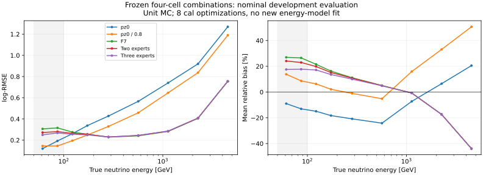
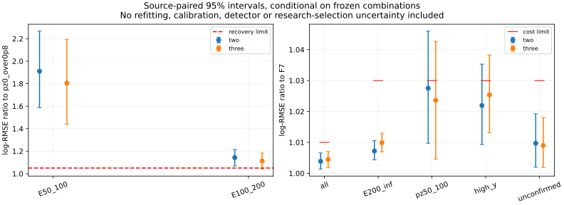

# 阶段58：四格受约束物理专家组合——低能改善，但未恢复传统精度

## 阶段目标与结论

按用户刚提交的`4a55cf5`路线§38与下一轮Prompt，一次完成四格诊断、二/三专家组合、来源OOF、冻结评价和下一投入决策。**完成8次低维组合优化、0新能量模型fit、0ROOT/RDO重读、0新生产/谱toy/SHA。** 未停在诊断后请求再次启动组合。

**三专家相对F7改善true50–100的log-RMSE 16.032% [10.551,22.413]、100–200改善4.745% [2.311,7.504]，但两层仍未恢复传统精度；reco低p与high-y的代价区间也未通过。** 本轮不替换F7，不放宽验收门槛。理想三专家下界明显更好，下一投入应检验更有信息的可部署gate及其来源支持，不继续调这四个粗格，也不据此关闭低能方向。

本报告数值来自实际紧凑缓存计算；log-RMSE及其比值无量纲，bias/R68/尾率用%，尾变化用百分点pp。95%区间均为500次π/K/charm分层保守来源组配对bootstrap，条件于已固定预测，不含重新优化、F7重训、校准、探测器/flux或研究选择不确定性。

## 输入、选择与保护

- 输入为`ntuples/energy_ml_stage55/dataset.npz`（25,505,895 bytes）、`ntuples/energy_ml_stage56/readout.npz`（6,194,961 bytes）、`ml/artifacts/stage56/predictions.npz`（297,800 bytes）；文件总大小31,998,656 bytes只是输入体积，不等于网络/物理I/O。
- 调用`audited_features.load()`统一F7状态/物理域/依赖；62列约定不回退。线性模长/纵向仅pz0，px/py、q/p、弯折保留；11闪烁体raw，VetoNu reduced保留；负raw合法，求和传播NaN，不补零。
- nominal官方d32b0ff3/without-IFT、原50 GeV门槛、其余选择（包括部分fit-charge cut）及unit MC不变。train/cal/eval=41,447/8,440/14,057，分区和相同入射ν向量保护沿用；不读历史locked-test预测或评价其标签，不为alternative补造raw，不重建shard/transport。
- cal明确改为组合开发集。eval是已暴露的开发检验，不是blind或独立确认；group保护不等于完整生产谱系独立已被认证。
- 完整81,313 nominal输入仍有42个新标缺失的calo事件。本轮eligible角色中train/cal/eval为21/3/7；另11个原本不在这些角色中（既有保护排除），不是按本轮缺失值或残差新删。全部沿用原角色；7个eval缺失事件/5组保留，F7及组合log-RMSE均0.666657，小支持不声称收益。

## 结果前固定协议与支持

完整不可覆盖协议见[protocol.json](stage58_energy_ml/protocol.json)，UTC冻结时间2026-11-02 19:00:16，早于组合输出。主代码为`ml/expert_combination.py`，prepare/run/report/validate为四个独立入口。

Timing0–3经F7清理后的float32值转float64严格求和，pC；train-only中位数为：

| pz0 GeV | 有效train N | Timing中位数pC | 路由 |
|---|---:|---:|---|
| [50,100) | 2498 | 77.0212325230 | 小于中位数low，否则high |
| [100,250) | 9663 | 64.2618785799 | 同上 |

Timing缺失或pz0≥250默认F7。本轮其他counts/Calo仅诊断，不选新边界。小样本先验证50/100/250边界、缺失默认、有符号求和和三个专家顶点，未进行额外优化。

cal三折按component内来源事件数贪心平衡，只用group/component/N，不用真能量、y或残差。每个保守group仅在一折。逐角色/折/困难组/读出格支持（包括空格）在[support_before_optimization.tsv](stage58_energy_ml/support_before_optimization.tsv)。

| cal留出折 | 全N / groups | π/K/charm N | true50–100 N/groups | true100–200 N/groups | high-y N | 未确认N |
|---|---|---|---|---|---:|---:|
| 0 | 2613 / 5 | 1199/1036/378 | 50/4 | 205/5 | 64 | 99 |
| 1 | 3075 / 6 | 1215/1519/341 | 52/5 | 242/6 | 90 | 107 |
| 2 | 2752 / 5 | 1214/1538/0 | 48/5 | 244/5 | 76 | 95 |

实际cal真50–100为150/14组、100–200为691/16组；这是本轮读取保护后数组测得，不照抄保护前支持。cal只有2个charm组，折2无charm，且三折最低能均无charm；不能以很多同源事件替代component外推支持。

## 组合目标、实现与验证

三个专家为`t0=log(pz0/GeV)`、`tμ=log((pz0/.8)/GeV)`、`tF=mean_seed(raw_F7_log)+offset`。每格权重非负、和为1；二专家固定w0=0。推理只查pz0/Timing格，不读取truth/y/身份/来源。pz0是测量面动量参照，没有被标为产生面μ校准。

每族三折+最终全cal，共**8次SciPy 1.16.3 SLSQP调用**。各折offset只用其余cal标签，分别0.006337423593、0.001355077556、0.005887923662；最终全cal offset为0.004602409250700414，与stage56精确相同。不用全cal offset冒充OOF。

主目标为两低E组相对传统平方log风险的最大值。全体相对F7的MSE上限1.01²，E≥200/reco pz50–100/high-y/未确认上限1.03²。所有格取F7是这些代价约束的可行点；低E≤传统并非强制可行约束。

为保持8次调用，采用固定数值次级项`max_low_ratio + 10^-6 * (MSE_all/MSE_F7_all)`，不扫描λ。其精确全局解对主目标最优值的牺牲上界≤1.0201×10^-6；实际用解析梯度、ftol=10^-13，最大投影KKT残差5.103×10^-8、约束违反<10^-8。**这是有界数值近似次级选择，不声称求得严格字典序唯一解或严格原始/对偶误差证书。** 它与当前低E风险比距1的差远不在同一量级，不作为失败原因。

最终全cal最坏低E MSE比：二专家2.847161，三专家2.429433；两者reco pz50–100约束均在1.0609处起作用。cal拟合的代价约束均满足，不保证OOF/eval仍通过。模型/每折参数及数值检查见[models.json](stage58_energy_ml/models.json)。

| 格 | 二专家(w0,wμ,wF) | 三专家(w0,wμ,wF) |
|---|---|---|
| pz50–100 / low | (0,.427984,.572016) | (.329384,0,.670616) |
| pz50–100 / high | (0,.008784,.991216) | (.008360,0,.991640) |
| pz100–250 / low | (0,≈0,≈1) | (.084377,.000523,.915100) |
| pz100–250 / high | (0,0,1) | (0,0,1) |

无新能量fit；所有8个组合的offset、OOF/最终预测、权重和经验风险独立回读核验。解析二次风险/梯度经小型数值差分检查；train-only边界精确重现，默认分支逐值等于F7，原stage56 F7七个主要层的N和log-RMSE精确重现。见[validation.json](stage58_energy_ml/validation.json)。

## 冻结评价：改善F7未等于恢复传统

评价共14,057/22保守来源组；true50–100为208/19、100–200为906/22。完整分能量箱、reco两低p层、缺失与双向tail50/100见[metrics.tsv](stage58_energy_ml/metrics.tsv)，来源配对比值/尾变化区间见[paired.tsv](stage58_energy_ml/paired.tsv)。≥6400 GeV无选中评价，指标未测量；空支持显式保留。

| 支持 | N | pz0 | pz0/.8 | F7 | 二专家 | 三专家 |
|---|---:|---:|---:|---:|---:|---:|
| 全体log-RMSE | 14057 | .657519 | .568069 | .296363 | .297516 | .297680 |
| true50–100 | 208 | .173174 | .145487 | .312816 | .277997 | .262665 |
| true100–200 | 906 | .306499 | .226876 | .265014 | .259270 | .252439 |
| true≥200 | 12943 | .680062 | .588671 | .298164 | .300311 | .301116 |
| reco pz50–100 | 682 | 1.489001 | 1.336853 | .502965 | .516805 | .514839 |
| reco pz100–250 | 2670 | .779128 | .652049 | .343488 | .343488 | .344991 |
| high-y≥.8 | 440 | 1.878026 | 1.676717 | .640068 | .654095 | .656296 |
| leading未确认 | 510 | 1.895414 | 1.699385 | .570928 | .576465 | .576056 |

**pz0单独在最低能仍差于pz0/.8（RMSE比1.190307，改善−19.031% [−35.085,−3.050]）。** 去掉固定0.8虽使均值从+10.276%变−11.779%，但绝对log风险更差，不能由低y中位数直接推出更好ν重建。三专家对二专家低E改善5.515% [3.237,8.870]及2.635% [1.827,3.374]，说明增加低输出参照在此组合族有用，不证明它单独有效或是无偏能标。

| trueE / 方法 | mean bias % | median bias % | R68 % | tail50 % |
|---|---:|---:|---:|---:|
| 50–100 / pz0/.8 | +10.276 | +12.936 | 11.434 | 0.000 |
| 50–100 / F7 | +26.656 | +17.192 | 21.987 | 14.904 |
| 50–100 / 二专家 | +23.321 | +16.512 | 14.360 | 9.135 |
| 50–100 / 三专家 | +17.675 | +9.613 | 16.802 | 8.654 |
| 100–200 / pz0/.8 | +3.945 | +9.942 | 17.314 | 2.318 |
| 100–200 / F7 | +18.539 | +13.441 | 16.847 | 8.720 |
| 100–200 / 二专家 | +17.159 | +12.825 | 17.056 | 8.168 |
| 100–200 / 三专家 | +15.131 | +10.841 | 16.416 | 7.837 |



### 预定验收逐项

[acceptance.json](stage58_energy_ml/acceptance.json)保留两族全部判断，不按有利中心值宣布成功。下表给主候选三专家，括号为来源配对95%上限：

| 条件 | RMSE比中心（95%上限） | 预定上限 | 判断 |
|---|---:|---:|---|
| true50–100 / 传统 | 1.805421 (2.193534) | 1.05 | 未恢复 |
| true100–200 / 传统 | 1.112675 (1.183498) | 1.05 | 未恢复 |
| 全体 / F7 | 1.004447 (1.007068) | 1.01 | 通过 |
| true≥200 / F7 | 1.009903 (1.012979) | 1.03 | 通过 |
| reco pz50–100 / F7 | 1.023606 (1.042697) | 1.03 | 区间未通过 |
| high-y / F7 | 1.025354 (1.038256) | 1.03 | 区间未通过 |
| 未确认 / F7 | 1.008982 (1.018032) | 1.03 | 通过 |

三专家最低两E层相对传统tail50增加8.654/5.519pp，均超过2pp；相对F7困难组tail50中心变化在−2.346至0pp，区间上限最大1.181pp，通过尾代价，但不能替代RMSE验收。正/负tail50、tail100及其变化均在表中；相对残差下界为−1，负tail100按严格<-1自然为0，不将其叫无欠估。二专家同样未通过低E恢复和reco低p/high-y区间代价。



## OOF来源波动与物理混合

OOF由每折各自offset/权重产生，不含留出标签的训练；cal已是开发集，OOF固定预测区间也不是全流程独立确认。折/source明细为[cal_oof_folds.tsv](stage58_energy_ml/cal_oof_folds.tsv)、[source_metrics.tsv](stage58_energy_ml/source_metrics.tsv)。

| cal OOF层 | N | 传统log-RMSE | F7 | 二专家 | 三专家 |
|---|---:|---:|---:|---:|---:|
| 全体 | 8440 | .544278 | .276010 | .277965 | .277958 |
| true50–100 | 150 | .152369 | .300101 | .256427 | .236619 |
| true100–200 | 691 | .215110 | .245631 | .238660 | .241708 |
| reco pz50–100 | 504 | 1.247405 | .459004 | .478345 | .478218 |
| high-y | 230 | 1.604856 | .592037 | .611770 | .611307 |

三专家50–100各折RMSE为.203478/.259310/.242881，传统.161740/.148301/.146544，三折均未恢复；100–200为.227791/.245311/.249343，传统.199358/.211829/.230537。OOF低E100–200对F7改善仅1.597% [−.362,3.440]，没有达到评价中心的4.745%；不能选择只报评价收益。OOF全体95%代价上限1.012832>1.01，reco低p/high-y中心代价4.186%/3.255%，显示约束从拟合到留出并非稳定保证。

50–100三专家单来源OOF RMSE范围.094135–.328089，每来源只有1–26例（14组）；100–200为.138648–.295986、2–96例（16组），描述性波动不解释为独立误差条。低pz/low格w0跨三折为.280333/.304764/.417921；高pz/low格w0从≈0到.040505，最终全cal为.084377，说明有限cal中的细小权重并不稳定。

同格组成和风险在[cell_composition.tsv](stage58_energy_ml/cell_composition.tsv)、[cell_metrics.tsv](stage58_energy_ml/cell_metrics.tsv)。冻结eval四格：

| 格 | 总N | true50–100 | true100–200 | true≥200 |
|---|---:|---:|---:|---:|
| pz50–100 / low | 298 | 158 | 104 | 36 |
| pz50–100 / high | 384 | 50 | 71 | 263 |
| pz100–250 / low | 1340 | 0 | 478 | 862 |
| pz100–250 / high | 1330 | 0 | 253 | 1077 |

低pz/low中36个≥200者的median y=.820639、Timing53.141pC、clusters52、calo .732GeV；158个真低E为y=.059210、Timing55.081pC、clusters31、calo .682GeV。**低Timing不是小transfer的充分条件。** 同格两个群体的Timing/Calo中位数相近，counts仍有差异，但不能由中位数断言逐例可分或据此事后加split。高活动格也含50个真低E，保持F7可保护高E却留下低E大尾。本轮的物理证据是粗活动格内低E和高-y仍混合，不是证明全部F7读出无辨识信息。

## 理想凸组合下界与下一科学决定

仅诊断将true logE投影到专家输出区间；不加四格/default约束，也不强制可部署的共同权重。它使用答案，**不是可部署能量估计或通用信息下界**。完整表为[oracle_diagnostic.tsv](stage58_energy_ml/oracle_diagnostic.tsv)。

| eval支持 | 传统 | 理想二专家 | 理想三专家 |
|---|---:|---:|---:|
| 全体log-RMSE | .568069 | .250586 | .238642 |
| true50–100 | .145487 | .114102 | .023980 |
| true100–200 | .226876 | .127803 | .081975 |

理想三专家相对传统低E改善83.517% [77.148,90.314]及63.868% [58.915,69.716]。连理想二专家也分别有21.572%/43.668%改善，因此当前失败不只是“缺少更低专家”；根据答案逐事件挑选与依据稀疏读出识别群体有很大距离。四格内共享权重及低/高E代价冲突、cal支持不稳定得到支持，程序实现/旧offset污染未发现。不能将这些成分的因果份额或全部观测的信息上限当作已测结论。

**本阶段决定：保持F7；不追加这四格的阈值、λ、seed或宽松代价扫描。** 下一单项研究为更有信息的轻量gate，先冻结协议再执行：

1. 输入继续用当前F7缓存和cal/eval原始预测，无ROOT/生产；沿用本轮三折与每折offset。仅用train冻结pz0、Timing raw总和、总cluster和calo EM四个允许读出变换/尺度，缺失显式路由F7，合法负值用有符号变换保留。不得据本轮eval结果挑新变量/边界。
2. 候选仅一个小gate（建议固定8单元的一层softmax、3专家权重），三折+全cal共4次gate拟合，0新F7训练；训练目标及1%/3%代价、双低E和尾验收保持本轮定义。与当前三专家固定对照，不进行宽度/深度/学习率/seed搜索；该候选的收益、资源和收敛可行性均**未测量**，执行前在协议中冻结数值算法、预算和可行点。
3. 验收需要OOF与冻结eval同时报告：低E两层相对传统95%上限≤1.05、全体/困难组与尾代价共同满足。若来源波动仍主导，交付所缺条件/component/generation支持与一次定向低E补样预算；不能靠更多seed或同事件复制冒充新增独立支持。该gate仍失败再单独冻结连续E似然比实验，不自动连开新模型/新生产。
4. 共同raw/data响应、stage54占据和ν interaction/FSI/材料继续保留；当前结果不是data改善或最终能谱物理收益。替代flux当前缺raw补充，F7迁移未测量。

## 执行、资源与产物

实测主机`lxplus908.cern.ch`，LCG_109/x86_64-el9-gcc15-opt，NumPy/SciPy CPU单线程；无GPU、无新编译或Condor（仅约32MB既有紧凑缓存的小规模计算）。软件导入前的启动耗时和EOS实际网络/物理字节未测量，不冒充0I/O。

| 步骤 | 内部wall s | CPU s | 峰值RSS MiB | /proc rchar增量bytes |
|---|---:|---:|---:|---:|
| prepare+小样本QA | 1.029448 | .939601 | 545.918 | 32,258,816 |
| 8组合优化+预测 | .964199 | .858833 | 545.918 | 32,260,971 |
| 500来源重抽样+表图 | 6.290785 | 5.151047 | 545.918 | 68,150,761 |
| 最终独立验证（含完整42缺失检查） | 2.178792 | 2.137541 | 545.918 | 64,706,759 |

8次优化内核累计.101708s；以上为各脚本进口后的测量，不当作整个会话总成本。首次独立验证另用wall.801209s/CPU.773499s，随后补充“42 vs eligible31”的保护计数核查并重跑最终验证，**没有再次优化**。前置交互缓存探查未单独计时，不能以表中合计当全部会话wall/CPU。/proc的rchar含缓存/库读取，kernel read_bytes本次均0，不代表没有EOS读取；不把输入文件大小当请求字节。

最终新增逐事件产物仅`ml/artifacts/stage58/predictions.npz`，423,468 bytes=.404MiB，含两族OOF/最终预测、精确cal/eval行号和折号；模型权重/offset/路由在Git中，未复制原缓存、ROOT、模型或transport。两幅SVG和紧凑TSV/JSON随报告提交，PNG仅本地检查。stage54原有未提交文件未修改、未混入提交。

```bash
source /cvmfs/sft.cern.ch/lcg/views/LCG_109/x86_64-el9-gcc15-opt/setup.sh
export PYTHONNOUSERSITE=1 OMP_NUM_THREADS=1 OPENBLAS_NUM_THREADS=1 MKL_NUM_THREADS=1
python ml/prepare_expert_combination.py
python ml/run_expert_combination.py
python ml/report_expert_combination.py
python ml/validate_expert_combination.py
python3 -m py_compile ml/expert_combination.py ml/prepare_expert_combination.py \
  ml/run_expert_combination.py ml/report_expert_combination.py ml/validate_expert_combination.py
git diff --check
```

prepare/run拒绝覆盖已冻结协议/成功模型；复核用validate，不能重新执行8次优化。资源原表为[prepare](stage58_energy_ml/prepare_resources.json)、[optimization](stage58_energy_ml/optimization_resources.json)、[report](stage58_energy_ml/report_resources.json)、[validation](stage58_energy_ml/validation.json)。本地Conventional Commit，不推送，不自动启动下一项gate研究。
