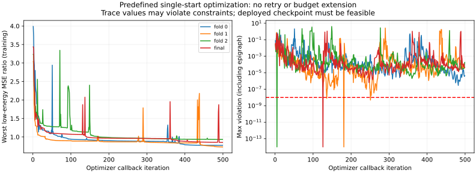
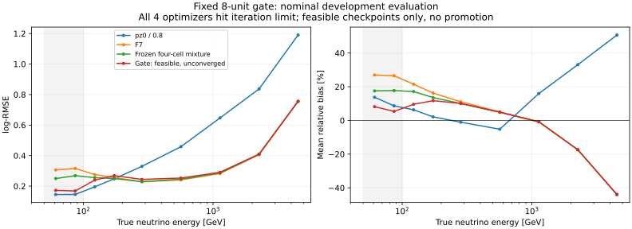

# 阶段59：轻量读出门控——最低能接近传统，但数值未收敛与代价外推均未通过

## 阶段目标与决定

本轮按用户要求继续路线§39，起点`7bc479e`。实现并完成一个固定的4输入/8隐藏单元/三专家gate：train冻结变换，cal原来源三折+全cal，共**4次gate拟合、0新F7能量fit、0ROOT/RDO/生产/谱toy/SHA**。F7变量契约、选择和保护不回退；没有追加结构、种子、阈值或λ搜索。

**结果：未通过，不替换F7。** 冻结eval的true50–100 log-RMSE从F7 .312816降到.169719，更接近传统.145487；但100–200仍为.256517/传统.226876，全体相对F7退化2.059%、reco低p退化11.333%，困难尾也有代价。全部4次优化达到预定500迭代上限，均不收敛；按冻结规则评价训练可行checkpoint，**这些不是已收敛的最佳gate，更不是部署确认**。

数值梯度/推理/来源检查通过，与优化收敛失败分开记录。当前数据不支持宣布轻量gate已解决低能，也不支持把本轮失败当作所有gate或全部读出的信息极限。下一步应先有界修复可行性参数化，不能直接用本轮阴性关闭低能方向或盲目扩大神经网络。

## 输入、物理约定和实际支持

复用`audited_features.load()`及stage56/stage58紧凑预测；文件：

| 输入 | bytes |
|---|---:|
| ntuples/energy_ml_stage55/dataset.npz | 25,505,895 |
| ntuples/energy_ml_stage56/readout.npz | 6,194,961 |
| ml/artifacts/stage56/predictions.npz | 297,800 |
| ml/artifacts/stage58/predictions.npz（对照） | 423,468 |

input体积不是实际EOS网络/物理I/O。普通官方nominal d32b0ff3、without-IFT、原pz>50及其余cuts（包括部分fit-charge cut）保持，unit MC。完整81,313输入先经F7有效域/状态/派生规则；线性动量模长/纵向仅pz0，px/py、q/p、弯折允许，11闪烁体raw和VetoNu reduced约定保持。有符号基线扣除电荷/EM能量用asinh，不剪负值、不填0或删整个事件。

train/cal/eval为41,447/8,440/14,057。精确四动量保护和保守group沿用，不读取historical locked-test预测或评价其标签，不为alternative伪造raw。cal已是gate开发集，eval已暴露；这些都是开发比较，不是新blind。完整生成谱系独立仍未认证。

| 角色 | 总N/groups | gate有效N | 默认F7 N | 原缺失输入事件N |
|---|---|---:|---:|---:|
| train | 41447/91 | 12159 | 29288 | 21 |
| cal | 8440/16 | 2311 | 6129 | 3 |
| eval | 14057/22 | 3351 | 10706 | 7 |

gate有效需四个输入有限、cluster非负且50≤pz0<250GeV；否则精确用F7，保留整个事件。相对stage58的12,161/2,312/3,352，分别多2/1/1例因calo缺失默认F7。完整42个calo缺失者保持；eligible中31个、另11个原本在既有保护排除中，未按本轮残差新增删除。eval的7例/5组F7和gate log-RMSE均.666657，不从这一小支持声称收益。

实际cal true50–100为150/14组、100–200为691/16组。沿用stage58三折：留出N=2613/3075/2752，低E N=50/52/48及205/242/244；cal只有2个charm组，一折无charm，最低能三折均无charm。fold不按标签或残差重选；完整映射随[protocol.json](stage59_energy_ml/protocol.json)保存。

## 结果前冻结的实现和数值小样本

协议UTC 2026-11-02 19:39:05冻结，之后不覆盖。输入仅pz0、Timing0–3 raw严格总和、四站cluster严格总和、清理后的calo EM总量。逐项变换和train-only有效12,159例的median/IQR：

| 输入/单位 | 变换 | center | scale(IQR) |
|---|---|---:|---:|
| pz0/GeV | log | 5.0595223782 | .6177134945 |
| Timing raw总和/pC | asinh | 4.8783080942 | 1.0022357439 |
| total clusters/个 | log1p | 3.7135720667 | 1.1641149980 |
| calo EM/GeV | asinh | .8284200968 | 2.1777354789 |

没有根据cal/eval挑尺度或剪离群值。标准化后为4→tanh(8)→2个相对logit，F7 logit固定0，形成3-softmax。增加标量ρ∈[0,1]，有效权重为`ρ*s0, ρ*sμ, 1−ρ+ρ*sF`，共59参数（58网络参数+ρ）。这保留了有限softmax本身无法精确表示的“ρ=0、全用F7”可行点；不是新能量专家或新的数据输入。网络参数限[-8,8]，初值seed2026110259，每折同一预定种子，ρ=0；无多起点。

专家为log(pz0)、log(pz0/.8)、三seed平均F7原始log+offset。各折offset只由其余cal标签计算，与stage58精确一致：.006337423593/.001355077556/.005887923662；最终全cal .004602409250700414。gate推理函数只访问四读出、F7原始预测及已保存参数，不读truth/y/身份/component/group。

主目标仍是两低E相对传统log-MSE的最大比值，代价全体≤1.01²、true≥200/reco pz50–100/high-y/未确认≤1.03²；次级为固定10^-6全体/F7 MSE项，不扫λ。SLSQP解析Jacobian、ftol=10^-10、maxiter=500；训练约束容差10^-8。**非凸问题，不声称全局最优或严格字典序解。** 每次wall≤90s、4次≤360s、CPU≤400s、RSS≤1200MiB、新预测≤2MB。超限或未收敛按冻结目标从训练可行迭代（含初始F7）取最好者，明确标失败，不重试。

48例cal小样本先检查完整59参数输出/七风险梯度、权重simplex、ρ=0精确F7、NaN/250GeV默认、负Timing/负calo合法；没有小样本优化fit。风险Jacobian最大差1.639×10^-10。见[pilot.json](stage59_energy_ml/pilot.json)。

## 优化实际失败与可行checkpoint

4次均status9“Iteration limit reached”，每次499条callback，达到maxiter500。没有追加迭代、重启或更换算法。模型、完整训练轨迹及checkpoint在[models.json](stage59_energy_ml/models.json)，摘要在[optimizer_diagnostics.json](stage59_energy_ml/optimizer_diagnostics.json)。

| 拟合 | 选中callback（0=初值） | ρ | 选中最坏低E MSE/传统 | 选中最大违反 | 末callback最坏比 | 末callback最大违反 |
|---|---:|---:|---:|---:|---:|---:|
| 留出折0 | 0 | 0 | 4.750997 | 0 | .772847 | 4.378×10^-6 |
| 留出折1 | 251 | .458516 | .867217 | 4.866×10^-9 | .729472 | 4.136×10^-5 |
| 留出折2 | 5 | .297373 | 2.181090 | 0 | .932793 | 1.793×10^-4 |
| 全cal | 126 | .515572 | 1.066546 | 0 | .851274 | 4.606×10^-5 |

选中模型均满足训练经验代价（含容差），但折0因后续checkpoint不满足冻结的完整可行判据而回退F7。最终全cal各风险MSE比：true50–100=1.066546、100–200=1.063401，全体/F7=1.017390、≥200=1.048892、reco低p=1.060867、high-y=1.032681、未确认=.964374。

**末callback损失更低，不代表可用解。** 其违反同时包含低E epigraph及代价约束，不能将一个总违反数全部解释成物理代价超标。本轮只保存选中的可行模型与标量轨迹，没有保存末端完整参数/分约束值，因此不能事后把这些轨迹投影、修复后冒充预定输出；这是数值诊断粒度的限制。严格可行checkpoint选择在不同折取到极不同训练阶段，造成实际学习能力不一致；不应把折0回退简单归为charm或某种物理不可分。



数值问题与来源外推都需检查。独立回读通过：59参数推理与另一种矩阵表达一致（≤10^-13），分折offset/OOF逐值精确，train变换精确；全cal最终checkpoint风险Jacobian数值差分最大误差1.156×10^-10，保存风险和直接残差计算一致。原F7/四格基线N、预测和主要分层log-RMSE重现。因此没有找到梯度、身份、offset污染或漏清理造成的实现错误，但不把这些QA当作优化已收敛。见[validation.json](stage59_energy_ml/validation.json)。

## 冻结评价：最低能明显改善，代价与恢复均未通过

评价14,057例/22组，true50–100为208/19组，100–200为906/22组。下表log-RMSE无量纲，四格是stage58已冻结三专家。本轮模型/协议先保存再生成eval预测，没有用eval选择checkpoint。

| 支持 | N | pz0/.8 | F7 | stage58四格 | gate可行、未收敛 |
|---|---:|---:|---:|---:|---:|
| 全体 | 14057 | .568069 | .296363 | .297680 | .302465 |
| true50–100 GeV | 208 | .145487 | .312816 | .262665 | .169719 |
| true100–200 GeV | 906 | .226876 | .265014 | .252439 | .256517 |
| true≥200 GeV | 12943 | .588671 | .298164 | .301116 | .307068 |
| reco pz50–100 GeV | 682 | 1.336853 | .502965 | .514839 | .559966 |
| reco pz100–250 GeV | 2670 | .652049 | .343488 | .344991 | .348925 |
| high-y≥.8 | 440 | 1.676717 | .640068 | .656296 | .675762 |
| leading未确认 | 510 | 1.699385 | .570928 | .576056 | .606958 |

对F7的最低能改善45.745% [39.695,54.240]，对四格改善35.386% [27.732,45.470]；100–200对F7仅3.207% [.056,6.704]，对四格反而−1.615% [−5.153,1.984]。区间都是500次π/K/charm分层来源配对、固定当前预测，不含重新拟合、gate数值误差、F7训练、校准、detector/flux或研究选择误差，未修正多重比较。不能由局部显著提升宣布整体方案成功。

| trueE / 方法 | mean bias % | median bias % | R68 % | tail50 % |
|---|---:|---:|---:|---:|
| 50–100 / 传统 | +10.276 | +12.936 | 11.434 | 0.000 |
| 50–100 / F7 | +26.656 | +17.192 | 21.987 | 14.904 |
| 50–100 / gate | +6.248 | +3.543 | 10.804 | 3.365 |
| 100–200 / 传统 | +3.945 | +9.942 | 17.314 | 2.318 |
| 100–200 / F7 | +18.539 | +13.441 | 16.847 | 8.720 |
| 100–200 / gate | +10.783 | +7.347 | 18.603 | 6.623 |

最低能中心bias/R68虽更好，log风险和尾仍不如传统；不能只看中心宽度。完整能量箱、pz0本身及双方向tail50/100在[metrics.tsv](stage59_energy_ml/metrics.tsv)，配对比值/尾变化在[paired.tsv](stage59_energy_ml/paired.tsv)。≥6400 GeV无支持，未测量；负tail100因相对残差≥−1且采用严格<-1自然为0，不等于无严重欠估。



### 预定共同验收

| eval条件 | RMSE比中心 / 来源95%上限 | 限制 | 通过？ |
|---|---|---:|---|
| true50–100 / 传统 | 1.166562 / 1.451339 | 1.05 | 否 |
| true100–200 / 传统 | 1.130646 / 1.197168 | 1.05 | 否 |
| 全体 / F7 | 1.020593 / 1.026613 | 1.01 | 否 |
| true≥200 / F7 | 1.029863 / 1.035279 | 1.03 | 区间未通过 |
| reco pz50–100 / F7 | 1.113329 / 1.161499 | 1.03 | 否 |
| high-y / F7 | 1.055765 / 1.085201 | 1.03 | 否 |
| 未确认 / F7 | 1.063109 / 1.086800 | 1.03 | 否 |

最低两E层tail50比传统高3.365/4.305pp，超过2pp；相对F7，high-y/未确认tail50中心增加1.136/2.353pp，95%上限2.391/3.602pp，也未通过完整尾验收。`acceptance.json`同时列cal OOF与eval，优化收敛要求为false，promotion_allowed=false；没有放松任何验收阈值。

## 来源OOF、权重和物理解释边界

| cal OOF支持 | N | 传统 | F7 | stage58四格 | gate |
|---|---:|---:|---:|---:|---:|
| 全体 | 8440 | .544278 | .276010 | .277958 | .278419 |
| true50–100 | 150 | .152369 | .300101 | .236619 | .245862 |
| true100–200 | 691 | .215110 | .245631 | .241708 | .230250 |
| reco pz50–100 | 504 | 1.247405 | .459004 | .478218 | .479280 |
| high-y | 230 | 1.604856 | .592037 | .611307 | .610897 |

最低能OOF只对F7改善18.073% [8.428,30.314]，对四格−3.906% [−18.509,8.087]，没有复现eval的35.386%四格改善。全体OOF比值95%上限1.014026>1.01，reco低p/high-y比值上限1.069211/1.068002>1.03；未确认上限1.039408也未通过。不能只展示漂亮的eval低E曲线。

低E两层各折gate log-RMSE分别：.257163/.225676/.254634，以及.230027/.221568/.238729。折0等于F7；各来源最低能范围.035686–.337381（14组、每组1–26例），100–200为.136827–.289314（16组、每组2–96例）。来源差异和算法可行checkpoint差异在本轮交织，不能定量归因为样本不足或探测器信息不足的某个唯一份额。

最终eval真低E mean(w0,wμ,wF)=(.498160,.000180,.501660)，high-y为(.029268,.000256,.970476)。gate通常给小transfer人群更低输出、保护大多数high-y，但少量错误收缩仍会造成显著log风险；平均97% F7权重不保证困难尾不受损。cal OOF最低能mean w0=.238687，与最终eval .498160差异较大，包含ρ、来源和拟合状态变化，不能只叫分布漂移。

旧低pz/low Timing格中，158个真低E gate RMSE=.141101，但同格36个≥200者=1.103844、24个high-y者=.972663；全部仍在评价中。旧高Timing格50个真低E=.238565，不能据此新删高活动低E或误判large transfer。本轮是联合加入counts/Calo和非线性gate的实现，不把全部收益唯一归因某一输入。

折、来源、旧格和权重明细分别为[cal_oof_folds.tsv](stage59_energy_ml/cal_oof_folds.tsv)、[source_metrics.tsv](stage59_energy_ml/source_metrics.tsv)、[old_cell_metrics.tsv](stage59_energy_ml/old_cell_metrics.tsv)、[weights.tsv](stage59_energy_ml/weights.tsv)。stage58理想下界仍只是不可部署的专家族诊断，本轮不重复计算来包装成新结果。

## 下一项单独冻结的修正，不自动连开训练

**保持F7。下一阶段先修复同一gate的可行性数值表示，而非扩大网络或增加生产。** 当前4次status9不构成对已充分优化gate的物理否定；简单提高迭代/重启网格也不是有数据证据的修复。建议下一单项：同58网络参数、同输入/变换/seed/分区，在每次网络评估时解析处理标量ρ，避免可行checkpoint稀疏和辅助epigraph对选取的影响。

给定网络输出，令Δ_i为softmax专家相对F7的log修正，最终残差`e_i+ρΔ_i`。每个困难组相对F7 MSE为`1+β_gρ+α_gρ²`，其中α≥0；ρ=0严格可行。解五个二次不等式与[0,1]交集得到`[0,ρmax]`，不放宽1%/3%。在这个区间内，两低E风险是两条凸二次式的最大值；只需端点、各活跃二次式极小点及两式交点就能解析一维profile（固定数值次级全体风险同处理），**不是λ/阈值扫描**。

1. 所需输入就是当前F7缓存/原cal预测、stage58 fold与本轮train变换，不需新ROOT/能量专家；先用小型合成数据核对解析区间、profile最优与经验约束，数值导数检查边界行为。保存末端参数、各约束值、可行性和stationarity，不只保存总违反。
2. 冻结一个有界网络优化器（建议58参数L-BFGS-B、单一起点、maxiter500/maxfun50000、每次90s），三折+全cal最多4次gate修正拟合，CPU≤400s/RSS≤1200MiB/新逐例≤2MB。外层仍非凸，不宣称全局最优；实际profile梯度/收敛能力和新收益**未测量**。具体数值容差在看新结果前写协议；不能复写本轮失败状态为“已解决”。
3. 两低E恢复、全体/困难组1%/3%、双方向尾2pp及OOF/eval共同验收全部不变。若可行性/收敛修复后仍有来源不稳定或代价外推失败，结束gate调参支线，单独冻结连续E响应似然或一次定向独立补样的方案；不自动连开新生产/新架构。低E支持/相互作用/响应问题不因数值修复消失。
4. data共同raw定义、stage54占据、ν interaction/FSI/材料和真正独立生产/最终能谱收益仍待交付。本轮不宣称data改善或接受度/背景闭合。

## 命令、实测资源和产物

实际主机`lxplus908.cern.ch`，LCG_109/x86_64-el9-gcc15-opt；NumPy2.2.6/SciPy1.16.3，单线程CPU，无GPU/新编译/Condor，仅既有紧凑缓存的小规模计算。

| 步骤 | 内部wall s | CPU s | peak RSS MiB | /proc rchar增量bytes |
|---|---:|---:|---:|---:|
| prepare+48例数值QA | .814139 | .755891 | 545.918 | 32,260,971 |
| 4次gate拟合+保存/评分 | 6.361650 | 6.013607 | 545.918 | 32,261,453 |
| 固定预测bootstrap+表图 | 8.038741 | 5.066828 | 545.918 | 71,985,091 |
| 独立验证含42缺失检查 | 2.468330 | 2.415264 | 545.918 | 65,444,182 |

4次拟合内核合计wall5.272203s/CPU5.205798s，远低于事前资源预算，但**不以更快宣称收敛或增加未授权扫描**。这些是导入后的内部计时，不含整个交互会话/启动时间；前置检查和图像浏览未单独计时。rchar含库/缓存读取，kernel read_bytes均0；实际EOS网络/物理字节未测量，不能叫0I/O。

最终逐事例预测`ml/artifacts/stage59/predictions.npz`为286,402 bytes=.273MiB（cal/eval行号、fold、OOF/最终预测），已忽略Git；gate权重/offset/轨迹在Git JSON（388,627 bytes），未复制原缓存或F7模型。图表/来源明细紧凑保存，PNG仅本地检查、SVG提交。stage54原有未跟踪工具/缓存未修改、未混入提交。

```bash
source /cvmfs/sft.cern.ch/lcg/views/LCG_109/x86_64-el9-gcc15-opt/setup.sh
export PYTHONNOUSERSITE=1 OMP_NUM_THREADS=1 OPENBLAS_NUM_THREADS=1 MKL_NUM_THREADS=1
python ml/prepare_lightweight_gate.py
python ml/fit_lightweight_gate.py
python ml/report_lightweight_gate.py
python ml/validate_lightweight_gate.py
python3 -m py_compile ml/lightweight_gate.py ml/prepare_lightweight_gate.py \
  ml/fit_lightweight_gate.py ml/report_lightweight_gate.py ml/validate_lightweight_gate.py
git diff --check
```

prepare/fit拒绝覆盖协议或开始过的fits。复核用validate，不能重新运行四次来取有利checkpoint。资源/验证在[pilot](stage59_energy_ml/pilot.json)、[fit](stage59_energy_ml/fit_resources.json)、[report](stage59_energy_ml/report_resources.json)、[validation](stage59_energy_ml/validation.json)。按仓库要求与代码/路线一起本地Conventional Commit，不推送，不在本轮启动下一算法。
