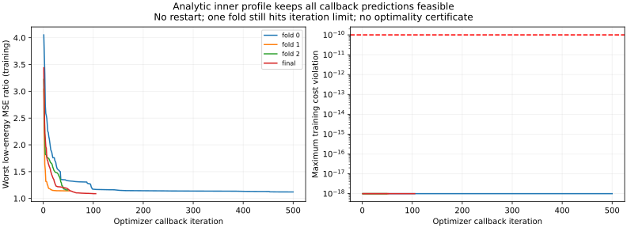
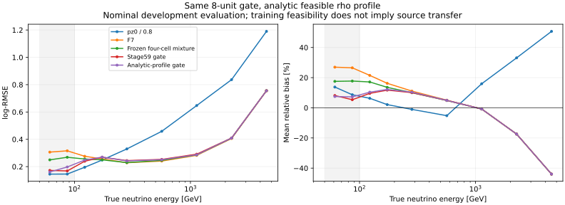

# stage60：同一轻量专家 gate 的解析 rho 可行性修正

日期：2026-11-02。起点提交：`5ab5c95`。执行路线§40及原下一轮 Prompt；本轮只有三折和全 cal 共四次 gate 拟合，没有重训 F7，没有读取新 ROOT/RDO、locked test、生产或谱 toy。

**结论：解析内层修复了训练约束的可行性，但没有达到低能恢复与共同代价验收，继续保留 F7。** 最低真实能量 50–100 GeV 的 evaluation log-RMSE 为 .186690，优于 F7 的 .312816，仍差于传统 pz0/.8 的 .145487；100–200 GeV 为 .260643，传统为 .226876。训练约束不保证来源外推。四次中三次返回求解器成功标志，但梯度及方向探测不支持宣称外层已经充分收敛，更不能宣称读出信息极限。本轮结束当前 gate 调参支线，下一次单独验证连续能量似然比，不在本轮连开。

## 1. 输入、选择和不可变约定

沿用 nominal d32b0ff3/without-IFT、stage55 的 pz>50 GeV 选择、unit MC 和既有去重保护；原选择仍含部分 fitted-charge cut，本轮没有测量改变这些 cut 后的接受度。替代 flux 的历史扩样结果保留，本轮没有补造 alternative raw 或重新读取样本。

| 输入 | 实际路径 | 文件大小 bytes |
| --- | --- | ---: |
| 基础事件/角色 | `ntuples/energy_ml_stage55/dataset.npz` | 25505895 |
| raw/status 读出 | `ntuples/energy_ml_stage56/readout.npz` | 6194961 |
| F7 原始预测 | `ml/artifacts/stage56/predictions.npz` | 297800 |
| 来源折/四格对照 | `ml/artifacts/stage58/predictions.npz` | 423468 |
| 原轻量 gate 对照 | `ml/artifacts/stage59/predictions.npz` | 286402 |

上述文件大小合计 32708526 bytes，仅是存储大小，不是实际网络 I/O。通过 `audited_features.load/build` 复用 F7 的 62 列契约：线性动量模长/纵向输入仅 pz0，允许 px/py、q/p 和弯折；11 个闪烁体用 raw_charge，VetoNu reduced 保留。有符号 raw、坐标、px/py、q/p 等合法负数保留；有限占位和状态失败按逐变量物理域转 NaN，并向派生量传播。没有以 fitted charge 填补 raw，没有用 nansum 伪造缺失总量。

gate 仍只用 pz0、Timing0–3 raw 严格总和、total clusters、清理后的 calo EM 总和。对应 log/asinh/log1p/asinh 变换及 median/IQR 完全沿用 stage59 的 train-only 结果。任何输入缺失/无效或 pz0 不在 [50,250) GeV 时精确默认 F7；不删除事件。

| 角色 | N | 保守来源组 | gate 有效 | 默认 F7 |
| --- | ---: | ---: | ---: | ---: |
| train（仅冻结变换） | 41447 | 91 | 12159 | 29288 |
| cal（gate 拟合及来源 OOF） | 8440 | 16 | 2311 | 6129 |
| evaluation（已暴露开发比较） | 14057 | 22 | 3351 | 10706 |

cal 的 true50–100 为 150 例/14组，100–200 为 691/16组；evaluation 分别为 208/19组、906/22组。cal 只有两个 charm 来源组，折2没有 charm，最低能各折均没有 charm。三折留出 N 为 2613/3075/2752；最低能 50/52/48，100–200 为 205/242/244。不能把这些开发样本称为 blind，也没有证明完整生产谱系独立。

原 nominal 42 个 calo 缺失事件完整保留原角色，eligible train/cal/eval 为 21/3/7，另11个由既有保护规则排除，不是本轮新增删除。evaluation 的7例/5组依旧 F7，gate 与 F7 log-RMSE 都为 .666657。

## 2. 事前冻结与解析求解

[protocol.json](stage60_energy_ml/protocol.json) 于 UTC `2026-11-02T20:01:02.037536+00:00` 冻结。网络仍为 4→tanh(8)→两相对 logits 加 F7 固定零 logit→三专家 softmax；专家为 log(pz0)、log(pz0/.8)、F7。网络58参数，范围[-8,8]，seed `2026110259`，初始58坐标与 stage59 相同。rho 仍属于同一个模型族，本轮将其从外层优化变量改为解析内层变量。

给定网络修正 Δ，预测为 F7+rho·Δ。每组归一化 MSE 是 `A rho²+B rho+C`，A≥0。五个代价在 rho=0 均可行，因此与 [0,1] 的交集为 [0,rho_max]。稳定二次根和朝零 nextafter 给出上界。然后枚举端点、两条有效低能风险二次曲线的极小点及交点，求该区间上 `max(两低能相对MSE)+1e-6·全体/F7 MSE` 的一维全局极小值。全体 RMSE≤1.01、≥200/reco低p/high-y/未确认≤1.03 的物理代价门槛不变；内层数值容差 1e-10，旧协议一般容差1e-8保留。

**只有给定网络的一维内层具有解析最优性质。** 外层仍非凸，分支切换可不光滑。固定单一起点 L-BFGS-B、两点有限差分相对步长1e-6、maxiter500/maxfun50000、ftol1e-10/gtol1e-5、maxls20；不重启、不扫算法/seed/结构/lambda。每次 wall≤90s，总≤360s、CPU≤400s、RSS≤1200MiB、新逐例预测≤2MB。

三折 offset 仅用其余 cal，分别为 .006337423593205365/.0013550775556296726/.005887923661790109；最终全 cal 为 .004602409250700414，与 F7/四格参考精确一致。失败时按训练目标选最好可行 callback（含初值），成功标志时使用末端；所有末端参数、风险、slack、梯度和轨迹均保存，先落盘冻结模型再生成 evaluation 预测。

## 3. 数值结果与可辨明的限制

| 拟合 | status/停止原因 | iter/nfev | rho / rho_max | 最坏低能训练 MSE 比 | 末端投影梯度最大绝对值 |
| --- | --- | --- | --- | ---: | ---: |
| 折0 | 1/迭代上限 | 500/35636 | .57992961705 /同值 | 1.121318925 | .000612228 |
| 折1 | 0/函数变化判据 | 52/6962 | .41047661612 /同值 | 1.142565331 | .008267566 |
| 折2 | 0/函数变化判据 | 49/6136 | .65069304468 /同值 | 1.159524609 | .226211885 |
| 全cal | 0/函数变化判据 | 105/13039 | .52203527014 /.52203527046 | 1.089540123 | .042638348 |

所有 callback、选中点及末端的最大正约束违反在记录精度下均为0；折0使用最好训练 callback，其余使用末端。全cal风险 MSE 比为：低能两组均1.089540123，全体1.016576357、≥200为1.046442234、reco低p为1.060899999849、high-y为1.054268685、未确认为.972347897。reco低p代价接近1.03²边界；这里 MSE 比不能混作 RMSE 比。

末端逐坐标正负探测，在步长1e-4时发现最大目标下降分别为 5.92306e-8/1.64394e-7/4.49826e-6/7.62258e-7，步长1e-5时为6.09472e-9/1.67224e-8/8.91626e-7/7.72283e-8。探测只作诊断，没有用于更新参数或额外拟合。三次 status0 都由函数变化判据停止，**不是 stationarity 或局部极小的证明**；有限差分在不光滑处的梯度也不能简单当作光滑最优性证书。

解析可行性和各折不再回退初始 F7 是实际修复；外层优化仍有限制。不能把失败唯一归因统计不足，也不能以本轮结果否定所有可部署 gate。



图中零违反以1e-18绘图下限显示，实际记录为0。详见[模型及轨迹](stage60_energy_ml/models.json)和[优化诊断](stage60_energy_ml/optimizer_diagnostics.json)。

## 4. 冻结 evaluation：低能改善与代价一并验收

以下 log-RMSE 无量纲。stage58 为四格三专家，stage59 为原可行但未收敛候选。

| 支持 | N | pz0/.8 | F7 | stage58 | stage59 | stage60 |
| --- | ---: | ---: | ---: | ---: | ---: | ---: |
| 全体 | 14057 | .568069 | .296363 | .297680 | .302465 | .300601 |
| true50–100 GeV | 208 | .145487 | .312816 | .262665 | .169719 | .186690 |
| true100–200 GeV | 906 | .226876 | .265014 | .252439 | .256517 | .260643 |
| true≥200 GeV | 12943 | .588671 | .298164 | .301116 | .307068 | .304668 |
| reco pz50–100 GeV | 682 | 1.336853 | .502965 | .514839 | .559966 | .544847 |
| reco pz100–250 GeV | 2670 | .652049 | .343488 | .344991 | .348925 | .346548 |
| high-y≥.8 | 440 | 1.676717 | .640068 | .656296 | .675762 | .667369 |
| leading未确认 | 510 | 1.699385 | .570928 | .576056 | .606958 | .589600 |

500次 component 分层保守来源配对 bootstrap，条件于固定预测，不重新拟合/calibration，不含优化、F7、探测器/flux、研究选择误差，不作多重检验修正。最低能相对 F7 改善40.319% [31.766,52.926]，相对 stage59 改善为−9.999% [−14.766,−.539]；100–200 相对 F7 为1.649% [−.315,4.050]，相对 stage59 为−1.609% [−4.037,.409]。全体相对 F7 为−1.430% [−2.007,−.899]，相对 stage59 为+.616% [.205,1.008]。数值可行性修复不必然降低最终评价风险。

| evaluation 验收（RMSE比） | 中心 | 来源95%上限 | 门槛 | 区间结论 |
| --- | ---: | ---: | ---: | --- |
| true50–100 /传统 | 1.283211 | 1.650453 | 1.05 | 失败 |
| true100–200 /传统 | 1.148836 | 1.219811 | 1.05 | 失败 |
| 全体/F7 | 1.014301 | 1.020071 | 1.01 | 失败 |
| ≥200/F7 | 1.021816 | 1.027502 | 1.03 | 通过 |
| reco低p/F7 | 1.083270 | 1.128096 | 1.03 | 失败 |
| high-y/F7 | 1.042653 | 1.067135 | 1.03 | 失败 |
| 未确认/F7 | 1.032704 | 1.052869 | 1.03 | 失败 |

stage60 最低能 mean/median bias 为 +7.324248/+3.408624%，R68=11.335378%，tail50=4.326923%；传统 mean bias+10.275816%、R68=11.433877%、tail50=0%。100–200 mean/median bias +11.388510/+7.103663%，R68=18.753491%，tail50=7.064018%；传统为 mean bias+3.945397%、R68=17.313958%、tail50=2.317881%。中心宽度或 bias 的改善不足以替代 log-risk 和大尾验收。

两低能 tail50 相对传统中心增加4.327/4.746pp，均超过2pp。high-y/未确认相对 F7 中心+1.136/+1.176pp，来源上限+2.483/+2.305pp，也未通过。完整能量箱、两方向 tail50/100、mean/median/R68 与缺失组均在[metrics.tsv](stage60_energy_ml/metrics.tsv)，配对区间在[paired.tsv](stage60_energy_ml/paired.tsv)；≥6400 GeV 评价 N=0，相关性能未测量，表中为 NaN。



## 5. 来源 OOF 和条件混合

| cal OOF log-RMSE | pz0/.8 | F7 | stage58 | stage59 | stage60 |
| --- | ---: | ---: | ---: | ---: | ---: |
| 全8440例 | .544278 | .276010 | .277958 | .278419 | .280542 |
| true50–100，150 | .152369 | .300101 | .236619 | .245862 | .203420 |
| true100–200，691 | .215110 | .245631 | .241708 | .230250 | .235853 |
| reco低p，504 | 1.247405 | .459004 | .478218 | .479280 | .492842 |
| high-y，230 | 1.604856 | .592037 | .611307 | .610897 | .630286 |

最低能对 F7 改善32.216% [25.500,40.850]，对 stage59 为17.263% [3.168,30.259]；100–200 对 F7 为3.980% [−.209,8.368]，对 stage59 为−2.434% [−5.303,−.131]。OOF 全体/低p/high-y 相对 F7 中心代价1.642%/7.372%/6.461%，低能恢复比上限1.622909/1.203802仍失败。全体/低p/high-y 比上限1.022897/1.112962/1.106076也超限。OOF≥200及未确认的来源上限也未通过，详[acceptance.json](stage60_energy_ml/acceptance.json)。

三折最低能风险为 .169959922/.232750904/.201332077，100–200 为 .232965205/.226449683/.247135998。逐来源最低能风险范围.0642553–.2659339（14组，N1–26），100–200 为.1265105–.2888824（16组，N2–96）；不是大量独立低能来源。[逐折表](stage60_energy_ml/cal_oof_folds.tsv)、[逐来源表](stage60_energy_ml/source_metrics.tsv)保留全部对照。

最低能 pz0 专家平均权重 OOF/eval 为 .464814/.490291，stage59 为 .238687/.498160，原折0回退引起的差距减小，但不能据此证明来源稳定。high-y 的 F7 平均权重已达 .965772/.975024，仍出现风险增加：接近 F7 的平均权重不保证少数事件的平方损失或尾安全。旧四格对照见[old_cell_metrics.tsv](stage60_energy_ml/old_cell_metrics.tsv)，不根据暴露评价再选分割。

物理上，低真实E与同reco低p的高E/high-y仍共享读出区域，降低低能上偏与保住高y风险存在竞争；stage55–58已有直接条件混合证据。本轮证明的是这次固定方案的训练可行性没有转移为共同验收成功，未测得各物理因素的因果份额，也未证明增加独立低能/困难样本无用。

## 6. QA、执行命令与实际资源

[pilot.json](stage60_energy_ml/pilot.json)：0次优化；六种已知解析算例（内点交点、单曲线极小、代价边界、线性代价、零修正、相切根）；100个随机二次数值 QA 与10001点网格比较，网格最小值减解析目标最大差2.005656e-7。48例 cal 直接经验风险一致，profile 导数步长细化最大差2.220446e-11。合成算例仅验证数值运算，不是物理/谱 toy。

[validation.json](stage60_energy_ml/validation.json)：四模型的选中及末端共8种状态，解析 rho 精确复现；直接经验成本、整个可行区间及密网格 profile 最优性检查通过。独立推理实现差≤1e-13，身份/来源折/offset/OOF及默认 F7 精确一致，F7与四格参考指标复现；完整42缺失者角色核对通过。全cal固定 rho 的原风险解析 Jacobian 对有限差分最大误差1.054734e-10；这不是 profile 不光滑处的最优性证明。所有数值 QA 通过，`promotion_allowed=false`。

运行环境：实际节点 `lxplus908.cern.ch`，LCG109、NumPy2.2.6、SciPy1.16.3。仅紧凑缓存的短 CPU 运算，单线程；没有批量 ROOT/生产作业，不需要 GPU。

```bash
source /cvmfs/sft.cern.ch/lcg/views/LCG_109/x86_64-el9-gcc15-opt/setup.sh
export PYTHONNOUSERSITE=1 OMP_NUM_THREADS=1 OPENBLAS_NUM_THREADS=1 MKL_NUM_THREADS=1
python ml/prepare_profiled_gate.py
python ml/fit_profiled_gate.py
python ml/report_profiled_gate.py
python ml/validate_profiled_gate.py
```

prepare/fit 具有不可覆盖保护，已各完成一次，不为报告重跑。实现为 `ml/profiled_gate.py` 及上述四个入口。

收尾执行 `python3 -m py_compile ml/profiled_gate.py ml/prepare_profiled_gate.py ml/fit_profiled_gate.py ml/report_profiled_gate.py ml/validate_profiled_gate.py` 和 `git diff --check`，均通过；报告低能数据逐项与TSV回读核对，下一轮Prompt中的stage54整段与HEAD逐字一致。没有追加模型fit或重复已完成的物理评价。

| 脚本内部计时 | wall s | CPU s | 进程峰值 RSS MiB | /proc rchar bytes |
| --- | ---: | ---: | ---: | ---: |
| prepare | .890036 | .841537 | 545.917969 | 32261453 |
| 四次fit | 64.373321 | 63.353313 | 545.917969 | 32262223 |
| report | 5.881036 | 5.193574 | 545.917969 | 72852388 |
| validate | 1.858263 | 1.812055 | 545.917969 | 65320590 |

四个拟合内核合计 wall63.399265s/CPU62.559675s，满足预算。时间从导入后开始，完整启动和会话诊断成本未全部计入；RSS是进程高水位。rchar含库和缓存读，kernel read_bytes=0 不等于零 EOS I/O；实际 EOS 网络/物理字节未测量。详细计时见pilot/fit_resources/report_resources/validation JSON。

最终逐事件 `ml/artifacts/stage60/predictions.npz` 为286473 bytes，已保存选中与末端参数/轨迹的 models.json 为256715 bytes。紧凑表和 SVG 位于 `workbook/stage60_energy_ml/`；PNG仅本地检查，不提交，未保存新大型中间文件。stage54 既有未跟踪工具/缓存保持原状，不混入本次提交。

## 7. 下一阶段的唯一研究及验收

保持 F7，不继续重启或扩大当前 gate。按stage57连续似然研究入口，下一次使用相同62个清理读出 X，在保护 train 内学习真实 `(X,logE)` 与独立边际配对的分类似然比；检验输出完整能量依赖能否缓解单值回归/专家组合的风险取舍。参考[Hermans等，2020](https://proceedings.mlr.press/v119/hermans20a.html)，沿用stage57文献入口，本轮没有新增文献检索。

具体输入仍为stage55/56缓存和既有 F7 对照；只做 unit 与训练 logE-bin-flat 两种先验的固定小分类器，共两次fit、一个seed、同 F7 级 depth5/400轮，不扫结构或重训回归器。独立负配对不增加独立 MC 支持，需报告有效样本量与重复使用。扫描固定129个50–6400 GeV log-spaced假设，用同一个 train-only 冻结先验对比预定的 MLE 与 posterior mean(logE)，各自只允许原始及一个 global cal offset，不做分能量校准或 eval 挑选。须检查先验敏感性、边界/多峰、来源低能支持、所有困难尾和有限统计；不能预设 MLE 无偏、最优 RMSE 或概率已校准。

执行前冻结精确训练/负配对/先验/数值协议及资源，先小样本 QA；批量计算经 Condor，拟议≤2任务、各≤2CPU/3GB、累计CPU≤1h、最终≤20MB。收益、所需统计功效、实际资源均未测量。本阶段不启动。验收仍需两低能相对传统95%上限≤1.05、全体/F7≤1.01、困难组≤1.03和关键tail50≤2pp；不能只报告局部低能收益或挑更有利估计器。对有限样本/训练先验敏感则明确证据，并量化定向独立补样的最小需求。

共同 raw 积分/饱和/时间窗定义、stage54 data占据、ν interaction/FSI/材料、真正独立低能生产和最终能谱物理收益继续必须交付；本轮数值修复未替代这些工作。
