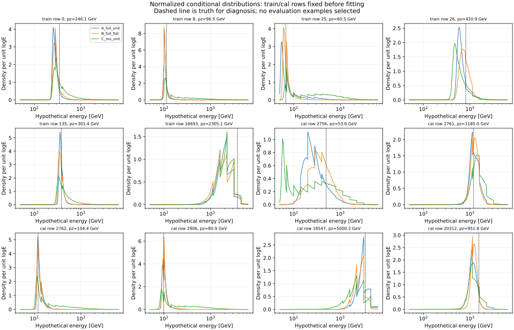
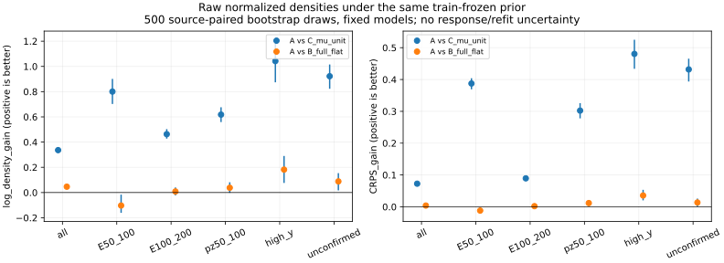
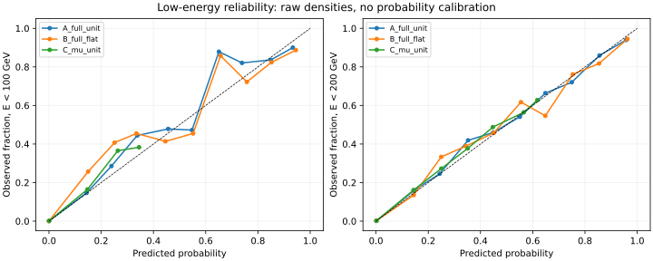
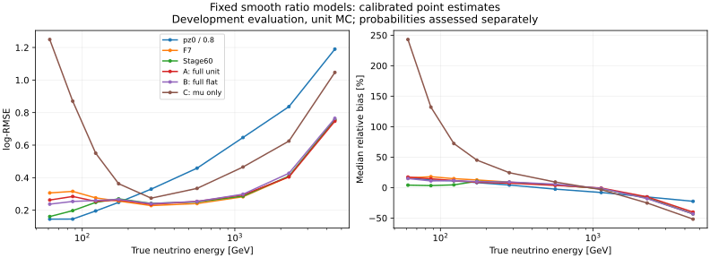

# stage62：平滑连续响应建立概率增量，点预测仍未达到推广门槛

日期：2026-11-02。起点：`84de80d`。依据：[stage61研究复盘](2026-11-02_stage61_research-reassessment.md)、路线§42、信息预算§22和原stage62执行Prompt。完成三个预定MLP分类fit及完整评价，没有续调gate、重训F7、读新ROOT/RDO、locked test、重建/生产或谱toy。

**本轮结论：完整读出相对本次μ-only概率模型的增量跨来源稳定，但未转为可替代F7的点重建器。** evaluation总体log-density提高 .336312 [ .319304, .353272 ]，logE-CRPS降低 .072681 [ .069158, .076168 ]；22/22来源两项均改善。主候选A校准后true50–100/100–200 log-RMSE为.277739/.259126，传统为.145487/.226876，总体比F7退化2.105% [1.370,2.985]。原始与全局校准输出均未通过旧验收，保留F7。训练谱敏感性也未消除，不能把评分增量称精确条件互信息、充分校准或已获物理谱收益。

下一研究按stage61分流，单独完成现有F7的μ/ML修正联合响应，对一个选中低能成分参数检验物理收益；本轮不执行，也不追加点估计器/先验/结构搜索。

## 1. 样本、变量与保护

沿用nominal d32b0ff3/without-IFT、stage55的pz>50 GeV及其余原选择、unit MC和去重保护。原选择仍有部分fitted-charge cut，本轮没有修改或测量其接受度。输入：`ntuples/energy_ml_stage55/dataset.npz`（25505895 bytes）、`ntuples/energy_ml_stage56/readout.npz`（6194961 bytes），F7预测/三模型及stage60对照。文件大小不是实际网络I/O。没有alternative raw拟造或重新扩样。

| 角色 | N | 保守来源组 | 原缺失者 | true50–100 | true100–200 |
|---|---:|---:|---:|---:|---:|
| train | 41447 | 91 | 21 | 767 | 3564 |
| cal | 8440 | 16 | 3 | 150/14组 | 691/16组 |
| evaluation | 14057 | 22 | 7 | 208/19组 | 906/22组 |

cal/eval均已用于开发，本轮不是blind确认。cal仅两个charm来源，最低能没有charm；完整生成谱系独立性仍未认证。原42个nominal缺失事件的eligible角色21/3/7保持，另11个是既有保护排除，未新增删除。所有high-y、未确认、大尾保留；未确认不等同全部错primary。

F7的62列经`audited_features.load/build`统一清理：线性动量模长/纵向量仅pz0，不用p0/p1/pz1或其log比；px/py、q/p和弯折保留。11闪烁体使用raw_charge，VetoNu reduced保留。合法signed raw、坐标、q/p、charge=-1、module eta=-1等不裁零；状态失败/非法物理域/有限占位及父项依赖转NaN，不nansum补零、不fit补raw。

正值列取log，非负/计数取log1p，其余signed/类别取asinh；asinh尺度为train median(abs)，非正/非有限回退1。变换后train median/IQR用于插补和标准化，IQR≤1e-8或非有限回退1，全缺失median回退0。每列另加缺失mask，无裁剪。假设坐标`u=log(E假设/GeV)−log(pz0/GeV)`以train真实配对的median/IQR标准化；先独立配(X,t)，再计算u。无效pz的部署分支为train median logpz加mask，不删事件；实际三个角色无无效pz。

完整网络有62个值+62个mask+u=125输入、12289参数；μ-only有标准化logpz、其mask、u=3输入、4481参数。mask只表达已有缺失状态。推理函数只接受变换读出和假设t，不读取该事件truth/y/身份/来源。

## 2. 冻结协议和三个fit

[protocol.json](stage62_energy_ml/protocol.json)冻结于UTC `2026-11-02T21:07:57.080189+00:00`，先于正式fit及新评价。固定seed2026110262；两层64单元SiLU、单logit，AdamW lr=.001/weight_decay=.0001、batch1024、120epoch、CPU单线程、终端epoch120，不用cal/eval早停。三个模型：A=完整unit（唯一主候选），B=完整train-bin-flat（敏感性），C=pz0-only unit（概率对照）。没有扫seed、结构、loss、负例数或选择最佳候选。

正例N=41447，按unit或flat权重归一到和N；负例从同一加权train的X与t边际独立有放回各抽2N=82894，每负例权重.5，负类总权重也为N。A/C复用相同unit负配对；shuffle generator固定seed+1。weighted BCE使用`1.5*mean(weight*BCEWithLogits)`，使随机batch平均与全局加权平均一致。

| 训练真E GeV | N | 来源组 | unit权重和 | flat权重和 |
|---|---:|---:|---:|---:|
| 50–100 | 767 | 79 | 767 | 5921 |
| 100–200 | 3564 | 90 | 3564 | 5921 |
| 200–400 | 9232 | 90 | 9232 | 5921 |
| 400–800 | 13805 | 91 | 13805 | 5921 |
| 800–1600 | 10141 | 91 | 10141 | 5921 |
| 1600–3200 | 3656 | 91 | 3656 | 5921 |
| 3200–6400 | 282 | 54 | 282 | 5921 |

train真E支持50.285000–5734.100011 GeV，无需扩展默认边界。unit权重Neff=41447；flat权重范围.428903–20.996454、Neff=8621.671252。unit负配对独立X/t身份35874/35819，偶然同一行0；flat为29586/29595，同一行10，均未删除。每个fit的124341个配对不是124341个独立ν事件。

理想平衡logit为`log p(X|t,S)−log p_ref(X|S)`，只适用于当前选择S，不包含接受度/背景。B与A的reference不同，不能直接比较raw logit高度；本轮都归一到同一unit train先验再比较。

## 3. 概率定义、积分和数值诊断

固定129个logE节点覆盖50–6400 GeV；每次128事件分块，不保存全train×能量网格。共同unit先验为每倍程两个等logE箱、每箱+.5伪计数的train selected-spectrum分段常数密度；不是正式flux归一化。另一个共同logE均匀先验仅作0新fit敏感性，不能据eval择优。

具体有限网格分布：节点上`exp(logit−event max)`作线性插值，乘分段常数先验；积分在扫描节点和先验跳变处共同分段。每段密度为线性，归一化、mean(logE)、CDF、quantile及logE-CRPS均可解析积分。log-density单位是相对于`dlog(E/GeV)`的密度对数，不是每GeV密度。**精确积分的是这个声明的有限网格分布，不是未经离散化的连续神经似然。** 先验跳变使最终后验可有台阶，不能因比值网络平滑就称后验处处光滑。

主点输出为exp(Eq[logE])；A/B/C均保留raw和各一个global cal log-offset，分别为+.005613057839254642/+.007390522179073812/−.0034910598491694807。cal指标明确为开发校准，不叫OOF；概率评分只使用原始归一化分布，点offset没有标定整个后验。

| 事前固定首16个cal、129→257节点诊断 | A | B | C |
|---|---:|---:|---:|
| mean(logE)最大绝对变化 | .000223317 | .000351475 | .000299658 |
| log-density最大绝对变化 | .022087317 | .023378076 | .038264336 |
| logE-CRPS最大绝对变化 | .000467316 | .000436813 | .000266536 |
| 累积箱概率最大绝对变化 | .004643496 | .003758872 | .000937487 |

它表明点均值对本次网格较稳定，但局部密度评分的离散化变化非零；只检查16个预定cal例，不能将最大值冒充所有来源的误差上界。没有改变网格或替换129点输出。cal/eval均没有扫描支持之外的真值；≥6400 GeV评价N=0，性能未测量。未硬施E≥测量pz。

evaluation A/B/C的MLE端点比例为1.252045/.362809/1.643309%；logit曲线有≥2内部局部峰为4.367931/2.468521/0%，1e-4 logit容差下近最大值覆盖多个节点为.775414/.561998/.825212%。这是有限网格似然曲线诊断，不是后验校准或物理分量测量；没有并列取最低能得到新点预测。



上述12例按fit前固定的train/cal能量支持及缺失首行选择，没有用eval残差挑例，不用这些个例代替总体证据。

## 4. 概率增量：总体及同低pz人群成立，先验敏感性仍在

以下均为evaluation、共同unit先验、原始归一化分布。log-density越高越好，CRPS越低越好。括号内N沿用全部原选择。

| 支持 | A log-density | C log-density | A CRPS | C CRPS |
|---|---:|---:|---:|---:|
| 全体14057 | .046668 | −.289643 | .149005 | .221685 |
| true50–100，208 | .651358 | −.149116 | .099989 | .487420 |
| true100–200，906 | .540875 | .078130 | .107582 | .197013 |
| reco pz50–100，682 | −.347452 | −.965435 | .253088 | .555377 |
| high-y，440 | −1.186236 | −2.228500 | .374821 | .855294 |
| 未确认，510 | −1.007332 | −1.929657 | .332692 | .764422 |
| true3200–6400，271 | −2.106408 | −2.800074 | .467396 | .688797 |

500次component分层保守来源配对、固定模型/预测，无重训、校准、探测器/flux、有限分类器和研究选择误差，无多重比较修正。A相对C：总体log-density增量.336312 [.319304,.353272]、CRPS改善.072681 [.069158,.076168]；低pz分别.617984 [.558875,.676215]和.302289 [.277985,.325807]；high-y为1.042264 [.874013,1.211445]和.480473 [.433734,.524911]。最低能两项为.800474 [.702059,.900870]和.387431 [.369170,.404017]。

cal开发对照总体也有增量：.347855 [.327936,.366239]、.070335 [.066389,.074699]。evaluation总体22/22来源两项均改善；低pz为21/22来源log-score改善、22/22 CRPS改善；最低能18/19、19/19，high-y22/22、22/22。cal总体16/16均改善。[逐来源表](stage62_energy_ml/source_metrics.tsv)保留局部反例和稀少支持，不将所有小组称作独立确认。

这些结果支持本次完整模型具有额外读出的预测增量；C也是有限容量/有限训练的模型，不是已知精确p(E|pz)。因此不能把差值当精确条件互信息，不能由同低pz宽箱对照声称完全消除了所有pz分布差异。

B总体log-density=.000295、CRPS=.152951。A相对B总体增量.046373 [.037380,.055711]和.003946 [.002786,.005202]；但最低能B反而更好，A−B log-density=−.102959 [−.160987,−.016486]，CRPS改善=−.011890 [−.018970,−.003587]。不同训练先验仍造成明显风险取舍。

共同先验下A/B的14箱粗概率TV均值.145348（来源区间.143786–.146967），低pz为.178442；raw mean(logE)平均绝对差.082149/低pz .154735。粗箱TV只度量保存分箱上的形状差异，不是完整连续分布TV。A改用均匀推断先验的粗TV=.126679、mean(logE)平均绝对变化.094827；低pz分别.211056/.177876。**不能说NRE已消除先验依赖。** 这同时包含有限学习/参考抽样和显式推断先验影响，不等同纯N的因果效应。详[shape_sensitivity.tsv](stage62_energy_ml/shape_sensitivity.tsv)。



低能概率可靠性：A全体P(E<100)均值.013576，实际.014797；P(E<200)均值.079256，实际.079249。总体Brier(E<100/E<200)为A .004689/.017907，C .009893/.037553。总体均值接近不等于各概率区间校准：A的E<100预测.6–.7箱仅33例/9组，预测均值.650574，观察.878788；小组明显波动。未拟合概率校准或宣称覆盖保证。[reliability.tsv](stage62_energy_ml/reliability.tsv)含全部箱N/来源与缺失/困难人群。



## 5. 点重建与原验收：A不推广，B/C不据分数替换主候选

下表为global cal offset后的log-RMSE，无量纲；A为主候选，B/C仅预定控制。

| evaluation支持 | N | 传统 | F7 | stage60 | A完整unit | B完整flat | C μ-only |
|---|---:|---:|---:|---:|---:|---:|---:|
| 全体 | 14057 | .568069 | .296363 | .300601 | .302601 | .308877 | .456440 |
| true50–100 GeV | 208 | .145487 | .312816 | .186690 | .277739 | .248761 | 1.006184 |
| true100–200 GeV | 906 | .226876 | .265014 | .260643 | .259126 | .263578 | .454293 |
| true≥200 GeV | 12943 | .588671 | .298164 | .304668 | .305792 | .312664 | .442214 |
| reco pz50–100 GeV | 682 | 1.336853 | .502965 | .544847 | .508713 | .527729 | 1.009127 |
| reco pz100–250 GeV | 2670 | .652049 | .343488 | .346548 | .347946 | .357487 | .577819 |
| high-y | 440 | 1.676717 | .640068 | .667369 | .638956 | .681441 | 1.227226 |
| 未确认 | 510 | 1.699385 | .570928 | .589600 | .590157 | .612658 | 1.166633 |

A的raw总体/最低能/100–200为.303001/.274035/.256712，global offset没有造成或修复主要失败。A校准相对F7最低能改善11.213% [6.959,16.172]，100–200为2.222% [−1.246,5.553]，总体为−2.105% [−2.985,−1.370]。不能用B最低能较好来改主候选，也不把概率有用改写成点评价成功。

| A校准evaluation门槛 | RMSE比中心 | 来源95%上限 | 门槛 | 风险区间 |
|---|---:|---:|---:|---|
| true50–100/传统 | 1.909038 | 2.200215 | 1.05 | 失败 |
| true100–200/传统 | 1.142146 | 1.205513 | 1.05 | 失败 |
| 全体/F7 | 1.021051 | 1.029847 | 1.01 | 失败 |
| ≥200/F7 | 1.025585 | 1.035160 | 1.03 | 失败 |
| reco低pz/F7 | 1.011427 | 1.052226 | 1.03 | 失败 |
| high-y/F7 | .998262 | 1.024293 | 1.03 | 通过 |
| 未确认/F7 | 1.033681 | 1.068511 | 1.03 | 失败 |

high-y虽过风险门槛，tail50变化的来源上限+3.604pp仍未过2pp；未确认tail50中心+2.353pp、上限+6.010pp也失败。两低能tail50比传统增加12.019/6.291pp。原始输出全部推广条件也失败。1%/3%/5%/2pp仍只是既定研究取舍，没有事后放宽。

最低能A mean/median bias +23.335351/+15.297881%，R68=18.210274%、tail50=12.019231%；100–200为+15.426354/+9.685939%、R68=16.784581%、tail50=8.609272%。中央宽度较好也不能替代全风险。3200–6400 GeV的A log-RMSE=.747008、median bias−40.263902%，F7为.755449/−43.046652%；高能欠估仍明显，未据这一局部中心改善称全区解决。

cal为开发校准，A全体/最低能/100–200=.290771/.323081/.251915，F7=.275965/.300343/.245748；不是OOF。原缺失evaluation7例/5组的A=.736541，F7=.666657，全部保留。详细能量箱、raw/cal/均匀先验、B/C、双方向tail50/100见[metrics.tsv](stage62_energy_ml/metrics.tsv)及[paired.tsv](stage62_energy_ml/paired.tsv)。



### 尾部损失归因与可支持的物理解释

零fit诊断[loss_attribution.tsv](stage62_energy_ml/loss_attribution.tsv)：A最低能25/208个tail50事件全为过估，贡献总平方log损失67.8241%；其余183例的条件log-RMSE=.167961，仍不等于恢复传统全部208例的.145487。100–200的78/906个tail50（75过估）贡献61.0860%。cal最低能16/150尾贡献73.4879%。**这些条件数字仅解释损失，不删例、不作为重建性能或新选择。**

完整读出相对μ-only改善低pz/high-y分布，但剩余低E上偏/上尾、高能欠估及训练先验取舍仍在，符合stage61关于阈值选择、低y核心和相同低pz高E/high-y混合的解释。不能据这些统计量测定每种不可见度/interaction/响应的因果份额。C的低E点输出很差反映本次概率模型/selected先验下的决策，不能拿它替代精确传统方法或宣称μ本身测得差。同X同先验的理想后验均值与log-MSE回归目标相同，本次没有理由期待换成似然就自动同时最优。

## 6. 验证、实际命令、资源及技术记录

[pilot.json](stage62_energy_ml/pilot.json)：0 formal fit、0 optimizer update；均匀/非均匀先验的归一化/均值/CRPS/密度单位、离散joint/product比值、u配对依赖、signed/NaN和分块一致性通过。12次无参数更新的backward，batch wall=.006057553s、CPU=.005362717s；1024×129扫描wall=.376123276s。120epoch backward外推88.682582s只作资源依据，不冒充实测fit成本。

[validation.json](stage62_energy_ml/validation.json)：train变换逐项精确、来源角色保护、原42缺失者、身份/负配对/offset核对通过；3fit都120epoch、loss有限。独立NumPy矩阵+SiLU与Torch logits最大差A2.628306e-5/B2.471785e-5/C4.148553e-6，与float32前向精度一致。另一种三点Gauss积分独立验证密度、均值和CRPS最大差≤7.106e-15；这验证有限网格算术，不是模拟响应正确或网络充分优化的证明。

环境LCG109、Python3.13、NumPy2.2.6、Torch2.10.0，交互节点lxplus908无可用CUDA；正式为CPU Condor，A/C在b9p17p6659、B在b9p19p8555。资源和软件冻结在协议。实际执行：

```bash
source /cvmfs/sft.cern.ch/lcg/views/LCG_109/x86_64-el9-gcc15-opt/setup.sh
export PYTHONNOUSERSITE=1 OMP_NUM_THREADS=1 OPENBLAS_NUM_THREADS=1 MKL_NUM_THREADS=1
python ml/prepare_continuous_response.py
# 打包：continuous_response/fit/audited_features/expert_combination代码、特征配置、协议及两个原紧凑输入
condor_submit -dry-run /afs/cern.ch/user/x/xcheng/nu_mu_stage62/submit.dry AnalysisZipFramework/submission/ml_continuous_response.sub
condor_submit AnalysisZipFramework/submission/ml_continuous_response.sub
# cluster9661766，分别调用fit_continuous_response.py --model A_full_unit / B_full_flat / C_mu_unit
python ml/collect_continuous_response.py
python ml/report_continuous_response.py
python ml/validate_continuous_response.py
python ml/diagnose_continuous_response.py
```

三任务均NumJobStarts=1/ExitCode=0，没有重试。日志在`/afs/cern.ch/user/x/xcheng/nu_mu_stage62/logs/continuous.9661766*`；[collection.json](stage62_energy_ml/collection.json)保存Condor资源摘要。

| 模型 | 训练内核wall/CPU s | 脚本内部wall/CPU s | 峰值RSS MiB | Condor remote CPU s | job wall s |
|---|---|---|---:|---:|---:|
| A | 98.962797/98.249218 | 117.502349/109.754850 | 542.148438 | 115 | 130 |
| B | 163.087669/159.079235 | 182.903238/174.893767 | 534.226563 | 183 | 202 |
| C | 68.506531/67.950343 | 83.718695/75.855081 | 525.066406 | 81 | 95 |

三训练内核合计wall330.556997s/CPU325.278795s；Condor remote CPU合计379s=.105278h，包含的范围不同，不相加。每任务1CPU/3000MB、无GPU，满足累计3h预算。外部`/usr/bin/time`的A/B/C wall=124.20/195.17/90.53s，与脚本导入后内部计时不同。B和A的耗时还受不同worker影响，不能当物理/架构结论。终端训练BCE首epoch→末epoch为A .658868→.357800、B .631046→.275797、C .565318→.463714，未声称充分优化或密度一致性保证。

pilot内部wall2.313525s/CPU2.209270s/RSS548.871MiB；collection为3.186200/1.375369s；最终完整图表report为14.832834/14.048909s、RSS477.977MiB；独立validator为2.308179/2.243751s。初次完整report在增加预定曲线图前另耗wall8.903909s/CPU7.746719s；最终零fit诊断的实测资源另见diagnostic_resources.json。以上从导入后开始，完整会话及失败调试成本未全部计时。

初次汇总的逐来源表遗漏对prediction施加mask，触发形状不符，已补齐；初次独立积分参考的exp用float32造成约6.57e-8差，已统一float64参考，没有修改已训练网络/预测。两次失败只涉及报告/验证，未新增fit，失败运行的完整CPU成本未测量。最终验证通过。collector首次有tar默认filter弃用提示，现已显式`filter='data'`，不改变数值。

Condor输入传输合计94375101bytes（约94.375MB），含三个31.457MB临时包，不等于ROOT或实际EOS网络流量；xrdcp输出与物理/网络I/O未测量。脚本rchar A/B/C=55356093/55374357/55356102bytes，含进程读，kernel read_bytes=0不称零EOS I/O。

## 7. 产物与存储

模型与逐事件摘要：`ml/artifacts/stage62/{A_full_unit,B_full_flat,C_mu_unit}/{model.pt,predictions.npz}`；协议、权重/资源、轨迹、固定曲线和紧凑表图：`workbook/stage62_energy_ml/`。每模型只保存cal/eval必要点/评分/箱概率/分位数，没有保存全train×能量网格。

为满足最终≤20MB，collector将概率/评分/分位数摘要存float32，点与mode logE仍逐值float64精确保留；最大摘要cast绝对误差A8.75945e-7/B8.55897e-7/C4.76371e-7，在collection逐字段记录。最终预测文件为3699834/3634977/3739845bytes。临时包和三份job archive经回读检查后删除，没有输入NPZ或ROOT长期副本。加入报告前，全部新模型/预测/证据/本地PNG实际文件大小合计13192820bytes≈13.193MB，满足预算；收尾存储核查随最终产物记录。

数值与程序QA、全部负结果和原推广门槛均保留。本轮只提交代码、协议/轨迹/汇总表/SVG及文档；模型/逐事件与PNG保持本地。stage54已有未跟踪工具和缓存不改、不混入提交。

收尾对7个新Python文件执行`python3 -m py_compile`、对launch脚本执行`bash -n`，均通过；`git diff --check`通过。四份新改文档的138个本地Markdown链接目标存在、代码围栏成对；stage54 Prompt保留段与HEAD逐字一致。最终存储快照、3fit/120epoch、379s remote CPU和预算核对见[final_storage.json](stage62_energy_ml/final_storage.json)，没有将历史stage54文件纳入本轮提交。

## 8. 下一阶段：一个选中低能成分参数的联合μ/ML响应

本次支持“概率增量稳定但点预测未过”，按stage61§5执行下一单项：复用F7三模型/相同缓存，必要时只对train推理F7、0新能量fit，构造`(logpz0, logE_F7−logpz0)`。在相同支持、参数化与总N=1000条件场景下，公平比较μ-only、灵活scalar F7、二维联合响应对选中true50–200相对≥200成分的误差；不称未选中flux，不恢复六自由箱。

执行前只由train冻结binning和模板/有限MC协议，保留缺失/负修正/溢出；先交付Asimov/profile灵敏度及来源留出闭合，再测低能内部形状和同低pz高E/high-y混合的预定压力。未知响应变体只能叫压力，不能当正式1σ。验收需联合量相对灵活scalar有稳定误差降低且无显著闭合/压力偏差，不能只用名义已知模板的曲率变窄报成功；无稳健增量则结束扩维。具体分箱/有限模板MC算法和资源在下阶段fit前冻结，实际收益/功效/CPU尚未测量。

本轮不启动stage63，不续扫MLP、MLE、后验点估计、训练或推断先验。参考沿用stage61的[Hermans2020](https://proceedings.mlr.press/v119/hermans20a.html)、[有限MC模板方法](https://doi.org/10.1140/epjc/s10052-022-11019-z)及[FASER flux研究](https://arxiv.org/abs/2507.06022)，没有新增文献检索。共同signed/rectified raw定义、stage54占据、ν interaction/FSI/材料、定向独立低E和同p困难样本、接受度/背景和新独立确认继续交付。
