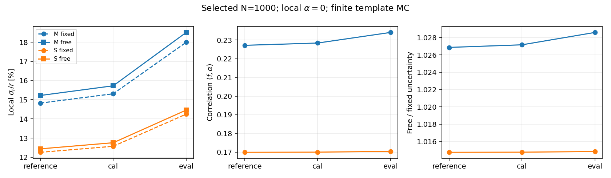
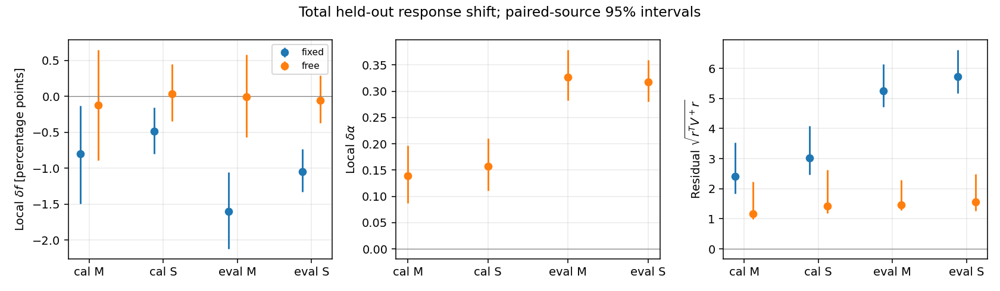

# Stage65：高组件谱硬度与低能比例的局部可辨识性

## 1. 目标与实测结论

按路线§45，冻结M=log(pz0/GeV)、S=log(E_F7/GeV)原格，只在高组件选中谱的一个硬度方向α=0处研究低比例f。**放开这个方向没有造成严重局部退化，但较小的总偏移不能当作响应闭合成功。** 参考点有限MC的σ_r/r，M由14.822367%增至15.220483%，S由12.255744%增至12.436492%；相对误差代价分别2.685911%和1.474801%。12个中央模型及6000个来源重复模型均满秩，实际没有未定义重复。

eval总线性δf：M由−1.599348降至−.005299个百分点，S由−1.050324降至−.060672个百分点。然而自由硬度下，eval S混合项为+.301805pp、条件项为−.362477pp，存在相消；条件项95%来源区间仍为[−.623026,−.072791]pp，低组件条件项也保留负向证据。**继续F7；下一单项是用未参与F7权重训练的cal模板检验eval响应稳定性。** 当前结果不改善事件能量预测、不测data、不推广到未选中flux。

单个Condor任务9661948.0一次成功；0新能量训练、F7推理、非线性谱profile、ROOT/RDO、新生产或coverage toy。stage62概率增量和低能点失败、stage63固定J布局阴性继续有效。本轮没有重新做网络/分箱/先验比赛。

## 2. 输入、选择、冻结与方法

复用`ml/artifacts/stage63/observables.npz`（2,236,976 bytes），stage63 `protocol_v2.json`、stage64 `summary.json/operators.json`，没有新增逐事件持久缓存、复制旧ROOT或读locked test。原F7的62个审计输入、唯一线性动量pz0、11个scintillator raw charge、VetoNu reduced、合法signed值及typed invalid/status/dependency→NaN策略保持。px/py、q/p、弯折仍允许；不重新引入p0/p1/pz1或ln(p0/p1)。

| role | 事件/保守来源 | true50–200 | ≥200 | 输入缺失 | 未确认 | S−M<0 | high-y | reco pz50–100 |
|---|---:|---:|---:|---:|---:|---:|---:|---:|
| train | 41447/91 | 4331 | 37116 | 21 | 1495 | 1963 | 1204 | 2498 |
| cal | 8440/16 | 841 | 7599 | 3 | 301 | 431 | 230 | 504 |
| eval | 14057/22 | 1114 | 12943 | 7 | 510 | 913 | 440 | 682 |

high-y为缓存y_lepton≥.8；未确认等全部保留。原pz>50 GeV选择、M/S各16常规格和专用无效格、端点/离群/巨大动量/全部保护不变。原42个输入缺失者另11个既有保护者仍保持原角色，不称本轮删事件。cal/eval已开发；来源分组不是完整生成谱系独立认证。

[不可覆盖协议](stage65_energy_ml/protocol.json)在**2026-11-02 22:47:53.639053 UTC**冻结，起始提交af66903。pilot先做合成归一化导数、改变能标不变性、W正交、完全共线、零硬度方向及f边界检验；通过后只提交一个任务。冻结N_selected=1000、能标400 GeV、α=0；能标是参数居中约定，不由eval优化。

低/高模板a/b来自原train，高组件按(E/400 GeV)^α重权并内部归一。u=log(E/400 GeV)，C_z=Σ_high,z(u−ubar)/MH；两个局部方向为D_f=a−b、D_α=(1−f)C。能量truth只定义选中谱响应，不进入部署统计量。参考f0=4331/41447=.10449489709749801；cal/eval研究点分别.09964454976303318/.07924877285338265，都是固定名义研究点，不重新估计f。

V沿用stage63的数据与两MC条件multinomial协方差：data项[diag(q)−qqᵀ]/1000，加f²[diag(a)−aaᵀ]/ML及(1−f)²[diag(b)−bbᵀ]/MH。已知响应版去掉后两项。I=DᵀV⁺D，固定α误差1/√I_ff，自由α误差由二维逆矩阵与Schur补独立核对；σ_r/r=σ_f/[f(1−f)]。这是假设局部响应的切向近似，不是精确二维有限MC profile或coverage。

协方差特征值相对/绝对截断1e−12/1e−18，方向信息最小1e−12，标准化Fisher秩阈值1e−10，f边界容差1e−8。零方向/共线/边界不报有限自由参数精度，不加ridge、先验或伪计数。原始矩阵条件数依赖参数尺度，本轮只以对角归一化Fisher诊断退化。

500次pi/k/charm分层来源多项式抽样，train/cal/eval独立seed2026110265/266/267；同一train重复用于cal/eval，M/S配对。每次重估a/b/C/V/算子及共同支持，名义f固定。**与stage64固定中央算子的bootstrap不同**，区间也包含本次算子来源变化，因此无需与旧分项区间逐位相同。每项同时记录有效/无效重复数，未定义值以NPZ NaN/JSON null保存；本轮所有case均500/0。来源区间条件于F7及分箱，不含重训、完整谱系、校准、detector或interaction系统，也不是正式统计覆盖。

## 3. 固定/自由硬度的精度和相关性

下表为参考f0，σ_f以百分点表示，σ_α无量纲；σ_r/r为相对百分数。

| 表示/MC | 固定σ_f/pp | 自由σ_f/pp | 固定σ_r/r/% | 自由σ_r/r/% | σ_α | corr(f,α) | 标准化条件数 |
|---|---:|---:|---:|---:|---:|---:|---:|
| M 已知响应 | 1.378597 | 1.415201 | 14.732422 | 15.123591 | .065154 | .225966 | 1.583866 |
| M 有限MC | 1.387014 | 1.424268 | 14.822367 | 15.220483 | .065935 | .227220 | 1.588059 |
| S 已知响应 | 1.142936 | 1.159509 | 12.214020 | 12.391134 | .058101 | .168472 | 1.405212 |
| S 有限MC | 1.146840 | 1.163754 | 12.255744 | 12.436492 | .058798 | .169871 | 1.409264 |

有限MC参考的自由/固定σ_f比：M **1.026859 [1.024705,1.029432]**，S **1.014748 [1.013429,1.016174]**；相关系数来源区间分别[.218259,.237408]/[.162253,.177706]。σ_α区间[.065362,.066550]/[.058417,.059275]。有限MC与已知响应排序一致，不把小修正当MC支持已饱和的证据。

| 点/表示，有限MC | 固定σ_r/r/% | 自由σ_r/r/% | 自由/固定σ_f及95%来源区间 | σ_α | corr(f,α) |
|---|---:|---:|---|---:|---:|
| cal M | 15.310031 | 15.725864 | 1.027161 [1.024983,1.029774] | .065725 | .228443 |
| cal S | 12.569807 | 12.755390 | 1.014764 [1.013460,1.016167] | .058589 | .169962 |
| eval M | 17.994166 | 18.508586 | 1.028588 [1.026283,1.031387] | .064854 | .234125 |
| eval S | 14.247188 | 14.458618 | 1.014840 [1.013554,1.016208] | .057713 | .170389 |

所有12个中央模型标准化秩2，6000个bootstrap Fisher均秩2/无未定义精度；全部来源数/事件质量保留。仅对这个高组件硬度方向可说误差代价较小，不能推断多个生产/interaction/材料方向均可辨识。完整已知/有限MC与区间见[Fisher.csv](stage65_energy_ml/Fisher.csv)、[Fisher_intervals.csv](stage65_energy_ml/Fisher_intervals.csv)。



## 4. 原有响应差的局部投影与残差

满秩时使用L₂=I⁻¹DᵀV⁺，固定α用L₁=D_fᵀV⁺/I_ff；每项δq投影为δf/δα，并保存δq−Dδθ的全部有符号格向量。低/高项先分别乘f/(1−f)，再相加。没有重新fit、修正输出、按物理域截断或加先验。

| case，有限MC | 固定总δf/pp | 自由总δf/pp [95%来源区间] | 自由总δα [95%来源区间] | 残差加权范数 固定→自由 |
|---|---:|---|---|---:|
| cal M | −.799012 | −.119547 [−.893661,+.645551] | .138560 [.086540,.196775] | 2.404413→1.156194 |
| cal S | −.487064 | +.032773 [−.349243,+.448800] | .156592 [.110770,.210453] | 3.027444→1.421969 |
| eval M | −1.599348 | −.005299 [−.566232,+.575675] | .326949 [.283059,.378661] | 5.249635→1.464120 |
| eval S | −1.050324 | −.060672 [−.370301,+.287375] | .317724 [.280039,.359463] | 5.721933→1.559622 |

范数为√(residualᵀV⁺residual)，无量纲；不是拟合优度p值或“几σ拒绝”。自由投影按构造降低此加权范数，不能把该代数性质当物理验证。half-L1并无必然逐项下降：eval M条件项由.015092变为.015616；其加权范数仍由1.297988降为1.269613。half-L1只对原始概率差是TV，残差或分项范数不能称完整分布的TV/归因比例。

总残差half-L1：cal M .030421→.015428、S .037401→.018600；eval M .068294→.017137、S .075952→.017552。仍有未解释格形状，不能仅因δf近零即宣称闭合。完整中央/来源投影见[projections.csv](stage65_energy_ml/projections.csv)，完整signed residual见[residuals.csv](stage65_energy_ml/residuals.csv)。

### 4.1 混合与条件项未消失

| case | 自由混合δf/pp | 自由条件δf/pp [95%来源区间] | 自由未匹配δf/pp | 混合δα | 条件δα |
|---|---:|---|---:|---:|---:|
| cal M | +.095177 | −.202800 [−.966493,+.552559] | −.011924 | .116927 | .021707 |
| cal S | +.093022 | −.046533 [−.421466,+.356092] | −.013717 | .115850 | .040838 |
| eval M | +.329164 | −.334463 [−.882863,+.221253] | 0 | .309444 | .017505 |
| eval S | +.301805 | −.362477 [−.623026,−.072791] | 0 | .306057 | .011666 |

硬度方向吸收了相当多宽组件混合差异，eval M/S混合残差加权范数由4.897786/5.462474降至1.105407/1.309734；但eval S条件残差范数仅.974021→.952814。条件δf仍负，总偏移小含不同项相消，不能把相消叫系统消除。

特别是**eval S低组件条件δf**：固定−.183912pp，自由**−.197460 [−.368548,−.016856]pp**；不是用高组件自由度就能证明低能响应正确。该低组件残差half-L1为.001387、加权范数.117581，均按其实际f加权。高组件条件项与其同为负向，完整各项保留，不筛异常或去掉charm。

全部8个中央合并总投影与4000个对应来源重复投影的f+δf均在[0,1]，未定义重复0；这仅是线性外推f域检查，不证明响应概率、非线性轨迹或覆盖可靠。eval投影δα约.32，已显著离开α=0；本轮没有评估该有限位移的二阶项，**非线性有效范围未测量**。不能将局部投影参数称新谱fit或偏差校正。stage63精确固定形状profile仍为eval M/S δf=−1.575900/−1.010323pp，本轮固定线性值相差.023448/.040001pp，沿用stage64对照，不重新profile。



## 5. 程序验证与物理限制

合成导数对照最大差6.6789e−12；正式事件对称步长±1e−5仅用于导数QA，最大差**1.4316e−11**。全部来源重复ΣC最大1.8041e−16、L₂D−单位阵最大7.2164e−16、分项逐格守恒最大1.3184e−16，均低于冻结1e−8阈值。

独立复核直接按事件及来源重复权重累计计数/高组件log矩，以sum-zero约束的降维矩阵直接逆替代生产特征伪逆，显式逐层分解：12中央模型的方向差9.0206e−17、V⁺差2.7285e−11、I差5.4570e−12、自由算子差7.9936e−15、σ差5.5511e−17；σ_f固定还与stage63既有information函数以及已知响应解析式对照。中央signed残差最大差2.7756e−17。

预定bootstrap索引0/249/499直接重建事件权重，36个Fisher/24个held-out投影case最大差**1.9984e−15 / 5.7732e−15**。原M/S边界重新落箱、角色/支持/保护、pz>50均通过。[verification.json](stage65_energy_ml/verification.json)。无优化器/F7推理/新能量fit，源码未涉及C++，无需重编译分析框架。

物理原因仍不能唯一归因：stage64条件项包含粗E箱内连续谱、y/几何/生产混合、interaction/FSI/材料，以及F7训练内模板乐观性；cal还参与既有global offset。M不依赖能量ML权重但同样有来源响应差，因此不能把全部差异归过拟合。有限MC协方差处理模板计数，C本身的来源误差由本次bootstrap体现；未包含完整重训和谱系系统。

true50–100 charm支持仍为train5例/5来源、cal0/0、eval1/1；100–200为55/10、6/2、17/3。共同支持在每次重复中重算，未匹配质量保留；最低能传统优于F7的旧点结果没有在本轮重测。独立低E样本必须同时覆盖同pz高E/high-y、低可见/未确认，新增事件数和功效**未测量**。共同signed/rectified raw、状态/积分窗和有效mask需真实data/μ输入，本缓存无法测，stage54支线仍须交付。

## 6. 资源、I/O与产物

合成pilot脚本wall .050576s/CPU .030132s/ru_maxrss616.605469MiB；100次四格Fisher内核wall .025666s/CPU .025369s，6012次外推1.543068s只是合成估算，不替代正式17格成本。

正式脚本wall **4.903847s**、CPU **4.849952s**、峰值RSS **116.437500MiB**；完成6012个Fisher及4008次held-out分解/投影，整体约**1225.98 Fisher case/s**（含分解、bootstrap和输出开销，非纯矩阵benchmark）。`/usr/bin/time`含启动/导入wall6.49s、user5.54s/sys.25s、maxRSS119232KiB。独立QA加图表wall3.653730s/CPU3.343670s，ru_maxrss616.605469MiB；仅QAwall2.053364s。

Condor **9661948.0，ExitCode0/NumJobStarts1，remote CPU5s**；事件日志execute8s，history RemoteWallClockTime11s（口径含slot时间），分别记录。提交dry-run与最终RequestCpus/Memory、Provisioned均为**1CPU/3000MB**，本轮满足冻结3GB请求；RSS监控字段0不当实测内存，用脚本/外部time高水位。未重交或自动重试，CPU/wall均低于600s。

Condor接收2,166,711 bytes、发送688 bytes，payload文件2,165,727 bytes，XRootD返回文件2,472,959 bytes；后两项是文件大小，不等于传输字节。正式/proc rchar2,382,852/wchar2,816,722/read_bytes0/write_bytes2,830,336 bytes；**actual EOS物理/网络I/O未测量**。单线程、分组直方图与来源矩阵复用，避免重复ROOT读取与500×全事件权重持久化；仅回收汇总矩阵/投影/残差。验证后删除payload和返回包，旧输入不复制。

紧凑证据、数值汇总和两幅PNG位于`workbook/stage65_energy_ml/`；证据合计2,960,549 bytes（2.823400 MiB），逐文件实测与源代码/报告大小见[storage.json](stage65_energy_ml/storage.json)，低于5,000,000 bytes（清单自身另计）。bootstrap只保留500次汇总Fisher/投影，不含新逐事件数据。协议原件、pilot、提交资源、Condor历史与stdout/stderr均保留。

## 7. 下一单项及验收

**stage66：以cal作为未参与F7权重训练的响应模板，检验eval的局部闭合和条件残差。** 保持M/S原格、同一个α=0硬度方向/有限MC与来源方法；与现有train→eval并列，cal→eval是唯一新增方向，不反向择优、不混合模板。复用现有紧凑缓存，0新训练/推理/ROOT/非线性fit/toy，不以当前阴性重开J、六箱或更多nuisance/先验。

先冻结cal模板低841/高7599与16来源、eval低1114/高12943与22来源，固定eval f_true/N1000、trueE粗箱×pi/k/charm及train参考顺序改为明确的cal参考。给已知/有限MC、固定/自由硬度误差、总/混合/条件/未匹配δf/δα与全部signed残差；500独立cal/eval来源重复，M/S配对，每次重算模板/导数/算子/支持，原train→eval仅读取stage65既有结果作为背景，不能重跑正式500次。验收是训练外模板是否改变条件偏移证据，以及小cal模板的误差/零支持代价是否允许判断；不要求事后区间必须含零，也不以未显著差异证明响应相同。

cal没有参与F7权重训练，却参与global offset，且其谱/生产/几何混合不同；只能叫**权重训练外的开发响应检验**，不能隔离纯训练乐观性或当新独立确认。不得把cal扩增/合并回train、重新校准或用eval选分箱；缺层保留未匹配，不造响应/加伪计数。若来源区间过宽或失去支持，则结论未定，列出具体层/所需独立谱与响应输入，而非自动补更多参数/toy。

拟议≤1Condor/1CPU/3000MB、CPU及wall≤600s、紧凑最终≤5MB，pilot后冻结；收益和实际成本**未测量，本轮不执行**。共同raw/stage54、ν interaction/FSI/材料、接受度/背景与真正未开发生产确认继续交付。沿用stage61的FASER flux及有限MC文献入口，本轮无需新方法且未新增文献检索。

## 8. 实际执行入口

```bash
source /cvmfs/sft.cern.ch/lcg/views/LCG_109/x86_64-el9-gcc15-opt/setup.sh
export PYTHONNOUSERSITE=1 OMP_NUM_THREADS=1 OPENBLAS_NUM_THREADS=1 MKL_NUM_THREADS=1
python ml/prepare_spectrum_hardness.py
# 打包必要代码、stage65协议、stage63缓存/协议、stage64 summary/operators，送AFS spool及EOS payload。
condor_submit -dry-run /tmp/stage65-submit.ad AnalysisZipFramework/submission/ml_spectrum_hardness.sub
condor_submit AnalysisZipFramework/submission/ml_spectrum_hardness.sub
# XRootD返回后只解包缺少的结果，保留已有协议/pilot。
tar -xzf ntuples/energy_ml_stage65/results.tar.gz --skip-old-files
python ml/report_spectrum_hardness.py
condor_history 9661948 -limit 1 -json -attributes ClusterId,ExitCode,NumJobStarts,RemoteUserCpu,RemoteSysCpu,RemoteWallClockTime,RequestCpus,RequestMemory,MemoryProvisioned,CpusProvisioned,BytesRecvd,BytesSent
python -m py_compile ml/spectrum_hardness.py ml/prepare_spectrum_hardness.py ml/run_spectrum_hardness.py ml/report_spectrum_hardness.py
bash -n AnalysisZipFramework/submission/run_ml_spectrum_hardness.sh
git diff --check
```

协议/正式结果不可覆盖，入口记录不授权重跑正式任务；报告脚本只独立复核并制图。AFS spool `/afs/cern.ch/user/x/xcheng/nu_mu_stage65`。按AGENTS先写本中文报告，再连同代码/配置/证据和文档本地Conventional Commit，不推送。stage54已有工具/缓存及Prompt保留后缀保持，不混入本轮提交。
