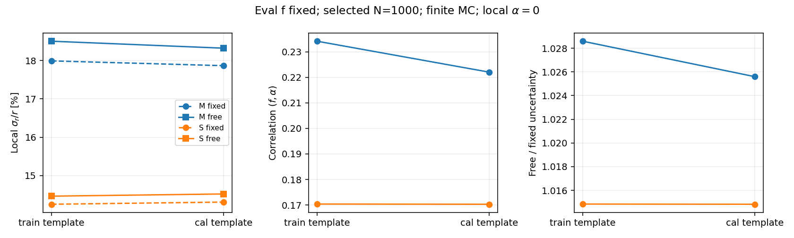
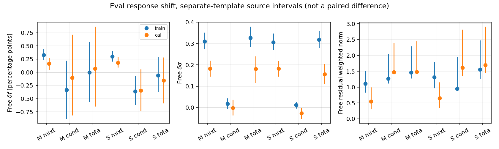

# Stage66：权重训练外 cal 模板的局部响应检验

## 1. 阶段目标

按路线§46，只将响应模板由train改为未参与F7权重训练的cal，以eval为唯一目标；固定M/S原格、选中N=1000及一个高组件α=0硬度方向。问题是：原条件偏移证据如何变化，小cal模板的有限MC/来源/缺层代价是否仍允许判断。原train→eval仅读stage65，不重跑其来源实验，不反向择优、合并模板或重新校准。


**实测结论：S的条件偏移中心值在换成权重训练外模板后仍接近原值，证据因来源不确定性变弱，不能宣称响应相同或原残差由训练内模板唯一造成。** 自由硬度有限MC条件δf由train模板−.362477 [−.623026,−.072791]pp变为cal模板−.346904 [−.733243,+.057334]pp；低组件由−.197460变为−.165032pp，也没有明确消失。继续F7，不做部署/谱修正。下一阶段转定向独立补样的身份与可交付性审计，不再轮换现有模板或追加局部参数。

单任务9662236.0一次成功，4中央+2000来源Fisher及投影，0新增train抽样。独立逐事件/降维矩阵复核通过，角色/保护/缺层完整；本阶段没有改善低能点预测或测量data。
## 2. 输入与冻结

唯一逐事件输入为stage63 `ml/artifacts/stage63/observables.npz`（2,236,976 bytes）；原落箱/角色/保护和stage63协议、stage64分解约定、stage65中央及来源汇总作为已有证据。未新增逐事件持久文件、F7推理、能量训练、ROOT/RDO、locked-test、新生产、非线性谱profile、coverage toy或SHA。源码没有涉及C++，无需重建分析框架。

| role | 事件/保守来源 | true50–200 | ≥200 | 输入缺失 | 未确认 | S−M<0 | high-y | reco pz50–100 |
|---|---:|---:|---:|---:|---:|---:|---:|---:|
| train，仅角色核对 | 41447/91 | 4331 | 37116 | 21 | 1495 | 1963 | 1204 | 2498 |
| cal，唯一新模板 | 8440/16 | 841 | 7599 | 3 | 301 | 431 | 230 | 504 |
| eval，唯一目标 | 14057/22 | 1114 | 12943 | 7 | 510 | 913 | 440 | 682 |

沿用pz>50 GeV、M=log(pz0/GeV)、S=log(E_F7/GeV)各16常规格及专用无效格，极端/溢出保留。F7既有62审计输入、唯一线性动量pz0、11个scintillator raw charge/VetoNu reduced、合法signed及typed invalid/status/dependency→NaN策略不变；px/py、q/p、弯折仍允许，不引入p0/p1/pz1或ln(p0/p1)。原42个输入缺失者中另11个既有保护者角色不变，不称本轮删除；未确认、high-y、负修正和困难尾完整保留。

[不可覆盖协议](stage66_energy_ml/protocol.json)于**2026-11-02 23:24:23.047681 UTC（当地11月3日）**冻结，起始提交f6e80d7。冻结cal参考顺序、固定f_eval=1114/14057=.07924877285338265、N_selected1000、400 GeV居中和α=0、500次来源抽样以及1CPU/3000MB/600s/5MB预算；没有按新结果选点/分箱/先验。

## 3. 方法和不确定性

cal低/高模板a/b分别内部归一，u=log(E/400GeV)，C_z=Σ_cal,high,z(u−ubar_cal)/7599；D=(a−b,(1−f_eval)C)。数据协方差为[diag(q)−qqᵀ]/1000，有限MC再加f²[diag(a)−aaᵀ]/841与(1−f)²[diag(b)−bbᵀ]/7599。已知响应版去掉MC两项，不能借用train41447的计数缩小模板误差。

局部I=DᵀV⁺D；固定硬度σ_f=1/√I_ff，自由硬度由二维逆/Schur补计算，σ_r/r=σ_f/[f(1−f)]，r为选中低/高相对强度。标准化Fisher秩阈值1e−10，协方差相对/绝对截断1e−12/1e−18，方向信息阈值1e−12，f边界容差1e−8；奇异/零方向/边界保留null/NaN，不加岭、先验或伪计数。

真E固定边界50/100/200/400/800/1600/3200/6400 GeV×pi/k/charm含外侧共27个k，低/高组件分别计算eval−cal：共同支持混合Σ(w_eval−w_cal)R_cal、条件Σw_eval(R_eval−R_cal)、非共同支持原始J_eval−J_cal。三项逐格相加恢复总差，不删层或补造响应。投影前按f/(1−f)乘低/高组件概率质量，固定/自由硬度分别留δf/δα及全部signed残差、half-L1与√(residualᵀV⁺residual)。只有原始概率差的half-L1可称TV，分项/残差范数不是归因比例，加权范数不是p值。

500次pi/k/charm分层保守来源多项式抽样，cal/eval独立seed2026110366/2026110367、M/S配对；每次重估cal a/b/C/V/算子、eval经验响应和共同支持。名义f固定。来源区间为2.5/97.5百分位，与有效/无效次数并列；未定义值以null/NaN保留，不只展示漂亮重复。来源ESS仅描述重复权重集中度，不能替换真实模板计数或当独立新事件。

本次与stage65采用不同模板/独立来源重复，分别列区间，**没有对两区间作配对差异推断**。cal/eval都已开发，cal参与旧global offset，原M/S分箱来自train；谱/生产/格内E/y/几何及interaction仍不同。这是权重训练外开发响应检验，不是纯训练乐观性测量、新独立确认、detector系统测量或未选中flux。来源区间不含重训、完整谱系、校准、interaction/FSI/材料/背景等系统，也不是coverage toy。


## 4. 局部精度：cal模板仍可辨识，不能将模板差异当纯样本量效应

σ_f以百分点（pp）表示，σ_r/r为相对百分数，σ_α无量纲；所有点固定eval f_true和N1000。

| 模板/表示/MC | 固定σ_f/pp | 自由σ_f/pp | 固定σ_r/r/% | 自由σ_r/r/% | σ_α | corr(f,α) |
|---|---:|---:|---:|---:|---:|---:|
| train，stage65/M/已知响应 | 1.303965 | 1.340905 | 17.870273 | 18.376514 | 0.064068 | 0.233104 |
| train，stage65/M/有限MC | 1.313006 | 1.350542 | 17.994166 | 18.508586 | 0.064854 | 0.234125 |
| train，stage65/S/已知响应 | 1.035859 | 1.051037 | 14.195997 | 14.404004 | 0.057015 | 0.169332 |
| train，stage65/S/有限MC | 1.039595 | 1.055022 | 14.247188 | 14.458618 | 0.057713 | 0.170389 |
| cal，本轮/M/已知响应 | 1.263547 | 1.294437 | 17.316362 | 17.739691 | 0.062102 | 0.217157 |
| cal，本轮/M/有限MC | 1.303873 | 1.337247 | 17.869012 | 18.326379 | 0.065745 | 0.222015 |
| cal，本轮/S/已知响应 | 1.026209 | 1.040486 | 14.063748 | 14.259400 | 0.056350 | 0.165086 |
| cal，本轮/S/有限MC | 1.043735 | 1.059208 | 14.303927 | 14.515981 | 0.059644 | 0.170303 |

cal有限MC自由/固定σ_f比：M **1.025596 [1.021878,1.029290]**、S **1.014825 [1.012687,1.017415]**；标准化条件数1.570743/1.410519（来源区间[1.518318,1.620755]/[1.374712,1.451674]）。4中央和2000个来源重复全秩2，无未定义精度/投影。α与f只就这个局部方向可分，不能推论多个谱/响应自由度均可辨识。

相比各自已知响应，自由σ_f的有限MC代价为M **3.307205%**、S **1.799379%**，比大train模板更明显。可是cal/train有限MC自由σ_f中央比为.990156/1.003967，不一定更宽：更换模板同时改变a/b/C和来源混合，不能把这种中央对照当“减少训练事件也一样好”或样本饱和。f的有限MC中央误差由841/7599而非41447真实计数得到。

cal有限MC自由σ_f来源区间：M **1.337247 [1.308689,1.366593]pp**、S **1.059208 [1.042940,1.076897]pp**；σ_α=.065745 [.064615,.066956]/.059644 [.058762,.060607]，corr=.222015 [.205819,.236861]/.170303 [.157793,.184231]。不包含F7重训/旧offset不确定性。

完整[Fisher.csv](stage66_energy_ml/Fisher.csv)、[区间](stage66_energy_ml/Fisher_intervals.csv)、[模板并列表](stage66_energy_ml/template_comparison.csv)。



## 5. 迁移投影：条件中心仍负，较宽区间不能当闭合

以下均为有限MC，δf单位pp；来源区间为各模板分别抽样的95%区间，不是新旧差异的置信区间。

| 模板/表示 | 固定总δf/pp | 自由总δf/pp [95%来源区间] | 自由条件δf/pp [95%来源区间] | 自由总δα |
|---|---:|---|---|---:|
| train→eval M，stage65 | −1.599348 | −.005299 [−.566232,+.575675] | −.334463 [−.882863,+.221253] | .326949 |
| cal→eval M，本轮 | −.749242 | +.066881 [−.646097,+.864819] | −.103918 [−.819164,+.713229] | .180728 |
| train→eval S，stage65 | −1.050324 | −.060672 [−.370301,+.287375] | −.362477 [−.623026,−.072791] | .317724 |
| cal→eval S，本轮 | −.627390 | −.155806 [−.586968,+.281620] | −.346904 [−.733243,+.057334] | .155928 |

S条件中心−.346904pp与旧−.362477pp接近；来源区间跨零只表示本次有限支持不能给同等负向证据。低组件S条件固定−.151486pp、自由**−.165032 [−.411329,+.043669]pp**，旧自由为−.197460 [−.368548,−.016856]pp；仍不能宣称低能响应恢复。M自由条件中心从−.334463减至−.103918pp，来源区间很宽且M不依赖能量ML权重，说明模板/来源混合本身会改变局部投影；不是对F7纯过拟合的隔离实验。

| cal→eval表示 | 固定混合δf/pp | 自由混合δf/pp | 固定条件δf/pp | 自由条件δf/pp | 自由未匹配δf/pp | 混合δα | 条件δα |
|---|---:|---:|---:|---:|---:|---:|---:|
| M | −.660803 | +.163700 | −.095289 | −.103918 | +.007100 | .182583 | −.001911 |
| S | −.368139 | +.182537 | −.267593 | −.346904 | +.008561 | .182080 | −.026224 |

自由混合δf来源区间M[+.045883,+.277593]pp、S[+.089562,+.289186]pp；S条件与其相消，不能用总δf代替分项响应验证。未匹配来自eval最低能charm，保持正号，不补造cal响应。

| cal→eval表示/项 | half-L1 固定→自由 | 加权残差范数 固定→自由 |
|---|---:|---:|
| M 混合 | .039240→.007390 | 2.830681→.547921 |
| M 条件 | .021755→.021627 | 1.469436→1.469149 |
| M 总 | .041808→.021992 | 3.124107→1.484416 |
| S 混合 | .044662→.008487 | 3.120485→.646605 |
| S 条件 | .023537→.022254 | 1.675462→1.616744 |
| S 总 | .041392→.023737 | 3.114240→1.692324 |

加硬度主要吸收混合方向，对条件残差帮助有限；增加投影方向按代数降低加权范数，不能当验证成功。half-L1不必每项下降，如M低组件条件由.001313增至.001367；全部signed残差保留。新cal模板S条件自由残差范数1.616744还大于旧train模板.952814，两模板的V与投影均变了，不能据此单指探测器变坏。

新总δα M .180728 [.116250,.240158]、S .155928 [.110014,.205282]；仍只在α=0的线性投影，有限位移的非线性有效范围**未测量**，不是新fit或无偏修正。4个中央合并总投影与2000个对应来源投影，固定/自由两模式的f+δf均在[0,1]，未定义0；域内不证明响应概率/完整曲线或覆盖正确。

完整[分项与区间](stage66_energy_ml/projections.csv)、[新旧分项并列表](stage66_energy_ml/projection_comparison.csv)、[原始signed向量](stage66_energy_ml/vectors.csv)、[signed残差](stage66_energy_ml/residuals.csv)。



## 6. 来源、零支持与独立补样需求

54个组件×k位置全部保留，其中20个任一侧非空、19个名义共同支持；其余为原始空/结构空格。唯一非共同支持层是true50–100 charm：cal **0例/0来源**、eval **1例/1来源**，500次cal零支持、eval有155/500次（31.0%）零支持、共同支持0/500。另19层在这500次中均保持共同支持，不意味着它们具有足够多独立生产。

eval低组件未匹配质量**.089767% [0,.226477]%**（1/1114），cal未匹配0；按f加权后对S自由δf的中央贡献+.008561pp。不能删掉该例或以bootstrap偶尔为零伪造cal响应。100–200 charm仍为cal6例/2来源、eval17例/3来源；各高能charm也只有2/3来源。

| 关键层 | cal N/来源 | eval N/来源 | 共享来源重复次数/500 |
|---|---:|---:|---:|
| 50–100 π | 132/6 | 179/8 | 500 |
| 50–100 K | 18/8 | 28/10 | 500 |
| 50–100 charm | 0/0 | 1/1 | 0 |
| 100–200 π | 518/6 | 690/8 | 500 |
| 100–200 K | 167/8 | 199/11 | 500 |
| 100–200 charm | 6/2 | 17/3 | 500 |
| 200–400 K | 545/8 | 899/11 | 500 |
| 800–1600 π | 549/6 | 1050/8 | 500 |

S自由条件中央分层贡献中，200–400 K为−.146665pp、100–200 K为−.106910pp、800–1600 π为−.048984pp；这些层不只包含稀少charm，不能把整个条件残差归几个异常。中央排序仅为描述性支持清单，未做分层来源显著性检验/多重校正，不作为新cut。所有层见[support.csv](stage66_energy_ml/support.csv)、[中央条件分层投影](stage66_energy_ml/conditional_strata.csv)。

来源权重ESS（事件等效计数，不能替代原始N或作为新增MC）：

| role | 全体95%范围 | 低组件95%范围 | 高组件95%范围 |
|---|---:|---:|---:|
| cal | [3288.405,6156.533] | [303.953,631.731] | [2941.545,5493.282] |
| eval | [5824.886,9716.816] | [416.264,803.779] | [5364.875,8956.789] |

cal低组件只有16保守来源中的有限支持，条件δf的区间足以限制“消除了失配”这种结论；当前不能给可靠独立确认或精确新增事件功效。所需新支持是未开发且可核实身份/谱系的true50–100、100–200（尤其charm），并同时保留reco pz50–100中的true≥200/high-y、低可见和未确认。不能仅补容易低能核心；需要共同raw/status/mask才能定义有效低可见活动，不能用ML负修正假装quiet。

## 7. 数值验证与程序/物理原因

合成pilot的归一化导数、改变居中能标、W正交、完全共线、零方向及f边界通过；导数差6.6789e−12。正式cal事件仅用对称步±1e−5作导数QA，最大差**5.1643e−12**。全部来源重复ΣC最大1.8041e−16、L₂D−单位阵最大5.5511e−16、逐格守恒误差最大1.1449e−16，均低于冻结1e−8。

独立逐事件直方图/高log矩、显式k循环分解与降维sum-zero协方差直接逆，复核4中央矩阵、预定索引0/249/499的12来源Fisher/投影：V⁺差2.5466e−11、I差5.4570e−12、算子差6.6613e−15、σ差5.5511e−17；来源Fisher/投影差≤1.5543e−15/3.1086e−15、signed中央残差差1.5613e−17。固定α误差与stage63 `information`函数、自由误差与Schur补一致。ESS逐事件权重公式差0。

原M/S边界逐事件重落箱，train/cal/eval角色/保护/困难支持全核；54层实际N/来源与保存的500次零/共同支持频率核对，未匹配质量预定3重复独立复核。所有保存数组未定义值0。[verification.json](stage66_energy_ml/verification.json)。独立验证未重跑完整train或cal正式Fisher bootstrap，没有F7推理/优化器，不能把当前负偏移归数值求解失败。

物理原因仍未唯一识别。权重训练外cal的S条件中心仍为负，未提供“仅换掉训练内模板即可消除残差”的证据；但区间宽、粗格内谱/y/几何/生产混合及旧offset未固定，也不能证明纯过拟合不存在、detector已失配或信息极限。继续F7，原最低能点风险仍未改善；本轮没有新增data/相互作用/材料响应测量。

## 8. 实测资源、I/O、产物与命令

合成pilot脚本wall .041161s/CPU .030060s/ru_maxrss616.605469MiB，100次四格Fisher内核wall .025424s/CPU .025176s，2004次估计.509488s仅是合成外推，不等于实际17格成本。

正式脚本wall **2.648804s**、CPU **2.448400s**、峰值RSS **104.332031MiB**，完成2004个Fisher/投影、3002次分解（含来源未匹配支持汇总）；约**756.57 Fisher case/s**，包括分组、分解、区间和写出开销，不是纯矩阵benchmark。`/usr/bin/time`含启动/导入wall5.15s、user3.09s/sys.42s、maxRSS106836KiB。独立QA和制图wall2.517589s/CPU2.101060s，ru_maxrss616.605469MiB。

Condor **9662236.0，ExitCode0，NumJobStarts1**；remote CPU user3+sys1=**4s**，日志execute12s/history RemoteWallClockTime16s分别记账。dry-run/最终请求/实际分配均**1CPU/3000MB**，预算600s内，无重交/重试；Condor ResidentSetSize30000KiB是采样记录，不替代脚本104.332MiB高水位。0新增train抽样、模型fit/推理/ROOT/RDO/生产/非线性profile/toy。

Condor接收2,164,669 bytes、发送211 bytes；payload文件2,163,670 bytes、XRootD结果包1,267,614 bytes是独立文件大小，不能冒充实际网络字节。正式/proc rchar2,373,699/wchar1,421,107/read_bytes0/write_bytes1,454,080 bytes，只是进程/kernel记账，**actual EOS物理/网络I/O未测量**。单线程、分组直方图与来源矩阵复用，不保存500×全事件权重或输入副本。验证后删除临时payload/返回包，汇总证据在`workbook/stage66_energy_ml/`，证据合计1,634,103 bytes（1.558402 MiB），逐文件字节见[storage.json](stage66_energy_ml/storage.json)，紧凑保留低于5MB。

```bash
source /cvmfs/sft.cern.ch/lcg/views/LCG_109/x86_64-el9-gcc15-opt/setup.sh
export PYTHONNOUSERSITE=1 OMP_NUM_THREADS=1 OPENBLAS_NUM_THREADS=1 MKL_NUM_THREADS=1
python ml/prepare_trainingout_response.py
# 打包必要代码、stage66协议、stage63缓存、stage65 summary，传入worker scratch。
condor_submit -dry-run /tmp/stage66-submit.ad AnalysisZipFramework/submission/ml_trainingout_response.sub
condor_submit AnalysisZipFramework/submission/ml_trainingout_response.sub
# 返回后不覆盖已有协议/pilot：
tar -xzf ntuples/energy_ml_stage66/results.tar.gz --skip-old-files
python ml/report_trainingout_response.py
condor_history 9662236 -limit 1 -json -attributes ClusterId,ExitCode,NumJobStarts,RemoteUserCpu,RemoteSysCpu,RemoteWallClockTime,RequestCpus,RequestMemory,MemoryProvisioned,CpusProvisioned,BytesRecvd,BytesSent
python -m py_compile ml/trainingout_response.py ml/prepare_trainingout_response.py ml/run_trainingout_response.py ml/report_trainingout_response.py
bash -n AnalysisZipFramework/submission/run_ml_trainingout_response.sh
git diff --check
```

上述为实际入口，prepare/正式任务有不可覆盖保护，不能在已有结果上重新运行。AFS spool `/afs/cern.ch/user/x/xcheng/nu_mu_stage66`。报告完成后与代码/配置/紧凑证据本地Conventional Commit，不推送。stage54既有未提交工具/缓存不改、不混入提交；Prompt原保留后缀逐字节保持。

## 9. 下一单项：定向独立补样的身份与可交付性审计

**停止本轮模板轮换/局部参数研究；stage67只回答“哪里还有可用且未开发的低能及同pz困难支持”。** 当前S条件中心仍负而来源证据不足，不应再换一组模板/参数或做更多toy求显著。先把既有替代flux使用情况与真实新支持分开，形成可执行的定向输入合同。

输入为stage55 `ml/configs/low_energy.json`、`low_energy_files.tsv`、`ntuples/energy_ml_stage55/dataset.npz`与提取metadata，stage56 raw审计/角色和既有F7身份保护清单，stage64/66支持表。只读已开发缓存并核身份/来源/精确入射ν四动量复用；不读取locked-test事件，不重训/推理F7，不先生成/重放或重建大样本。先核缓存schema/单位，按原角色统计true50–100、100–200、同reco pz50–100且true≥200/high-y及未确认的事件/保守来源、精确重复/保护量；低可见若缺共同有效定义则明确未测量，不编造quiet。

对用户指定200080–200101，仅访问已有清单指向的22个run `rdo/s0014`目录做一层清单/metadata；明确其中原nominal六run与替代16run。stage55已经用过替代31个训练来源、16个评价来源，新增低能训练139例，不能再标作未开发新证据；此处为引用历史报告，非本轮重新计数。未用文件名/不同flux/几何不能证明生成谱系独立，需原生成ID/种子/子文件或足够身份联结证据。只允许≤24个事先按run/生产/来源范围确定的候选文件做头/schema与≤40总事件身份QA，不按低能残差选候选；不递归扫EOS、不恢复大文件、不做SHA或大规模RDO读取。

交付实际可复用/已开发/受保护/仅几何或flux变体/谱系未证的来源表、已缓存支持的实测计数及未用候选的metadata证据，并列无法从头信息测到的选中低E支持/功效为“未测量”。必须给**一个**最小后续生产/提取输入方案（源、角色隔离、共同重建/特征定义、低能与困难支持、身份去重规则、预计I/O/时间的pilot测量与停止），或者明确现有目录不能证明有独立输入并列所缺生成/quiet信息。metadata量不能叫新增独立物理事件，重复digitization/重抽样不是补样。

先冻结边界与身份判据，小QA后再批量缓存统计，经≤1Condor/1CPU/3000MB、CPU及wall≤600s、实际新增输入读取≤1GB、紧凑最终≤5MB；native环境不匹配则用既有构建核可测头信息，不重编译/延长全历史恢复。新增独立事件数与功效、任务实际成本**未测量，本轮不执行**；不按旧3000–5000目标硬造需求，不自动启动正式生产。stage54共同raw/有效占据、interaction/FSI/材料、接受度/背景及真正未开发确认仍须交付；沿用stage61文献入口，本轮未新增检索。
