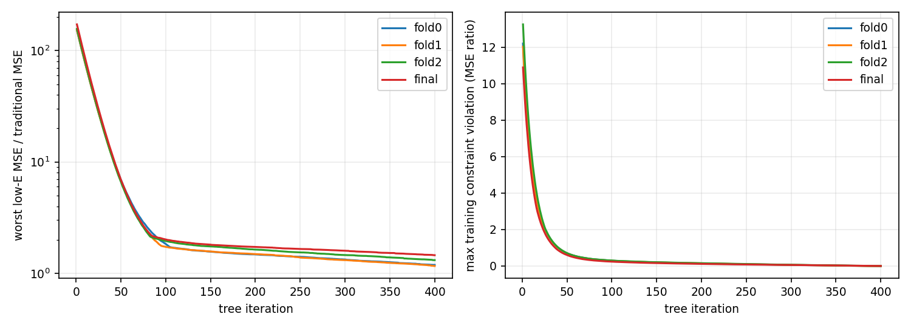
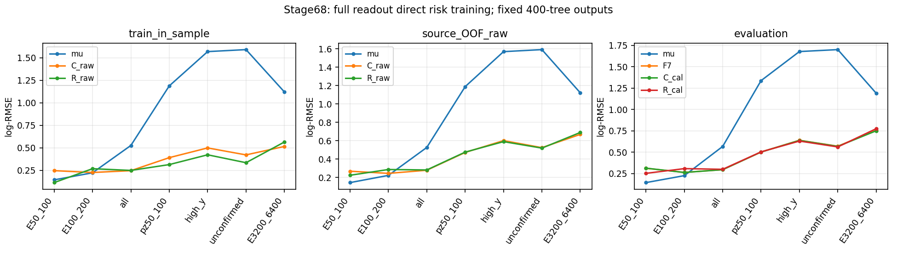

# stage68：完整读出受约束回归改善最低能，但未同时恢复两个低能层

日期：2026-11-03。起始提交：`3cc3955`。依据：[stage67复盘](2026-11-03_stage67_research-reassessment.md)、[路线§48](../docs/nu_mu_energy_ml_revised_roadmap.md)、本轮执行前冻结的[协议v1](stage68_energy_ml/protocol_v1.json)及正式fit前修订的[协议v2](stage68_energy_ml/protocol.json)。

## 1. 阶段目标与结论

本轮完成完整62读出、同容量普通平方log误差C与群体风险受约束回归R的三来源折及全train对照，共8个正式fit，未追加调参或选择迭代。预定主候选为最终`R_cal`；raw并列保留。

**目标改变确实改善了最低能的来源留出表现，但没有找到两个低能层和全体风险都满足要求的解。继续F7，结束本次对偶训练预算。** 来源OOF true50–100的R/C log-RMSE比为.835132 [.798541,.876462]，而100–200比为1.172821 [1.155239,1.190005]；最终evaluation同向。原传统低能恢复、全体相对F7的1%和100–200尾部标准失败。不能将这次阴性推广为全部62读出不可分或全部方法不可行，也不能将原因唯一归于缺数据。

## 2. 输入、变量与角色

- 输入为stage55 `ntuples/energy_ml_stage55/dataset.npz`、stage56 `ntuples/energy_ml_stage56/readout.npz`。nominal d32b0ff3/without-IFT、TI12MC04/FASERNU-04/OFLCOND-FASER-06，unit MC。train/cal/eval分别41447/8440/14057事件、91/16/22保守来源。原truth/reco pz>50 GeV、最高pz leading、truth fiducial和其余选择完整保留，无新增能量上限。
- X直接经`audited_features.load/build`。62列中线性模长/纵向动量仅pz0；px/py、q/p和弯折允许，p0/p1仅保留在允许变量的有效性依赖中，不作为输入；不使用ln(p0/p1)。11个scintillator raw charge及VetoNu reduced沿用，未换回fitted charge。原分析仍有fitted-charge cut，本轮未改变接受度。
- 非负/正数/count中的非物理负占位、明确几何sentinel、状态和依赖转NaN；合法signed值及电荷符号−1保留。不能把所有−999/−1全局清掉：signed raw、位置和px/py须以分支语义判断。单模块Calo无效则总量NaN，不用nansum补零，不拟合raw或删除缺失事件。
- 原42个缺失者保持eligible train/cal/eval 21/3/7及另11个既有保护者。全体高-y、未确认、巨大动量、负修正和困难尾保留。truth E/y/身份仅用于训练组、分折或评价，独立部署只用X。
- 固定参考只读取已保存的传统pz0/.8、F7三seed ensemble＋原global offset、stage60最终gate、stage62 A完整unit posterior mean(logE)校准点输出。没有重训或重新推理F7；cal中的这些最终输出是开发比较，非OOF。

## 3. 正式结果前的分折修订

train的41447个入射(pdg,px,py,pz)均有限，无零三动量；只有32046个唯一四元组。6625个key跨保守来源复用，涉及15918事件。它们不是无效默认数值，但完整生成谱系仍未认证。将共享key连通的来源整体合并，会把91来源连成仅3个组件，恰好分别π/K/charm，不能称普通均衡来源三折。

因此在任何正式fit前保留v1，并冻结v2：每个π/K/charm内部按来源事件N降序、名称排序，贪心分配到该组件负载最小的折；依次以总负载、折编号破同值。每折训练端排除与留出端共享精确入射四元组的事件；全部留出者及最终完整train/cal/eval不删除。只使用来源/身份/计数，不用留出残差或标签选折。

| 折 | 留出N/来源 | 原训练候选N | 身份隔离排除N | 实际训练N/来源 |
|---|---:|---:|---:|---:|
| 0 | 13820/32 | 27627 | 4832 | 22795/59 |
| 1 | 13667/29 | 27780 | 4902 | 22878/62 |
| 2 | 13960/30 | 27487 | 4944 | 22543/61 |

每折C/R完全匹配训练支持，来源及精确入射交集均为0；41447个train事件恰好获得一次OOF预测。最终fit仍使用完整41447。这些折因身份隔离而少于通常2/3训练集，OOF与最终误差不能直接当学习曲线。共享四元组是保守复用代理，不能认证全部生成独立性；不同来源之间仍可能相关，来源bootstrap并不因此获得严格覆盖保证。详见[身份审计](stage68_energy_ml/identity_fold_audit.json)。

## 4. 训练政策与算术

C/R都直接预测t=log(Eν/GeV)，同train mean(t)初始化、depth5/400轮、eta=.04、subsample=.8、colsample=1、min_child_weight20、lambda10、hist、单线程、seed2026110368。C优化普通平方log误差。R低能目标为两个true50–100/100–200的MSE/同支持传统MSE之最大值；保护全体≤1.01²×C训练MSE，true≥200、reco pz50–100、高y≥.8、未确认各≤1.03²×C训练MSE。

R每轮按当前train风险先更新两个低能simplex对偶及五个非负保护对偶，再加一棵树。step=.05/sqrt(1+t/50)，低能初值(.5,.5)，指数更新中心化风险差；保护对偶初值1、上界25，dual增量截在±10。只截对偶增量，不截预测残差或事件损失。低能概率floor1e−8后重归一。每组事件系数dual/(N_group×referenceMSE)，重叠贡献相加，最终事件weight均值归一到1；梯度w(f−t)、Hessian w，与XGBoost普通平方损失1/2约定一致，保持正则尺度。

没有全局最优或训练可行性保证。唯一输出为第400轮，不挑最佳/可行checkpoint，不平均、不修复、不重试，不用cal/eval更新对偶。正式训练前24个合成点/7重叠组的独立方向差分梯度/Hessian和均值归一通过；256个train点各20轮的资源/算术pilot不是科学候选，模型已删除。最终C/R各仅一个全cal mean log offset：C=+.004101128972，R=−.001831020418；OOF没有offset。详见[pilot](stage68_energy_ml/pilot.json)、[校准](stage68_energy_ml/calibration.json)。

## 5. 训练与来源OOF：最低能收益可转移，第二低能层恶化

log-RMSE为自然对数无量纲；能量边界单位GeV。

| 群体 | N | 传统 | C训练内 | R训练内 | C来源OOF | R来源OOF |
|---|---:|---:|---:|---:|---:|---:|
| E50_100 | 767 | 0.143853 | 0.246332 | 0.113431 | 0.267998 | 0.223814 |
| E100_200 | 3564 | 0.222426 | 0.225730 | 0.268000 | 0.244169 | 0.286366 |
| all | 41447 | 0.526281 | 0.246156 | 0.248933 | 0.278414 | 0.281511 |
| E200_inf | 37116 | 0.551464 | 0.248026 | 0.249070 | 0.281692 | 0.282110 |
| pz50_100 | 2498 | 1.187733 | 0.390663 | 0.313578 | 0.471906 | 0.475446 |
| high_y | 1204 | 1.568664 | 0.498660 | 0.422361 | 0.600664 | 0.589596 |
| unconfirmed | 1495 | 1.590771 | 0.421223 | 0.334493 | 0.524132 | 0.519114 |
| E3200_6400 | 282 | 1.120650 | 0.515139 | 0.564472 | 0.668698 | 0.689460 |

| OOF群体 | R/C RMSE比 [来源95%区间] | R/传统 RMSE比 [来源95%区间] |
|---|---:|---:|
| E50_100 | 0.835132 [0.798541, 0.876462] | 1.555846 [1.412540, 1.699470] |
| E100_200 | 1.172821 [1.155239, 1.190005] | 1.287466 [1.238375, 1.346670] |
| all | 1.011124 [1.008752, 1.013870] | 0.534907 [0.525837, 0.544074] |
| pz50_100 | 1.007503 [0.997912, 1.017592] | 0.400297 [0.384018, 0.417062] |
| high_y | 0.981573 [0.971325, 0.992716] | 0.375858 [0.361308, 0.393914] |
| unconfirmed | 0.990426 [0.980217, 1.000630] | 0.326328 [0.314166, 0.339363] |

三折留出最低能C/R依次为.272739/.221226、.239078/.190248、.288026/.253459；100–200则为.261975/.305478、.239540/.277731、.229037/.274016，三折均同向。最低能79个有支持来源中68个R优于C；100–200为5/90；high-y为59/90。不是少数evaluation离群点驱动的唯一现象。来源逐行及折内结果见[source_metrics.tsv](stage68_energy_ml/source_metrics.tsv)、[fold_metrics.tsv](stage68_energy_ml/fold_metrics.tsv)。

最终训练末端的低能MSE/传统比分别.621764/1.451765；保护组MSE/C比分别1.0226845/1.0084362/.6442970/.7173968/.6305929。全体上限1.0201被违反.00258450（RMSE比1.01127865>1.01），fold2也违反.000360662；fold0/1末端保护可行。**完整最终R没有同时达到训练保护，更没有达到两个低能恢复。**

程序轨迹提供一项具体限制：全train R第50轮低能对偶约(1−1e−8,1e−8)，第100轮实际第二低能风险已更大(1.700377 vs2.013829)，但第400轮第二组对偶仍只有9.62368e−7。前期恒定初始化时最低能风险较大，使乘法对偶积累强烈偏向第一组；有限轮数内未重新平衡。各任务前26轮有dual增量截断，保护对偶未碰25上界。末端事件weight范围.418626–11.105081、ESS14566.116/41447。该轨迹说明本实现不能被当作minimax鞍点解；它也不能证明所有约束不可同时实现。本轮按冻结政策结束，不借诊断继续扫对偶。完整逐轮数据只存于[trajectory.tsv](stage68_energy_ml/trajectory.tsv)的1600行，四份job fit.json只保留末端/风险参照/资源摘要。



## 6. 最终开发evaluation：原推广标准未通过

500次按π/K/charm分层、保守来源配对bootstrap，固定所有预测和global offset；不含重训、校准重估、完整谱系、响应/interaction或研究选择误差，也未作多重比较修正。cal/eval都已开发，不称blind或新的独立确认。来源<3的组不报精确CI，空组标未测量；每条有效/无效次数见[paired.tsv](stage68_energy_ml/paired.tsv)。

| 群体 | N/来源 | 传统 | F7 | C_cal | R_cal | stage60 | stage62 A_cal |
|---|---:|---:|---:|---:|---:|---:|---:|
| all | 14057/22 | 0.568069 | 0.296363 | 0.296553 | 0.300964 | 0.300601 | 0.302601 |
| E50_100 | 208/19 | 0.145487 | 0.312816 | 0.314489 | 0.253745 | 0.186690 | 0.277739 |
| E100_200 | 906/22 | 0.226876 | 0.265014 | 0.263651 | 0.308859 | 0.260643 | 0.259126 |
| E200_inf | 12943/22 | 0.588671 | 0.298164 | 0.298425 | 0.301103 | 0.304668 | 0.305792 |
| pz50_100 | 682/22 | 1.336853 | 0.502965 | 0.502616 | 0.504583 | 0.544847 | 0.508713 |
| pz100_250 | 2670/22 | 0.652049 | 0.343488 | 0.343356 | 0.350726 | 0.346548 | 0.347946 |
| high_y | 440/22 | 1.676717 | 0.640068 | 0.638640 | 0.630901 | 0.667369 | 0.638956 |
| unconfirmed | 510/22 | 1.699385 | 0.570928 | 0.568489 | 0.562267 | 0.589600 | 0.590157 |
| input_missing | 7/5 | 0.704495 | 0.666657 | 0.680390 | 0.679853 | 0.666657 | 0.736541 |
| E3200_6400 | 271/14 | 1.189880 | 0.755449 | 0.750925 | 0.775321 | 0.755449 | 0.747008 |

| evaluation群体 | R_cal/F7比 [95%区间] | R_cal/传统比 [95%区间] |
|---|---:|---:|
| E50_100 | 0.811164 [0.744726, 0.863551] | 1.744110 [1.393597, 2.161167] |
| E100_200 | 1.165443 [1.138789, 1.194698] | 1.361357 [1.285722, 1.444319] |
| all | 1.015526 [1.012004, 1.018928] | 0.529802 [0.515750, 0.542239] |
| E200_inf | 1.009859 [1.006435, 1.013171] | 0.511496 [0.497287, 0.524334] |
| pz50_100 | 1.003216 [0.987466, 1.019942] | 0.377441 [0.357617, 0.396858] |
| high_y | 0.985678 [0.974720, 0.996862] | 0.376272 [0.361820, 0.392020] |
| unconfirmed | 0.984830 [0.971501, 0.997750] | 0.330865 [0.310962, 0.353103] |

主候选最低能相对F7改善18.884% [13.645,25.527]，相对匹配C_cal改善19.315% [12.923,26.635]；但对传统比的95%上限2.161167远大于1.05。100–200/F7中央退化16.544%，来源区间也排除不退化；两低能/传统上限分别2.161167/1.444319，均未恢复。全体/F7上限1.018928>1.01，中央本身也超过1%，不是只因区间太宽。≥200、低pz、高y、未确认的3% RMSE保护通过，其中高y和未确认对F7有小幅来源区间同向改善，但不能替代低能/全体验收。

raw最终结果也失败：全体.300835、最低能.254574、100–200 .309952。cal最终R的对应数值.281176/.247477/.297264，传统.544278/.152369/.215110，F7 .275965/.300343/.245748，同样未获得整体成功。不能从raw/cal或不同阶段中挑局部优值换主候选。完整cal/eval/raw/训练/OOF见[metrics.tsv](stage68_energy_ml/metrics.tsv)，验收布尔量见[decisions.json](stage68_energy_ml/decisions.json)。

全部evaluation真能量箱如下；≥6400无支持，未测量，未将空箱补零。

| trueE/GeV | N/来源 | 传统 | F7 | C_cal | R_cal |
|---|---:|---:|---:|---:|---:|
| E50_75 | 66/12 | 0.145187 | 0.306319 | 0.311503 | 0.232261 |
| E75_100 | 142/19 | 0.145626 | 0.315789 | 0.315868 | 0.263134 |
| E100_150 | 395/21 | 0.195570 | 0.275854 | 0.275375 | 0.330513 |
| E150_200 | 511/22 | 0.248386 | 0.256321 | 0.254218 | 0.291019 |
| E200_400 | 2555/22 | 0.329592 | 0.228522 | 0.228036 | 0.238105 |
| E400_800 | 4349/22 | 0.458574 | 0.240938 | 0.241653 | 0.240610 |
| E800_1600 | 4007/22 | 0.646911 | 0.282578 | 0.283143 | 0.281205 |
| E1600_3200 | 1761/22 | 0.836590 | 0.405905 | 0.407059 | 0.410716 |
| E3200_6400 | 271/14 | 1.189880 | 0.755449 | 0.750925 | 0.775321 |
| E6400_inf | 0/0 | 未测量 | 未测量 | 未测量 | 未测量 |



## 7. 偏差、宽度与双向尾：不能只看最低能中心改善

下表为R_cal；bias、R68和尾率单位%，loss share为tail50事件占本组平方log损失的百分比。tail50按|Ehat/E−1|>.5，tail100按>1，双向完整保存；正能量输出的negative tail100在此定义下恒为0，不能据此宣称消除了严重低估。完整所有参考的双向tail50/100和各方向loss share在metrics.tsv。

| 群体 | mean bias | median bias | R68 | +tail50 | −tail50 | +tail100 | −tail100 | tail50 loss share |
|---|---:|---:|---:|---:|---:|---:|---:|---:|
| E50_100 | 15.589830 | 7.283331 | 16.694957 | 9.615385 | 0.000000 | 3.365385 | 0.000000 | 73.743438 |
| E100_200 | 24.117575 | 18.654326 | 20.100146 | 12.472406 | 0.441501 | 3.421634 | 0.000000 | 59.994884 |
| all | 1.925260 | 2.259693 | 23.054498 | 3.727680 | 3.066088 | 0.754073 | 0.000000 | 51.274087 |
| pz50_100 | 7.494275 | 2.153144 | 39.135410 | 13.343109 | 9.824047 | 5.571848 | 0.000000 | 81.212027 |
| high_y | -5.042761 | -13.628757 | 48.382330 | 12.500000 | 21.818182 | 4.545455 | 0.000000 | 82.695454 |
| unconfirmed | 0.063643 | -7.285373 | 46.055924 | 12.745098 | 15.294118 | 4.313725 | 0.000000 | 78.744081 |
| input_missing | 3.569259 | -0.283637 | 21.349798 | 14.285714 | 14.285714 | 14.285714 | 0.000000 | 97.904165 |
| E3200_6400 | -45.265141 | -44.143521 | 15.316423 | 0.000000 | 36.531365 | 0.000000 | 0.000000 | 76.618529 |

最低能20/208个tail50全部过估，贡献73.7434%平方log损失；7/208超过+100%。传统观察tail50=0，但有限支持下不能把观察零当真实尾率严格为零。R_cal的最低能中位bias+7.283%小于传统+12.936%，R68却为16.695%（传统11.434%），全体log风险仍明显较差，不能删20尾或用中心量替代全样本目标。

100–200的tail50=12.913907%，F7=8.719647%，差+4.194260 [2.757537,5.688607]pp，上尾差+4.083885pp、95%上限5.540680pp，超过+2pp；这是推广的另一明确失败。其余预定关键组tail50及两个方向相对F7的上限通过。3.2–6.4TeV R_cal中位bias−44.144%、tail50=36.531%，F7分别−43.047%/33.210%，高端并未解决。7个缺失evaluation事件来自5来源，R_cal风险.679853，F7值可在全表查阅；这种小组的固定预测bootstrap不能称稳定独立确认。

## 8. 有限补样准备：有未分配charm范围，无已证新独立支持

按既有manifest指定的200080–200101共22个`rdo/s0014`目录作一层文件metadata核实，不递归。共1134个ROOT文件名；161个继承原`files.tsv`的test范围，即使换flux/几何也保留保护。53个文件不属于原历史角色或stage55角色，仅出现在200090/200101的charm max（28/25文件），不是π/K低能核心的新支持。

初次仅用stage55 manifest的候选预览会错误将历史test范围列为未分配，已在读取任何ROOT头/事件前补入原files.tsv角色并纠正；22个初始预览全部被拒绝。最终只留每run一个确定性metadata候选：200090和200101的`charm:00190-00199`，分别1583028892/1451031124bytes。两个run共享范围，本身不能算两个独立生成来源。全部过程仅24个不同文件stat、3次一层目录清单复核（22个不同目录，共66次调用），ROOT头0、事件头0，符合≤24文件/≤40头事件上限；没有生产或重建。

谱系seed、parent generator ID、源事件联结尚未核实，新增选中低E/同pz高E支持和功效均**未测量**，已证新独立事件数为0。旧替代31训练/16评价来源、+139低能训练为stage55历史开发结果，不能重计为新确认。[run表](stage68_energy_ml/supplement_runs.tsv)、[候选表](stage68_energy_ml/supplement_candidates.tsv)、[资源/范围](stage68_energy_ml/supplement_resources.json)给出可交付路径。

最小新源输入合同：需要原生成parent/subfile/seed及事件ID，保持原generation-range角色和精确入射去重；已有test范围永不转训练。只在证实与所有开发/保护池无已知身份复用后，对一个共同几何/重建版本的新π/K生成来源作分层随机小pilot，并同时保留低E核心与同pz高E/high-y/未确认者。先量选择后N/来源、包含概率、I/O和CPU再定规模；本轮未执行、所需规模/收益未测量。现有两个charm文件不满足这一核心合同，不能因目录有文件就扩大生产。共同quiet/可见度仍无有效读出定义，未测量。

## 9. 实现、验证、实际资源与产物

代码：[group_risk.py](../ml/group_risk.py)、[准备](../ml/prepare_group_risk.py)、[分折修订](../ml/amend_group_risk_folds.py)、[fit](../ml/fit_group_risk.py)、[报告](../ml/report_group_risk.py)、[变量QA](../ml/validate_group_risk.py)、[有限补样](../ml/prepare_group_risk_sources.py)、[Condor](../AnalysisZipFramework/submission/ml_group_risk.sub)、[worker](../AnalysisZipFramework/submission/run_ml_group_risk.sh)。

实际使用的子进程wrapper `/tmp/stage68_python.sh` 设置PYTHONNOUSERSITE及OMP/OPENBLAS/MKL线程为1，在子进程source既有LCG_109/x86_64-el9-gcc15-opt后exec python；没有安装软件、改变当前终端环境或重建未修改C++。关键实际命令：

```bash
bash /tmp/stage68_python.sh ml/prepare_group_risk.py
# 正式fit前执行同内容的/tmp/amend_stage68.py，现保存为下列永久脚本；不可覆盖重跑冻结协议。
bash /tmp/stage68_python.sh ml/amend_group_risk_folds.py
condor_submit -dry-run /afs/cern.ch/user/x/xcheng/nu_mu_stage68/dryrun.ads AnalysisZipFramework/submission/ml_group_risk.sub
condor_submit AnalysisZipFramework/submission/ml_group_risk.sub
condor_history -userlog /afs/cern.ch/user/x/xcheng/nu_mu_stage68/logs/risk.9662707.log -json
bash /tmp/stage68_python.sh ml/report_group_risk.py
bash /tmp/stage68_python.sh ml/prepare_group_risk_sources.py
bash /tmp/stage68_python.sh ml/validate_group_risk.py
python3 -m py_compile ml/group_risk.py ml/prepare_group_risk.py ml/amend_group_risk_folds.py ml/fit_group_risk.py ml/report_group_risk.py ml/validate_group_risk.py ml/prepare_group_risk_sources.py
bash -n AnalysisZipFramework/submission/run_ml_group_risk.sh
git diff --check
```

payload通过Python tarfile构造，精确包含fit/group_risk/audited_features/expert_combination四模块、audited_features.json、stage55 dataset、stage56 readout和protocol v2，31453896bytes；worker在本地scratch解包及训练，减少EOS逐轮I/O，结果上传后只提取新的job文件，跳过重复protocol。未读取locked-test事件、新ROOT/RDO或新的大中间文件。

独立验证结果：8模型全部400树/精确62列，保存后独立加载仅X的预测与已保存点输出逐位相同（最大绝对差0）；训练风险独立复算一致；原42缺失角色、NaN/合法负数、坏fit仍可用raw/坏波形NaN、缺失Calo不补零均通过；OOF无缺失/重复，折间身份隔离通过，train/cal/eval精确入射交集为0。来源bootstrap独立逐事件复制复算最大差4.44089e−16。图已打开检查。见[模型验证](stage68_energy_ml/validation.json)、[变量验证](stage68_energy_ml/policy_validation.json)。

| 任务 | C/R fit CPU/s | worker wall/s | worker maxRSS/MiB | Condor remote CPU/s | remote wall/s |
|---|---:|---:|---:|---:|---:|

| fold0 | 5.941/8.976 | 22.18 | 294.078 | 20 | 25 |
| fold1 | 3.339/3.966 | 12.25 | 287.508 | 12 | 14 |
| fold2 | 3.706/3.952 | 12.52 | 289.504 | 11 | 15 |
| final | 4.394/5.144 | 14.93 | 288.434 | 14 | 17 |

4个Condor任务9662707.0–3各启动1次、exit0、无重试；每任务1CPU/3000MB、disk150MB、MaxRuntime2700s。总remote CPU57s=.015833h，remote wall合计71s；8fit内核CPU39.418493s。训练脚本全流程wall合计54.324850s、CPU51.046550s，worker含启动/环境的实际wall见上表；峰值RSS294.078MiB。全train pair内核吞吐约4345.57事件/s（41447/(4.394011+5.143757)，一对模型而非单模型口径）；输入只在scratch构建一次，每轮单线程读内存。

首次固定预测/500来源bootstrap报告wall16.859664s、CPU15.171159s、峰值333.961MiB；合并四份重复JSON轨迹后复算wall16.619899s、CPU15.011212s、峰值336.988MiB，两次报告CPU共30.182371s、无新增fit。1600条完整群体风险/对偶轨迹合并为单TSV，末端与原JSON逐项精确复核；补样最终一层metadata核实wall/CPU见资源JSON，不将LCG启动的进程峰值当文件读入量。pilot 256例×两种20轮内核CPU .078957s，不能外推为完整fit成本。Condor输入接收125820124bytes（含传输附带开销）；进程read_bytes=0是内核计数，不代表未读EOS。实际EOS物理/网络字节、整体吞吐与数据响应系统均**未测量**。远端schedd的只读condor_history查询停滞，停止该查询后由本地userlog解析取得完成/CPU/wall/启动数，保留仅去行尾空白的eventlog及dryrun记录；没有重试训练。

模型和必要固定预测在`ml/artifacts/stage68/{fold0,fold1,fold2,final}`及`oof_predictions.npz`；聚合指标、轨迹、协议和图在`workbook/stage68_energy_ml/`。返回归档/临时payload经验证后去重删除，最终字节数见[storage.json](stage68_energy_ml/storage.json)，低于20MB预算；没有新增训练事件缓存、xAOD或ROOT。原stage54未跟踪工具/缓存保持原状。

最终静态与文档检查通过：7个Python模块py_compile、worker bash -n、git diff --check；四份文档共167个本地链接无缺失、代码围栏闭合且无行末空白。路线§1–48、信息预算§1–28历史正文及原stage54 Prompt后缀6714bytes保留。模型/固定点输出遵循既有忽略规则保留在本地，代码、聚合证据、图与文档纳入本阶段提交。

## 10. 物理解释、限制与唯一下一项

在pz>50选择的真实最低能组，μ主导低transfer核心使传统有优势；完整读出风险重权能减少最低能上偏和尾，但本轮并未把高能/高-y低可见者完全分离。100–200的上偏/上尾在train、三折OOF和eval一致恶化，说明不能只靠调低最低能输出宣称恢复。高-y和未确认的小幅改善也说明不是把全部低pz机械调低。没有共同有效可见度监督，不能将当前失败叫已证detector不可辨识；材料/primary关联、有限支持与训练轨迹仍可能共同作用。

**下一阶段stage69只做一次transfer辅助监督的匹配控制试验，不继续本对偶/seed搜索，也不自动启动生产。** 使用同62清理读出及同三来源/身份隔离折，先检查可信truth y/primary确认的覆盖与单位；两个同容量共享两层64 SiLU的点回归器，均预测logE并保留相同三类辅助头。C只用主平方log误差，P额外以可信confirmed且finite y∈[0,1]的低/中/高transfer（y<.2、.2≤y<.8、y≥.8）交叉熵监督共享表示，固定辅助系数.1。未确认者保留主损失，不贴“错轨”或高transfer标签。部署主输出及软transfer诊断只依赖reco X；不硬施E≥测量pz，也不将该分类头冒充已识别的真实可见度/完整物理混合。

三折＋全train共8个固定fit，单seed2026110369、固定120epoch，沿用stage62的小型MLP处理（train-only尺度/NaN mask）；其余实现细节在任何正式fit前经算术/小样本资源pilot冻结，不扫结构/辅助系数/停止点。P_cal为事前主候选，raw及匹配C并列，cal仅各一个global offset。仍用传统/F7原推广标准、同500来源区间、所有能量箱和困难双向尾；新C不能降低门槛。拟议≤4 Condor任务、每任务≤2CPU/3000MB、总CPU≤3h、最终≤20MB，成本与收益未测量。验收要同时回答辅助物理标签是否有来源OOF可迁移增量、是否改善两个低E而保住全体/困难尾；若只有训练改善或仍失败，停止此辅助分支并以明确新π/K生成身份合同转补样，不再接同eval架构轮换。

这是对stage67§5中“可信truth辅助训练”的有限检验，不是完成μ产生能量＋H＋可见度的机制模型。源清单揭示当前未分配文件主要是charm，不可替代核心π/K和同pz高E新支持；共同raw/stage54、interaction/FSI/材料、接受度/背景和真正未开发确认仍需交付。本轮不执行stage69，不重开谱profile、布局或coverage toy。方法背景沿用stage67 P2/P3/P4/P5，本轮无需新增方法检索，未引入未经核实的新物理收益。
