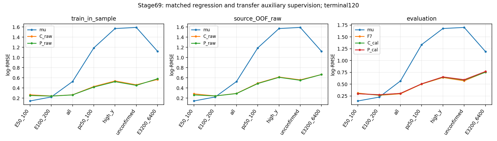
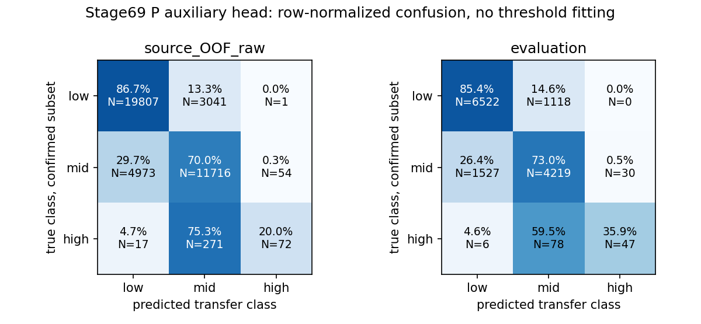

# stage69：transfer辅助监督有来源预测价值，点能量收益未通过推广

日期：2026-11-03。起始提交`1f4fc1c`。依据：[stage68报告](2026-11-03_stage68_group-risk-regression.md)、[stage67研究复盘](2026-11-03_stage67_research-reassessment.md)、[路线§49](../docs/nu_mu_energy_ml_revised_roadmap.md)。正式训练前冻结的[协议](stage69_energy_ml/protocol.json)为本轮唯一训练政策。

## 1. 目标与阶段决定

完成同62读出、同两层64 SiLU的普通平方log回归C和额外固定.1 transfer交叉熵辅助监督P：三来源折＋全train，共8个正式fit、4个Condor任务，没有选择epoch/辅助系数或重训。主候选预定P_cal，raw同时报告。

**辅助transfer概率确有来源留出增量，不能等同能量推广成功。继续F7，结束本次辅助监督分支。** 来源OOF总体P/C RMSE比.989517 [.986748,.992295]，最低能.924198 [.903393,.944414]；最终evaluation P_cal/C_cal总体1.000314 [.996601,1.004180]，最低能.988096 [.964653,1.009617]，100–200则1.025540 [1.009450,1.045609]。最低能收益未稳定迁移、第二低能层恶化，原传统/F7门槛失败。本结果只限定这次容量、训练/辅助定义和支持，不证明全部物理监督无用或信息极限。

## 2. 输入、变量、角色与可信y定义

stage55 `ntuples/energy_ml_stage55/dataset.npz`及stage56 `ntuples/energy_ml_stage56/readout.npz`为唯一逐事件输入。nominal d32b0ff3/without-IFT、TI12MC04/FASERNU-04/OFLCOND-FASER-06、unit MC；train/cal/eval41447/8440/14057事件、91/16/22保守来源（178/32/44文件来源）。原truth/reco pz>50 GeV、最高pz leading、fiducial和其余cut保留，包括既有fitted-charge cuts；本轮未测接受度变化。

同F7 62列经audited_features：线性模长/纵向动量仅pz0，允许px/py、q/p、弯折；无p0/p1/pz1或ln(p0/p1)输入。11个scintillator raw、VetoNu reduced、合法signed、typed invalid/status/dependency→NaN不变。p0/p1仅作允许变量的有效性依赖；没有新增变量、不fit补raw、不nansum补零。原42缺失者train/cal/eval eligible21/3/7及另11保护者完整保留；未确认/high-y/巨大动量/负修正/所有尾保留。

核对`frozen_evaluation.truth_diagnostics`：y=1−E_primary_mu,production/E_incoming，能量均GeV；primary候选为产生顶点与入射ν衰变顶点一致（容差1e−4mm）的唯一μ，confirmed另要求leading的pdg/barcode及入射parent pdg/barcode相符。所有confirmed都具唯一有效primary，confirmed中非法或非有限y的事件数为0。用缓存重算((1−y)Eν)²−p_primary²，61638个有效标签的min/median/max为.011163678020/.011163691355/.011163700372 GeV²，与μ质量平方相符；这只核单位和缓存代数，不是data物理标定。

辅助标签仅confirmed且finite y∈[0,1]：低transfer y<.2、中transfer .2≤y<.8、高transfer y≥.8；无效/未确认标−1且只从辅助CE排除，仍参与主回归。未确认不等于错轨，不强贴transfer类别。详见[标签审计](stage69_energy_ml/truth_label_audit.json)、[群体支持](stage69_energy_ml/label_support.tsv)、[来源支持](stage69_energy_ml/label_sources.tsv)。

| role | 全N | 辅助有效N | 低/中/高transfer N | 未确认N | high-y全N/辅助有效N |
|---|---:|---:|---:|---:|---:|
| train | 41447 | 39952 | 22849/16743/360 | 1495 | 1204/360 |
| cal | 8440 | 8139 | 4655/3425/59 | 301 | 230/59 |
| eval | 14057 | 13547 | 7640/5776/131 | 510 | 440/131 |

train true50–100为767例，其中有效766（685低/81中/0高）；true100–200有效3492（2562/930/0）。eval最低能有效206（181/25/0），100–200有效882（663/219/0）。辅助高transfer只占有效train的.901081%，而844/1204个train high-y、309/440个eval high-y未进入辅助监督；它对最困难混合状态的监督覆盖明显受限。没有补造标签或依据结果改变mask/类别权重。

## 3. 匹配训练、来源隔离及部署

- 输入采用stage62的固定log/log1p/asinh变换，signed尺度median(abs)，变换后median/IQR标准化；仅每个模型自己的训练支持拟合尺度。NaN在标准化值通道取训练中心，另加62个明确missing indicator；不是删除缺失或把raw补成有效测量。两模型共享相同训练状态，输入维度124，无截尾。
- 共享Linear124→64/SiLU/Linear64→64/SiLU，回归头64→1，辅助头64→3；总参数12420，回归路径12225，辅助头195。C有同辅助头但不更新，验证其195个参数与初始化逐位相同；P辅助头更新。评价P分类与训练类别先验比较，未把C的未训练辅助头当物理控制。
- 回归目标直接t=log(Eν/GeV)，仅减自己训练mean(t)，不按目标方差重新缩放；回归头零初始化，因此C/P均从同train mean(t)开始。seed2026110369，同初始共享/辅助参数、同seed+1打乱顺序；AdamW lr=.001、weight_decay=.0001、batch1024、CPU1、固定120epoch，无dropout/early stop/最佳checkpoint。
- C主损失mean[(f−t)²]包含全部训练例；P加.1 CE。辅助batch损失=sum_valid CE/(batch_N×完整train有效比例)，对均匀批是完整有效标签均值的无偏估计，末批也按实际N；不逐批按随机有效N再平均，不作class reweight。主梯度2(f−t)/batch_N，辅助logit梯度由valid mask及同归一控制。小算例验证边界0/.2/.8/1、非法/未确认mask、解析梯度和批/全体归一一致。
- 沿用stage68 v2来源折及精确入射训练端排除：三折留出13820/13667/13960、实际train22795/22878/22543、身份排除4832/4902/4944；训练与held的保守来源/精确入射交集0，全部41447一次OOF。折内辅助有效21984/22079/21736，三类N为12771/9033/180、12782/9113/184、12704/8843/189。最终完整train41447不删。
- 模型先保存再推理held/cal/eval，部署predict只接受62审计X及训练尺度/中心，不接受truth/y/角色/身份。每最终模型只用8440cal拟合一个global mean log offset：C=+.014465823668、P=+.020141413358；OOF仅raw。没有分能量校准、预测边界E≥pz或辅助头阈值调整。

完整生成谱系及跨来源相关未认证，身份隔离是已知复用保护，不能称新独立确认。cal/eval均已开发。没有读取locked-test事件或新ROOT/RDO，未生产/重建、未重训/重新推理F7，未重算stage62–66或运行谱profile/toy/SHA。

## 4. 主回归训练/OOF：最低能增量成立于三折，第二低能不稳定

log-RMSE为自然对数无量纲；能量/动量边界单位GeV。

| 群体 | N | 传统 | C训练内 | P训练内 | C来源OOF | P来源OOF |
|---|---:|---:|---:|---:|---:|---:|
| E50_100 | 767 | 0.143853 | 0.265141 | 0.251193 | 0.283796 | 0.262284 |
| E100_200 | 3564 | 0.222426 | 0.241554 | 0.239591 | 0.243425 | 0.242571 |
| all | 41447 | 0.526281 | 0.264368 | 0.263015 | 0.292222 | 0.289159 |
| E200_inf | 37116 | 0.551464 | 0.266440 | 0.265392 | 0.296655 | 0.293765 |
| pz50_100 | 2498 | 1.187733 | 0.428104 | 0.416794 | 0.493560 | 0.486160 |
| high_y | 1204 | 1.568664 | 0.538174 | 0.523471 | 0.615286 | 0.608843 |
| unconfirmed | 1495 | 1.590771 | 0.462097 | 0.450579 | 0.559146 | 0.550675 |
| E3200_6400 | 282 | 1.120650 | 0.566731 | 0.580453 | 0.665018 | 0.663927 |

| OOF群体 | P/C RMSE比 [来源95%区间] | P/传统比 [95%区间] |
|---|---:|---:|
| E50_100 | 0.924198 [0.903393, 0.944414] | 1.823274 [1.712101, 1.929321] |
| E100_200 | 0.996491 [0.982442, 1.010407] | 1.090569 [1.042021, 1.143862] |
| all | 0.989517 [0.986748, 0.992295] | 0.549439 [0.541166, 0.558626] |
| pz50_100 | 0.985007 [0.976848, 0.992824] | 0.409318 [0.393422, 0.423249] |
| high_y | 0.989529 [0.981378, 0.999011] | 0.388128 [0.371926, 0.405170] |
| unconfirmed | 0.984849 [0.976269, 0.995366] | 0.346168 [0.334384, 0.356550] |

最低能三折C/P=.270006/.252653、.285813/.260154、.295182/.273517，均改善；100–200=.249841/.260181、.253751/.244538、.225403/.220547，符号不一致。OOF最低能63/79来源改善，全体68/91、高y51/90；100–200为46/90。P相对C总体改善1.048% [.771,1.325]、最低能7.580% [5.559,9.661]，第二层区间含无差异。不能把F7已见train标签的输出当OOF。详见[折结果](stage69_energy_ml/fold_metrics.tsv)、[来源结果](stage69_energy_ml/source_metrics.tsv)。



## 5. 辅助transfer：来源评分有用，但稀少高类识别仍弱

P与各自train冻结的三类频率先验比较，OOF每折使用该折训练端先验，最终cal/eval使用全train先验；没有用held类频率作baseline。NLL单位nats/event，Brier为三个类别概率平方误差之和，accuracy单位%。以下只限confirmed、finite有效y。

| sample | 有效N | P/prior NLL | P/prior Brier | P/prior accuracy/% |
|---|---:|---:|---:|---:|
| train_in_sample | 39952 | 0.429607/0.726474 | 0.272803/0.497210 | 80.349/57.191 |
| source_OOF_raw | 39952 | 0.460267/0.726726 | 0.291318/0.497428 | 79.082/57.191 |
| cal_development | 8139 | 0.450997/0.719701 | 0.286820/0.495757 | 79.568/57.194 |
| evaluation | 13547 | 0.450079/0.731477 | 0.284409/0.500180 | 79.634/56.396 |

OOF总体NLL增量.266459 [.260723,.272252]、Brier增量.206110 [.202165,.209959]；eval对应.281398 [.270482,.291399]及.215771 [.208332,.222414]。91/91 OOF、16/16 cal和22/22 eval来源NLL同向改善。reco pz50–100的eval有效443例，P/prior NLL=.614972/.977202；表明reco包含可迁移transfer相关信息，但这个baseline不是已知精确μ条件模型，不能当作精确互信息或额外X相对pz0的独立增量。

| sample | 真低类N/recall% | 真中类N/recall% | 真高类N/recall% | 高类precision% |
|---|---:|---:|---:|---:|
| train_in_sample | 22849/86.078 | 16743/73.380 | 360/40.833 | 62.553 |
| source_OOF_raw | 22849/86.687 | 16743/69.976 | 360/20.000 | 56.693 |
| cal_development | 4655/83.888 | 3425/74.569 | 59/28.814 | 38.636 |
| evaluation | 7640/85.366 | 5776/73.044 | 131/35.878 | 61.039 |

高类train recall40.833%，OOF20.000%、eval35.878%（47/131）；OOF高类中271/360被判为中类，17为低类，72为高类。高类别概率能比稀少先验提高评分，仍远未完全识别这类状态。true50–100的eval辅助accuracy84.466%反而低于常预测低类先验的87.864%，但NLL更好；不能只挑总体accuracy或一项概率分数冒充全能量成功。未确认者不在这些分类指标内，无法由此声称已识别其primary/transfer/可见度。



完整分类N/来源、NLL/Brier区间、逐类precision/recall、混淆和来源评分见[auxiliary_metrics.tsv](stage69_energy_ml/auxiliary_metrics.tsv)、[paired](stage69_energy_ml/auxiliary_paired.tsv)、[classes](stage69_energy_ml/auxiliary_classes.tsv)、[confusion](stage69_energy_ml/auxiliary_confusion.tsv)、[sources](stage69_energy_ml/auxiliary_sources.tsv)。没有概率校准或阈值扫描。

## 6. 最终evaluation：两个低能及原F7保护失败

固定参考复用已存F7原三seed＋global offset、stage68最终C/R及各offset、stage60最终gate、stage62 A posterior mean(logE)校准点输出；没有新参考fit或推理。cal中的最终输出也只叫开发比较，不叫OOF。

| 群体 | N/来源 | 传统 | F7 | C_cal | P_cal | stage68 C_cal | stage68 R_cal |
|---|---:|---:|---:|---:|---:|---:|---:|
| all | 14057/22 | 0.568069 | 0.296363 | 0.305916 | 0.306012 | 0.296553 | 0.300964 |
| E50_100 | 208/19 | 0.145487 | 0.312816 | 0.300667 | 0.297088 | 0.314489 | 0.253745 |
| E100_200 | 906/22 | 0.226876 | 0.265014 | 0.271882 | 0.278826 | 0.263651 | 0.308859 |
| E200_inf | 12943/22 | 0.588671 | 0.298164 | 0.308241 | 0.307965 | 0.298425 | 0.301103 |
| pz50_100 | 682/22 | 1.336853 | 0.502965 | 0.507152 | 0.508358 | 0.502616 | 0.504583 |
| pz100_250 | 2670/22 | 0.652049 | 0.343488 | 0.355416 | 0.355289 | 0.343356 | 0.350726 |
| high_y | 440/22 | 1.676717 | 0.640068 | 0.649599 | 0.654651 | 0.638640 | 0.630901 |
| unconfirmed | 510/22 | 1.699385 | 0.570928 | 0.587412 | 0.595579 | 0.568489 | 0.562267 |
| input_missing | 7/5 | 0.704495 | 0.666657 | 0.746153 | 0.762773 | 0.680390 | 0.679853 |
| E3200_6400 | 271/14 | 1.189880 | 0.755449 | 0.752283 | 0.768569 | 0.750925 | 0.775321 |

| evaluation群体 | P_cal/C_cal [95%区间] | P_cal/F7 [95%区间] | P_cal/传统 [95%区间] |
|---|---:|---:|---:|---:|
| E50_100 | 0.988096 [0.964653, 1.009617] | 0.949722 [0.900149, 1.006099] | 2.042029 [1.756990, 2.321684] |
| E100_200 | 1.025540 [1.009450, 1.045609] | 1.052117 [1.009291, 1.101387] | 1.228980 [1.139270, 1.308959] |
| all | 1.000314 [0.996601, 1.004180] | 1.032559 [1.023294, 1.041501] | 0.538688 [0.526815, 0.550963] |
| E200_inf | 0.999107 [0.995058, 1.003276] | 1.032874 [1.022825, 1.042746] | 0.523154 [0.510738, 0.535933] |
| pz50_100 | 1.002378 [0.987827, 1.016031] | 1.010722 [0.977440, 1.041877] | 0.380265 [0.357057, 0.403353] |
| high_y | 1.007777 [0.993821, 1.024342] | 1.022782 [0.989689, 1.054740] | 0.390436 [0.370947, 0.408795] |
| unconfirmed | 1.013903 [1.000422, 1.026115] | 1.043177 [1.013925, 1.075306] | 0.350467 [0.328267, 0.374417] |

原恢复门槛要求两低E/传统的95%上限≤1.05，实际为2.321684/1.308959；全体/F7上限1.041501>1.01，≥200/低pz/high-y/未确认各上限1.042746/1.041877/1.054740/1.075306>1.03。全体和未确认的中央也已超门槛，其他有中央/区间功效两方面限制，不能统一说只是统计不足。P_cal与新C_cal几乎相同，100–200及未确认有小幅来源区间同向退化；C本身也弱于F7，不能降低推广基准。

raw没有救回结论：eval P_raw全体.308024、最低能.284396、100–200 .269192；cal最终P_raw/P_cal全体.288597/.287893、最低能.304674/.317178、100–200 .262851/.273298。global offset对总体校准有效，却会提高低能预测；不能事后选raw、分段offset或另一个阶段局部更佳值替代P_cal。eval最低能P_cal/C_cal改善下限为−.962%，仅11/19来源中央改善，未稳定转移OOF的最低能收益。完整[metrics.tsv](stage69_energy_ml/metrics.tsv)、[paired.tsv](stage69_energy_ml/paired.tsv)、[decisions.json](stage69_energy_ml/decisions.json)含全部版本/参考。

500次component分层保守来源配对bootstrap仅重抽固定预测及offset，不含重训、校准重估、完整谱系、响应/interaction或研究选择误差，无多重比较修正；不是新独立确认/覆盖认证。每条有效/无效次数有记录，来源<3不报精确CI，空组未测量。

全部evaluation能量箱（GeV）如下，不用≥200平均值掩盖高端。

| trueE/GeV | N/来源 | 传统 | F7 | C_cal | P_cal |
|---|---:|---:|---:|---:|---:|
| E50_75 | 66/12 | 0.145187 | 0.306319 | 0.313282 | 0.295300 |
| E75_100 | 142/19 | 0.145626 | 0.315789 | 0.294620 | 0.297915 |
| E100_150 | 395/21 | 0.195570 | 0.275854 | 0.273470 | 0.282409 |
| E150_200 | 511/22 | 0.248386 | 0.256321 | 0.270648 | 0.276024 |
| E200_400 | 2555/22 | 0.329592 | 0.228522 | 0.244162 | 0.243678 |
| E400_800 | 4349/22 | 0.458574 | 0.240938 | 0.250333 | 0.248940 |
| E800_1600 | 4007/22 | 0.646911 | 0.282578 | 0.289511 | 0.289702 |
| E1600_3200 | 1761/22 | 0.836590 | 0.405905 | 0.423387 | 0.419532 |
| E3200_6400 | 271/14 | 1.189880 | 0.755449 | 0.752283 | 0.768569 |
| E6400_inf | 0/0 | 未测量 | 未测量 | 未测量 | 未测量 |

## 7. 偏差、宽度与双向困难尾

P_cal的bias/R68/尾率单位%；最后一列为tail50占该组平方log损失的%。tail50按|Ehat/E−1|>.5，tail100按>1；负能量比误差低于−1对于正预测恒不可能，negative tail100为0仅是定义，不是严重低估消失。所有参考/版本/方向的尾损失份额都在metrics.tsv。

| 群体 | mean bias | median bias | R68 | +tail50 | −tail50 | +tail100 | −tail100 | tail50 loss share |
|---|---:|---:|---:|---:|---:|---:|---:|---:|
| E50_100 | 24.854495 | 15.254448 | 20.701764 | 12.980769 | 0.000000 | 3.365385 | 0.000000 | 66.539689 |
| E100_200 | 18.816155 | 12.787149 | 20.286962 | 9.713024 | 0.220751 | 2.869757 | 0.000000 | 58.806650 |
| all | 2.219495 | 2.075742 | 23.794105 | 4.118944 | 3.002063 | 0.704275 | 0.000000 | 51.559131 |
| pz50_100 | 12.239860 | 7.928234 | 44.116548 | 16.422287 | 8.504399 | 4.838710 | 0.000000 | 79.134280 |
| high_y | -2.539486 | -14.718181 | 51.732429 | 14.090909 | 21.590909 | 4.318182 | 0.000000 | 84.373483 |
| unconfirmed | 3.013005 | -7.704889 | 47.672937 | 15.098039 | 14.705882 | 5.294118 | 0.000000 | 80.798925 |
| input_missing | 1.273623 | 2.978839 | 29.293596 | 14.285714 | 14.285714 | 0.000000 | 0.000000 | 95.778101 |
| E3200_6400 | -43.410451 | -43.706313 | 17.820030 | 0.000000 | 35.424354 | 0.000000 | 0.000000 | 77.498492 |

最低能27/208个tail50全部过估，贡献66.5397%平方log损失，7/208超过+100%；不删它们来报告恢复。最低能P_cal中位bias+15.254%、R68=20.702%，传统+12.936%/11.434%，中心也未解决。100–200 P_cal tail50=9.933775%、F7=8.719647%；差上限+2.361546pp>2。低pz、高y、未确认tail50差上限+3.045158/+3.812339/+3.900954pp，均未通过；若某上尾方向失败，不能用合并尾偶然通过掩盖，详见决策JSON。

3.2–6.4TeV P_cal中位bias−43.706%、tail50=35.424%，F7分别−43.047%/33.210%；高端没有新解。7个缺失eval来自5来源，P_cal风险.762773、F7 .666657；小组区间不可当稳定确认。真实低E的μ主导核心/选择效应及相似reco的高E高transfer混合依然存在；辅助低/中/高y不等于完整可见度状态模型。

## 8. 验证、实现与实际性能

实现：[训练/部署模块](../ml/transfer_supervision.py)、[标签/算术/资源准备](../ml/prepare_transfer_supervision.py)、[正式pair](../ml/fit_transfer_supervision.py)、[报告](../ml/report_transfer_supervision.py)、[变量QA](../ml/validate_transfer_supervision.py)、[辅助来源汇总](../ml/summarize_transfer_sources.py)、[Condor](../AnalysisZipFramework/submission/ml_transfer_supervision.sub)、[worker](../AnalysisZipFramework/submission/run_ml_transfer_supervision.sh)。

- 512个train事件、每模型5epoch的算术/资源pilot，C/P训练CPU .025853/.024686s，pair .050539s；完整准备wall9.777048s、CPU3.998663s、峰值475.523MiB。pilot模型已删，不是额外科研候选；不能将这项成本外推成完整120epoch成本。
- 8模型独立加载：120epoch、12420参数、62列＋62 missing，训练中心/训练支持一致；所有已存train/cal/eval/held点及P概率回读逐位一致，最大差0。C辅助头确未更新，P确有更新；训练MSE独立复算一致。41447个OOF一次且无缺失；来源/已知入射隔离和原42缺失角色、typed sentinel/signed/状态/依赖/无nansum通过。bootstrap逐事件复制复核最大差3.33067e−16。
- 初次报告因对预处理字典要求完全相等而中止；复算三个fold的median/IQR与worker冻结值仅差4.44089e−16，signed_scale差0，全train差0。将只读验证改为数值绝对容差1e−12、类别元数据精确比较，仍使用原保存尺度，并保持全部部署预测逐位相同；没有改训练协议、模型、输出或重新fit。这个验证条件问题不是物理失败。诊断过程额外CPU未单独测量，见[verification_note.json](stage69_energy_ml/verification_note.json)。
- 模型/角色验证在[validation.json](stage69_energy_ml/validation.json)、[policy_validation.json](stage69_energy_ml/policy_validation.json)，三张图已打开检查。
- 最终检查：7个Python模块`py_compile`、worker `bash -n`与`git diff --check`通过；202个本地Markdown链接存在、代码围栏成对。路线§1–49、信息预算§1–29及Prompt中stage54支线6714bytes与起始HEAD逐字一致；8fit/4次单启动成功任务、OOF计数及CPU预算再次核实通过。最终模型/预测及聚合证据逻辑大小6156356bytes（不含storage.json自身），低于20MB；已删除5个冗余payload/结果归档。

所有环境设置只在`/tmp/stage69_python.sh`子进程：PYTHONNOUSERSITE=1，OMP/OPENBLAS/MKL线程1，source既有LCG_109/x86_64-el9-gcc15-opt后exec python。未安装软件、改变当前终端环境或编译无改动C++。实际主要命令：

```bash
bash /tmp/stage69_python.sh ml/prepare_transfer_supervision.py
python3 -m py_compile ml/transfer_supervision.py ml/prepare_transfer_supervision.py ml/fit_transfer_supervision.py ml/report_transfer_supervision.py ml/validate_transfer_supervision.py ml/summarize_transfer_sources.py ml/prepare_transfer_followup.py
bash -n AnalysisZipFramework/submission/run_ml_transfer_supervision.sh
condor_submit -dry-run /afs/cern.ch/user/x/xcheng/nu_mu_stage69/dryrun.ads AnalysisZipFramework/submission/ml_transfer_supervision.sub
condor_submit AnalysisZipFramework/submission/ml_transfer_supervision.sub
condor_history -userlog /afs/cern.ch/user/x/xcheng/nu_mu_stage69/logs/transfer.9662730.log -json
bash /tmp/stage69_python.sh ml/validate_transfer_supervision.py
bash /tmp/stage69_python.sh ml/report_transfer_supervision.py
bash /tmp/stage69_python.sh ml/summarize_transfer_sources.py
bash /tmp/stage69_python.sh ml/prepare_transfer_followup.py
git diff --check
```

payload通过Python tarfile构造，含新fit/transfer模块、连续变换/group split/audited/expert/CSV依赖、audited_features.json、stage55/56两缓存和stage69协议，31461240bytes；worker本地scratch一次构建读出，训练循环单线程使用内存、4096批推理，只返回紧凑模型/点/概率/聚合历史。解包跳过重复protocol，worker的status.json成功后删除，未存重复全量事件输入。

| 任务 | C/P fit CPU/s | worker wall/s | worker maxRSS/MiB | remote CPU/s | remote wall/s |
|---|---:|---:|---:|---:|---:|
| fold0 | 11.021/12.119 | 33.10 | 475.285 | 29 | 36 |
| fold1 | 11.018/12.403 | 40.96 | 469.059 | 31 | 43 |
| fold2 | 10.779/12.295 | 34.27 | 472.004 | 30 | 36 |
| final | 50.941/59.032 | 127.13 | 477.656 | 121 | 129 |

4任务9662730.0–3各1次启动、exit0、0重试；每任务1CPU/3000MB、disk180MB、MaxRuntime2700s。remote CPU合计211s=.058611h，remote wall合计244s；8fit内核CPU179.608461s。四脚本全流程wall203.882535s、CPU194.115453s、峰值477.656MiB。全train pair按41447×120×2训练事件访问计90452.43访问/CPU-s；不同worker耗时有差异，未测相同硬件强扩展或多线程收益，未使用GPU。

固定预测报告wall16.876519s、CPU15.793097s、峰值478.625MiB；辅助来源/图汇总wall2.994337s、CPU2.602458s，无新推理/fit。下阶段metadata输入准备wall.365535s、CPU.013554s，仅2个已知目录的一层列表和2个stat，0 ROOT头/事件/重建；峰值616.605MiB是进程历史峰值，不是读取的文件量。Condor接收输入125849652bytes另列；进程read_bytes=0是内核口径，实际EOS物理/网络字节、正式data性能均未测量。

模型/固定预测仅本地保留于`ml/artifacts/stage69/{fold0,fold1,fold2,final}`和`oof_predictions.npz`，遵循既有Git忽略；报告表/协议/图/紧凑历史在`workbook/stage69_energy_ml/`。归档和临时payload验证后删除，精确最终大小见[storage.json](stage69_energy_ml/storage.json)，低于20MB。代码、聚合证据、文档本地Conventional Commit，不推送；原stage54五项未跟踪工具/缓存保留。

## 9. 科学解释与具体下一项

本轮证明的是：reco读出能够学习与可信transfer有关的软分类，辅助训练在这次来源OOF有能量增量；最终更完整train的主候选没有稳健迁移到开发evaluation，且整个MLP家族仍弱于F7。可能涉及支持/来源变化、辅助mask覆盖、容量及平方log主目标与分层验收不一致；本轮无法唯一分解这些原因。概率好与能量点好是两个目标，不将未知称为物理不可分，也不归成“只需更多数据”。固定模型对照停止，不扫辅助权重、seed、网络或class reweight。

**stage70唯一下一项：两条替代flux π/K、继承训练角色的选择后支持pilot。** 这是执行既定补样分流的一份可直接核查的输入合同，不把旧开发来源换名叫新确认。已生成[alternative_support_pilot.json](../ml/configs/alternative_support_pilot.json)，由[准备脚本](../ml/prepare_transfer_followup.py)从200080 π及200081 K的历史canonical train范围中，排除任何test/cal/validation范围和stage55已开发的替代文件，在各自23/41个合格来源内用seed2026110370均匀抽一个，未看新事件、低E或残差。无新的全EOS清单。

| 组件/run | 选定generation范围 | 来源选择概率 | 文件bytes | 已继承角色 |
|---|---|---:|---:|---|
| π/200080 | 00440–00449 | 1/23 | 42220266 | train＋已暴露challenge |
| K/200081 | 00630–00639 | 1/41 | 1293229936 | train |

精确RDO路径在config；parent generator ID/subfile/seed和实际entries尚未测量，文件大小不能换算成事件数。两个范围已属于历史训练范围，当前合同只计开发增补的支持量；真正独立确认仍需新生成运动学/parent和未开发随机来源。53个无历史角色文件只有charm的stage68事实保留，不能由此忽略π/K训练范围内尚未提取的替代flux文件；保留范围角色可进行受控训练支持pilot，但不能解除全部谱系限制。

先≤40总头事件验证schema/身份/单位与共同名义d32b0ff3重建/raw11/status定义，并做小型原生资源QA，优先匹配现成构建。仅在输入实际兼容、资源可冻结后，对两个选定完整文件以Condor运行一次选择/62读出提取，最多2文件/20000输入事件；不取低能或大误差前缀，文件内条件包含概率1，源包含概率如上。所有新事件须排除与全部stage55已开发缓存的精确入射复用及pilot内部重复，同时保留原角色保护。complete genealogy无法核实就继续标未证，不将剩余精确key数叫独立生成证明。

报告实际选择后true50–100/100–200核心、相同reco pz50–100且true≥200/high-y、未确认、高能端及raw有效性/NaN、复用/剩余key/来源N、包含概率、CPU/RSS/I/O；不作能量fit/F7新推理或谱toy，不生产整批run。拟议≤2 Condor、各≤2CPU/3000MB、累计CPU≤2h、单任务wall≤1h、最终≤5MB，成本和新增选择后支持**未测量**，须QA后冻结；不兼容或超预算就给确切缺项，不自行放大。若剩余支持0，保留零结论并交付具体新π/K generator parent/seed请求；若有支持，再凭实测独立性范围/组成决定后续训练，不自动连开。当前仅准备合同，stage70未执行。

共同raw/stage54、ν interaction/FSI/材料、接受度/背景和真正独立确认依然未完成；本轮不启动嵌套谱表示/非线性谱shape或完整机制混合。方法背景沿用stage67 P4/P5及stage68的有限对照原则，执行既定方法未新增文献检索，不移植论文的精度或DUNE物理类别收益。
