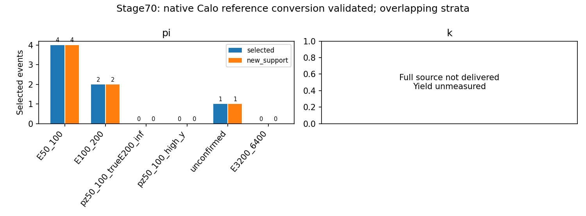

# stage70：替代flux补样pilot，π完成、K预算停止后完整支持未测

日期：2026-11-03；起始提交`9f21332`。依据[路线§50](../docs/nu_mu_energy_ml_revised_roadmap.md)、[stage69](2026-11-03_stage69_transfer-supervision.md)与[预定来源合同](../ml/configs/alternative_support_pilot.json)。本轮完成两个预定来源的预算内尝试；只π成功交付，K没有完整选择后结果。0能量模型fit、0新F7推理、0谱toy；继续F7。

## 1. 目标、实测结论与缺项

目标是在同62输入、原pz>50GeV选择下，测真实低E和同低pz困难事件的新训练支持。预定两个文件的头测输入为784＋10000＝10784例。π完整784例→30选中→排除2个stage55复用，内部重复0，新增**28个唯一开发key、1个来源**；true50–100/100–200GeV新增**4/2**。K仍在重建时触及冻结3600s作业上限，按预算停止、0重试；完整selected/new/低E支持均**未测量**，不能写0或把QA的1例算作完整交付。

这测得π有小幅可交付增补，并暴露大文件成本估计不足；没有证明低能性能改善、总体功效充分或缺数据是唯一原因。K的失败是本次资源可交付性结果，不是K物理不可用。下一阶段合同仅围绕实际π的28例，K不计入；本轮不追加来源或延长预算。

## 2. 事前来源、包含概率与角色

seed2026110370在固定π/K历史canonical train范围各均匀抽一个，未按新事件或残差择源。两个完整文件的精确路径见[冻结协议](stage70_energy_ml/protocol.json)。

| 来源 | generation范围 | 源概率 | 文件bytes | 头测N | 完整交付 |
|---|---|---|---|---|---|
| π/200080 | 00440–00449 | 1/23 | 42220266 | 784 | 成功 |
| K/200081 | 00630–00639 | 1/41 | 1293229936 | 10000 | 未完成，预算停止 |

总逻辑文件大小1335450202bytes，头/schema见[input_schema.json](stage70_energy_ml/input_schema.json)；没有再列22个run或递归扫EOS。设计的文件内条件事件包含概率1，K交付失败不能当作已观测完整文件。源概率不等于物理flux权重，去重key总体包含概率未测；不外推23/41倍计数，沿用unit MC。

π继承train且已暴露challenge，K继承train；排除历史test/cal/validation候选范围。它们不是独立确认，generator parent/subfile/seed未证。完整入射key veto覆盖stage55全部已开发缓存，非只nominal或eligible；[历史同组支持](stage70_energy_ml/existing_group_support.tsv)保留。原truth/reco pz>50GeV、highest-pz leading、truth fiducial及所有质量/charge cuts不改，无真实E上限；本轮未测接受度变化。

## 3. 原生QA、单位与共同重建

复用现成Calypso d32b0ff3cc4a2dad4abfb1474a82422c3c25b305（Athena24.0.41/GCC13/EL9），没有源码修改或编译。重建TI12MC04/FASERNU-04/OFLCOND-FASER-06，ntuple merge/without-IFT，与F7名义链路一致。软件归档54973160bytes，提取payload587190bytes、无逐事件数据输入。

各来源前16个身份做小型原生重建/ntuple/选择/62读出，π/K选中2/1例。reco wall25.99/25.15s、CPU10.02/14.33s，峰值995.285/1039.773MiB；这是小样本成本，不作逐例线性预算证明。原生HepMC成功读取各2例，与PHYS的run/eventID及入射三动量逐值精确；首个π入射pz183800MeV、K245060MeV，转换183.8/245.06GeV。声明momentum enum=1不能单独决定换算；PHYS的μ质量/1000核为约0.105658GeV，沿用已审计的内部MeV/mm，而非再凭enum乘1000。

四个头的`random_states`为空，HepMC event_number都为0；generator parent ID/subfile/seed未证，不能由文件名、run/eventID或不同flux声称独立。详见[native π](stage70_energy_ml/native_pi.json)、[native K](stage70_energy_ml/native_k.json)。

两轮metadata reader在有限预算内停止，另一次各1个原生事件因额外no-production-vertex判据失败；最终沿用官方PHYS首truth粒子约定并逐值实测，truth匹配定义未变。成功原生4次、失败2次，加重建32次为38次显式RDO事件循环访问、32个不同输入身份；metadata自动peeking内部读取另未计量。失败成本/诊断保留于[reader_retry.json](stage70_energy_ml/reader_retry.json)，不是坏物理文件或生成独立性的结论。

还检查了原manifest明确指向的π旧PHYS（784事件、527分支）。与固定16例新名义PHYS的462个共同分支中，412个精确相等，50个不同，涉及Calo能量、部分preshower转换与station truth。Calo0–3 E_EM最大绝对差为0.249657, 5.905367, 2.876574, 0.119629GeV；同名raw charge/轨迹不能保证能量定义相同。差异见[existing_phys_qa.json](stage70_energy_ml/existing_phys_qa.json)。初次QA遗漏了与F7实际输入的绝对Calo标度核对；该项在正式作业开始后补查发现，冻结的两个作业没有改写、重启或增加来源。

后补的固定16例F7 nominal参考表明，实际F7与旧π的有效脉冲E_EM/charge约4628.33MeV/pC，而当前重建约4359.31MeV/pC。[实际换算测量](stage70_energy_ml/calo_conversion_qa.json)与[COOL payload](stage70_energy_ml/calo_conditions_qa.json)定位到默认WAVE-Calibration-03-LG的charge_ref=.0757pC/MIP，对比参考01-LG的.0713pC/MIP；MC原生CaloRecTool公式为E_EM=charge/charge_ref×330MeV。源代码、当前解析tag及两个run的四模块payload均已核实，不是根据truth或残差拟合一个系数。完整历史生产snapshot仍未证，不将tag值相同当系统闭合。

按[事前限定的修正验证合同](stage70_energy_ml/calibration_amendment.json)，仅把四个Calo E_EM乘实际payload比1.061711079650782，再以原NaN传播重算总和；57个非Calo列、raw11、选择、真值、角色及困难事件不改。原始03-LG矩阵保留为x_produced，reference01-LG矩阵为x。对同一π旧PHYS完整784例重做原选择，30个选中身份/20个cutflow/57个非Calo列/原始raw与status逐位一致；五个Calo量通过rtol1e−6、atol1e−6GeV闭合，最大绝对差1.90735e−6GeV，总和最大相对差2.26004e−6（近零有符号相消，不谎称所有纯相对误差≤1e−6）。见[calibration_closure.json](stage70_energy_ml/calibration_closure.json)及[参考提取计时](stage70_energy_ml/reference_extraction_pi.json)。

K的相同payload和固定前16例原生E/charge也通过；没有完整旧K对应物，故K完整逐事例配对闭合**未测量**。这里只认证本次输入的标定重表达，不认证完整探测器响应。额外参考读取为既有F7 nominal前16例和同一π完整PHYS784例，没有新增RDO身份或第三个Condor/重建作业；不通过闭合就不放行训练支持，实测闭合通过后才汇总。

QA后于2026-11-03T09:42:59.749708+00:00冻结[协议](stage70_energy_ml/protocol.json)，才提交两个完整来源。所有环境设置只在子进程，未安装/重配置本终端。

## 4. π实际支持与K未测项

π选中30，已知复用2、内部重复0，新增28。稳定按来源/entry保留第一次新key，精确key=(pdg,px,py,pz)，原生MeV。与stage55完整95748例/66843唯一key交集0，新key内部唯一；集合与NumPy unique/inverse独立复核。新key只相对缓存新增，不能证明完整谱系独立。

| 层（GeV） | π选择后N | π新增唯一N | K完整来源N |
|---|---|---|---|
| all | 30 | 28 | 未测量 |
| E50_100 | 4 | 4 | 未测量 |
| E100_200 | 2 | 2 | 未测量 |
| E50_100_confirmed_low_transfer | 3 | 3 | 未测量 |
| E100_200_confirmed_low_transfer | 1 | 1 | 未测量 |
| pz50_100_trueE200_inf | 0 | 0 | 未测量 |
| pz50_100_high_y | 0 | 0 | 未测量 |
| pz50_100_unconfirmed | 0 | 0 | 未测量 |
| high_y | 1 | 1 | 未测量 |
| unconfirmed | 1 | 1 | 未测量 |
| input_missing | 0 | 0 | 未测量 |
| E3200_6400 | 0 | 0 | 未测量 |
| E6400_inf | 0 | 0 | 未测量 |


[support.tsv](stage70_energy_ml/support.tsv)与[identities.tsv](stage70_energy_ml/identities.tsv)的`source_measured=False`标出K；其N=0只表示没有交付行，不能解释为物理零产额。`all`仅汇总实际交付π。K完整cutflow、62列分布、低E及困难尾全部未测；16例QA仅用于可执行性，不加入支持缓存。

低transfer为confirmed＋finite y∈[0,1]且y<.2，high-y沿用y≥.8；未确认完整保留。y=1−产生μ能量/Eν，不是可见度测量。空的已测π层是N=0，对应模型性能未测。

| 层（GeV） | 原F7 train N | 实际新增N | 相对原计数/% |
|---|---|---|---|
| all | 41447 | 28 | 0.0676 |
| E50_100 | 767 | 4 | 0.5215 |
| E100_200 | 3564 | 2 | 0.0561 |
| pz50_100_trueE200_inf | 1005 | 0 | 0.0000 |
| pz50_100_high_y | 512 | 0 | 0.0000 |
| pz50_100_unconfirmed | 692 | 0 | 0.0000 |
| high_y | 1204 | 1 | 0.0831 |
| unconfirmed | 1495 | 1 | 0.0669 |
| E3200_6400 | 282 | 0 | 0.0000 |


上述只是原训练计数的增量。一个π来源不能估计总体来源方差或认证功效；同reco pz50–100的true≥200新增0，说明这次交付并没有同时补齐所有困难支持。



## 5. 变量、占位值和缺失保护

线性模长/纵向动量输入仅pz0；允许px/py、q/p、弯折。无p0/p1/pz1或ln比值输入；这些一次方变量仅在临时派生中作允许量的有效性依赖。11个scintillator用raw_charge，VetoNu reduced保留。所有变量复用`audited_features.build`同一62列、typed sentinel/domain/status/dependency规则，float32输出。

raw积分有符号，合法负值不能统一改NaN；bad fit flags16/32仍可保留有效raw，baseline/missing/invalid waveform bits8/128/256令raw NaN。非负/计数域的−1/−999、显式几何sentinel等按类型清理；合法signed −1/−999和charge sign−1保留。Calo invalid/censored-fit依赖照旧，任一module缺失总和NaN，不`nansum`补零。没有删掉缺失、巨大动量、未确认、高-y或困难尾。

逐列N/缺失/负值/−1/−999/范围见[feature_validity.tsv](stage70_energy_ml/feature_validity.tsv)，11raw/status/fit-failure见[raw_validity.tsv](stage70_energy_ml/raw_validity.tsv)。保留新增缺失事件0例。完整角色检查[role_validation.json](stage70_energy_ml/role_validation.json)：原train/cal/eval41447/8440/14057、原42缺失21/3/7及11保护者不改；新支持只落单独train pool，不混入旧cal/eval。

全部选择/typed特征/真值/回读、Calo参考重表达及独立去重验证通过；QA三例的汇总流程先跑通，[collector_smoke.json](stage70_energy_ml/collector_smoke.json)明确只是QA，临时输出已清理。最终缓存`ntuples/energy_ml_stage70/support.npz`本地Git忽略，含选择后全部例及复用/内部重复/新增掩码，未强行提交事件数组。没有调用训练器或F7预测接口。

独立[最终验证](stage70_energy_ml/final_validation.json)通过：新key与旧缓存交集0、内部唯一、57列逐位不变、逐run实际payload换算/总和NaN传播、raw11状态及typed sentinel规则均核对；[验证实现](../ml/validate_alternative_support.py)可复现。[两交付路径QA](stage70_energy_ml/delivery_smoke.json)分别用真实16例QA测试双来源成功与仅π成功，未交付K明确标未测；临时结果已清理。[代码检查](stage70_energy_ml/code_validation.json)记录9个Python编译、bash语法和发布worker逐字不变。

外层完整汇总（含LCG子进程设置、保存/回读、画图）[aggregation.time](stage70_energy_ml/aggregation.time)：wall9.54s、CPU3.38s、RSS110.465MiB；独立验证[validation.time](stage70_energy_ml/validation.time)：wall5.70s、CPU1.41s、RSS50.656MiB。summary.json内部wall3.128943s/CPU.626093s只计保存/画图前准备，不能当完整汇总耗时。资源汇总首次遇到空condor_q stdout的JSON解析错误，已按空队列修正后通过；没有重交正式作业。

## 6. 执行、资源上限与真实诊断

主要命令如下；官方/LCG栈分别在独立子进程，两个源码栈不混用：

```bash
bash /tmp/stage70_native.sh python ml/inspect_alternative_support.py --index 0 --input /tmp/nu_mu_stage70_qa/pi/input-RDO.root --output workbook/stage70_energy_ml/native_pi.json
# K同理index1；两来源小样本各nevents16
faser_reco.py --isMC --geom TI12MC04 --nevents 16 input-RDO.root
faser_ntuple_maker.py --isMC --geom TI12MC04 --CKFTrackType merge --nevents 16 --outfile ntuple.root input-xAOD.root
bash /tmp/stage69_python.sh ml/prepare_alternative_support.py
python3 ml/package_alternative_support.py
condor_submit -dry-run /afs/cern.ch/user/x/xcheng/nu_mu_stage70/dryrun.ads AnalysisZipFramework/submission/ml_alternative_support.sub
condor_submit AnalysisZipFramework/submission/ml_alternative_support.sub
# 发现Calo标度差异后，同源旧π完整PHYS做闭合，未新增RDO/Condor
bash /tmp/stage70_native.sh python ml/audit_alternative_conditions.py
bash /tmp/stage69_python.sh ml/alternative_calibration.py
bash /tmp/stage69_python.sh ml/summarize_alternative_resources.py
bash /tmp/stage69_python.sh ml/collect_alternative_support.py
bash /tmp/stage69_python.sh ml/validate_alternative_support.py
```

实现：[原生QA](../ml/inspect_alternative_support.py)、[原生标定payload](../ml/audit_alternative_conditions.py)、[标定重表达/完整π闭合](../ml/alternative_calibration.py)、[QA/冻结](../ml/prepare_alternative_support.py)、[提取](../ml/extract_alternative_support.py)、[打包](../ml/package_alternative_support.py)、[汇总](../ml/collect_alternative_support.py)、[资源](../ml/summarize_alternative_resources.py)、[Condor](../AnalysisZipFramework/submission/ml_alternative_support.sub)、[worker](../AnalysisZipFramework/submission/run_ml_alternative_support.sh)。

两个正式任务9662832.0–1各1启动，各1CPU/3000MB、disk5500MB、MaxRuntime3600s、无重试。πexit0；K状态3、原因`Job removed by SYSTEM_PERIODIC_REMOVE due to wall time exceeded allowed max.`。站点history实际记为SYSTEM_PERIODIC_REMOVE（wall time exceeded）；独立监测也按JobStartDate计时，在上限发出`condor_rm -reason 'stage70 frozen3600s per-job wall budget; no retry' 9662832.1`；命令、终止时钟及最后重建进度保存在[runtime_observation.json](stage70_energy_ml/runtime_observation.json)。调度器记录K wall3604s，比3600s阈值多4s，含start/execute口径与停止延迟；未请求延长，不能声称严格≤3600s。站点停止与监测请求同一时段，不把手工请求冒充唯一终止原因；也不是因少数离群换源或删事件。现场快照时刻2026-11-03T10:43:38Z、从JobStartDate起3537.796s；快照日志确认至少8801个事件已处理，仍无ntuple.log，并有Kalman传播达到5000step上限/拟合失败消息；没有事件级成本剖析，不能把它们确定为总耗时的唯一原因。快照不是完整终态事件计数或选择结果。

成功返回的π四环节实测：

| 组件/环节 | wall/s | CPU/s | RSS/MiB |
|---|---|---|---|
| pi/copy | 1.87 | 0.13 | 2.000 |
| pi/reco | 89.29 | 81.19 | 974.852 |
| pi/ntuple | 25.57 | 21.61 | 870.469 |
| pi/extract | 15.5 | 10.09 | 613.504 |


正式两个任务remote CPU合计3654.00s、remote wall合计3755.00s；K单独remote CPU3532.00s/wall3604.00s。完整scheduler记录见[condor_history.json](stage70_energy_ml/condor_history.json)、[资源汇总](stage70_energy_ml/condor_resources.json)及[事件日志](stage70_energy_ml/condor_events.log)。返回π的直接计时峰值974.852MiB；调度器采样RSS最大值732.422MiB。调度器RSS是采样最大值，不是连续精确峰值；K快照进程RSS1070212KiB=1045.129MiB（非峰值）。K没有完成的reco/ntuple/extract计时文件，不补造其分环节耗时或吞吐。

原冻结总wall估计π233.120s/K2973.474s来自16例QA及历史4.010events/s重建、20.846events/s ntuple，实际K未能在3600s完成。历史平均率不足以约束本文件尾部成本；具体事件级成本原因未做完整剖析，不当作数据坏或物理不可用结论。没有扩大预算或重提交。π输入/reco=8.780379events/s，输入/ntuple=30.660931events/s；K完整吞吐未测。

原生成功QA CPU107.63s，失败metadata第二轮31.62s，第一轮及失败首事件CPU未测；正式remote不是全阶段精确总成本。π正式Uproot请求350842bytes，RDataFrame另读；K复制完成量无返回计时凭据，不把输入大小冒充完成复制测量。EOS物理/网络总I/O均未测。workbook、合并support.npz逻辑大小见[storage.json](stage70_energy_ml/storage.json)，<5MB；重复π传输包/逐源数据、本轮payload及QA ROOT清理，不删共用runtime。Kscratch由Condor清理；该清理的物理I/O量未测。

π原框架日志并不干净：

| 环节 | WARNING/ERROR/FATAL | FPE overflow/invalid/div0 | 全输入轨迹N | 测量长度不齐事件N |
|---|---|---|---|---|
| pi/reco | 5168/51/0 | 69/1236/18 | 143 | 215 |
| pi/ntuple | 30/10/0 | 0/0/4 | 143 | 215 |


π全输入measurement_length_mismatch、非正nDoF轨迹等详见[production_pi.txt](stage70_energy_ml/production_pi.txt)，一个nDoF=-2147483648，受既有质量cut约束；没有新加ML删尾。K完整日志诊断/全输入轨迹统计未交付，现场最后warning不替代全量ERROR/FPE计数。原几何overlap/数值症状对物理响应的完整影响未测，不能由标量对齐声称系统闭合。

## 7. 结论、下一输入与验收

本轮实测π新增28例，低E两箱4/2；K完整支持未测，两个来源pilot的完整交付目标未达。保持F7。新增输入的Calo标度差异已由实际payload定位并在完整同源π闭合后作限定重表达；01-LG用于匹配F7，不证明比03更物理，也不能解释使用同旧nominal缓存的stage56–69低E失败。

[下一stage71合同](../ml/configs/alternative_support_augmentation.json)只使用实际π28个new_training_support，共41447＋28＝41475train。相同62输入/原F7超参数/400轮/三seed/unit MC，一个增补候选3fit，旧F7预测和传统参考复用；cal8440只一个ensemble global offset，eval14057仍开发。两true低E/传统、全区/F7及≥200/低pz/high-y/未确认和双向tail50原门槛不降，主cal/raw同时报；先无fit对齐/NaN/标定/身份/资源QA后冻结。拟议≤1Condor/1CPU/3000MB、CPU/wall≤900s、最终≤10MB，新成本和收益未测，本轮不执行。

增补很小且只有π，不声称填平π/K统计缺口。收益若有包含flux组成与重训，不是纯N效应。失败继续F7并停止这组样本的方法轮换；全部通过也只冻结研究候选、需真正未开发确认。[生成输入请求](stage70_energy_ml/generation_input_request.json)列具体GENIE parent/subfile/entry/seed、两组件新运动学、低E及同pz困难覆盖、随机确认和共同raw响应；产额/功效/新生产事件数未测，不填未经证实的3000–5000目标。K未自动追加重试或分块生产；若后续要交付，需独立阶段先做实际成本分布QA和事前冻结新资源合同。

原角色41447/8440/14057、42缺失21/3/7＋11保护、原stage54五项未跟踪工具/缓存不改。路线§51、信息预算§31与下一Prompt围绕实际交付更新，旧章节及stage54协议逐字保留。中文报告与代码/聚合证据本地Conventional Commit、不push；本轮方法背景沿用stage67/69，无新模型或文献轮换。
