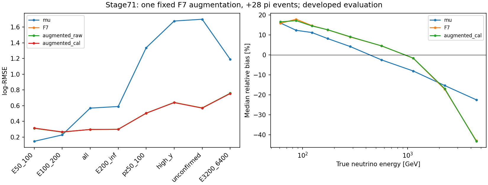

# stage71：固定F7增补28例π，低能门槛仍失败、保留原F7

日期：2026-11-03；起始提交`8ba4c12`。依据[路线§51](../docs/nu_mu_energy_ml_revised_roadmap.md)、[stage70报告](2026-11-03_stage70_alternative-support-pilot.md)、[准备合同](../ml/configs/alternative_support_augmentation.json)及[本轮冻结协议](stage71_energy_ml/protocol.json)。只有一个增补候选、三次正式fit，完成后停止；0新F7 fit/推理、0新ROOT/RDO/生产/谱toy，未读locked-test。

## 1. 目标与有数据支持的结论

检验在相同F7算法/62输入/400轮/三seed下，实际交付π28例是否足以改善原真实低E及完整能量风险。主候选augmented_cal最低能log-RMSE0.314206，传统0.145487；100–200GeV为0.264763/传统0.226876。两低E/传统比值95%上限2.480478/1.237628均超过1.05；raw也失败。**不推广增补模型，继续F7，停止这组样本的方法轮换。**

全体/F7比值0.999569 [0.998629, 1.000443]，原全体/困难组与双向tail50保护均通过；这表示未见超过预定限度的退化，不能替代低E成功。新增只有总train的28/41447＝0.067556%，低E增加4/767＝0.521512%、2/3564＝0.056117%，同低pz困难层增量0；本实验不证明充分补样无用，也不证明缺数据是唯一原因。K完整支持未交付，不计0产额或用QA替代。

## 2. 输入、身份、变量与校准契约

原nominal train/cal/eval41447/8440/14057不改，新train41475；原42缺失的21/3/7 eligible与11保护者保留。π来自200080 pi:00440-00449，继承train且已暴露challenge，parent/subfile/seed未证，不能作为独立确认。stage70完整π784→30选中→剔除2个已知复用→28个new_training_support。与全部stage55缓存95748例的精确incoming(pdg,px,py,pz)交集0、新key内部唯一；不只对nominal或train做veto。

只用`ntuples/energy_ml_stage70/support.npz`的参考01-LG `x`，未用x_produced训练或再次缩放。预检逐run按实际payload验证四模块E和NaN传播总和，57列不变，metadata的amendment/closure与已提交stage70证据一致。01-LG是旧F7定义的兼容性选择，不是更物理的标定或完整响应系统认证。K完整配对闭合仍未测，本轮没有新重建。

输入线性模长/纵向动量仅pz0，px/py、q/p和弯折允许；p0/p1/pz1/ln比值不入模型。11 scintillator用raw_charge，VetoNu reduced保留；typed sentinel/domain/status/dependency→NaN，合法signed负值保留，缺一个Calo module总和NaN，无nansum补零或按困难事件删行。所有特征使用GeV/原审计单位；真值log(Eν/GeV)只作标签/诊断，不进入特征。

[输入QA](stage71_energy_ml/input_validation.json)记录零fit的512行DMatrix和完整缓存回读：DMatrix wall0.015041s/CPU0.002652s；准备内部wall3.812315s/CPU3.538770s、进程峰值391.574MiB（input_validation.json计写最终文件前，故略短）。输入压缩13259313bytes、数组逻辑20263830bytes，仅一次交付scratch；最终验证后删除准备缓存，保留紧凑预测/模型和支持证据。

训练各能量/困难层的原支持与实际增补计数见[training_support.tsv](stage71_energy_ml/training_support.tsv)。

## 3. 唯一训练、校准与固定参照

XGBoost2.1.3（LCG109/GCC15子进程），原参数depth5/eta.04/subsample.8/colsample1/min_child_weight20/lambda10/hist/nthread1/reg:squarederror，原seed2026110255/56/57、400末轮，无early stop/扫描/候选择优。原41447排序行先放、π28个稳定新key后接；默认unit MC，无物理flux归一化、无matching/residual/gate变体。相同seed在样本改变后也会改变随机子样本与树结构；本实验效应包含组成、支持与重训，不能叫纯28事件局部效应。

| seed | 轮数 | 训练N | 拟合wall/s | 拟合CPU/s |
|---|---|---|---|---|
| 2026110255 | 400 | 41475 | 3.975594 | 3.937124 |
| 2026110256 | 400 | 41475 | 3.652200 | 3.623214 |
| 2026110257 | 400 | 41475 | 3.568567 | 3.541124 |


三seed raw log平均，原8440cal拟合唯一global mean log offset=0.004623141007926；旧F7原offset=.004602409250700414不重拟合，固定旧预测数组逐位复用。三个新模型保存后预测cal/eval并逐位回读；seed诊断共用这个ensemble offset，没有三个额外offset或选择最优seed。主候选augmented_cal、raw并报，禁止按结果切换。训练内OOF和重训不确定性**未测量**，不提供无fit的OOF。

| eval层 | seed255/256/257共用ensemble offset的log-RMSE |
|---|---|
| E50_100 | 0.316578 / 0.314000 / 0.314520 |
| E100_200 | 0.264811 / 0.265134 / 0.266068 |
| all | 0.296885 / 0.296471 / 0.296783 |
| unconfirmed | 0.570239 / 0.569202 / 0.568600 |


## 4. 实测完整风险、区间与保护

下表log-RMSE无量纲，所有N为实际未删尾的共同eval身份；传统为pz0/.8。mean/median bias、R68、上下tail50/100及各尾损失归因在[metrics.tsv](stage71_energy_ml/metrics.tsv)，全能量箱50/75/100/150/200/400/800/1600/3200/6400均保留。≥6400GeV N=0为实测空层，对应性能未测量；缺失层eval7例不作总体性能证明。

| eval层/GeV | N | 传统 | 旧F7 | 增补raw | 主增补cal |
|---|---|---|---|---|---|
| E50_100 | 208 | 0.145487 | 0.312816 | 0.311196 | 0.314206 |
| E100_200 | 906 | 0.226876 | 0.265014 | 0.262299 | 0.264763 |
| all | 14057 | 0.568069 | 0.296363 | 0.296592 | 0.296235 |
| E200_inf | 12943 | 0.588671 | 0.298164 | 0.298606 | 0.298018 |
| pz50_100 | 682 | 1.336853 | 0.502965 | 0.503778 | 0.503733 |
| high_y | 440 | 1.676717 | 0.640068 | 0.640157 | 0.638494 |
| unconfirmed | 510 | 1.699385 | 0.570928 | 0.569448 | 0.568303 |
| input_missing | 7 | 0.704495 | 0.666657 | 0.662371 | 0.661238 |
| E3200_6400 | 271 | 1.189880 | 0.755449 | 0.757628 | 0.753695 |


| eval层 | 参照 | 主候选比值 | 95%区间 | 原上限 |
|---|---|---|---|---|
| E50_100 | mu | 2.159691 | [1.788054, 2.480478] | 1.05 |
| E100_200 | mu | 1.166994 | [1.088395, 1.237628] | 1.05 |
| all | F7 | 0.999569 | [0.998629, 1.000443] | 1.01 |
| E200_inf | F7 | 0.999511 | [0.998541, 1.000438] | 1.03 |
| pz50_100 | F7 | 1.001527 | [0.997726, 1.004984] | 1.03 |
| high_y | F7 | 0.997540 | [0.994402, 1.001482] | 1.03 |
| unconfirmed | F7 | 0.995402 | [0.991469, 0.999301] | 1.03 |


500次pi/k/charm分层的保守canonical来源配对bootstrap，cal16/eval22组、seed2026110371（cal加1）。固定已训练预测和已定offset；每个重复保留组内所有事件及正负尾。区间是逐项、开发集条件区间，不含重训、offset重估、完整谱系、detector/interaction系统或研究选择，非独立确认/coverage。原两低E/传统≤1.05、all/F7≤1.01、≥200/低pz/high-y/未确认/F7≤1.03不降。

原验收各组cal/eval的有效bootstrap均500/500、无效0；input_missing层cal有效490/500（10次无效）、eval497/500（3次无效），其空抽样不补造风险。完整有效/无效计数在paired.tsv；≥6400空层不构造区间。

相对F7的tail50整体/过估/低估增量上限均须≤2pp；所有原验收组通过：

| eval层 | tail50增量/pp | 95%区间/pp | 正尾上限/pp | 负尾上限/pp |
|---|---|---|---|---|
| E50_100 | 0.000000 | [-2.369668, 1.758443] | 1.758443 | 0.000000 |
| E100_200 | -0.220751 | [-0.767632, 0.226271] | 0.331145 | 0.000000 |
| all | 0.042683 | [-0.056601, 0.158950] | 0.042891 | 0.127926 |
| E200_inf | 0.061809 | [-0.062233, 0.188882] | 0.062136 | 0.147797 |
| pz50_100 | 0.146628 | [-0.890348, 1.134459] | 0.648509 | 0.905122 |
| high_y | 0.227273 | [-0.652328, 1.196663] | 0.479203 | 1.111240 |
| unconfirmed | 0.784314 | [-0.188894, 1.982700] | 0.617421 | 1.578841 |


未确认RMSE/F7=0.995402 [0.991469, 0.999301]在这个固定预测区间内低于1，但tail50增加0.784314pp、上限1.982700pp，接近2pp边界；不事后增加bootstrap或换seed来美化。≥200/high-y/低pz的保护通过不代表全体条件风险都优于F7。raw的两低E/传统门槛也失败，详见[decisions.json](stage71_energy_ml/decisions.json)、[gates.tsv](stage71_energy_ml/gates.tsv)与[paired.tsv](stage71_energy_ml/paired.tsv)。



## 5. 物理与程序原因分别检查

最低能31/208个正向tail50（预测高于真值50%）贡献72.381585%平方log损失，完整保留；旧F7相应损失份额71.858389%。新增4个最低真能事件（其中3个confirmed且y<.2；100–200GeV新增2例中仅1个低transfer）、0个同低pz高E/high-y/未确认，没有改变这个失效机制的实测证据。能看到同低pz真E歧义与尾部风险仍在，但本次没有分离不可约响应歧义、unit-MC先验、有限训练支持和模型目标的各自贡献；未知原因不能改叫物理不可能或纯过拟合。

3.2–6.4TeV主候选中位bias-43.312793%、log-RMSE0.753695，旧F7 bias-43.046652%，高端问题也没有解决。全体RMSE小变化不是低能或高端改善的替代标准；总体流量/功效、data响应、interaction/FSI/材料、接受度/背景仍未测。

程序核验通过：[validation.json](stage71_energy_ml/validation.json)独立核三模型400轮、原F7归档参数/seed完全相同、cal/eval预测逐位回读、原F7数组/offset复用、参考x及logGeV标签追加、21/3/7＋11保护。global校准后cal mean log residual=3.63690121e-16；[bootstrap独立复核](stage71_energy_ml/bootstrap_validation.json)对预定0/1/2三次抽样逐事件展开，共54个非空层×draw检查，ratio最大差3.33066907e-16、tail最大差2.22044605e-16pp。没有发现行错位、重复缩放、误用fit-charge、NaN删尾或协议参数改变可解释本轮低能失败；这些检查不认证完整物理响应。

## 6. 执行、资源与存储

```bash
python3 -m py_compile ml/support_augmentation.py ml/prepare_support_augmentation.py ml/fit_support_augmentation.py ml/package_support_augmentation.py ml/collect_support_augmentation.py ml/report_support_augmentation.py ml/validate_support_augmentation.py
bash -n AnalysisZipFramework/submission/run_ml_support_augmentation.sh
bash /tmp/stage69_python.sh ml/prepare_support_augmentation.py
bash /tmp/stage69_python.sh ml/package_support_augmentation.py
condor_submit -dry-run /afs/cern.ch/user/x/xcheng/nu_mu_stage71/dryrun.ads AnalysisZipFramework/submission/ml_support_augmentation.sub
condor_submit AnalysisZipFramework/submission/ml_support_augmentation.sub
bash /tmp/stage69_python.sh ml/collect_support_augmentation.py --cluster 9662919
bash /tmp/stage69_python.sh ml/validate_support_augmentation.py
bash /tmp/stage69_python.sh ml/report_support_augmentation.py
```

所有LCG设置只在子进程，无环境安装/全局重配。现成软件无C++修改或编译。1个Condor9662919.0、1启动/exit0、0重试、仅3fit，无基线重训或新增F7推理。[worker](../AnalysisZipFramework/submission/run_ml_support_augmentation.sh)用scratch缓存一次、单线程与紧凑输出，训练回调850s/worker timeout880s；请求1CPU/3000MB、disk180MB、冻结CPU/wall900s。输入archive13204682bytes，返回归档1104542bytes，最终只保留一套模型/紧凑比较；重复predictions.npz、传输归档、准备输入与payload验证后去重。

**资源请求偏差如实记录：** dry-run显示MaxRuntime900s，最终schedd history3600s（microcentury）。初次collector严格匹配因该差异停止，随后只改资源记录，未改冻结协议/worker或重交fit。实际remote CPU14.00s/wall20.00s低于900s，故实测运行预算通过；不能声称调度请求900s被原样保留，站点变换具体配置未定位。后续合同须核最终ClassAd且保留worker硬上限。

三次fit合计wall11.196360s/CPU11.101462s，124425个训练样本计数（跨fit重复）/拟合wall=11112.987样本/s，仅计拟合、不含DMatrix/推理。训练内核整体wall12.454053s/CPU12.346290s/峰值RSS254.016MiB；外部GNU time见[worker.time](stage71_energy_ml/worker.time)，wall15.85s/CPU14.25s/峰值254.016MiB。history最终RSS170.898MiB为末次采样，不冒充精确峰值。

本地准备[preparation.time](stage71_energy_ml/preparation.time) wall12.05s/CPU6.57s/RSS391.574MiB；报告外层[report.time](stage71_energy_ml/report.time) wall7.64s/CPU4.25s/RSS102.207MiB；验证外层[validation.time](stage71_energy_ml/validation.time)含新模型重载、无新增fit。validation重复一次仅新增原F7归档参数一致性断言，非模型选择。所有内外层/调度计时口径分别保留，不相加为精确全阶段成本；打包/收集等未完整计时，总阶段CPU及EOS物理/网络I/O未测。Condor收到13204800bytes和发出3045bytes是调度器计量，EOS xrdcp结果归档另计，不能混为总网络字节。

实现：[准备](../ml/prepare_support_augmentation.py)、[公共合同/指标](../ml/support_augmentation.py)、[训练](../ml/fit_support_augmentation.py)、[打包](../ml/package_support_augmentation.py)、[收集](../ml/collect_support_augmentation.py)、[独立验证](../ml/validate_support_augmentation.py)、[评价](../ml/report_support_augmentation.py)、[Condor](../AnalysisZipFramework/submission/ml_support_augmentation.sub)。[代码检查](stage71_energy_ml/code_validation.json)记录7个Python编译、worker bash语法及发布版本逐字不变。数据/模型不提交Git；逻辑保留量及删除清单见[storage.json](stage71_energy_ml/storage.json)，<10MB；真实EOS物理占用/总写量未测。

去重前另做[保留格式验证](stage71_energy_ml/retained_io_validation.json)：暂时移开准备缓存，确认comparison.npz可复现全部评价输入，且从原审计缓存重建的cal/eval特征及追加训练矩阵逐位相同；0fit/0推理；该独立进程wall1.749083s/CPU1.237742s、峰值RSS616.605MiB。评价脚本因此可用保留缓存重算表，验证脚本可从原stage55/56/70缓存重建特征，无需长期保留13MB准备输入。

## 7. 下一任务的输入与验收标准

本轮唯一候选完成，按失败规则继续F7，结束本组样本的unit/matched/residual/seed/架构轮换。没有自动stage72、追加K重试/分块或扩大run，也没有把少数离群当分支不可恢复证明。

[具体输入交付请求](stage71_energy_ml/followup_input_request.json)承接stage70合同，要求实际新π及K的GENIE parent/input/subfile/entry联结、真实seed与是否复用运动学、跨flux/几何事前角色、随机未开发确认池和包含概率、共同raw/status及实际Calo条件。需兼顾true50–100/100–200与同reco低pz困难层、高端及缺失，不按旧残差挑事件。现有原生头没有这些谱系证据，文件名/run不同不能替代。

**验收：** 输入方给出可访问实际文件和身份映射、不同于旧kinematic parent的证据、角色冻结与完整响应单位/读出合同；先做有界schema/单位/交集/资源QA，再依据实测支持与成本冻结单项新物理实验。未交付则明确缺项/未测，不用重复metadata扫描或旧预测评价充当下一阶段，也不填未经测量的生成事件数/选中3000–5000目标。K未完成不是物理零支持，未来任何续交付须另有实测成本分布和预算合同。

真正未开发确认、共同raw/stage54、interaction/FSI/材料以及接受度/背景仍须交付；方法背景沿用stage67/69，无新架构或文献循环。更新路线§52、信息预算§32及下一入口，保留旧章节和stage54协议；原stage54五项未跟踪内容不动，本阶段中文报告与代码/聚合证据本地Conventional Commit、不push。
