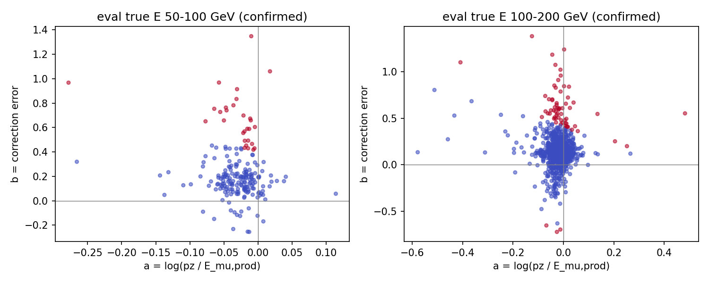
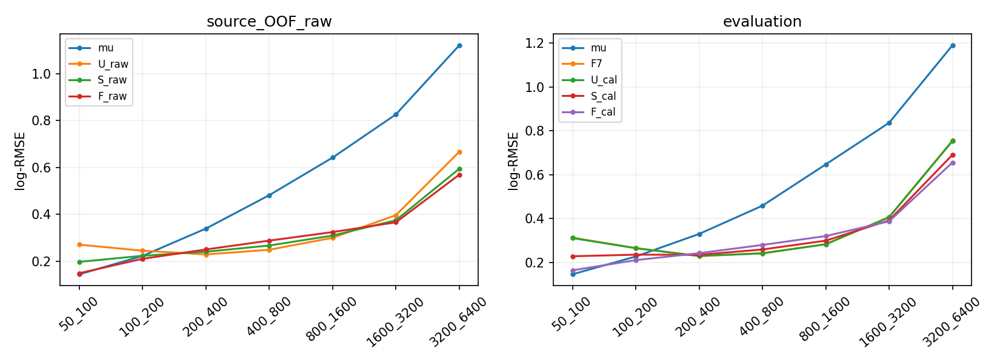

# stage73：低能误差路径与固定能量重权对照

## 1. 目标、冻结和结论

依据用户修订的[路线§53](../docs/nu_mu_energy_ml_revised_roadmap.md)、[stage72](2026-11-03_stage72_reconstruction-reweight-reassessment.md)与 stage73 Prompt，完成零新能量推理的 A 取证及 U/S/F 固定三政策的 B 实验。起始 commit `7ad0c62`。**保持 F7，不推广 S/F，不继续扫描 α。**

低能已确认事件的主要平方误差在附加修正 b，未发现当前 X 的可复现行对齐/单位/状态传播错误。重权在来源 OOF 与 eval 都改善两个低能箱及高端，说明本次风险政策确有可学习、可迁移的影响；同时总体、低 pz、高 y 和未确认者受损，不能用 macro 改善替代原门槛。F_cal 的100–200 GeV优于传统，但最低能未恢复，且 F 是敏感性控制，不能事后替换主候选 S_cal。

原计划≤4次提交，实际8次：首次4任务因本阶段 launcher 的目录创建冲突在任何 fit 前失败；修复后另外4任务完成12fit。这个执行偏差在纠正提交前写入[启动修订](stage73_energy_ml/launch_amendment.json)，原[科学协议](stage73_energy_ml/protocol.json)未反写。累计 CPU、单任务 wall、内存和留存预算均通过；不能把失败隐藏为“只提交4任务”。

## 2. 输入、变量与样本保护

仅复用 `ntuples/energy_ml_stage55/dataset.npz`、`ntuples/energy_ml_stage56/readout.npz`，由 `audited_features.load/build` 生成同62列。nominal d32b0ff3、without-IFT、TI12MC04/FASERNU-04/OFLCOND-FASER-06，unit MC；train/cal/eval为41447/8440/14057，91/16/22保守来源（原生文件source ID分别178/32/44），不把多个文件当独立谱系。完整train唯一incoming32046；来源间精确复用仍在。既有cal/eval均为开发，未读取 locked/未开发确认。

一次方纵向/模长动量仅 pz0；保留 px/py、q/p、弯折；没有 p0/p1/pz1 或其 log 比、次轨迹线性动量新增输入。11闪烁体 raw_charge 与 VetoNu reduced 使用原 typed/status/domain/dependency→NaN；合法 signed 负值保留，charge sign与 module_eta 的 −1 也不能当通用缺失。实际63944开发行的62列中没有数值恰为 −999；仅 charge sign/module_eta 有合法 −1。非负/count非法 −1/−999 的清洗与 signed 保留用解析 QA 验证。四个 Calo module 缺失数为10/6/4/11，总和31，不能 nansum 成小沉积。完整列有效性见[feature_validity](stage73_energy_ml/feature_validity.tsv)。

原 truth νpz 和 reco highest-pz leading >50 GeV、其余质量/几何/fitted-charge cuts不改。42缺失者保持21/3/7 eligible与11保护；全部尾、巨大动量、高y、未确认、合法负修正保留。没有追加stage70的28π、没有重复其Calo参考化；未读新ROOT/RDO、没有重建/生产/K重试/谱toy/SHA。缓存只读一致性不是新生产响应认证。

## 3. A：完整低能取证

对 confirmed、primary有效且有限 0≤y<1 者，定义 Eμ,prod=(1−y)Eν，
`a=log(pz/Eμ,prod)`，`b=log(Ehat/pz)−log(Eν/Eμ,prod)`。
逐例 `e=log(Ehat/Eν)=a+b`，均方 `mean(e²)=mean(a²)+mean(b²)+2mean(ab)`。
未确认/非法标签的 a/b 留 NaN，但保留全部主评价。a 包含方向、材料/传播、拟合及参考面差，不是纯tracker分辨率；signed交叉项不是唯一因果份额。

只用已存F7三seed均值和原offset0.004602409250700414，传统为pz/0.8，0新F7fit/推理；没有以F7训练内值冒充OOF。全部cal/eval两个低E箱的全体/尾/非尾、每保守来源、状态子组、62列有效性及固定reco活动对照均留存，详见[联合证据](stage73_energy_ml/reconstruction_evidence.tsv)、[逐层有效性](stage73_energy_ml/feature_strata.tsv)。紧凑逐例记录 `ml/artifacts/stage73/reconstruction_events.npz` 包含 row/run/event/source/group/incoming、X/raw/status/Calo、a/b/F7与几何；按全局row联结，不仅用重复run/event。

下表各项均为自然log的平方，无量纲；N是全部事件，有效N才参与a/b均方：

| role | 层 | N | 来源 | 有效N | mean(e²) | mean(a²) | mean(b²) | 2mean(ab) |
|---|---|---|---|---|---|---|---|---|
| cal | E50_100:all | 150 | 14 | 150 | 0.090206 | 0.001846 | 0.103772 | -0.015412 |
| cal | E50_100:tail50 | 20 | 7 | 20 | 0.470740 | 0.002694 | 0.521929 | -0.053883 |
| cal | E50_100:non_tail50 | 130 | 14 | 130 | 0.031662 | 0.001715 | 0.039440 | -0.009494 |
| cal | E100_200:all | 691 | 16 | 676 | 0.051747 | 0.002895 | 0.057908 | -0.009056 |
| cal | E100_200:tail50 | 57 | 10 | 47 | 0.339387 | 0.008043 | 0.364211 | -0.032867 |
| cal | E100_200:non_tail50 | 634 | 16 | 629 | 0.030254 | 0.002510 | 0.035020 | -0.007277 |
| eval | E50_100:all | 208 | 19 | 206 | 0.092449 | 0.002373 | 0.106907 | -0.016830 |
| eval | E50_100:tail50 | 31 | 11 | 29 | 0.459199 | 0.003717 | 0.508203 | -0.052721 |
| eval | E50_100:non_tail50 | 177 | 19 | 177 | 0.032361 | 0.002153 | 0.041158 | -0.010950 |
| eval | E100_200:all | 906 | 22 | 882 | 0.062283 | 0.003974 | 0.067433 | -0.009123 |
| eval | E100_200:tail50 | 79 | 18 | 65 | 0.440114 | 0.009353 | 0.453111 | -0.022350 |
| eval | E100_200:non_tail50 | 827 | 22 | 817 | 0.032223 | 0.003546 | 0.036748 | -0.008071 |

逐例恒等式最大差1.554312e−15，独立逐例回算12组均方最大差1.665335e−16；每组来源计数严格恢复全体。[独立验证](stage73_energy_ml/evidence_validation.json)未拟合模型。

### 3.1 低能尾与质量/状态联合证据

- eval50–100的31个tail50均为正尾，来自11保守来源；29可分解，2未确认不强填标签。它们χ²/NDF中位1.1551、层数9、rMax64.8283 mm、Theta15.3195 mrad，非尾分别0.9785、9层、rMax64.6087 mm、Theta见联合证据。a中位−0.01961，b中位0.65778，F7修正中位0.76478；非尾a/b中位−0.02867/0.15739。没有波形无效、fit failure、Calo无效或X缺失事件。31尾中18例有至少一通道合法负raw，非尾129/177；不能因负raw删尾或宣称负raw导致失败。
- eval100–200有79个tail50/18来源，65可分解、14未确认。tail χ²/NDF中位1.0806、9层、rMax62.7227 mm；非尾1.0186、9层。fit failure为6/79，对照非尾4/827；wave/Calo无效及X缺失仍均0。这里fit failure指任一闪烁体status bit16/32，并非全部为μ fit失败，raw仍按波形状态有效使用。它与尾有描述性关联，但73/79尾没有该flag，不能作总解释。cal对应2/57与5/634，关联大小也不同。
- 两个eval低能全体的a中位−0.02535/−0.01847，b中位0.18800/0.13996，确认层的b²远大于a²；cal同向。质量、层数和radius未给出一个能复现当前X错误的判据，也不排除尚未测的响应问题。已选样本本就要求≥7层、χ²/NDF<15等，不能据此声称选前效率良好。

[source语义核对](stage73_energy_ml/source_semantics.md)这次直接读取已知d32b0ff3源码：nMeasurements在轨迹station筛选前push，nLayers/χ²/DoF/pz等在筛选后；measurement向量不入62列。nClusters按station累加cluster collection，SpacePoints累加所配置collection，普通TrackSegments与GhostBusted分开。历史measurement长度问题不是当前ML行错位的证据。没有盲改几何。原生同面pull、选前效率、geometry/FPE逐例因果、材料/interaction/FSI及data响应仍**未测量**。

### 3.2 固定reco歧义对照

冻结后才看结果：reco pz50–75/75–100 GeV × train-only严格四Timing raw总和四分位；阈值54.42144/70.35448/176.54148 pC，来自完整实际train（不看cal/eval）。严格sum遇NaN保持NaN，另列missing；8常规格＋缺失格。高E(≥200)、high-y(≥.8)和未确认对照可重叠，不相加成独立N。

例如eval pz50–75且Timing≥176.54148 pC同格：低E50–100为4例/3来源，100–200为12/7，高E105/22，其中98未确认；高E的F7修正中位2.17175，最低能中位1.08105。pz75–100同高活动格相应3/3、13/8、111/21，高E87未确认。它们不是逐例全X匹配，更不证明不可约信息极限；新证据是低能b尾没有当前无效状态、相同粗reco支持中仍需竞争不同能量解释，而且B确实移动了这些解释的代价。逐来源、各活动格、状态与几何全部保留，未只选上述两格。

图中红点为tail50，蓝点为非尾；只显示可分解确认事件，未确认仍在主评价。



## 4. B：固定三政策、12fit与实际权重

[协议](stage73_energy_ml/protocol.json)冻结seed2026110373，direct log(Eν/GeV)，depth5/400轮、eta.04、subsample.8、colsample1、min_child_weight20、lambda10、hist/nthread1、squarederror。三臂初始化同一**未加权实际train** mean(logE)，明确base_score与boost_from_average=0；完整train base6.332202034444325，S/F加权标签均值6.298687671091668/6.326868338776624，仅诊断，不用于初始化。权重直接进入DMatrix，无重复加权抽样；实际DMatrix保存float32权重。没有earlystop/checkpoint/额外seed、aux/dual或新特征。

固定七个等倍程箱，U α0，S α.5（唯一主候选），F α1（敏感性控制），全train平均w=1。箱外预先定义独立under/overflow类别，不删事件、不伪计数，四实际train均0箱外；50/100/6400边界独立QA通过。S箱质量∝sqrt(N)，F非空箱质量相同，箱内谱不变。

| E/GeV | N | 保守来源 | 唯一incoming | S每例w | S总w | F每例w | F总w |
|---|---|---|---|---|---|---|---|
| 50–100 | 767 | 79 | 751 | 3.124794 | 2396.717 | 7.719687 | 5921.000 |
| 100–200 | 3564 | 90 | 3424 | 1.449607 | 5166.398 | 1.661336 | 5921.000 |
| 200–400 | 9232 | 90 | 8287 | 0.900681 | 8315.089 | 0.641356 | 5921.000 |
| 400–800 | 13805 | 91 | 10807 | 0.736548 | 10168.040 | 0.428903 | 5921.000 |
| 800–1600 | 10141 | 91 | 6651 | 0.859367 | 8714.840 | 0.583867 | 5921.000 |
| 1600–3200 | 3656 | 91 | 1999 | 1.431251 | 5232.655 | 1.619530 | 5921.000 |
| 3200–6400 | 282 | 54 | 127 | 5.153407 | 1453.261 | 20.996454 | 5921.000 |

来源折完全沿用stage68 v2，held不删、train端purge同held的精确incoming。OOF全部41447恰好一次，来源及已知incoming交集0；完整谱系相关未知。每折自己计数/权重/初始化，未用held频率。完整[每折权重](stage73_energy_ml/fold0/weights.tsv)（另fold1/fold2/final同名文件）及fit.json留存。

| job | train N | held N | purge N | 来源 | 唯一incoming | S ESS | F ESS | F最大w |
|---|---|---|---|---|---|---|---|---|
| fold0 | 22795 | 13820 | 4832 | 59 | 19509 | 17734.244 | 2956.722 | 42.291 |
| fold1 | 22878 | 13667 | 4902 | 62 | 19651 | 17820.456 | 3260.457 | 37.567 |
| fold2 | 22543 | 13960 | 4944 | 61 | 19377 | 17540.368 | 3180.536 | 37.887 |
| final | 41447 | 0 | 0 | 91 | 32046 | 32768.013 | 8621.671 | 20.996 |

完整train S权重0.736548–5.153407、ESS32768.013299；F0.428903–20.996454、ESS8621.671252；U ESS41447。折内F ESS仅约2957–3260且最大w可达42.2913。ESS仅表权重集中度，不是独立物理N，也不让767低E成为5921个新例。

解析梯度差1.149636e−11，DMatrix内置加权平方损失与手算梯度的一步预测逐位相同；512行两树pilot含28个NaN，X-only推理逐位相同，无pilot模型留存。[pilot](stage73_energy_ml/pilot.json)、[初始化QA](stage73_energy_ml/initialization_QA.json)与实际包的四split无fit启动检查均通过。两树pilot不是额外科学候选。

## 5. 训练、OOF及完整开发评价

表中均为自然log-RMSE，无量纲。train内不是OOF；原F7三seed固定集成不是唯一匹配控制，匹配控制为本次同seed U。

| 层/N/保守来源 | mu | U_raw | S_raw | F_raw |
|---|---|---|---|---|
| E50_100/767/79 | 0.143853 | 0.242159 | 0.145442 | 0.095032 |
| E100_200/3564/90 | 0.222426 | 0.224862 | 0.196480 | 0.178368 |
| all/41447/91 | 0.526281 | 0.245967 | 0.250896 | 0.269099 |
| pz50_100/2498/90 | 1.187733 | 0.391435 | 0.412602 | 0.459038 |
| high_y/1204/90 | 1.568664 | 0.499501 | 0.536184 | 0.594222 |
| unconfirmed/1495/90 | 1.590771 | 0.422000 | 0.448982 | 0.497255 |
| E3200_6400/282/54 | 1.120650 | 0.516195 | 0.268241 | 0.103748 |

| 层/N/保守来源 | mu | U_raw | S_raw | F_raw |
|---|---|---|---|---|
| E50_100/767/79 | 0.143853 | 0.270367 | 0.197097 | 0.148594 |
| E100_200/3564/90 | 0.222426 | 0.244736 | 0.222957 | 0.210069 |
| all/41447/91 | 0.526281 | 0.278554 | 0.282312 | 0.292169 |
| E200_inf/37116/91 | 0.551464 | 0.281752 | 0.288832 | 0.301047 |
| pz50_100/2498/90 | 1.187733 | 0.471897 | 0.489076 | 0.516573 |
| high_y/1204/90 | 1.568664 | 0.600877 | 0.629692 | 0.662383 |
| unconfirmed/1495/90 | 1.590771 | 0.525356 | 0.543311 | 0.568878 |
| E3200_6400/282/54 | 1.120650 | 0.666555 | 0.594086 | 0.568964 |

| OOF层 | S/U | low95 | high95 | F/U | low95 | high95 |
|---|---|---|---|---|---|---|
| E50_100 | 0.728999 | 0.705535 | 0.749378 | 0.549603 | 0.527470 | 0.570873 |
| E100_200 | 0.911011 | 0.898458 | 0.925466 | 0.858350 | 0.837673 | 0.878876 |
| all | 1.013492 | 1.010425 | 1.016430 | 1.048877 | 1.043731 | 1.054246 |
| pz50_100 | 1.036406 | 1.024042 | 1.048486 | 1.094675 | 1.071371 | 1.115216 |
| high_y | 1.047955 | 1.037200 | 1.059245 | 1.102361 | 1.083205 | 1.121149 |
| unconfirmed | 1.034178 | 1.022967 | 1.047617 | 1.082844 | 1.060565 | 1.107139 |
| E3200_6400 | 0.891278 | 0.875380 | 0.906597 | 0.853589 | 0.825991 | 0.880036 |
| macro | 0.926969 | 0.919800 | 0.933572 | 0.908185 | 0.895674 | 0.919547 |

三折均分别输出固定400轮，未选最佳折/迭代。最低能训练内S/F为.145442/.095032，OOF.197097/.148594，eval校准后.227861/.163625；有泛化差距，但**不是只有train改善**：两个低能的OOF/eval相对U均显著改善。全体与困难损害同样已在OOF出现，不能将相反方向藏在总体平均里。

### 5.1 eval所有能量箱及保护层

| 层/N/保守来源 | mu | F7 | U_cal | S_cal | F_cal |
|---|---|---|---|---|---|
| E50_100/208/19 | 0.145487 | 0.312816 | 0.310913 | 0.227861 | 0.163625 |
| E100_200/906/22 | 0.226876 | 0.265014 | 0.264708 | 0.235144 | 0.210258 |
| E200_400/2555/22 | 0.329592 | 0.228522 | 0.229200 | 0.234453 | 0.241902 |
| E400_800/4349/22 | 0.458574 | 0.240938 | 0.241548 | 0.258746 | 0.279541 |
| E800_1600/4007/22 | 0.646911 | 0.282578 | 0.282757 | 0.298998 | 0.320025 |
| E1600_3200/1761/22 | 0.836590 | 0.405905 | 0.406175 | 0.391498 | 0.387266 |
| E3200_6400/271/14 | 1.189880 | 0.755449 | 0.753355 | 0.690589 | 0.655540 |
| all/14057/22 | 0.568069 | 0.296363 | 0.296556 | 0.298186 | 0.307123 |
| E200_inf/12943/22 | 0.588671 | 0.298164 | 0.298424 | 0.303089 | 0.314512 |
| pz50_100/682/22 | 1.336853 | 0.502965 | 0.504906 | 0.515126 | 0.541202 |
| pz100_250/2670/22 | 0.652049 | 0.343488 | 0.344054 | 0.347780 | 0.358108 |
| high_y/440/22 | 1.676717 | 0.640068 | 0.641997 | 0.654810 | 0.674903 |
| unconfirmed/510/22 | 1.699385 | 0.570928 | 0.573037 | 0.585601 | 0.608719 |
| input_missing/7/5 | 0.704495 | 0.666657 | 0.672368 | 0.653890 | 0.600986 |

≥6400 GeV为0例，全部模型该层性能**未测量**，没有填0。input_missing仅7例/5保守来源，不外推为完整缺失响应。3.2–6.4TeV为271例/14保守来源、184唯一incoming，S/F中位bias仍−37.3934%/−35.2372%，负tail50=25.8303%/20.6642%，不能只称高端“已修复”。

| eval参考 | 50–100 | 100–200 | all |
|---|---|---|---|
| stage68_C | 0.314489 | 0.263651 | 0.296553 |
| stage68_R | 0.253745 | 0.308859 | 0.300964 |
| stage69_C | 0.300667 | 0.271882 | 0.305916 |
| stage69_P | 0.297088 | 0.278826 | 0.306012 |
| stage71 | 0.314206 | 0.264763 | 0.296235 |

所有U/S/F raw与cal、cal开发/每来源/偏差/宽度/上下tail50/100及尾平方log损失份额，见[metrics](stage73_energy_ml/metrics.tsv)、[source_metrics](stage73_energy_ml/source_metrics.tsv)、[fold_metrics](stage73_energy_ml/fold_metrics.tsv)。全部与传统/F7/stage68 C/R/stage69 C/P/stage71的配对区间见[paired](stage73_energy_ml/paired.tsv)，未择优删除。

三个unit global mean-log offset：U +0.003952771259293887、S −0.003997438916514122、F −0.015438455113718708，均只用原8440cal。unit offset与加权目标不同；S/F负offset进一步降低低能过修正，也增加一部分困难者欠估，故raw和cal均报，不按层校准或选raw赢家。

| eval模型 | 50–100 | 100–200 | all | macro |
|---|---|---|---|---|
| U_raw | 0.308319 | 0.262622 | 0.296864 | 0.395317 |
| U_cal | 0.310913 | 0.264708 | 0.296556 | 0.394622 |
| S_raw | 0.229882 | 0.236734 | 0.297992 | 0.367430 |
| S_cal | 0.227861 | 0.235144 | 0.298186 | 0.368145 |
| F_raw | 0.169696 | 0.214104 | 0.306869 | 0.353809 |
| F_cal | 0.163625 | 0.210258 | 0.307123 | 0.356524 |
| F7 | 0.312816 | 0.265014 | 0.296363 | 0.395271 |

macro固定为七个非空等倍程箱的MSE等权平均再开根。OOF U/S/F macro=.366110/.339372/.332495，eval校准后.394622/.368145/.356524；eval S/U macro比.932904 [.921286,.944655]，但unit总体比1.005497 [1.000882,1.010131]。这正是政策取舍，不用macro替换原unit门槛。



### 5.2 原门槛与双向尾

500次pi/k/charm分层的保守来源配对固定预测bootstrap，seed2026111373（cal+1、OOF+2），offset不重估。不含重训/完整谱系/响应/interaction/研究选择误差，不能叫独立确认或正式覆盖。关键eval/OOF层有效500/无效0；cal缺失层3例/3来源的12次抽样为空，有效488/无效12；≥6400全空层不造区间。macro重复要求固定七箱都非空。

主候选 S_cal 的门槛逐项如下；尾列是整体/正/负tail50差的95%上限，单位pp，对照F7：

| 层 | RMSE对照 | 比值 | 来源95%区间 | 上限标准 | 结果 | tail50 Δ上限 | 正尾Δ上限 | 负尾Δ上限 |
|---|---|---|---|---|---|---|---|---|
| E50_100 | mu | 1.566202 | [1.234912, 1.963327] | 1.05 | 失败 | -2.7445 | -2.7445 | 0.0000 |
| E100_200 | mu | 1.036444 | [0.982266, 1.096954] | 1.05 | 失败 | -1.5085 | -1.6947 | 0.5408 |
| all | F7 | 1.006154 | [1.001158, 1.011241] | 1.01 | 失败 | 0.7177 | 0.6909 | 0.0995 |
| E200_inf | F7 | 1.016520 | [1.012213, 1.021445] | 1.03 | 通过 | 1.0722 | 1.0693 | 0.0964 |
| pz50_100 | F7 | 1.024178 | [1.008783, 1.037225] | 1.03 | 失败 | 1.7019 | -0.8978 | 2.9391 |
| high_y | F7 | 1.023032 | [1.006474, 1.038923] | 1.03 | 失败 | 3.5992 | 2.1553 | 2.2498 |
| unconfirmed | F7 | 1.025700 | [1.012667, 1.039978] | 1.03 | 失败 | 5.0520 | 3.0786 | 3.2556 |

两低E/传统95%上限1.963327/1.096954，都未达到1.05；最低能中心也差56.62%，第二箱中心差3.64%且区间跨1，不能仅归“区间太宽”。总体中心+0.6154%低于1%但上限1.1241%失败；≥200保护通过，而低pz/high-y/未确认的RMSE和部分尾保护失败。

F_cal/传统最低能1.124675 [.881715,1.376360]未恢复，100–200=.926752 [.882314,.976847]，改善95%下限2.3153%，只支持这个箱的超越；F_cal/F7总体1.036308 [1.028302,1.043865]、≥200上限1.062280，困难层均失败。S/F双低能/高端收益和主体/困难损害并存，停止α扫描，不从F挑新主候选。

S_cal最低能18/208正tail50，占67.1464%平方log损失（F7为31尾），F_cal8/208占47.3924%；100–200 S/F总体tail50为6.1810%/4.4150%，正尾5.6291%/3.8631%、负尾均.5519%，损失份额54.1775%/44.9578%。最低能S/F mean bias14.6444%/7.3099%、median8.7822%/4.8331%、R68 13.0481%/9.7147%。宽度改善不替代含全部尾的RMSE。其余上下tail100及各尾损失均在完整表内；负tail100因正能量预测不可能低于−100%，为结构性0，不是修复证据。

## 6. 程序验证、命令与资源

实际命令（LCG_109 Python、XGBoost2.1.3，线程均1；`/tmp/stage69_python.sh`仅source现有CVMFS，不安装环境）：

```bash
bash /tmp/stage69_python.sh ml/prepare_energy_reweight.py
bash /tmp/stage69_python.sh ml/pilot_energy_reweight.py
bash /tmp/stage69_python.sh ml/submit_energy_reweight.py
# 首次9662991的4任务在fit前目录冲突，保存失败ads/history/stderr，修订启动合同
# 同一科学协议修复exist_ok后，对实际tar的四split作--check-only，0fit
bash /tmp/stage69_python.sh ml/submit_energy_reweight.py
# 成功9662994，4任务各U/S/F，12fit，没有成功/部分fit的重训
bash /tmp/stage69_python.sh ml/collect_energy_reweight.py
bash /tmp/stage69_python.sh ml/report_energy_reweight.py
bash /tmp/stage69_python.sh ml/validate_reweight_evidence.py
```

首次dry-run检查还有一次文本空格格式断言失败（ClassAd实际是MaxRuntime=1800）；在任何提交前修正空白解析，无科学影响。正式启动目录冲突发生在started marker/DMatrix/第一棵树前，四结果包没有模型/预测；失败4任务remote CPU12s、wall合计40s。原“4提交”上限超4，校正前冻结launch_amendment，max_retries仍0，未自动续跑部分训练；不将此记录成原预算完全通过。

成功4任务均1启动/exit0，1CPU/3000MB，最终ClassAd MaxRuntime均1800s；worker timeout1750s另kill-after10，callback每job CPU850s/wall1700s。成功remote CPU107s、wall合计134s，含失败CPU119s＜3600。4成功脚本内部wall14.4380/15.7415/24.8358/38.0774s、CPU14.3244/15.6106/24.5536/37.6396s，合计CPU92.1282s；12次fit区段合计CPU89.74545s（含保存/回读/诊断），不把它冒充全部调度成本。最终训练脚本peakRSS326.8711MiB；worker time43.70s、user39.84s/system.95s/maxRSS334716KiB；scheduler末次RSS只是采样，不是精确峰值。

A准备wall11.32321s/CPU10.13992s/peak616.6055MiB；512行两树pilot区段wall.03114s/CPU.02513s，进程peak616.6055MiB包括加载全缓存，不能说512行本身需要该内存。独立report完整命令wall40.32427s/CPU38.56419s/peak616.6055MiB，A/宏观复核wall.73741s/CPU.47799s（绘图前）。打包/启动QA/文档/环境加载全阶段精确总CPU**未测量**，上述范围分别列出。

12模型独立回读，400树/62输入、显式初始化、训练风险/权重ESS及原row逐位通过；所有OOF恰一次。普通来源bootstrap逐事件展开最大差4.440892e−16；宏观固定第0/173/499重复逐事件回算最大MSE差1.110223e−16。源码未改C++，没有无意义重编译。`bash -n`、Python语法和`git diff --check`通过；文档链接/旧章节保护另见最终delivery记录。

紧凑输入 `ntuples/energy_ml_stage73/input.npz` 15634909 bytes，只打包一次，每worker在scratch复用三fit，不存新的ROOT/xAOD。四结果传输归档合计4682034 bytes；这是归档逻辑大小，不是实测EOS网络/物理I/O。成功采集/验证后删除输入副本、四结果重复归档和software提交包，保留12模型、OOF/final/held预测、逐例取证与聚合表图。最终实际bytes见[delivery](stage73_energy_ml/delivery.json)，必须≤20MB；物理EOS网络字节**未测量**。模型/逐例数组在ignored路径，不进Git；原stage54五项未跟踪内容不动。

## 7. 物理判断与唯一下一任务

1. **程序路径：**当前62输入的typed/status/行对齐契约通过，没有支持直接改几何/删事件的证据。最低能31尾全部raw/Calo状态有效，较高低能箱fit failure只覆盖6/79尾；不能归咎全部坏fit，也不能据缓存QA排除所有重建/读出系统。
2. **物理/统计路径：**门槛附近低E倾向低transfer，单位MSE对稀少端点的修正不够局部；a/b与固定重权结果支持“附加修正和风险政策有实际作用”，但不构成条件分布不可辨识定理。真实高E/high-y/未确认的同粗reco支持是必须保护的对手，三政策已实测其代价。
3. **研究方向：**不继续边际权重或旧对偶/辅助系数、seed、architecture/gate扫描。原stage62已存A_full_unit相对C_mu_unit在eval pz50–100的log-density增量.617984 [.558875,.676215]、CRPS增量.302289 [.277985,.325807]（只引用旧表，未新拟合）；说明当前reco存在可用信息，但不是条件负配对方法的已测收益、信息极限或OOF保证。

**下一单项stage74：同reco pz内的条件能量假设判别信息检验。** 使用原stage55/56与stage68 v2身份折，比较pz0-only与全62两种判别器，负能量来自每个实际train的已知q(t|Bpz)，部署时t只是待查询假设，绝不输入事件真能量。目标是测竞争能量假设的信息在来源OOF及两侧困难支持上能否转移；不是再做y辅助头，也不直接部署点预测。必须乘回q才有后验含义，零q支持单列不伪填；先做合成条件独立/已知比值/归一与资源QA，再冻结最多8fit，参数/提议分布不扫。具体可执行输入/分层/验收和资源见下一Prompt；本轮未运行，收益/功效未测量。

通过条件proper-score增量及双侧支持验收后才考虑一个能量决策合同；若无转移/支持不足，停止这个条件方向，转实际新增歧义两侧支持，不把判别阴性当观测信息极限。旧cal/eval仍开发，任何未来候选须共同响应/真新来源确认。真正新π/K parent/subfile/seed、未开发随机确认、共同raw/stage54、Calo条件、interaction/FSI/材料及接受度/背景合同继续保留；不自动K重试或生产。

方法解释沿用[stage72§7](2026-11-03_stage72_reconstruction-reweight-reassessment.md)：HEP校准先验/风险政策、DIR/密度权重局限与tracking参考面。没有把外部论文精度移植为本项目收益，本轮未另做文献检索。
