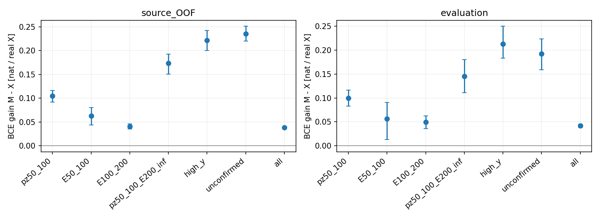
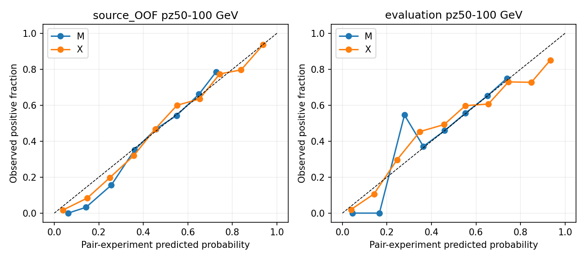

# stage74：同pz条件能量假设具有可迁移判别信息，完整后验支持与校准尚未闭合

## 1. 目标与阶段结论

按[路线§54](../docs/nu_mu_energy_ml_revised_roadmap.md)、[stage73](2026-11-03_stage73_reconstruction-energy-reweight.md)和stage74 Prompt完成一个固定条件负配对实验。起始commit `1e6d6a1`。只比较 pz0-only 的 M 与完整62输入的 X，每者加一个待查询 logE 假设；三来源折＋全train各一次，共8正式fit。没有新能量点映射、后验grid、额外校准或F7新推理。

**测得明确可迁移的条件判别增量，继续保留F7。** pz50–100 GeV主层，X相对M的BCE gain：OOF .104600 [.092062,.116040] nat/真实X；eval .099794 [.083047,.116878]。两个低E、同低pz高E、high-y和未确认的重要层在OOF/eval均gain95%下限>0，没有重要层出现整体负区间。这个结果既非“没有判别信息”，也非已恢复逐E箱点风险。

预定**完整支持＋判别信息合同仍未通过**：OOF12/41447真实例位于其实际train的零q格，涉及部分关键层；cal/eval实际真标签均在最终q支持内。零q只是本次有限train频率提议的缺口，不能叫物理不可能或数据不存在。独立校准诊断还显示，X的主低pz ECE10高于M，后验/点能量转换未验证。不能因12个罕见例否定整个条件方向；也不删除它们、改验收或加伪计数重训来补本轮。保留判别成果，交付[实际新支持/共同响应请求](stage74_energy_ml/followup_input_request.json)，并依据AGENTS不得因少数离群停止分支的要求，把下一步限定为0新训练的固定能量决策验证；本轮不继续q/温度/结构扫描。

## 2. 输入与不可改变的保护

只读stage55 `dataset.npz`、stage56 `readout.npz`，以 `audited_features.load/build` 使用同62列；名义 d32b0ff3、without-IFT、TI12MC04/FASERNU-04/OFLCOND-FASER-06、unit MC。train/cal/eval 41447/8440/14057，保守来源91/16/22（文件source ID 178/32/44）；完整train唯一incoming32046。cal/eval已经开发，不是新盲测。原truth νpz和reco highest-pz leading>50 GeV，质量/几何/fitted-charge cuts保持。

一次方纵向/模长动量仅pz0，原px/py、q/p与弯折保留；没有p0/p1/pz1、其log比或次轨迹线性动量。11signed scintillator raw及VetoNu reduced、typed sentinel/domain/status/dependency→NaN与合法负值保留；四Calo任缺使totalNaN，无nansum或fit替代raw。42缺失保持21/3/7 eligible＋11保护；未确认/high-y/巨大动量/负修正/全部尾均保留。raw11逐值/状态与Calo缺失传播精确检查，float32模型pz与原scalar的提议格归属也逐例相同。

M的reco输入仅原第0列pz0，共1列；X用原62列。额外的 `hypothesis_logE_GeV` 是可查询假设t，M/X总维数2/63，**不是部署时事件未知真能量的观测字段**。正例在监督/评价中用已知t，负查询函数只接收reco和候选t，不读truth字典。未确认者也有可信incoming ν能量标签，未被贴错轨标签或从训练剔除。

没有追加stage70 π28、读取K QA扩样/重试、新ROOT/RDO/重建/生产、locked/未开发确认、谱toy/SHA。stage70参考化x未再次缩放。共同data/MC响应、材料/interaction/FSI、选前效率与同面pull本阶段均**未测量**。

## 3. 固定q、负配对及其概率含义

[科学协议](stage74_energy_ml/protocol.json)先于事件支持测量/正式fit冻结，另留[评价细则](stage74_energy_ml/evaluation_contract.json)。Bpz为reco 50/75/100/150/250/500/1000/+∞ GeV；E固定50/100/200/400/800/1600/3200/6400 GeV。每个**实际train**计7×7 unit数 n_pb，令q_b=n_pb/Σ_b n_pb，箱内logE均匀，密度 `q(t|Bpz)=q_b/ΔlogE`。无伪计数、merge、clip、加权重抽或held频率。实际四train无空pz层，所有role无箱外能量/pz；原样本没有边界裁剪。

完整train的原始7×7支持如下；行是reco pz、列是真E，单位GeV（不是各格独立物理N）：

| reco pz / true E | 50–100 | 100–200 | 200–400 | 400–800 | 800–1600 | 1600–3200 | 3200–6400 |
|---|---|---|---|---|---|---|---|
| 50–75 | 461 | 205 | 173 | 199 | 98 | 29 | 1 |
| 75–100 | 304 | 523 | 234 | 169 | 78 | 23 | 1 |
| 100–150 | 2 | 1915 | 685 | 352 | 111 | 23 | 1 |
| 150–250 | 0 | 920 | 4289 | 1047 | 258 | 56 | 4 |
| 250–500 | 0 | 1 | 3829 | 7853 | 1274 | 133 | 4 |
| 500–1000 | 0 | 0 | 14 | 4083 | 5830 | 673 | 25 |
| ≥1000 | 0 | 0 | 8 | 102 | 2492 | 2719 | 246 |

完整q质量、密度、来源/文件/唯一incoming以及三实际train对应表见[proposal.tsv](stage74_energy_ml/proposal.tsv)。例如最终pz50–75切片N1166，低E质量461/1166，3.2–6.4TeV仅1/1166；pz100–150低E仅2/3089。有限支持的0与1不是物理严格边界，尤其有重建分辨率跨箱者。

每个真实X配一个真实t正例、一个该train q独立抽的负t，行序按X交错(positive,negative)，两类1:1、DMatrix隐式unit权重。负例是提议分布抽样，**不等于已证伪的物理能量**，也不增加独立事件数。同一job M/X共享完全相同的X顺序/配对。train RNG seed2026110374＋job序号0/1/2/3；held RNG再+100；final cal/eval共享独立RNG并依次draw cal、eval，既不看它们谱也不改q。负查询均落于非零q格，真实零q例照样保留。

理想平衡BCE logit `s(t,X)=log p(t|X)−log q(t|Bpz)`。恢复p须乘回q并归一，不能把sigmoid直接叫能量后验；真实q=0处有限比值恢复未定义。X和M只是在同一已定义的正/负实验分布中比较，gain不是条件互信息精确值，更非生成级flux无关响应。原unit/flat的先验与风险区别仍适用。

## 4. 八fit、来源隔离与无训练QA

两者同BDT depth5/400轮、eta.04/subsample.8/colsample1/min_child_weight20/lambda10/hist/nthread1，objective binary:logistic、base_score.5、boost_from_average=0、模型seed2026110374；不earlystop/checkpoint、不额外seed/权重/辅助头/architecture/温度或概率校准。树直接使用原值和NaN，没有新的truth-derived reco列。

stage68 v2来源折及train端exact incoming purge沿用，全部held保持；q只用purge后train：

| job | train N | pair rows | 保守来源 | 唯一incoming | purge N | held N |
|---|---|---|---|---|---|---|
| fold0 | 22795 | 45590 | 59 | 19509 | 4832 | 13820 |
| fold1 | 22878 | 45756 | 62 | 19651 | 4902 | 13667 |
| fold2 | 22543 | 45086 | 61 | 19377 | 4944 | 13960 |
| final | 41447 | 82894 | 91 | 32046 | 0 | 0 |

已知来源和incoming交集0，41447真实train各获一次OOF、对应82894正/负行；完整谱系仍未知。训练内与OOF不但是否留出不同，q/支持也因purge而不同，不将其评分差全归纯过拟合。

小QA验证条件独立的最优log-ratio0、已知条件比值及q乘回归一、错误无条件q的偏差、零支持/边界、BCE解析梯度（差5.595949e−11）、隐式unit类先验、NaN与查询不读truth。内置BCE与解析梯度的一步预测逐位相同。512真实X/1024行、含48NaN的两树资源pilot用时wall.02558s/CPU.02521s；没有保留pilot模型或将它作科学候选。一次早期边界QA因 `log(200)−log(100)` 与 `log(2)` 的浮点差使用exact比较失败，正式fit前改为rtol1e−14；无科学协议/数据变化。

实际提交tar的四job均 `--check-only`，同时构造M/X两输入矩阵并覆盖worker已预建输出目录；0正式fit，回归stage73目录冲突问题。[pilot](stage74_energy_ml/pilot.json)、[实际包启动QA](stage74_energy_ml/package_startup_QA.json)和[输入检查](stage74_energy_ml/input_validation.json)均通过。

## 5. 全样本proper-score及双侧结果

主指标每真实X的 `L=−.5[log σ(s_pos)+log(1−σ(s_neg))]`，用softplus；下列BCE及其gain单位均nat/真实X，gain=M−X，正为好。Brier为两行平方概率误差的平均，无量纲；没有把正负两行当两倍物理N。

### 5.1 训练内与来源OOF

| 层 | N | M训练BCE | X训练BCE |
|---|---|---|---|
| all | 41447 | 0.585748 | 0.536487 |
| pz50_100 | 2498 | 0.617700 | 0.495843 |
| E50_100 | 767 | 0.562227 | 0.467816 |
| E100_200 | 3564 | 0.560427 | 0.498788 |
| high_y | 1204 | 0.689815 | 0.474864 |
| unconfirmed | 1495 | 0.683533 | 0.460315 |

| 层 | 真实N | 保守来源 | 零q N | M BCE | X BCE | gain M−X | 来源95%区间 |
|---|---|---|---|---|---|---|---|
| all | 41447 | 91 | 12 | 0.594477 | 0.555899 | 0.038577 | [0.036913, 0.040234] |
| pz50_100 | 2498 | 90 | 2 | 0.636596 | 0.531996 | 0.104600 | [0.092062, 0.116040] |
| pz50_75 | 1166 | 89 | 1 | 0.662407 | 0.540369 | 0.122038 | [0.103132, 0.138365] |
| pz75_100 | 1332 | 90 | 1 | 0.614002 | 0.524666 | 0.089336 | [0.073707, 0.104217] |
| pz100_250 | 9663 | 90 | 6 | 0.609104 | 0.555581 | 0.053522 | [0.049543, 0.058033] |
| E50_100 | 767 | 79 | 2 | 0.574107 | 0.511503 | 0.062604 | [0.043933, 0.080615] |
| E100_200 | 3564 | 90 | 1 | 0.559827 | 0.519390 | 0.040436 | [0.035180, 0.046009] |
| pz50_100_E50_100 | 765 | 79 | 0 | 0.573866 | 0.511986 | 0.061879 | [0.042536, 0.080097] |
| pz50_100_E100_200 | 728 | 83 | 0 | 0.648441 | 0.594396 | 0.054045 | [0.039039, 0.068343] |
| pz50_100_E200_inf | 1005 | 90 | 2 | 0.675766 | 0.502026 | 0.173741 | [0.150245, 0.192982] |
| high_y | 1204 | 90 | 0 | 0.722739 | 0.501097 | 0.221642 | [0.199927, 0.242151] |
| unconfirmed | 1495 | 90 | 3 | 0.716057 | 0.480663 | 0.235394 | [0.219757, 0.251055] |
| E3200_6400 | 282 | 54 | 9 | 0.634296 | 0.633204 | 0.001092 | [-0.029025, 0.032634] |
| input_missing | 21 | 18 | 0 | 0.576081 | 0.498322 | 0.077759 | [-0.005770, 0.176354] |

主低pz M/X正例BCE .631353/.503857，负例.641840/.560135，两项均改善；Brier .224746→.180701，gain .044044。三个来源折主低pz gain分别为.103103/.111952/.098932 nat/真实X，均正；逐折/全体/每来源结果均保留于[fold_metrics](stage74_energy_ml/fold_metrics.tsv)、[source_metrics](stage74_energy_ml/source_metrics.tsv)，未只看最终train内收益。

### 5.2 完整cal/eval开发

| 层 | 真实N | 保守来源 | 零q N | M BCE | X BCE | gain M−X | 来源95%区间 |
|---|---|---|---|---|---|---|---|
| all | 14057 | 22 | 0 | 0.600932 | 0.559088 | 0.041845 | [0.038392, 0.045043] |
| pz50_100 | 682 | 22 | 0 | 0.638692 | 0.538898 | 0.099794 | [0.083047, 0.116878] |
| pz50_75 | 320 | 22 | 0 | 0.666357 | 0.541583 | 0.124774 | [0.095724, 0.157199] |
| pz75_100 | 362 | 22 | 0 | 0.614237 | 0.536524 | 0.077713 | [0.051627, 0.102957] |
| pz100_250 | 2670 | 22 | 0 | 0.613079 | 0.549720 | 0.063359 | [0.055904, 0.070282] |
| E50_100 | 208 | 19 | 0 | 0.592653 | 0.536354 | 0.056299 | [0.012944, 0.090523] |
| E100_200 | 906 | 22 | 0 | 0.562814 | 0.513249 | 0.049566 | [0.035799, 0.062201] |
| pz50_100_E50_100 | 208 | 19 | 0 | 0.592653 | 0.536354 | 0.056299 | [0.012944, 0.090523] |
| pz50_100_E100_200 | 175 | 20 | 0 | 0.645450 | 0.572317 | 0.073132 | [0.040861, 0.108956] |
| pz50_100_E200_inf | 299 | 22 | 0 | 0.666764 | 0.521107 | 0.145657 | [0.111357, 0.180086] |
| high_y | 440 | 22 | 0 | 0.712818 | 0.499982 | 0.212836 | [0.183451, 0.249966] |
| unconfirmed | 510 | 22 | 0 | 0.697447 | 0.505279 | 0.192168 | [0.159242, 0.223681] |
| E3200_6400 | 271 | 14 | 0 | 0.647846 | 0.584834 | 0.063012 | [0.033455, 0.092817] |
| input_missing | 7 | 5 | 0 | 0.625890 | 0.604242 | 0.021647 | [-0.035711, 0.064408] |

cal主低pz504例/16保守来源，M/X BCE .636377/.531814、gain .104563 [.084655,.124753]；cal低pz true100–200仅149例/15来源，gain .024933 [−.000692,.051223]跨零，这一层未定，不能写cal所有子组都显著。eval低pz true50–100/100–200/≥200分别208/175/299例，收益在两侧均为正；unconfirmed仍全510例评价，没有依赖y/匹配标签。

完整真E七箱、≥200、缺失、stage73固定Timing格和其双侧层、cal/eval/OOF的M/X全部正负分项/Brier在[metrics](stage74_energy_ml/metrics.tsv)、[paired](stage74_energy_ml/paired.tsv)中。Timing严格sum及train阈值54.42144/70.35448/176.54148pC只作诊断，不参与q或重挑样本；空格/少来源保留。≥6400真E为0，性能未测量。最高3.2–6.4TeV的OOF gain .001092 [−.029025,.032634]未定，eval .063012 [.033455,.092817]为正，不能据后者声称高端迁移已闭合。

来源中央gain也不是全源同向：全体OOF91/91、eval22/22为正；主低pz OOF87/90、eval20/22；最低能OOF54/79、eval12/19为正。没有对单一来源假造显著性；每来源低N和组成可使中央值异号，完整区间依原保守来源重抽样，不只挑好来源。见[source_gain](stage74_energy_ml/source_gain.tsv)。



### 5.3 分项、Brier和校准的限制

| eval层 | M正BCE | X正BCE | M负BCE | X负BCE | M Brier | X Brier |
|---|---|---|---|---|---|---|
| all | 0.591204 | 0.538852 | 0.610661 | 0.579323 | 0.209113 | 0.190856 |
| pz50_100 | 0.633317 | 0.488467 | 0.644067 | 0.589329 | 0.226501 | 0.184156 |
| E50_100 | 0.517971 | 0.396524 | 0.667335 | 0.676185 | 0.203616 | 0.182997 |
| E100_200 | 0.511374 | 0.468727 | 0.614255 | 0.557771 | 0.191293 | 0.171285 |
| pz50_100_E200_inf | 0.682291 | 0.470397 | 0.651238 | 0.571817 | 0.239393 | 0.175087 |
| high_y | 0.802109 | 0.475001 | 0.623527 | 0.524963 | 0.261054 | 0.167196 |
| unconfirmed | 0.770885 | 0.457364 | 0.624008 | 0.553194 | 0.253758 | 0.170410 |

eval最低能总体gain为正，但负例BCE .667335→.676185略变差，不能把平均改善叫所有分项改善。high-y/未确认两项均明显改善，说明收益并不只来自原易区。

固定10等宽概率箱，可靠性逐箱报告pair rows及贡献真实X数量，见[reliability](stage74_energy_ml/reliability.tsv)、[ECE摘要](stage74_energy_ml/calibration_summary.tsv)。ECE10为Σ_bin Nk/(2N)|平均预测概率−正例比例|，只描述平衡配对实验的分类概率；不是物理能量校准，未加拟合校准或调概率箱。主低pz OOF M/X ECE10=.016716/.030889，eval .011875/.040752（即1.1875/4.0752pp）；eval全体 .007816/.046111。X的BCE/Brier更好但ECE较大，判别增量与分类概率校准不是同一性质；不能直接将odds当已校准能量密度比。ECE中央值不附本轮未计算的重训/配对变化区间。



## 6. 零q支持、统计依据与验收

OOF零q为fold0/1/2的4/5/3例，共12/41447（0.028953%），全部在评分和bootstrap中；其中9例true3.2–6.4TeV（该箱282例的3.19149%），另2例true50–100和1例true100–200。主低pz2/2498=.080064%。未确认3例包含于12，其他9例确认；这不是12个坏轨迹标签。

逐例完整[zero_q_events](stage74_energy_ml/zero_q_events.tsv)联结原global row/group/source。两个低E例E=99.580001/99.563001 GeV、reco pz=100.414/103.895344 GeV，所在fold2 train的pz100–150×true50–100计数0；不因reco跨边界删例或硬施E≥pz。高端来自不同pz切片中的0格，校验所有负draw仍在非零q；最终全train q对cal/eval实际标签零缺口，但7×7中仍有不少零候选箱，不能由“实际eval没碰到”推为对所有未来假设完整支持。

按预定严格合同：OOF/eval主gain95下限>0通过；七个重要层没有负区间且全部gain95下限>0；但OOF关键层零q N为2（最低能）、1（第二低能）、2（同低pz高E）、3（未确认），这些计数可重叠，完整覆盖失败。[decisions](stage74_energy_ml/decisions.json)原样记 `pass_frozen_information_contract=false`，不事后豁免/填权/merge重训。它不把主要科学发现改写为“无迁移”或所有条件模型不可能；也不是仅因12例永久停研究分支。当前版本不能宣称完整后验；点风险是否改善仍未测量，下一份合同在保留全部事件/支持缺口的前提下单独检验，不以分类收益冒充点预测成功。

500次pi/k/charm分层保守来源配对bootstrap，seed2026111374（cal+1/OOF+2），每真实X携带其正负两行，固定模型/q/负配对。主层与所有重要OOF/eval层500有效/0无效；少来源活动格不足3组时中央值保留、区间未测量，其余空抽样有效/无效逐行记载；cal缺失3例/3组有12次空抽样，为488有效。区间不含重训、q估计、负配对RNG、完整谱系、detector/interaction或研究选择误差，非新独立确认/正式覆盖。

## 7. 执行、资源和独立验证

实际命令，LCG_109/XGBoost2.1.3，线程均1，现成CVMFS无需安装/C++重建：

```bash
bash /tmp/stage69_python.sh ml/prepare_conditional_hypotheses.py
bash /tmp/stage69_python.sh ml/pilot_conditional_hypotheses.py
bash /tmp/stage69_python.sh ml/submit_conditional_hypotheses.py
# 包内4split --check-only完成后提交9663005.0–3
bash /tmp/stage69_python.sh ml/collect_conditional_hypotheses.py
bash /tmp/stage69_python.sh ml/report_conditional_hypotheses.py
bash /tmp/stage69_python.sh ml/validate_conditional_hypotheses.py
```

4任务均一次启动/exit0，8正式fit，无重试或超预算改候选。dry-run、最终ClassAd/事件记录均1CPU/3000MB/MaxRuntime1800s；worker timeout1750s、kill-after10s，callback CPU850s/wall1700s。remote CPU89s、wall合计121s。下表是脚本本身范围（不含全部环境/传输/调度）：

| job | wall/s | CPU/s | 进程peakRSS/MiB |
|---|---|---|---|
| fold0 | 15.0997 | 14.8814 | 277.434 |
| fold1 | 14.6415 | 14.4462 | 277.070 |
| fold2 | 14.5961 | 14.4501 | 280.156 |
| final | 27.4198 | 27.0576 | 376.914 |

四脚本CPU合计70.835358s。final worker time34.29s、user29.59s/system1.23s/maxRSS385960KiB，即376.914MiB；请求3GB与采样RSS/进程peak分开，未拿请求内存冒充实测使用。

准备wall4.064713s/CPU3.672239s/peak616.6055MiB；资源pilot .02558/.02521s仅小fit区段，整个进程peak含全缓存加载。实际包四无fit启动总wall12.74311s（含子进程），Python父进程CPU.567742s不含所有子进程；各startup记录另存。主报告wall16.74375s/CPU15.79318s/peak616.6055MiB；独立QA资源见[independent_resources](stage74_energy_ml/independent_resources.json)。准备/打包/环境/文档的精确全阶段总CPU未测量，EOS物理/网络总I/O未测量。

8模型独立回读，400树、M1＋query/X62＋query、base.5/boost_from_average0、原row、q计数/密度、固定RNG负配对、训练评分均逐位/数值通过。41447恰一次OOF；普通来源bootstrap对固定0/173/499重复逐事件展开最大差1.665335e−16。另以直接sigmoid概率公式独立计算BCE（不调用共享loss函数），最大差3.330669e−16；可靠性pair计数精确恢复2N，所有负draw无零q格，未删除任何真实零q者。见[validation](stage74_energy_ml/validation.json)和[independent_validation](stage74_energy_ml/independent_validation.json)。复核pz的float32格归属新增后重跑独立只读QA，无fit/点能量/能量grid。

紧凑输入 `ntuples/energy_ml_stage74/input.npz` 为14243735bytes；一次打包，worker scratch中两fit复用，不留ROOT/xAOD或点云。四结果归档合计4633128bytes是逻辑传输文件大小，不能叫实际EOS物理字节。验证后删新的输入副本/4归档/software包，保留8模型、分折/final/OOF查询预测与q、聚合表图；完整最终实际bytes及删除记录见[delivery](stage74_energy_ml/delivery.json)，须≤20MB。事件/模型数组不进Git，原stage54五项未跟踪内容不动。语法/脚本/文档链接/旧章节保护和Git检查结果记入delivery。

## 8. 物理/程序解释与唯一下一任务

- **测得什么：**在固定coarse-pz条件提议下，全62输入对竞争能量假设有跨保守来源的增量，且两低E与同pz困难高E两侧同时改善。相较只报告全局NRE或y辅助，这次明确了同低pz的正负实验与未确认覆盖。不能解释为精确互信息、tracking修复或传统点预测已经被超越。
- **没有测得什么：**完整能量后验归一/覆盖、与F7/传统的新增点风险、重训/q/配对误差、detector/interaction/接受度/背景。F7/传统历史点分数仅引用stage73：eval两低E F7 .312816/.265014、传统 .145487/.226876，本轮未重新推理或变更。
- **限制来自哪里：**稀疏的train提议格及原谱系复用限制后验解释；X的分类ECE仍需处理，最高能OOF收益未定、最低能源中央增量并非全源同向。不是将12个罕见例当作全部原因，也不能把缺新样本定为唯一物理原因。更广泛q或概率校准可能改变数学支持/odds含义，但本轮禁止这些变体，不能未经比较就宣称一定成功。

**下一单项stage75：当前固定M/X的归一分数密度及唯一log-MSE能量决策，0新训练。** 这是对旧Prompt“支持不足就停止条件方向”的明确修订，不反写本阶段完整覆盖失败：主信息门槛和七个重要层均有来源增量，零q只涉及12个罕见OOF例；AGENTS.md明确要求“不能因少数离群事件就停止某条分析分支”，ECE/高端未定也不能代替实际点风险测量。因而既不宣布完整成功，也不将新生成再次设为已有缓存有限研究的无限前置。

复用本阶段8个已存模型和每实际train q，定义分数密度 `r(t|X)∝q(t|Bpz) exp(s(t,X))`，不称已校准真后验；q=0处仍为0，支持缺口原样报告，不读事件真E选模型/补零/回退。唯一决策 `Ehat=exp(∫t r(t|X)dt)` 与训练log-MSE口径一致，M/X同处理。三个OOF仅raw；最终M/X各原8440cal一个unit global mean-log offset，主X_cal、raw并列。没有新classifier/seed/q混合/伪计数/temperature、后验均值-MLE/quantile选择或truth分段校准。

事前257个等logE节点，分段积分必须包含原能量箱边界；对≤256个不按误差选的固定身份用513节点作数值QA，最大log均值差≤.005且来源中位差≤.001才执行正式评价，未达则交具体积分问题，不挑较好能量结果的网格。先做已知piecewise密度/边界/稳定指数/零q不丢真实事件/X-only及小资源pilot，预算实测后冻结。所有原41447/8440/14057及困难/尾/缺失保留，包括12个零qOOF；不输出/长期保存逐例能量grid。拟议≤4Condor/1CPU/3000MB、CPU总≤3600s、wall/job≤1800s、紧凑≤20MB，成本/收益未测、本轮不执行。

验收用原stage73/传统/F7固定预测、两低E/传统恢复和全体1%/困难3%/tail50+2pp完整标准，OOF X/M、完整真E箱/高端/困难/双向尾和500来源固定预测区间并报。密度proper-score若真标签q=0则明确未定义/无穷负log-density，不删例或冒充有限logscore；点估计仍逐例存在，因此其RMSE必须全评价。成功仅冻结研究候选并安排共同响应/真新确认，失败如实记录信息与决策落差，再真实扩支持，不自动校准/q/架构轮换。

新物理支持和共同响应作为并行交付合同继续： 保留stage71生成请求，并用本次实际q/来源/校准证据细化[请求](stage74_energy_ml/followup_input_request.json)：可访问π/K GENIE parent/subfile/entry和seed/是否复用、跨flux/几何事前角色及随机未开发确认、incoming联结，原生11raw/status/VetoNu reduced和Calo实际payload/单位/参考闭合。生产设计需同时覆盖true50–100/100–200核心及相同reco pz50–100的真高E/high-y/未确认；3.2–6.4TeV与低/中pz的稀疏支持也要报告。按truth E/y/角度和来源事前随机选，不按这12个身份、坏残差或reco尾挑选确认。

验收先要真实输入/完整身份/共同响应字段可核实，跨角色已知incoming与谱系保护通过；之后≤40头/schema身份例及有代表性成本QA，按实际成本冻结一个后续提取合同的事件/CPU/wall/I/O/存储上限。新选中N、最低足量N/学习曲线功效、新输入成本均未测量，不捏造目标；补齐12例或某个q格不保证概率校准或足量统计。只有真实交付后才安排该新输入的正式提取/新确认；现缓存的stage75固定决策并不等待新生成。本轮未自动生产/K重试、未发外部消息，也不以目录清单/旧预测复评替代新物理输入，不增一轮空metadata阶段。

这次分流修订有明确的数据和AGENTS依据：保留当前q完整覆盖失败与ECE缺口，不增加训练变体，只补一个信息尚不能回答的固定决策实验；条件研究的正证据和真实输入请求均保留。真正独立确认、共同raw/stage54、Calo条件、interaction/FSI/材料及接受度/背景仍须交付。理论解释沿用stage72§6.1/§7及其HEP校准先验/比值学习原始文献，本轮未另检索新方法或移植外部精度。报告后与代码/表图本地Conventional Commit，不push，不自动执行stage75。
