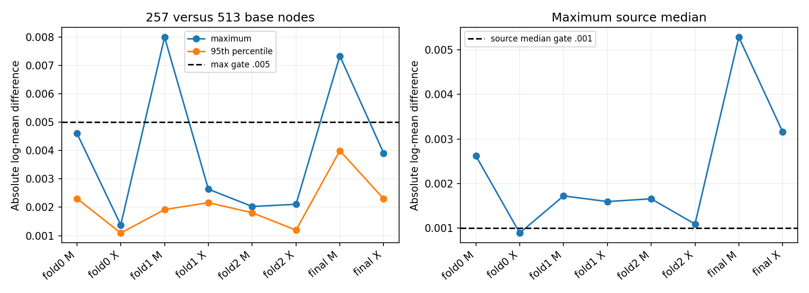

# stage75：固定能量决策的数值预检未收敛，尚无新增点风险结论

## 1. 阶段目标与结论

按[路线§55](../docs/nu_mu_energy_ml_revised_roadmap.md)、[stage74](2026-11-03_stage74_conditional-energy-hypotheses.md)和本轮stage75 Prompt，复用8个固定条件判别器及原实际train q，检验唯一 `exp(mean logE)` 能量决策。起始commit `a3cc31b`。先做事前规定的257/513节点数值QA；**预检失败，依合同没有启动正式点预测作业，也没有做能量风险或cal offset评价。** 继续F7。

256个事前固定真实身份、M/X共512个模型输出对比中，最大 `|logEhat257−logEhat513|=0.0079940143`，超过0.005；最大“作业×模型×来源”中位差0.0052871131，超过0.001。4/512模型身份行（4个不同真实X）超过前者，85/254作业×模型×来源组合超过后者。后者同源M/X成对、低N组也计入，**254不是独立来源N**；实际覆盖127个保守来源。不能只去掉4例继续，也不能以X单项最大差小于0.005放行。

这证明当前均匀节点离散化**尚未通过自身工程收敛门槛**，并不证明模型点预测无用或低E无信息。513节点不是已知真积分，因此0.007994是两种离散化差，不是已测真积分误差；其对应两离散化能量比最大变化约0.802605%，也不是物理bias或分辨率。stage74的来源可迁移判别信息和12个零q支持限制原样保留。本轮点风险/传统恢复/能量校准结论均**未测量**。

## 2. 输入、冻结与全部保护

输入仅stage55 `dataset.npz`、stage56 `readout.npz`经 `audited_features.load/build` 的同62列，以及stage74已有M/X八模型/各实际train q。原名义d32b0ff3、without-IFT、TI12MC04/FASERNU-04/OFLCOND-FASER-06、unit MC、truth νpz和reco leading pz>50 GeV，原质量/几何/fitted-charge cuts不改；没有新F7推理或读取ROOT/RDO。

train/cal/eval为41447/8440/14057，保守来源91/16/22，stage68 v2来源折＋train端exact incoming purge保持，实际train22795/22878/22543、held13820/13667/13960，final41447；各split q计数/质量与stage74逐值相同，已知来源与incoming交集0，完整谱系仍未知。输入重新构造时，eligible缺失21/3/7原样，原42缺失及11保护的定义沿用stage74，不将unused保护例纳入研究。

一次方纵向/模长动量只pz0，px/py、q/p、弯折允许；原11signed raw、VetoNu reduced、typed/domain/status/dependency→NaN、合法负值与缺一Calo使totalNaN不改。没有引入p0/p1/pz1或其log比、fit charge替代raw、nansum、删除high-y/未确认/巨大动量/负修正/困难尾，亦没有对12零q者或低N来源加豁免。

[protocol](stage75_energy_ml/protocol.json)先于查询冻结唯一映射/插值/身份/数值门槛/原能量门槛；[input_validation](stage75_energy_ml/input_validation.json)和[splits](stage75_energy_ml/splits.json)保留身份与支持审计。8模型均回读400树，特征名为pz0＋query的M2维或原62＋query的X63维。模型/seed/q/负配对规则均未变化；本轮没有任何训练。cal/eval为已开发样本，不是新确认。

## 3. 唯一映射和本轮离散化

固定t=ln(E/GeV)∈[ln50,ln6400]，`r(t|X)∝q(t|Bpz)exp(s(t,X))`。q使用stage74原reco pz50/75/100/150/250/500/1000/inf与真E50/100/200/400/800/1600/3200/6400的7×7单位计数，箱内logE均匀；零q不填。r仅称**归一分数密度**，不称校准真后验。唯一决策 `logEhat=∫t rdt`，不挑均值/MLE/median、q、temperature或truth分段回退。

实现 `conditional_decision.py:integrate/predict` 只接收reco、候选t、模型和原q，不接收事件真E。主257等距log节点＋8原箱边界去重后263节点；QA513＋边界后519节点。每个子区间q取其所属原箱的常数，**不跨q跳点平均或向零箱漏质量**。在区间内线性插值exp(score)，对这个插值的零阶和一阶矩解析积分：

```text
Zsegment = q Δt (fL+fR)/2
Msegment = q Δt [(2tL+tR)fL+(tL+2tR)fR]/6
logEhat = ΣMsegment / ΣZsegment
```

每真实X以有支持节点最大logit平移后指数计算，归一时常数抵消；不裁odds。每chunk64真实X，查询矩阵及时约化为均值/logZ/首尾箱质量/归一误差，丢弃完整grid。树本身在查询维上是阶梯函数，因此上述插值是一个明确数值近似，不能假装连续精确积分。

真实q=0标签的密度logscore仍未定义/−∞，不能补floor或删事件。点决策数学上仍可存在，未来应评价全样本；**本轮只保存数值QA的256身份均值，不做真能量残差、NLL、RMSE或offset计算**。没有正式OOF能量数组，也没有完成新的41447恰一次点评价。

## 4. 合成、独立接口与真实身份数值QA

先做合成piecewise q（两箱.3/.7）、单支持箱、零区质量、constant score已知均值/归一、score+1000不变、截断指数解析均值及独立Gauss子区间求积。全部通过；截断指数均值绝对差3.9660124e−8（当前插值的离散误差），独立插值积分差8.8817842e−16。主网格逐chunk归一误差最大5.5511151e−16。每job/arm再对既定最前2身份，用独立DMatrix API查询同一263节点，与inplace_predict路径的log均值**逐位相同**；0新增fit。见[pilot](stage75_energy_ml/pilot.json)。

真实身份在查询前写入[numerical_QA_identities](stage75_energy_ml/numerical_QA_identities.tsv)：每held按global row排序等距64个；final原cal/eval各32，共256且互不重复。覆盖127保守来源，未按真E、残差、模型结果或缺失状态挑选。每者M/X都运行两固定网格，共512个对比。没有尝试1025节点或改变积分定义找更有利点风险。

| job | arm | 身份N | 最大abs log差 | 中位abs log差 | >.005行N | 来源中位>.001组/组数 | 最大来源中位差 |
|---|---|---:|---:|---:|---:|---:|---:|
| fold0 | M | 64 | 0.004603394 | 0.000937211 | 0 | 13/30 | 0.002618504 |
| fold0 | X | 64 | 0.001378639 | 0.000504822 | 0 | 0/30 | 0.000886929 |
| fold1 | M | 64 | 0.007994014 | 0.000873043 | 1 | 12/29 | 0.001720298 |
| fold1 | X | 64 | 0.002636854 | 0.000962897 | 0 | 16/29 | 0.001593045 |
| fold2 | M | 64 | 0.002028431 | 0.000830601 | 0 | 8/30 | 0.001654811 |
| fold2 | X | 64 | 0.002104335 | 0.000386520 | 0 | 2/30 | 0.001088254 |
| final | M | 64 | 0.007331897 | 0.001176642 | 3 | 23/38 | 0.005287113 |
| final | X | 64 | 0.003907390 | 0.000777144 | 0 | 11/38 | 0.003160543 |

185/512行差>.001；数值门槛按预定的全局最大和逐来源中位验收，两者都失败。M有4行>.005，X无此类行，但X在fold1/fold2/final仍有来源中位超标；不能只保留X最好的fold0或事后删M对照。最大来源中位组final M `k:00110-00119`仅1身份，仍按原合同报告；更广泛的85/254超标说明不能只归为少数坏事件。

最大差是fold1 M、row49379、`pi:00290-00299`，两log均值5.1416063104/5.1496003247；final M最大为eval row70501、`k:00480-00489`，7.6880794705/7.6807475738。逐身份完整[numerical_QA](stage75_energy_ml/numerical_QA.tsv)、逐来源[numerical_source_QA](stage75_energy_ml/numerical_source_QA.tsv)和[summary](stage75_energy_ml/numerical_summary.tsv)保留。这里身份仅用于数值诊断，不按这些身份做新物理选样。



## 5. 程序原因与最小修复合同

本轮区分了两个问题：合成/稳定归一和DMatrix/inplace接口一致性通过；真实已存树上均匀采样的257→513离散化不稳定。没有证据把它归咎于真能量标签、q重估、NaN填补或源混合；detector原因不可能由本次数值差直接判定。

不再查询模型，仅结构回读8个序列化模型的query分裂节点，得到[query_threshold_inventory](stage75_energy_ml/query_threshold_inventory.tsv)。各400树中399–400树使用候选t，M各3580–4126个query分裂节点、X2220–2410；去重后每模型244–254个float32查询阈值，分裂点到主网格最近节点的距离最大0.009413–0.009476（log单位）。均匀节点不对齐这些跳点，线性exp(score)插值会将跳变分散到相邻区间；增加一倍均匀节点不保证已收敛。对当前插值的解析积分准确，不代表对原阶梯树准确。

**下一单项stage76：相同模型/q/唯一决策的确定性分段积分修复。** 数学上固定reco时，有限树集合只在查询维的有限阈值处改变分数。读取每模型所有已存query cut，将连续t→float32输入的有效跳点（阈值与前一个可表float32数的中点）与原q边界合并，即可在每段内查询恒定score并精确积其质量和一阶矩；tie点是零测度，但实际float32比较/NaN分支仍须独立验证。原模型结构给出的分段数为251–261/模型，与当前263节点规模接近；**新方法运行时间、实际误差和节省均未测量**，不能据结构数声称资源已通过。

[最小修复合同](stage75_energy_ml/integration_repair_contract.json)固定0新训练、不变q/模型/决策/seed或研究候选。先合成piecewise score/q、支持边界、float32舍入/tie、稳定大logit和独立树遍历；同256身份用独立float64 logsumexp与显式分段求和验证log均值差≤1e−6、归一误差≤1e−12，并在≤32固定身份检查各段quarter/mid/three-quarter和独立树遍历。不能以真能量RMSE选分段或积分方法；没有均匀网格扫描。数值QA未过继续交具体程序缺陷，不测正式点风险。

QA/资源通过后stage76才可在原≤4Condor/1CPU/3000MB、累计CPU≤3600s、wall/job≤1800s、worker1750s、最终≤20MB内做完整固定决策。OOF raw；final M/X各原8440cal一个unit global log-offset，主X_cal。完整41447/8440/14057和12零q/缺失/困难尾均保留；传统两低E恢复上限1.05、all/F7 1.01、困难1.03、双向tail50+2pp及500component分层保守来源固定预测区间（seed2026111375，cal+1/OOF+2）不改。原7非空真E箱/macro与unit、3.2–6.4TeV/≥6400空层和历史参考全报。不能用M替代传统/F7门槛，也不把r叫校准后验。

## 6. 命令、资源、存储与验证

本轮交互仅小样本和模型结构QA，无大批量数据处理，无Condor提交；因此不存在提交/失败/重试/MaxRuntime通过的虚构记录。CVMFS现成LCG_109与XGBoost2.1.3，OMP/OpenBLAS/MKL均1线程，无安装或C++重建。

```bash
# /tmp/stage69_python.sh 依次设置 PYTHONNOUSERSITE=1、三线程变量=1，
# source /cvmfs/sft.cern.ch/lcg/views/LCG_109/x86_64-el9-gcc15-opt/setup.sh
# 再 exec python "$@"
bash /tmp/stage69_python.sh ml/prepare_conditional_decision.py
bash /tmp/stage69_python.sh ml/pilot_conditional_decision.py
bash /tmp/stage69_python.sh ml/report_conditional_decision_qa.py
```

| 区段 | wall/s | CPU/s | 进程peakRSS/MiB |
|---|---:|---:|---:|
| 输入/冻结/8模型与q回读 | 2.802288 | 2.620315 | 616.605469 |
| 全合成＋两网格＋独立接口pilot | 3.100013 | 2.902916 | 616.605469 |
| 汇总核验＋结构inventory＋图 | 2.360172 | 1.752298 | 616.605469 |

主257查询134656行/CPU0.868628s，QA513查询265728行/CPU1.694544s；独立DMatrix4208查询行另外计入完整pilot资源。主路径吞吐各job/arm为140788–170319 query rows/CPU s，仅小pilot实测，不能冒充完整点任务吞吐。进程peakRSS含原缓存构造/载入，非只有64事件矩阵大小；完整进程实测616.605MiB低于拟议3000MB，但尚没有正式worker资源/传输QA。三个完整脚本区段CPU合计7.275529s，不含全部CVMFS启动/其他审计/文档，精确全阶段CPU与EOS物理/网络I/O**未测量**。模型结构检查未额外预测，不保存逐例完整grid。

新输入副本14243735逻辑bytes，验证后删除；原stage55/56与stage74模型/预测不动。最终保留代码、冻结协议、256身份、512数值对比/来源汇总、8模型结构统计和单图；[delivery](stage75_energy_ml/delivery.json)记录最终实际逻辑bytes、删除记录、语法/Git/链接及旧章节保护QA，≤20MB。没有新模型或正式能量数组。原stage54五项未跟踪内容不动、不提交。

独立汇总审计逐行复算全部差、逐来源中位和两门槛，与pilot逐值一致，256身份×M/X准确覆盖、无重复/缺失；[validation](stage75_energy_ml/validation.json)的passed仅指**审计通过**，不能误读为数值gate通过。[decisions](stage75_energy_ml/decisions.json)仍明确numerical_gate_passed=false、0正式点任务、0fit和energy_point_risk_measured=false。

## 7. 研究结论与后续边界

本阶段达成的是可审计的数值阻碍定位，尚未回答stage74信息能否变成低能点风险收益；不能声称模型优于/劣于传统、低E恢复、完整后验校准或信息极限。新logRMSE/mean或median bias/R68/tail50/100/尾损失、offset、macro、来源bootstrap及12零q完整点评价均**未测量**，没有拿旧分数冒充本阶段成果。stage76只是修复同一科学映射的求积，不增加方法候选或放宽能量门槛；本轮未执行。

[真实π/K/共同响应请求](stage74_energy_ml/followup_input_request.json)继续作为并行交付，保留GENIE parent/subfile/seed、跨flux事前角色/随机未开发确认、歧义两侧/高端支持及raw/Calo实际条件/单位闭合。新N/足量功效/共同响应与interaction/FSI/材料、接受度/背景均未测量或未交付；不因本数值失败声称唯一物理原因是缺训练数据，也不以这些请求阻断已有模型的有限积分修复。无K重试/扩run/生产/locked确认/π28/SHA/谱toy或外发消息。

先报告后代码与紧凑表图本地Conventional Commit，不push；路线/信息预算追加本阶段，Prompt改为stage76修复合同，旧章节与stage54支线逐字保留。
