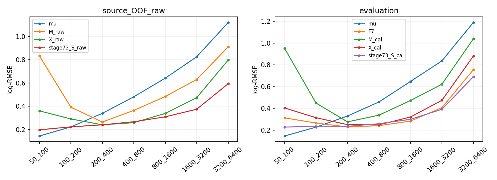

# stage76：分段积分修复通过，但固定条件密度的能量决策未恢复低能性能

## 1. 阶段目标与结论

按[路线§56](../docs/nu_mu_energy_ml_revised_roadmap.md)、[stage75](2026-11-03_stage75_conditional-decision-numerical-qa.md)与本轮stage76 Prompt，先修复同一 `r∝q exp(score)` 的求积，再检验唯一 `exp(mean logE)` 决策。起始commit `3b3cb07`。**数值修复通过，4个正式推理作业全部成功、0新训练；主X_cal未通过原低E恢复、全体/困难保护和部分双向尾门槛，继续保留F7。**

主eval true50–100/100–200 GeV log-RMSE为.403918/.313986，传统pz0/.8为.145487/.226876，F7为.312816/.265014；X_cal/传统来源95%区间为[2.423425,3.184732]/[1.291339,1.484742]，不只未达到1.05，完整区间都劣于传统。全体X_cal/F7=1.127244 [1.114230,1.139433]，也未过1.01。这个失败并非本次积分不收敛，也不是只由12个零q或少数坏尾造成。

X相对同容量pz0-only M的点风险仍明显改善，且raw分数密度在eval的NLL优于M；因此保留stage74“读出有条件判别信息”的结论。**有信息、优于弱M，不等于优于已有F7或传统。** 不把固定分类器的点决策失败推广为所有条件方法不可能，也不把缺数据/先验/校准中的未知原因当唯一物理结论。本轮结束此固定决策预算，不自动温度/q/估计器/架构扫描。

## 2. 输入、选择与变量保护

只用stage55 `dataset.npz`、stage56 `readout.npz`经 `audited_features.load/build` 的原62列；stage74已存8个模型和每实际train原q；stage75的256固定QA身份。名义d32b0ff3、without-IFT、TI12MC04/FASERNU-04/OFLCOND-FASER-06、unit MC，truth νpz与reco highest-pz leading>50 GeV、原质量/几何/fitted-charge cuts保持。无新ROOT/RDO、生产、π28增补、K重试/扩run、locked确认、新F7推理或谱toy/SHA。

train/cal/eval仍41447/8440/14057，91/16/22保守来源；原42缺失21/3/7 eligible＋11 protected。stage68 v2来源折＋train端exact incoming purge，实际train22795/22878/22543、held13820/13667/13960；最终41447。来源和已知incoming交集0，完整谱系未知。全部缺失、high-y、未确认、巨大动量、负修正和困难尾保持。所有实际train q计数/质量与stage74逐值一致，无改先验/加伪计数/merge。

一次方纵向/模长动量仅pz0；px/py、q/p、弯折允许。11signed scintillator raw与VetoNu reduced、typed sentinel/domain/status/dependency→NaN、合法负值与缺一Calo使totalNaN保持；没有引入p0/p1/pz1或其log比、fit替代raw、nansum或填补。输入/模型/边界/数值门槛/能量验收在[protocol](stage76_energy_ml/protocol.json)冻结；[输入QA](stage76_energy_ml/input_validation.json)、[split](stage76_energy_ml/splits.json)、[原q](stage76_energy_ml/proposals.json)保留。

M仅pz0＋候选logE共2维，X原62＋候选logE共63维，均400树。候选t不是事件真能量的部署观测，`predict_exact`只接收reco/pz/原q；真能量只在其后评分/原cal offset中使用。cal/eval已多次开发，不是新盲测。

## 3. 对同一科学映射的确定性积分修复

t=ln(E/GeV)∈[ln50,ln6400]，原coarse-pz与7个logE箱内常数q不变。r是归一**分数密度**，不称已校准真后验；q=0处保持0，不按事件真能量选择或回退。唯一点决策 `logEhat=∫t r(t|X)dt`，M/X完全相同处理，不施Ehat≥pz。

读取原模型serialized float32 query cut。推理先把连续t转float32，故严格 `float32(t)<cut` 的有效连续跳点位于cut与其float32前驱中点；tie为零测度。把全部跳点与原q边界合并，各段内原树分数s固定，以段中点查询。质量为 `a_j=q_j exp(s_j) Δt_j`，一阶矩为 `a_j(tL+tR)/2`；通过稳定logsumexp等价的最大log质量平移归一并求均值。没有线性插值原树，也没有均匀网格/温度/决策选择。

各模型244–254独立query cut，251–261个实际区间；见[partition_inventory](stage76_energy_ml/partition_inventory.tsv)。每chunk64真实X，完整query grid只在内存，及时约化为均值/logZ/首尾箱质量/归一误差；不保存逐例完整grid。精确性针对已存float32模型和原q，在浮点舍入下核实，不宣称对真实物理概率精确。

OOF仅raw，每真实train恰获一次held预测；final完整train/cal/eval。M/X各在原8440cal上一个unit mean(logEtrue−logEhat) offset，M=.006369642861、X=.000201037307，自然对数无量纲。主X_cal预定，raw并列；不根据结果改主候选或对密度加概率校准。offset仅作用于点能量，不将raw密度NLL冒充offset校准后的能量后验评分。

## 4. 数值、部署与实际包QA

先合成piecewise q/score、单/零箱、已知均值、+1000 logit常数平移、严格cut/float32邻域与NaN默认分支。已知标量参考差8.8817842e−16；+1000平移均值差1.7763568e−14。阶段75同256身份（3held各64＋cal/eval各32）M/X512对比，生产积分与独立逐事件float64 logsumexp/显式区间参考最大log均值差**5.3290705e−15**，归一误差最大**4.4408921e−16**，分别通过1e−6与1e−12。

每held上述身份中再按row等距8个，final cal/eval各4，共32独立身份；对每段quarter/mid/three-quarter，XGBoost分数逐位恒定，且独立逐树遍历（float32加和、NaN分支）逐位相同。所有模型全部actual cut的前驱/cut/后继值也逐位通过。没有用真E残差挑数值方法。见[pilot](stage76_energy_ml/pilot.json)、[逐身份QA](stage76_energy_ml/numerical_QA.tsv)和[树遍历/边界QA](stage76_energy_ml/traversal_QA.json)。

此时可以把stage75两均匀网格与已验证分段积分比较：同256身份old257最大绝对log均值误差.011179098，old513为.003847201；这是本轮才取得的固定模型积分参考，不反写stage75当时未知精确值。正式worker在这256身份回读差8.8817842e−16；全正式样本归一误差≤6.6613382e−16。

实际提交tar的4 split均 `--check-only`，覆盖worker预建report目录、两个输入维数及模型/q加载，0正式点任务/0fit；[package_startup_QA](stage76_energy_ml/package_startup_QA.json)通过后才提交。[resource_contract](stage76_energy_ml/resource_contract.json)用小pilot预测413.557s查询CPU（仅估计），不拿它替代实测485s remote CPU。

## 5. 全样本点风险：信息相对M有效，但不及传统/F7

log-RMSE为自然对数无量纲。μ为固定传统pz0/.8；历史参考使用原已存预测，匹配同row/支持。source OOF只比较确有来源OOF的stage68/69/73 raw，不把F7/71的最终预测冒充OOF；cal/eval完整参考与原偏移都保留在表中。

### 5.1 来源OOF、训练内与raw比较

| 层 | N/保守来源 | mu | M_raw | X_raw | stage73_U_raw | stage73_S_raw | stage73_F_raw |
|---|---|---:|---:|---:|---:|---:|---:|
| E50_100 | 767/79 | 0.143853 | 0.833863 | 0.360273 | 0.270367 | 0.197097 | 0.148594 |
| E100_200 | 3564/90 | 0.222426 | 0.391576 | 0.290825 | 0.244736 | 0.222957 | 0.210069 |
| all | 41447/91 | 0.526281 | 0.428845 | 0.311592 | 0.278554 | 0.282312 | 0.292169 |
| E200_inf | 37116/91 | 0.551464 | 0.419852 | 0.312434 | 0.281752 | 0.288832 | 0.301047 |
| pz50_100 | 2498/90 | 1.187733 | 0.916453 | 0.515825 | 0.471897 | 0.489076 | 0.516573 |
| high_y | 1204/90 | 1.568664 | 1.164391 | 0.678647 | 0.600877 | 0.629692 | 0.662383 |
| unconfirmed | 1495/90 | 1.590771 | 1.143609 | 0.580629 | 0.525356 | 0.543311 | 0.568878 |
| E3200_6400 | 282/54 | 1.120650 | 0.911438 | 0.798135 | 0.666555 | 0.594086 | 0.568964 |
| zero_q | 12/12 | 2.503737 | 2.229195 | 1.578239 | 1.264531 | 1.205695 | 1.203908 |

OOF X/M两低E比为.432053 [.417371,.446905]/.742703 [.719017,.767033]，all .726584 [.718208,.734814]、低pz .562849 [.542840,.583561]、high-y .582834 [.559509,.605789]、未确认.507716 [.490868,.527138]。这是跨来源保留的读出增益，但弱M最低能log-RMSE达.833863，不能替代传统门槛。

相对已有stage73 unit直接回归U，OOF X/U最低能比1.332536 [1.274640,1.394104]、第二低能1.188321 [1.148747,1.224680]、all1.118607 [1.112230,1.124738]，显著更差；相对M改善不是新最佳方法。原source三折单独指标见[fold_metrics](stage76_energy_ml/fold_metrics.tsv)。最终训练内X all .301394、两低E .373573/.293763，M all .427627、两低E .963428/.439587，连训练内也没有低E恢复；训练与OOF的q/训练支持不同，不把差值全部归纯过拟合。

### 5.2 完整eval开发与原门槛

| 层 | N/保守来源 | mu | F7 | M_cal | X_raw | X_cal | stage73_S_cal | stage73_F_cal |
|---|---|---:|---:|---:|---:|---:|---:|---:|
| E50_100 | 208/19 | 0.145487 | 0.312816 | 0.953126 | 0.403746 | 0.403918 | 0.227861 | 0.163625 |
| E100_200 | 906/22 | 0.226876 | 0.265014 | 0.449275 | 0.313844 | 0.313986 | 0.235144 | 0.210258 |
| all | 14057/22 | 0.568069 | 0.296363 | 0.456258 | 0.334088 | 0.334073 | 0.298186 | 0.307123 |
| E200_inf | 12943/22 | 0.588671 | 0.298164 | 0.444253 | 0.334226 | 0.334197 | 0.303089 | 0.314512 |
| pz50_100 | 682/22 | 1.336853 | 0.502965 | 1.008140 | 0.551406 | 0.551445 | 0.515126 | 0.541202 |
| high_y | 440/22 | 1.676717 | 0.640068 | 1.237580 | 0.718726 | 0.718645 | 0.654810 | 0.674903 |
| unconfirmed | 510/22 | 1.699385 | 0.570928 | 1.183485 | 0.614041 | 0.613984 | 0.585601 | 0.608719 |
| E3200_6400 | 271/14 | 1.189880 | 0.755449 | 1.039347 | 0.880992 | 0.880814 | 0.690589 | 0.655540 |

| eval层/参考 | X_cal比值 | 来源95%区间 | 原上限 | 结论 |
|---|---:|---|---:|---|
| E50_100/mu | 2.776321 | [2.423425, 3.184732] | 1.05 | 未通过 |
| E100_200/mu | 1.383953 | [1.291339, 1.484742] | 1.05 | 未通过 |
| all/F7 | 1.127244 | [1.114230, 1.139433] | 1.01 | 未通过 |
| E200_inf/F7 | 1.120851 | [1.107135, 1.133965] | 1.03 | 未通过 |
| pz50_100/F7 | 1.096387 | [1.059004, 1.133946] | 1.03 | 未通过 |
| high_y/F7 | 1.122763 | [1.094133, 1.154260] | 1.03 | 未通过 |
| unconfirmed/F7 | 1.075414 | [1.048508, 1.107896] | 1.03 | 未通过 |

上述每项原门槛均失败，且与F7的主要保护层下限也>1。raw/cal几乎相同，不能用一个新全局offset解决分层偏差。eval X_cal对M_cal在最低能比.423782 [.377038,.460118]、all .732202 [.720438,.744396]，但不能据此宣传优于传统。

cal开发两低E X_cal/传统比区间[2.229860,3.040451]/[1.233529,1.424440]，all/F7[1.103409,1.128308]，方向同eval。cal仅作开发/offset支持，不作为额外独立确认。模型/q/offset均固定，未重训或选seed。

来源中央值也显示并非个别源：eval全体22/22来源X_cal比F7差，最低能18/19、第二低能20/22、high-y21/22、未确认19/22，高端14/14；这是中央值方向，不是每源显著性。来源小N/完整谱系限制照样保留，见[source_metrics](stage76_energy_ml/source_metrics.tsv)和[interpretation](stage76_energy_ml/interpretation.json)。



### 5.3 bias、R68、双向尾与macro

| eval X_cal层 | mean bias/% | median bias/% | R68/% | 正/负tail50/% | tail100/% | tail50损失份额/% |
|---|---:|---:|---:|---|---:|---:|
| E50_100 | 44.806 | 36.112 | 20.679 | 21.635/0.000 | 4.808 | 63.223 |
| E100_200 | 28.222 | 23.146 | 17.919 | 11.921/0.000 | 3.974 | 56.060 |
| all | 2.364 | 3.852 | 26.079 | 3.614/4.183 | 0.775 | 55.431 |
| pz50_100 | 26.045 | 22.723 | 49.221 | 23.607/8.065 | 9.384 | 82.224 |
| high_y | -7.638 | -22.698 | 55.414 | 15.227/28.409 | 6.818 | 88.555 |
| unconfirmed | -1.152 | -11.414 | 52.302 | 16.078/18.627 | 6.471 | 84.049 |
| E3200_6400 | -51.104 | -48.110 | 13.441 | 0.000/46.494 | 0.000 | 80.609 |

最低能median bias +36.112%，不是只有少数离群：45/208为正tail50，贡献63.2228%平方log损失，其余163例仍占36.7772%；原F7为31/208、71.8584%损失。第二低能108/906正tail50、56.0604%损失，F7为79/906总tail50。X最低能R68=20.679%略小于F7的21.987%，但偏差和风险更大，不能拿窄核心宽度代替恢复。

高端3.2–6.4TeV X_cal median bias−48.110%、R68=13.441%，F7为−43.047%/16.292%；小R68伴随更强向低值集中，不能称高端响应改善。其X_cal/F7 log-RMSE比1.165947 [1.128396,1.210363]。≥6400真E为空，性能未测量。正/负tail100全表保留；正能量估计不产生低于−100%的误差，negative_tail100为0是定义边界。

原tail50保护上限为+2pp，下面是X_cal−F7配对来源区间：

| eval层 | tail50增量/F7 (pp) | 总tail50上限95 (pp) | 正tail50上限95 (pp) | 负tail50上限95 (pp) |
|---|---:|---:|---:|---:|
| E50_100 | 6.730769 | 9.343294 | 9.343294 | 0.000000 |
| E100_200 | 3.200883 | 5.001437 | 5.229711 | 0.000000 |
| all | 1.351640 | 1.656175 | 0.369770 | 1.399247 |
| E200_inf | 1.135749 | 1.393036 | 0.008124 | 1.543059 |
| pz50_100 | 6.891496 | 9.770051 | 10.594515 | -0.456952 |
| high_y | 8.181818 | 11.087767 | 4.681704 | 7.826139 |
| unconfirmed | 6.078431 | 9.245595 | 4.739686 | 5.517680 |

全体和≥200的总/正/负tail50均通过+2pp，但其RMSE保护失败；两低E过估、低pz、high-y和未确认尾代价失败，不能仅报全体尾。低pz同时包含两个低E与真≥200两侧，完整双侧结果亦在表中，不剔除未确认或无y者。

固定七非空真E箱等权MSE开根的macro：OOF M/X=.599316/.433569；eval μ/F7/M_cal/X_cal=.646502/.395271/.653519/.461233。X_cal/F7 macro比1.166878 [1.143987,1.190301]，亦更差；相对μ虽macro更好，unit及每低E标准仍必须同时满足。完整[metrics](stage76_energy_ml/metrics.tsv)、[paired](stage76_energy_ml/paired.tsv)和[macro](stage76_energy_ml/macro.tsv)包含mean/median bias、R68、上下tail50/100和尾损失、全部能量/困难/缺失/零q层以及stage68/69/71/73固定对照，未只挑有利表格。

## 6. 密度评分、支持及统计解释

[density](stage76_energy_ml/density.tsv)为raw分数密度对t=ln(E/GeV)的NLL，单位nat/真实事件，非分类BCE，也非经offset校准的密度。eval无真实零q，M→X NLL：all .319245→.140668、低pz1.057907→.587497、最低能.294876→.003881、第二低能.072252→−.089670；连续密度NLL可以为负。它仍说明X比弱M保留了信息，不给F7不存在的密度伪造比较或区间校准。

OOF12个真实q0（三fold分别4/5/3，9高端/2最低能/1第二低能）原样留在点预测/所有bootstrap。因此全OOF密度NLL明确为**+∞**，不是用floor改成有限平均。仅作为有支持子集诊断的41435例NLL M/X=.246203/.085099，不能叫全样本NLL；高端有支持273例反而X3.200699略差于M3.136892，不能声称所有密度层都改善。所有零q样本点估计有限，X OOF该12例log-RMSE1.578239、M2.229195；12例有12保守来源，其X平方log损失占全OOF仅**0.742782%**，并未删除它们或据此重算有利分数。eval真实零q为0仍广泛失败，故12例不是全部解释。

最低能eval的X平均分配给50–100 GeV箱质量仅.487770，M .312476；高端真E3.2–6.4TeV的该箱平均质量X .069475、M .079006，反映当前分数形状未在这些条件层集中到相应能区。这不是逐真能量后验必须在本箱的校准定理，但与观测到低端正偏、高端负偏一致。原粗pz q有先验/混合，判别器经有限容量BCE训练并不保证odds已校准或积分决策等于直接回归。stage74 ECE缺口仍在，不能只因乘回q/归一就宣称后验闭合。

本轮排除了原均匀求积作为当前失败原因，也检查了变量/行/q/标签评分和模型接口；真正detector响应、传播、interaction/FSI、选择效率、完整谱系、更多训练统计和概率模型校准各自的因果贡献**未测量**。没有充分补样/学习曲线对照，不能认定缺数据是唯一原因；已有直接回归更好也说明本固定分类决策未把可用信息变成更好点风险。结束的是这一预定决策预算，不是宣布物理信息极限。

500次component(pi/k/charm)分层保守来源配对bootstrap，seed2026111375（cal+1/OOF+2），模型/q/offset固定；关键主层500有效/0无效，空层/不足3来源中央与区间按表明确。区间不含重训、q估计、原负配对RNG、offset估计、完整谱系、响应和研究选择误差。cal/eval仍开发，不冒充正式覆盖或新独立确认。

## 7. 执行命令、资源、独立验证与存储

LCG_109/XGBoost2.1.3，CVMFS现成构建，OMP/OpenBLAS/MKL均1；源码未变不编译C++。命令：

```bash
# /tmp/stage69_python.sh 设置 PYTHONNOUSERSITE=1 和三线程变量=1，
# source /cvmfs/sft.cern.ch/lcg/views/LCG_109/x86_64-el9-gcc15-opt/setup.sh
# 再 exec python "$@"
bash /tmp/stage69_python.sh ml/prepare_exact_conditional_decision.py
bash /tmp/stage69_python.sh ml/pilot_exact_conditional_decision.py
bash /tmp/stage69_python.sh ml/submit_exact_conditional_decision.py
# actual-package four --check-only passed, then9663068.0–3
bash /tmp/stage69_python.sh ml/collect_exact_conditional_decision.py
bash /tmp/stage69_python.sh ml/report_exact_conditional_decision.py
bash /tmp/stage69_python.sh ml/validate_exact_conditional_decision.py
```

4任务9663068.0–3各一次启动/exit0，无重试、无部分正式重跑、0fit。remote CPU485s、wall合计513s；dry-run/最终ClassAd均1CPU/3000MB/MaxRuntime1800s。worker timeout1750s/kill-after10s，chunk间CPU850s/wall1700s预算检查。下表为直接推理脚本区段：

| job | wall/s | CPU/s | 进程peakRSS/MiB |
|---|---:|---:|---:|
| fold0 | 70.994345 | 70.230330 | 219.984375 |
| fold1 | 88.193010 | 87.409745 | 225.148438 |
| fold2 | 56.127719 | 55.850036 | 226.285156 |
| final | 260.965274 | 259.734799 | 246.335938 |

四脚本CPU合计473.224910s；final worker time265.86s、user261.80s/system.80s/maxRSS252248KiB=246.336MiB。请求3GB不是实测RSS。准备wall/CPU3.621682/3.174478s，完整pilot8.606679/8.326120s，进程peak616.605MiB含原缓存读取。pilot小查询吞吐131962–153824 query rows/CPU s；正式每job查询行/模型、计时均留[inference记录](stage76_energy_ml/final/inference.json)，不拿pilot吞吐冒充完整批量。

实际包四无fit启动wall20.869272s，父CPU.749318s（不含所有子进程）；包16383558逻辑bytes。完整报告wall/CPU47.787686/45.681773s；独立QA3.257108/3.109255s，父进程peak616.605MiB。一个早期只读 `condor_history -af` 客户端挂起，随后有时限的JSON history成功后停止该客户端；没有重提交/重推理，不把查询客户端问题记成科学作业失败。全阶段精确总CPU和EOS物理/网络I/O均未测量。

独立回读所有角色/row/原q，41447恰一次OOF，原stage74真实查询margin与新density/logZ逐位相容，q0与−∞掩码完全一致；数值QA256worker回读差≤8.882e−16。来源bootstrap固定draw0/173/499逐事件展开，RMSE比差≤4.441e−16、tail差≤1.422e−14pp。[独立验证](stage76_energy_ml/independent_validation.json)另以不调用共享metrics的公式复算1060个非空表行（最大数值差3.411e−13，各自指标单位），以及eval全部500来源draw的主X_cal/μ/F7关键层和macro区间：RMSE区间差≤4.441e−16、tail区间差0，cal offset差0。见[validation](stage76_energy_ml/validation.json)、[independent_validation](stage76_energy_ml/independent_validation.json)。

新输入副本14243735bytes、传输结果四包4756433bytes与提交包均仅为逻辑文件大小，非实测物理EOS传输。验证后删除这些重复副本，并将三个fold held数组无损合并成一次OOF后删除分fold重复NPZ；保留最终完整train/cal/eval与合并OOF、协议/q/表图及资源记录，原stage74模型/预测不动，不保存全grid。最终实际bytes和删除清单见[delivery](stage76_energy_ml/delivery.json)，≤20MB；事件/模型数组不进Git。原stage54五项未跟踪内容不动，不纳入提交。文档旧章节/用户stage72报告/stage54 Prompt后缀与语法/Git/链接检查见delivery。

## 8. 下一步：结束固定决策，交付真实新增支持与共同响应

本轮未达推广门槛，继续F7；不自动温度、q平滑、伪计数、估计器或架构轮换，不用一轮新谱toy或metadata目录清单代替物理进展。[后续输入合同](stage76_energy_ml/followup_input_request.json)保留stage70/74请求，并用本次低E/同pz高E/high-y/高端的实际风险细化。

**下一单项stage77应为真实新增开发支持的有界交付，0能量训练。** 优先利用可访问且已可核实共同62/raw/status/Calo表示的现成PHYS；stage70完整π已证明旧PHYS可直接执行原选择/62提取，不应默认重建整批RDO。新的π/K候选PHYS是否存在、schema/条件是否相容及成本均**未测量**；不能假装K完整旧对应物已交付，也不自动重试stage70的K重建或扩run。若既有PHYS入口不能交付，明确要求最小缺失的实际样本/条件，不无限扫EOS或再做一个空metadata阶段。

先在已知manifest与历史canonical train角色范围核对明确路径，继承跨flux/几何全部曝光和保护，不访问test/cal/eval候选；排除已完整提取交付的来源，只有partial缓存的合法train源可读完整文件再排旧incoming。冻结π/K各至多2个来源、总至多4个、总头QA≤40身份，事前seed2026110377均匀选完整文件，不按低E/坏残差择源。QA必须核原11raw/status/VetoNu reduced、Calo实际单位/payload/参考闭合、身份/事件联结与代表性提取成本。完整输入预算建议总≤40000事件/10GB、≤4Condor/每任务≤2CPU/3000MB、CPU总≤7200s/wall每≤3600s、最终≤10MB；这些是新合同上限，只有实际成本可承受才冻结正式提取，不是已证明可完成。禁止有利prefix或换源凑产额；任何完整文件超预算则交具体资源合同，不静默截短。

只在QA通过后实际执行原选择和62提取、对stage55全部已开发incoming及stage70实际28去重，测低E两箱核心与相同reco pz低区的真≥200/high-y/未确认、高端、缺失/尾的选中/新增N、来源数/唯一incoming及I/O/吞吐，合并紧凑支持；新增N/足量功效/学习曲线尚未测，不捏造最低充分N或凭目录数宣布扩样成功。0新模型，只有实际交付后再决定是否值得一次预定增补比较。

开发支持可以在保守历史角色＋精确incoming排复用下明确标为development enrichment；GENIE parent/subfile/seed未证时，不能声称真正独立确认。真正随机未开发确认仍须真实上游谱系/角色/曝光核实，不能将另一flux/几何或旧challenge换名。新生成/共同响应请求继续并行，不把完整谱系未知变成所有有界开发提取的无限前置，也不放弃确认要求。

共同raw/stage54、实际Calo条件、interaction/FSI/材料、接受度/背景和真正新确认仍待交付，完整物理原因未测。本轮没有stage77输入读取/提取/生产或外发消息。先中文报告后本地Conventional Commit，路线/信息预算追加结果，Prompt列具体下一合同并保留stage54后缀，不push、不自动执行下一阶段。
