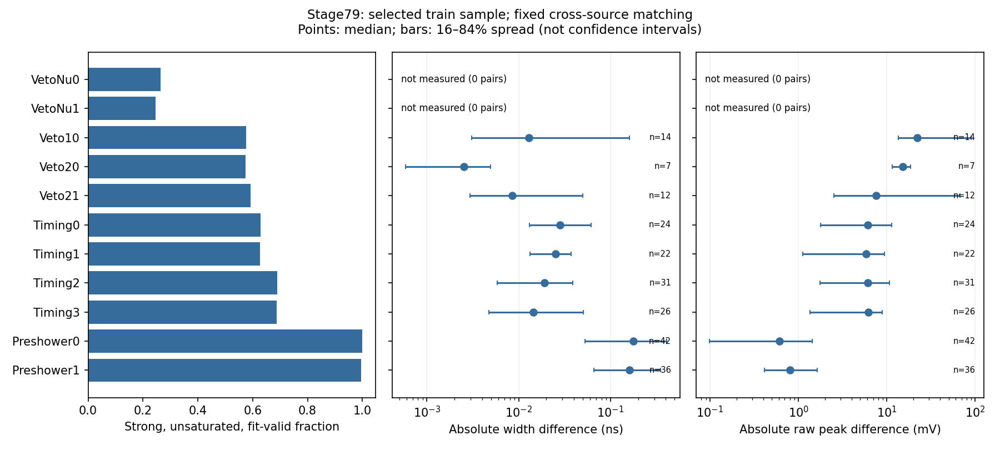

# Stage79：实际脉冲摘要的条件变异、生成机制与时序限制

日期：2026-11-03。起点 `1621c2f`，执行路线§59与stage79 Prompt。**完成40身份QA、12个既有train来源/2048身份的实际同事件测量；0能量训练、0 F7推理，继续F7。** 有真实hit时间卷积的生产证据，也有跨来源脉冲摘要变异；尚未证明这些变化包含原62之外的测能信息。下一单项为一次固定形状族消融，未执行stage80。

## 1. 目标、样本与事前冻结

问题是当前nominal PHYS是否记录积分/pz/位置/状态之外值得检验的形状或时间，而非再改权重、专家、架构。输入仅`ml/configs/low_energy_files.tsv`已知nominal路径、stage55 dataset与stage56 readout；没有递归扫描EOS或读取新生产物理事例。

原模型合同保持：41447/8440/14057 train/cal/eval、91/16/22保守来源组、42缺失的21/3/7 eligible＋11 protected不变；所有困难、未确认、巨大动量、尾保留。一次方模长/纵向动量仅pz0；px/py、q/p、弯折保留，p0/p1/pz1仅为旧62联结/派生依赖读取，不新增为模型输入。11路signed raw、VetoNu reduced、typed/domain/status/dependency NaN与缺一Calo则总和NaN保持，未二次缩放Calo。stage54原五项未跟踪工作未修改。

事前`qa_plan.json`：在原41447合法nominal train中，seed **2026110379**，六run各不放回抽两个来源；各源尽量覆盖reco pz50–100/100–250/≥250 GeV，再补足40 QA身份。先看旧身份/组件/来源/pz，不看新摘要、真E/y或残差。QA通过后才冻结`measurement_plan.json`的2048身份：source×pz层均衡分配容量，层小则全取，余量按固定顺序分配；可用池2598，未根据新读出替换来源/身份。

| run | 可用合法train来源数 | 抽取来源 | 来源抽取概率 |
|---:|---:|---|---:|
|200082|34|18,34|2/34|
|200083|46|74,109|2/46|
|200089|11|113,125|2/11|
|200093|33|134,163|2/33|
|200094|44|176,222|2/44|
|200100|10|244,245|2/10|

来源是manifest文件index，不等同保守group或独立生成运动学。完整路径、每层N/n、来源概率及条件抽样概率均留存。JSON/NPZ中`inclusion_probability`是来源概率×**给定实际来源集合**的层内n/N（范围.0260869565–.2），不是对所有来源抽签结果边际化的事件概率；保留两阶段因子以审计抽样。以下率/分位数描述本次样本，未加权外推整个train。

正式样本：π924、K598、charm526；reco pz三层142/575/1331；2031个唯一incoming。QA与正式重合38例，总共接触2050个不同的选定物理身份。没有抽掉missing；本次随机样本原62含NaN者实际0/2048，不代表原队列缺失已消失。cal/eval/test/locked没有新增选定物理身份。

## 2. 同事件与程序验证

stage55缓存没有inputentry。每个**已选train源**完整读取eventID标量建立临时唯一索引（每源10000条），再只保留固定身份；不能猜eventID就是entry。按所需branch的basket边界合并选定entry区间。ROOT basket及区间内部会临时解码邻接数据，随即只留下冻结身份，不保存/分析邻接物理行，也不保留全波形、PHYS副本或ROOT快照。

40 QA及2048正式例均通过：

- run/eventID唯一联结、source/inputentry边界、leading=max Track_pz0及原incoming四元组精确一致。
- 用实际向量重新计算原scalar/track定义，经原`audited_features.build`清理后，**原62逐值及NaN完全一致**；不是只核对pz或raw。SpacePoint按ROOT的double累加及元素类型乘积，保留原运算语义。
- 11路raw与缓存逐值一致；独立回读再核status、baseline_rms与62。原有允许负数未改。
- 新摘要实际未发现width/raw_peak/localtime/baseline_rms的−999或−1，各计数均0；合成−999、正域−1、fit/threshold/overflow/missing依赖验证通过。没有将signed raw的负值统一删掉。
- 214个配对的控制容差、来源/组件、逐量差、通道内不重复用事件及所有表中位数独立核验通过；4个ClassAd均一次启动/exit0、1CPU/3000MB/3600s。

详见[validation.json](stage79_energy_ml/validation.json)。没有新增能量模型或用真E/y拟合响应。

## 3. 真实生成机制、单位与缺口

有限metadata入口：先只列已知200082生产`log/s0014`一级目录（728文件，上限1000，无递归），再由12个已选来源的segment直接定位**12个确切RDO digitization日志**。全部日志包含相应输出RDO完整名、四个闪烁体算法的`Using improved digitization timing`；不是根据header默认推断。共读取日志4,736,399 bytes。

日志actual release为 **6d6ab70b / Calypso22.0.49**，数字化GlobalTag **OFLCOND-FASER-04**、folder `/WAVE/Digitization`解析为 **WAVE-Digitization-02-LG**。与当前PHYS writer/reconstruction参考 **d32b0ff3、OFLCOND-FASER-06** 分开记录；没有拿旧重建算法冒充新算法。git逐指定路径比较证明6d6ab70b和d32b0ff3的`WaveformDigitisationTool.cxx`、`ScintWaveformDigiAlg.cxx/.h`完全相同；波形重建工具存在版本差异，因此重建语义使用d32源码。

12日志所报kernel参数一致（时间参数ns，norm为实现的幅度参数，不称实测电荷）：

| detector | norm | mean/ns | sigma/ns | alpha | n |
|---|---:|---:|---:|---:|---:|
|Trigger|6360|830|3.21|−.424|6.14|
|Veto|8890|825|3.35|−.32|9|
|VetoNu|10420|800|5|−.28|1000|
|Preshower|530|850|4|−.32|1000|

参数表以日志实际证据为准，完整摘录/行号见[source_evidence.json](stage79_energy_ml/source_evidence.json)。数字化实际走`generate_scint_timing_waveforms`：按每hit meanTime/energyLoss填时间分布，先扣detector中心z/c；Timing双PMT按hit x施加相反传播项，Preshower按y传播，再与固定CrystalBall核卷积、下采样、加baseline噪声、量化并截断负ADC。**并非只将总能损乘固定模板**；但脉冲差异仍可来自噪声、量化、截断和fit。

固定源码入口为既有`/eos/home-x/xcheng/FASER/calypso`的`git show <commit>:<path>`，未checkout/下载/重建：

- `PhysicsAnalysis/NtupleDumper/src/NtupleDumperAlg.cxx`约L246–266：raw_charge=raw_integral/50，pC；raw_peak/baseline/baseline_rms为mV；width/localtime为ns，secondary不覆盖primary。
- `Waveform/WaveRecTools/src/WaveformReconstructionTool.cxx`约L407–549、L810–841：先raw样本估计，再Gaussian/CrystalBall覆盖width/localtime；坏fit可能保留先前值或回退raw，raw宽度NaN还可回退2ns。raw_integral为实际积分窗口有符号求和×2ns；baseline点RMS不是该积分的误差。
- 同文件L299–351与`Waveform/WaveRecAlgs/src/RawWaveformRecAlg.cxx`约L90–101：只有找到clock时才调用时间校正。缺clock并不必然留下CLOCK_INVALID位。`bcid=-1`只在实际调用且clock无效的分支明确为占位。
- `Waveform/WaveRecAlgs/python/WaveRecAlgsConfig.py`在MC禁用ClockRec；writer在MC不写trigger_time，clearTree默认trigger/bcid/clockPhase为0。因此**本次所有trigger/bcid为0不构成有效时间**，也不能因CLOCK_INVALID位未置就认证clock。

尚缺实际完整payload的baseline/noise相关性、通道offset与传播slope数值、可靠逐通道μ路径及共同data/MC时间响应。日志认证了数字化分支和所列核参数，没有认证上述未列payload。不得用truth调offset，也不得把≥50GeV超相对论μ飞行时间当能量计。

## 4. 有效性、饱和、弱信号与模板退化

冻结的一族诊断为11通道的raw_peak/width/localtime及baseline摘要、状态；未扫描通道/阈值。强、未饱和、fit-valid联合mask：`status & (444|1)==0`，finite width>0、localtime>0、baseline_rms>0、raw_peak≥5×baseline_rms。localtime是采集窗坐标，非有符号校正时间。5σ是声明的保守审计约定（源码默认），**actual生产阈值未独立认证**。baseline RMS不作积分误差；不对小或负raw作峰/积分比。

全部22528通道×事件：status0 **14097（62.5755%）**；status1 **5679**；status4 **2583**；status32 **1**；status36 **168**。总overflow **2751（12.2115%）**；fit-failure169，不能全当独立于overflow的169。raw负值 **1518**，全部保留在原表示。形状无效者仍在样本/原模型输入中，仅新摘要诊断标缺失。

| 通道 | 有效形状N/2048 | threshold failed N | overflow N | baseline=0 N | width中位/ns |
|---|---:|---:|---:|---:|---:|
|VetoNu0|542|1506|0|1263|5.290337|
|VetoNu1|505|1543|0|1263|5.317524|
|Veto10|1181|6|861|0|3.445407|
|Veto20|1175|0|872|0|3.443024|
|Veto21|1213|0|835|0|3.443856|
|Timing0|1289|720|39|0|3.296045|
|Timing1|1285|724|39|0|3.295063|
|Timing2|1413|589|46|0|3.292810|
|Timing3|1409|591|48|0|3.291724|
|Preshower0|2045|0|3|0|4.084305|
|Preshower1|2040|0|8|0|4.086389|

width中位只对联合有效者，不能以它代表所有事例。VetoNu的0/status1有默认值与弱信号/无hit接口退化；Veto10/20/21约四成overflow，强活动区拟合形状缺失严重；Timing存在模板附近狭窄核心，Preshower宽度更分散但弱信号拟合噪声也可能贡献。额外活动不统一称hadron。分组件、源、pz与完整状态表见[pulse_summary.tsv](stage79_energy_ml/pulse_summary.tsv)、[status_counts.tsv](stage79_energy_ml/status_counts.tsv)。

## 5. 固定条件匹配：变化存在，低动量支持不足

`analysis_protocol.json`在查看正式摘要前冻结：跨来源、同组件、同三档reco pz、exact status，只取联合有效者；控制被测通道**本身**的asinh(raw_charge/1pC)差≤.1、log(pz/GeV)差≤.2、前/外推VetoNu与Calo的六个xy差各≤20mm、z0差≤100mm、baseline RMS差≤.1mV。按归一控制距离排序贪心配对，每通道内事件只用一次。不看真E/y或任何残差。

214个**通道配对**仅涉及240个不同事件，不能称428或214个新独立生成事例；相同事件跨通道可复用。三组件配对π/K/charm=101/58/55，全部12来源出现；pz三层仅 **1/44/169**。所有配对incoming彼此不同。VetoNu零配对，保持“未测量”，未调大容差或补有利来源。

| 通道 | 跨源配对N | median绝对width差/ns | 16–84%差/ns | median绝对raw_peak差/mV |
|---|---:|---:|---:|---:|
|VetoNu0/1|0/0|未测量|未测量|未测量|
|Veto10|14|.012969|.003068–.160459|21.941895|
|Veto20|7|.002520|.000582–.004917|15.161865|
|Veto21|12|.008454|.002958–.050202|7.596191|
|Timing0|24|.028144|.013069–.061290|6.131226|
|Timing1|22|.025063|.013310–.037109|5.822693|
|Timing2|31|.018959|.005837–.038660|6.126709|
|Timing3|26|.014354|.004728–.050539|6.135010|
|Preshower0|42|.177652|.052464–.410457|.609863|
|Preshower1|36|.160326|.066022–.353365|.803406|

Timing0和Preshower0在12源各有配对。Preshower0各来源median绝对width差约.05936–.33147ns；同一跨源配对在两端来源各计一次，不能作独立显著性。16–84%为观测分布范围，**不是置信区间**。小于2ns采样间隔的拟合参数差也不等于已标定的时间分辨率。完整[逐对表](stage79_energy_ml/conditional_pairs.tsv)、[来源/组件/pz条件表](stage79_energy_ml/conditional_variation.tsv)、[PDF图](stage79_energy_ml/pulse_variation.pdf)留存。



必须限定解释：容差非零，峰差可部分来自允许的积分差；只匹配本通道积分，未固定其余61个输入；噪声/fit协方差与无噪声配对未测。这些结果**不证明严格条件独立、不证明新增测能信息，也不证明变化主要为物理而非电子学/拟合**。生成路径确认允许hit时间结构进入波形，支持发起一次有限消融假说；不支持宣布低能性能改善。尤其50–100GeV只有1配对，不能宣称低动量处跨源稳健。

未校正的Timing0−1、Timing2−3 localtime：有效1282/1409，median **+.014191/−.012756ns**，16–84% **[−.691050,.721277]/[−.707739,.692427]ns**。仅诊断列，未扣固定offset/光传播/μ路径，不称物理延时，不入下一次模型。完整[原时间表](stage79_energy_ml/uncorrected_relative_time.tsv)保留；校正时序与能量收益均**未测量**。

## 6. 命令、实际资源与存储

复用LCG109 `x86_64-el9-gcc15-opt`，单线程numpy/BLAS，无安装、无C++重建。执行命令如下；`/tmp/stage69_python.sh`仅设置该view和单线程后exec python。

```bash
bash /tmp/stage69_python.sh ml/pulse_information_audit.py prepare
bash /tmp/stage69_python.sh ml/pulse_information_audit.py qa
bash /tmp/stage69_python.sh ml/pulse_information_audit.py freeze
condor_submit -dry-run /afs/cern.ch/user/x/xcheng/nu_mu_stage79/dryrun.ads AnalysisZipFramework/submission/ml_pulse_information.sub
condor_submit AnalysisZipFramework/submission/ml_pulse_information.sub
bash /tmp/stage69_python.sh ml/audit_pulse_sources.py
bash /tmp/stage69_python.sh ml/analyze_pulse_information.py
bash /tmp/stage69_python.sh ml/validate_pulse_information.py
```

打包包含reader及两个依赖、原configs、stage55/56缓存、QA/正式名单，实际包31,460,013 bytes；临时解包验证四split导入/62维/2048名单，不访问ROOT、不训练，通过后才提交。4Condor **9663208.0–3**，全部一次exit0，无重试。

**执行顺序偏差：** 冻结/提交时实际上游AdvancedTiming和payload尚未认证，`measurement_plan.json`明确限定为诊断测量；12源生产日志的分支/核参数核准在提交后、正式条件统计之前完成。因此不能声称“全部生产语义证据先齐再提交”。没有按后来日志或正式摘要换身份/来源/匹配条件；结果中已闭合数字化分支，完整payload和时序仍保留未认证。下一阶段须把既有语义证据和所需新增来源检查放到正式提交前。

| 实测项 | QA | 正式job0 | job1 | job2 | job3 |
|---|---:|---:|---:|---:|---:|
|选定N|40|491|528|539|490|
|wall/s|24.108543|56.916741|53.168602|72.317796|76.955015|
|脚本CPU/s|11.428002|45.053730|42.054880|61.723361|58.544590|
|peak RSS/MiB|616.605|358.770|340.371|357.438|359.258|
|请求bytes|66,760,527|635,930,123|693,174,499|712,652,699|668,997,721|

正式脚本CPU合计 **207.376561s**、wall合计 **259.358154s**、吞吐9.876选定事件/CPU s；Condor remote user+sys **216s**、wall合计 **297s**。每job实际1CPU/3000MB、MaxRuntime3600s；worker CPU软/硬1700/1750s，timeout3500s，均远低预算。分析控制匹配约3.3CPU s、peak875MiB；独立验证约.76s wall。分析图生成后重跑只读紧凑缓存，0新ROOT。

正式ROOT请求 **2,710,755,042 bytes**，含QA合计 **2,777,515,569 bytes**；生产日志另4,736,399 bytes。来源/basket合并将2048个单事件array调用降为 **1650**，减少19.43%；共享branch basket仍可能重复读取，未宣称全量basket缓存最优。记录的是uproot请求/解码范围，**实际EOS物理网络I/O未测量**。后续大范围仅取scalar时应按源批读并只保留固定身份，不能将本稀疏多branch成本简单线性外推。

保留`ntuples/energy_ml_stage79/measurements.npz`（2048×摘要/原62/身份/entry/有效性/两阶段概率）和40 QA小缓存；忽略提交物理NPZ。workbook保留名单、协议、source证据、结果/配对/资源/验证表、图与worker记录。正式分片与传输tar、31MB输入包均在验证后去重删除；最终大小见[storage.json](stage79_energy_ml/storage.json)，小于10MB。代码支持从合并缓存重做分析，不依赖被删分片。

## 7. 结论与唯一下一合同

已排除“只是旧schema有同名分支”和“必然只用总能损乘模板”两种未核实说法；实际已选nominal采用hit时间卷积、摘要可联结且有跨源变化。没有排除模板附近噪声/fit/有限容差解释；低pz控制支持不足、VetoNu未测、校正时间不可用。没有证据把当前低能失败唯一归缺训练数据，也没有新能量风险结果。

**stage80仅做一次原62 vs 原62＋11×(raw_peak,width)的固定消融**，其缺失模式属于整个信息族；不将可能收益全归纯物理形状。baseline RMS仅用于有效性，不作能量输入/积分误差；localtime/trigger/bcid不入模。先复用≤40事前QA测scalar提取成本、补齐同一原41447/8440/14057身份的22列，再按同stage68 v2三来源折/incoming purge、原depth5/400轮/unit direct logE、seed2026110380做最多8fit。全事件保留，新列按本阶段冻结强信号/fit/饱和mask置NaN，旧raw不受此fit mask影响。

主增量对照是低pz来源OOF及eval的P/U配对风险与两低E/全部困难层；500 component分层来源固定预测区间。最终P_cal为预定候选，OOF raw，final各一个原cal unit global log-offset，raw并报。推广仍需传统两低E上限1.05、all/F7 1.01、困难1.03及原关键层总/正/负tail50＋2pp，不能用摘要变化替代验收。若不迁移或原门槛失败，保留F7并结束本固定族，不自动调通道/阈值/seed/时间或架构。

所需输入/限制/预算见[followup_input_request.json](stage79_energy_ml/followup_input_request.json)与更新Prompt；≤4提取＋≤4训练/每1CPU3000MB/CPU总7200s/wall每1800s/输入10GB/留存20MB均为**下一阶段拟议上限**，实际成本和能量收益未测量，先pilot再冻结。共同data/MC raw/stage54、完整Calo/脉冲条件、interaction/FSI/材料/接受度/背景、足量π/K及真正未开发随机确认仍待交付。[独立支持协议](../docs/nu_mu_energy_ml_support_delivery_prompt.md)不变，本轮未执行、不外发、不push、不执行stage80。
