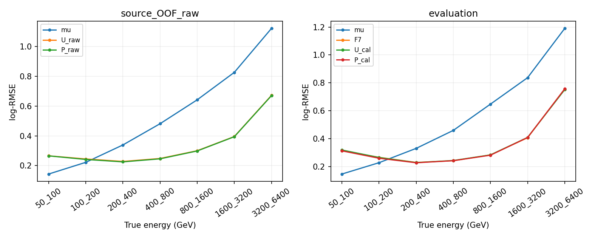

# Stage80：固定峰高/宽度族的同容量能量消融

日期：2026-11-03，起点`27d30c4`，执行路线§60和stage80 Prompt。已完成254源scalar补充、8次正式fit和独立核验；主低pz增量未确立，两低E仍未恢复，继续F7并结束这次固定族。工作目标是检验原62之外的一族11×(raw_peak,width)，不扫描通道、阈值、权重、深度、seed或架构；描述性波形变化不能替代能量风险检验。

## 1. 输入与物理合同

仅原stage55 nominal manifest的254个已知PHYS，冻结的train/cal/eval **41447/8440/14057**，共63944身份。91/16/22保守来源组、原incoming角色与曝光、42缺失的21/3/7 eligible＋11 protected不改；所有困难、未确认、巨大动量和尾保留。没有新物理身份、alternative增补、test/challenge/locked、RDO/HITS、重建/生成、谱toy或新F7推理。

一次方模长/纵向动量仅pz0，px/py、q/p和弯折仍可用；旧62逐值/NaN不改。11路signed raw/VetoNu reduced、typed/domain/status/dependency NaN、合法负数及缺一Calo则total NaN保持。没有用fitted charge替代raw，也未二次缩放Calo。

U为原62；P在后面按固定通道顺序交错添加raw_peak、width，共84维。有效性直接复用stage79 `strong_shape_validity`：status & (444|1)==0，finite width>0/localtime>0/baseline_rms>0，raw_peak≥5×RMS。这个5σ是保守审计约定，不称独立认证的生产阈值。无效新列NaN，整例仍进入训练/评价；旧raw不应用fit-invalid mask。localtime仅为既定有效性依赖，时间和RMS均不作新模型输入；RMS不是积分电荷误差。

## 2. 正式提交前的语义与小样本QA

复用stage79固定40身份、12来源进行scalar提取QA，实际width/raw_peak/localtime/status/raw_charge/baseline_rms全部与旧QA逐值相同，联合有效285通道记录。wall **4.493073s**、CPU **4.014879s**、peak **616.605MiB**（LCG启动高水位），请求 **17,520,457 bytes**，输出3003bytes。未拟合任何能量模型。

正式提交前完成254来源的确切RDO数字化日志核查。12份复用stage79证据，其余242份实际读 **100,075,960 bytes**，wall6.315275s、CPU1.422733s。实际release是 **6d6ab70b 135源、4a0e366b 119源**；全部对应输出RDO名称正确、四个闪烁体算法improved timing、OFLCOND-FASER-04→WAVE-Digitization-02-LG、所报kernel参数与stage79相同。两个release的digitization tool及ScintWaveformDigiAlg四个指定源码文件均与d32b0ff3相同。不能把“相关代码/所列参数一致”扩展为完整共同data/MC响应已认证；baseline相关性、传播slope/offset和可靠逐通道μ路径仍未交付，校正时间不入模。

首次预检解析器只认`Fast-forward/6d6ab70b`，在source129的`master/4a0e366b`日志处停止；在0正式作业/0fit时修正为解析实际release并逐文件比较，而非假定一个release。没有改源/身份/物理定义。首次未完成预检的重复日志读取字节未测量，已明确记录，不能伪称所有历史metadata读取都被计数。

scalar/语义QA通过后冻结`protocol.json`，`extract_package_QA.json`对实际4,900,991-byte提取包的四split无ROOT/无fit启动通过；核实ClassAd和worker上限后提交4个提取任务 **9663221**，每1CPU/3000MB/MaxRuntime1800s、CPU软/硬850/875s、timeout1750s，无自动重试。

## 3. 同身份补充、I/O与缺失

按源一次读所需68个scalar branch，完整source eventID建立唯一索引，保留原冻结身份；不猜eventID=entry。内部会临时解码源中非保留行，未保存/分析这些邻接物理行或扩大队列。254次array调用读取2,521,976条源scalar记录，最终只保留63944身份；不保留全波形或ROOT副本。

每源run/event与原raw/status/RMS精确闭合；合并后所有旧62与角色逐值一致，stage79正式2048例的新22列逐值/NaN一致。原缺失仍21/3/7；形状有效 **440934/703384通道记录**。无效新形状保持NaN，不对small/negative raw做比值。

| job | 来源N | 保留N | 有效形状通道N | 请求bytes | wall/s | CPU/s | peak/MiB |
|---|---:|---:|---:|---:|---:|---:|---:|
|0|64|15947|110104|90,277,903|79.885081|36.366093|143.359|
|1|64|15892|109416|92,460,267|80.538948|38.300457|144.492|
|2|63|15740|108690|90,745,252|93.233660|36.309522|144.242|
|3|63|16365|112724|90,978,004|77.647019|37.324645|143.859|

正式提取wall合计 **331.304709s**、CPU **148.300717s**、请求 **364,461,426 bytes**；Condor remote CPU **156s**、wall合计 **390s**，全部一次exit0。请求计数不是实际EOS物理网络字节，后者未测量。按需求批读的实际成本已测，不用有利prefix速率保证全量，也不将不同branch集合的stage79耗时全差归因于实现优化。

EOS FUSE一度负缓存隐藏已成功上传的job2结果，`xrdfs stat`确认存在849616-byte归档，直接取现有结果到临时本地存储；未重跑计算或换源。collector的Path导入也在本地收集时纠正，已有分片逐字节一致后复用，0额外fit。见`preflight_correction.json`及`extract_transport.json`。

## 4. 固定训练与评价政策

三来源fold与train端incoming purge沿stage68 v2，U/P相同实际训练身份、标签、seed **2026110380**、depth5/400轮/unit direct logE；初始化都是各实际train的未加权mean(logE)、boost_from_average=0。无早停、挑轮、重权、分段校准、模型平均或参数扫描。

| split | 实际train N | held N | train端incoming purge N |
|---|---:|---:|---:|
|fold0|22795|13820|4832|
|fold1|22878|13667|4902|
|fold2|22543|13960|4944|
|final|41447|0|0|

17,598,652-byte实际训练包的四split无fit启动通过，DMatrix 62/84维、零树Booster、不保留pilot模型，**pilot fit=0**。之后提交 **9663223**，两臂×(3fold＋final)=8fit。来源OOF只报raw，final各一个原8440 cal的unit全局log-offset；P_cal预定主候选，raw及匹配U并报。F7只读旧预测。

主增量是reco pz50–100 GeV的P/U来源OOF及eval配对风险；同时报告两真低E、同低pz真≥200、高y/未确认、全体/≥200/高端、旧缺失和新missing/overflow/weak状态及正负尾。500次component分层保守来源固定预测bootstrap，eval seed2026111380、OOF＋1、cal＋2。区间不含重训、offset估计、完整谱系、探测器/interaction响应与研究选择，cal/eval仍已开发，不称新确认。

推广仍要求两低E相对传统RMSE来源95%上限≤1.05、all/F7≤1.01、≥200/低pz/high-y/未确认≤1.03，原关键层总/正/负tail50增量95%上限≤2pp，门槛不降。

## 5. 能量结果与独立验证

### 5.1 固定对照结果

全部8fit完成，4个训练任务9663223一次exit0、无重试。以下log-RMSE无量纲，E与pz分层单位GeV；传统μ为原pz0/0.8估计。U/P为匹配控制/新增22列，同400轮与初始化，不把与旧seed的F7差异全归新族。

| 层 | OOF μ | OOF U raw | OOF P raw | eval μ | eval F7 | eval U_cal | eval P_cal |
|---|---:|---:|---:|---:|---:|---:|---:|
| E50_100 | 0.143853 | 0.265914 | 0.265704 | 0.145487 | 0.312816 | 0.317774 | 0.311694 |
| E100_200 | 0.222426 | 0.244853 | 0.241619 | 0.226876 | 0.265014 | 0.263962 | 0.258639 |
| all | 0.526281 | 0.278351 | 0.276328 | 0.568069 | 0.296363 | 0.296791 | 0.295463 |
| E200_inf | 0.551464 | 0.281607 | 0.279646 | 0.588671 | 0.298164 | 0.298607 | 0.297605 |
| pz50_100 | 1.187733 | 0.471123 | 0.468302 | 1.336853 | 0.502965 | 0.506465 | 0.508282 |
| pz50_100_E200_inf | 1.838171 | 0.636764 | 0.632285 | 1.990581 | 0.649292 | 0.654161 | 0.661154 |
| high_y | 1.568664 | 0.599301 | 0.595750 | 1.676717 | 0.640068 | 0.642144 | 0.637244 |
| unconfirmed | 1.590771 | 0.524355 | 0.526921 | 1.699385 | 0.570928 | 0.571071 | 0.573710 |
| E3200_6400 | 1.120650 | 0.671506 | 0.669611 | 1.189880 | 0.755449 | 0.750801 | 0.756295 |

原cal 8440例unit offset：U **0.004408651594**、P **0.004437591316**（logE）。以下为P/U配对来源95%区间，前两列是预定raw对照，第三列是单offset后匹配对照；不能把cal比冒充预定raw主对照。

| 层 | OOF raw P/U [95%] | eval raw P/U [95%] | eval cal P/U [95%] |
|---|---|---|---|
| all | 0.992729 [0.990749,0.995082] | 0.995557 [0.992296,0.998503] | 0.995527 [0.992254,0.998504] |
| E50_100 | 0.999210 [0.971621,1.023969] | 0.980483 [0.941046,1.027231] | 0.980865 [0.941946,1.027135] |
| E100_200 | 0.986790 [0.977057,0.996480] | 0.979612 [0.966684,0.992104] | 0.979835 [0.967093,0.992136] |
| pz50_100 | 0.994011 [0.986851,1.001817] | 1.003645 [0.993637,1.013789] | 1.003586 [0.993530,1.013732] |
| high_y | 0.994075 [0.984053,1.003801] | 0.992394 [0.983706,1.001722] | 0.992368 [0.983628,1.001721] |
| unconfirmed | 1.004893 [0.996300,1.013655] | 1.004648 [0.994040,1.014805] | 1.004621 [0.993978,1.014816] |

总体与100–200有小幅跨来源收益，不能说形状族全无信息；**主低pz OOF和eval区间均跨1**，最低能也未测出可靠增量。最低能eval只有208例/19来源组，第二低能906例/22组，低pz682例/22组；不能以事件数代替来源独立性。eval来源中央P_cal优于U_cal：最低能9/19、第二低能13/22、all15/22、低pz10/22，优于F7分别8/19、14/22、14/22、8/22；不作单来源显著性声称。

### 5.2 原恢复/保护与尾部

主P_cal相对传统两低E风险比为 **2.142423 [1.826960,2.497108] / 1.140002 [1.070227,1.214789]**，两个95%上限均大于1.05，未恢复。相对F7的all、≥200、低pz、high-y、未确认RMSE95%上限分别 **1.000485/1.001390/1.020295/1.006509/1.014495**，均通过原1%/3%保护；不能写成所有保护失败。但低pz中央风险比1.010570、区间下端1.000306，仍有相对F7代价。

| eval P_cal相对F7 | 总tail50增量95%上限/pp | 正尾上限/pp | 负尾上限/pp | 原≤2pp判断 |
|---|---:|---:|---:|---|
| E50_100 | 2.593249 | 2.593249 | 0.000000 | 失败 |
| E100_200 | 0.333899 | 0.443510 | 0.000000 | 通过 |
| all | 0.309419 | 0.282821 | 0.099031 | 通过 |
| E200_inf | 0.331756 | 0.295630 | 0.107842 | 通过 |
| pz50_100 | 2.215504 | 1.102817 | 1.476435 | 失败 |
| high_y | 2.601146 | 0.693683 | 3.032921 | 失败 |
| unconfirmed | 2.708142 | 1.396746 | 2.475995 | 失败 |

最低能P_cal median bias **+15.306530%**，33/208=**15.865385%**为正tail50（U_cal为30例，F7为31例），这些33例贡献该箱 **72.883667%** 平方log损失；未删除。第二低能总77/906=**8.498896%**，正75、负2，贡献56.415284%损失。同低pz真≥200为299例，P_cal/F7=1.018269 [1.005387,1.030876]，不能用总低pz允许3%掩盖另一侧代价。高端3200–6400为271例/14组/184唯一incoming，median **−43.407047%**、90/271负tail50；≥6400空箱未测量。

固定7个非空真能箱等权MSE开根的macro eval U_cal/P_cal/F7为 **0.394855/0.394609/0.395271**，小差异不能替代原门槛。最终训练内U/P最低能 **0.243583/0.241467**、第二低能 **0.224355/0.219901**、all **0.245747/0.241921**；并非最低能已经训练内恢复、仅留出失败，不能唯一归为数据不足或过拟合。还未分离训练目标/有限容量取舍、真实响应、低pz混合与新增支持功效，不把未知当物理极限。

### 5.3 缺失与状态层全部保留

新增有效形状440934/703384=62.687522%（全train/cal/eval联合通道描述，非效率认证）。eval所有11通道均有效只有133例，任何新缺失13924例；不只评价133例。

| eval状态层 | N | 来源组N | U_cal log-RMSE | P_cal log-RMSE | F7 log-RMSE |
|---|---:|---:|---:|---:|---:|
| input_missing | 7 | 5 | 0.652606 | 0.638712 | 0.666657 |
| shape_any_missing | 13924 | 22 | 0.297001 | 0.295693 | 0.296576 |
| shape_all_valid | 133 | 22 | 0.273850 | 0.270308 | 0.273044 |
| scint_overflow | 8053 | 22 | 0.319295 | 0.319359 | 0.318958 |
| scint_weak | 12942 | 22 | 0.289388 | 0.288380 | 0.289162 |

这些状态层可重合。原输入缺失仅7例/5组，不声称其小样本改善为稳定结论。新mask已排除−999、正域−1和依赖无效；原62/raw保持原typed定义、合法signed负值不清除。新增族同时含raw_peak、width和状态依赖缺失模式，本轮不能将总体收益全部归因纯形状、hit时间或消除噪声。

### 5.4 模型、统计与资源独立验证

8个serialized模型独立重读，特征顺序62/84、400树、base_score/参数、held/final/train预测与训练风险精确一致。stage68 split自行检查来源/incoming零交叠；41447恰一次OOF、旧62/角色及原42缺失21/3/7＋11逐值保持。12组（OOF/cal/eval各all/低pz/两低E）×500=**6000** bootstrap draw逐事件展开，相对分组计数最大差 **1.776357e−15**；230行RMSE独立范数复算最大差 **2.220446e−16**，正负tail50按相对能差独立复算一致。此核验不是对全部paired表行重做500次bootstrap；所有预定层的表和双向尾完整留存。

| 训练split（每个2fit） | 脚本wall/s | CPU/s | peak/MiB |
|---|---:|---:|---:|
| fold0 | 20.134980 | 19.975155 | 305.023438 |
| fold1 | 15.610520 | 15.486211 | 307.316406 |
| fold2 | 22.013959 | 21.797393 | 308.242188 |
| final | 24.040610 | 23.833790 | 353.394531 |

训练脚本CPU合计 **81.092549s**、wall **81.800069s**；Condor训练remote CPU **98s**、wall合计 **126s**。加提取，两phase8任务/8fit，remote CPU **254s**、wall合计 **516s**，所有1CPU/3000MB/1800s、一次exit0、pilot0fit、无重试；低于冻结CPU7200s等预算。LCG进程高水位与训练脚本分列，不当同一指标。模型/统计报告回读wall28.349420s、CPU25.096925s、peak336.523MiB；独立验证首次wall2.155807s、CPU2.006511s、peak616.605MiB。ROOT请求含QA **381,981,883bytes**，另生产语义日志新读100,075,960bytes；实际EOS物理网络I/O未测量。

完整[metrics](stage80_energy_ml/metrics.tsv)、[配对区间/双向尾](stage80_energy_ml/paired.tsv)、[逐折](stage80_energy_ml/fold_metrics.tsv)、[逐来源](stage80_energy_ml/source_metrics.tsv.gz)、[有效率](stage80_energy_ml/shape_validity.tsv)、[决策](stage80_energy_ml/decisions.json)、[独立验证](stage80_energy_ml/independent_validation.json)与[图PDF](stage80_energy_ml/pulse_ablation.pdf)保留。



**阶段结论：继续F7，结束这一次固定raw_peak/width族；不扫通道、mask、seed、时间、重权或架构。** 保留总体和第二低能的小幅信息证据，原低E恢复及部分关键尾门槛失败也必须保留。

## 6. 命令、产物与下一步

```bash
bash /tmp/stage69_python.sh ml/pulse_ablation.py
bash /tmp/stage69_python.sh ml/extract_pulse_ablation.py --qa
bash /tmp/stage69_python.sh ml/audit_ablation_sources.py
bash /tmp/stage69_python.sh ml/submit_pulse_ablation.py extract
bash /tmp/stage69_python.sh ml/collect_pulse_ablation.py extract
bash /tmp/stage69_python.sh ml/submit_pulse_ablation.py fit
bash /tmp/stage69_python.sh ml/collect_pulse_ablation.py fit
bash /tmp/stage69_python.sh ml/report_pulse_ablation.py
bash /tmp/stage69_python.sh ml/validate_pulse_ablation.py
```

复用LCG109、单线程numpy/BLAS与XGBoost2.1.3；无安装或C++重建。源/协议、提取/训练ClassAd、输入联结、成本、角色、全部指标与图放在`workbook/stage80_energy_ml/`；新增摘要`ntuples/energy_ml_stage80/shape.npz`与模型`ml/artifacts/stage80/`不进Git。分片/大输入缓存/传输包在验证后去重，最终大小见[storage.json](stage80_energy_ml/storage.json)，删除input后逐数组验证可由旧stage55/56＋shape缓存重建，不再访问新ROOT。本阶段删除重复缓存/软件输入/传输包共 **55,015,218bytes**，保留数据/8模型/预测/工作表约 **14.05MB**（十进制，精确值见storage.json）；input删除后的全数组重建逐值一致，wall **2.394348s**，无新ROOT。原stage54五项工作不动，不push、不外发、不执行stage81。

唯一下一单项 **stage81：实际兼容π/K PHYS的新增开发支持交付，0训练**。执行[独立支持协议](../docs/nu_mu_energy_ml_support_delivery_prompt.md)原stage77合同；本轮只在主下一Prompt标注stage81，独立协议逐字不改。

具体任务/输入/验收：已知合法canonical train π/K manifest与PHYS、stage70完整π及失败K/Calo闭合证据、现有选择/build；事前seed2026110377各均匀≤2源、总≤4完整源，记录选择概率，先≤40身份QA实际raw/status/62及Calo reference01-LG条件与联结，再按实测冻结Condor。新增key对stage55全部曝光＋stage70实际28排重；交低E与同pz高E/high-y/未确认两侧的唯一新增N/来源/缺失、完整cutflow和资源。原pz>50/62/所有尾不变，0模型训练。总40000输入/10GB、≤4job/每≤2CPU3000MB、CPU7200s/wall3600s、最终10MB仅为上限，先QA后冻结，不能拿有利prefix外推保证。

实际不可交付则列出最小缺失路径/字段/条件，不把未知填0或交空metadata阶段，不自动RDO/HITS/生成/重试K。不预判四源足量，不自动转学习曲线；真实新增支持交付后才给一个固定增补实验。见[下一请求](stage80_energy_ml/followup_input_request.json)。共同raw/stage54、Calo/完整脉冲条件、interaction/FSI/材料、接受度/背景与真正随机未开发确认继续待交付。
